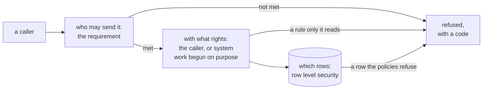
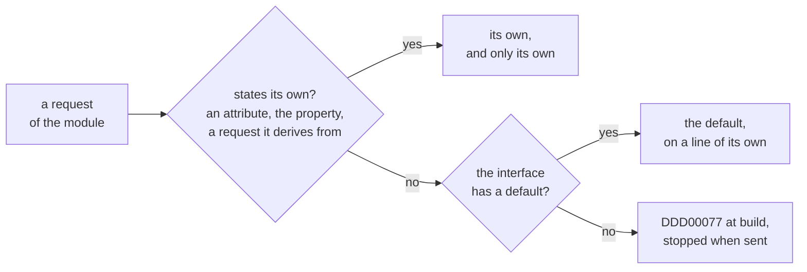
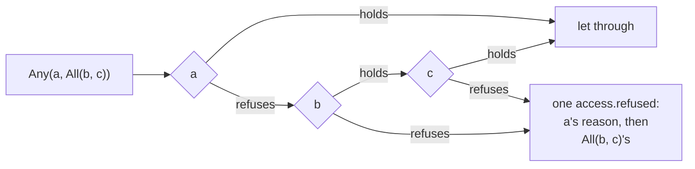
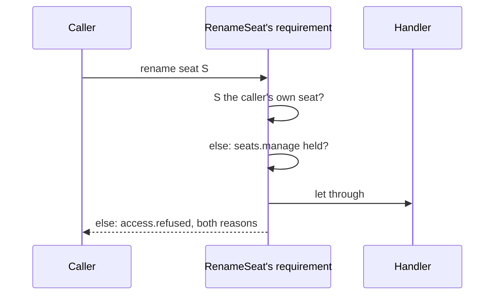
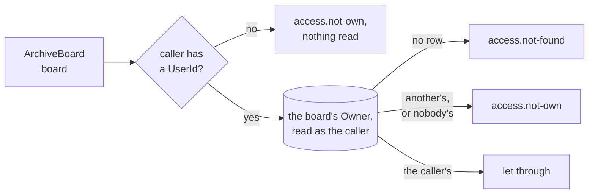
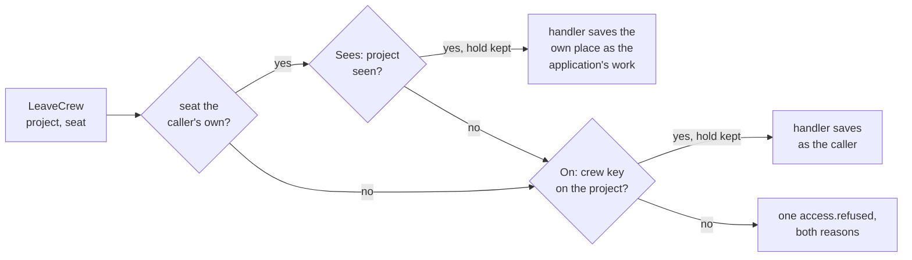
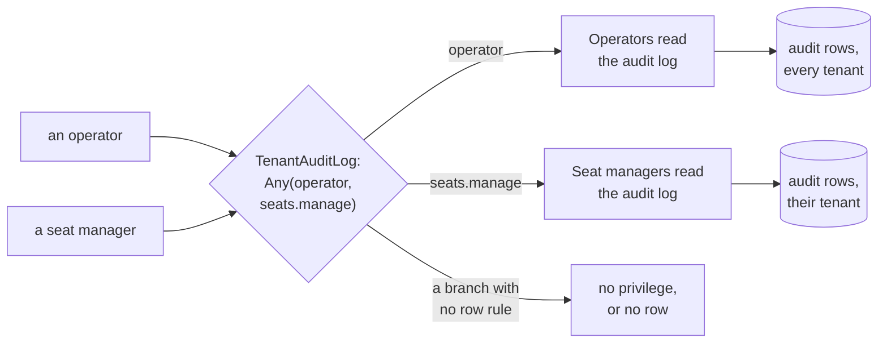
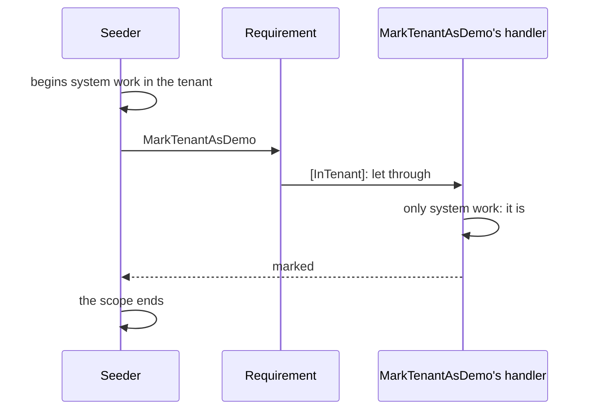
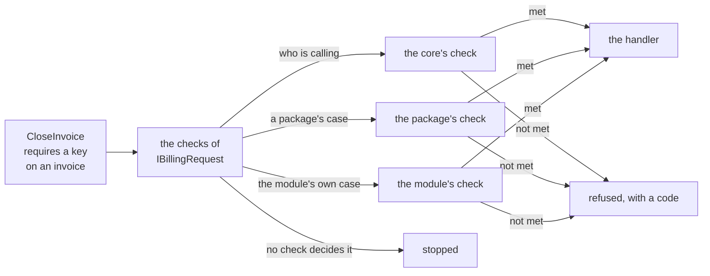
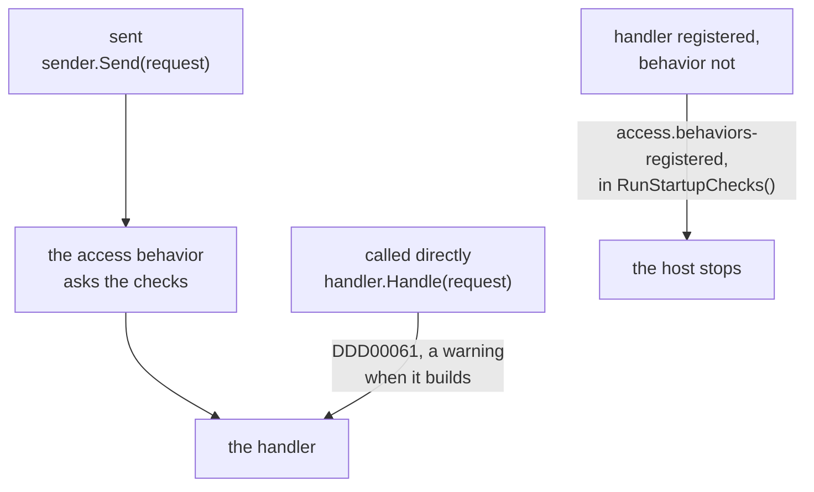

# Access requirements

Three questions stand between a caller and a row of your database, and each is answered in one place of its own:

- **Who may send the request.** Its requirement, which the request states and the module's checks hold the caller
  to at the door, before the handler runs: anyone, a signed-in user, a key held for the whole tenant, at a unit or on
  the thing the request is about, the caller's own, or several of these at once. An attribute on the request, where a
  review reads it.
- **With what rights the code runs.** The caller the work runs as: the person who sent the request, or system work,
  which trusted code begins on purpose for what no caller may do, a handler, a job or a seeder, around the work it
  does, and which ends with it.
- **Which rows it may touch.** Row level security, which holds every row the work reads or writes to the caller it
  runs as, whatever the code above it did ([Row level security](row-level-security.md)).

The three are kept apart on purpose. A requirement never says what the work may then do, so a request anyone may
send gives its sender nothing by being sent; system work is never something a request requires, so no door opens
because the code behind it runs with more; and the database asks again, so a door that let too much through is not
the last word.



<details>
<summary>Show the code: the three, for a form anyone may send</summary>

```csharp shortened
[AllowAnonymous]                                                                // who may send it: anyone
public sealed record RequestQuote(string Email, string Product) : IBillingRequest;

public sealed class RequestQuoteHandler(IQuoteStore quotes) : IHandler<RequestQuote>
{
    public async Task HandleAsync(RequestQuote command, CancellationToken cancellationToken)
    {
        using (Callers.Begin(Caller.SystemIn("billing")))                         // with what rights: system work, begun here
        {
            await quotes.AddAsync(command.Email, command.Product, cancellationToken);   // which rows: billing's policies
        }
    }
}
```

</details>

`DDDToolkit.Access` has the types for the first: saying it on the request, and holding the caller to it before the
handler runs. They are part of the core package, free of any dispatcher and of any
[supporting domain](writing-a-supporting-domain.md):

| Type | What it is |
|---|---|
| `IRequireAccess` | What a request implements: one member, `RequiredAccess`. |
| `[AllowAnonymous]`, `[SignedIn]`, `[RequiresKey(key)]`, `[OrOwn]`, `[OwnOnly]` with `[Own]` | The core's attributes a request states its requirement with; a package ships the rest of the vocabulary the same way. Stacked, they all hold. |
| `AccessRequirement` | What `RequiredAccess` answers: a record that says what is required. The core spells the cases about who is calling, the caller's own, the owner of an aggregate, and what combines cases, `All` and `Any`; the others come from whoever can decide them. |
| `ICallersOwn<TValue>` | Says what the caller's own value of a type is: the core's for a `Guid`, Tenancy's for its seat id, an application's for a kind of its own. |
| `[Owner]`, `IAggregateOwners<TId>` | The property of an aggregate root that names its owner, a fact the domain states, and what reads it for a request about the owner's own: the Entity Framework package's, for every id. |
| `IAccessCheck` | What decides the cases of one owner: a package ships one, a module writes one for its own. |
| `CallerAccessCheck` | The core's check of who is calling, first in every module's set. |
| `AccessChecks<TRequests>` | The checks of one module. `RequireAsync(request)` holds a request to what it declared, and fails closed. |
| `Checked<T>` | What a check read on the way, kept for the code after it that handles the same request. |
| `RequestInHand` | The request a flow of work is handling, once its checks let it through, with the requirement it passed: what the handler and its save serve, and the check to ask again. |

Who is calling is a separate question, answered by the host: [running queries as the caller](row-level-security.md#running-queries-as-the-caller).
[How a request is checked](how-a-request-is-checked.md) follows six requests, four of them the Tenancy sample's own,
through all three questions in order, from the attribute to the row, with a walk-through to click through on the
docs site.

## What a request declares

A module declares one interface of its own that derives from `IRequireAccess`, and every command and query
of the module implements it. The interface is yours to write because it is what tells one module's requests
from another's: the checks are registered for it, so a request of billing is never held to the checks of
shipping. Mark it `[AccessRequests]` and declare it `partial`, so the toolkit's generator can write into it what its
requests' attributes say.

A request says what it requires with an attribute where the requirement reads no value of the request but a key and
an id it carries, which is nearly always. It answers `RequiredAccess` itself where the requirement is computed from
its values, and for a case of your module's own, which no attribute stands for:

```csharp
[EntityId<Guid>] public readonly partial record struct InvoiceId;

[AccessRequests]
public partial interface IBillingRequest : IRequireAccess;      // one interface per module

[SignedIn]
public sealed record MyInvoices : IBillingRequest;

[AllowAnonymous]
public sealed record ListPlans : IBillingRequest;

public sealed record CloseInvoice(InvoiceId Invoice) : IBillingRequest
{
    AccessRequirement IRequireAccess.RequiredAccess => new BillingAccess.OnInvoice("billing.close", Invoice);
}
```

- **The attribute is plain C# by the time it runs.** The generator turns it into the call it stands for at compile
  time, one line per request, in the module's interface, which implements `RequiredAccess` with it:
  `MyInvoices => AccessRequirement.SignedIn()`. Nothing is read by reflection, nothing is looked up when a request
  is sent, and the request need not be partial. A request that answers `RequiredAccess` itself answers with its own,
  which C# takes over the interface's, so every reader of the property reads the same requirement either way: the
  module's checks, a handler that asks them again, a test.
- **Said one way, and stacked attributes all hold.** An attribute and the property on one request is
  [DDD00078](diagnostics.md#ddd00078). Several requirement attributes on one request all hold, as several
  `[Authorize]` attributes do in ASP.NET Core: the line is `AccessRequirement.All` of their calls, in the order they
  are written ([Stacked attributes are all](#stacked-attributes-are-all)). `[AllowAnonymous]` beside any other is a
  contradiction, [DDD00079](diagnostics.md#ddd00079). An interface that is not `partial` has nothing written into
  it, and a request's attributes there are [DDD00083](diagnostics.md#ddd00083), with the line to write.
- **The member is implemented explicitly,** where a request answers it, so the requirement stands next to the
  request's own fields without becoming one of them: it is not serialized with the request and not part of its
  shape.
- **A requirement says what is asked, never who may.** It carries a key and the ids the request names. The
  check reads the rest where it is kept. What a requirement cannot say, a rule about what is given to whom or
  about the state the request meets, stays in the handler, in plain sight, or in the use case of the package the
  handler calls.
- **There is no requirement that says nothing.** A request that declares none is stopped, so a requirement
  somebody forgot never opens a door, and where the interface is partial it is [DDD00077](diagnostics.md#ddd00077)
  when it builds (the compiler's own CS0535 where it is not). A request anyone may send says so:
  `[AllowAnonymous]`, or `AccessRequirement.AllowAnonymous()`, so it reads as meant in a review where `None`
  would read as forgotten. A module whose requests nearly all require the same may say it once, on its interface,
  and a request that declares nothing then requires that ([A module's default](#a-modules-default)).
- **`[AllowAnonymous]` is named as ASP.NET Core's and HotChocolate's are.** It goes on a request, in the
  application layer, which references neither library, so the name is free there. A file that imports
  `Microsoft.AspNetCore.Authorization` or `HotChocolate.Authorization` beside `DDDToolkit.Access`, a route or a
  resolver that declares a request of its own, finds two attributes of that name, CS0104: write it in full,
  `[DDDToolkit.Access.AllowAnonymous]`, or name one with an alias at the top of that file,
  `using AllowAnonymous = DDDToolkit.Access.AllowAnonymousAttribute;`.
- **A requirement is a record,** so two that say the same are equal, and a test can hold every request to
  the one it is meant to declare.

<details>
<summary>Show the code: what the generator writes into the interface</summary>

```csharp title="BillingAccessBehavior.g.cs, shortened"
partial interface IBillingRequest
{
    AccessRequirement IRequireAccess.RequiredAccess => this switch
    {
        ListPlans => AccessRequirement.AllowAnonymous(),
        MyInvoices => AccessRequirement.SignedIn(),
        _ => throw new InvalidOperationException("... declares no access requirement ..."),   // a request of another project
    };
}
```

`CloseInvoice` has no line: it answers the property itself. The same file holds the
[behavior](#the-generated-behavior-with-mediator) where the project uses Mediator, and the lines alone where it does
not, since whatever asks the checks reads them.

</details>

### A module's default

Nearly every request of a module that reads a tenant's data requires a seat in the tenant, `[InTenant]`, and a key
a request requires already requires one, so `[InTenant]` stands alone on the requests any seat may send. A module
like that says it once, on its interface: a requirement attribute there is the module's default, and a request of
the module that states nothing of its own requires what the default says. The Tenancy sample's Projects module
says it so.

```csharp
[AccessRequests, InTenant]                                                   // the module's default: a caller in the tenant
public partial interface IBoardsRequest : IRequireAccess;

public sealed record ListBoards : IBoardsRequest;                            // states nothing: takes the default

[RequiresKey(BoardKeys.Archive)]                                             // states its own: the key, and only the key
public sealed record ArchiveBoard(BoardId Board) : IBoardsRequest;

[SignedIn]                                                                   // its own too: a signed-in user, a seat or not
public sealed record MyInvitations : IBoardsRequest;
```



- **What a request states is all it requires.** A request that states its requirement, with an attribute, the
  property or the attributes of a request it derives from, keeps only its own: the default replaces nothing and
  stacks onto nothing. `MyInvitations` lets a signed-in user without a seat through, as it says, and `ArchiveBoard`
  asks the key alone. Several attributes on the interface all hold, `AccessRequirement.All` in the order written, as
  on a request.
- **The switch shows what each request got.** A request that takes the default gets a line of its own with the
  default's call, `ListBoards => TenancyAccess.InTenant()`, so the generated file still reads as the list of the
  module's requests and what each requires. A request no line can name, one of another project or one with type
  parameters, takes the default in the last arm, which answers it where it would otherwise stop the request: that is
  what a module's default means.
- **A default is one any request may take.** `[SignedIn]`, `[InTenant]`, `[RequiresKey(key)]`, whose key is held for
  the whole tenant, since a default reads no member of a request and so has no marker, and an attribute of your own
  whose class allows `AttributeTargets.Interface` in its `AttributeUsage`. Not `[AllowAnonymous]`: every request that
  forgot its own would let anyone in, and a forgotten requirement never opens a door. Not a requirement for queries
  only, `[RequiresOperator]` or `[SeenWith<TResourceId>(key)]`: a command that says nothing would take it. Not
  `[OwnOnly]`, which reads a member. Each is [DDD00089](diagnostics.md#ddd00089), and a default on an interface that
  is not `partial`, or on one that is not the module's, is [DDD00083](diagnostics.md#ddd00083).
- **Said once is said once.** A request's own attributes that say what the default says, `[InTenant]` on `ListBoards`,
  add nothing: [DDD00084](diagnostics.md#ddd00084), a warning. On a request another derives from they are kept, since
  the request that derives from it holds to them beside its own.
- **What it costs.** [DDD00077](diagnostics.md#ddd00077) no longer reports a request of the module that states
  nothing, since it takes the default. So a command that forgets its `[RequiresKey]` lets every seat in the tenant
  through, and the build says nothing of it. That is why the default is an opt-in you write, for a module whose
  requests nearly all require it, and why the generated switch shows per request what it got; a test that pins what
  each request requires ([Holding it with a test](#holding-it-with-a-test)) finds the forgotten key where the build
  does not.

<details>
<summary>Show the code: what the generator writes for a module with a default</summary>

```csharp title="BoardsAccessBehavior.g.cs, with the module's default, shortened"
partial interface IBoardsRequest
{
    AccessRequirement IRequireAccess.RequiredAccess => this switch
    {
        ArchiveBoard => TenancyAccess.ForTheWholeTenant("boards.archive"),
        ListBoards => TenancyAccess.InTenant(),
        MyInvitations => AccessRequirement.SignedIn(),
        // A request this project cannot name, one of another project say, takes the module's default as well.
        _ => TenancyAccess.InTenant(),
    };
}
```

Without a default the last arm stops a request it has no line for; with one it answers the default, the same call
the lines above it write for each request that takes it.

</details>

## The vocabulary

Every request says what it requires with one of a few requirements, each named for what it requires and
spelled on whoever decides it. The attribute is the short way to say it; the call beside it is what the attribute
stands for, and what a request that computes its requirement writes:

| A request requires | Its attribute | Or, computed, `RequiredAccess =>` | Let through | Anyone else is refused with |
|---|---|---|---|---|
| anyone, a caller who did not sign in too | `[AllowAnonymous]` | `AccessRequirement.AllowAnonymous()` | everyone: nobody is asked | |
| a signed-in user, who need not hold anything yet | `[SignedIn]` | `AccessRequirement.SignedIn()` | a user who signed in, an anonymous sign-in of the identity provider too | `access.not-signed-in` |
| a caller who works in the tenant | `[InTenant]`, of [Tenancy](tenancy.md#what-a-request-requires-of-its-caller) | `TenancyAccess.InTenant()` | a seat in the tenant the request was sent for, and system work there | the caller's own reason, such as `tenancy.not-seated` |
| a key for the whole tenant | `[RequiresKey(key)]` | `TenancyAccess.ForTheWholeTenant(key)` | whoever holds the key at the tenant's root now | `tenancy.not-permitted`, naming the key |
| a key at a unit | `[RequiresKey(key)]`, `[AtUnit]` on the unit | `TenancyAccess.AtUnit(key, unit)` | whoever holds the key at that unit now, there or above it | `tenancy.not-permitted`, with the key and the unit |
| a key on a resource | `[RequiresKey(key)]`, `[OnResource]` on the resource, `[ExpectedVersion]` on the version read, of [Membership](membership.md#a-document-and-the-people-it-is-shared-with) | `MemberAccess.On(key, resource, expectedVersion)` | whoever holds the key on it, through its members or from above | the resource's `not-found` or `not-permitted` |
| a query that shows the resources a key is held on | `[SeenWith<TResourceId>(key)]`, of [Membership](membership.md#inside-your-own-statements) | `MemberAccess.SeenWith<TResourceId>(key)` | every caller who signed in, and system work: the query's own statement leaves out what the caller does not hold the key on | the caller's own reason where it is nobody; the resource's `not-permitted`, naming the key, for a caller who did not sign in |
| one of the application's operators, on a query | `[RequiresOperator]` | `TenancyAccess.RequiresOperator()` | a signed-in user with an [operator's token role](tenancy.md#operators) | `tenancy.operators-only` |
| the caller's own, or a key | `[RequiresKey(key)]`, `[OrOwn]` on the member that names it | `AccessRequirement.Any(AccessRequirement.Own(seat), ...)` | the caller the member names, and whoever holds the key | one `access.refused`, with `access.not-own` and the key's reason |
| the caller's own alone | `[OwnOnly]`, `[Own]` on the member that names it | `AccessRequirement.Own(seat)` | the caller the member names | `access.not-own` |
| the owner of an aggregate, or a key | `[RequiresKey(key)]`, `[OrOwn]` on the aggregate's id, whose owner the aggregate marks `[Owner]` | `AccessRequirement.Any(AccessRequirement.OwnerOf(board), ...)` | the aggregate's owner, and whoever holds the key | one `access.refused`, with `access.not-own` or `access.not-found` and the key's reason |
| the owner of an aggregate alone | `[OwnOnly]`, `[Own]` on the aggregate's id | `AccessRequirement.OwnerOf(board)` | the aggregate's owner | `access.not-own`; `access.not-found` for a row the caller does not see |
| several of these, all of them | the attributes, stacked | `AccessRequirement.All(...)` | whoever meets every one | the first failing one's own reason |
| one of several | | `AccessRequirement.Any(...)` | whoever meets one | one `access.refused`, with each one's reason |
| something only your module knows | `[YourOwn]`, declared with `[StatesRequirement]` | a record of your own | what your check lets through | your module's code |

The cases of `AccessRequirement` are about who is calling, or combine other cases, so the core decides them, and a
host without any supporting domain has them. Who is calling is what the host's `ICallerAccessor` answers, and the door
asks it once, before any check, whatever the request requires: in a host that
[requires explicit callers](row-level-security.md#fail-closed-callers), work nobody began a caller for fails with
`NoCallerException` before it is let through or refused, a request of `[InTenant]`, whose check asks Tenancy's own
caller, and one of `[AllowAnonymous]` included.

- **`[SignedIn]`** asks whether the caller's token names a user. An anonymous sign-in, such as Supabase Auth
  makes for a visitor without an account, names one too, marked with the `is_anonymous` claim. A handler that
  should take only an account with a verified identity refuses that claim itself, as the registration that
  [provisions a tenant](tenancy.md#who-may-ask-and-what-the-work-runs-as) does, and as Tenancy's acceptance of
  an invitation does. The application's own work is nobody's sign-in, and is refused.
- **There is no requirement for the application's own work.** System work is a scope, not a door:
  [System work is a scope](#system-work-is-a-scope) says how a request sent by it, or a handler that needs it,
  is written.

Each call is a method on the class of whoever decides it, so the requirements read alike side by side:
`AccessRequirement.SignedIn()`, `TenancyAccess.InTenant()`, `MemberAccess.On(key, resource)`. A method rather
than a constructor, so a case closed over your own id takes it from the argument: `TenancyAccess.AtUnit(key,
unit)` is closed over your unit id without your writing it. And `AllowAnonymous()` and `SignedIn()` say who is let
through rather than what is checked, as the name a reviewer looks for. What each attribute stands for is its
package's to say, with an attribute of the core's on the attribute's class, `[StatesRequirement]` or
`[KeyMarker]`: the generator knows none of them by name, and a module can declare one for a case of its own the
same way ([Writing your own supporting domain](writing-a-supporting-domain.md)).

### Where the key is held

`[RequiresKey(key)]` is one attribute, wherever the key is held. A marker on one of the request's members says
where: none for the whole tenant, `[AtUnit]` at that unit or above it, `[OnResource]` on that resource through its
members, with `[ExpectedVersion]` beside it on the version the caller read, which the check compares only once the
caller may act. A marker goes on a positional parameter of a record as it is, or on a property; `[property: AtUnit]`
is read as well. Nothing is named by a string: no `nameof`, no member's name in an attribute.

```csharp
[RequiresKey(BillingKeys.CloseTheBooks)]                                     // for the whole tenant
public sealed record CloseTheBooks(int Year) : IBillingRequest;

[RequiresKey(BillingKeys.OpenLedger)]                                        // at the unit, or above it
public sealed record OpenLedger(string Name, [AtUnit] OrganizationUnitId Unit) : IBillingRequest;

[RequiresKey(DocumentKeys.Share)]                                            // on the document, through its members
public sealed record ShareDocument([OnResource] DocumentId Document, UserId With, [ExpectedVersion] long? ExpectedVersion = null) : IDocumentsRequest;

[RequiresKey(BillingKeys.ArchiveLedger)]                                     // an ordinary property takes a marker too
public sealed class ArchiveLedger : IBillingRequest
{
    [AtUnit] public required OrganizationUnitId Unit { get; init; }
}
```

The key is a constant, one of the catalogue's, as an attribute's argument is: a request may name its own constant,
`[RequiresKey(RequiredKey)]` beside `public const string RequiredKey = ProjectKeys.Edit;`, where its handler or a
list of abilities reads the same key.

### What goes together

Stacked requirement attributes all hold, and a marker says where for the key of the one `[RequiresKey]` a request
carries. What does not go together is reported where it is written, as an error, since a request that reads as if it
said what it requires and says something else is a door a review would take for closed; what says nothing more than
its neighbour is a warning:

| `[RequiresKey(key)]` with | no marker | `[AtUnit]` | `[OnResource]` | `[OnResource]` and `[ExpectedVersion]` |
|---|---|---|---|---|
| is | `ForTheWholeTenant(key)` | `AtUnit(key, unit)` | `On(key, resource)` | `On(key, resource, version)` |
| and `[OrOwn]` on a member | `Any(Own(member), ForTheWholeTenant(key))` | not: [DDD00085](diagnostics.md#ddd00085) | `Any(All(Own(member), Sees(key, resource)), On(key, resource))` | `Any(All(Own(member), Sees(key, resource, version)), On(key, resource, version))` |

Beside `[OnResource]` the caller's own way through is held to the resource too: the caller sees it, its version is
compared, and what a save is held to is kept, as on the key's way ([Yours, or the key](#yours-or-the-key)). On the id
of an aggregate whose owner it marks `[Owner]`, `[OrOwn]` is the same with `OwnerOf(member)` in the place of
`Own(member)` ([The owner of an aggregate](#the-owner-of-an-aggregate)).

| On one request | Goes with | Reported otherwise |
|---|---|---|
| `[AllowAnonymous]` | no other requirement attribute, on it or on a request it derives from, and not the property | [DDD00079](diagnostics.md#ddd00079), [DDD00078](diagnostics.md#ddd00078) |
| any other requirement attribute | other requirement attributes, on it and on the requests it derives from, all of which hold; not the property | [DDD00078](diagnostics.md#ddd00078) |
| `[InTenant]`, `[SignedIn]` | a neighbour that does not already require it: not a key of Tenancy's for `[InTenant]`, not `[RequiresOperator]` for `[SignedIn]`, not `[OwnOnly]` with `[Own]` on a member whose own requires it, not the same attribute on a request it derives from; and not alone what its module's default says, on a sealed request | [DDD00084](diagnostics.md#ddd00084), a warning |
| `[RequiresKey]` | one per request, the requests it derives from counted | [DDD00080](diagnostics.md#ddd00080) |
| `[AtUnit]` or `[OnResource]` | `[RequiresKey]`, one of the two, on a member of the id it marks that is never null | [DDD00080](diagnostics.md#ddd00080), [DDD00081](diagnostics.md#ddd00081) |
| `[ExpectedVersion]` | `[OnResource]`, on a `long?` | [DDD00080](diagnostics.md#ddd00080), [DDD00081](diagnostics.md#ddd00081) |
| `[RequiresKey]` without a marker | a package that says where such a key is held, Tenancy | [DDD00080](diagnostics.md#ddd00080) |
| `[OrOwn]` | `[RequiresKey]`, without `[AtUnit]`, once, on a member that is never null, of a type with an own or the id of an aggregate whose owner is of one | [DDD00085](diagnostics.md#ddd00085), [DDD00086](diagnostics.md#ddd00086), [DDD00088](diagnostics.md#ddd00088) |
| `[Own]` | `[OwnOnly]`, once, on a member that is never null, of a type with an own or the id of an aggregate whose owner is of one | [DDD00085](diagnostics.md#ddd00085), [DDD00086](diagnostics.md#ddd00086), [DDD00088](diagnostics.md#ddd00088) |
| `[Owner]`, on an aggregate's property | the root itself, once, on a property of a type with an own, nullable or not | [DDD00087](diagnostics.md#ddd00087), [DDD00088](diagnostics.md#ddd00088) |
| `[SeenWith<TResourceId>(key)]`, `[RequiresOperator]` | a query | [DDD00082](diagnostics.md#ddd00082) on a command or a plain request of Mediator's |
| any of them | one module interface of the same project, `[AccessRequests]` and `partial` | [DDD00083](diagnostics.md#ddd00083) |

| On the module's interface | Goes with | Reported otherwise |
|---|---|---|
| `[SignedIn]`, `[InTenant]`, `[RequiresKey(key)]`, your own that allows an interface | `[AccessRequests]` and `partial`; each other, all of which hold; a key without a marker, held where a package says, Tenancy | [DDD00083](diagnostics.md#ddd00083), [DDD00080](diagnostics.md#ddd00080), [DDD00084](diagnostics.md#ddd00084) |
| `[AllowAnonymous]`, `[RequiresOperator]`, `[SeenWith<TResourceId>(key)]`, `[OwnOnly]` | nothing: they are no default | [DDD00089](diagnostics.md#ddd00089) |

`[AllowAnonymous]` beside `[RequiresKey]` would open the door the key closes, whichever was meant. `[InTenant]`
beside `[RequiresKey]` says nothing the key does not: only a seat in the tenant or system work there holds a key of
Tenancy's. `[SignedIn]` beside `[RequiresKey]` does say more, since system work holds every key and is nobody's
sign-in, and is not reported. The caller's own says what it requires as well: only a signed-in user has a verified
identity, so `[SignedIn]` beside `[OwnOnly]` with `[Own]` on a `Guid` is a warning, and only a seat in the tenant has a
seat of its own there, so `[InTenant]` beside `[OwnOnly]` with `[Own]` on the seat id is one too. Beside a key with
`[OrOwn]` only what both ways through require counts: `[InTenant]` beside a key of Tenancy's with `[OrOwn]` on the seat
id says nothing more, and `[SignedIn]` there does, since system work holds the key.

### A requirement computed from the request

Where the request's values decide which requirement it is, no attribute can say it, and the request answers the
property itself. The Tenancy sample's `SeatGrants` reads the roles a seat holds in every unit with the key for the
whole tenant, and those at one unit with the key there:

```csharp
public sealed record ListLedgers(OrganizationUnitId? Unit) : IBillingRequest
{
    AccessRequirement IRequireAccess.RequiredAccess => Unit is { } unit
        ? TenancyAccess.AtUnit(BillingKeys.Read, unit)
        : TenancyAccess.ForTheWholeTenant(BillingKeys.Read);
}
```

A unit that may be left out marked `[AtUnit]` is [DDD00081](diagnostics.md#ddd00081) for that reason: the
requirement is computed from whether it is given.

## Requirements that combine

Some requests require more than one thing of their caller: a plan the tenant pays for and a key, a key on the project
and a key at the unit it moves to. Others let one caller or another through: one of the application's operators, or a
seat that manages the tenant's seats. And some are about the caller's own: a person renames their own seat, and
somebody with a key renames anybody's. A requirement says each of these, as one record the door holds the caller to
before the handler runs:

| Said as | Holds when | Refused with |
|---|---|---|
| `AccessRequirement.All(a, b)`, and requirement attributes stacked on one request | every case holds, asked in the order they are written | the first failing case's own refusal; what follows it is not asked |
| `AccessRequirement.Any(a, b)` | the first case that holds; what follows it is not asked | one `access.refused`, whose argument `Reasons` is each case's own refusal, its code and its arguments, in order |
| `AccessRequirement.Own(value)`, `[OwnOnly]` with `[Own]` on the member | the value is the caller's own | `access.not-own` |
| `[RequiresKey(key)]` with `[OrOwn]` on the member | the value is the caller's own, or the caller holds the key: `Any(Own(value), the key's case)` | one `access.refused`, with both reasons |
| `AccessRequirement.OwnerOf(id)`, `[OwnOnly]` with `[Own]` on an aggregate's id | the aggregate's owner, read from its row as the caller, is the caller's own | `access.not-own`, or `access.not-found` for a row the caller does not see |

Each case of a combination is decided by the check that decides it alone, so cases of different owners combine: a
key on a project of Membership's with a key at a unit of Tenancy's, a module's own case with either. A combination
may hold another, `Any(All(a, b), c)`. Every case needs its check before any is asked: a combination with a case none
of the module's checks decides is stopped as that case alone would be, whichever case would have let the caller
through. `AllowAnonymous()` combines with nothing; beside another case it would open the door that case closes.

What a case's check keeps for the handler and its save ([The request in hand](#the-request-in-hand)) is kept only
once the whole combination let the caller through, and only for the cases it was let through by: every case of an
`All`, the one case of an `Any` that let the caller in. A refused combination leaves nothing behind, whichever of its
cases passed before the one that refused, and a branch of an `Any` that refused leaves nothing of its own. A key on each
of two resources of one kind keeps a hold on each, and each save is held to its own.



A refusal of `All` is its failing case's own, so a client reads the code it would read had the request required that
case alone. A refusal of `Any` is one `access.refused`, `RefusalKind.NotPermitted`, a 403 at the edge, because no one
case's reason is the answer: its argument `Reasons` lists them, each with its code and arguments, and its message names
them for a log. A case that fails with anything but a refusal, a lost race on a version say, is the answer as it is,
and the cases after it are not asked. `RequestInHand.ToString()` names a combination by its cases' types,
`RenameSeat (AccessRequirement.Any(AccessRequirement.Owned<SeatId>, TenancyRequirement.ForTheWholeTenant))`.

<details>
<summary>Show the code: a refusal of one way or another, as an edge writes it</summary>

```csharp shortened
// The request: one of the application's operators, or a seat that manages seats for the whole tenant
AccessRequirement IRequireAccess.RequiredAccess => AccessRequirement.Any(
    TenancyAccess.RequiresOperator(),
    TenancyAccess.ForTheWholeTenant(TenancyKeys.SeatsManage));

// A client that wants each reason reads them from the refusal's arguments
catch (RefusalException refused) when (refused.Code == ToolkitRefusals.Refused
    && refused.Arguments.TryGetValue(ToolkitRefusals.ReasonsArgument, out var value)
    && value is IReadOnlyList<RefusalReason> reasons)
{
    // reasons[0].Code == "tenancy.operators-only", reasons[1].Code == "tenancy.not-permitted"
}
```

```json
{
  "status": 403,
  "code": "access.refused",
  "title": "Access to this was refused.",
  "arguments": {
    "Reasons": [
      { "code": "tenancy.operators-only", "arguments": {} },
      { "code": "tenancy.not-permitted", "arguments": { "Key": "tenancy.seats.manage" } }
    ]
  }
}
```

</details>

### Stacked attributes are all

Requirement attributes stacked on one request all hold, as several `[Authorize]` attributes do in ASP.NET Core. The
generator writes `AccessRequirement.All` of the calls they stand for, in the order they are written above the
request, so the one written first is asked first, and its refusal is the one a caller gets where it fails. A marker
keeps saying where the key of `[RequiresKey]` is held, whatever stands beside it. A module's own attribute, declared
with `[StatesRequirement]` as a package declares one ([Writing your own supporting domain](writing-a-supporting-domain.md)),
stacks the same way:

```csharp
[RequiresPlan(Plan.Pro)]                                                     // the module's own: the tenant's plan
[RequiresKey(BoardKeys.Export)]                                              // Tenancy's: a key for the whole tenant
public sealed record ExportBoard(BoardId Board) : IBoardsRequest;
```

is, in the module's interface, `ExportBoard => AccessRequirement.All(PlanAtLeast.RequiresPlan(Plan.Pro),
TenancyAccess.ForTheWholeTenant("boards.export"))`. Put the case that reads nothing first: a refusal there costs no
statement. [A requirement of your own](how-a-request-is-checked.md#a-requirement-of-your-own) builds this one whole:
the requirement, the attribute, `PlanCheck` and its registration.

- **One opens no door the other closes.** `[AllowAnonymous]` beside any other requirement attribute is a
  contradiction, [DDD00079](diagnostics.md#ddd00079), an error.
- **One that says nothing more is a warning.** `[InTenant]` beside a key of Tenancy's, and `[SignedIn]` beside
  `[RequiresOperator]`, add nothing to what their neighbour requires already, [DDD00084](diagnostics.md#ddd00084).
  A package says what its requirement already requires with `Implies` on its mark, so a module's own attribute is held
  to the same rule.
- **One key per request.** `[RequiresKey]` is not stacked twice: a marker could not say which key it says where of.
  Two keys, and one case or another, are written as the property.
- **A derived request adds to its base.** A request that derives from one carrying requirement attributes, and carries
  some of its own, holds to both, its base's first, as `[Authorize]` on a controller and on the one it derives from do:
  `[SignedIn] MyReport : Report`, where `Report` is `[InTenant]`, is `All(InTenant(), SignedIn())`, and never
  `SignedIn()` alone. The markers of the base are read with it, a bare one on the base record's parameter too. One
  without attributes of its own takes its base's line as it is. A derived request cannot take back what its base
  requires: `[AllowAnonymous]` on it below a base that requires something is DDD00079, a second `[RequiresKey]` is
  DDD00080, and an attribute its base carries already is DDD00084.
- **A module's default stacks onto nothing.** It is no attribute of a request: a request that states nothing takes
  it, and one that states its own, or derives from one that does, keeps that alone
  ([A module's default](#a-modules-default)).

<details>
<summary>Show the code: a module's own requirement attribute, declared and stacked</summary>

```csharp
public enum Plan { Free, Team, Pro }

// The requirement: a record, so two that say the same are equal
public sealed record PlanAtLeast(Plan Plan) : AccessRequirement
{
    public static PlanAtLeast RequiresPlan(Plan plan) => new(plan);
}

// The attribute names the call it stands for: its constructor's arguments are the call's
[StatesRequirement(typeof(PlanAtLeast), nameof(PlanAtLeast.RequiresPlan))]
[AttributeUsage(AttributeTargets.Class | AttributeTargets.Struct, Inherited = false)]
public sealed class RequiresPlanAttribute(Plan plan) : Attribute
{
    public Plan Plan { get; } = plan;
}

// The module's check decides PlanAtLeast, beside Tenancy's, for the same interface
services.AddAccessCheck<IBoardsRequest, PlanCheck>();
services.AddTenancyAccess<TenantId, SeatId, OrganizationUnitId, RoleId, IBoardsRequest, BoardsContext>();
```

```csharp title="BoardsAccessBehavior.g.cs, shortened"
partial interface IBoardsRequest
{
    AccessRequirement IRequireAccess.RequiredAccess => this switch
    {
        ExportBoard => AccessRequirement.All(
            PlanAtLeast.RequiresPlan((Plan)(2)),
            TenancyAccess.ForTheWholeTenant("boards.export")),
        // ...
    };
}
```

</details>

### One caller or another, and two keys at once

Where a request lets one caller or another through, or needs two keys in two places, no stack of attributes says it,
and the request answers the property with `Any` or `All`:

- **One caller or another.** A tenant's audit log, read by the application's operators across tenants, and by a
  seat that manages the tenant's seats: `Any(TenancyAccess.RequiresOperator(), TenancyAccess.ForTheWholeTenant(TenancyKeys.SeatsManage))`.
  An operator is let through by the first case with nothing read; a seat manager by the second, in one statement.
- **Two keys at two units.** Moving a seat from one unit to another needs the key that manages seats at both:
  `All(TenancyAccess.AtUnit(TenancyKeys.SeatsManage, From), TenancyAccess.AtUnit(TenancyKeys.SeatsManage, To))`. The
  door checked the units the request names, so the handler acts on those: it moves the seat away from `From`, and
  refuses a seat that is not placed there, rather than moving it from wherever it is. Otherwise a caller who holds the
  key at two units of its own would move a seat away from a third.
- **A key of each package.** Moving a project to another unit needs the key to edit it, on the project, and the key
  that opens a project, at the unit it goes to: `All(MemberAccess.On(ProjectKeys.Edit, Project, ExpectedVersion),
  TenancyAccess.AtUnit(ProjectKeys.Open, To))`, Membership's case and Tenancy's. The Tenancy sample's
  `MoveProjectToUnit` says the same with its module's own case at the unit, whose refusal is `projects.not-permitted`.

<details>
<summary>Show the code: the audit log, moving a seat, moving a project</summary>

```csharp
public sealed record TenantAuditLog(TenantId Tenant, PagingArguments Paging) : IQuery<Page<AuditEntry>>, IAuditRequest
{
    AccessRequirement IRequireAccess.RequiredAccess => AccessRequirement.Any(
        TenancyAccess.RequiresOperator(),
        TenancyAccess.ForTheWholeTenant(TenancyKeys.SeatsManage));
}

public sealed record MoveSeat(SeatId Seat, OrganizationUnitId From, OrganizationUnitId To) : ICommand, ISeatsRequest
{
    AccessRequirement IRequireAccess.RequiredAccess => AccessRequirement.All(
        TenancyAccess.AtUnit(TenancyKeys.SeatsManage, From),
        TenancyAccess.AtUnit(TenancyKeys.SeatsManage, To));
}

public sealed class MoveSeatHandler(TenancyUseCases.SeatCommands seats) : ICommandHandler<MoveSeat>
{
    public async ValueTask<Unit> Handle(MoveSeat command, CancellationToken cancellationToken)
    {
        // The units the door checked, and no other: a seat placed elsewhere is not moved from there.
        await seats.WithdrawAsync(command.Seat, command.From, cancellationToken);   // refuses a seat not placed at From
        await seats.PlaceAsync(command.Seat, command.To, primary: true, cancellationToken);
        return Unit.Value;
    }
}

public sealed record MoveProject(ProjectId Project, OrganizationUnitId To, long? ExpectedVersion = null) : ICommand, IProjectsRequest
{
    AccessRequirement IRequireAccess.RequiredAccess => AccessRequirement.All(
        MemberAccess.On(ProjectKeys.Edit, Project, ExpectedVersion),
        TenancyAccess.AtUnit(ProjectKeys.Open, To));
}
```

</details>

### Yours, or the key

A request about the caller's own names the value, a seat or a user, and the door compares it with the caller's own
value of that type, so the request never says whose it is and nobody can send it for somebody else by naming
themselves. `[OrOwn]` on that member, beside `[RequiresKey]`, makes the caller's own the alternative of the key: the
person renames their own seat, and whoever holds the key renames any. The caller's own is asked first, since it reads
nothing, and the key only where the value is not the caller's.



What the caller's own value of a type is, whoever knows says, with an `ICallersOwn<TValue>`:

| The member is a | The caller's own is | Said by |
|---|---|---|
| `Guid` | the caller's verified identity, the id its token names | the core, with nothing registered |
| the application's seat id | the caller's seat in the tenant of the request, active, in an active tenant | Tenancy, which `AddTenancy` registers |
| a kind of the application's own, its `UserId` say | what the application's handle answers | a small handle beside the requests, registered by the host: `services.AddCallersOwn<UserId, CallersUser>()` |
| the id of an aggregate with an `[Owner]` property | the aggregate, where its owner, read from its row as the caller, is the caller's own of the owner's type | the aggregate, which marks the property; the Entity Framework package reads it, with nothing registered ([The owner of an aggregate](#the-owner-of-an-aggregate)) |

Nobody else has an own: a caller who did not sign in, the application's own work, which holds every key in its tenant
but has no seat, an operator. `[OwnOnly]` on the request, with `[Own]` on the member, says the caller's own alone,
with no key standing in: leaving a tenant, closing one's own account.

- **Beside a resource, not beside a unit.** `[OrOwn]` goes beside `[OnResource]`: `LeaveCrew([OnResource] ProjectId
  Project, [OrOwn] SeatId Seat)` takes the caller off the crew of a project it sees, or anybody with the key on the
  project, and the handler still finds the seat on that crew ([The caller's own on a resource](#the-callers-own-on-a-resource)).
  It does not go beside `[AtUnit]`, [DDD00085](diagnostics.md#ddd00085): the unit says where the key is checked, not
  what the request acts on, so a caller would send a unit where it holds the key for another person's seat, and a key
  held at one unit would act on a seat anywhere. A package says which of its markers may stand beside `[OrOwn]`, and
  what the caller's own way through still meets there, with `OwnAlternative` on `[KeyMarker]`.
- **Said in one place.** `[OrOwn]` without `[RequiresKey]`, `[Own]` without `[OwnOnly]` and the other way round, a
  member marked both ways, and two members marked one way are [DDD00085](diagnostics.md#ddd00085). On a member of a
  type nothing says the caller's own of, or one that may be null, it is [DDD00086](diagnostics.md#ddd00086): the
  request would be stopped every time it is sent. The id of an aggregate that marks its owner is no such type: it
  is about that owner.
- **As the property.** `AccessRequirement.Own(value)` is the case, and `TenancyAccess.Own(seat)` the same case
  spelled beside Tenancy's others: `Any(TenancyAccess.Own(Seat), TenancyAccess.ForTheWholeTenant(key))`.

<details>
<summary>Show the code: yours or the key, yours alone, and a handle of the application's own</summary>

```csharp
[RequiresKey(TenancyKeys.SeatsManage)]                                       // rename yourself, or any seat with the key
public sealed record RenameSeat([OrOwn] SeatId Seat, string? DisplayName) : ITenantsRequest;

[RequiresKey(ProjectKeys.ManageCrew)]                                        // take yourself off, or manage the crew
public sealed record LeaveCrew([OnResource] ProjectId Project, [OrOwn] SeatId Seat) : IProjectsRequest;

[OwnOnly]                                                                    // only your own, no key stands in
public sealed record CloseAccount([Own] UserId User) : IAccountsRequest;

// The handle: what the caller's own UserId is, beside the requests, where the generator sees it
public sealed class CallersUser : ICallersOwn<UserId>
{
    public UserId? Find(Caller caller) => caller.UserId is { } id ? new UserId(id) : null;
}

// The host registers it, once; a later registration for the same type takes the place of an earlier one
services.AddCallersOwn<UserId, CallersUser>();
```

```csharp title="the lines the generator writes, each into its module's interface, shortened"
RenameSeat request => AccessRequirement.Any(
    AccessRequirement.Own(request.Seat),
    TenancyAccess.ForTheWholeTenant("tenancy.seats.manage")),
LeaveCrew request => AccessRequirement.Any(
    AccessRequirement.All(AccessRequirement.Own(request.Seat), MemberAccess.Sees("projects.crew.manage", request.Project)),
    MemberAccess.On("projects.crew.manage", request.Project)),
CloseAccount request => AccessRequirement.Own(request.User),
```

</details>

The generator finds an application's handle in the requests' project or a project it references, where it is
public there; a package names the types its own handles are for with `[assembly: CallersOwn(...)]`, by type, or by the
template an application declares its class with, as Tenancy does for the seat id, and says with `Implies` there what
the caller's own already requires, a sign-in for a `Guid` and a seat in the tenant for the seat id. A handle answers
from what is known of the caller already, as the check that asks it reads nothing.

#### The owner of an aggregate

A row the caller owns is the same question, asked of the row: a board is its owner's, an order the customer's who
placed it. The fact sits in the domain, and the policy at the door. The aggregate root marks the property that names
its owner `[Owner]`, which says what the aggregate is and nothing of who may do what with it; a request marks the
aggregate's id `[Own]`, with `[OwnOnly]`, for the owner alone, or `[OrOwn]` beside a key, for the owner or the key, as
it marks a value of the caller's own. The generator sees both, the domain through the project the requests
reference, and writes `AccessRequirement.OwnerOf(request.Board)` where nothing says the caller's own of the id itself.

```csharp
[AggregateRoot<BoardId>]
public sealed partial class Board
{
    public Board(BoardId id, UserId owner) : base(id) => Owner = owner;

    [Owner] public UserId Owner { get; private set; }                       // the fact: whose board it is
}

[OwnOnly]                                                                    // the board's owner alone
public sealed record ArchiveBoard([Own] BoardId Board) : IBoardsRequest;

[RequiresKey(BoardKeys.Manage)]                                              // the owner, or the key for every board
public sealed record RenameBoard([OrOwn] BoardId Board, string Name) : IBoardsRequest;
```

```csharp title="the lines the generator writes into IBoardsRequest, shortened"
ArchiveBoard request => AccessRequirement.OwnerOf(request.Board),
RenameBoard request => AccessRequirement.Any(
    AccessRequirement.OwnerOf(request.Board),
    TenancyAccess.ForTheWholeTenant("boards.manage")),
```

The check asks the caller's own of the owner's type first, as for a value: a caller who has none, one who did not
sign in or the application's own work, is refused with `access.not-own` before anything is read. Then it reads the
owner, the one column of the one row the id names, in one statement, as the caller. A row the caller does not see,
because row level security or a query filter keeps it from them, is as missing as one never made: `access.not-found`,
as a resource of Membership's the caller does not see is its own `not-found`. A row that is somebody else's is
`access.not-own`, and so is one whose owner is null, which is nobody's. Beside a key each of these lets the key be
asked, and where the key is not held either the caller gets one `access.refused` with both reasons.



- **Read by the storage, with nothing written.** What reads the owner is the storage's, an `IAggregateOwners<TId>`. The
  Entity Framework package registers one for every id with `AddDDDToolkitEntityFramework`, which a host on Entity
  Framework calls already: it finds the context that maps the aggregate among the registered ones, once for the host,
  and reads the column of the `[Owner]` property, on a context of its own where the host registered a factory for the
  context, and otherwise on the request's. A storage of another kind registers its own for the id, and one the host
  registers takes the place of the package's. Where nothing reads it the request is stopped, as any requirement
  nothing decides is, and the exception names the registration.
- **Found when the host starts.** The generator says of the requests' assembly which aggregates they ask the owner
  of, `[assembly: AsksOwnerOf(typeof(BoardId))]`, for its lines and for every call of `OwnerOf` the project writes
  itself. The [start-up check](startup-checks.md) `entity-framework.owners-mapped`, which
  `AddDDDToolkitEntityFramework` brings, reads it from the assembly of every request interface the host registered
  checks for, finds each aggregate's context and column, and keeps them for the requests. Where one cannot be read,
  because no context maps the aggregate, two do, it marks no owner or two, or its owner is of a type nothing could
  compare, the host does not start, with the message its first request would have failed with, and lets nobody
  through. A call of `OwnerOf` in a project no request interface is declared in is found by its first request, the
  same way.
- **The id's own comes first.** Where something says the caller's own of the id itself, an `ICallersOwn` of the id's
  own, or Tenancy for its seat id, the line compares the id, `Own(request.Seat)`, and the owner is not read: that
  handle reads nothing, and says what the id is first.
- **Beside a resource as well.** `[OrOwn]` on the id of an aggregate that marks its owner, beside `[OnResource]`, is the
  caller's own on a resource with the owner in the place of the value: `Any(All(OwnerOf(member), Sees(key, resource)),
  On(key, resource))`, and the handler still finds the aggregate on that resource.
- **One owner, of a type with an own.** Several owners of one aggregate are members: a resource with members, which
  [Membership](membership.md) keeps, with the keys each member's roles give. `[Owner]` twice on one aggregate, on an
  entity inside it or on a type that is no aggregate root is [DDD00087](diagnostics.md#ddd00087). On a type nothing
  could say the caller's own of it is [DDD00088](diagnostics.md#ddd00088): where it is declared, for a `string`, a class
  or an enum, and at the request, where the requests' project sees no handle of the owner's type. An owner that may be
  null is fine: a row whose owner is null is nobody's.
- **The rows stay the policies'.** The owner is read as the caller, so the door never tells a caller about a row the
  policies hide; whether the work may then change that row is still theirs to say. A row rule of your own says it,
  `[RowAccess<Order>]` with `order.PlacedBy?.Value == caller.UserId`, as the Webshop sample's does.

The Webshop sample's `ShipElsewhere` sends an order elsewhere for the customer who placed it alone: `Order.PlacedBy`
is marked `[Owner]`, and may be null, so a guest's order is nobody's, and whoever has a link to it sends it nowhere.
Its endpoint asks the checks itself, as one without Mediator does ([Asking the checks without Mediator](#asking-the-checks-without-mediator)).

#### The caller's own on a resource

Beside `[OnResource]` the caller's own way through is held to the resource, as the key's way is. The caller's own seat
alone would let a seat send any project's id with its own seat; so the own way also asks Membership's
`MemberAccess.Sees(key, resource, version)`: the caller sees the resource, whether or not it holds the key there.
The resource's check reads it in one statement, refuses one the caller does not see with its `not-found`, compares the
version `[ExpectedVersion]` names, and keeps what the [expert hold](membership.md#the-expert-hold) holds the save to,
as on the key's way, so a save under `UseMemberHolds` is held to what the door read whichever way the caller came
through. A package names that case with `OwnAlternative` on its `[KeyMarker]`; Tenancy's `[AtUnit]` names none.



The database may still hold the save to the key. Where the resource's rules name the key that changes the members,
`changeMembersKey`, Membership's lock is a restrictive policy on the member tables: a member row changes only for a
caller that holds that key, and no row rule of the application's widens it. A caller who takes itself off passes the
door, and the database refuses its own row. So the handler saves the caller's own place as the application's own
work, begun for that one save once the request is the one in hand, the one whose check let it through in this very
handling; anybody else's place it saves as the caller, which the database judges as every other save. The Tenancy
sample's `OwnPlaceOnTheCrew.BeginSave` does it for a seat, in its module's own scope.

<details>
<summary>Show the code: taking yourself off, saved as the application's own work</summary>

```csharp
[RequiresKey(DocumentKeys.Share)]                                            // take yourself off, or anybody with the key
public sealed record LeaveDocument([OnResource] DocumentId Document, [OrOwn] UserId Member, [ExpectedVersion] long? ExpectedVersion = null) : IDocumentsRequest;

public sealed class LeaveDocumentHandler(DocumentsContext context, ICallerAccessor callers)
{
    public async Task HandleAsync(LeaveDocument command, CancellationToken cancellationToken)
    {
        var document = await context.Documents.AsTracking().SingleOrDefaultAsync(each => each.Id == command.Document, cancellationToken)
            ?? throw DocumentRefusals.Membership.Refuse(MembershipRefusals.NotFound);
        context.ExpectVersion(document, command.ExpectedVersion);
        if (document.Shares.All(share => share.MemberId != command.Member))
        {
            throw DocumentRefusals.Membership.Refuse(MembershipRefusals.MemberNotFound);   // acts on itself, not anywhere
        }

        document.Unshare(command.Member);

        // The caller's own place, decided at the door: the application's own work for this one save, and only for the
        // request its check let through in this handling. Anybody else's place is saved as the caller.
        var own = callers.Current.UserId is { } user && new UserId(user) == command.Member
            && ReferenceEquals(RequestInHand.Current?.Request, command);
        using (own ? Callers.Begin(Caller.System) : null)
        {
            await context.SaveChangesAsync(cancellationToken);
        }
    }
}
```

</details>

### The door and the rows

The door decides per request, and reads no row the request is about: it asks the caller's rights, once, and at most
the owner of the one aggregate a request about the owner's own names, as the caller. The
policies decide per row, as the caller, for every statement the work sends, whatever the door said. So a combination
at the door is a decision about who may send the request, and the rows the work then reads are the policies' to let
through. Postgres lets a row through that one permissive policy for the caller's role allows, and Tenancy's
restrictive policies keep a seat to its tenant on top of that. Each way an `Any` lets a caller through to a table of
the application's own therefore needs a row rule of its own: without it, the caller passes the door and then may not
read the table at all, or reads no row of it.



The audit log's two ways through the door are two row rules on the application's own table: one for the operators'
token role, which reads every tenant's rows, and one for a signed-in seat that manages seats for the whole tenant,
which Tenancy keeps to its own tenant. The export writes each as a policy for its own role, and leaves the two to
Postgres, which allows a row either allows. Take the seat managers' rule away and the door still lets a seat manager
through, and what the read meets then depends on who grants the table's privileges. The Supabase export writes them
from the permissive policies ([Privileges from the policies](row-level-security.md#privileges-from-the-policies)),
so with the rule gone no policy gives `authenticated` a privilege on the table: the read fails with 42501,
`permission denied`, an error the toolkit does not make a refusal of. Where the host grants the privileges itself, as
with the Postgres export, which writes none unless `WriteGrants` says so, the read passes and returns no row, and
nothing says why. Tenancy's `OneCallerOrAnotherTests` run the second on Postgres.

<details>
<summary>Show the code: the request, its two row rules, and the policies the export writes</summary>

```csharp
// Who may send it: one way or the other. An operator works in no tenant, so the request names the one it reads;
// a seat that names another tenant than its own reads no row of it, since Tenancy keeps a seat to its tenant.
public sealed record TenantAuditLog(TenantId Tenant, PagingArguments Paging) : IQuery<Page<AuditEntry>>, IAuditRequest
{
    AccessRequirement IRequireAccess.RequiredAccess => AccessRequirement.Any(
        TenancyAccess.RequiresOperator(),
        TenancyAccess.ForTheWholeTenant(TenancyKeys.SeatsManage));
}

// Which rows: a rule for each way, each for its own role
[RowAccess<AuditEntry>(RowOperations.Read, To = [RowAccessRoles.TokenPrefix + "operator"])]
public static partial class OperatorsReadTheAuditLog
{
    public static bool Allows(AuditEntry entry, Caller caller) => true;
}

[RowAccess<AuditEntry>(RowOperations.Read, To = [RowAccessRoles.User])]
public static partial class SeatManagersReadTheAuditLog
{
    public static bool Allows(AuditEntry entry, Caller caller) => TenancyRowAccess.HoldsTenantWide(TenancyKeys.SeatsManage);
}
```

```sql
CREATE POLICY "Operators read the audit log (select) for tenancy_operator" ON "audit"."AuditEntries" FOR SELECT TO tenancy_operator
    USING (TRUE);

CREATE POLICY "Seat managers read the audit log (select) for authenticated" ON "audit"."AuditEntries" FOR SELECT TO authenticated
    USING ((SELECT "tenancy".holds_tenant_wide('tenancy.seats.manage')));

-- Tenancy's own, on every table kept to a tenant: a seat reads its tenant's rows alone, and an operator writes none
CREATE POLICY "Kept to its tenant (all) for authenticated" ON "audit"."AuditEntries" AS RESTRICTIVE FOR ALL TO authenticated
    USING ("TenantId" = (SELECT "tenancy".caller_tenant()))
    WITH CHECK ("TenantId" = (SELECT "tenancy".caller_tenant()));
CREATE POLICY "Operators only read (insert) for tenancy_operator" ON "audit"."AuditEntries" AS RESTRICTIVE FOR INSERT TO tenancy_operator
    WITH CHECK (false);
-- ... and the same for update and delete
```

`tenancy_operator` is the database role the host maps the operators' token role to
([Token roles](row-level-security.md#token-roles)); each policy is commented `DDDToolkit row access rule`, which the
export finds it by again.

</details>

The same holds for the caller's own: `RenameSeat` lets a seat rename itself or any seat with the key, and the Tenancy
sample's column rule on the seat's name, `NameChangesByTheSeatOrWithTheSeatsKey`, says both branches again for each
row, `seat.Id == TenancyRowAccess.CallerSeat<SeatId>() || TenancyRowAccess.HoldsTenantWide(RenameSeat.RequiredKey)`.

## System work is a scope

A requirement says who may send a request, and nothing about what the work then runs with. The application's own
work, system work, is no requirement at all: it is a scope that trusted code begins on purpose around the work,
`Callers.Begin(Caller.System)`, `Callers.Begin(Caller.SystemIn(scope))` or a supporting domain's own way, such as
Tenancy's `TenancyUseCases.BeginSystem()` and `BeginSystemIn(tenant)`. When its result is disposed, the caller before
it is current again.

- **Trusted code begins it, around the send or inside the handler.** A seeder, a job or an import begins it and
  calls the use case inside it, sending no request at all, as the sample's seeding provisions its tenants, or sends
  a request inside it, as the same seeding sends `MarkTenantAsDemo` in each tenant. A handler begins it itself for
  the one thing its caller could not do, as the registration that
  [provisions a tenant](tenancy.md#who-may-ask-and-what-the-work-runs-as) does.
- **The request says who may send it, as any other does.** A request system work sends in a tenant is sent by a
  caller in that tenant, `[InTenant]`, which lets the system work there through; a development route that
  provisions is `[AllowAnonymous]`, a registration a signed-in person sends `[SignedIn]`. System work is
  nobody's sign-in, so a request that only system work outside any tenant sends, or one of a module without
  Tenancy, passes `[AllowAnonymous]` alone: declare that, hold it to the list of requests anyone may send
  ([Holding it with a test](#holding-it-with-a-test)), so it is a decision a review sees, and refuse everyone else
  in its handler. Where nothing but trusted code ever sends it, calling the work inside the scope needs no request.
- **What only system work may do is refused past the door.** The handler, or the use case of the package it calls,
  asks who it runs as and refuses everyone else with `access.system-only` (`ToolkitRefusals.SystemOnly`).
  `Callers.RequireSystemWork(callers)` does it in any host; in a tenant, Tenancy's own answer says it with the
  tenant, `answers.RequireTenant().BySystem`, as the sample's `MarkTenantAsDemo` does, and Tenancy's provisioning
  refuses everyone else itself. A caller who sent the request gets nothing more by it, since the handler alone says
  what the system work does.
- **Begun means begun.** Ask `Callers.RequireSystemWork`, not `callers.Current.Kind`. In a host that does not
  [require explicit callers](row-level-security.md#fail-closed-callers), the accessor answers the application
  itself for any flow nobody began a caller for, a web request it does not know included; only the caller begun for
  the flow, `Callers.Ambient`, shows that trusted code began the work, and the method asks both.



<details>
<summary>Show the code: system work begun around the send, and a handler that lets only it through</summary>

```csharp shortened
// The seeding, trusted code: system work in the tenant, around what it sends
using (TenancyUseCases.BeginSystemIn(tenant.Id))
{
    await sender.Send(new MarkTenantAsDemo(), cancellationToken);
}

// Who may send it: a caller in the tenant, which the system work there is
[InTenant]
public sealed record MarkTenantAsDemo : ICommand, ITenantsRequest;

public sealed class MarkTenantAsDemoHandler(TenancyUseCases.IStore store, SampleAnswers answers) : ICommandHandler<MarkTenantAsDemo>
{
    public async ValueTask<Unit> Handle(MarkTenantAsDemo command, CancellationToken cancellationToken)
    {
        var scope = answers.RequireTenant();
        if (!scope.BySystem)
        {
            throw ToolkitRefusals.Refuse(ToolkitRefusals.SystemOnly);           // what only system work may do
        }

        // ... load the tenant, mark it, save
    }
}

// A module without Tenancy: an import a job sends inside Callers.Begin(Caller.System)
[AllowAnonymous]                                                              // system work is nobody's sign-in
public sealed record ImportPrices(string File) : ICommand, IBillingRequest;

public sealed class ImportPricesHandler(ICallerAccessor callers, IPriceList prices) : ICommandHandler<ImportPrices>
{
    public async ValueTask<Unit> Handle(ImportPrices command, CancellationToken cancellationToken)
    {
        Callers.RequireSystemWork(callers);                                   // access.system-only for anyone else
        await prices.ImportAsync(command.File, cancellationToken);
        return Unit.Value;
    }
}
```

</details>

## What answers it

The cases are records that derive from `AccessRequirement`, each owned by whoever can decide it, and shipped
with the `IAccessCheck` that does:

| The case is about | Its requirement | Its check is added with |
|---|---|---|
| who is calling: anyone, a signed-in user | `[AllowAnonymous]` and `[SignedIn]`, `AccessRequirement.AllowAnonymous()` and `SignedIn()`, of the core | nothing: every module's set asks the core's `CallerAccessCheck` first, and nobody has to decide that anyone may send a request |
| the caller's own | `[OrOwn]`, `[OwnOnly]` with `[Own]`, `AccessRequirement.Own(value)`, of the core | nothing for a `Guid` or Tenancy's seat id; `services.AddCallersOwn<TValue, TCallersOwn>()` for a kind of your own |
| the owner of an aggregate | `[OrOwn]`, `[OwnOnly]` with `[Own]` on the id of an aggregate that marks its owner `[Owner]`, `AccessRequirement.OwnerOf(id)`, of the core | nothing more on Entity Framework, whose `AddDDDToolkitEntityFramework` registers what reads the owner; the caller's own of the owner's type as in the row above |
| several cases at once, or one of several | stacked attributes, `AccessRequirement.All(...)` and `Any(...)`, of the core | nothing: the set asks each case of the check that decides it |
| a tenant: a seat in it, a key for the whole of it or at a unit, operators | `[InTenant]`, `[RequiresKey(key)]` with `[AtUnit]` or without a marker, `[RequiresOperator]`: `TenancyAccess.InTenant()` and the rest of `TenancyRequirement`'s cases, of [Tenancy](tenancy.md#what-a-request-requires-of-its-caller) | `services.AddTenancyAccess<...>()`, for each module |
| a resource with members: a key held on it | `[RequiresKey(key)]` with `[OnResource]`, `[SeenWith<TResourceId>(key)]`: `MemberAccess.On(key, resource)` and `SeenWith`, of [Membership](membership.md#a-document-and-the-people-it-is-shared-with) | `services.AddDocumentMemberAccess<IFilingRequest>()`, generated for each resource |
| something only your module knows | a record of your own | `services.AddAccessCheck<IBillingRequest, BillingAccessCheck>()` |

A check of your own is two methods. `Decides` says whether a requirement is one of its cases, and only looks
at the requirement. `RequireAsync` then holds the caller to it: passing is returning, refusing is throwing a
refusal with your module's code. So a branch the check forgets lets the caller through: with several cases,
end the `switch` with `default: throw`, as the packages' checks do, and a case added later without its
branch refuses. Below, the cast does the same for the one case there is.

```csharp
public abstract record BillingAccess : AccessRequirement
{
    public sealed record OnInvoice(string Key, InvoiceId Invoice) : BillingAccess;
}

// Yours: whatever answers whether the caller holds a key on an invoice
public interface IInvoiceAccess
{
    ValueTask<bool> HoldsKeyAsync(string key, InvoiceId invoice, CancellationToken cancellationToken);
}

public sealed class BillingAccessCheck(IInvoiceAccess invoices) : IAccessCheck
{
    public bool Decides(AccessRequirement requirement) => requirement is BillingAccess;

    public async ValueTask RequireAsync(AccessRequirement requirement, IRequireAccess request, CancellationToken cancellationToken)
    {
        var required = (BillingAccess.OnInvoice)requirement;
        if (!await invoices.HoldsKeyAsync(required.Key, required.Invoice, cancellationToken))
        {
            throw new RefusalException("billing.not-permitted", RefusalKind.NotPermitted, "That takes a key on the invoice.");
        }
    }
}

public static class BillingModule
{
    public static IServiceCollection AddBilling(this IServiceCollection services)
        => services.AddAccessCheck<IBillingRequest, BillingAccessCheck>();
}
```

`AddAccessCheck` registers the check, the set of checks of the interface, `AccessChecks<IBillingRequest>`, and
`Checked<T>`, each per scope. A check added for one interface is not asked about the requests of another: a
module that uses a package's check adds it for its own interface. Adding the same check for the same
interface again changes nothing.

**It fails closed.** `AccessChecks<IBillingRequest>.RequireAsync` stops a request that declares nothing, and
one whose requirement none of the checks added for its interface decides, with an exception that names the
check that is missing. A case added without its check lets nobody in. Where the case is a package's, the
exception names the package's call that adds its check, `services.AddTenancyAccess<IBillingRequest, TContext>()`
for Tenancy's, which the package says with `[AccessCheckRegistration]` on its requirement; a case of your own
names `AddAccessCheck<IBillingRequest, TCheck>()`.

**The handler acts on its request.** The check was asked about what the request names, so the handler takes
its ids from the request, and loads what it changes as its caller may see it now:

```csharp
public interface IInvoiceStore
{
    Task CloseAsync(InvoiceId invoice, CancellationToken cancellationToken);
}

public sealed class CloseInvoiceHandler(IInvoiceStore store)
{
    public Task HandleAsync(CloseInvoice command, CancellationToken cancellationToken)
        => store.CloseAsync(command.Invoice, cancellationToken);
}
```

Permission is about who is calling. That what the handler changes is right is the aggregate's to keep, that
nobody changed it since the caller read it is the version's (`ExpectVersion` at the load, and the save's own
comparison), and where the database checks every row it checks the write again as the caller.

**What a check read, for the code after it.** A check that had to work out an answer the handler needs as
well, one it would otherwise ask a second time, keeps it in `Checked<T>`: `KeepFor(request, answer)` in the
check, `TakeFor(request)` in the handler, which hands out what the request's latest pass kept, once, and throws
for a request that passed no check that keeps a `T`. A request is found by reference, so declare it as a class
or a record class. What a check keeps is kept with the [request in hand](#the-request-in-hand) as well, where
code that is not handed the request finds it: that is how the Membership package's
[expert hold](membership.md#the-expert-hold) holds a save to what its check read, with no line in the handler.
Where the cases of a [combination](#requirements-that-combine) each keep a `T`, a key on each of two documents say,
each is kept, in the order the cases were asked: `TakeAllFor(request)` hands them all out, `TakeFor` refuses to
guess which one of several the handler means, and `Checked<T>.TryFindInHand(each => ..., out var kept)` finds the one
code of the handling is about, the hold on the very document a save changes.



<details>
<summary>Show the code: what asks the checks</summary>

```csharp shortened
// AccessChecks<TRequests>.RequireAsync, the package's, shortened
// The first check that decides a requirement holds the caller to it
var requirement = request.RequiredAccess
    ?? throw new InvalidOperationException("CloseInvoice declares no access requirement. ...");

if (requirement is AccessRequirement.Anyone)                    // AllowAnonymous()
{
    return;                                                     // decided here, by asking nobody
}

var check = checks.FirstOrDefault(candidate => candidate.Decides(requirement))
    ?? throw new InvalidOperationException("CloseInvoice declares 'BillingAccess.OnInvoice', which none of the access checks registered for IBillingRequest decides. ...");

await check.RequireAsync(requirement, request, cancellationToken);  // in hand for the flow that handles the request
```

</details>

**The check a request passed stays with its handler.** The request is [in hand](#the-request-in-hand) for the
flow of work that handles it, with the requirement it passed, so the check can be
[asked again](#asking-its-check-again) later in that flow: the toolkit does that when the policies refuse a save
the check allowed.

## Asking the checks without Mediator

Something has to ask the checks in front of every handler. The core knows no dispatcher, so that is one
call from whatever sends your requests: your own dispatcher, an endpoint filter, a behavior of another
library.

```csharp
public interface IHandler<TRequest>
{
    Task HandleAsync(TRequest request, CancellationToken cancellationToken);
}

public sealed class BillingDispatcher(AccessChecks<IBillingRequest> checks, IServiceProvider services)
{
    public async Task SendAsync<TRequest>(TRequest request, CancellationToken cancellationToken)
        where TRequest : class, IBillingRequest
    {
        await checks.RequireAsync(request, cancellationToken);                              // returns, or refuses
        await services.GetRequiredService<IHandler<TRequest>>().HandleAsync(request, cancellationToken);
    }
}
```

The checks, the dispatcher and the handlers come from one scope, the request's: what a check keeps is
taken by a handler of the same scope. Ask the checks and run the handler in one `async` method, as above: the
request is then [in hand](#the-request-in-hand) for the handler and its save, with the check it passed, and no
longer once the method returned. A method without `async` that hands on the checks' task leaves the request in
hand for whoever called it instead.

## The request in hand

`AccessChecks<TRequests>.RequireAsync(request)` puts the request in hand for the flow of work that asked, from
the moment the checks let it through: `RequestInHand.Current.Request` is that request, in the method that asked
and in whatever it runs after, the handler and the save the handler ends with among it, and
`RequestInHand.Current.Requirement` what it declared. A request the checks refused is in nobody's hand. What a
check kept for the request is found there without it, `Checked<T>.TryFindInHand(out var kept)`, and left where
it is; of several, `Checked<T>.FindAllInHand()` and `TryFindInHand(match, out var kept)`.

```csharp
await checks.RequireAsync(command, cancellationToken);    // in hand from here, once it passed
await handler.HandleAsync(command, cancellationToken);    // and here, down to the save
// RequestInHand.Current.Request is command; Checked<T>.TryFindInHand(out var kept) finds what its check kept
```

- **It follows the flow, as `Callers.Begin` does:** into what the method runs after the checks, into tasks
  started there, and not back out. Once the method that asked returns, its caller has nothing in hand. So two
  requests sent side by side each have their own, a request sent from inside another's handling, through a
  sender of its own, is in hand for its own handling, and the other is in hand again once it returns.
- **The method that asks is `async`.** Only an `async` method gives its caller the flow back as it was. One
  that is not, that asks the checks and returns the task of the handling it chains on, leaves the request in
  hand for its caller, and whatever that caller runs next, a handler it calls directly included, is taken for
  part of the request's handling.
- **A helper that only asks the checks** has the request in hand inside itself alone. Code that relies on the
  request in hand, as the expert hold does, then finds none, and says so.
- **What runs after the handling returned has nothing in hand,** so a save that relies on it happens inside:
  a unit-of-work behavior that saves after the handler is registered after the access behavior, and an
  endpoint does not save after `Send`.
- **A query answered with a stream** has its request in hand until its handler hands out the first item:
  every item after that is asked for by whoever reads the stream, in that reader's flow.
- **It is not the scope.** A scope may handle several requests, the mutations of one GraphQL request say: what
  is in hand is the one whose handling the code is in, and nothing a request before it left in the scope.

### Asking its check again

`RequestInHand.Current.StillPassesAsync()` asks the check the request passed again, as the same caller, now, and
keeps nothing for a handler while it does: `true` when it still lets the caller through, `false` when it refuses,
and anything else the check throws comes out as it is: a `ConcurrencyConflictException` too, which says the
resource moved on from the version the request named, not whether the caller may. A request anyone may send passed
by asking nobody, and passes again the same way. What is asked again is the requirement the request declared: a
rule a handler or a package's use case checks itself, past that requirement, is not part of it.

The toolkit asks it when the policies or a guard refuse a save the check allowed, to tell a caller whose rights
changed in between from a rule C# and the policies hold differently:
[When the policies refuse what C# allowed](row-level-security.md#when-the-policies-refuse-what-c-allowed).
`ToString()` names the request and its requirement by their types, `ChangeProjectName (MemberAccess<ProjectId>.On)`,
never their values, for a log line.

## The generated behavior, with Mediator

In a project that references [Mediator](https://github.com/martinothamar/Mediator), the source-generated one
(`Mediator.Abstractions`), mark the interface, and the toolkit's generator writes the pipeline behavior that
asks the checks, and its registration. The toolkit's packages reference no dispatcher: the only code that
names Mediator is written into your project.

```csharp
[AccessRequests]
public partial interface IBillingRequest : IRequireAccess;

// Written beside the interface: BillingAccessBehavior<TMessage, TResponse>, for every message that implements
// it and for no other, and the call that puts it in the pipeline with the set of checks it asks.
services.AddBillingAccessBehavior();
```

<details>
<summary>Show the code: what the generator writes</summary>

```csharp title="BillingAccessBehavior.g.cs, shortened"
public sealed class BillingAccessBehavior<TMessage, TResponse> : IPipelineBehavior<TMessage, TResponse>
    where TMessage : notnull, IBillingRequest, IMessage
{
    private readonly AccessChecks<IBillingRequest> _checks;

    public async ValueTask<TResponse> Handle(TMessage message, MessageHandlerDelegate<TMessage, TResponse> next, CancellationToken cancellationToken)
    {
        await _checks.RequireAsync(message, cancellationToken).ConfigureAwait(false);
        return await next(message, cancellationToken).ConfigureAwait(false);
    }
}

public static class BillingAccessBehaviorRegistration
{
    public static IServiceCollection AddBillingAccessBehavior(this IServiceCollection services)
    {
        services.AddAccessChecks<IBillingRequest>();
        services.TryAddEnumerable(ServiceDescriptor.Scoped(typeof(IPipelineBehavior<,>), typeof(BillingAccessBehavior<,>)));
        return services;
    }
}
```

</details>

- The behavior is named after the interface (`IBillingRequest` gives `BillingAccessBehavior`), sits in its
  namespace and is as visible as it is. An interface it cannot be written for is
  [DDD00056](diagnostics.md#ddd00056).
- A message that is answered with a stream, an `IStreamQuery<T>` say, passes a pipeline of its own in
  Mediator, `IStreamPipelineBehavior<,>`, which no `IPipelineBehavior<,>` is part of. So a second class is
  written for that one, `BillingAccessStreamBehavior<TMessage, TResponse>`, and the same call registers it:
  a stream query that implements the interface is asked about before its handler streams anything.
- Both are registered per scope, as the checks are, so register Mediator with `ServiceLifetime.Scoped`.
  Behaviors run in the order they were registered.
- How `IPipelineBehavior<TMessage, TResponse>` and `IStreamPipelineBehavior<TMessage, TResponse>` are
  implemented is read from the version of the library the project references, the order of `Handle`'s
  parameters included; a version the generator does not know is [DDD00057](diagnostics.md#ddd00057), and
  nothing is written.
- A notification is published to its handlers through neither pipeline, so nothing asks what one requires:
  a notification that implements the interface is [DDD00058](diagnostics.md#ddd00058). What needs a check is
  sent as a command or a query.
- Without the library no behavior is generated: you call `RequireAsync` yourself,
  [as above](#asking-the-checks-without-mediator). What the requests' attributes say is written into a partial
  interface all the same, since your call reads it.

Mediator's own generator registers the behaviors a host lists in `MediatorOptions.PipelineBehaviors`. It reads
that list from the code as you wrote it, and one generator never sees what another writes. So it depends on
where the interface is declared:

| The interface is declared in | The generated behavior |
|---|---|
| a module's class library, which the project that runs Mediator's generator references | is a type of a referenced assembly like any other: add it with `services.AddBillingAccessBehavior()`, or list it. Listed, the set of checks it asks still has to be registered: `AddAccessCheck` does that, and `AddAccessChecks<IBillingRequest>()` for a module that adds no check. And listed, the second class goes in the list of the other pipeline, `typeof(BillingAccessStreamBehavior<,>)` in `MediatorOptions.StreamPipelineBehaviors`: a host that lists the first alone leaves the module's stream queries unasked, and once the module has one, [does not start](#when-nothing-asks-the-checks) |
| the project that runs Mediator's generator itself | cannot be listed: `typeof(BillingAccessBehavior<,>)` in the list is Mediator's error MSG0007. Add it with `services.AddBillingAccessBehavior()`, after `AddMediator`, and it runs after the behaviors you did list |

A host of one project that wants every behavior in that list, so that Mediator's generator registers them
all, writes this one itself and leaves `[AccessRequests]` off the interface.
[DDD00057](diagnostics.md#ddd00057) shows the whole class; a host that sends stream queries writes the one
for `IStreamPipelineBehavior<,>` as well.

## When nothing asks the checks

The checks hold nobody to anything by themselves. The behavior asks them, in the pipeline a request passes when
it is sent, and a request that reaches its handler some other way is asked nothing. A handler that takes what
its check kept, `Checked<T>`, fails there for want of it. Any other handler runs, held only by what the database
checks, and per table that is coarser than what one request requires. A policy has to let every member who may
write a project's row write it, to close the project or to rename it, so it lets a rename through for one who may
only close it. So the toolkit watches the two ways round the behavior it can see: a missing behavior stops the
host when it starts, in a host that calls `RunStartupChecks()`, and a handler called in code is reported when the
code builds.

- **The behavior is not in the pipeline.** A module registers its checks and not the behavior that asks them, a
  host forgets a module's registration altogether, or a host that lists its behaviors for Mediator's generator
  leaves one out. The registration of the checks brings the [start-up check](startup-checks.md)
  `access.behaviors-registered` for an interface the toolkit wrote a behavior for, and a host that calls
  `RunStartupChecks()` does not start: the message names the behavior, its interface, and the line that adds it.
  Nothing to write for it: `AddAccessCheck`, `AddTenancyAccess`, the generated `AddDocumentMemberAccess` and
  `AddBillingAccessBehavior` itself all bring it.
- **What the check reads.** Mediator registers every handler under its handler interface, closed over its
  message, so the check reads from the host's registrations which commands and queries it can handle. For each
  one of an interface the toolkit wrote a behavior for, in any module, the behavior has to be in its pipeline:
  registered open, as the generated call adds it, or closed over that message, as Mediator registers a behavior a
  host lists. A query answered with a stream needs the behavior for streams, and a module with no such query
  needs nothing in that pipeline. A behavior registered as something no pipeline asks for, as itself say, does
  not count, and the message says so. One registration brings the check for every module, so a module whose
  registration was forgotten is found as long as any other registered its checks. A host that registered no
  module's checks at all brings no check: nothing of the toolkit's access is in it to bring one.
- **Code calls a handler.** `handler.Handle(request, cancellationToken)` with a request of a marked interface is
  [DDD00061](diagnostics.md#ddd00061), a warning at the call, with a code fix that sends the request through an
  `ISender` the code reaches. Constructing or injecting a handler is not reported, the call is. Neither is a
  decorator that hands its inner handler the request it was given, which passed the pipeline on its way in, nor
  anything in a test project, where a test calls a handler on purpose to test it alone.
- **A transport goes round the pipeline.** A route, a GraphQL resolver or a message consumer that sends through
  `ISender` passes the behavior like any other caller; one that calls a handler of a marked request is the case
  above, and is reported where it is written. One that dispatches some other way altogether asks the checks
  itself, `AccessChecks<IBillingRequest>.RequireAsync`, [as above](#asking-the-checks-without-mediator): neither
  the build nor the start can see such a way. That includes a dispatcher that calls `Handle` on a handler of a
  type parameter with no constraint to a marked interface: the build cannot tell which requests pass through it.



<details>
<summary>Show the code: what the start-up check says, and a call the build reports</summary>

```csharp
// A module that registers its check and forgot the behavior
services.AddAccessCheck<IBillingRequest, BillingAccessCheck>();
// services.AddBillingAccessBehavior();

builder.Services.RunStartupChecks();
```

```text
System.InvalidOperationException: BillingAccessBehavior<TMessage, TResponse>, the pipeline behavior the toolkit
wrote to ask the access checks of IBillingRequest, is not in the pipeline: every command and query that implements
IBillingRequest reaches its handler with nothing asking what it requires, held only by what the database checks.
Add services.AddBillingAccessBehavior() where the module registers its checks.
```

A host that lists the behaviors for Mediator's generator and leaves one out is told to list it, rather than to
call the generated registration as well, which would put the other one in the pipeline twice:

```text
System.InvalidOperationException: BillingAccessStreamBehavior<TMessage, TResponse>, the behavior the toolkit wrote
to ask the access checks of IBillingRequest of a query answered with a stream, is not in the pipeline of streams:
every such query that implements IBillingRequest is streamed with nothing asking what it requires. The host lists
its behaviors for the Mediator library: list typeof(BillingAccessStreamBehavior<,>) among its
StreamPipelineBehaviors as well.
```

```csharp
// With the Mediator library, a command of IBillingRequest, marked [AccessRequests] as above, and its handler
public sealed record CloseOverdueInvoice(InvoiceId Invoice) : ICommand, IBillingRequest
{
    AccessRequirement IRequireAccess.RequiredAccess => new BillingAccess.OnInvoice("billing.close", Invoice);
}

public sealed class CloseOverdueInvoiceHandler(IInvoiceStore store) : ICommandHandler<CloseOverdueInvoice>
{
    public async ValueTask<Unit> Handle(CloseOverdueInvoice command, CancellationToken cancellationToken)
    {
        await store.CloseAsync(command.Invoice, cancellationToken);
        return Unit.Value;
    }
}

public sealed class InvoiceReminders(CloseOverdueInvoiceHandler handler, ISender sender)
{
    public async Task CloseOverdueAsync(InvoiceId invoice, CancellationToken cancellationToken)
    {
        await handler.Handle(new CloseOverdueInvoice(invoice), cancellationToken);   // DDD00061: past the behavior
        await sender.Send(new CloseOverdueInvoice(invoice), cancellationToken);      // through it, as the fix writes it
    }
}
```

The generator says which behaviors it wrote for an interface, in an attribute of the assembly that declares it,
which is what the start-up check reads:

```csharp title="BillingAccessBehavior.g.cs, its first line"
[assembly: AccessBehavior(typeof(IBillingRequest), typeof(BillingAccessBehavior<,>),
    StreamBehavior = typeof(BillingAccessStreamBehavior<,>), Registration = "services.AddBillingAccessBehavior()")]
```

</details>

## Holding it with a test

A few things no check can see are worth a test of your own, over the requests of every module:

- **Every command and query declares.** A request that implements no interface derived from `IRequireAccess`
  passes unchecked, since nothing asks about it. List the request types of a module by reflection and hold
  each to implementing the module's interface.
- **Every requirement has a check.** `AccessChecks<TRequests>.Decides(requirement)` says whether a request
  that declares a requirement can pass at all, without reading anything: for a combination, whether every case of it
  can, and for the caller's own, whether something says what the caller's own value of the type is. Ask it for every
  requirement the module's requests declare, and a case added without its check fails the build rather than a request.
- **A requirement that refuses nobody for want of the key is a query's.** `[SeenWith<TResourceId>(key)]` lets
  a signed-in caller through, one that holds nothing too, and refuses a caller who did not sign in, who
  reaches nothing under any rules: it says what a query's own statement filters by, and that filter is the check.
  Declared on a message of Mediator's that is no query, a command or a plain `IRequest`, it is
  [DDD00082](diagnostics.md#ddd00082) when it builds; a requirement of your own that works the same way, the same
  requirement answered as `RequiredAccess`, and a request of another dispatcher the build cannot tell for a query
  are a test's to hold, as the Tenancy sample's `AccessDeclarationTests.Only_a_query_declares_what_it_shows` does.
- **A request anyone may send is one somebody meant.** List the requests that declare
  `AccessRequirement.AllowAnonymous()`, with the attribute or the property, and hold them to a list of your own, so
  a new one is a decision a review sees. The Tenancy sample holds it to none: every route of it takes a token.
- **The property is for what an attribute cannot say.** Hold the requests that answer `RequiredAccess` themselves
  to a case of your module's own, a requirement computed from their values, or a combination no stack of attributes
  says, one case or another, two keys, as the Tenancy sample's `AccessDeclarationTests` does, so one that could be an
  attribute is written as one. `All` of a sign-in and a key is a stack, `[SignedIn] [RequiresKey(key)]`, and `Any` of
  the caller's own and a key is `[OrOwn]`: the sample holds its guard to those too.

Because a requirement is a record, the same test can pin which request declares which: a table of request
types and the requirement each is meant to answer, compared with what they do answer. Where a module has a
[default](#a-modules-default) that table is what finds a command that forgot its key, which the build does not: it
takes the default, and the table says the key. The Tenancy sample's `AccessDeclarationTests` holds its Projects module,
whose default is `[InTenant]`, to such a table.
