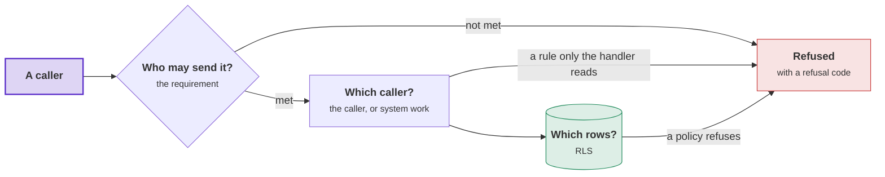
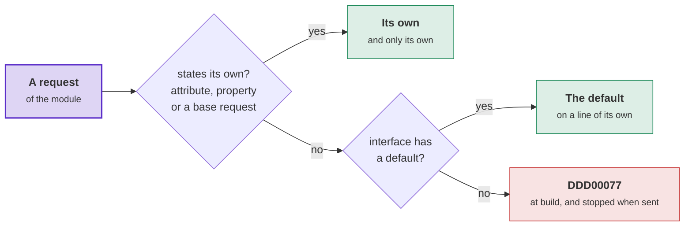
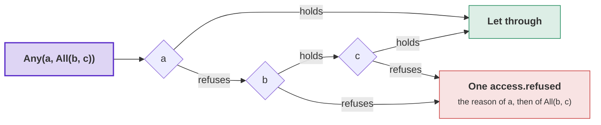
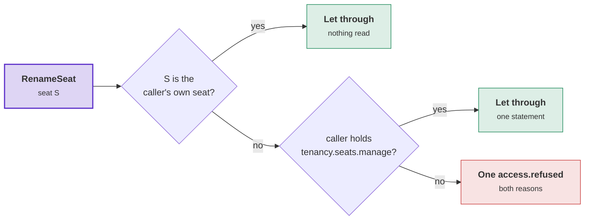
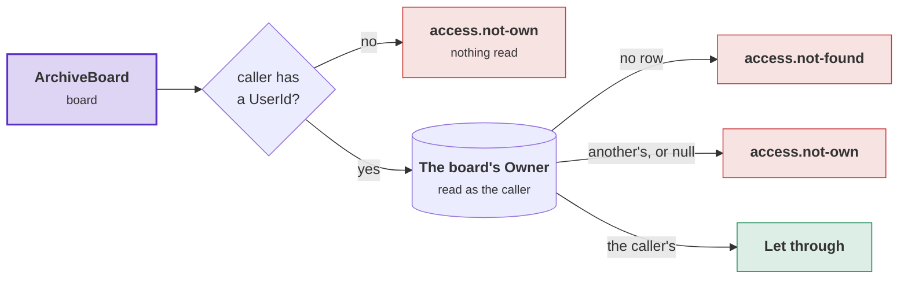
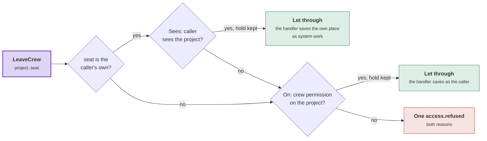
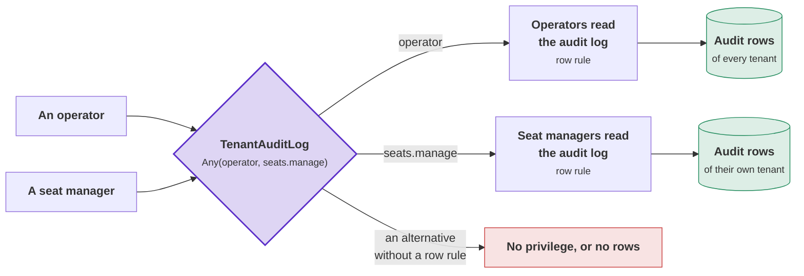
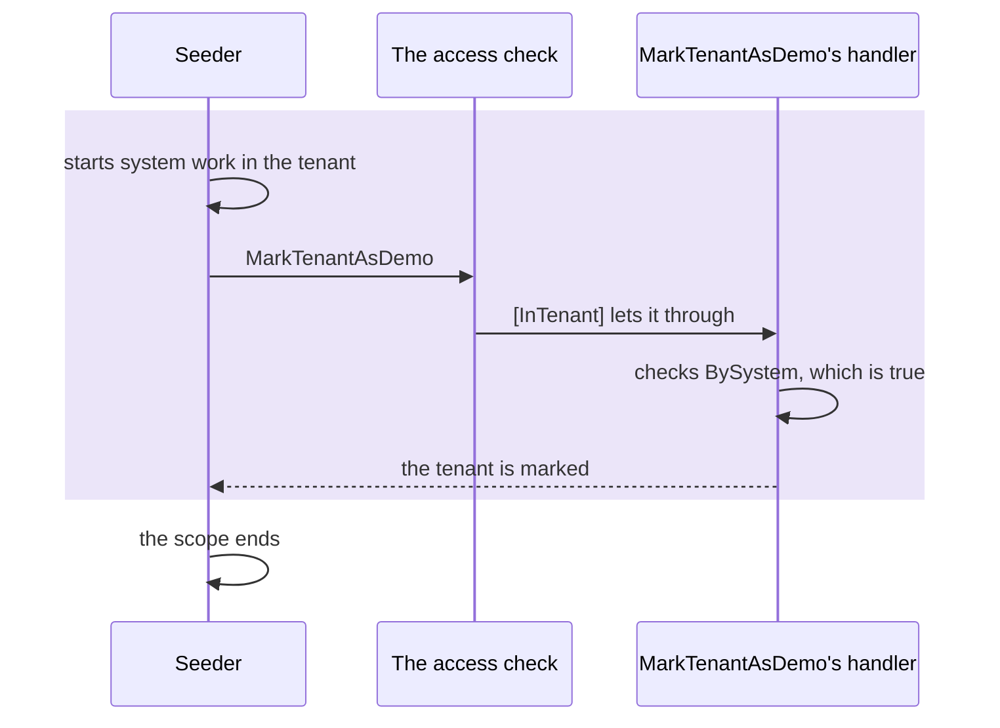
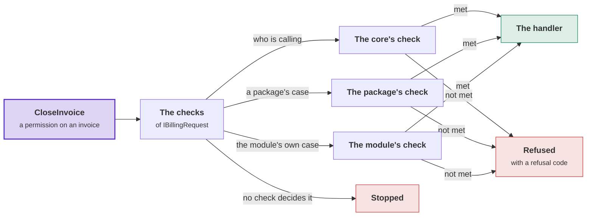
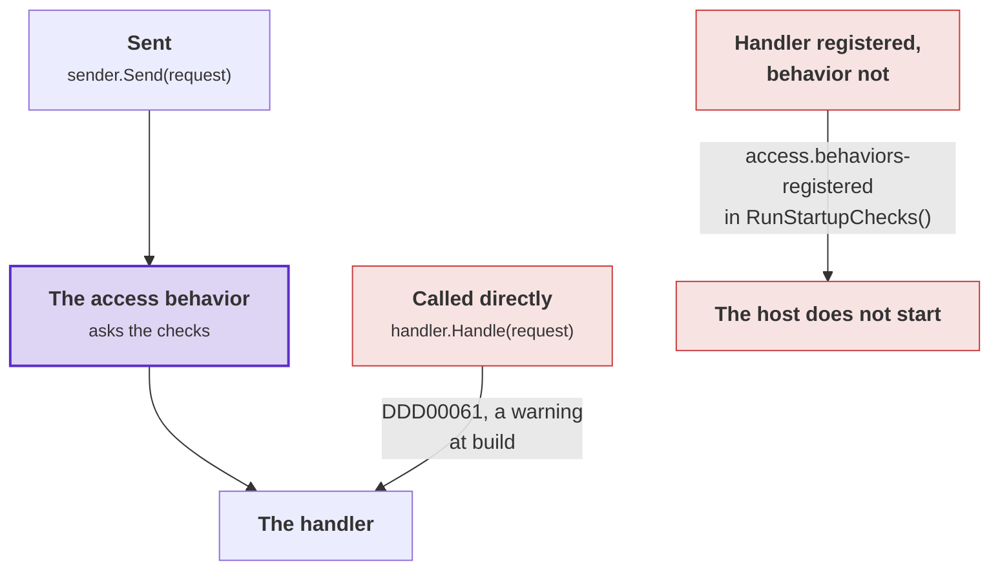

# Access requirements

Three questions decide what a caller can do with the rows of your database. Each is answered in a different place:

- **Who may send the request?** The request states a requirement. The access check holds the caller to it before the
  handler runs. A requirement can be: anyone, a signed-in user, a permission for the whole tenant, a permission at a
  unit, a permission on the thing the request is about, the caller's own, or several of these together. It is
  written as an attribute on the request, where a reviewer sees it.
- **Which caller does the code run as?** The person who sent the request, or system work. Trusted code (a handler, a
  job or a seeder) starts system work explicitly, around work that no caller may do. System work ends with that work.
- **Which rows may the code touch?** Row level security (RLS) checks every row the work reads or writes, as the
  caller the work runs as, whatever the code before it did ([Row level security](row-level-security.md)).

The three answers are independent:

- A requirement does not say what the work may do afterwards. A request that anyone may send gives its sender no
  permissions.
- No request can require system work. A caller cannot get the permissions of system work by sending a request.
- The database checks again. When the access check lets too much through, the RLS policies still apply.

The diagram shows the three questions in order. Purple: the caller. Green: the rows, reached when every step allows
it. Red: refused.



<details>
<summary>Show the code: the three answers for a form that anyone may send</summary>

```csharp shortened
[AllowAnonymous]                                                                // who may send it: anyone
public sealed record RequestQuote(string Email, string Product) : IBillingRequest;

public sealed class RequestQuoteHandler(ICurrentUser user, IQuoteStore quotes) : IHandler<RequestQuote>
{
    public async Task HandleAsync(RequestQuote command, CancellationToken cancellationToken)
    {
        using (user.BeginSystem("billing"))                                       // which caller: system work, started here
        {
            await quotes.AddAsync(command.Email, command.Product, cancellationToken);   // which rows: billing's policies
        }
    }
}
```

</details>

The namespace `DDDToolkit.Access` has the types for the first question: stating the requirement on the request, and
checking the caller before the handler runs. They are part of the core package. They depend on no dispatcher and on
no [supporting domain](writing-a-supporting-domain.md):

| Type | What it is |
|---|---|
| `IRequireAccess` | The interface a request implements. It has one member, `RequiredAccess`. |
| `[AllowAnonymous]`, `[SignedIn]`, `[RequiresPermission(permission)]`, `[OrOwn]`, `[OwnOnly]` with `[Own]` | The core's attributes for stating a requirement on a request. Packages ship more attributes the same way. Stacked attributes must all hold. |
| `AccessRequirement` | What `RequiredAccess` returns: a record that says what is required. The core defines the cases about who is calling, the caller's own, the owner of an aggregate, and the combinations `All` and `Any`. The package that decides a case defines the other cases. |
| `IOwnedByCurrentUser<TValue>` | Returns the caller's own value of a type. The core has one for `Guid`, Tenancy has one for its seat id, and an application can add one for a type it defines. |
| `[Owner]`, `IAggregateOwners<TId>` | `[Owner]` marks the property of an aggregate root that names its owner. This is a fact of the domain. `IAggregateOwners<TId>` reads that owner for a request about the owner's own. The Entity Framework package registers one for every id. |
| `IAccessCheck` | Decides the cases of one package. A package ships one, and a module writes one for its own cases. |
| `CurrentUserAccessCheck` | The core's check of who is calling. It is first in every module's set. |
| `AccessChecks<TRequests>` | The checks of one module. `RequireAsync(request)` checks a request against its requirement, and fails closed. `BeginWork(request, isQuery)` begins the work a check says the handler runs in. |
| `IBeginsWork` | A check that begins work around the handler of a request it let through, as Tenancy's check of `[Operator]` begins operator work. |
| `Checked<T>` | What a check read, kept for the code that handles the same request after it. |
| `RequestInHand` | The request that the current flow of work handles, after the access check let it through, with the requirement it passed. The handler and its save use it, and the check can be asked again through it. |

The host provides the caller ([Running queries as the caller](row-level-security.md#running-queries-as-the-caller)).
[How a request is checked](how-a-request-is-checked.md) follows six requests through all three questions, from the
attribute to the row. Four of them are the Tenancy sample's. On the docs site it has a walk-through you can click
through.

## What a request declares

Each module declares one interface that derives from `IRequireAccess`. Every command and query of the module
implements it. You write this interface yourself, because it separates one module's requests from another's. The
checks are registered for the interface, so a billing request is never checked by the checks of the shipping module.
Mark the interface `[AccessRequests]` and declare it `partial`. The generator then writes into it what the requests'
attributes require.

Most requests state their requirement with an attribute, because the requirement only names a permission and an id
the request carries. A request implements `RequiredAccess` itself in two cases: when the requirement is computed from
the request's values, and for a case of your module's own that has no attribute:

```csharp
[EntityId<Guid>] public readonly partial record struct InvoiceId;

[AccessRequests]
public partial interface IBillingRequest : IRequireAccess;      // one interface per module

[SignedIn]
public sealed record MyInvoices : IBillingRequest;

[AllowAnonymous]
public sealed record ListPlans : IBillingRequest;

public sealed record CloseInvoice(InvoiceId Invoice) : IBillingRequest
{
    AccessRequirement IRequireAccess.RequiredAccess => new BillingAccess.OnInvoice("billing.close", Invoice);
}
```

- **The generator turns attributes into code.** At compile time it writes the call each attribute stands for, one
  line per request, into the module's interface. The interface implements `RequiredAccess` with these lines, for
  example `MyInvoices => AccessRequirement.SignedIn()`. No reflection runs, and nothing is looked up when a request
  is sent. The request itself does not need to be `partial`. A request that implements `RequiredAccess` itself
  returns its own requirement, because C# uses the class's implementation over the interface's. So every reader of the
  property gets the same requirement: the module's checks, a handler that asks them again, and a test.
- **One way per request, and stacked attributes all hold.** A request with both an attribute and the property is
  [DDD00078](diagnostics.md#ddd00078). Several requirement attributes on one request must all hold, like several
  `[Authorize]` attributes in ASP.NET Core. The generated line is `AccessRequirement.All` of their calls, in the
  order they are written ([Stacked attributes](#stacked-attributes)). `[AllowAnonymous]` next to any other
  requirement attribute is a contradiction, reported as [DDD00079](diagnostics.md#ddd00079). The generator writes
  nothing into an interface that is not `partial`. The requirement attributes of its requests are then
  [DDD00083](diagnostics.md#ddd00083), and the message shows the line to write.
- **Implement the member explicitly.** A request that implements `RequiredAccess` does it explicitly, as
  `AccessRequirement IRequireAccess.RequiredAccess => ...`. The requirement then does not become a field of the
  request. It is not serialized, and it is not part of the request's shape.
- **A requirement names the permission and the ids.** It carries a permission and the ids the request names. The
  check reads everything else, such as who holds the permission and where, from where it is stored. A rule that a
  requirement cannot express, such as a rule about what is given to whom or about the current state, belongs in the
  handler, or in the method of the package that the handler calls, such as a method of Tenancy's managers.
- **Every request declares a requirement.** A request that declares none is stopped when it is sent, so a forgotten
  requirement lets nobody through. When the interface is `partial`, the build reports it as
  [DDD00077](diagnostics.md#ddd00077). When it is not, the compiler reports CS0535. A request that anyone may send
  says so with `[AllowAnonymous]` or `AccessRequirement.AllowAnonymous()`. In a review this reads as a decision,
  where a `None` would look forgotten. A module whose requests nearly all require the same can state it once, on its
  interface. A request that declares nothing then requires that default ([A module's default](#a-modules-default)).
- **`[AllowAnonymous]` has the same name as the attributes of ASP.NET Core and HotChocolate.** It goes on a request
  in the application layer, which references neither library, so the name is free there. A file that imports
  `Microsoft.AspNetCore.Authorization` or `HotChocolate.Authorization` next to `DDDToolkit.Access` sees two
  attributes with that name, and the compiler reports CS0104. This happens, for example, in a route or a resolver
  that declares its own request. Write the attribute in full, `[DDDToolkit.Access.AllowAnonymous]`, or add an alias
  at the top of that file: `using AllowAnonymous = DDDToolkit.Access.AllowAnonymousAttribute;`.
- **A requirement is a record.** Two requirements with the same values are equal, so a test can compare each
  request's requirement with the one it should declare.

<details>
<summary>Show the code: what the generator writes into the interface</summary>

```csharp title="BillingAccessBehavior.g.cs, shortened"
partial interface IBillingRequest
{
    AccessRequirement IRequireAccess.RequiredAccess => this switch
    {
        ListPlans => AccessRequirement.AllowAnonymous(),
        MyInvoices => AccessRequirement.SignedIn(),
        _ => throw new InvalidOperationException("... declares no access requirement ..."),   // a request of another project
    };
}
```

`CloseInvoice` has no line, because it implements the property itself. When the project uses Mediator, the same file
also contains the [behavior](#the-generated-behavior-with-mediator). Without Mediator, the file contains only the
lines, because whatever asks the checks reads them through the property.

</details>

### A module's default

In a module that reads a tenant's data, nearly every request requires a seat in the tenant, `[InTenant]`. A request
that requires a permission already requires a seat. So `[InTenant]` appears alone on the requests that any seat may
send. Such a module can state it once, on its interface. A requirement attribute on the interface is the module's
default. A request of the module that states nothing requires the default. The Tenancy sample's Projects module does
this.

```csharp
[AccessRequests, InTenant]                                                   // the module's default: a caller in the tenant
public partial interface IBoardsRequest : IRequireAccess;

public sealed record ListBoards : IBoardsRequest;                            // states nothing: takes the default

[RequiresPermission(BoardPermissions.Archive)]                                             // states its own: the permission, and only the permission
public sealed record ArchiveBoard(BoardId Board) : IBoardsRequest;

[SignedIn]                                                                   // its own too: a signed-in user, a seat or not
public sealed record MyInvitations : IBoardsRequest;
```

The diagram shows which requirement a request gets. Purple: the request. Green: the request gets a requirement. Red:
the request has no requirement.



- **A request that states its own requirement does not get the default.** This holds for an attribute, for the
  property, and for the attributes of a base request. The default does not replace a stated requirement and does not
  add to it. `MyInvitations` lets a signed-in user without a seat through, as it states. `ArchiveBoard` requires only
  the permission. Several attributes on the interface must all hold, as `AccessRequirement.All` in the order written,
  as on a request.
- **The `switch` shows what each request gets.** A request that takes the default gets its own line with the
  default's call, such as `ListBoards => TenancyAccess.InTenant()`. So the generated file still lists every request
  of the module with its requirement. A request that no line can name, such as a request of another project or one
  with type parameters, gets the default in the last arm. Without a default, the last arm stops such a request.
- **A default must suit every request.** These attributes can be a default:
  - `[SignedIn]`;
  - `[InTenant]`;
  - `[RequiresPermission(permission)]`, with the permission held for the whole tenant, because a default reads no
    member of a request and so cannot have a marker;
  - an attribute of your own whose `AttributeUsage` allows `AttributeTargets.Interface`.

  These cannot, and are reported as [DDD00089](diagnostics.md#ddd00089):
  - `[AllowAnonymous]`, because every request that forgot its own requirement would let anyone in;
  - `[SeenWith<TResourceId>(permission)]`, because it is for queries only, and a command that states nothing would
    get it;
  - `[OwnOnly]`, because it reads a member of the request;
  - `[Operator]`, because its `AttributeUsage` allows no interface. The compiler reports CS0592 as well.

  A default on an interface that is not `partial`, or on an interface that is not the module's, is
  [DDD00083](diagnostics.md#ddd00083).
- **Repeating the default is a warning.** An attribute on a request that repeats the default, such as `[InTenant]` on
  `ListBoards`, adds nothing. The build reports it as the warning [DDD00084](diagnostics.md#ddd00084). On a request
  that another request derives from, the attribute is not reported, because the derived request must meet it next to
  its own.
- **The cost: a forgotten permission is not reported.** With a default, [DDD00077](diagnostics.md#ddd00077) no longer
  reports a request that states nothing, because the request gets the default. A command that forgets its
  `[RequiresPermission]` then lets every seat in the tenant through, and the build reports nothing. For this reason
  the default is opt-in, for a module whose requests nearly all need it, and the generated `switch` shows what each
  request gets. A test that compares each request's requirement with the expected one
  ([Testing the requirements](#testing-the-requirements)) finds the forgotten permission.

<details>
<summary>Show the code: what the generator writes for a module with a default</summary>

```csharp title="BoardsAccessBehavior.g.cs, with the module's default, shortened"
partial interface IBoardsRequest
{
    AccessRequirement IRequireAccess.RequiredAccess => this switch
    {
        ArchiveBoard => TenancyAccess.AtTenant("boards.archive"),
        ListBoards => TenancyAccess.InTenant(),
        MyInvitations => AccessRequirement.SignedIn(),
        // A request this project cannot name, one of another project say, takes the module's default as well.
        _ => TenancyAccess.InTenant(),
    };
}
```

Without a default, the last arm stops a request that has no line. With a default, the last arm returns the same call
as the lines of the requests that take the default.

</details>

## Requirements and their attributes

The table lists every requirement. Each requirement is a method on the class of the package that decides it. The
attribute is the short form. The call next to it is what the attribute stands for, and what a request writes when it
computes its requirement:

| A request requires | Its attribute | Or computed, `RequiredAccess =>` | Let through | Anyone else is refused with |
|---|---|---|---|---|
| anyone, also a caller who did not sign in | `[AllowAnonymous]` | `AccessRequirement.AllowAnonymous()` | everyone, without asking a check | |
| a signed-in user, who does not need to hold anything yet | `[SignedIn]` | `AccessRequirement.SignedIn()` | a user who signed in, including an anonymous sign-in of the identity provider | `access.not-signed-in` |
| a caller in the tenant | `[InTenant]`, from [Tenancy](tenancy/who-may-do-what.md#what-a-request-requires-of-its-caller) | `TenancyAccess.InTenant()` | a seat in the tenant the request was sent for, and system work there | the caller's own reason, such as `tenancy.not-seated` |
| a permission for the whole tenant | `[RequiresPermission(permission)]` | `TenancyAccess.AtTenant(permission)` | whoever holds the permission at the tenant's root now | `tenancy.not-permitted`, naming the permission |
| a permission at a unit | `[RequiresPermission(permission)]`, with `[AtUnit]` on the unit | `TenancyAccess.AtUnit(permission, unit)` | whoever holds the permission now at that unit or at a unit above it | `tenancy.not-permitted`, with the permission and the unit |
| a permission on a resource | `[RequiresPermission(permission)]`, with `[OnResource]` on the resource and `[ExpectedVersion]` on the version read, from [Membership](membership/resources-and-members.md#a-document-and-the-people-it-is-shared-with) | `MemberAccess.On(permission, resource, expectedVersion)` | whoever holds the permission on it, through its members or from above | the resource's `not-found` or `not-permitted` |
| a query that shows the resources a permission is held on | `[SeenWith<TResourceId>(permission)]`, from [Membership](membership/checks-and-saves.md#access-in-your-own-queries) | `MemberAccess.SeenWith<TResourceId>(permission)` | every caller who signed in, and system work. The query's own statement leaves out the resources where the caller does not hold the permission. | the caller's own reason for a caller who is nobody; the resource's `not-permitted`, naming the permission, for a caller who did not sign in |
| one of the application's operators | `[Operator]`, with `[ForTenant]` on the tenant the request names ([An operator's request](#an-operators-request)) | `TenancyAccess.Operator()`, `TenancyAccess.Operator(tenant)` | a signed-in user with an [operator's token role](tenancy/operators-and-history.md#operators). On a command, the handler runs as operator work. | `tenancy.operators-only`; `tenancy.tenant-mismatch` for a request that names another tenant than its `[ForTenant]` member |
| the caller's own, or a permission | `[RequiresPermission(permission)]`, with `[OrOwn]` on the member that names the value | `AccessRequirement.Any(AccessRequirement.Own(seat), ...)` | the caller the member names, and whoever holds the permission | one `access.refused`, with `access.not-own` and the permission's reason |
| only the caller's own | `[OwnOnly]`, with `[Own]` on the member that names the value | `AccessRequirement.Own(seat)` | the caller the member names | `access.not-own` |
| the owner of an aggregate, or a permission | `[RequiresPermission(permission)]`, with `[OrOwn]` on the aggregate's id. The aggregate marks its owner with `[Owner]`. | `AccessRequirement.Any(AccessRequirement.OwnerOf(board), ...)` | the aggregate's owner, and whoever holds the permission | one `access.refused`, with `access.not-own` or `access.not-found` and the permission's reason |
| only the owner of an aggregate | `[OwnOnly]`, with `[Own]` on the aggregate's id | `AccessRequirement.OwnerOf(board)` | the aggregate's owner | `access.not-own`; `access.not-found` for a row the caller cannot see |
| several of these, all of them | the attributes, stacked | `AccessRequirement.All(...)` | whoever meets every one | the reason of the first one that fails |
| one of several | | `AccessRequirement.Any(...)` | whoever meets one | one `access.refused`, with each one's reason |
| something only your module knows | `[YourOwn]`, declared with `[StatesRequirement]` | a record of your own | what your check lets through | your module's refusal code |

The cases of `AccessRequirement` are about who is calling, or they combine other cases. The core decides them, so a host
without any supporting domain has them. `ICurrentUser` returns the current user. The set of checks asks it once, before
any check, whatever the request requires. In a host that [requires an explicit current
user](row-level-security.md#requiring-an-explicit-current-user), work that began no user fails with `NoCurrentUserException` before
it is let through or refused. This includes a request of `[InTenant]`, whose check asks Tenancy's own caller, and a
request of `[AllowAnonymous]`.

- **`[SignedIn]`** checks whether the caller's token names a user. An anonymous sign-in, which Supabase Auth makes for
  a visitor who has not registered, also names a user. Its token has the `is_anonymous` claim. A handler that accepts
  only a registered user with a verified identity refuses that claim itself. The registration that
  [provisions a tenant](tenancy/who-may-do-what.md#requests-that-provision-a-tenant) does this, and so does Tenancy's
  acceptance of an invitation. System work is not a signed-in user, so `[SignedIn]` refuses it.
- **No requirement exists for system work.** System work is a scope that trusted code starts.
  [System work](#system-work) shows how to write a request that system work sends, and a handler that needs system
  work.

Each call is a static method on the class of the package that decides it, so requirements look alike:
`AccessRequirement.SignedIn()`, `TenancyAccess.InTenant()`, `MemberAccess.On(permission, resource)`.

- They are static methods, because C# infers type arguments from the arguments of a method, and not from those of a
  constructor. So `TenancyAccess.AtUnit(permission, unit)` is closed over your unit id type without you writing it.
- `AllowAnonymous()` and `SignedIn()` are named after who is let through, which is what a reviewer looks for.
- Each package declares what its attributes stand for, with a core attribute on the attribute's class:
  `[StatesRequirement]` or `[PermissionMarker]`. The generator knows no attribute by name. A module declares an
  attribute for its own case the same way ([Writing your own supporting domain](writing-a-supporting-domain.md)).

### Where the permission is held

`[RequiresPermission(permission)]` is the same attribute wherever the permission is held. A marker on one of the
request's members states where:

- no marker: for the whole tenant;
- `[AtUnit]`: at that unit, or at a unit above it;
- `[OnResource]`: on that resource, through its members. Add `[ExpectedVersion]` on the member that holds the version
  the caller read. The check compares the version only after it finds that the caller may act.

A marker goes on a positional parameter of a record, or on a property. `[property: AtUnit]` is read as well. No
attribute names a member with a string or with `nameof`.

```csharp
[RequiresPermission(BillingPermissions.CloseTheBooks)]                                     // for the whole tenant
public sealed record CloseTheBooks(int Year) : IBillingRequest;

[RequiresPermission(BillingPermissions.OpenLedger)]                                        // at the unit, or above it
public sealed record OpenLedger(string Name, [AtUnit] OrganizationUnitId Unit) : IBillingRequest;

[RequiresPermission(DocumentPermissions.Share)]                                            // on the document, through its members
public sealed record ShareDocument([OnResource] DocumentId Document, UserId With, [ExpectedVersion] long? ExpectedVersion = null) : IDocumentsRequest;

[RequiresPermission(BillingPermissions.ArchiveLedger)]                                     // an ordinary property takes a marker too
public sealed class ArchiveLedger : IBillingRequest
{
    [AtUnit] public required OrganizationUnitId Unit { get; init; }
}
```

The permission is a constant from the catalogue, because an attribute argument must be a constant. A request can
declare its own constant, as `[RequiresPermission(RequiredPermission)]` with
`public const string RequiredPermission = ProjectPermissionNames.Edit;`. Its handler, or a list of abilities, then
reads the same permission.

### An operator's request

An operator is one of the application's own staff. An operator is a signed-in user whose token carries one of the
operators' token roles ([Operators](tenancy/operators-and-history.md#operators)). An operator holds no seat in any
tenant and no permission. `[Operator]`, from Tenancy, lets an operator through. The access check refuses every other caller with
`tenancy.operators-only`, before the handler runs. A seat is refused whatever it holds, and so is system work.

What happens after the access check depends on the kind of request:

- **A command runs as operator work.** The pipeline begins the work around the handler and ends it when the handler
  returns. Operator work is system work, recorded as the operator. The operator's identity is the current user's id,
  never an id that the request carries. The work holds every permission in its tenant, so a handler of an operator's
  command does the operator's act and nothing more. The handler writes no `using` for it.
- **A query begins nothing.** An operator reads across tenants through the database role of its token,
  `tenancy_operator` in the sample.

A command states the tenant its operator work acts in. There are three choices:

| The command | The operator work acts in | Refused before the handler with |
|---|---|---|
| marks a member `[ForTenant]` | the tenant that the member names | `tenancy.tenant-mismatch`, when the request names another tenant beside the command |
| carries `[Operator(Tenant = OperatorTenant.FromRequest)]` | the tenant that the request names beside the command, as tenant selection reads it (the `Tenant` header in the sample). The operator gets no seat there. | `tenancy.tenant-required` for a request that names no tenant; `tenancy.not-seated` for a tenant that does not exist |
| does neither | no tenant, as provisioning needs. A tenant that the request names is ignored. | nothing more |

A command that does both names two tenants. The build reports it as [DDD00103](diagnostics.md#ddd00103). `[ForTenant]`
goes on a positional parameter of a record as written, without a `property:` target, or on a property. It marks the
application's tenant id. Without `[Operator]` on the request it is [DDD00102](diagnostics.md#ddd00102).

`Scope` names the scope of the work. The default is Tenancy's own scope, `tenancy`, which writes Tenancy's tables. A
module's own command names the module's scope, such as `[Operator(Scope = "projects")]`. On a query nothing begins, so
`Tenant` and `Scope` there are the warning [DDD00105](diagnostics.md#ddd00105).

```csharp shortened
[Operator(Scope = "projects")]                       // operator work in the tenant the command names, scope projects
public sealed record RenameTenantProject([ForTenant] TenantId Tenant, ProjectId Project, string Name) : ICommand, IProjectsRequest;

[Operator(Tenant = OperatorTenant.FromRequest)]      // operator work in the tenant of the Tenant header, scope tenancy
public sealed record CloseStaleInvitations : ICommand, ITenantsRequest;

[Operator]                                           // operator work in no tenant: provisioning
public sealed record ProvisionTenant(string Slug, string Name, Guid Administrator) : ICommand<Tenant>, ITenantsRequest;

[Operator]                                           // a query: nothing begins
public sealed record AllTenants(string? After = null) : IQuery<TenantManager.TenantPage>, ITenantsRequest;
```

The generator writes `[Operator]` with `[ForTenant]` as `TenancyAccess.Operator(request.Tenant)`, and a property set
on the attribute as a named argument: `TenancyAccess.Operator(request.Tenant, scope: "projects")`. The sample's
`RenameTenantProject` is the first command above. Its handler loads the project, renames it and saves, with no `using`
of its own.

### Valid combinations of attributes

Stacked requirement attributes must all hold. A marker states where the permission of the request's one
`[RequiresPermission]` is held. The build reports attributes that do not go together as an error, where they are
written. Such a request would look correct in a review while it requires something else. An attribute that adds
nothing to its neighbour is a warning.

| `[RequiresPermission(permission)]` with | no marker | `[AtUnit]` | `[OnResource]` | `[OnResource]` and `[ExpectedVersion]` |
|---|---|---|---|---|
| is | `AtTenant(permission)` | `AtUnit(permission, unit)` | `On(permission, resource)` | `On(permission, resource, version)` |
| and `[OrOwn]` on a member | `Any(Own(member), AtTenant(permission))` | not allowed: [DDD00085](diagnostics.md#ddd00085) | `Any(All(Own(member), Sees(permission, resource)), On(permission, resource))` | `Any(All(Own(member), Sees(permission, resource, version)), On(permission, resource, version))` |

Next to `[OnResource]`, the caller's own alternative is also checked against the resource. The caller must see the
resource, its version is compared, and the check keeps what the save is checked against, as for the permission
([The caller's own on a resource](#the-callers-own-on-a-resource)). On the id of an aggregate that marks its owner
with `[Owner]`, `[OrOwn]` produces the same with `OwnerOf(member)` instead of `Own(member)`
([The owner of an aggregate](#the-owner-of-an-aggregate)).

| On one request | Goes with | Reported otherwise |
|---|---|---|
| `[AllowAnonymous]` | No other requirement attribute, on the request or on a base request, and not the property. | [DDD00079](diagnostics.md#ddd00079), [DDD00078](diagnostics.md#ddd00078) |
| any other requirement attribute | Other requirement attributes, on the request and on its base requests. All of them must hold. Not the property. | [DDD00078](diagnostics.md#ddd00078) |
| `[InTenant]`, `[SignedIn]` | A neighbour that does not already require it. So not `[InTenant]` next to a permission of Tenancy's, not `[SignedIn]` next to `[Operator]`, neither next to `[OwnOnly]` with `[Own]` on a member whose own value already requires it, and not the same attribute on a base request. On a sealed request, also not alone when it repeats the module's default. | [DDD00084](diagnostics.md#ddd00084), a warning |
| `[RequiresPermission]` | One per request, base requests included. | [DDD00080](diagnostics.md#ddd00080) |
| `[AtUnit]` or `[OnResource]` | `[RequiresPermission]`. One of the two markers, on a member of the id type it marks, which is never null. | [DDD00080](diagnostics.md#ddd00080), [DDD00081](diagnostics.md#ddd00081) |
| `[ExpectedVersion]` | `[OnResource]`, on a `long?`. | [DDD00080](diagnostics.md#ddd00080), [DDD00081](diagnostics.md#ddd00081) |
| `[RequiresPermission]` without a marker | A package that declares where such a permission is held, such as Tenancy. | [DDD00080](diagnostics.md#ddd00080) |
| `[OrOwn]` | `[RequiresPermission]` without `[AtUnit]`. Once per request, on a member that is never null. The member's type has an own value, or is the id of an aggregate whose owner's type has one. Not on the id of a resource with members next to a permission that its owner already holds. | [DDD00085](diagnostics.md#ddd00085), [DDD00086](diagnostics.md#ddd00086), [DDD00088](diagnostics.md#ddd00088), [DDD00096](diagnostics.md#ddd00096) (a warning) |
| `[Own]` | `[OwnOnly]`. Once, on a member that is never null. The member's type has an own value, or is the id of an aggregate whose owner's type has one. | [DDD00085](diagnostics.md#ddd00085), [DDD00086](diagnostics.md#ddd00086), [DDD00088](diagnostics.md#ddd00088) |
| `[Owner]`, on a property of an aggregate | The aggregate root itself, once, on a property of a type with an own value. The property may be nullable. | [DDD00087](diagnostics.md#ddd00087), [DDD00088](diagnostics.md#ddd00088) |
| `[At]`, from Membership's markers, on a property of an aggregate | The aggregate root itself, once, on an instance property that is never null. It names the unit the aggregate is placed at. The rules of a resource with members read it when the resource is reached from above. | [DDD00097](diagnostics.md#ddd00097), and [DDD00098](diagnostics.md#ddd00098) for rules that reach a class that marks none |
| `[Permissions]`, on a class | A static class whose public constants each have a level: `[AtTenant]`, `[AtUnit]` or `[On<TResource>]`. | [DDD00092](diagnostics.md#ddd00092), [DDD00093](diagnostics.md#ddd00093) |
| `[SeenWith<TResourceId>(permission)]` | A query. | [DDD00082](diagnostics.md#ddd00082) on a command, or on a plain request of Mediator |
| `[Operator]` | Neither `[InTenant]` nor `[RequiresPermission]`, because an operator holds no seat and no permission. On a query, no `Tenant` and no `Scope`. | [DDD00104](diagnostics.md#ddd00104), [DDD00105](diagnostics.md#ddd00105) (a warning) |
| `[ForTenant]` | `[Operator]` without `Tenant = OperatorTenant.FromRequest`. Once per request, on a member of the application's tenant id. | [DDD00102](diagnostics.md#ddd00102), [DDD00103](diagnostics.md#ddd00103), [DDD00081](diagnostics.md#ddd00081) |
| any of them | One module interface of the same project, with `[AccessRequests]` and `partial`. | [DDD00083](diagnostics.md#ddd00083) |

| On the module's interface | Goes with | Reported otherwise |
|---|---|---|
| `[SignedIn]`, `[InTenant]`, `[RequiresPermission(permission)]`, an attribute of your own that allows an interface | `[AccessRequests]` and `partial`. Each other, and all of them must hold. A permission without a marker, held where a package says, such as Tenancy. | [DDD00083](diagnostics.md#ddd00083), [DDD00080](diagnostics.md#ddd00080), [DDD00084](diagnostics.md#ddd00084) |
| `[AllowAnonymous]`, `[Operator]`, `[SeenWith<TResourceId>(permission)]`, `[OwnOnly]` | Nothing, because they cannot be a default. | [DDD00089](diagnostics.md#ddd00089) |

Why these combinations are reported:

- `[AllowAnonymous]` next to `[RequiresPermission]` would let anyone in where the permission should keep them out.
  The build cannot know which one was meant.
- `[InTenant]` next to `[RequiresPermission]` adds nothing, because only a seat in the tenant, or system work there,
  holds a permission of Tenancy's.
- `[Operator]` next to `[InTenant]` or `[RequiresPermission]` refuses every caller. An operator holds no seat and no
  permission, and a seat is no operator. A request that either may send implements the property with
  `AccessRequirement.Any` ([Any and All in RequiredAccess](#any-and-all-in-requiredaccess)).
- `[SignedIn]` next to `[RequiresPermission]` does add something, and is not reported. System work holds every
  permission, but it is not a signed-in user.
- The caller's own also requires something. Only a signed-in user has a verified identity, so `[SignedIn]` next to
  `[OwnOnly]` with `[Own]` on a `Guid` is a warning. Only a seat in the tenant has its own seat there, so `[InTenant]`
  next to `[OwnOnly]` with `[Own]` on the seat id is a warning too.
- Next to a permission with `[OrOwn]`, only what both alternatives require counts. `[InTenant]` next to a Tenancy
  permission with `[OrOwn]` on the seat id adds nothing. `[SignedIn]` there adds something, because system work holds
  the permission.

### A requirement computed from the request

When the request's values decide the requirement, no attribute can express it, and the request implements the
property itself. The Tenancy sample's `SeatGrants` does this. Without a unit, it lists a seat's roles at every unit
and requires the permission for the whole tenant. With a unit, it lists the roles at that unit and requires the
permission there. The same pattern in a billing request:

```csharp
public sealed record ListLedgers(OrganizationUnitId? Unit) : IBillingRequest
{
    AccessRequirement IRequireAccess.RequiredAccess => Unit is { } unit
        ? TenancyAccess.AtUnit(BillingPermissions.Read, unit)
        : TenancyAccess.AtTenant(BillingPermissions.Read);
}
```

For this reason, `[AtUnit]` on a unit that may be null is [DDD00081](diagnostics.md#ddd00081). The requirement
depends on whether the unit is given, so the request must compute it.

## Requirements that combine

Some requests require more than one thing:

- Several things at once: a plan the tenant pays for and a permission, or a permission on a project and a permission
  at the unit the project moves to.
- One caller or another: one of the application's operators, or a seat that manages the tenant's seats.
- The caller's own: a person renames their own seat, and somebody with a permission renames any seat.

Each of these is one requirement record. The access check holds the caller to it before the handler runs:

| Written as | Holds when | Refused with |
|---|---|---|
| `AccessRequirement.All(a, b)`, and stacked requirement attributes | Every case holds. The cases are asked in the order they are written. | The refusal of the first failing case. The cases after it are not asked. |
| `AccessRequirement.Any(a, b)` | The first case that holds. The cases after it are not asked. | One `access.refused`. Its argument `Reasons` lists each case's refusal, with its refusal code and arguments, in order. |
| `AccessRequirement.Own(value)`, `[OwnOnly]` with `[Own]` on the member | The value is the caller's own. | `access.not-own` |
| `[RequiresPermission(permission)]` with `[OrOwn]` on the member | The value is the caller's own, or the caller holds the permission: `Any(Own(value), the permission's case)`. | One `access.refused`, with both reasons |
| `AccessRequirement.OwnerOf(id)`, `[OwnOnly]` with `[Own]` on the id of an aggregate | The aggregate's owner, read from its row as the caller, is the caller's own value. | `access.not-own`, or `access.not-found` for a row the caller cannot see |

The set gives each case of a combination to the check that decides that case. So cases of different packages
combine: a Membership permission on a project with a Tenancy permission at a unit, or a module's own case with
either. A combination can contain another, as in `Any(All(a, b), c)`. Every case needs a check before any case is
asked. When no check of the module decides one case, the set stops the request, as it would stop that case alone,
even when another case would have let the caller through. `AllowAnonymous()` cannot be combined, because next to
another case it would let in callers that the other case refuses.

A check can keep what it read for the handler and its save ([The request in hand](#the-request-in-hand)). In a
combination, this is kept only after the whole combination let the caller through, and only for the cases that let
the caller through: every case of an `All`, and the one case of an `Any` that passed. A refused combination keeps
nothing, even from cases that passed before the refusal. A branch of an `Any` that refused keeps nothing either. A
permission on each of two resources of one kind keeps a hold on each resource, and each save is checked against its
own hold.

The diagram shows how `Any(a, All(b, c))` is decided. Purple: the requirement. Green: let through. Red: refused.



- **`All` refuses with the refusal of the failing case.** A client reads the same refusal code as when the request
  requires only that case.
- **`Any` refuses with one `access.refused`.** Its kind is `RefusalKind.NotPermitted`, a 403 at the edge, because no
  single case's reason is the answer. Its argument `Reasons` lists each case's reason with its refusal code and
  arguments. Its message names them for a log.
- **Another exception ends the combination.** When a case fails with something other than a refusal, such as a
  version conflict, that exception is the result, and the cases after it are not asked.
- **`RequestInHand.ToString()` names a combination by the types of its cases**, for example
  `RenameSeat (AccessRequirement.Any(AccessRequirement.Owned<SeatId>, TenancyRequirement.AtTenant))`.

<details>
<summary>Show the code: an Any refusal, and how the edge writes it</summary>

```csharp shortened
// The request: one of the application's operators, or a seat that manages seats for the whole tenant
AccessRequirement IRequireAccess.RequiredAccess => AccessRequirement.Any(
    TenancyAccess.Operator(),
    TenancyAccess.AtTenant(TenancyPermissions.SeatsManage));

// A client that wants each reason reads them from the refusal's arguments
catch (RefusalException refused) when (refused.Code == ToolkitRefusals.Refused
    && refused.Arguments.TryGetValue(ToolkitRefusals.ReasonsArgument, out var value)
    && value is IReadOnlyList<RefusalReason> reasons)
{
    // reasons[0].Code == "tenancy.operators-only", reasons[1].Code == "tenancy.not-permitted"
}
```

```json
{
  "status": 403,
  "code": "access.refused",
  "title": "Access to this was refused.",
  "arguments": {
    "Reasons": [
      { "code": "tenancy.operators-only", "arguments": {} },
      { "code": "tenancy.not-permitted", "arguments": { "Permission": "tenancy.seats.manage" } }
    ]
  }
}
```

</details>

### Stacked attributes

Requirement attributes stacked on one request must all hold, like several `[Authorize]` attributes in ASP.NET Core.
The generator writes `AccessRequirement.All` of their calls, in the order they are written above the request. The
first attribute is checked first, and when it fails, its refusal is the one the caller gets. A marker still states
where the permission of `[RequiresPermission]` is held, whatever other attributes are present. A module's own
attribute, declared with `[StatesRequirement]` as a package declares one
([Writing your own supporting domain](writing-a-supporting-domain.md)), stacks the same way:

```csharp
[RequiresPlan(Plan.Pro)]                                                     // the module's own: the tenant's plan
[RequiresPermission(BoardPermissions.Export)]                                              // Tenancy's: a permission for the whole tenant
public sealed record ExportBoard(BoardId Board) : IBoardsRequest;
```

The generator writes this into the module's interface as `ExportBoard =>
AccessRequirement.All(PlanAtLeast.RequiresPlan(Plan.Pro), TenancyAccess.AtTenant("boards.export"))`. Put the case that
reads nothing first, because a refusal there costs no statement. [A requirement of your
own](how-a-request-is-checked.md#a-requirement-of-your-own) builds this example completely: the requirement, the
attribute, `PlanCheck` and its registration.

- **`[AllowAnonymous]` with another attribute is an error.** The two contradict each other, and the build reports
  [DDD00079](diagnostics.md#ddd00079).
- **An attribute that adds nothing is a warning.** `[InTenant]` next to a permission of Tenancy's, and `[SignedIn]`
  next to `[Operator]`, add nothing to what the other attribute already requires. The build reports
  [DDD00084](diagnostics.md#ddd00084). A package states what its requirement already requires with `Implies` on its
  `[StatesRequirement]` or `[PermissionMarker]`, so a module's own attribute follows the same rule.
- **One permission per request.** A request has at most one `[RequiresPermission]`, because a marker could not say
  which permission it belongs to. Write two permissions, or one case or another, as the property.
- **A derived request adds to its base.** A request that derives from a request with requirement attributes, and has
  attributes of its own, must meet both, the base's first. This works like `[Authorize]` on a controller and on its
  base controller. For example, `[SignedIn] MyReport : Report`, where `Report` has `[InTenant]`, requires
  `All(InTenant(), SignedIn())`, and never `SignedIn()` alone. The base's markers are read too, including a marker
  without a target on the base record's parameter. A derived request without attributes of its own gets the line of
  its base unchanged. A derived request cannot remove what its base requires:
  - `[AllowAnonymous]` on it, below a base that requires something, is DDD00079;
  - a second `[RequiresPermission]` is DDD00080;
  - an attribute that its base already has is DDD00084.
- **A module's default does not stack.** The default is not an attribute of the request. A request that states
  nothing gets the default. A request that states its own requirement, or derives from one that does, gets only that
  requirement ([A module's default](#a-modules-default)).

<details>
<summary>Show the code: a module's own requirement attribute, declared and stacked</summary>

```csharp
public enum Plan { Free, Team, Pro }

// The requirement: a record, so two that say the same are equal
public sealed record PlanAtLeast(Plan Plan) : AccessRequirement
{
    public static PlanAtLeast RequiresPlan(Plan plan) => new(plan);
}

// The attribute names the call it stands for: its constructor's arguments are the call's
[StatesRequirement(typeof(PlanAtLeast), nameof(PlanAtLeast.RequiresPlan))]
[AttributeUsage(AttributeTargets.Class | AttributeTargets.Struct, Inherited = false)]
public sealed class RequiresPlanAttribute(Plan plan) : Attribute
{
    public Plan Plan { get; } = plan;
}

// The module's check decides PlanAtLeast, beside Tenancy's, for the same interface
services.AddAccessCheck<IBoardsRequest, PlanCheck>();
services.AddTenancyAccess<IBoardsRequest, BoardsContext>();
```

```csharp title="BoardsAccessBehavior.g.cs, shortened"
partial interface IBoardsRequest
{
    AccessRequirement IRequireAccess.RequiredAccess => this switch
    {
        ExportBoard => AccessRequirement.All(
            PlanAtLeast.RequiresPlan((Plan)(2)),
            TenancyAccess.AtTenant("boards.export")),
        // ...
    };
}
```

</details>

### Any and All in RequiredAccess

Stacked attributes cannot express one caller or another, or two permissions at two places. For these, the request
implements the property with `Any` or `All`:

- **One caller or another.** The application's operators read a tenant's audit log across tenants. A seat that manages
  the tenant's seats reads it too: `Any(TenancyAccess.Operator(),
  TenancyAccess.AtTenant(TenancyPermissions.SeatsManage))`. The first case lets an operator through without reading
  anything. The second case lets a seat manager through, with one statement.
- **Two permissions at two units.** Moving a seat from one unit to another requires the permission that manages seats at
  both units: `All(TenancyAccess.AtUnit(TenancyPermissions.SeatsManage, From),
  TenancyAccess.AtUnit(TenancyPermissions.SeatsManage, To))`. The access check tested the units the request names, so
  the handler acts on those units. It removes the seat from `From`, and refuses a seat that is not placed there. If the
  handler moved the seat from wherever it is, a caller with the permission at two units could move a seat away from a
  third unit.
- **A permission from each package.** Moving a project to another unit requires the edit permission on the project, and
  the permission that opens a project at the target unit: `All(MemberAccess.On(ProjectPermissionNames.Edit, Project,
  ExpectedVersion), TenancyAccess.AtUnit(ProjectPermissionNames.Open, To))`. The first case is Membership's, the second
  Tenancy's. The Tenancy sample's `MoveProjectToUnit` does the same, but uses its module's own case at the unit, which
  refuses with `projects.not-permitted`.

<details>
<summary>Show the code: the audit log, moving a seat, moving a project</summary>

```csharp
public sealed record TenantAuditLog(TenantId Tenant, PagingArguments Paging) : IQuery<Page<AuditEntry>>, IAuditRequest
{
    AccessRequirement IRequireAccess.RequiredAccess => AccessRequirement.Any(
        TenancyAccess.Operator(),
        TenancyAccess.AtTenant(TenancyPermissions.SeatsManage));
}

public sealed record MoveSeat(SeatId Seat, OrganizationUnitId From, OrganizationUnitId To) : ICommand, ISeatsRequest
{
    AccessRequirement IRequireAccess.RequiredAccess => AccessRequirement.All(
        TenancyAccess.AtUnit(TenancyPermissions.SeatsManage, From),
        TenancyAccess.AtUnit(TenancyPermissions.SeatsManage, To));
}

public sealed class MoveSeatHandler(SeatManager seats) : ICommandHandler<MoveSeat>
{
    public async ValueTask<Unit> Handle(MoveSeat command, CancellationToken cancellationToken)
    {
        // Only the units the access check tested: a seat placed elsewhere is not moved from there.
        await seats.WithdrawAsync(command.Seat, command.From, cancellationToken);   // refuses a seat not placed at From
        await seats.PlaceAsync(command.Seat, command.To, primary: true, cancellationToken);
        return Unit.Value;
    }
}

public sealed record MoveProject(ProjectId Project, OrganizationUnitId To, long? ExpectedVersion = null) : ICommand, IProjectsRequest
{
    AccessRequirement IRequireAccess.RequiredAccess => AccessRequirement.All(
        MemberAccess.On(ProjectPermissionNames.Edit, Project, ExpectedVersion),
        TenancyAccess.AtUnit(ProjectPermissionNames.Open, To));
}
```

</details>

### The caller's own, or a permission

A request about the caller's own names the value, such as a seat or a user. The check compares that value with the
caller's own value of the same type. The request never states whose value it is. The check takes the caller from the
token, so nobody can act for somebody else by naming them. `[OrOwn]` on that member, next to `[RequiresPermission]`,
makes the caller's own an alternative to the permission. A person renames their own seat, and whoever holds the
permission renames any seat. The check tests the caller's own first, because that reads nothing. It tests the
permission only when the value is not the caller's.

The diagram shows how the requirement of `RenameSeat` is checked. Purple: the request. Green: let through. Red:
refused.



An `IOwnedByCurrentUser<TValue>` returns the caller's own value of a type. The type decides who provides it:

| The member is a | The caller's own value is | Provided by |
|---|---|---|
| `Guid` | the caller's verified identity: the id the token names | the core, with nothing registered |
| the application's seat id | the caller's seat in the request's tenant, when the seat is active and the tenant is active | Tenancy. `AddTenancy` registers it. |
| a type the application defines, such as its `UserId` | what the application's handle returns | a small handle next to the requests, registered by the host: `services.AddOwnedByCurrentUser<UserId, CurrentUserId>()` |
| the id of an aggregate with an `[Owner]` property | the aggregate, when its owner, read from its row as the caller, is the caller's own value of the owner's type | the aggregate, which marks the property. The Entity Framework package reads it, with nothing registered ([The owner of an aggregate](#the-owner-of-an-aggregate)). |

A caller who did not sign in has no own value, and neither has system work. System work holds every permission in its
tenant, but has no seat. An operator has no seat either, so an operator has no own seat id. `[OwnOnly]` on the
request, with `[Own]` on the member, requires the caller's own value with no permission as alternative. Use it for
leaving a tenant, or for `CloseAccount` below.

- **Next to `[OnResource]`, never next to `[AtUnit]`.** `[OrOwn]` can go next to `[OnResource]`.
  `LeaveCrew([OnResource] ProjectId Project, [OrOwn] SeatId Seat)` lets callers take themselves off the crew of a
  project they can see, and lets anybody with the permission on the project take anyone off. The handler still checks
  that the seat is on that crew ([The caller's own on a resource](#the-callers-own-on-a-resource)). Next to
  `[AtUnit]` it is [DDD00085](diagnostics.md#ddd00085). The unit names where the permission is checked, but the
  request does not act on the unit. A caller could send a unit where they hold the permission together with another
  person's seat, so a permission held at one unit would act on a seat anywhere. A package states which of its markers
  allow `[OrOwn]`, and what the caller's own alternative must still meet there, with `OwnAlternative` on
  `[PermissionMarker]`.
- **One mark, on a suitable member.** These are [DDD00085](diagnostics.md#ddd00085): `[OrOwn]` without
  `[RequiresPermission]`, `[Own]` without `[OwnOnly]` and the other way round, one member with both marks, and two
  members with the same mark. A mark on a member that may be null, or on a member of a type that has no own value, is
  [DDD00086](diagnostics.md#ddd00086), because the request would be stopped every time. The id of an aggregate that
  marks its owner counts as a type with an own value, through its owner.
- **Written as the property.** The case is `AccessRequirement.Own(value)`. `TenancyAccess.Own(seat)` is the same case,
  next to Tenancy's other calls: `Any(TenancyAccess.Own(Seat), TenancyAccess.AtTenant(permission))`.

<details>
<summary>Show the code: own or a permission, only own, and a handle of the application</summary>

```csharp
[RequiresPermission(TenancyPermissions.SeatsManage)]                                       // rename yourself, or any seat with the permission
public sealed record RenameSeat([OrOwn] SeatId Seat, string? DisplayName) : ITenantsRequest;

[RequiresPermission(ProjectPermissionNames.ManageCrew)]                                        // take yourself off, or manage the crew
public sealed record LeaveCrew([OnResource] ProjectId Project, [OrOwn] SeatId Seat) : IProjectsRequest;

[OwnOnly]                                                                    // only your own, no permission stands in
public sealed record CloseAccount([Own] UserId User) : IAccountsRequest;

// The handle: what the caller's own UserId is, beside the requests, where the generator sees it
public sealed class CurrentUserId : IOwnedByCurrentUser<UserId>
{
    public UserId? Find(ICurrentUser user) => user.Id is { } id ? new UserId(id) : null;
}

// The host registers it, once; a later registration for the same type takes the place of an earlier one
services.AddOwnedByCurrentUser<UserId, CurrentUserId>();
```

```csharp title="the lines the generator writes, each into its module's interface, shortened"
RenameSeat request => AccessRequirement.Any(
    AccessRequirement.Own(request.Seat),
    TenancyAccess.AtTenant("tenancy.seats.manage")),
LeaveCrew request => AccessRequirement.Any(
    AccessRequirement.All(AccessRequirement.Own(request.Seat), MemberAccess.Sees("projects.crew.manage", request.Project)),
    MemberAccess.On("projects.crew.manage", request.Project)),
CloseAccount request => AccessRequirement.Own(request.User),
```

</details>

The generator finds an application's handle in the requests' project, or in a project it references when the handle
is public there. A package names the types of its own handles with `[assembly: OwnedByCurrentUser(...)]`. It names them by
type, or by the template the application declares its class with, as Tenancy does for the seat id. `Implies` on that
attribute states what the caller's own already requires: a sign-in for a `Guid`, and a seat in the tenant for the seat
id. A handle answers only from what is already known about the caller, because the check that asks it reads nothing.

#### The owner of an aggregate

A row can have an owner too. A board belongs to its owner, and an order to the customer who placed it.
The ownership is a fact of the domain. The access rule belongs to the request.

- The aggregate root marks the property that names its owner with `[Owner]`. This states a fact about the aggregate.
  It says nothing about who may do what.
- A request marks the aggregate's id with `[Own]` and `[OwnOnly]` for the owner only, or with `[OrOwn]` next to a
  permission for the owner or the permission. This works as for a value of the caller's own.

The generator sees both. It sees the domain through the project the requests reference. It writes
`AccessRequirement.OwnerOf(request.Board)` when nothing returns the caller's own value of the id type itself.

```csharp
[AggregateRoot<BoardId>]
public sealed partial class Board
{
    public Board(BoardId id, UserId owner) : base(id) => Owner = owner;

    [Owner] public UserId Owner { get; private set; }                       // the fact: whose board it is
}

[OwnOnly]                                                                    // the board's owner alone
public sealed record ArchiveBoard([Own] BoardId Board) : IBoardsRequest;

[RequiresPermission(BoardPermissions.Manage)]                                              // the owner, or the permission for every board
public sealed record RenameBoard([OrOwn] BoardId Board, string Name) : IBoardsRequest;
```

```csharp title="the lines the generator writes into IBoardsRequest, shortened"
ArchiveBoard request => AccessRequirement.OwnerOf(request.Board),
RenameBoard request => AccessRequirement.Any(
    AccessRequirement.OwnerOf(request.Board),
    TenancyAccess.AtTenant("boards.manage")),
```

The check works in this order:

1. It gets the caller's own value of the owner's type, as for a value. A caller without one, such as a caller who did
   not sign in or system work, is refused with `access.not-own`, and nothing is read.
2. It reads the owner column of the one row the id names, in one statement, as the caller.
3. A row the caller cannot see, because RLS or a query filter hides it, counts as missing, and the check refuses with
   `access.not-found`. Membership does the same for a resource the caller cannot see, with the resource's `not-found`.
4. A row owned by somebody else is `access.not-own`. A row whose owner is null belongs to nobody, and is
   `access.not-own` too.

Next to a permission, each of these refusals lets the check test the permission. When the caller does not hold the
permission either, the caller gets one `access.refused` with both reasons.

The diagram shows `ArchiveBoard`. Purple: the request. Green: let through. Red: refused.



- **The storage reads the owner. You write nothing.** An `IAggregateOwners<TId>` reads the owner. The Entity Framework
  package registers one for every id in `AddDDDToolkitEntityFramework`, which a host on Entity Framework already calls.
  It finds the context that maps the aggregate among the registered contexts, once per host. It reads the column of the
  `[Owner]` property. It reads with a context of its own when the host registered a factory for that context, and with
  the request's context otherwise. Another kind of storage registers its own `IAggregateOwners<TId>` for the id. One
  that the host registers replaces the package's. When nothing reads the owner, the request is stopped, as for any
  requirement that no check decides, and the exception names the registration.
- **Problems are found when the host starts.** The generator records in the requests' assembly which aggregates the
  requests ask the owner of: `[assembly: AsksOwnerOf(typeof(BoardId))]`. It does this for its own lines, and for every
  `OwnerOf` call the project writes itself. `AddDDDToolkitEntityFramework` adds the [start-up check](startup-checks.md)
  `entity-framework.owners-mapped`. This check reads the attribute from the assembly of every request interface the host
  registered checks for. It finds the context and the owner column of each aggregate, and keeps them for the requests.
  The host does not start when an owner cannot be read: no context maps the aggregate, two contexts map it, the
  aggregate marks no owner or two, or nothing can compare the owner's type. The message is the one the first request
  would have failed with. A call of `OwnerOf` in a project that declares no request interface is found by its first
  request, with the same message.
- **An own value of the id type comes first.** When something returns the caller's own value of the id type itself, such
  as an `IOwnedByCurrentUser` for that id or Tenancy for its seat id, the line compares the id directly, as `Own(request.Seat)`.
  The owner is then not read. That handle reads nothing, so it is used first.
- **Next to a resource too.** `[OrOwn]` on the id of an aggregate that marks its owner, next to `[OnResource]`, works
  like the caller's own on a resource, with the owner instead of the value: `Any(All(OwnerOf(member), Sees(permission,
  resource)), On(permission, resource))`. The handler still checks that the aggregate belongs to that resource.
- **The owner of a resource with members already holds its permissions.** On a [Membership](membership/overview.md)
  resource, the property marked `[Owner]` names the member who owns the resource. The owner holds every permission
  declared for the owner. So `[OrOwn]` on the resource's own id, next to `[OnResource]` and a permission the owner
  holds, lets nobody through that the permission does not let through. The build reports this as the warning
  [DDD00096](diagnostics.md#ddd00096). Remove `[OrOwn]` in that case. It is useful only for a permission declared with
  `Owner = false`.
- **One owner, of a type with an own value.** For several owners of one aggregate, use a resource with members, which
  [Membership](membership/overview.md) manages, with the permissions each member's roles give. `[Owner]` twice on one
  aggregate, on an entity inside it, or on a type that is not an aggregate root is [DDD00087](diagnostics.md#ddd00087).
  `[Owner]` on a type that has no own value is [DDD00088](diagnostics.md#ddd00088). The build reports it where `[Owner]`
  is declared, for a `string`, a class or an enum. It also reports it at the request, when the requests' project sees no
  handle for the owner's type. An owner that may be null is allowed. A row whose owner is null belongs to nobody.
- **The policies still decide about the rows.** The owner is read as the caller, so the access check never reveals a row
  that the policies hide. Whether the work may then change that row is still up to the policies. Write a row rule for
  it, such as `[RowAccess<Order>]` with `order.PlacedBy?.Value == user.Id`, as the Webshop sample does.

In the Webshop sample, only the customer who placed an order can send it to another address with `ShipElsewhere`.
`Order.PlacedBy` is marked `[Owner]` and may be null. A guest's order therefore belongs to nobody, and nobody can send
it to another address, not even someone with a link to it. Its endpoint asks the checks itself, as an endpoint without
Mediator does ([Asking the checks without Mediator](#asking-the-checks-without-mediator)).

#### The caller's own on a resource

Next to `[OnResource]`, the caller's own alternative is also checked against the resource, like the permission. With
only the test of the caller's own seat, a seat could send the id of any project together with its own seat. So the own
alternative also requires Membership's `MemberAccess.Sees(permission, resource, version)`, which holds when the caller
can see the resource, whether or not they hold the permission there. The resource's check:

- reads this in one statement;
- refuses a resource the caller cannot see with the resource's `not-found`;
- compares the version that `[ExpectedVersion]` names;
- keeps what the [expert hold](membership/checks-and-saves.md#the-expert-hold) checks the save against, as for the
  permission.

So a save that uses `UseMemberHolds` is checked against what the access check read, whichever alternative let the
caller through. A package names this case with `OwnAlternative` on its `[PermissionMarker]`. Tenancy's `[AtUnit]`
names none.

The diagram shows `LeaveCrew`. Purple: the request. Green: let through. Red: refused.



The database can still require the permission for the save. A resource can mark a permission `ManagesMembers`. This
is the permission that the member manager requires to change the members. Membership then adds a restrictive policy
on the member tables, the lock. A member row changes only for a caller who holds that permission, and no row rule of
the application widens this. A caller who takes themselves off passes the access check, and then the database refuses
their row.

So the member manager saves the caller's own place as the resource's own work, begun for that one save. It does this
only when the request in hand is the one whose check read the resource, because then its check let it through in
this handling. It saves anybody else's place as the caller, and the database checks that save like every other save
([The caller's own place](membership/resources-and-members.md#the-callers-own-place)).

<details>
<summary>Show the code: taking yourself off, saved as the document's own work</summary>

```csharp
[RequiresPermission(DocumentPermissions.Share)]                                            // take yourself off, or anybody with the permission
public sealed record LeaveDocument([OnResource] DocumentId Document, [OrOwn] UserId Member, [ExpectedVersion] long? ExpectedVersion = null) : IDocumentsRequest;

public sealed class LeaveDocumentHandler(DocumentShareManager shares, ICurrentUser user)
{
    public Task<Document> HandleAsync(LeaveDocument command, CancellationToken cancellationToken)
        => user.Id is { } id && new UserId(id) == command.Member
            ? shares.LeaveAsync(command.Document, cancellationToken, command.ExpectedVersion)                    // the caller's own place: no permission, saved as the document's own work
            : shares.RemoveAsync(command.Document, command.Member, cancellationToken, command.ExpectedVersion);  // anybody else's: documents.share, saved as the caller
}
```

</details>

### Access checks and row policies

The access check decides per request. It reads the caller's permissions once, and at most the owner of the one
aggregate that a request about the owner names, as the caller. It reads no other row of the request. The RLS
policies decide per row, as the caller, for every statement the work sends, whatever the access check decided. So a
combination in a requirement decides who may send the request. The policies decide which rows the work then reads.

Postgres lets a row through when one permissive policy for the caller's role allows it. Tenancy's restrictive
policies also keep a seat to its own tenant. So each alternative of an `Any` that reaches a table of the application
needs its own row rule. Without that rule, the caller passes the access check and then cannot read the table at all,
or reads no rows from it.

The diagram shows the two alternatives of the audit log. Purple: the requirement. Green: rows reached. Red: an
alternative without a row rule.



The audit log has one row rule on its table for each alternative:

- one for the operators' token role, which reads the rows of every tenant;
- one for a signed-in seat that manages seats for the whole tenant. Tenancy keeps that seat to its own tenant.

The export writes each rule as a policy for its own role. Postgres allows a row when either policy allows it.

Remove the seat managers' rule, and the access check still lets a seat manager through. What the read then does
depends on who grants the table's privileges:

- The Supabase export writes the privileges from the permissive policies
  ([Privileges from the policies](row-level-security.md#privileges-from-the-policies)). Without the rule, no policy
  gives `authenticated` a privilege on the table. The read fails with 42501, `permission denied`. The toolkit does
  not turn this error into a refusal.
- When the host grants the privileges itself, as with the Postgres export, which writes no grants unless
  `WriteGrants` is set, the read succeeds and returns no rows, with no reason given. Tenancy's
  `OneUserOrAnotherTests` test this case on Postgres.

<details>
<summary>Show the code: the request, its two row rules, and the policies the export writes</summary>

```csharp
// Who may send it: one way or the other. An operator works in no tenant, so the request names the one it reads;
// a seat that names another tenant than its own reads no row of it, since Tenancy keeps a seat to its tenant.
public sealed record TenantAuditLog(TenantId Tenant, PagingArguments Paging) : IQuery<Page<AuditEntry>>, IAuditRequest
{
    AccessRequirement IRequireAccess.RequiredAccess => AccessRequirement.Any(
        TenancyAccess.Operator(),
        TenancyAccess.AtTenant(TenancyPermissions.SeatsManage));
}

// Which rows: a rule for each way, each for its own role
[RowAccess<AuditEntry>(RowOperations.Read, To = [RowAccessRoles.TokenPrefix + "operator"])]
public static partial class OperatorsReadTheAuditLog
{
    public static bool Allows(AuditEntry entry, ICurrentUser user) => true;
}

[RowAccess<AuditEntry>(RowOperations.Read, To = [RowAccessRoles.User])]
public static partial class SeatManagersReadTheAuditLog
{
    public static bool Allows(AuditEntry entry, ICurrentUser user) => TenancyRowAccess.HoldsAtTenant(TenancyPermissions.SeatsManage);
}
```

```sql
CREATE POLICY "Operators read the audit log (select) for tenancy_operator" ON "audit"."AuditEntries" FOR SELECT TO tenancy_operator
    USING (TRUE);

CREATE POLICY "Seat managers read the audit log (select) for authenticated" ON "audit"."AuditEntries" FOR SELECT TO authenticated
    USING ((SELECT "tenancy".holds_at_tenant('tenancy.seats.manage')));

-- Tenancy's own, on every table kept to a tenant: a seat reads its tenant's rows alone, and an operator writes none
CREATE POLICY "Kept to its tenant (all) for authenticated" ON "audit"."AuditEntries" AS RESTRICTIVE FOR ALL TO authenticated
    USING ("TenantId" = (SELECT "tenancy".current_tenant()))
    WITH CHECK ("TenantId" = (SELECT "tenancy".current_tenant()));
CREATE POLICY "Operators only read (insert) for tenancy_operator" ON "audit"."AuditEntries" AS RESTRICTIVE FOR INSERT TO tenancy_operator
    WITH CHECK (false);
-- ... and the same for update and delete
```

`tenancy_operator` is the database role that the host maps the operators' token role to
([Token roles](row-level-security.md#token-roles)). The export adds the comment `DDDToolkit row access rule` to each
policy, and uses it to find the policy again.

</details>

The same applies to the caller's own. `RenameSeat` lets a seat rename itself, or any seat with the permission. The
Tenancy sample's column rule on the seat's name, `NameChangesByTheSeatOrWithTheSeatsPermission`, repeats both
alternatives for each row:
`seat.Id == TenancyRowAccess.CurrentSeatId<SeatId>() || TenancyRowAccess.HoldsAtTenant(RenameSeat.RequiredPermission)`.

## System work

A requirement says who may send a request. It says nothing about the user the work then runs as. System work is not
a requirement. It is a scope that trusted code starts explicitly around the work, with one of these calls:

- `user.BeginSystem()` on `ICurrentUser`, system work without a scope;
- `user.BeginSystem(scope)`, system work in a module's scope;
- a call of a supporting domain, such as `access.BeginSystem()` and `access.BeginSystemIn(tenant)` on Tenancy's
  `TenancyAccessManager`.

When the result is disposed, the previous user is current again.

The pipeline begins one kind of system work itself: the operator work of a command marked `[Operator]`
([An operator's request](#an-operators-request)). The operator sends a request, and the access check lets only an
operator through. The work is recorded as that operator.

- **Trusted code starts it, around the send or inside the handler.** A seeder, a job or an import starts it. Inside
  it, the code either calls the package's manager directly, without a request, or sends a request. The sample's seeding does
  both. It provisions its tenants without a request, and sends `MarkTenantAsDemo` in each tenant. A handler starts
  system work itself for the one step its caller may not do, as the registration that
  [provisions a tenant](tenancy/who-may-do-what.md#requests-that-provision-a-tenant) does.
- **The request states who may send it, like any other request.**
  - A request that system work sends in a tenant requires `[InTenant]`. System work in that tenant passes it.
  - A development route that provisions tenants requires `[AllowAnonymous]`. A registration that a signed-in person
    sends requires `[SignedIn]`.
  - System work is not a signed-in user. So a request that only system work outside any tenant sends, or a request of
    a module without Tenancy, passes only `[AllowAnonymous]`. Declare `[AllowAnonymous]`. Add the request to your
    test's list of requests that anyone may send ([Testing the requirements](#testing-the-requirements)), so a review
    sees the decision. Refuse everyone else in the handler.
  - When only trusted code ever runs the work, call the work inside the scope. No request is needed.
- **The handler refuses everyone except system work.** The handler, or the manager of the package it calls, checks
  which caller it runs as. It refuses every other caller with `access.system-only` (`ToolkitRefusals.SystemOnly`).
  - `user.RequireSystemWork()` on `ICurrentUser` does this in any host.
  - In a tenant, Tenancy's access manager returns it together with the tenant:
    `access.CurrentTenant.Require().BySystem`. The sample's `MarkTenantAsDemo` uses this.
  - Tenancy's provisioning refuses every other caller itself.

  The caller who sent the request gets no extra permissions from it, because only the handler decides what the system
  work does.
- **Use `user.RequireSystemWork()`, and do not test `user.IsSystem` yourself.** In a host that does not
  [require an explicit current user](row-level-security.md#requiring-an-explicit-current-user), `ICurrentUser` answers system
  work for any flow that began no user, including a web request that no source knows. Only a begun user,
  `user.IsBegun`, shows that trusted code started the work. `RequireSystemWork` checks both.

The diagram shows the seeding. The shaded part runs as system work.



<details>
<summary>Show the code: system work started around the send, and a handler that accepts only system work</summary>

```csharp shortened
// The seeding, trusted code: system work in the tenant, around what it sends
using (access.BeginSystemIn(tenant.Id))
{
    await sender.Send(new MarkTenantAsDemo(), cancellationToken);
}

// Who may send it: a caller in the tenant, which the system work there is
[InTenant]
public sealed record MarkTenantAsDemo : ICommand<Tenant>, ITenantsRequest;

public sealed class MarkTenantAsDemoHandler(TenancyStore store, TenancyAccessManager access) : ICommandHandler<MarkTenantAsDemo, Tenant>
{
    public async ValueTask<Tenant> Handle(MarkTenantAsDemo command, CancellationToken cancellationToken)
    {
        var scope = access.CurrentTenant.Require();
        if (!scope.BySystem)
        {
            throw ToolkitRefusals.Refuse(ToolkitRefusals.SystemOnly);           // what only system work may do
        }

        // ... load the tenant, mark it, save, and return it
    }
}

// A module without Tenancy: an import a job sends inside user.BeginSystem()
[AllowAnonymous]                                                              // system work is nobody's sign-in
public sealed record ImportPrices(string File) : ICommand, IBillingRequest;

public sealed class ImportPricesHandler(ICurrentUser user, IPriceList prices) : ICommandHandler<ImportPrices>
{
    public async ValueTask<Unit> Handle(ImportPrices command, CancellationToken cancellationToken)
    {
        user.RequireSystemWork();                                             // access.system-only for anyone else
        await prices.ImportAsync(command.File, cancellationToken);
        return Unit.Value;
    }
}
```

</details>

## What answers it

Each case is a record that derives from `AccessRequirement`. The package that can decide the case owns it, and ships
the `IAccessCheck` that decides it:

| The case is about | Its requirement | Its check is added with |
|---|---|---|
| who is calling: anyone, a signed-in user | `[AllowAnonymous]` and `[SignedIn]`, `AccessRequirement.AllowAnonymous()` and `SignedIn()`, from the core | Nothing. Every module's set asks the core's `CurrentUserAccessCheck` first, and `AllowAnonymous()` needs no check at all. |
| the caller's own | `[OrOwn]`, `[OwnOnly]` with `[Own]`, `AccessRequirement.Own(value)`, from the core | Nothing for a `Guid` or for Tenancy's seat id. `services.AddOwnedByCurrentUser<TValue, THandle>()` for a type you define. |
| the owner of an aggregate | `[OrOwn]`, or `[OwnOnly]` with `[Own]`, on the id of an aggregate that marks its owner `[Owner]`; `AccessRequirement.OwnerOf(id)`; from the core | Nothing more on Entity Framework, whose `AddDDDToolkitEntityFramework` registers what reads the owner. The caller's own value of the owner's type, as in the row above. |
| several cases at once, or one of several | stacked attributes, `AccessRequirement.All(...)` and `Any(...)`, from the core | Nothing. The set gives each case to the check that decides it. |
| a tenant: a seat in it, a permission for the whole tenant or at a unit, operators | `[InTenant]`, `[RequiresPermission(permission)]` with `[AtUnit]` or without a marker, `[Operator]` with `[ForTenant]`; `TenancyAccess.InTenant()` and the other cases of `TenancyRequirement`; from [Tenancy](tenancy/who-may-do-what.md#what-a-request-requires-of-its-caller) | `services.AddTenancyAccess<TRequests, TContext>()`, once per module. It adds Tenancy's check and the check of the operator cases. |
| a resource with members: a permission held on it | `[RequiresPermission(permission)]` with `[OnResource]`, `[SeenWith<TResourceId>(permission)]`; `MemberAccess.On(permission, resource)` and `SeenWith`; from [Membership](membership/resources-and-members.md#a-document-and-the-people-it-is-shared-with) | `services.AddDocumentMemberAccess<IFilingRequest>()`, generated for each resource |
| something only your module knows | a record of your own | `services.AddAccessCheck<IBillingRequest, BillingAccessCheck>()` |

A check of your own has two methods:

- `Decides` returns whether a requirement is one of the check's cases. It looks only at the requirement.
- `RequireAsync` checks the caller against the requirement. It returns to let the caller through. It throws a refusal
  with your module's refusal code to refuse.

So a branch the check forgets lets the caller through. With several cases, end the `switch` with `default: throw`,
as the packages' checks do. A case added later without its branch then refuses. The example below has one case, and
the cast does the same.

```csharp
public abstract record BillingAccess : AccessRequirement
{
    public sealed record OnInvoice(string Permission, InvoiceId Invoice) : BillingAccess;
}

// Yours: whatever answers whether the caller holds a permission on an invoice
public interface IInvoiceAccess
{
    ValueTask<bool> HoldsPermissionAsync(string permission, InvoiceId invoice, CancellationToken cancellationToken);
}

public sealed class BillingAccessCheck(IInvoiceAccess invoices) : IAccessCheck
{
    public bool Decides(AccessRequirement requirement) => requirement is BillingAccess;

    public async ValueTask RequireAsync(AccessRequirement requirement, IRequireAccess request, CancellationToken cancellationToken)
    {
        var required = (BillingAccess.OnInvoice)requirement;
        if (!await invoices.HoldsPermissionAsync(required.Permission, required.Invoice, cancellationToken))
        {
            throw new RefusalException("billing.not-permitted", RefusalKind.NotPermitted, "That takes a permission on the invoice.");
        }
    }
}

public static class BillingModule
{
    public static IServiceCollection AddBilling(this IServiceCollection services)
        => services.AddAccessCheck<IBillingRequest, BillingAccessCheck>();
}
```

`AddAccessCheck` registers three things, each per scope: the check, the set of checks of the interface
(`AccessChecks<IBillingRequest>`), and `Checked<T>`. A check added for one interface is not asked about the requests
of another interface. A module that uses a package's check adds it for its own interface. Adding the same check for
the same interface again changes nothing.

**It fails closed.** `AccessChecks<IBillingRequest>.RequireAsync` stops two kinds of request with an exception: a
request that declares nothing, and a request whose requirement none of the interface's checks decides. A case added
without its check lets nobody in. The exception names the missing registration. For a package's case it names the
package's call, for example `services.AddTenancyAccess<IBillingRequest, TContext>()` for Tenancy. The package states
this call with `[AccessCheckRegistration]` on its requirement. For a case of your own, the exception names
`AddAccessCheck<IBillingRequest, TCheck>()`.

**The handler acts on its request.** The check tested the ids the request names. So the handler takes its ids from
the request, and loads what it changes as the caller can see it now:

```csharp
public interface IInvoiceStore
{
    Task CloseAsync(InvoiceId invoice, CancellationToken cancellationToken);
}

public sealed class CloseInvoiceHandler(IInvoiceStore store)
{
    public Task HandleAsync(CloseInvoice command, CancellationToken cancellationToken)
        => store.CloseAsync(command.Invoice, cancellationToken);
}
```

The permission is only about who is calling. Other checks happen elsewhere:

- The aggregate keeps its own data valid.
- The version detects a change since the caller read the data: `ExpectVersion` at the load, and the comparison of the
  save.
- When the database checks every row, it checks the write again as the caller.

**A check can keep what it read for the handler.** When a check computes an answer that the handler also needs, it
keeps the answer in `Checked<T>`, so the handler does not ask again:

- The check calls `KeepFor(request, answer)`.
- The handler calls `TakeFor(request)`. It returns what the request's latest pass kept, once. It throws for a request
  that passed no check that keeps a `T`.
- A request is found by reference, so declare it as a class or a record class.
- What a check keeps is also stored with the [request in hand](#the-request-in-hand). Code that is not handed the
  request finds it there. The [expert hold](membership/checks-and-saves.md#the-expert-hold) of the Membership package
  uses this to check a save against what its check read, with no line in the handler.
- When several cases of a [combination](#requirements-that-combine) each keep a `T`, for example a permission on each
  of two documents, each is kept, in the order the cases were asked. `TakeAllFor(request)` returns all of them.
  `TakeFor` throws, because it cannot know which one the handler means. `Checked<T>.TryFindInHand(each => ..., out var
  kept)` finds the one that the code is about, such as the hold on the document a save changes.

The diagram shows how the checks of `IBillingRequest` handle `CloseInvoice`. Purple: the request. Green: the handler
runs. Red: refused or stopped.



<details>
<summary>Show the code: how the set asks the checks</summary>

```csharp shortened
// AccessChecks<TRequests>.RequireAsync, the package's, shortened
// The first check that decides a requirement holds the caller to it
var requirement = request.RequiredAccess
    ?? throw new InvalidOperationException("CloseInvoice declares no access requirement. ...");

if (requirement is AccessRequirement.Anyone)                    // AllowAnonymous()
{
    return;                                                     // decided here, by asking nobody
}

var check = checks.FirstOrDefault(candidate => candidate.Decides(requirement))
    ?? throw new InvalidOperationException("CloseInvoice declares 'BillingAccess.OnInvoice', which none of the access checks registered for IBillingRequest decides. ...");

await check.RequireAsync(requirement, request, cancellationToken);  // in hand for the flow that handles the request
```

</details>

**The passed check stays available to the handler.** The request is [in hand](#the-request-in-hand) for the flow of
work that handles it, with the requirement it passed. So the check can be [asked again](#asking-the-check-again) later
in that flow. The toolkit does this when the policies refuse a save that the check allowed.

## Asking the checks without Mediator

Something must ask the checks before every handler. The core depends on no dispatcher, so whatever sends your
requests makes one call: your own dispatcher, an endpoint filter, or a behavior of another library.

```csharp
public interface IHandler<TRequest>
{
    Task HandleAsync(TRequest request, CancellationToken cancellationToken);
}

public sealed class BillingDispatcher(AccessChecks<IBillingRequest> checks, IServiceProvider services)
{
    public async Task SendAsync<TRequest>(TRequest request, CancellationToken cancellationToken)
        where TRequest : class, IBillingRequest
    {
        await checks.RequireAsync(request, cancellationToken);                              // returns, or refuses
        using (checks.BeginWork(request, isQuery: false))                                   // the work a check begins, or none
        {
            await services.GetRequiredService<IHandler<TRequest>>().HandleAsync(request, cancellationToken);
        }
    }
}
```

The checks, the dispatcher and the handlers come from one scope, the scope of the request. What a check keeps is taken
by a handler of the same scope. Ask the checks and run the handler in one `async` method, as above. The request is
then [in hand](#the-request-in-hand) for the handler and its save, with the check it passed, until the method returns.
A method without `async` that returns the task of the checks leaves the request in hand for its caller instead.

`BeginWork` begins the work that a check says the handler runs in, and returns `null` when no check begins any. Call
it after `RequireAsync`, in the same method, and run the handler inside it. Tenancy's check of `[Operator]` begins
operator work here for an operator's command ([An operator's request](#an-operators-request)). `isQuery` says whether
the request only reads. Pass `true` for a query, and a check begins no work for it. `BeginWork` throws for a request
that is not in hand in this flow of work.

## The request in hand

`AccessChecks<TRequests>.RequireAsync(request)` puts the request *in hand* for the flow of work that asked, from the
moment the checks let it through. In the method that asked, and in whatever that method runs next (the handler, and
the save the handler ends with), two properties are available:

- `RequestInHand.Current.Request`: the request;
- `RequestInHand.Current.Requirement`: the requirement it declared.

A request that the checks refused is not in hand. Code can find what a check kept for the request without being handed
the request, with `Checked<T>.TryFindInHand(out var kept)`. This leaves the value where it is. For several values, use
`Checked<T>.FindAllInHand()` and `TryFindInHand(match, out var kept)`.

```csharp
await checks.RequireAsync(command, cancellationToken);    // in hand from here, once it passed
await handler.HandleAsync(command, cancellationToken);    // and here, down to the save
// RequestInHand.Current.Request is command; Checked<T>.TryFindInHand(out var kept) finds what its check kept
```

- **It follows the flow of work, as a user begun with `user.BeginAs` does.** It flows into what the method runs after
  the checks, and into tasks started there. It does not flow back out. Once the method that asked returns, its caller
  has nothing in hand. So two requests sent side by side each have their own request in hand. A request sent from
  inside the handling of another request, through its own sender, is in hand for its own handling. The outer request
  is in hand again once it returns.
- **Ask in an `async` method.** Only an `async` method restores the flow of its caller when it returns. A method that
  is not `async`, asks the checks, and returns the task of the handling leaves the request in hand for its caller.
  Whatever that caller runs next, including a handler it calls directly, then counts as part of the request's
  handling.
- **A helper that only asks the checks** has the request in hand only inside itself. Code that relies on the request
  in hand, such as the expert hold, then finds none, and reports this.
- **Code after the handling has nothing in hand.** So a save that relies on the request in hand must happen inside
  the handling. Register a unit-of-work behavior that saves after the handler after the access behavior. An endpoint
  must not save after `Send`.
- **A streamed query** has its request in hand until its handler returns the first item. The reader of the stream
  asks for every later item, in the reader's own flow.
- **It is separate from the scope.** One scope can handle several requests, such as the mutations of one GraphQL
  request. The request in hand is the one whose handling the code is in. Nothing that an earlier request left in the
  scope is in hand.

### Asking the check again

`RequestInHand.Current.StillPassesAsync()` asks the check the request passed again, now, as the same caller. It keeps
nothing for a handler while it does this. It returns:

- `true` when the check still lets the caller through;
- `false` when the check refuses.

Any other exception the check throws comes out unchanged. This includes a `ConcurrencyConflictException`, which means
the resource changed since the version the request named. It says nothing about whether the caller may act. A request
that anyone may send passed without asking a check, and passes again the same way. Only the requirement the request
declared is asked again. A rule that a handler or a package's manager checks itself is not part of it.

The toolkit calls it when the policies or a guard refuse a save that the check allowed. The answer tells two cases
apart: the caller's permissions changed in the meantime, or C# and the policies apply a rule differently
([When the policies refuse what C# allowed](row-level-security.md#when-the-policies-refuse-what-c-allowed)). For a
log line, `ToString()` names the request and its requirement by their types, never by their values:
`ChangeProjectName (MemberAccess<ProjectId>.On)`.

## The generated behavior, with Mediator

In a project that references [Mediator](https://github.com/martinothamar/Mediator), the source-generated library
(`Mediator.Abstractions`), mark the interface. The generator then writes the pipeline behavior that asks the checks,
and its registration. The toolkit's packages reference no dispatcher. The only code that names Mediator is code the
generator writes into your project.

```csharp
[AccessRequests]
public partial interface IBillingRequest : IRequireAccess;

// Written beside the interface: BillingAccessBehavior<TMessage, TResponse>, for every message that implements
// it and for no other, and the call that puts it in the pipeline with the set of checks it asks.
services.AddBillingAccessBehavior();
```

<details>
<summary>Show the code: what the generator writes</summary>

```csharp title="BillingAccessBehavior.g.cs, shortened"
public sealed class BillingAccessBehavior<TMessage, TResponse> : IPipelineBehavior<TMessage, TResponse>
    where TMessage : notnull, IBillingRequest, IMessage
{
    private readonly AccessChecks<IBillingRequest> _checks;

    public async ValueTask<TResponse> Handle(TMessage message, MessageHandlerDelegate<TMessage, TResponse> next, CancellationToken cancellationToken)
    {
        await _checks.RequireAsync(message, cancellationToken).ConfigureAwait(false);
        using (_checks.BeginWork(message, isQuery: message is IBaseQuery))
        {
            return await next(message, cancellationToken).ConfigureAwait(false);
        }
    }
}

public static class BillingAccessBehaviorRegistration
{
    public static IServiceCollection AddBillingAccessBehavior(this IServiceCollection services)
    {
        services.AddAccessChecks<IBillingRequest>();
        services.TryAddEnumerable(ServiceDescriptor.Scoped(typeof(IPipelineBehavior<,>), typeof(BillingAccessBehavior<,>)));
        return services;
    }
}
```

</details>

- The behavior is named after the interface: `IBillingRequest` gives `BillingAccessBehavior`. It is in the
  interface's namespace and has the interface's visibility. An interface the behavior cannot be written for is
  [DDD00056](diagnostics.md#ddd00056).
- The behavior runs the next step inside `BeginWork`, so the work a check begins reaches the handler and ends with it.
  A command an operator sends runs as operator work this way. A message that implements Mediator's `IBaseQuery` is
  passed as a query, and a check begins nothing for it.
- A streamed message, such as an `IStreamQuery<T>`, passes its own pipeline in Mediator, `IStreamPipelineBehavior<,>`.
  No `IPipelineBehavior<,>` is part of that pipeline. So the generator writes a second class,
  `BillingAccessStreamBehavior<TMessage, TResponse>`, and the same call registers it. The checks of a stream query that
  implements the interface run before its handler streams anything. The stream behavior begins no work, because the
  reader of the stream asks for each item in its own flow.
- Both behaviors are registered per scope, like the checks, so register Mediator with `ServiceLifetime.Scoped`.
  Behaviors run in the order they were registered.
- The generator reads the shape of `IPipelineBehavior<TMessage, TResponse>` and
  `IStreamPipelineBehavior<TMessage, TResponse>` from the library version the project references, including the order
  of the parameters of `Handle`. A version the generator does not know is [DDD00057](diagnostics.md#ddd00057), and
  nothing is written.
- A notification reaches its handlers through neither pipeline, so nothing would check its requirement. A
  notification that implements the interface is [DDD00058](diagnostics.md#ddd00058). Send work that needs a check as
  a command or a query.
- Without the library, no behavior is generated. You call `RequireAsync` yourself,
  [as described above](#asking-the-checks-without-mediator). The generator still writes the requirements of the
  attributes into a `partial` interface, because your call reads them.

Mediator's own generator registers the behaviors a host lists in `MediatorOptions.PipelineBehaviors`. It reads that
list from your source code, and one source generator cannot see what another one writes. So the registration depends
on where the interface is declared:

| The interface is declared in | The generated behavior |
|---|---|
| a module's class library, which the project that runs Mediator's generator references | The behavior is a type of a referenced assembly like any other. Add it with `services.AddBillingAccessBehavior()`, or list it. When you list it, still register the set of checks it asks: `AddAccessCheck` does that, or `AddAccessChecks<IBillingRequest>()` for a module that adds no check. Also list the second class in the other pipeline: `typeof(BillingAccessStreamBehavior<,>)` in `MediatorOptions.StreamPipelineBehaviors`. A host that lists only the first leaves the module's stream queries unchecked. Once the module has a stream query, that host [does not start](#handlers-reached-without-the-access-check). |
| the project that runs Mediator's generator itself | The behavior cannot be listed, because `typeof(BillingAccessBehavior<,>)` in the list is Mediator's error MSG0007. Add it with `services.AddBillingAccessBehavior()`, after `AddMediator`. It then runs after the behaviors you listed. |

A single-project host that wants every behavior in that list, so that Mediator's generator registers them all, writes
the behavior itself and leaves `[AccessRequests]` off the interface. [DDD00057](diagnostics.md#ddd00057) shows the
complete class. A host that sends stream queries also writes the behavior for `IStreamPipelineBehavior<,>`.

## Handlers reached without the access check

The checks run only when something asks them. The behavior asks them in the pipeline that a sent request passes. A
request that reaches its handler another way is not checked. A handler that takes what its check kept, with
`Checked<T>`, fails, because nothing was kept. Any other handler runs, and only the database checks it. Per table, the
database check is coarser than the requirement of a request. A policy must let every member who may write a project's
row write it, whether to close the project or to rename it. So the policy lets a rename through for a member who may
only close the project.

The toolkit detects two ways around the behavior:

- A missing behavior stops the host at start-up, in a host that calls `RunStartupChecks()`.
- A handler called directly in code is reported when the code builds.

In detail:

- **The behavior is missing from the pipeline.** This happens when a module registers its checks but not the
  behavior, when a host forgets the registration of a module completely, or when a host lists its behaviors for
  Mediator's generator and leaves one out. Registering the checks adds the [start-up check](startup-checks.md)
  `access.behaviors-registered` for each interface the generator wrote a behavior for. A host that calls
  `RunStartupChecks()` then does not start. The message names the behavior, its interface, and the line that adds it.
  You write nothing for this check: `AddAccessCheck`, `AddTenancyAccess`, the generated `AddDocumentMemberAccess` and
  `AddBillingAccessBehavior` itself all add it.
- **How the start-up check works.** Mediator registers every handler as its handler interface, closed over its
  message. So the check reads from the host's registrations which commands and queries the host can handle. For each
  of them whose interface has a generated behavior, in any module, the behavior must be in its pipeline. It counts
  when it is registered open, as the generated call registers it, or closed over that message, as Mediator registers a
  listed behavior. A streamed query needs the stream behavior. A module without streamed queries needs nothing in that
  pipeline. A behavior registered as a service that no pipeline asks for, such as the behavior type itself, does not
  count, and the message states this. One registration adds the check for every module. So a module whose registration
  was forgotten is found, as long as any other module registered its checks. A host that registered no checks of any
  module has no start-up check at all, because no part of the toolkit's access is in it.
- **Code calls a handler directly.** `handler.Handle(request, cancellationToken)` with a request of a marked
  interface is the warning [DDD00061](diagnostics.md#ddd00061), at the call. A code fix sends the request through an
  `ISender` that the code can reach. Only the call is reported, not constructing or injecting a handler. These calls
  are not reported:
  - a decorator that passes the request it was given to its inner handler, because that request already passed the
    pipeline;
  - any call in a test project, where a test calls a handler on purpose to test it alone.
- **A transport that skips the pipeline.** A route, a GraphQL resolver or a message consumer that sends through
  `ISender` passes the behavior like any other caller. One that calls a handler of a marked request directly is the
  case above, and is reported where it is written. A transport that dispatches in another way must ask the checks
  itself with `AccessChecks<IBillingRequest>.RequireAsync`, [as described above](#asking-the-checks-without-mediator).
  Neither the build nor the start-up check can detect such a transport. This includes a dispatcher that calls
  `Handle` on a handler of a type parameter without a constraint to a marked interface, because the build cannot tell
  which requests pass through it.

The diagram shows the three paths. Purple: the access behavior, which asks the checks. Red: the two ways around it
that the toolkit reports.



<details>
<summary>Show the code: the message of the start-up check, and a call the build reports</summary>

```csharp
// A module that registers its check and forgot the behavior
services.AddAccessCheck<IBillingRequest, BillingAccessCheck>();
// services.AddBillingAccessBehavior();

builder.Services.RunStartupChecks();
```

```text
System.InvalidOperationException: BillingAccessBehavior<TMessage, TResponse>, the pipeline behavior the toolkit
wrote to ask the access checks of IBillingRequest, is not in the pipeline: every command and query that implements
IBillingRequest reaches its handler with nothing asking what it requires, held only by what the database checks.
Add services.AddBillingAccessBehavior() where the module registers its checks.
```

A host that lists its behaviors for Mediator's generator and leaves one out gets a message to list it. Calling the
generated registration as well would put the other behavior in the pipeline twice:

```text
System.InvalidOperationException: BillingAccessStreamBehavior<TMessage, TResponse>, the behavior the toolkit wrote
to ask the access checks of IBillingRequest of a query answered with a stream, is not in the pipeline of streams:
every such query that implements IBillingRequest is streamed with nothing asking what it requires. The host lists
its behaviors for the Mediator library: list typeof(BillingAccessStreamBehavior<,>) among its
StreamPipelineBehaviors as well.
```

```csharp
// With the Mediator library, a command of IBillingRequest, marked [AccessRequests] as above, and its handler
public sealed record CloseOverdueInvoice(InvoiceId Invoice) : ICommand, IBillingRequest
{
    AccessRequirement IRequireAccess.RequiredAccess => new BillingAccess.OnInvoice("billing.close", Invoice);
}

public sealed class CloseOverdueInvoiceHandler(IInvoiceStore store) : ICommandHandler<CloseOverdueInvoice>
{
    public async ValueTask<Unit> Handle(CloseOverdueInvoice command, CancellationToken cancellationToken)
    {
        await store.CloseAsync(command.Invoice, cancellationToken);
        return Unit.Value;
    }
}

public sealed class InvoiceReminders(CloseOverdueInvoiceHandler handler, ISender sender)
{
    public async Task CloseOverdueAsync(InvoiceId invoice, CancellationToken cancellationToken)
    {
        await handler.Handle(new CloseOverdueInvoice(invoice), cancellationToken);   // DDD00061: past the behavior
        await sender.Send(new CloseOverdueInvoice(invoice), cancellationToken);      // through it, as the fix writes it
    }
}
```

The generator records which behaviors it wrote for an interface, in an attribute of the assembly that declares the
interface. The start-up check reads this attribute:

```csharp title="BillingAccessBehavior.g.cs, its first line"
[assembly: AccessBehavior(typeof(IBillingRequest), typeof(BillingAccessBehavior<,>),
    StreamBehavior = typeof(BillingAccessStreamBehavior<,>), Registration = "services.AddBillingAccessBehavior()")]
```

</details>

## Testing the requirements

Some mistakes no check can detect. Write a test of your own for them, over the requests of every module:

- **Every command and query declares a requirement.** A request that implements no interface derived from
  `IRequireAccess` is never checked. List the request types of a module by reflection, and assert that each
  implements the module's interface.
- **Every requirement has a check.** `AccessChecks<TRequests>.Decides(requirement)` returns whether a request with that
  requirement can pass at all, without reading anything. For a combination it tests every case. For the caller's own
  it tests whether something returns the caller's own value of the type. Call it for every requirement the module's
  requests declare. A case added without its check then fails the test, instead of a request.
- **A requirement that never refuses for a missing permission belongs on a query.**
  `[SeenWith<TResourceId>(permission)]` lets every signed-in caller through, even one who holds nothing. It refuses a
  caller who did not sign in, who could not reach anything with any rule. It states what the query's own statement
  filters by, and that filter is the real check. On a Mediator message that is not a query, such as a command or a
  plain `IRequest`, the build reports [DDD00082](diagnostics.md#ddd00082). The build cannot catch three cases: a
  requirement of your own that works the same way, the same requirement returned from `RequiredAccess`, and a request
  of another dispatcher, which the build cannot identify as a query. Test these yourself, as the Tenancy sample's
  `AccessDeclarationTests.Only_a_query_declares_what_it_shows` does.
- **Every request that anyone may send is intended.** List the requests that declare
  `AccessRequirement.AllowAnonymous()`, with the attribute or with the property, and compare them with a list in the
  test. A new one then shows up in review as a decision. The Tenancy sample's list is empty, because every route of
  the sample requires a token.
- **The property is only for what attributes cannot express.** Assert that every request that implements
  `RequiredAccess` itself uses one of these: a case of your module's own, a requirement computed from the request's
  values, or a combination that stacked attributes cannot express (one case or another, or two permissions). The
  Tenancy sample's `AccessDeclarationTests` does this, so a requirement that could be an attribute is written as one.
  `All` of a sign-in and a permission is a stack, `[SignedIn] [RequiresPermission(permission)]`. `Any` of the caller's
  own and a permission is `[OrOwn]`. The sample's test checks for these two as well.

A requirement is a record, so the same test can compare each request's requirement with the expected one: a table of
request types, and the requirement each should return. In a module with a [default](#a-modules-default), this table
finds a command that forgot its permission, which the build does not report. The command gets the default, and the
table expects the permission. The Tenancy sample's `AccessDeclarationTests` checks its Projects module, whose default
is `[InTenant]`, against such a table.
