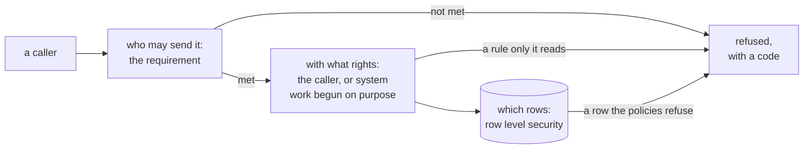
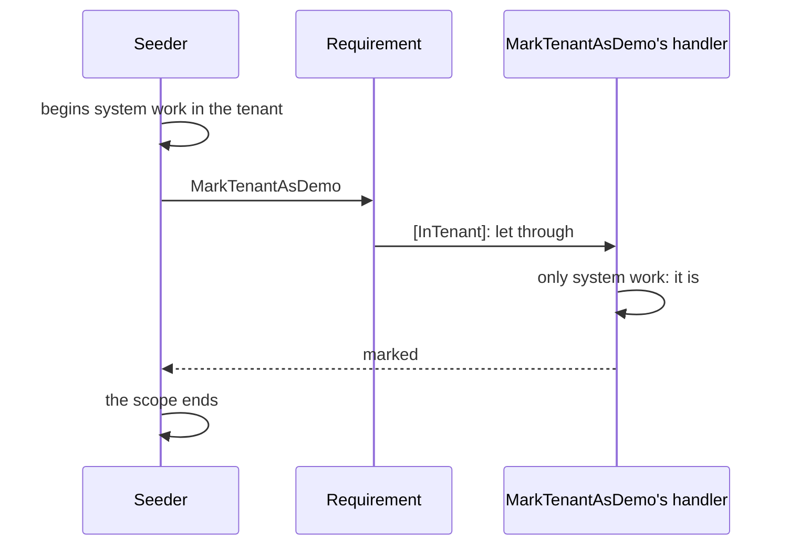
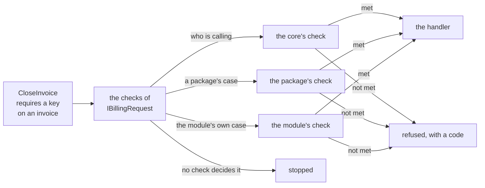
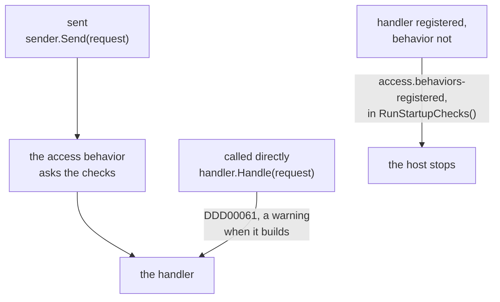

# Access requirements

Three questions stand between a caller and a row of your database, and each is answered in one place of its own:

- **Who may send the request.** Its requirement, which the request states and the module's checks hold the caller
  to at the door, before the handler runs: anyone, a signed-in user, a key held for the whole tenant, at a unit or on
  the thing the request is about. One attribute on the request, where a review reads it.
- **With what rights the code runs.** The caller the work runs as: the person who sent the request, or system work,
  which trusted code begins on purpose for what no caller may do, a handler, a job or a seeder, around the work it
  does, and which ends with it.
- **Which rows it may touch.** Row level security, which holds every row the work reads or writes to the caller it
  runs as, whatever the code above it did ([Row level security](row-level-security.md)).

The three are kept apart on purpose. A requirement never says what the work may then do, so a request anyone may
send gives its sender nothing by being sent; system work is never something a request requires, so no door opens
because the code behind it runs with more; and the database asks again, so a door that let too much through is not
the last word.



<details>
<summary>Show the code: the three, for a form anyone may send</summary>

```csharp shortened
[AllowAnonymousCallers]                                                         // who may send it: anyone
public sealed record RequestQuote(string Email, string Product) : IBillingRequest;

public sealed class RequestQuoteHandler(IQuoteStore quotes) : IHandler<RequestQuote>
{
    public async Task HandleAsync(RequestQuote command, CancellationToken cancellationToken)
    {
        using (Callers.Begin(Caller.SystemIn("billing")))                         // with what rights: system work, begun here
        {
            await quotes.AddAsync(command.Email, command.Product, cancellationToken);   // which rows: billing's policies
        }
    }
}
```

</details>

`DDDToolkit.Access` has the types for the first: saying it on the request, and holding the caller to it before the
handler runs. They are part of the core package, free of any dispatcher and of any
[supporting domain](writing-a-supporting-domain.md):

| Type | What it is |
|---|---|
| `IRequireAccess` | What a request implements: one member, `RequiredAccess`. |
| `[AllowAnonymousCallers]`, `[SignedIn]`, `[RequiresKey(key)]` | The core's attributes a request states its requirement with; a package ships the rest of the vocabulary the same way. |
| `AccessRequirement` | What `RequiredAccess` answers: a record that says what is required. The core spells the cases about who is calling; the others come from whoever can decide them. |
| `IAccessCheck` | What decides the cases of one owner: a package ships one, a module writes one for its own. |
| `CallerAccessCheck` | The core's check of who is calling, first in every module's set. |
| `AccessChecks<TRequests>` | The checks of one module. `RequireAsync(request)` holds a request to what it declared, and fails closed. |
| `Checked<T>` | What a check read on the way, kept for the code after it that handles the same request. |
| `RequestInHand` | The request a flow of work is handling, once its checks let it through, with the requirement it passed: what the handler and its save serve, and the check to ask again. |

Who is calling is a separate question, answered by the host: [running queries as the caller](row-level-security.md#running-queries-as-the-caller).

## What a request declares

A module declares one interface of its own that derives from `IRequireAccess`, and every command and query
of the module implements it. The interface is yours to write because it is what tells one module's requests
from another's: the checks are registered for it, so a request of billing is never held to the checks of
shipping. Mark it `[AccessRequests]` and declare it `partial`, so the toolkit's generator can write into it what its
requests' attributes say.

A request says what it requires with an attribute where the requirement reads no value of the request but a key and
an id it carries, which is nearly always. It answers `RequiredAccess` itself where the requirement is computed from
its values, and for a case of your module's own, which no attribute stands for:

```csharp
[EntityId<Guid>] public readonly partial record struct InvoiceId;

[AccessRequests]
public partial interface IBillingRequest : IRequireAccess;      // one interface per module

[SignedIn]
public sealed record MyInvoices : IBillingRequest;

[AllowAnonymousCallers]
public sealed record ListPlans : IBillingRequest;

public sealed record CloseInvoice(InvoiceId Invoice) : IBillingRequest
{
    AccessRequirement IRequireAccess.RequiredAccess => new BillingAccess.OnInvoice("billing.close", Invoice);
}
```

- **The attribute is plain C# by the time it runs.** The generator turns it into the call it stands for at compile
  time, one line per request, in the module's interface, which implements `RequiredAccess` with it:
  `MyInvoices => AccessRequirement.SignedIn()`. Nothing is read by reflection, nothing is looked up when a request
  is sent, and the request need not be partial. A request that answers `RequiredAccess` itself answers with its own,
  which C# takes over the interface's, so every reader of the property reads the same requirement either way: the
  module's checks, a handler that asks them again, a test.
- **One requirement, said one way.** An attribute and the property on one request is
  [DDD00078](diagnostics.md#ddd00078); two requirement attributes, [DDD00079](diagnostics.md#ddd00079). An
  interface that is not `partial` has nothing written into it, and a request's attributes there are
  [DDD00083](diagnostics.md#ddd00083), with the line to write.
- **The member is implemented explicitly,** where a request answers it, so the requirement stands next to the
  request's own fields without becoming one of them: it is not serialized with the request and not part of its
  shape.
- **A requirement says what is asked, never who may.** It carries a key and the ids the request names. The
  check reads the rest where it is kept. What a requirement cannot say, a second key or a rule about what is
  given to whom, stays in the handler, in plain sight, or in the use case of the package the handler calls.
- **There is no requirement that says nothing.** A request that declares none is stopped, so a requirement
  somebody forgot never opens a door, and where the interface is partial it is [DDD00077](diagnostics.md#ddd00077)
  when it builds (the compiler's own CS0535 where it is not). A request anyone may send says so:
  `[AllowAnonymousCallers]`, or `AccessRequirement.AllowAnonymous()`, so it reads as meant in a review where `None`
  would read as forgotten. The attribute is not called `[AllowAnonymous]`, because ASP.NET Core's
  `Microsoft.AspNetCore.Authorization` and HotChocolate's `HotChocolate.Authorization` each have an attribute of
  that name: a route or a resolver that imports either beside `DDDToolkit.Access` would not compile where it wrote
  it.
- **A requirement is a record,** so two that say the same are equal, and a test can hold every request to
  the one it is meant to declare.

<details>
<summary>Show the code: what the generator writes into the interface</summary>

```csharp title="BillingAccessBehavior.g.cs, shortened"
partial interface IBillingRequest
{
    AccessRequirement IRequireAccess.RequiredAccess => this switch
    {
        ListPlans => AccessRequirement.AllowAnonymous(),
        MyInvoices => AccessRequirement.SignedIn(),
        _ => throw new InvalidOperationException("... declares no access requirement ..."),   // a request of another project
    };
}
```

`CloseInvoice` has no line: it answers the property itself. The same file holds the
[behavior](#the-generated-behavior-with-mediator) where the project uses Mediator, and the lines alone where it does
not, since whatever asks the checks reads them.

</details>

## The vocabulary

Every request says what it requires with one of a few requirements, each named for what it requires and
spelled on whoever decides it. The attribute is the short way to say it; the call beside it is what the attribute
stands for, and what a request that computes its requirement writes:

| A request requires | Its attribute | Or, computed, `RequiredAccess =>` | Let through | Anyone else is refused with |
|---|---|---|---|---|
| anyone, a caller who did not sign in too | `[AllowAnonymousCallers]` | `AccessRequirement.AllowAnonymous()` | everyone: nobody is asked | |
| a signed-in user, who need not hold anything yet | `[SignedIn]` | `AccessRequirement.SignedIn()` | a user who signed in, an anonymous sign-in of the identity provider too | `access.not-signed-in` |
| a caller who works in the tenant | `[InTenant]`, of [Tenancy](tenancy.md#what-a-request-requires-of-its-caller) | `TenancyAccess.InTenant()` | a seat in the tenant the request was sent for, and system work there | the caller's own reason, such as `tenancy.not-seated` |
| a key for the whole tenant | `[RequiresKey(key)]` | `TenancyAccess.ForTheWholeTenant(key)` | whoever holds the key at the tenant's root now | `tenancy.not-permitted`, naming the key |
| a key at a unit | `[RequiresKey(key)]`, `[AtUnit]` on the unit | `TenancyAccess.AtUnit(key, unit)` | whoever holds the key at that unit now, there or above it | `tenancy.not-permitted`, with the key and the unit |
| a key on a resource | `[RequiresKey(key)]`, `[OnResource]` on the resource, `[ExpectedVersion]` on the version read, of [Membership](membership.md#a-document-and-the-people-it-is-shared-with) | `MemberAccess.On(key, resource, expectedVersion)` | whoever holds the key on it, through its members or from above | the resource's `not-found` or `not-permitted` |
| a query that shows the resources a key is held on | `[SeenWith<TResourceId>(key)]`, of [Membership](membership.md#inside-your-own-statements) | `MemberAccess.SeenWith<TResourceId>(key)` | every caller who signed in, and system work: the query's own statement leaves out what the caller does not hold the key on | the caller's own reason where it is nobody; the resource's `not-permitted`, naming the key, for a caller who did not sign in |
| one of the application's operators, on a query | `[RequiresOperator]` | `TenancyAccess.RequiresOperator()` | a signed-in user with an [operator's token role](tenancy.md#operators) | `tenancy.operators-only` |
| something only your module knows | | a record of your own | what your check lets through | your module's code |

The two of `AccessRequirement` are about who is calling and nothing else, so the core decides them, and a host
without any supporting domain has them. Who is calling is what the host's `ICallerAccessor` answers; in a host that
[requires explicit callers](row-level-security.md#fail-closed-callers), work nobody began a caller for fails with
`NoCallerException` before it is let through or refused.

- **`[SignedIn]`** asks whether the caller's token names a user. An anonymous sign-in, such as Supabase Auth
  makes for a visitor without an account, names one too, marked with the `is_anonymous` claim. A handler that
  should take only an account with a verified identity refuses that claim itself, as the registration that
  [provisions a tenant](tenancy.md#who-may-ask-and-what-the-work-runs-as) does, and as Tenancy's acceptance of
  an invitation does. The application's own work is nobody's sign-in, and is refused.
- **There is no requirement for the application's own work.** System work is a scope, not a door:
  [System work is a scope](#system-work-is-a-scope) says how a request sent by it, or a handler that needs it,
  is written.

Each call is a method on the class of whoever decides it, so the requirements read alike side by side:
`AccessRequirement.SignedIn()`, `TenancyAccess.InTenant()`, `MemberAccess.On(key, resource)`. A method rather
than a constructor, so a case closed over your own id takes it from the argument: `TenancyAccess.AtUnit(key,
unit)` is closed over your unit id without your writing it. And `AllowAnonymous()` and `SignedIn()` say who is let
through rather than what is checked, as the name a reviewer looks for. What each attribute stands for is its
package's to say, with an attribute of the core's on the attribute's class, `[StatesRequirement]` or
`[KeyMarker]`: the generator knows none of them by name, and a module can declare one for a case of its own the
same way ([Writing your own supporting domain](writing-a-supporting-domain.md)).

### Where the key is held

`[RequiresKey(key)]` is one attribute, wherever the key is held. A marker on one of the request's members says
where: none for the whole tenant, `[AtUnit]` at that unit or above it, `[OnResource]` on that resource through its
members, with `[ExpectedVersion]` beside it on the version the caller read, which the check compares only once the
caller may act. A marker goes on a positional parameter of a record as it is, or on a property; `[property: AtUnit]`
is read as well. Nothing is named by a string: no `nameof`, no member's name in an attribute.

```csharp
[RequiresKey(BillingKeys.CloseTheBooks)]                                     // for the whole tenant
public sealed record CloseTheBooks(int Year) : IBillingRequest;

[RequiresKey(BillingKeys.OpenLedger)]                                        // at the unit, or above it
public sealed record OpenLedger(string Name, [AtUnit] OrganizationUnitId Unit) : IBillingRequest;

[RequiresKey(DocumentKeys.Share)]                                            // on the document, through its members
public sealed record ShareDocument([OnResource] DocumentId Document, UserId With, [ExpectedVersion] long? ExpectedVersion = null) : IDocumentsRequest;

[RequiresKey(BillingKeys.ArchiveLedger)]                                     // an ordinary property takes a marker too
public sealed class ArchiveLedger : IBillingRequest
{
    [AtUnit] public required OrganizationUnitId Unit { get; init; }
}
```

The key is a constant, one of the catalogue's, as an attribute's argument is: a request may name its own constant,
`[RequiresKey(RequiredKey)]` beside `public const string RequiredKey = ProjectKeys.Edit;`, where its handler or a
list of abilities reads the same key.

### What combines

A request carries one requirement, and a marker says where for the key of that one. What does not combine is
reported where it is written, as an error, since a request that reads as if it said what it requires and says
something else is a door a review would take for closed:

| `[RequiresKey(key)]` with | no marker | `[AtUnit]` | `[OnResource]` | `[OnResource]` and `[ExpectedVersion]` |
|---|---|---|---|---|
| is | `ForTheWholeTenant(key)` | `AtUnit(key, unit)` | `On(key, resource)` | `On(key, resource, version)` |

| On one request | Goes with | Reported otherwise |
|---|---|---|
| a requirement attribute | nothing else that says what is required: no second attribute, and not the property | [DDD00079](diagnostics.md#ddd00079), [DDD00078](diagnostics.md#ddd00078) |
| `[AtUnit]` or `[OnResource]` | `[RequiresKey]`, one of the two, on a member of the id it marks that is never null | [DDD00080](diagnostics.md#ddd00080), [DDD00081](diagnostics.md#ddd00081) |
| `[ExpectedVersion]` | `[OnResource]`, on a `long?` | [DDD00080](diagnostics.md#ddd00080), [DDD00081](diagnostics.md#ddd00081) |
| `[RequiresKey]` without a marker | a package that says where such a key is held, Tenancy | [DDD00080](diagnostics.md#ddd00080) |
| `[SeenWith<TResourceId>(key)]`, `[RequiresOperator]` | a query | [DDD00082](diagnostics.md#ddd00082) on a command or a plain request of Mediator's |
| any of them | one module interface of the same project, `[AccessRequests]` and `partial` | [DDD00083](diagnostics.md#ddd00083) |

`[AllowAnonymousCallers]` with `[RequiresKey]` would open the door the key closes, and `[InTenant]` with
`[RequiresKey]` says less than the key alone: a caller who holds a key at a tenant's unit works in that tenant.

### A requirement computed from the request

Where the request's values decide which requirement it is, no attribute can say it, and the request answers the
property itself. The Tenancy sample's `SeatGrants` reads the roles a seat holds in every unit with the key for the
whole tenant, and those at one unit with the key there:

```csharp
public sealed record ListLedgers(OrganizationUnitId? Unit) : IBillingRequest
{
    AccessRequirement IRequireAccess.RequiredAccess => Unit is { } unit
        ? TenancyAccess.AtUnit(BillingKeys.Read, unit)
        : TenancyAccess.ForTheWholeTenant(BillingKeys.Read);
}
```

A unit that may be left out marked `[AtUnit]` is [DDD00081](diagnostics.md#ddd00081) for that reason: the
requirement is computed from whether it is given.

## System work is a scope

A requirement says who may send a request, and nothing about what the work then runs with. The application's own
work, system work, is no requirement at all: it is a scope that trusted code begins on purpose around the work,
`Callers.Begin(Caller.System)`, `Callers.Begin(Caller.SystemIn(scope))` or a supporting domain's own way, such as
Tenancy's `TenancyUseCases.BeginSystem()` and `BeginSystemIn(tenant)`. When its result is disposed, the caller before
it is current again.

- **Trusted code begins it, around the send or inside the handler.** A seeder, a job or an import begins it and
  calls the use case inside it, sending no request at all, as the sample's seeding provisions its tenants, or sends
  a request inside it, as the same seeding sends `MarkTenantAsDemo` in each tenant. A handler begins it itself for
  the one thing its caller could not do, as the registration that
  [provisions a tenant](tenancy.md#who-may-ask-and-what-the-work-runs-as) does.
- **The request says who may send it, as any other does.** A request system work sends in a tenant is sent by a
  caller in that tenant, `[InTenant]`, which lets the system work there through; a development route that
  provisions is `[AllowAnonymousCallers]`, a registration a signed-in person sends `[SignedIn]`. System work is
  nobody's sign-in, so a request that only system work outside any tenant sends, or one of a module without
  Tenancy, passes `[AllowAnonymousCallers]` alone: declare that, hold it to the list of requests anyone may send
  ([Holding it with a test](#holding-it-with-a-test)), so it is a decision a review sees, and refuse everyone else
  in its handler. Where nothing but trusted code ever sends it, calling the work inside the scope needs no request.
- **What only system work may do is refused past the door.** The handler, or the use case of the package it calls,
  asks who it runs as and refuses everyone else with `access.system-only` (`ToolkitRefusals.SystemOnly`).
  `Callers.RequireSystemWork(callers)` does it in any host; in a tenant, Tenancy's own answer says it with the
  tenant, `answers.RequireTenant().BySystem`, as the sample's `MarkTenantAsDemo` does, and Tenancy's provisioning
  refuses everyone else itself. A caller who sent the request gets nothing more by it, since the handler alone says
  what the system work does.
- **Begun means begun.** Ask `Callers.RequireSystemWork`, not `callers.Current.Kind`. In a host that does not
  [require explicit callers](row-level-security.md#fail-closed-callers), the accessor answers the application
  itself for any flow nobody began a caller for, a web request it does not know included; only the caller begun for
  the flow, `Callers.Ambient`, shows that trusted code began the work, and the method asks both.



<details>
<summary>Show the code: system work begun around the send, and a handler that lets only it through</summary>

```csharp shortened
// The seeding, trusted code: system work in the tenant, around what it sends
using (TenancyUseCases.BeginSystemIn(tenant.Id))
{
    await sender.Send(new MarkTenantAsDemo(), cancellationToken);
}

// Who may send it: a caller in the tenant, which the system work there is
[InTenant]
public sealed record MarkTenantAsDemo : ICommand, ITenantsRequest;

public sealed class MarkTenantAsDemoHandler(TenancyUseCases.IStore store, SampleAnswers answers) : ICommandHandler<MarkTenantAsDemo>
{
    public async ValueTask<Unit> Handle(MarkTenantAsDemo command, CancellationToken cancellationToken)
    {
        var scope = answers.RequireTenant();
        if (!scope.BySystem)
        {
            throw ToolkitRefusals.Refuse(ToolkitRefusals.SystemOnly);           // what only system work may do
        }

        // ... load the tenant, mark it, save
    }
}

// A module without Tenancy: an import a job sends inside Callers.Begin(Caller.System)
[AllowAnonymousCallers]                                                       // system work is nobody's sign-in
public sealed record ImportPrices(string File) : ICommand, IBillingRequest;

public sealed class ImportPricesHandler(ICallerAccessor callers, IPriceList prices) : ICommandHandler<ImportPrices>
{
    public async ValueTask<Unit> Handle(ImportPrices command, CancellationToken cancellationToken)
    {
        Callers.RequireSystemWork(callers);                                   // access.system-only for anyone else
        await prices.ImportAsync(command.File, cancellationToken);
        return Unit.Value;
    }
}
```

</details>

## What answers it

The cases are records that derive from `AccessRequirement`, each owned by whoever can decide it, and shipped
with the `IAccessCheck` that does:

| The case is about | Its requirement | Its check is added with |
|---|---|---|
| who is calling: anyone, a signed-in user | `[AllowAnonymousCallers]` and `[SignedIn]`, `AccessRequirement.AllowAnonymous()` and `SignedIn()`, of the core | nothing: every module's set asks the core's `CallerAccessCheck` first, and nobody has to decide that anyone may send a request |
| a tenant: a seat in it, a key for the whole of it or at a unit, operators | `[InTenant]`, `[RequiresKey(key)]` with `[AtUnit]` or without a marker, `[RequiresOperator]`: `TenancyAccess.InTenant()` and the rest of `TenancyRequirement`'s cases, of [Tenancy](tenancy.md#what-a-request-requires-of-its-caller) | `services.AddTenancyAccess<...>()`, for each module |
| a resource with members: a key held on it | `[RequiresKey(key)]` with `[OnResource]`, `[SeenWith<TResourceId>(key)]`: `MemberAccess.On(key, resource)` and `SeenWith`, of [Membership](membership.md#a-document-and-the-people-it-is-shared-with) | `services.AddDocumentMemberAccess<IFilingRequest>()`, generated for each resource |
| something only your module knows | a record of your own | `services.AddAccessCheck<IBillingRequest, BillingAccessCheck>()` |

A check of your own is two methods. `Decides` says whether a requirement is one of its cases, and only looks
at the requirement. `RequireAsync` then holds the caller to it: passing is returning, refusing is throwing a
refusal with your module's code. So a branch the check forgets lets the caller through: with several cases,
end the `switch` with `default: throw`, as the packages' checks do, and a case added later without its
branch refuses. Below, the cast does the same for the one case there is.

```csharp
public abstract record BillingAccess : AccessRequirement
{
    public sealed record OnInvoice(string Key, InvoiceId Invoice) : BillingAccess;
}

// Yours: whatever answers whether the caller holds a key on an invoice
public interface IInvoiceAccess
{
    ValueTask<bool> HoldsKeyAsync(string key, InvoiceId invoice, CancellationToken cancellationToken);
}

public sealed class BillingAccessCheck(IInvoiceAccess invoices) : IAccessCheck
{
    public bool Decides(AccessRequirement requirement) => requirement is BillingAccess;

    public async ValueTask RequireAsync(AccessRequirement requirement, IRequireAccess request, CancellationToken cancellationToken)
    {
        var required = (BillingAccess.OnInvoice)requirement;
        if (!await invoices.HoldsKeyAsync(required.Key, required.Invoice, cancellationToken))
        {
            throw new RefusalException("billing.not-permitted", RefusalKind.NotPermitted, "That takes a key on the invoice.");
        }
    }
}

public static class BillingModule
{
    public static IServiceCollection AddBilling(this IServiceCollection services)
        => services.AddAccessCheck<IBillingRequest, BillingAccessCheck>();
}
```

`AddAccessCheck` registers the check, the set of checks of the interface, `AccessChecks<IBillingRequest>`, and
`Checked<T>`, each per scope. A check added for one interface is not asked about the requests of another: a
module that uses a package's check adds it for its own interface. Adding the same check for the same
interface again changes nothing.

**It fails closed.** `AccessChecks<IBillingRequest>.RequireAsync` stops a request that declares nothing, and
one whose requirement none of the checks added for its interface decides, with an exception that names the
check that is missing. A case added without its check lets nobody in. Where the case is a package's, the
exception names the package's call that adds its check, `services.AddTenancyAccess<IBillingRequest, TContext>()`
for Tenancy's, which the package says with `[AccessCheckRegistration]` on its requirement; a case of your own
names `AddAccessCheck<IBillingRequest, TCheck>()`.

**The handler acts on its request.** The check was asked about what the request names, so the handler takes
its ids from the request, and loads what it changes as its caller may see it now:

```csharp
public interface IInvoiceStore
{
    Task CloseAsync(InvoiceId invoice, CancellationToken cancellationToken);
}

public sealed class CloseInvoiceHandler(IInvoiceStore store)
{
    public Task HandleAsync(CloseInvoice command, CancellationToken cancellationToken)
        => store.CloseAsync(command.Invoice, cancellationToken);
}
```

Permission is about who is calling. That what the handler changes is right is the aggregate's to keep, that
nobody changed it since the caller read it is the version's (`ExpectVersion` at the load, and the save's own
comparison), and where the database checks every row it checks the write again as the caller.

**What a check read, for the code after it.** A check that had to work out an answer the handler needs as
well, one it would otherwise ask a second time, keeps it in `Checked<T>`: `KeepFor(request, answer)` in the
check, `TakeFor(request)` in the handler, which hands out what the request's latest pass kept, once, and throws
for a request that passed no check that keeps a `T`. A request is found by reference, so declare it as a class
or a record class. What a check keeps is kept with the [request in hand](#the-request-in-hand) as well, where
code that is not handed the request finds it: that is how the Membership package's
[expert hold](membership.md#the-expert-hold) holds a save to what its check read, with no line in the handler.



<details>
<summary>Show the code: what asks the checks</summary>

```csharp shortened
// AccessChecks<TRequests>.RequireAsync, the package's, shortened
// The first check that decides a requirement holds the caller to it
var requirement = request.RequiredAccess
    ?? throw new InvalidOperationException("CloseInvoice declares no access requirement. ...");

if (requirement is AccessRequirement.Anyone)                    // AllowAnonymous()
{
    return;                                                     // decided here, by asking nobody
}

var check = checks.FirstOrDefault(candidate => candidate.Decides(requirement))
    ?? throw new InvalidOperationException("CloseInvoice declares 'BillingAccess.OnInvoice', which none of the access checks registered for IBillingRequest decides. ...");

await check.RequireAsync(requirement, request, cancellationToken);  // in hand for the flow that handles the request
```

</details>

**The check a request passed stays with its handler.** The request is [in hand](#the-request-in-hand) for the
flow of work that handles it, with the requirement it passed, so the check can be
[asked again](#asking-its-check-again) later in that flow: the toolkit does that when the policies refuse a save
the check allowed.

## Asking the checks without Mediator

Something has to ask the checks in front of every handler. The core knows no dispatcher, so that is one
call from whatever sends your requests: your own dispatcher, an endpoint filter, a behavior of another
library.

```csharp
public interface IHandler<TRequest>
{
    Task HandleAsync(TRequest request, CancellationToken cancellationToken);
}

public sealed class BillingDispatcher(AccessChecks<IBillingRequest> checks, IServiceProvider services)
{
    public async Task SendAsync<TRequest>(TRequest request, CancellationToken cancellationToken)
        where TRequest : class, IBillingRequest
    {
        await checks.RequireAsync(request, cancellationToken);                              // returns, or refuses
        await services.GetRequiredService<IHandler<TRequest>>().HandleAsync(request, cancellationToken);
    }
}
```

The checks, the dispatcher and the handlers come from one scope, the request's: what a check keeps is
taken by a handler of the same scope. Ask the checks and run the handler in one `async` method, as above: the
request is then [in hand](#the-request-in-hand) for the handler and its save, with the check it passed, and no
longer once the method returned. A method without `async` that hands on the checks' task leaves the request in
hand for whoever called it instead.

## The request in hand

`AccessChecks<TRequests>.RequireAsync(request)` puts the request in hand for the flow of work that asked, from
the moment the checks let it through: `RequestInHand.Current.Request` is that request, in the method that asked
and in whatever it runs after, the handler and the save the handler ends with among it, and
`RequestInHand.Current.Requirement` what it declared. A request the checks refused is in nobody's hand. What a
check kept for the request is found there without it, `Checked<T>.TryFindInHand(out var kept)`, and left where
it is.

```csharp
await checks.RequireAsync(command, cancellationToken);    // in hand from here, once it passed
await handler.HandleAsync(command, cancellationToken);    // and here, down to the save
// RequestInHand.Current.Request is command; Checked<T>.TryFindInHand(out var kept) finds what its check kept
```

- **It follows the flow, as `Callers.Begin` does:** into what the method runs after the checks, into tasks
  started there, and not back out. Once the method that asked returns, its caller has nothing in hand. So two
  requests sent side by side each have their own, a request sent from inside another's handling, through a
  sender of its own, is in hand for its own handling, and the other is in hand again once it returns.
- **The method that asks is `async`.** Only an `async` method gives its caller the flow back as it was. One
  that is not, that asks the checks and returns the task of the handling it chains on, leaves the request in
  hand for its caller, and whatever that caller runs next, a handler it calls directly included, is taken for
  part of the request's handling.
- **A helper that only asks the checks** has the request in hand inside itself alone. Code that relies on the
  request in hand, as the expert hold does, then finds none, and says so.
- **What runs after the handling returned has nothing in hand,** so a save that relies on it happens inside:
  a unit-of-work behavior that saves after the handler is registered after the access behavior, and an
  endpoint does not save after `Send`.
- **A query answered with a stream** has its request in hand until its handler hands out the first item:
  every item after that is asked for by whoever reads the stream, in that reader's flow.
- **It is not the scope.** A scope may handle several requests, the mutations of one GraphQL request say: what
  is in hand is the one whose handling the code is in, and nothing a request before it left in the scope.

### Asking its check again

`RequestInHand.Current.StillPassesAsync()` asks the check the request passed again, as the same caller, now, and
keeps nothing for a handler while it does: `true` when it still lets the caller through, `false` when it refuses,
and anything else the check throws comes out as it is: a `ConcurrencyConflictException` too, which says the
resource moved on from the version the request named, not whether the caller may. A request anyone may send passed
by asking nobody, and passes again the same way. What is asked again is the requirement the request declared: a
rule a handler or a package's use case checks itself, past that requirement, is not part of it.

The toolkit asks it when the policies or a guard refuse a save the check allowed, to tell a caller whose rights
changed in between from a rule C# and the policies hold differently:
[When the policies refuse what C# allowed](row-level-security.md#when-the-policies-refuse-what-c-allowed).
`ToString()` names the request and its requirement by their types, `ChangeProjectName (MemberAccess<ProjectId>.On)`,
never their values, for a log line.

## The generated behavior, with Mediator

In a project that references [Mediator](https://github.com/martinothamar/Mediator), the source-generated one
(`Mediator.Abstractions`), mark the interface, and the toolkit's generator writes the pipeline behavior that
asks the checks, and its registration. The toolkit's packages reference no dispatcher: the only code that
names Mediator is written into your project.

```csharp
[AccessRequests]
public partial interface IBillingRequest : IRequireAccess;

// Written beside the interface: BillingAccessBehavior<TMessage, TResponse>, for every message that implements
// it and for no other, and the call that puts it in the pipeline with the set of checks it asks.
services.AddBillingAccessBehavior();
```

<details>
<summary>Show the code: what the generator writes</summary>

```csharp title="BillingAccessBehavior.g.cs, shortened"
public sealed class BillingAccessBehavior<TMessage, TResponse> : IPipelineBehavior<TMessage, TResponse>
    where TMessage : notnull, IBillingRequest, IMessage
{
    private readonly AccessChecks<IBillingRequest> _checks;

    public async ValueTask<TResponse> Handle(TMessage message, MessageHandlerDelegate<TMessage, TResponse> next, CancellationToken cancellationToken)
    {
        await _checks.RequireAsync(message, cancellationToken).ConfigureAwait(false);
        return await next(message, cancellationToken).ConfigureAwait(false);
    }
}

public static class BillingAccessBehaviorRegistration
{
    public static IServiceCollection AddBillingAccessBehavior(this IServiceCollection services)
    {
        services.AddAccessChecks<IBillingRequest>();
        services.TryAddEnumerable(ServiceDescriptor.Scoped(typeof(IPipelineBehavior<,>), typeof(BillingAccessBehavior<,>)));
        return services;
    }
}
```

</details>

- The behavior is named after the interface (`IBillingRequest` gives `BillingAccessBehavior`), sits in its
  namespace and is as visible as it is. An interface it cannot be written for is
  [DDD00056](diagnostics.md#ddd00056).
- A message that is answered with a stream, an `IStreamQuery<T>` say, passes a pipeline of its own in
  Mediator, `IStreamPipelineBehavior<,>`, which no `IPipelineBehavior<,>` is part of. So a second class is
  written for that one, `BillingAccessStreamBehavior<TMessage, TResponse>`, and the same call registers it:
  a stream query that implements the interface is asked about before its handler streams anything.
- Both are registered per scope, as the checks are, so register Mediator with `ServiceLifetime.Scoped`.
  Behaviors run in the order they were registered.
- How `IPipelineBehavior<TMessage, TResponse>` and `IStreamPipelineBehavior<TMessage, TResponse>` are
  implemented is read from the version of the library the project references, the order of `Handle`'s
  parameters included; a version the generator does not know is [DDD00057](diagnostics.md#ddd00057), and
  nothing is written.
- A notification is published to its handlers through neither pipeline, so nothing asks what one requires:
  a notification that implements the interface is [DDD00058](diagnostics.md#ddd00058). What needs a check is
  sent as a command or a query.
- Without the library no behavior is generated: you call `RequireAsync` yourself,
  [as above](#asking-the-checks-without-mediator). What the requests' attributes say is written into a partial
  interface all the same, since your call reads it.

Mediator's own generator registers the behaviors a host lists in `MediatorOptions.PipelineBehaviors`. It reads
that list from the code as you wrote it, and one generator never sees what another writes. So it depends on
where the interface is declared:

| The interface is declared in | The generated behavior |
|---|---|
| a module's class library, which the project that runs Mediator's generator references | is a type of a referenced assembly like any other: add it with `services.AddBillingAccessBehavior()`, or list it. Listed, the set of checks it asks still has to be registered: `AddAccessCheck` does that, and `AddAccessChecks<IBillingRequest>()` for a module that adds no check. And listed, the second class goes in the list of the other pipeline, `typeof(BillingAccessStreamBehavior<,>)` in `MediatorOptions.StreamPipelineBehaviors`: a host that lists the first alone leaves the module's stream queries unasked, and once the module has one, [does not start](#when-nothing-asks-the-checks) |
| the project that runs Mediator's generator itself | cannot be listed: `typeof(BillingAccessBehavior<,>)` in the list is Mediator's error MSG0007. Add it with `services.AddBillingAccessBehavior()`, after `AddMediator`, and it runs after the behaviors you did list |

A host of one project that wants every behavior in that list, so that Mediator's generator registers them
all, writes this one itself and leaves `[AccessRequests]` off the interface.
[DDD00057](diagnostics.md#ddd00057) shows the whole class; a host that sends stream queries writes the one
for `IStreamPipelineBehavior<,>` as well.

## When nothing asks the checks

The checks hold nobody to anything by themselves. The behavior asks them, in the pipeline a request passes when
it is sent, and a request that reaches its handler some other way is asked nothing. A handler that takes what
its check kept, `Checked<T>`, fails there for want of it. Any other handler runs, held only by what the database
checks, and per table that is coarser than what one request requires. A policy has to let every member who may
write a project's row write it, to close the project or to rename it, so it lets a rename through for one who may
only close it. So the toolkit watches the two ways round the behavior it can see: a missing behavior stops the
host when it starts, in a host that calls `RunStartupChecks()`, and a handler called in code is reported when the
code builds.

- **The behavior is not in the pipeline.** A module registers its checks and not the behavior that asks them, a
  host forgets a module's registration altogether, or a host that lists its behaviors for Mediator's generator
  leaves one out. The registration of the checks brings the [start-up check](startup-checks.md)
  `access.behaviors-registered` for an interface the toolkit wrote a behavior for, and a host that calls
  `RunStartupChecks()` does not start: the message names the behavior, its interface, and the line that adds it.
  Nothing to write for it: `AddAccessCheck`, `AddTenancyAccess`, the generated `AddDocumentMemberAccess` and
  `AddBillingAccessBehavior` itself all bring it.
- **What the check reads.** Mediator registers every handler under its handler interface, closed over its
  message, so the check reads from the host's registrations which commands and queries it can handle. For each
  one of an interface the toolkit wrote a behavior for, in any module, the behavior has to be in its pipeline:
  registered open, as the generated call adds it, or closed over that message, as Mediator registers a behavior a
  host lists. A query answered with a stream needs the behavior for streams, and a module with no such query
  needs nothing in that pipeline. A behavior registered as something no pipeline asks for, as itself say, does
  not count, and the message says so. One registration brings the check for every module, so a module whose
  registration was forgotten is found as long as any other registered its checks. A host that registered no
  module's checks at all brings no check: nothing of the toolkit's access is in it to bring one.
- **Code calls a handler.** `handler.Handle(request, cancellationToken)` with a request of a marked interface is
  [DDD00061](diagnostics.md#ddd00061), a warning at the call, with a code fix that sends the request through an
  `ISender` the code reaches. Constructing or injecting a handler is not reported, the call is. Neither is a
  decorator that hands its inner handler the request it was given, which passed the pipeline on its way in, nor
  anything in a test project, where a test calls a handler on purpose to test it alone.
- **A transport goes round the pipeline.** A route, a GraphQL resolver or a message consumer that sends through
  `ISender` passes the behavior like any other caller; one that calls a handler of a marked request is the case
  above, and is reported where it is written. One that dispatches some other way altogether asks the checks
  itself, `AccessChecks<IBillingRequest>.RequireAsync`, [as above](#asking-the-checks-without-mediator): neither
  the build nor the start can see such a way. That includes a dispatcher that calls `Handle` on a handler of a
  type parameter with no constraint to a marked interface: the build cannot tell which requests pass through it.



<details>
<summary>Show the code: what the start-up check says, and a call the build reports</summary>

```csharp
// A module that registers its check and forgot the behavior
services.AddAccessCheck<IBillingRequest, BillingAccessCheck>();
// services.AddBillingAccessBehavior();

builder.Services.RunStartupChecks();
```

```text
System.InvalidOperationException: BillingAccessBehavior<TMessage, TResponse>, the pipeline behavior the toolkit
wrote to ask the access checks of IBillingRequest, is not in the pipeline: every command and query that implements
IBillingRequest reaches its handler with nothing asking what it requires, held only by what the database checks.
Add services.AddBillingAccessBehavior() where the module registers its checks.
```

A host that lists the behaviors for Mediator's generator and leaves one out is told to list it, rather than to
call the generated registration as well, which would put the other one in the pipeline twice:

```text
System.InvalidOperationException: BillingAccessStreamBehavior<TMessage, TResponse>, the behavior the toolkit wrote
to ask the access checks of IBillingRequest of a query answered with a stream, is not in the pipeline of streams:
every such query that implements IBillingRequest is streamed with nothing asking what it requires. The host lists
its behaviors for the Mediator library: list typeof(BillingAccessStreamBehavior<,>) among its
StreamPipelineBehaviors as well.
```

```csharp
// With the Mediator library, a command of IBillingRequest, marked [AccessRequests] as above, and its handler
public sealed record CloseOverdueInvoice(InvoiceId Invoice) : ICommand, IBillingRequest
{
    AccessRequirement IRequireAccess.RequiredAccess => new BillingAccess.OnInvoice("billing.close", Invoice);
}

public sealed class CloseOverdueInvoiceHandler(IInvoiceStore store) : ICommandHandler<CloseOverdueInvoice>
{
    public async ValueTask<Unit> Handle(CloseOverdueInvoice command, CancellationToken cancellationToken)
    {
        await store.CloseAsync(command.Invoice, cancellationToken);
        return Unit.Value;
    }
}

public sealed class InvoiceReminders(CloseOverdueInvoiceHandler handler, ISender sender)
{
    public async Task CloseOverdueAsync(InvoiceId invoice, CancellationToken cancellationToken)
    {
        await handler.Handle(new CloseOverdueInvoice(invoice), cancellationToken);   // DDD00061: past the behavior
        await sender.Send(new CloseOverdueInvoice(invoice), cancellationToken);      // through it, as the fix writes it
    }
}
```

The generator says which behaviors it wrote for an interface, in an attribute of the assembly that declares it,
which is what the start-up check reads:

```csharp title="BillingAccessBehavior.g.cs, its first line"
[assembly: AccessBehavior(typeof(IBillingRequest), typeof(BillingAccessBehavior<,>),
    StreamBehavior = typeof(BillingAccessStreamBehavior<,>), Registration = "services.AddBillingAccessBehavior()")]
```

</details>

## Holding it with a test

A few things no check can see are worth a test of your own, over the requests of every module:

- **Every command and query declares.** A request that implements no interface derived from `IRequireAccess`
  passes unchecked, since nothing asks about it. List the request types of a module by reflection and hold
  each to implementing the module's interface.
- **Every requirement has a check.** `AccessChecks<TRequests>.Decides(requirement)` says whether a request
  that declares a requirement can pass at all, without reading anything. Ask it for every requirement the
  module's requests declare, and a case added without its check fails the build rather than a request.
- **A requirement that refuses nobody for want of the key is a query's.** `[SeenWith<TResourceId>(key)]` lets
  a signed-in caller through, one that holds nothing too, and refuses a caller who did not sign in, who
  reaches nothing under any rules: it says what a query's own statement filters by, and that filter is the check.
  Declared on a message of Mediator's that is no query, a command or a plain `IRequest`, it is
  [DDD00082](diagnostics.md#ddd00082) when it builds; a requirement of your own that works the same way, the same
  requirement answered as `RequiredAccess`, and a request of another dispatcher the build cannot tell for a query
  are a test's to hold, as the Tenancy sample's `AccessDeclarationTests.Only_a_query_declares_what_it_shows` does.
- **A request anyone may send is one somebody meant.** List the requests that declare
  `AccessRequirement.AllowAnonymous()`, with the attribute or the property, and hold them to a list of your own, so
  a new one is a decision a review sees. The Tenancy sample holds it to none: every route of it takes a token.
- **The property is for what an attribute cannot say.** Hold the requests that answer `RequiredAccess` themselves
  to a case of your module's own or a requirement computed from their values, as the Tenancy sample's
  `AccessDeclarationTests` does, so one that could be an attribute is written as one.

Because a requirement is a record, the same test can pin which request declares which: a table of request
types and the requirement each is meant to answer, compared with what they do answer.
