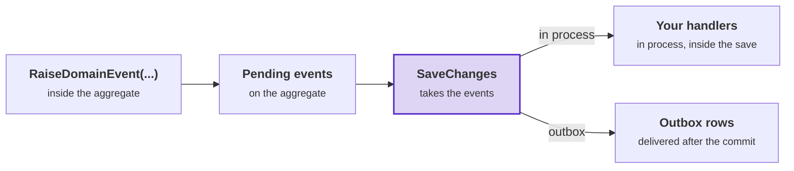

# Domain events

When an order is cancelled, other things must follow: the stock reserved for it is released, the customer gets a
message, and the payment is refunded. If `Cancel` does each of these itself, the aggregate needs a mailer, a stock
service and a payment client. The aggregate then depends on every part of the system that reacts to it, and each new
reaction means a change to the order.

A domain event records that something happened. The order records that it was cancelled, and the code that cares
reacts to that event. The side effects stay out of the aggregate. Other aggregates and other modules can react
without the aggregate knowing about them.

The toolkit gives every event an id and a timestamp. Only the aggregate that owns an event can raise it, and only the
persistence layer can drain it. This page shows how to declare, raise and read an event. It then covers delivery, the
id and the timestamp, and the stable name an event needs once it is stored.

## Declaring an event

An event is a record that derives from `DomainEvent`. Name it after what happened:

```csharp
using DDDToolkit.BaseTypes;

public sealed record OrderCancelled(OrderId OrderId, CancellationReason Reason) : DomainEvent;
```

`DomainEvent` supplies two properties:

```csharp
public Guid EventId { get; init; }            // Guid.CreateVersion7(), time ordered
public DateTimeOffset OccurredAt { get; init; }   // UtcNow
```

An event needs no attribute and no `partial`. It is an ordinary record.
[The event id and the timestamp](#the-event-id-and-the-timestamp) explains what the two properties are for.

## Raising an event

`RaiseDomainEvent` is `protected` on `AggregateRoot<TId>`, so only the aggregate the event describes can create it:

```csharp
[AggregateRoot<OrderId>]
public partial class Order
{
    public void Cancel(CancellationReason reason)
    {
        if (Status == OrderStatus.Shipped)
        {
            throw new InvalidOperationException("A shipped order cannot be cancelled.");
        }

        Status = OrderStatus.Cancelled;
        RaiseDomainEvent(new OrderCancelled(Id, reason));
    }
}
```

No code outside the aggregate can add an event to it. This matters when events are your integration contract. An
event that says an order was cancelled should exist only if the order was cancelled.

Child entities marked `[Entity<TId>]` have no event list. A change to a child is a change to its aggregate, so the
root raises the event.

## Reading and draining

```csharp
IReadOnlyList<IDomainEvent> pending = order.DomainEvents;
```

`DomainEvents` is a read-only view. It is marked [`[Internal]`](value-objects.md#hiding-members), the toolkit's
marker for infrastructure members, so it is left out of your tables, your JSON and your GraphQL schema.

Draining the events is hard to reach on purpose. `IHasDomainEvents` is implemented explicitly:

```csharp
public interface IHasDomainEvents
{
    IReadOnlyList<IDomainEvent> DomainEvents { get; }
    IReadOnlyList<IDomainEvent> DequeueDomainEvents();   // returns and empties
    void ClearDomainEvents();                            // discards
}
```

```csharp
var events = ((IHasDomainEvents)order).DequeueDomainEvents();
```

You normally do not write that line. The Entity Framework integration drains the events during the save. The cast is
required on purpose. Application code that could call `ClearDomainEvents()` without the cast could save a change and
drop the event for it. When events are your integration contract, that is a data integrity problem.

## Delivery

Raising an event adds it to a list on the aggregate. `DDDToolkit.EntityFramework` delivers it to the handlers, in one
of two ways. In the diagram, purple marks the save, where the two ways split:



<details>
<summary>Show the code: choosing how events are delivered</summary>

One line in the registration chooses the way. The aggregate does not change:

```csharp
// in process: handlers run inside the save
builder.Services.AddDDDToolkitEntityFramework(options => options.DispatchWithMediator());

// through the outbox: rows in the same transaction, delivered afterwards
builder.Services.AddDDDToolkitEntityFramework(options =>
{
    options.DispatchWithMediator();
    options.UseOutbox(outbox => outbox.RegisterEventsFromAssemblyContaining<Program>());
});
builder.Services.AddOutboxBackgroundService<OrderingContext>(TimeSpan.FromSeconds(2));
```

[Delivering domain events](event-delivery.md) shows both ways step by step, with the rest of the setup.

</details>

**In-process dispatch** runs the handlers during `SaveChanges`, before the commit. Changes that a handler makes to the
same `DbContext` are saved in the same transaction, and a handler that throws cancels the save. This is simple and
transactional. It is also best effort. Nothing survives a process crash, and handlers must be fast, because the
transaction stays open while they run.

**Outbox delivery** writes one row per event in the same transaction as the aggregate. A separate reader delivers the
rows afterwards. The rows are written together with the data, so an event is never lost, and never published for a
transaction that rolled back. Delivery is at least once, so handlers must be idempotent, keyed on `EventId`.

Use in-process dispatch for side effects in the same database. Use the outbox for anything that leaves the process.
[Domain event delivery](event-delivery.md) has the configuration for both.

## The event id and the timestamp

`EventId` is the idempotency key. Any at-least-once delivery hands the same event to a handler twice at some point,
and the handler needs a stable value to recognize it. `OccurredAt` records when the thing happened. A handler may run
much later.

Both properties are `init`, so code that creates the event can set its own values:

```csharp
var evt = new OrderCancelled(id, reason) { OccurredAt = recorded };
```

This is useful when you replay events you already have. It does not help in a test, because the aggregate creates
the event, and the test never calls the event's constructor. In a test, `DomainEventClock.Use(timeProvider)` sets the
clock that both default values read ([Deterministic time in tests](testing.md#deterministic-time-in-tests)).

You can implement `IDomainEvent` directly instead of deriving from `DomainEvent`. Then you provide `EventId` and
`OccurredAt` yourself.

## Stable names

An event that lives only in memory needs no name. Once it is stored or published, a name is written with it, in an
outbox row or on a message. Later code reads that name back, and the class may have been renamed in the meantime. So
every event has a name. You rarely have to write it.

### The default name

An event without a name of its own is named after its module and its class, both in kebab case. The module is the one
the assembly declares, with `<DDD_Module>Ordering</DDD_Module>` in its project file or with `[assembly: Module]`
([Modules](modules.md)):

```csharp
[assembly: Module("Ordering")]

public sealed record OrderPlaced(OrderId OrderId, CustomerId Customer) : DomainEvent;   // ordering.order-placed
public sealed record HTTPCallbackReceived(string Url) : DomainEvent;                   // ordering.http-callback-received
```

```csharp
DomainEventName.For<OrderPlaced>();   // "ordering.order-placed"
DomainEventName.For(someEvent);       // same, from an instance
```

In an assembly without a module, the name has no module part: `order-placed`. The namespace is not part of the name,
so you can move a class to another namespace or folder without changing its name.

### The version in the class name

A class name that ends in `V` and a number is that version of its event. The suffix is not part of the name, so
every version of one event has the same name:

| Class | Name | Version |
|---|---|---|
| `OrderPlaced` | `ordering.order-placed` | 1 |
| `OrderPlacedV2` | `ordering.order-placed` | 2 |
| `Level2Reached` | `ordering.level2-reached` | 1, because the digits do not follow a `V` |

A class can also state its version with `[IntegrationEvent(Version = n)]`. A stated version wins over the version in
the name. Somebody wrote it on purpose, and the suffix is the convention for when nobody did. When a class has both and
they differ, the suffix is ignored and the build warns with [DDD00034](diagnostics.md#ddd00034). Its code fix renames
the class to the version it is. A suffix that cannot be a version, such as `V0` or `V01`, fails the build with
[DDD00035](diagnostics.md#ddd00035). [Versioning and upcasting](integration-events.md#versioning-and-upcasting)
explains what a version is for.

### Renaming a class

The default name follows the class. Rename `OrderPlaced` to `PlacedOrder`, and new rows are written as
`ordering.placed-order`. The rows already in the outbox, and every consumer, still use `ordering.order-placed`. So
when you rename the class, pin the old name:

```csharp
[DomainEventName("ordering.order-placed")]
public sealed record PlacedOrder(OrderId OrderId, CustomerId Customer) : DomainEvent;
```

A published contract pins its name in its own attribute, `[IntegrationEvent("ordering.order-placed")]`. The version
still comes from the class name, so `PlacedOrderV2` with that attribute is `ordering.order-placed` version 2.

### Two events with one name

Two classes of one module can have the same name in different namespaces. The default name is then the same for both.
An outbox row or a message could not say which of the two it is, so the compiler reports an error,
[DDD00036](diagnostics.md#ddd00036), on both classes:

```csharp
namespace Ordering.Orders  { public sealed record OrderPlaced(OrderId OrderId) : DomainEvent; }
namespace Ordering.Returns { public sealed record OrderPlaced(OrderId OrderId) : DomainEvent; }
// error DDD00036: 'Ordering.Returns.OrderPlaced' and 'Ordering.Orders.OrderPlaced' are both stored or
// published as 'ordering.order-placed' version 1 ...
```

The code fix pins another name on the class you run it on, built from its namespace or its containing type:
`[DomainEventName("ordering.returns-order-placed")]`. You can also rename one of the classes. The toolkit does not make
the names unique by itself, for example from the namespace. Then a name would change when a class moved, or when a
second class with the same name appeared, and the rows written under the old name would never be read, without a
warning.

The check compares events of one kind only:

| These two | Error? |
|---|---|
| Two domain events with one name and version | Yes |
| Two published contracts with one name and version, such as `OrderPlaced` and `OrderPlacedV1` | Yes |
| A domain event and the contract it is published as, `OrderPlaced` and `OrderPlacedV1` | No. This is the normal pattern. |
| `OrderPlacedV1` and `OrderPlacedV2` | No. These are versions. |

The check runs where the module compiles, so it sees the events of that assembly. Two assemblies that declare the same
module without referencing each other are compared when the application starts. The outbox registry then refuses the
second event.

### Name constants

For every name that the module's events are stored or published under, the generator writes a constant into a class
named after the module:

**`EventNames.g.cs`**

```csharp
public static class OrderingEventNames
{
    /// <summary><c>ordering.order-placed</c>: OrderPlaced (version 1), OrderPlacedV2 (version 2).</summary>
    public const string OrderPlaced = "ordering.order-placed";
}
```

Use the constants where you write a name by hand: a topic binding, a test, a log query. Do not use them in an event's
own `[DomainEventName]` or `[IntegrationEvent]`. The generator reads those attributes to write the constants, so a
constant cannot name its own event. Write the literal there.

A constant is named after the event's name. So a renamed class that pins its old name keeps its old constant. When
every event the class names is published, as in a contracts assembly, the generator marks the class
`[ModuleContract]`, so other modules can use the constants.

### Where the name is stored

- **The outbox row** stores the name in `EventName`. The generated registration contains the name as a literal,
  written when the module compiles, so nothing reads an attribute at start-up.
- **The published message** carries the name in `Name`. An inbox and a pgmq topic route on it.
- **A broker exchange**, with MassTransit or Wolverine and `UseIntegrationEventNames()`, is named with the name and the
  version: `ordering.order-placed.v1` ([Transports](transports.md)).

**`IntegrationEventExtensions.g.cs`**, shortened:

```csharp
public static OutboxOptions AddOrderingIntegrationEvents(this OutboxOptions outbox)
{
    ArgumentNullException.ThrowIfNull(outbox);
    outbox.RegisterEvent<Ordering.OrderCancelled>("ordering.order-cancelled", 1);
    outbox.RegisterEvent<Ordering.OrderPlaced>("ordering.order-placed", 1);
    return outbox;
}
```

The `1` is the version of the event's shape. It matters when the shape changes.
[The generated registration](integration-events.md#the-generated-registration) shows what else the method
registers.

### Rows written by an older build

Before events were named by convention, an event without `[DomainEventName]` was stored under its bare class name,
`OrderPlaced`. The outbox still finds such a row. Every registered type also matches its class name, as long as no
current name has the same spelling and no other registered class has that class name. The outbox reads such a row as
that class, upcasts it if the class is an older shape, and publishes it under the type's current name.

## Testing

With events, you can test an aggregate without a database. Call a method, then check which events it raised.
`DDDToolkit.Testing` does the checking, and reports only the events that the call under test raised:

```csharp
AggregateScenario.Given(order)
    .When(o => o.Cancel(CancellationReason.OutOfStock))
    .RaisedExactly<OrderCancelled>();
```

See [Testing aggregates](testing.md). It also shows how to fix the clock an event is stamped with, in
[Deterministic time in tests](testing.md#deterministic-time-in-tests).
