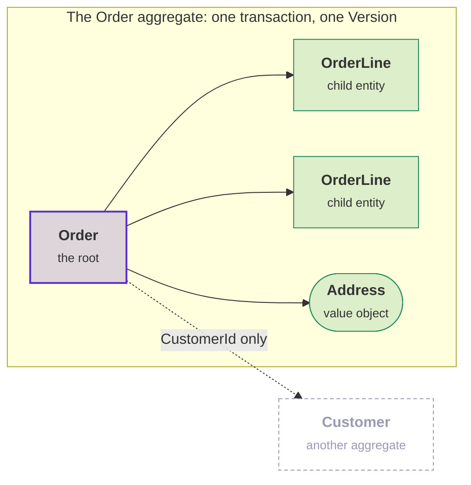

# Entities and aggregates

An order is placed, gets another line, has its address corrected, is paid and is shipped. Every property changed, and
it is still the same order. An object whose identity outlives its values is an **entity**. Two entities are the same
when their identifiers are equal, whatever else they hold.

Some rules are about more than one entity. "A placed order has at least one line" is about an order and its lines
together. The rule only holds if no code can remove a line without the order knowing. An **aggregate** is such a
group: a root entity (the order) and the objects it owns (the lines), treated as one unit. The root is the only way
in. Code outside the aggregate holds the order, and never a line on its own. Every change goes through a method on the
order, and the order applies the rules.

So the aggregate is the unit of consistency. Its rules hold after every change, and code changes it as a whole or not
at all. Two aggregates, such as an order and the customer who placed it, are separate, and each aggregate is
responsible only for itself.

The toolkit has an attribute for each:

- `[AggregateRoot<TId>]` for the object you load, save and refer to from elsewhere;
- `[Entity<TId>]` for an object that exists only inside one aggregate, such as an order line.

The two attributes generate different behavior. This page declares both. Then it covers the collections that hold one
inside the other, the references between aggregates, events, invariants and the version. Storage comes last.

## Declaring an aggregate

```csharp
[AggregateRoot<OrderId>]
public partial class Order
{
    public Order(OrderId id, CustomerId customer) : base(id)
    {
        Customer = customer;
    }

    public CustomerId Customer { get; private set; }

    public OrderStatus Status { get; private set; } = OrderStatus.Draft;
}
```

`OrderId` is an identifier type, declared with `[EntityId<Guid>]`. See [Identifiers](identifiers.md). The class must be
`partial`, so the generator can add to it. The generator writes the base class and a protected parameterless
constructor for Entity Framework and serializers. Your own constructor therefore calls `base(id)`:

**Order.g.cs, shortened**

```csharp
partial class Order : AggregateRoot<OrderId>
{
    protected Order()
    {
    }

    partial void CheckInvariants();

    // ... the invariant checks, see Invariants below
}
```

The base class brings `Id`. For a root, it also brings `Version` and `RaiseDomainEvent`, described further down.

Equality comes from the base type and compares identifiers. So two instances of the same order, loaded in different
contexts, are equal. `==`, `!=`, `Equals` and `GetHashCode` agree with each other, and all of them handle `null`.

## Child entities

```csharp
[Entity<OrderLineId>]
public partial class OrderLine
{
    public OrderLine(OrderLineId id, ProductId product, int quantity) : base(id)
        => (Product, Quantity) = (product, quantity);

    public ProductId Product { get; private set; }

    public int Quantity { get; private set; }
}
```

The generator writes the same as for a root, with `Entity<OrderLineId>` as the base class:

**OrderLine.g.cs, shortened**

```csharp
partial class OrderLine : Entity<OrderLineId>
{
    protected OrderLine()
    {
    }

    // ...
}
```

A child entity has identity and equality, but no events and no version. The child is not a consistency boundary. Its
root is. With Entity Framework referenced, that package's generator adds a part that marks the child as owned. So
Entity Framework loads and saves the child with the aggregate that owns it:

**OrderLine.EntityFramework.g.cs**

```csharp
[Owned]
partial class OrderLine
{
}
```

The two attributes side by side:

| | `[Entity<TId>]` | `[AggregateRoot<TId>]` |
|---|---|---|
| Base type | `Entity<TId>` | `AggregateRoot<TId>` |
| Identity and equality | Yes | Yes |
| Domain events | No | Yes |
| Concurrency version | No | Yes |
| Invariants | Yes, checked by a save that changes the entity | Yes, checked by a save that changes the root or anything it owns |
| Entity Framework | Mapped as an owned type | Mapped as its own entity type |

## Read-only collections

An order holds its lines. If the aggregate exposes a `List<T>`, any caller can add to the list and skip your
invariants. Exposing `_items.AsReadOnly()` from a hand-written field is correct, but it needs a field, a property and
a wrapper for every collection. The generator writes them for you.

Declare the property you want, get-only and `partial`:

```csharp
[AggregateRoot<OrderId>]
public partial class Order
{
    public partial IReadOnlyList<OrderLine> Lines { get; }

    public void AddLine(OrderLine line) => _lines.Add(line);

    public void RemoveLine(OrderLineId id) => _lines.RemoveAll(l => l.Id == id);
}
```

The generator writes the field behind the property and the read-only view in front of it:

**Order.g.cs, shortened**

```csharp
partial class Order : AggregateRoot<OrderId>
{
    // ...

    private readonly List<OrderLine> _lines = new();

    private IReadOnlyList<OrderLine>? __linesView;

    [BackingField(nameof(_lines))]
    public partial IReadOnlyList<OrderLine> Lines => __linesView ??= _lines.AsReadOnly();
}
```

`Lines` appears twice because it is one property in two halves. A C# 13 partial property has a declaring half, which
you write, and an implementing half, which the generator writes. Your half can use `_lines` as soon as you declare the
property. So `AddLine` above compiles, although you never wrote the field.

Callers see a read-only view that cannot be cast back to `List<T>`. The aggregate changes the list through `_lines`.
`[BackingField]` is for Entity Framework, and [Stored with Entity Framework](#stored-with-entity-framework) describes
it.

### Supported property types

| Declared type | Backing field | View |
|---|---|---|
| `IReadOnlyList<T>` | `List<T>` | `AsReadOnly()` |
| `IReadOnlyCollection<T>` | `List<T>` | `AsReadOnly()` |
| `IEnumerable<T>` | `List<T>` | `AsReadOnly()` |
| `IReadOnlySet<T>` | `HashSet<T>` | `ReadOnlySet<T>` wrapper |

The field name is the property name in camel case, with a leading underscore. `Lines` gives `_lines`, and
`OrderLines` gives `_orderLines`. The generator copies the accessibility and the `virtual`, `override` and `sealed`
modifiers from your declaration. So a `protected partial IReadOnlyList<T>` stays protected.

Child entities can declare partial collection properties in the same way as roots.

### The property must be get-only

```csharp
public partial IReadOnlyList<OrderLine> Lines { get; set; }   // DDD00020
```

A setter would let a caller replace the whole collection. A declared setter reports
[DDD00020](diagnostics.md#ddd00020), and the generator leaves the property unimplemented. So the build fails, instead
of producing code you did not ask for.

### Stored with Entity Framework

`[BackingField]` tells Entity Framework to read and write the field directly. So Entity Framework never writes through
the read-only property. See
[Child entities and owned collections](entity-framework.md#child-entities-and-owned-collections).

The generator writes `[BackingField]` only when the project references Entity Framework. So the same declaration works
in a domain project without a persistence dependency.

### Why the view is cached

The generated property keeps the view in a field and does not build a new view on each read. `AsReadOnly()` is
`new ReadOnlyCollection<T>(this)` and has no cache of its own. An expression-bodied property would build a new wrapper
on every read and throw it away, at 24 bytes per read. Keeping the view is safe for two reasons:

- The list field is `readonly`, so nothing can replace the list behind the view.
- The view wraps the list and copies nothing, so it shows every later change to the list.

See [Performance](performance.md#reading-a-read-only-collection).

## Reference other aggregates by id

An aggregate owns everything inside it and nothing outside it. It refers to another aggregate by that aggregate's id:

```csharp
[AggregateRoot<OrderId>]
public partial class Order
{
    public CustomerId Buyer { get; private set; }        // an id, not a Customer

    public partial IReadOnlyList<OrderLine> Lines { get; }   // owned, so a reference
}
```

A field or property that holds the `Customer` itself reports [DDD00021](diagnostics.md#ddd00021).

The diagram shows the order's boundary. Purple is the root, green is what the order owns, and grey is the other
aggregate, which the order reaches only by its id:



<details>
<summary>Show the code: the aggregate in the box, and the customer outside it</summary>

```csharp
// Inside the box: the root, with the lines and the address it owns
[AggregateRoot<OrderId>]
public partial class Order
{
    public Order(OrderId id, CustomerId buyer, Address shipTo) : base(id)
        => (Buyer, ShipTo) = (buyer, shipTo);

    // The dotted arrow: the customer's id only
    public CustomerId Buyer { get; private set; }

    // A value object: no id, part of the order
    public Address ShipTo { get; private set; }

    // Entities that exist only inside this order
    public partial IReadOnlyList<OrderLine> Lines { get; }

    public void AddLine(OrderLine line) => _lines.Add(line);
}

[Entity<OrderLineId>]
public partial class OrderLine
{
    public OrderLine(OrderLineId id, ProductId product, int quantity) : base(id)
        => (Product, Quantity) = (product, quantity);

    public ProductId Product { get; private set; }

    public int Quantity { get; private set; }
}

[ValueObject]
public partial record Address(string Street, string City, string PostalCode);

// Outside the box: a separate aggregate, loaded and saved on its own, with its own Version
[AggregateRoot<CustomerId>]
public partial class Customer
{
    public Customer(CustomerId id, string name) : base(id) => Name = name;

    public string Name { get; private set; }
}
```

</details>

Everything inside the box is loaded and saved with the order, and the order's invariants check it. The customer is
outside the box. The order knows which customer, and nothing else about the customer.

### Why an id instead of a reference

An aggregate is two boundaries at once, and a direct reference breaks both.

It is a **loading boundary**. `context.Orders.Find(id)` should load an order and its lines, and nothing else. Once
`Order` has a `Customer` property, Entity Framework has a navigation to follow. Then Entity Framework either loads the
customer with every order, or it leaves a proxy that loads the customer later, once per order, in a loop that nobody
wrote. With an id, the code that needs the customer loads it by id, through the customer repository. The decision is
visible in the code.

It is a **consistency boundary**. Every root has its own `Version`. One save changes one aggregate, and one version
says whether anyone else changed it. With a direct reference, `order.Buyer.Rename(...)` inside an order method makes
one `SaveChanges` write two roots in one transaction. A conflict on the customer then rolls back the order, and the
order's version says nothing about the customer. The two aggregates have become one aggregate with two names.

An id also works where a reference does not. An id can be serialized into an event, sent through a queue and put in a
URL. It still means the same customer when the two aggregates live in different services or different databases. A
reference works only while both objects are in the same unit of work.

This is the oldest rule of the pattern. The toolkit knows which of your types are aggregate roots and which are ids,
so the analyzer can check the rule.

### A child's reference to its root

A child entity may hold a navigation back to the root that owns it:

```csharp
[AggregateRoot<OrderId>]
public partial class Order
{
    public partial IReadOnlyList<OrderLine> Lines { get; }
}

[Entity<OrderLineId>]
public partial class OrderLine
{
    public Order Order { get; private set; } = default!;   // allowed
}
```

This reference does not widen the aggregate. The line is loaded with the order and saved with the order, and it cannot
outlive the order. Entity Framework uses the inverse navigation when it maps the owned type.

The analyzer checks that the reference points at the owning root:

- `Order` must hold `OrderLine`, in a collection or in a single property.
- The child's reference must be a single value, not a collection.

A child entity that holds a root which does not own it reports DDD00021, like any other reference.

### Turning DDD00021 off

DDD00021 is a warning, and generation does not change when the analyzer reports it. A model that is loaded and saved
as one unit, or a legacy mapping you cannot change yet, can keep its reference. Turn the rule off for the project:

```xml
<PropertyGroup>
  <NoWarn>$(NoWarn);DDD00021</NoWarn>
</PropertyGroup>
```

You cannot turn the rule off for one member. A `#pragma warning disable` cannot suppress a diagnostic from a source
generator, so the setting applies to the whole project. [DDD00021](diagnostics.md#ddd00021) explains why, and lists
what reports and what does not.

## Domain events

Only aggregate roots raise events, because only the root is a consistency boundary. `RaiseDomainEvent` is
`protected`, so an event can only come from inside the aggregate:

```csharp
public void Ship(TrackingCode code)
{
    if (Status != OrderStatus.Paid)
    {
        throw new InvalidOperationException("Only a paid order can ship.");
    }

    Status = OrderStatus.Shipped;
    RaiseDomainEvent(new OrderShipped(Id, code));
}
```

Code outside the aggregate also cannot remove the events. The root implements `IHasDomainEvents` explicitly. So the
persistence layer can collect the events, and application code cannot discard them by accident:

```csharp
IReadOnlyList<IDomainEvent> pending = order.DomainEvents;          // read-only view

var events = ((IHasDomainEvents)order).DequeueDomainEvents();      // persistence only
```

See [Domain events](domain-events.md).

## Invariants

A rule about the whole aggregate, such as "a placed order has at least one line", belongs to the root. The generator
declares a `CheckInvariants()` method, the seam, in its half of the class. Implement the seam in your half:

```csharp
[AggregateRoot<OrderId>]
public partial class Order
{
    partial void CheckInvariants()
    {
        if (Status != OrderStatus.Draft && Lines.Count == 0)
        {
            throw InvariantViolation("A placed order must have at least one line.");
        }
    }
}
```

A rule that needs a name, a code that a caller can branch on, or a test of its own is better as a nested
`IInvariant<Order>`. The entity runs both kinds.

Once the aggregate is stored with Entity Framework, every save that writes the aggregate runs the rules, and a broken
rule stops the save. An aggregate without rules costs nothing. The compiler removes an unimplemented `partial void`
method and every call to it.

The same check runs without a database. A check on the root covers the whole aggregate:

```csharp
order.AddLine(line);

var broken = order.GetInvariantViolations();   // the order's rules, and every line's
order.EnsureInvariants();                      // the same, and throws instead of returning a list
```

[Invariants](invariants.md) covers the two stages, what one check covers and when to check one object only. It also
covers when to use each kind of rule, the order of the interceptors, and why an invariant across two aggregates is a
design question.

## Declaring the identifier on the entity

`OrderId` above is a type you declared with `[EntityId<Guid>]`. When the identifier only identifies this one
aggregate, you can skip that declaration and name the raw value type instead:

```csharp
[AggregateRoot<Guid>("ORD")]
public partial class Order { }          // also generates OrderId
```

The toolkit then also generates `OrderId`, as a `readonly partial record struct` with every member that an explicitly
declared identifier gets. The name is the entity's name with `Id` appended. The first argument is the optional
prefix. `[Entity<T>]` does the same for a child entity.

Keep a separate `[EntityId<Guid>]` declaration for an identifier that other aggregates, DTOs or API contracts use.
Readers of those types need a declaration they can find. See
[Identifiers](identifiers.md#letting-the-entity-declare-the-id).

## Optimistic concurrency

Every aggregate root has a version, from its base class:

```csharp
public long Version { get; private set; }
```

The version is 0 for a new aggregate. The Entity Framework integration increments the version on every save that
touches the aggregate, including a save that only changed something the aggregate owns. A save that carries an old
version is refused. When two users edit the same order, the second save throws a `ConcurrencyConflictException` that
names the aggregate type and id.

The version makes an aggregate a unit of consistency. Without it, two concurrent saves are last-write-wins, and
nothing reports the lost write. The version says that nobody else changed the aggregate. It does not say whether the
aggregate is *consistent*. The [invariants](#invariants) check that.

See [Optimistic concurrency](entity-framework.md#optimistic-concurrency) for how the version is mapped and checked,
what counts as touching the aggregate, and what to do with the exception.

## Designing aggregates

Declaring an aggregate takes one attribute. Deciding what belongs inside it is the hard part. That decision depends on
your rules and your write patterns, and no compiler can see either. Vaughn Vernon's four rules of aggregate design are
a good short guide. [Designing aggregates](aggregate-design.md) explains why each rule exists and what the toolkit
does for it. For the rule the toolkit cannot help with, the page lists questions to ask instead.

## Aggregates a supporting domain ships

A [supporting domain](writing-a-supporting-domain.md) can ship an aggregate for you to extend. You declare your class
with the package's attribute instead of `[AggregateRoot<T>]`, for example
`[Subscription<SubscriptionId>] partial class ShopSubscription`. The generator derives your class from the package's
parent class, and the parent's rules run with yours. See
[What the application writes](writing-a-supporting-domain.md#what-the-application-writes).

## Persistence

Nothing above needs a database. With `DDDToolkit.EntityFramework` referenced, Entity Framework maps the same
declarations without configuration:

- a root as an entity type;
- a child entity as an owned type;
- a read-only collection through its backing field;
- `Version` as a concurrency token.

See [Entity Framework](entity-framework.md).

The toolkit does not add the bookkeeping columns that many persistence layers put on every row.

### Auditing and soft delete

The toolkit has no `CreatedAt`, `CreatedBy`, `UpdatedAt`, `UpdatedBy`, `IAuditable`, `IsDeleted` or `ISoftDeletable`,
and it will not add them. `Version` is the only bookkeeping field an aggregate root gets. It exists because optimistic
concurrency is part of the correctness of the consistency boundary. Reporting is not its purpose.

This is a deliberate choice. "Who last touched this row" is a question about your rows and your users, and your
persistence layer should answer it. On the domain type, these fields would cost three things:

- Every aggregate carries four properties that its behavior never reads.
- Your constructors take a user.
- Your unit tests need a signed-in principal to build an order.

An interceptor in your own solution fills these columns in about twenty lines, with your organization's meaning of
"modified". No library can know that meaning.

Nothing in this section is generated. The toolkit adds no convention or interceptor for it. The code below is plain
Entity Framework, in your context.

First decide which of these cases you have.

**Domain data.** "Who approved this order" and "when was it cancelled" are facts the business talks about, and rules
depend on them. Model them as ordinary properties, set by the method that performs the action:

```csharp
public void Approve(EmployeeId approver, DateTimeOffset at)
{
    Approver = approver;
    ApprovedAt = at;
    RaiseDomainEvent(new OrderApproved(Id, approver, at));
}
```

This is part of the domain, and you can test it without a database.

**Row bookkeeping.** Nothing in the domain reads these values. You want them for support and for investigations. Keep
them out of the domain type, and use Entity Framework shadow properties. The columns exist, and the C# class has no
properties for them:

```csharp
protected override void OnModelCreating(ModelBuilder modelBuilder)
{
    foreach (var entityType in modelBuilder.Model.GetEntityTypes()
                 .Where(type => typeof(IAggregateRoot).IsAssignableFrom(type.ClrType)))
    {
        modelBuilder.Entity(entityType.ClrType).Property<DateTimeOffset>("CreatedAt");
        modelBuilder.Entity(entityType.ClrType).Property<Guid?>("CreatedBy");
        modelBuilder.Entity(entityType.ClrType).Property<DateTimeOffset?>("UpdatedAt");
        modelBuilder.Entity(entityType.ClrType).Property<Guid?>("UpdatedBy");
    }
}
```

Fill the columns from an interceptor of your own, registered next to the toolkit's interceptors. The user comes from
the toolkit's `ICurrentUser`, the same current user that
[row level security (RLS)](row-level-security.md#running-queries-as-the-caller) reads. So the column holds the user
that the database also saw:

```csharp
public sealed class AuditInterceptor(ICurrentUser user, TimeProvider clock) : SaveChangesInterceptor
{
    public override ValueTask<InterceptionResult<int>> SavingChangesAsync(
        DbContextEventData eventData, InterceptionResult<int> result, CancellationToken cancellationToken = default)
    {
        // System work has no user id, so the columns stay null.
        var by = user.Id;

        foreach (var entry in eventData.Context!.ChangeTracker.Entries())
        {
            if (entry.Metadata.FindProperty("CreatedAt") is null)
            {
                continue;   // not an audited type
            }

            if (entry.State == EntityState.Added)
            {
                entry.Property("CreatedAt").CurrentValue = clock.GetUtcNow();
                entry.Property("CreatedBy").CurrentValue = by;
            }
            else if (entry.State == EntityState.Modified)
            {
                entry.Property("UpdatedAt").CurrentValue = clock.GetUtcNow();
                entry.Property("UpdatedBy").CurrentValue = by;
            }
        }

        return base.SavingChangesAsync(eventData, result, cancellationToken);
    }
}
```

```csharp
db.UseDDDToolkit(serviceProvider)
  .AddInterceptors(serviceProvider.GetRequiredService<AuditInterceptor>());
```

**On Postgres, let the database fill the columns.** With [RLS](row-level-security.md) on, every connection a context
opens already carries the caller. So a default and a trigger can fill the columns instead of the interceptor. Then
the columns are correct for every writer: the application, PostgREST and supabase-js. No writer can forge them. The
trigger goes in a migration of your own:

```sql
create function ordering.touch_row() returns trigger language plpgsql as $$
begin
    new."UpdatedAt" := now();
    new."UpdatedBy" := ddd.current_user_id();   -- auth.uid() on Supabase
    new."CreatedAt" := old."CreatedAt";   -- an update never changes the creation columns
    new."CreatedBy" := old."CreatedBy";
    return new;
end $$;

create trigger touch_row before update on ordering."Orders"
    for each row execute function ordering.touch_row();
```

The model says that the database fills the columns. So Entity Framework does not send them, and it does not keep an
old value after a save:

```csharp
modelBuilder.Entity<Order>(order =>
{
    order.Property<DateTimeOffset>("CreatedAt").HasDefaultValueSql("now()");
    order.Property<Guid?>("CreatedBy").HasDefaultValueSql("ddd.current_user_id()");
    order.Property<DateTimeOffset?>("UpdatedAt").ValueGeneratedOnAddOrUpdate();
    order.Property<Guid?>("UpdatedBy").ValueGeneratedOnAddOrUpdate();
});
```

Read a shadow property with `context.Entry(order).Property<DateTimeOffset>("CreatedAt")`, or query it with
`EF.Property<DateTimeOffset>(order, "CreatedAt")`. If you want real properties, declare them on each aggregate and give
them an interface of your own, such as `IAudited`. The interceptor then looks for that one type. A base class of your
own does not work. The generator writes the base class of every `[AggregateRoot<T>]` and `[Entity<T>]`. So a class
that also names a base class fails to compile with CS0263 ("partial declarations must not specify different base
classes").

**A history of what happened.** The domain events record this already. The events an aggregate raises record every
meaningful change, written by the aggregate that knows what the change meant. Turn on the
[outbox](event-delivery.md#the-outbox) and keep its rows instead of deleting them, or write a handler that appends the
events to an event table. An audit trail built from `UpdatedBy` columns tells you that a row changed. A trail of
`OrderCancelled` events tells you what happened, and why.

An audit trail for people, with who did what and when across the whole application, is a supporting domain of its
own. The modules do not each carry it. An Audit module subscribes to the other modules'
[integration events](integration-events.md) and keeps its own history, in its own schema, for its own queries. The
audited modules only raise the events they already raise. An event that the trail must attribute to a person carries
that person in a field of its contract.

**Soft delete** follows the same approach. Entity Framework does it with a flag and a global query filter, and neither
needs the toolkit:

```csharp
modelBuilder.Entity<Order>().HasQueryFilter(order => !EF.Property<bool>(order, "IsDeleted"));
```

Know two things before you use it:

- A filtered row still occupies its unique indexes. So a "deleted" customer still owns their email address.
- Query filters do not apply to raw SQL or to anything outside Entity Framework. So your reporting jobs must know the
  convention.

A domain state, such as `OrderStatus.Cancelled`, is often the better model. The rest of the domain can reason about a
state. A row that pretends not to exist gives the domain nothing to reason about.

## Requirements

The declaration must be a `partial class`. A record or struct with `[Entity<T>]` or `[AggregateRoot<T>]` reports
[DDD00002](diagnostics.md#ddd00002). A class without `partial` reports [DDD00005](diagnostics.md#ddd00005).

The type argument is one of two things:

- an identifier, which is any type with `[EntityId<T>]` or any type that implements `IEntityId`;
- the raw value that a generated identifier wraps, which must be a value type or a `string`.

Any other type argument reports [DDD00008](diagnostics.md#ddd00008). When the toolkit generates the identifier and
another type already has its name, the analyzer reports [DDD00007](diagnostics.md#ddd00007).

A field or property typed as another aggregate root reports [DDD00021](diagnostics.md#ddd00021). DDD00021 is a
warning. The code compiles, and the generator still writes everything.
