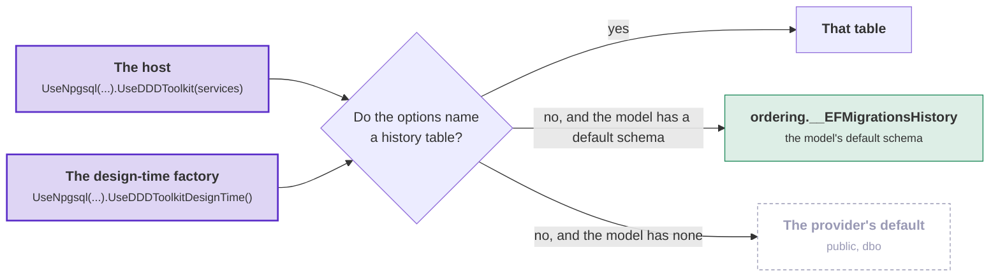
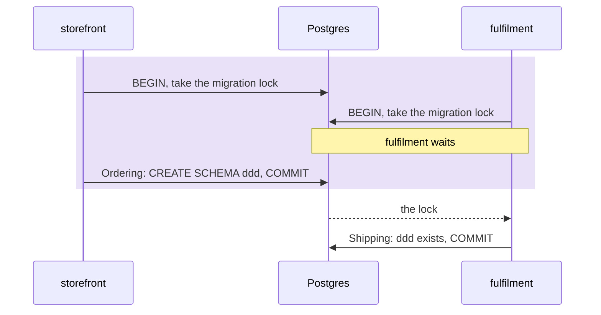
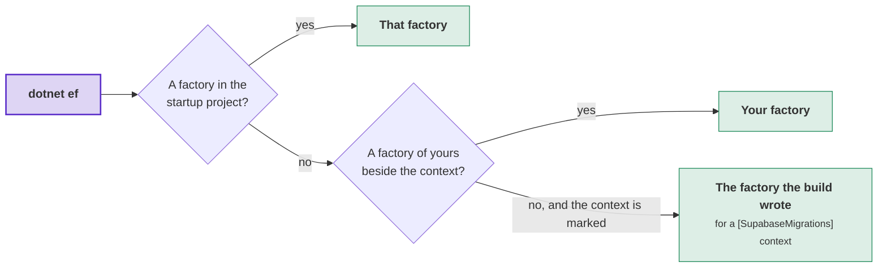
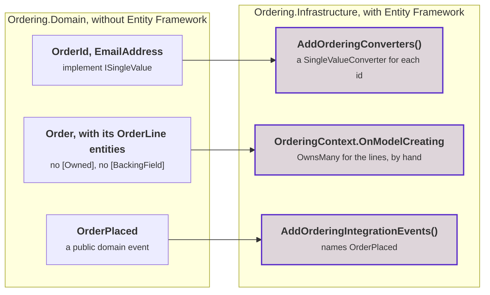
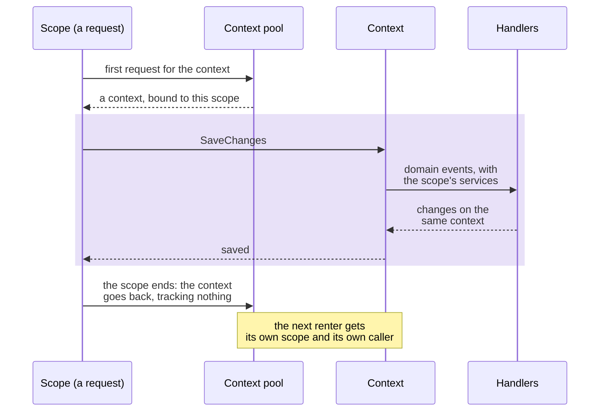

# Entity Framework

`DDDToolkit.EntityFramework` is the persistence package of the toolkit. It registers converters and conventions for
the types the generators write, so a domain model written as the other pages describe maps to tables without
configuration by hand. It also adds the behaviours that run during a save: domain event delivery, the invariant check
and optimistic concurrency.

The package does five things:

| | What it gives you |
|---|---|
| Generated converters | A `ValueConverter` per identifier and single value object, and one registration call per assembly |
| Conventions | Read-only collections mapped, `Version` made a concurrency token, `[Internal]` members ignored |
| Domain event delivery | In-process dispatch during `SaveChanges`, or a transactional outbox |
| Invariants at the save | Every entity that a save adds or changes is checked for its invariants first ([Invariants](invariants.md#at-the-save)) |
| Optimistic concurrency | `Version` raised by one per save, and a stale write turned into `ConcurrencyConflictException` |

The package has no repository abstraction and no message bus. `DbContext` is already the unit of work. You write the
delegate that hands events to your publisher. If your publisher is
[Mediator](https://github.com/martinothamar/Mediator), the companion package `DDDToolkit.Mediator` writes that
delegate for you ([In-process dispatch](event-delivery.md#in-process-dispatch)). If the events must leave the
process, the outbox delivers them to a sink you implement ([Integration events](integration-events.md)).

## Install

```bash
dotnet add package Temp.DDDToolkit.EntityFramework --prerelease
```

The package brings its own source generator, so the package reference is all the configuration it needs. It targets
.NET 10 and Entity Framework Core 10.

## Setting up a context

Setting up takes three calls: one in your service registration, one on the `DbContextOptionsBuilder`, and one or more
in `ConfigureConventions`.

```csharp
using DDDToolkit.EntityFramework;

builder.Services.AddDDDToolkitEntityFramework();

builder.Services.AddDbContext<OrderingContext>((services, options) => options
    .UseSqlite(connectionString)
    .UseDDDToolkit(services));
```

```csharp
using DDDToolkit.EntityFramework.Conventions;
using Ordering.Domain.Converters;

public class OrderingContext(DbContextOptions<OrderingContext> options) : DbContext(options)
{
    public DbSet<Order> Orders => Set<Order>();

    protected override void ConfigureConventions(ModelConfigurationBuilder configurationBuilder)
    {
        configurationBuilder.AddDDDToolkitConventions();
        configurationBuilder.AddOrderingConverters();
    }
}
```

With this setup the context stores and loads aggregates. It cannot yet save an aggregate that raised a domain event.
With events pending, `SaveChanges` throws an `InvalidOperationException`. The message names the aggregate, says that
no delivery mode is configured, and names the two calls that configure one. The toolkit does not drop the events,
because each event stands for something that must still happen.

The argument to `AddDDDToolkitEntityFramework` says how events are delivered. To hand them to
[Mediator](https://github.com/martinothamar/Mediator) handlers in the same process, add a second package, next to
Mediator itself:

```bash
dotnet add package Temp.DDDToolkit.Mediator --prerelease
```

```csharp
using DDDToolkit.Mediator;

builder.Services.AddMediator(options => options.ServiceLifetime = ServiceLifetime.Scoped);
builder.Services.AddDDDToolkitEntityFramework(options => options.DispatchWithMediator());
```

That package is optional. Delivery is a delegate that you can write yourself, against any library or none, and the
outbox is the other way to deliver. [Delivering domain events](event-delivery.md) explains both, and when to use
which.

### `UseDDDToolkit`

`UseDDDToolkit` sets up a context for the toolkit with one call. It adds:

1. the toolkit's own interceptors, which deliver domain events, check invariants, raise the version, and handle a
   save that the database refused;
2. the parts that the host's registered packages bring to a context: row level security (RLS) once
   `AddSupabaseRowLevelSecurity` or `AddPostgresRowLevelSecurity` is registered, and Tenancy's save check once
   `AddTenancy` is registered.

A host that registered none of those packages gets only the toolkit's interceptors. Every context that
`UseDDDToolkit` sets up keeps its migration history in its default schema, next to its tables
([The migration history](#the-migration-history)).

Pass the `IServiceProvider` that the options callback gives you. With `AddDbContext`, that provider belongs to the
same scope as the context, so a handler that injects `OrderingContext` gets the instance that is saving. With a
context pool, the callback runs once and gets the application's root provider. The handlers then get the scope the
context was rented in ([Contexts from a pool](#contexts-from-a-pool)). [The interceptors](#the-interceptors) lists the
toolkit's interceptors in the order they run.

Each registration adds its part with a position. `UseDDDToolkit` puts every part after the toolkit's own
interceptors, lowest position first. This is the order the toolkit requires of a context. Tenancy's save check comes
last, at the highest position. So the save check sees what the domain event handlers changed, sees only aggregates
that passed their invariants, and sees every row that another part added to the save.

`UseDDDToolkit` decides whether a part belongs on a context from what the options say when it is called:

- RLS is left off a context whose provider is set and is not Postgres.
- A context whose provider is set later, further down the options callback or in `OnConfiguring`, gets row level
  security. At every use, the interceptor skips the context if it is not on Postgres. So a context on Postgres runs as
  its caller wherever its provider was set.
- The options say nothing about the model, so a part decides at use what the model needs. Tenancy's save check is on
  every context. It checks the rows of a context that keeps rows to a tenant, writes the `SeatRights` rows in Tenancy's own
  context, and skips a context that has neither.

So no registration names the contexts it is for, and the same call sets up a module that you add later. A model that
needs a part says so, and a context of that model without the part is refused at its first save
([Parts a model requires](#parts-a-model-requires)).

The diagram shows the order in which `UseDDDToolkit` adds to a context. Purple: the one call. Green: the parts that
registrations bring.

```mermaid
flowchart TB
    call["<b>UseNpgsql(...).UseDDDToolkit(services)</b>"]
    own["<b>The toolkit's interceptors</b><br/><small>always, first</small>"]
    rls["<b>postgres.row-level-security</b><br/><small>position 100, if registered, on Postgres</small>"]
    tenancy["<b>tenancy.save-check</b><br/><small>last, if registered</small>"]
    call --> own
    own --> rls
    rls --> tenancy
    classDef strong fill:#5b2ec933,stroke:#5b2ec9,stroke-width:2px
    classDef good fill:#1f8a5b26,stroke:#1f8a5b
    class call strong
    class rls,tenancy good
```

<details>
<summary>Show the code: three contexts in one host, one call each</summary>

```csharp
builder.Services.AddDDDToolkitEntityFramework(options => options.DispatchWithMediator());
builder.Services.AddSupabaseRowLevelSecurity();
builder.Services.AddShopTenancy(connectionString);       // AddTenancy<ShopTenancyContext>, with its context

// A module's context that keeps its rows to a tenant: the toolkit, row level security, Tenancy's save check
builder.Services.AddDbContext<OrderingContext>((services, options) => options
    .UseNpgsql(connectionString)
    .UseDDDToolkit(services));

// A context of shared data on Postgres: the same three. The save check finds no tenant rows and checks nothing.
builder.Services.AddDbContext<CatalogContext>((services, options) => options
    .UseNpgsql(connectionString)
    .UseDDDToolkit(services));

// A context on SQLite in the same host: no row level security, which needs Postgres
builder.Services.AddDbContext<ReportsContext>((services, options) => options
    .UseSqlite(reportsConnectionString)
    .UseDDDToolkit(services));
```

</details>

The `Use...` calls of the packages still work, and each adds nothing that a context already has. A chain written as
before the one call existed, `UseDDDToolkit(services).UseSupabaseRowLevelSecurity(services).UseTenancy(services)`,
gives each interceptor once. So does calling `UseDDDToolkit` twice. The first time the options of a context type are
built with a part, the log says so once, at the information level:

```text
UseDDDToolkit gave 'OrderingContext' what the host's registrations bring, after the toolkit's own interceptors: postgres.row-level-security, tenancy.save-check. A context that should do without one is configured with UseDDDToolkitCore and the Use... calls of the parts it does want.
```

**Upgrading from 3.1.** Up to 3.1, `UseDDDToolkit` added only the toolkit's interceptors. A context ran as its caller
only with `UseSupabaseRowLevelSecurity` or `UsePostgresRowLevelSecurity` in its own options. Now every context on
Postgres that `UseDDDToolkit` sets up runs as its caller once RLS is registered. Before you upgrade,
move a context that you left without RLS on purpose to `UseDDDToolkitCore` (below). Until you do, its
queries run as the role of their caller, instead of the role the application logged in as:

- Where the login role owns the tables or is a superuser, as it usually is, this takes access away. The caller sees
  and changes only what the policies allow.
- Where the login role was a restricted one, this can give more access. Background work runs as `SystemRole`, past
  every policy where that is `service_role`, as in a Supabase project with `system=service_role`. A request runs as
  `authenticated` or `anon`, with whatever those roles were granted.

The log line above names the context the first time its options are built. Without start-up checks, that is the
first time something uses the context. `builder.Services.RunStartupChecks()` builds every registered context before
the first request, so every line is in the log at start-up.

### `UseDDDToolkitCore`

`UseDDDToolkitCore` adds only the base: the toolkit's own interceptors, and no part that a package brings. This is
what `UseDDDToolkit` added up to 3.1. The migration history belongs to the toolkit, and is no package's part, so the
base also keeps the history in the context's default schema. Use it for a context that should go without a part the
host registered. An example is a context on Postgres that runs as the role the application logged in as, while the
other contexts run as their caller. Such a context adds the parts it does want with their own calls, after
`UseDDDToolkitCore`:

```csharp
// Runs as the login role, and still keeps its rows to a tenant
builder.Services.AddDbContext<ReportsContext>((services, options) => options
    .UseNpgsql(connectionString)
    .UseDDDToolkitCore(services)
    .UseTenancy(services));
```

The options record this choice:

- The [start-up check](startup-checks.md) of RLS, `postgres.row-level-security-wired`, accepts a
  context with the base alone as intended. It still refuses a context without RLS that was set up in
  another way, for example with the toolkit's interceptors added by hand.
- A part that the context's model requires is still required. A context that keeps rows to a tenant needs Tenancy's
  save check, whichever call set it up.

Running as the login role means doing what that role may do. Where the host uses
[a login that owns nothing](row-level-security.md#a-login-that-owns-nothing), which the start-up check
`postgres.login-role-owns-nothing` enforces, the login role holds nothing on the tables. The database then refuses
such a context's first command. Such a context reads past the policies only where the login role owns the tables, in
a host that skips that check with a reason. Work across callers usually belongs to a system caller instead,
`Callers.Begin(Caller.SystemIn("reports"))`, in a context that runs as its caller.

### Writing a context part

A package of yours, or the application's infrastructure, brings a part the same way the toolkit's packages do. It
registers the part next to what the part is about, with a name and a position. `UseDDDToolkit` then puts the part in
its place on every context it belongs on.

```csharp
public static IServiceCollection AddBillingAudit(this IServiceCollection services)
{
    services.TryAddSingleton<BillingAuditInterceptor>();
    return services.AddContextPart(new ContextPart<DbContextOptionsBuilder>(
        "billing.audit",
        position: 150,                                       // after row level security, at 100
        (options, provider) => options.UseBillingAudit(provider)));
}
```

`UseBillingAudit` is the method a host calls when it adds the parts one by one. Like the toolkit's methods, it adds
nothing that the options already have.

- Without `AppliesTo`, the part goes on every context. Its interceptor decides at each use whether the context gives
  it anything to do, as Tenancy's interceptor does.
- `AppliesTo` skips a context based on what its options say, as RLS does based on the provider.
- Where the options cannot tell yet, let the part go on, and let its interceptor skip at use what it has nothing to do
  for. RLS does this for a provider that is set later. A part that is left off when nothing can be
  told yet fails open. The context then saves without it.
- Two registrations with the same name bring the part once.
- Tenancy's save check comes last, whatever position your part has. So the save check checks a row that your part
  adds or changes in a save, like any other row.

| Part | Brought by | Position | Goes on |
|---|---|---|---|
| `postgres.row-level-security` | `AddPostgresRowLevelSecurity`, `AddSupabaseRowLevelSecurity` | 100 | every context that may be on Postgres. The interceptor skips a context that is not. |
| `tenancy.save-check` | `AddTenancy` | last, `int.MaxValue` | every context. It checks the contexts that keep rows to a tenant. |

The names and positions are constants on the interceptors: `PostgresRowLevelSecurityInterceptor.PartName` and
`TenancySaveInterceptor.PartName`, each with `PartPosition` next to it.

Membership brings no part. Its member tables belong to your context. On Postgres, the policies that the export writes
protect those tables, and the policies apply to a context once RLS runs it as its caller.
Membership's [expert hold](membership/checks-and-saves.md#the-expert-hold) is not a part either. No registration
brings it, because a host decides it per context. The host adds it after the one call,
`.UseDDDToolkit(services).UseMemberHolds(services)`, or after `UseDDDToolkitCore`. It changes no row, so it may come
after Tenancy's save check.

### Parts a model requires

`UseDDDToolkit` puts a part on every context it sets up. Some contexts need a part because of what their model
holds. For example, a context that keeps rows to a tenant needs Tenancy's save check. Where nothing registered the part, or the
context was given the base alone, the one call has nothing to add, and the context would save without the part. So
the model states what it requires. `ScopeToTenant` states the save check. A mapping of yours states its part with
`RequireContextPart`:

```csharp
entity.Metadata.Model.RequireContextPart(
    "billing.audit",
    typeof(BillingAuditInterceptor),
    registeredWith: "services.AddBillingAudit()",
    addedWith: "options.UseBillingAudit(serviceProvider)");
```

A context whose model requires a part that its options do not have is refused before anything is written: at its
first save, and by the start-up check `entity-framework.toolkit-wired` before the first request. The check recognises
a part on a context by the interceptor that the part adds. Where nothing registered the part, the message names the
registration:

```text
'ProjectsContext' cannot do without the part tenancy.save-check, which its model requires, and its options have no TenancySaveInterceptor, so its saves would go without it. No registration brought it. Register it with services.AddTenancy<…, TContext>(…) of DDDToolkit.Supporting.Tenancy.EntityFramework, and options.UseDDDToolkit(serviceProvider) puts it on every context.
```

Where a registration brought the part, the message names `UseDDDToolkit`, and the part's own call after
`UseDDDToolkitCore`. The requirement is a model annotation with a text value, so the model still goes into a
migration's snapshot and a compiled model.

### `AddDDDToolkitConventions` and `Add{Module}Converters`

`AddDDDToolkitConventions` adds the toolkit's five conventions to the model. It is the same for every context, so it
takes no arguments. [Generated code and conventions](#generated-code-and-conventions) describes each convention.

`Add{Module}Converters` is generated, once per assembly that declares identifiers or single value objects. It
registers the value converter that the generator wrote for each of them, so Entity Framework stores an `OrderId` as
the `Guid` inside it. Shortened:

**`ConverterExtensions.g.cs`**

```csharp
namespace Ordering.Domain.Converters;

public static class ConverterExtensions
{
    public static ModelConfigurationBuilder AddOrderingConverters(this ModelConfigurationBuilder modelConfigurationBuilder)
    {
        // ...
        modelConfigurationBuilder.Properties<OrderId>().HaveConversion<OrderId.OrderIdConverter>();
        modelConfigurationBuilder.DefaultTypeMapping<OrderId>().HasConversion<OrderId.OrderIdConverter>();
        // ...
        return modelConfigurationBuilder;
    }
}
```

The method is in a `Converters` namespace under the assembly name, in a static class called `ConverterExtensions`.
The method's name comes from the first of these three places that has a name:

1. `[assembly: Module("Ordering")]` in a file of the project. It always wins, and gives `AddOrderingConverters`.
2. The `DDD_Module` property in the project file, which
   [Getting started](getting-started.md#store-the-aggregate-with-entity-framework) sets. A `Directory.Build.props` can set it
   for a whole folder. The property also declares the module. The build writes the attribute above from it
   ([A module named by its folder](modules.md#a-module-named-by-its-folder)). The exceptions are a test project, and
   the rare project that sets `DDD_DeclareModule` to false. There the property only names the code.
3. The assembly name without the dots.

The module is the boundary that the analyzer checks ([Modules](modules.md)).
[Why the property becomes an attribute](modules.md#why-the-property-becomes-an-attribute) explains why the build
writes the attribute.

Call one method per module, and one per assembly that is not part of a module. Two assemblies of one module, such as
a module and its contracts project, share a name. Each assembly's method calls the methods of the module's other
assemblies that it references. A solution with a shared kernel and two modules calls three methods:

```csharp
protected override void ConfigureConventions(ModelConfigurationBuilder configurationBuilder)
{
    configurationBuilder.AddDDDToolkitConventions();
    configurationBuilder.AddSharedKernelConverters();
    configurationBuilder.AddOrderingConverters();
    configurationBuilder.AddBillingConverters();
}
```

An assembly that declares no identifier and no single value object gets no method, because there would be nothing to
register. The exception is a module project whose other projects declare identifiers without Entity Framework. Its
method registers their identifiers
([A domain project without Entity Framework](#a-domain-project-without-entity-framework)).

### `AddDDDToolkitEntityFramework`

`AddDDDToolkitEntityFramework` registers the delivery configuration and the interceptors that `UseDDDToolkit` adds.
Its argument configures delivery ([Delivering domain events](event-delivery.md)). If your aggregates never raise
events, call it without an argument. You still need the call, because it registers the interceptors.

You can call it more than once. So each module of a modular monolith can register its own outbox next to its own
context ([An outbox per context](event-delivery.md#an-outbox-per-context)).

## Mapping

Everything in this section works without any code in `OnModelCreating`. The mapping tests in
`Tests/DDDToolkit.EntityFramework.Tests/MappingTests.cs` cover each case against SQLite.

### Identifiers

A struct identifier works as a primary key, as an ordinary property, and as a nullable property:

```csharp
[EntityId<Guid>("ORD")]
public readonly partial record struct OrderId;

[AggregateRoot<OrderId>]
public partial class Order
{
    public CustomerId Customer { get; private set; }

    public CourierId? Courier { get; private set; }
}
```

The generator writes a converter into each identifier. The converter stores the underlying value, so the column is a
`Guid`, an `int` or a `string`, and never a serialized object:

**`OrderId.Converter.g.cs`**

```csharp
readonly partial record struct OrderId
{
    public sealed class OrderIdConverter : ValueConverter<OrderId, Guid>
    {
        public OrderIdConverter() : base(static v => v.Value, static v => new OrderId(v))
        {
        }
    }
}
```

You can use the identifier in a query predicate:

```csharp
var order = context.Orders.Single(o => o.Id == orderId);          // the key
var theirs = context.Orders.Count(o => o.Customer == customerId); // a plain property
var unassigned = context.Orders.Count(o => o.Courier == null);    // a nullable property
```

Class identifiers, declared as `partial record` instead of `readonly partial record struct`, map the same way. They
also get a converter for their always-valid twin.

### Ids made in code

Code makes an id before the save, with `OrderId.Create()`, so a change and each of its events know the id from the
start. The database stores the id and makes none. This needs no configuration:

- Entity Framework generates a key value on add only when the key's type is a number or a `Guid`.
- An id has its own type, which reaches its column through the converter that `Add{Module}Converters` registers. So
  the key of an `[EntityId<long>]` is a plain `bigint` on Postgres, and an `INTEGER` that SQLite does not number.
- A new row whose id still has its default value is saved with that value. The database does not pick another.

The tests in `Tests/DDDToolkit.EntityFramework.Tests/Conventions/EntityIdKeyTests.cs` check this on Postgres and
SQLite, so they fail if a provider ever starts to make ids.

An id over a `long` or a `string` that a package makes, as Tenancy makes a tenant's id, says how with its own
`Create()` ([Creating identifiers](identifiers.md#creating-identifiers)).

### Value objects

A `[ValueObject]` record is annotated `[ComplexType]`, so its properties are stored in columns of the owning table:

```csharp
[ValueObject]
public partial record PersonName(string FirstName, string LastName);
```

**`PersonName.EntityFramework.g.cs`**

```csharp
[ComplexType]
partial record PersonName
{
}

[ComplexType]
partial record ValidPersonName
{
}
```

An order's `Recipient`, a `PersonName`, becomes the columns `Recipient_FirstName` and `Recipient_LastName` on the
`Orders` table. It gets no table of its own.

A `[SingleValueObject<T>]` is a converted scalar, so it becomes one column. A nullable one stores and reads `null`.
Its converter is written the same way as an identifier's, with a second converter for the always-valid twin:

```csharp
[SingleValueObject<string>]
public partial record EmailAddress
{
    public static EmailAddress Create(string value) => new(value);
}
```

**`EmailAddress.Converter.g.cs`**

```csharp
partial record EmailAddress
{
    public sealed class EmailAddressConverter : ValueConverter<EmailAddress, string>
    {
        public EmailAddressConverter() : base(static v => v.Value, static v => new EmailAddress(v))
        {
        }
    }
}

partial record ValidEmailAddress
{
    public sealed class ValidEmailAddressConverter : ValueConverter<ValidEmailAddress, string>
    {
        public ValidEmailAddressConverter() : base(static v => v.Value, static v => new ValidEmailAddress(v))
        {
        }
    }
}
```

See [Value objects](value-objects.md#entity-framework).

### Child entities and owned collections

`[Entity<TId>]` adds `[Owned]`, so a child entity is loaded and saved with its aggregate:

```csharp
[Entity<Guid>("LINE")]
public partial class OrderLine
{
    // Sku and Quantity
}
```

**`OrderLine.EntityFramework.g.cs`**

```csharp
[Owned]
partial class OrderLine
{
}
```

Entity Framework discovers a generated `partial IReadOnlyList<OrderLine> Lines { get; }` on the aggregate as an owned
collection. The `[BackingField]` annotation on the generated property points Entity Framework at the private list. So
Entity Framework reads and writes the field, and never tries to write through the read-only view. Shortened:

**`Order.g.cs`**

```csharp
partial class Order : AggregateRoot<OrderId>
{
    protected Order()
    {
    }

    // ...

    private readonly List<OrderLine> _lines = new();

    private IReadOnlyList<OrderLine>? __linesView;

    [BackingField(nameof(_lines))]
    public partial IReadOnlyList<OrderLine> Lines => __linesView ??= _lines.AsReadOnly();

    // ...
}
```

Entity Framework uses the protected constructor to materialize a row. The core generator writes `[BackingField]` only
when the project references Entity Framework. A domain project without Entity Framework gets the same property
without the annotation.

Removing an element removes the row. Callers still cannot cast `Lines` back to `List<OrderLine>` and change it.

### Composite keys

A property marked `[KeyPart]` joins the primary key ahead of `Id`. The foreign key of every owned child also carries
it. So an `Order` keyed `(RegionId, Id)` owns `OrderLine` rows keyed `(RegionId, OrderId, Id)`. The child needs a
property with the same name, or the model fails to build. [Composite keys](composite-keys.md) has the rules, the
order of several parts, and how to override it.

### Read-only collections of primitives

A generated `IReadOnlyList<T>` is mapped as an Entity Framework primitive collection when `T` is a primitive, a
converted identifier or a single value object. On a relational provider, a primitive collection is a JSON column. The
elements are stored as their converted values:

```csharp
[EntityId<int>("TAG")]
public readonly partial record struct TagId;

public partial IReadOnlyList<TagId> Tags { get; }
```

Two tags give the column value `[1,2]`.

This needs the convention. Entity Framework discovers primitive properties only when they have a setter, and a
generated collection property is get-only. Without `AddDDDToolkitConventions`, Entity Framework would skip the
property without a warning, and the data would never reach the database. The convention finds the property, sets its
element type, and copies the converter, max length, unicode, precision and scale from the type mapping that the
generated registration installed.

The convention only considers public get-only properties. A `protected partial IReadOnlyList<T>` is not mapped as a
primitive collection.

The column is JSON on SQL Server and SQLite. PostgreSQL stores the same collection as a native array. LINQ queries
work across that difference, and hand-written SQL does not. Read
[Primitive collections in hand-written SQL](#primitive-collections-in-hand-written-sql) before you write a report
against one of these columns.

### Read-only sets of primitives

Entity Framework Core 10 accepts only arrays and `IList<T>` implementations as primitive collections. A generated
`IReadOnlySet<T>` is backed by a `HashSet<T>`, so a set of primitives cannot be a primitive collection.

`ReadOnlyCollectionConvention` throws while the model is built, so the property is never left unmapped without an
error. The message:

- names the type and the property;
- says that the backing field is a `HashSet`, and that only arrays and `IList<T>` qualify;
- tells you to declare `IReadOnlyList<T>` instead, or to exclude the property with `[NotMapped]` or `Ignore()`.

You see the error on the first use of the context, before any save.

```csharp
public partial IReadOnlySet<string> Keywords { get; }   // throws while building the model
public partial IReadOnlyList<string> Keywords { get; }  // maps
```

An `IReadOnlySet<T>` of entities works. It is a navigation, so relationship discovery handles it, and the children
are saved and loaded with their aggregate.

## Optimistic concurrency

Every aggregate root has a `long Version`. It is 0 on a new instance, becomes 1 when the aggregate is inserted, and
goes up by one per save that touches the aggregate. `AddDDDToolkitConventions` maps it as a concurrency token, so the
`UPDATE` carries the loaded version in its `WHERE` clause.

A save also touches the aggregate when it changes more than the root's own properties. `AggregateVersionInterceptor`
walks from each changed entry to the aggregate root it belongs to, through ownership or through a foreign key whose
principal is an aggregate root, and raises that root's version. So each of these raises the root's version:

- a change to an owned child;
- an element added to or removed from an owned collection;
- a change to a primitive collection on a child.

Each root's version goes up at most once per save, however many entries changed. A save that changes nothing raises
no version.

Deleting an aggregate does not raise its version, but the token is still checked. So deleting an aggregate that
someone else changed in the meantime conflicts, like any other stale write.

The version makes the aggregate a unit of consistency. Two people who edit different lines of the same order still
conflict, by design.

When a save writes a stale version, you get a `ConcurrencyConflictException` that names the aggregate:

```csharp
try
{
    await context.SaveChangesAsync(cancellationToken);
}
catch (ConcurrencyConflictException conflict)
{
    // conflict.AggregateType is typeof(Order), conflict.AggregateId is the OrderId.
    // Reload the aggregate, reapply the change and save again, or report it to the user.
    return Conflict(conflict.Message);
}
```

No retry fits every case, so the toolkit does not retry for you:

- Reload and reapply when the change is a command you can repeat, such as adding a line.
- Report the conflict when the user needs to see what changed.
- Do not retry a computed value without reloading the data it was computed from.

`conflict.InnerException` is the original `DbUpdateConcurrencyException`, if you need the entries.
[Why the exception is rethrown from `SaveChangesFailed`](#why-the-exception-is-rethrown-from-savechangesfailed)
explains how the exception reaches your catch block unwrapped.

### The version the client saw

The token protects the time between a load and its save. It does not cover a client that read an order a minute ago
and now sends a change it decided on then. The server loads the order as it is now, and saves over whatever happened
in that minute. `ExpectVersion` closes this gap. Pass it the version the client read, after the load and before the
change:

```csharp
var order = await context.Orders.SingleAsync(order => order.Id == id, cancellationToken);
context.ExpectVersion(order, expectedVersion);   // from If-Match, or from the mutation's input
order.Cancel(reason);
await context.SaveChangesAsync(cancellationToken);
```

If the order was loaded at another version, `ExpectVersion` throws `ConcurrencyConflictException` at once, before
anything changes. If the versions match, the save compares against that version as usual. So a change that someone
makes between the load and the save is the same conflict. Both cases throw the same exception, because the client
handles both the same way: read again, and decide again.

A request whose client may leave out the version carries a `long?`, and passes it on as it is. With `null`, there is
nothing to compare at the load, and the save compares the loaded version as usual. So one line handles both cases,
and a handler writes it after its load:

```csharp
var order = await context.Orders.SingleAsync(order => order.Id == command.Order, cancellationToken);
context.ExpectVersion(order, command.ExpectedVersion);   // null: the client wants the order as it is now
```

`ExpectVersion` reads nothing from the database and changes nothing in the context. It throws an
`InvalidOperationException` for:

- an aggregate that this context did not load;
- a new aggregate, which has no stored version yet;
- a model that does not map `Version` as a concurrency token. There an expectation that is checked only at the load
  would look like protection and give none.

A read returns the version with the data, in the body or as an `ETag`. A client that leaves out the expectation gets
the same last-write-wins behaviour as before. In GraphQL the conflict is a
[`ConcurrencyConflictError`](graphql.md#typed-errors-in-mutation-payloads) in the mutation's payload.

## Migrations

Migrations need no extra steps. The toolkit adds types and configuration to your own `DbContext` model, so everything
it maps appears in your ordinary migrations:

```bash
dotnet ef migrations add AddOutbox
dotnet ef database update
```

The one line to write is in the context's design-time factory, the factory that `dotnet ef` makes the context with.
The factory calls `UseDDDToolkitDesignTime()` after its provider, so `dotnet ef` records the migrations in the history
that the running application reads. The build reports a factory without that call
([DDD00074](diagnostics.md#ddd00074)). [The migration history](#the-migration-history) explains why. A context whose
migrations Supabase applies needs no factory written by hand ([The design-time factory](#the-design-time-factory)).

The outbox table is part of the model as soon as `OnModelCreating` calls `AddDomainEventOutbox(Database)`. So the next
migration you scaffold contains it, including the `ddd` schema. That one call is the whole opt-in. There is no
separate package, migration history table or command. The same goes for `AddDomainEventInbox(Database)` on the
consuming side ([The table](event-delivery.md#the-table)).

If you write migrations by hand instead of scaffolding them, `migrationBuilder.CreateDomainEventOutbox()` and the
matching inbox and drop methods write the same tables
([Integration events](integration-events.md#tables-schema-and-migrations)).

This applies to everything else on this page too. Struct identifier columns, complex type columns, primitive
collection columns and the `Version` column are ordinary columns in your model. So `migrations add` after a change to
an aggregate gives the diff you would expect.

If you map the outbox table before you need it, as the example context does, a later switch from in-process dispatch
to the outbox needs no migration.

On Supabase the CLI applies the migrations, and Entity Framework does not ([Supabase](#supabase)).

### The migration history

Entity Framework records the migrations it applied in its own table, `__EFMigrationsHistory`. By default it keeps
that table in the provider's default schema: `public` on Postgres and `dbo` on SQL Server, whatever schema the
model's tables are in. Two modules that share a database would then share one history, and each would read the
other's migrations as its own. So the toolkit keeps the history in the context's default schema, next to its tables.
A model with `HasDefaultSchema("ordering")` keeps it in `ordering."__EFMigrationsHistory"`, and the options need to
say nothing.

The diagram shows where a context's history table ends up. Purple: the two ways a context is made. Green: the
module's own history table. Grey: the provider's default.



`UseDDDToolkit` does this, and so does `UseDDDToolkitCore`, because the history belongs to the toolkit and is no
package's part. The provider may be configured before the call, after it, or in `OnConfiguring`. Every relational
provider gets the same. SQLite has no schemas, so it leaves the schema name out of the history, as it does for the
tables.

The other way a context is made is the design-time factory. `dotnet ef` and the [Supabase export](supabase.md) make
the context through it, before any host exists, so the factory has no services to pass to `UseDDDToolkit`. It calls
`UseDDDToolkitDesignTime()` instead. That call adds what `UseDDDToolkit` adds that needs no services. Today that is
only the migration history.

Without that call, the factory's context keeps Entity Framework's default. Then `dotnet ef database update`, a
migrations script, a migration bundle and the exported files record every migration in a table the running
application does not read. The application's `Migrate()` then tries to apply the first migration again, and fails on
a table that already exists. So the build reports a factory that leaves the call out, in a project that references
`DDDToolkit.EntityFramework` ([DDD00074](diagnostics.md#ddd00074)), and a code fix adds the call. On Supabase, the
[start-up check](supabase.md#checking-at-start-up) also names this cause when it finds the migrations missing.

Other cases:

- Options that name a history table with `MigrationsHistoryTable` keep it where they name it. Use this to put the
  history in another place.
- A model without a default schema keeps the provider's default.
- A history repository of the host's own, added with `ReplaceService<IHistoryRepository, ...>()` in either of its
  forms, is kept, and decides where its history is.
- Options with their own internal service provider, set with `UseInternalServiceProvider`, must name the table.
  Entity Framework gives no options extension the services of a provider it did not build, so the toolkit cannot place
  the history there. The design-time factory has no such provider, so it would place the history in the schema. So
  such options are refused when the context is made, unless they name the table,
  `MigrationsHistoryTable(HistoryRepository.DefaultTableName, schema)`, in the host's options and the factory's alike.

<details>
<summary>Show the code: a module's context, its design-time factory and its host</summary>

```csharp
public sealed class OrderingContext(DbContextOptions<OrderingContext> options) : DbContext(options)
{
    protected override void OnModelCreating(ModelBuilder modelBuilder)
    {
        modelBuilder.HasDefaultSchema("ordering");        // the tables, and so the migration history
        modelBuilder.AddDomainEventOutbox(Database, schema: "ordering");
    }
}

// dotnet ef makes the context with this factory, without the application's services. For a context marked
// [SupabaseMigrations], the build writes the same factory (see The design-time factory, below).
public sealed class OrderingContextFactory : IDesignTimeDbContextFactory<OrderingContext>
{
    public OrderingContext CreateDbContext(string[] args)
        => new(new DbContextOptionsBuilder<OrderingContext>().UseNpgsql("Host=unused").UseDDDToolkitDesignTime().Options);
}

// the host
builder.Services.AddDbContext<OrderingContext>((services, options) => options
    .UseNpgsql(connectionString)
    .UseDDDToolkit(services));
```

</details>

**Upgrading from 3.1.** Up to 3.1, a context whose model has a default schema, and whose options named no history
table, kept its history in the provider's default schema. The toolkit now looks for the history in the context's
schema, where there is none yet. `Migrate()` would then try to apply every migration again and fail on the first
table that exists, and the Supabase start-up check would report every migration as missing. Before you upgrade, do
one of two things.

**Keep the table where it is** by naming it, in the application's options and in the design-time factory alike. Do
this for a context whose migrations are exported to Supabase. Every file exported so far records its migration in
that table, and a factory that placed the history in another table would make the export report each of those files
as changed. Such a context keeps a factory of its own that names the table, because the factory the build writes for
a `[SupabaseMigrations]` context names none.

```csharp
options.UseNpgsql(connectionString, npgsql => npgsql.MigrationsHistoryTable(HistoryRepository.DefaultTableName));
```

**Move the table into the schema** for a context whose migrations Entity Framework applies, and whose table holds
only that context's migrations. Move it once, before the application starts on the new release, and add
`UseDDDToolkitDesignTime()` to the factory:

```sql
-- Postgres
ALTER TABLE public."__EFMigrationsHistory" SET SCHEMA ordering;
-- SQL Server
ALTER SCHEMA ordering TRANSFER dbo.__EFMigrationsHistory;
```

### Several services on one database

Several services can share one Postgres database, each with its own modules, and migrate it when they start. Entity
Framework takes a lock while it migrates. On SQL Server and SQLite that lock covers the whole database. On Postgres,
Npgsql locks the context's migration history table, and the toolkit keeps one history per module. So Npgsql's lock
stops two services from migrating one module at the same time, and lets two modules migrate side by side.

Two modules' migrations can create the same object, such as a schema that both use (`ddd`). Each service then
creates it in its own transaction. The second service asks whether the schema exists while the first has created it
and not yet committed. The second then creates it too, and fails as soon as the first commits:

```text
23505: duplicate key value violates unique constraint "pg_namespace_nspname_index"
```

`IF NOT EXISTS` does not help between two transactions. The window is short, so this happened now and then, when two
services started at the same time.

So on Postgres, every context the toolkit sets up takes one more lock when it migrates: the migration lock
(`DatabaseMigrationLock`), which covers the whole database. It is an advisory lock, taken in the migration's
transaction before Npgsql's own lock. The migrations of every module, in every service on that database, then run one
after the other.

The diagram shows two services that start together. The purple band is the time the storefront holds the migration
lock, while fulfilment waits.



- **Every way to migrate.** `UseDDDToolkit`, `UseDDDToolkitCore` and a design-time factory's
  `UseDDDToolkitDesignTime()` add the lock. So it applies to `Migrate()`, `MigrateAsync()`,
  `dotnet ef database update` and a migration bundle. Entity Framework takes the lock before it reads what is applied.
  So a service with nothing to apply waits for a service that is migrating, and then finds everything applied.
- **Nothing left behind.** The lock lasts until the migration's transaction commits or rolls back. So a service that
  fails or stops halfway never keeps it, and a pooled connection never carries it back to the pool. It also works
  through a pooler that hands out a connection per transaction.
- **One database.** Advisory locks belong to a database. Services on two databases of one server never wait for each
  other.
- **How long it waits.** As long as the context's command timeout, as for Entity Framework's own lock. Then the
  migration fails with a timeout on `pg_advisory_xact_lock`. A service that may wait behind another service's long
  migration gives its own migration a timeout that is as long: `Database.SetCommandTimeout(...)` before it migrates.
- **The toolkit's scripts.** `PostgresRowAccess.SetupScript()` and the row access scripts, with what Tenancy and
  Membership add to them, create `ddd`, its functions and its roles. They run in a migration of yours
  (`migrationBuilder.Sql(...)`), so they run under the lock. On Supabase they are files that the CLI applies one at a
  time. A script you run yourself, outside the migrations, waits for the lock when its transaction runs
  `DatabaseMigrationLock.PostgresStatement` first.

A context that should not wait behind another context's long migration can leave the lock out, if its migrations
create nothing that another context's migrations also create. It calls `WithoutDatabaseMigrationLock()` after the
toolkit's call, in the host's options and in its design-time factory.

- A migrations script (`dotnet ef migrations script`) takes no lock, as Entity Framework's own script takes none.
- A history repository of yours, added with `ReplaceService`, decides its own lock, as it decides where its history
  is.
- So do options with their own internal service provider, which the toolkit cannot reach.

<details>
<summary>Show the code: leaving the lock out, and seeing who waits</summary>

```csharp
// a context whose migrations should not wait for the others
services.AddDbContext<ReportingContext>((services, options) => options
    .UseNpgsql(connectionString)
    .UseDDDToolkit(services)
    .WithoutDatabaseMigrationLock());
```

The key is `DatabaseMigrationLock.PostgresKey`, 4919131821860013906, the bytes of `DDDTMIGR`. `pg_locks` shows it in
two halves:

```sql
SELECT pid, granted FROM pg_catalog.pg_locks
WHERE locktype = 'advisory' AND classid = 1145324628 AND objid = 1296648018 AND objsubid = 1;
```

</details>

### The design-time factory

`dotnet ef` makes a context without the application, through an `IDesignTimeDbContextFactory<TContext>`. It looks for
one in the startup project first, and then in the context's assembly.

The diagram shows which factory `dotnet ef` uses. Purple: `dotnet ef`. Green: the factory it uses.



For a context on any database, write a factory that calls `UseDDDToolkitDesignTime()` after its provider, as above.
For a context whose migrations Supabase applies, write none:

- The [Supabase export](supabase.md#exporting-as-part-of-the-build) always builds the context on Npgsql, with a
  connection string that points nowhere, so its factory is always the same.
- The marker that the export needs, `[SupabaseMigrations]` on the context, is all the build needs to write the
  factory: `OrderingContextDesignTimeFactory`, beside the context, in a file with that name.
- `dotnet ef` finds that factory as it finds one written by hand, with the module or the host as the startup project.
  A startup project with its own factory, for example for its own SQL Server migrations, keeps that factory.
- A factory in the context's project wins over the build's, and the build then writes none. Write one where the
  context needs more at design time than Npgsql and the toolkit's call, such as provider options like `MapEnum`, or
  its own history table. The build's factory has neither.
- The export and the start-up check make the context the way `dotnet ef` does with the host as its startup project.
  So a factory in the host for a module's context is the one they use there too.
- DDD00074 requires `UseDDDToolkitDesignTime()` in a factory written by hand. The factory that the build writes calls
  it wherever the project references `DDDToolkit.EntityFramework`.

<details>
<summary>Show the code: a context marked for Supabase, and the factory the build writes beside it</summary>

```csharp
[SupabaseMigrations]
public sealed class OrderingContext(DbContextOptions<OrderingContext> options) : DbContext(options)
{
    protected override void OnModelCreating(ModelBuilder modelBuilder)
        => modelBuilder.HasDefaultSchema("ordering");
}
```

The factory, shortened:

**`OrderingContextDesignTimeFactory.g.cs`**

```csharp
public sealed class OrderingContextDesignTimeFactory : IDesignTimeDbContextFactory<OrderingContext>
{
    public OrderingContext CreateDbContext(string[] args)
        => new OrderingContext(new DbContextOptionsBuilder<OrderingContext>().UseNpgsql("Host=unused").UseDDDToolkitDesignTime().Options);
}
```

</details>

## Generated code and conventions

A value converter belongs to one type, so it must be written per type and registered per assembly. A generator does
that work. A convention is a rule about the shape of a model, the same in every context, so it is in the runtime
package.

The generator writes, for each type:

| You wrote | Generated |
|---|---|
| `[EntityId<T>]` | A nested `ValueConverter`, for example `OrderId.OrderIdConverter`, that stores `Value` |
| `[SingleValueObject<T>]` | The same, plus a converter for the always-valid twin |
| `[ValueObject]` | `[ComplexType]` on the record and on its twin |
| `[Entity<TId>]` | `[Owned]` on the class |

It also writes, once per assembly, the registration method, which registers every converter twice. Shortened:

**`ConverterExtensions.g.cs`**

```csharp
modelConfigurationBuilder.Properties<OrderId>().HaveConversion<OrderId.OrderIdConverter>();
modelConfigurationBuilder.DefaultTypeMapping<OrderId>().HasConversion<OrderId.OrderIdConverter>();
```

Both lines are needed:

- `Properties<T>()` configures the properties of that type, which is most of a model.
- `DefaultTypeMapping<T>()` configures the type where no property is involved: query parameters, constants, and the
  element type of a primitive collection. The read-only collection convention reads this default type mapping to find
  the converter for the elements of a generated `IReadOnlyList<T>`, because Entity Framework does not pass property
  configuration down to collection elements.

`ColumnLength` on an identifier or a single value object becomes `HaveMaxLength` on the property registration and
`HasMaxLength` on the type mapping ([Identifiers](identifiers.md#column-length)).

`AddDDDToolkitConventions` adds these conventions:

| Convention | What it does |
|---|---|
| `InternalMemberConvention` | Ignores every member marked `[Internal]`, on entity types and complex types alike |
| `ReadOnlyCollectionConvention` | Maps generated get-only collections of primitives and converted types as primitive collections, and applies the element converter |
| `AggregateRootVersionConvention` | Makes `Version` on every aggregate root a concurrency token |
| `KeyPartConvention` | Puts `[KeyPart]` properties into the primary key ahead of `Id`, and into the foreign key of every owned type below ([Composite keys](composite-keys.md)) |
| `IndexRefusalConvention` | Checks, when the model is built, every index that names its refusal with `RefusesAs`. The index must be unique, and every property that its message names in braces must be one the entity maps. |

`InternalMemberConvention` is why `DomainEvents` never reaches your tables. The `AggregateRoot<TId>` base class marks
it `[Internal]`, so the convention ignores it, as `[NotMapped]` would.

Explicit configuration in `OnModelCreating` still wins over all of this. The conventions fill in what you did not
configure.

### A domain project without Entity Framework

A module that is split into projects by layer ([A module in layers](modules.md#a-module-in-layers)) keeps Entity
Framework out of its domain and contracts projects. The generator writes Entity Framework's parts only into a project
that references Entity Framework. So those projects get no nested converters, no `[Owned]`, no `[ComplexType]`, and
no `[BackingField]` on the field behind a generated collection. The infrastructure project, which holds the context,
does that mapping instead.

The diagram shows which code in the infrastructure project maps each part of the domain. Purple: the infrastructure
code.



<details>
<summary>Show the code: the infrastructure project's context and registration</summary>

```csharp
// Ordering.Infrastructure: the one project of the module that references Entity Framework
public sealed class OrderingContext(DbContextOptions<OrderingContext> options) : DbContext(options)
{
    public DbSet<Order> Orders => Set<Order>();

    protected override void OnModelCreating(ModelBuilder modelBuilder)
        => modelBuilder.Entity<Order>(order =>
        {
            // The domain project marks nothing for Entity Framework, so the context maps the order lines
            order.OwnsMany(row => row.Lines, line => line.ToTable("OrderLines"));
        });

    protected override void ConfigureConventions(ModelConfigurationBuilder configurationBuilder)
    {
        configurationBuilder.AddDDDToolkitConventions();

        // Generated into this project: a converter for every id and single value object of the module
        configurationBuilder.AddOrderingConverters();
    }
}

// The module's registration, in the same project
services.AddDDDToolkitEntityFramework(options => options.UseOutbox<OrderingContext>(outbox =>
    outbox.AddOrderingIntegrationEvents()));   // generated here too: names OrderPlaced
```

</details>

- **Identifiers and single value objects.** The infrastructure project's generated `Add{Module}Converters()`
  registers them, with `SingleValueConverter<T, TValue>`. So the context calls that one method, whichever of the
  module's projects declares the ids ([Identifiers](identifiers.md#an-identifier-stored-by-another-project)).
- **Child entities and value objects.** They carry no Entity Framework attributes, so the context maps them in
  `OnModelCreating`: `OwnsMany` or `OwnsOne` for a child entity, `ComplexProperty` for a value object. Without that
  mapping, a child entity with its own id is mapped as a separate entity type, and the model changes.
- **A generated read-only collection of ids or primitives.** Its backing field must be named. The read-only collection
  convention finds the `List<T>` behind the property through `[BackingField]`. Without the attribute the convention
  leaves the collection unmapped, so the context maps it with `HasField`. A collection of child entities is a
  navigation, and Entity Framework finds its field by name.
- **Domain events.** The infrastructure project's `Add{Module}IntegrationEvents()` registers them, and they must be
  `public` ([DDD00033](diagnostics.md#ddd00033)).

`HasPendingModelChanges()` tells whether a model still maps as it did. A test that calls it for each context catches
a child entity or a collection that the split left unmapped.

## The interceptors

`UseDDDToolkit` and `UseDDDToolkitCore` add the toolkit's four interceptors, in the order they run, before any part
that a package brings. The first interceptor also refuses a save of a context that lacks a part its model requires
([Parts a model requires](#parts-a-model-requires)):

| | Interceptor | Why in this position |
|---|---|---|
| 1 | `PublishDomainEventsInterceptor` | It delivers domain events first, so what the handlers change is part of the same save. |
| 2 | `InvariantInterceptor` | It runs after the handlers, so it sees what they changed. |
| 3 | `AggregateVersionInterceptor` | It runs after both, so a save that the invariants refuse raises no version. |
| 4 | `DatabaseRefusalInterceptor` | It only handles a save that the database refused: the refusal that a unique index declares with `RefusesAs`, or `access.refused` for a row that a policy or a guard refused. It logs that as [a race or a disagreement](row-level-security.md#when-the-policies-refuse-what-c-allowed). |

`AddDDDToolkitEntityFramework` registers them. The options object is a singleton, and so are `InvariantInterceptor`,
`AggregateVersionInterceptor` and `DatabaseRefusalInterceptor`, because they hold no state. `UseDDDToolkit` builds a
`PublishDomainEventsInterceptor` for the options it is called on, from the provider it gets. That interceptor gives
the handlers the scope that the saving `DbContext` belongs to: the scope that owns it under `AddDbContext`, or the
scope that rented it under [a pool](#contexts-from-a-pool). It is also registered as a scoped service, for a host that
adds the interceptors by hand.

### Checking the wiring

A context built without `UseDDDToolkit` or `UseDDDToolkitCore` still saves. It checks no invariant, raises no version
and stores no event, and nothing fails, so nobody notices. `EntityFrameworkChecks` reports this at start-up, before
the first request. `AddDDDToolkitEntityFramework` registers it as the [start-up check](startup-checks.md)
`entity-framework.toolkit-wired`, and one call runs it with every other check that the host's registrations brought:

```csharp
builder.Services.AddDDDToolkitEntityFramework(options => options.DispatchWithMediator());
builder.Services.RunStartupChecks();
```

- The check looks at every context the host registers that maps one of the toolkit's classes: an entity, an
  aggregate, or the table of the outbox, the inbox or the event log.
- A context that a library brings for its own tables needs none of the interceptors, and the check skips it.
- Every context, of either kind, is also checked for the parts its model requires
  ([Parts a model requires](#parts-a-model-requires)).
- The same registration also brings `entity-framework.owners-mapped`. That check finds the context of every aggregate
  whose owner the host's requests ask about
  ([The owner of an aggregate](access-requirements.md#the-owner-of-an-aggregate)).

By hand, the first check is:

```csharp
var app = builder.Build();

await using (var scope = app.Services.CreateAsyncScope())
{
    foreach (var contextType in EntityFrameworkChecks.RegisteredContexts(scope.ServiceProvider))
    {
        EntityFrameworkChecks.EnsureToolkitWired((DbContext)scope.ServiceProvider.GetRequiredService(contextType));
    }
}
```

`EnsureToolkitWired` opens nothing. It throws unless the context's options hold the three interceptors that decide
what is saved, in the order above. A host that adds them by hand passes, as long as events come before invariants and
invariants come before versions. It also throws when the model and the outbox disagree:

- the model maps an [event log](#an-event-log) that no `KeepEventLog()` keeps;
- the context has its own outbox, and the model does not map that outbox's table or its event log.

`RegisteredContexts` lists every context type that the container knows, by name. So a module added later is checked
without anyone adding it to a list.

## Why the exception is rethrown from `SaveChangesFailed`

The interceptor translates the conflict in `ThrowingConcurrencyException`. But the update pipeline wraps whatever that
method throws in a `DbUpdateException`, so callers would have to search the inner exceptions. So the interceptor also
handles `SaveChangesFailed`. It unwraps the `ConcurrencyConflictException` and rethrows it, which lets you write
`catch (ConcurrencyConflictException)` directly. It does the same for a provider that raised the conflict without
going through `ThrowingConcurrencyException`.

The synchronous and the asynchronous save behave the same.
`Tests/DDDToolkit.EntityFramework.Tests/ConcurrencyTests.cs` covers the version arithmetic, changes to children only,
deletes, and both save paths.

## Contexts from a pool

Entity Framework can keep context instances in a pool and hand them out again, instead of making a new one for every
scope. `AddPooledDbContextFactory<TContext>` registers a factory to rent from, and `AddDbContextPool<TContext>`
registers a context per scope. A pool is useful when one request runs reads in parallel. No two queries may share a
context, so each read rents a context for its own query, as a GraphQL server needs for the fields of one query. The
commands of the request keep one context as their unit of work.

```csharp
builder.Services.AddDDDToolkitEntityFramework(options => options.DispatchWithMediator());

builder.Services.AddPooledDbContextFactory<OrderingContext>((services, options) => options
    .UseNpgsql(connectionString)
    .UseDDDToolkit(services));
builder.Services.AddScopedFromPool<OrderingContext>();
```

`UseDDDToolkit` is the same call as without a pool. `AddScopedFromPool<TContext>()` makes the context that a scope
asks for come from the pool, bound to that scope. The context goes back to the pool when the scope ends. Call it after
either pool registration.

- Entity Framework 10 already registers the context as a scoped service for both pool registrations (checked on
  10.0.0 and 10.0.12). There the call only adds the binding.
- Over a factory that you registered yourself, the call also registers the scoped context.
- A context registered with `AddDbContext` or `AddDbContextFactory` is not pooled, and is refused with an
  `InvalidOperationException`. The call itself refuses `AddDbContext`. A context from `AddDbContextFactory` is refused
  when a scope first asks for it, because only the context that the scope then gets shows that it comes from no pool.

**A pool has one rule. Nothing in the options callback reads a caller, a request or a scope.** A pool builds its
options once, with the application's root services, and every context it hands out shares those options. The
toolkit's own `Use...` methods resolve singletons only. What differs per use is read at the moment of use:

- who is calling, which [RLS](row-level-security.md) reads on every open and before every command;
- which scope the handlers of a save belong to.

An interceptor of yours in that callback must work the same way. Register it as a singleton that reads per use, and
capture nothing while the options are built.

### Event handlers in a pooled context

In-process handlers run with a scope's services, so a handler that injects the context gets the one that is saving.
A pool's options know no scope, so the toolkit records which scope each rental was bound to.

The diagram follows one rental. The purple band is the save. The handlers run with the scope's services, on the same
context.



<details>
<summary>Show the code: a command and a read on one pool</summary>

The command uses the scope's context, which `AddScopedFromPool` took from the pool and bound to the scope. So the
handlers of its events run with that scope:

```csharp
public sealed class CancelOrderHandler(OrderingContext context)
{
    public async Task HandleAsync(OrderId id, string reason, CancellationToken cancellationToken)
    {
        var order = await context.Orders.SingleAsync(order => order.Id == id, cancellationToken);
        order.Cancel(reason);
        await context.SaveChangesAsync(cancellationToken);
    }
}
```

A read rents a context for its one query and gives it back, so two reads of one request never share a context:

```csharp
public sealed class OrderReads(IDbContextFactory<OrderingContext> contexts)
{
    public async Task<bool> ExistsAsync(OrderId id, CancellationToken cancellationToken)
    {
        await using var context = await contexts.CreateDbContextAsync(cancellationToken);
        return await context.Orders.AnyAsync(order => order.Id == id, cancellationToken);
    }
}
```

</details>

- **The context a scope asks for** is bound to that scope by `AddScopedFromPool`. Nothing else is needed.
- **A context you rent from the factory** has no scope. Reading through it needs none. Saving with
  [an outbox](event-delivery.md#the-outbox) needs none either, because the outbox writes its rows on the saving
  context and resolves nothing. Dispatching in process does need a scope. Name it with
  `context.BindToScope(scope.ServiceProvider)`. The binding lasts until the context is disposed.
- **A pooled context with events to dispatch in process and no scope is refused**, with an
  `InvalidOperationException` that names both fixes. It is refused before any event leaves its aggregate. So nothing is
  dispatched and nothing is saved, and the same save succeeds once the context is bound. The toolkit does not make a
  scope of its own for the handlers. A handler that asked such a scope for the context would get another instance than
  the one that is saving, and its changes would be lost without an error.

Options that are built once without a pool also give the callback the root provider. That is the case with
`AddDbContextFactory`, and with `AddDbContext` and `optionsLifetime: ServiceLifetime.Singleton`. Where the container
validates scopes, the first in-process dispatch from such a context is refused in the same way, and `BindToScope`
fixes it there too.

### What a pooled context resets

One instance serves one renter after another, and nothing of one renter reaches the next:

| What | Who ends it | When |
|---|---|---|
| Tracked entities, and the domain events pending on them | Entity Framework | when the context goes back |
| Change tracker settings, the command timeout, `SavingChanges` handlers | Entity Framework restores the values the context started with | when the context goes back |
| An open transaction | Entity Framework rolls it back | when the context goes back |
| A connection left open | Entity Framework closes it, and the context keeps the connection object | when the context goes back |
| The role, the claims and the settings of RLS on the server connection | Npgsql resets the connection, and the interceptor sets them again on every open | before the connection is used again |
| The scope a rental was bound to | The toolkit. A binding lasts one rental | the next rental starts with none |
| Who is calling | Nobody. It is never stored on a context | read on every use |

Nobody resets a field that your context class declares itself, so declare no such field.

A context pool limits how many context instances are kept. It does not limit how many connections are open. A context
holds a connection only while one of its commands runs, while it has a transaction, or after you opened one by hand.
A context in the pool holds none. The limit on connections is the data source's `Maximum Pool Size`. A read that
finds every connection taken waits up to `Timeout` seconds and then fails with Npgsql's exception. The next read
succeeds as soon as a connection is free. Code that already holds a connection and waits for a second one can end up
waiting for itself, so do not nest them.

`PooledContextSaveTests.cs`, `PooledContextRowLevelSecurityTests.cs` and `PooledContextBudgetTests.cs` in
`Tests/DDDToolkit.EntityFramework.Tests` test each of these rows, on SQLite and against a real Postgres.

## Providers

Everything on this page is tested on SQLite, PostgreSQL and SQL Server. The fast test suite runs on SQLite. The other
two run in containers, in their own CI workflow, against the same aggregates and the same context. Most of the
mapping is the same on all three. This section lists what differs, so none of it surprises you in production.

### Differences between providers

| | SQLite | PostgreSQL | SQL Server |
|---|---|---|---|
| `Guid` identifier | `TEXT` | `uuid` | `uniqueidentifier` |
| Outbox timestamps | UTC `DateTime` | `timestamptz` | `datetimeoffset` |
| Primitive collection | JSON `TEXT` | `integer[]` | JSON `nvarchar` |
| Schemas | ignored | yes | yes |

[Timestamps](event-delivery.md#timestamps) covers the outbox timestamps. SQLite ignores schemas. It drops the schema
when it writes an identifier. So `ddd.OutboxMessages` is `OutboxMessages` there, and nothing else changes. The
primitive collection needs more explanation
([Primitive collections in hand-written SQL](#primitive-collections-in-hand-written-sql)).

### DateTimeOffset properties on SQLite

The outbox converts its own timestamps for SQLite. Your `DateTimeOffset` properties stay as they are, which works
until a query compares or orders by one. SQLite stores a `DateTimeOffset` as text, and throws on
`Where(voyage => voyage.StartsAt <= now)`.

Call `StoreDateTimeOffsetsAsUtc()` in `ConfigureConventions`. Every `DateTimeOffset` and `DateTimeOffset?` property
of the model, owned and keyless types included, is then stored as its UTC instant in a `DateTime` column, on every
provider, with the same converters that the outbox uses. The value reads back as the same instant with an offset of
zero. The offset it was written with is not kept. On PostgreSQL the column is still `timestamp with time zone`. On
SQL Server it is `datetime2` instead of `datetimeoffset`, so decide before the first migration.

```csharp
protected override void ConfigureConventions(ModelConfigurationBuilder configurationBuilder)
{
    configurationBuilder.AddDDDToolkitConventions();
    configurationBuilder.StoreDateTimeOffsetsAsUtc();
}
```

### Primitive collections in hand-written SQL

A generated `IReadOnlyList<TagId>` is mapped as an Entity Framework primitive collection. The provider decides what
that becomes in the database, and the providers decide differently:

- **PostgreSQL** stores it as a real `integer[]`. Npgsql maps .NET collections of a primitive to PostgreSQL's own
  array types, which is the better mapping.
- **SQL Server and SQLite** store it as a JSON document in a string column: `[1,2]`.

**This comes from Entity Framework Core, and the toolkit does not change it.** Each provider's type mapping source
supplies the mapping. The toolkit's convention only finds the get-only property, sets its element type and copies the
element converter. The provider chooses the store type after that, as it would for a hand-written
`modelBuilder.PrimitiveCollection(...)`. Forcing every provider onto the same store type would replace Npgsql's native
array mapping with a worse one, for a portability that nobody asked for. It would also break every PostgreSQL index
and query already written against the array.

So the rule is:

**LINQ ports.** `Contains`, `Count` and the other operators translate on both providers: to `= ANY(...)` on
PostgreSQL and to `OPENJSON` on SQL Server. A query through `IQueryable` keeps working when you change providers.

```csharp
// Translates on both.
var tagged = await context.Shelves
    .SelectMany(shelf => shelf.Books)
    .Where(book => book.Tags.Contains(new TagId(7)))
    .ToListAsync();
```

**SQL does not port.** Hand-written SQL that reads inside the column is specific to the provider, and no SQL text runs
on both:

```sql
-- PostgreSQL
SELECT COUNT(*) FROM "Book" WHERE 7 = ANY("Tags");

-- SQL Server
SELECT COUNT(*) FROM "Book" WHERE EXISTS (SELECT 1 FROM OPENJSON("Tags") WHERE CAST([value] AS int) = 7);
```

This matters for reports, ad hoc queries, data migrations and anything a DBA writes. Indexing also differs. A
PostgreSQL array takes a GIN index, and a JSON string column does not.

If a query like that must port, model the collection as a child entity with its own table: one row per tag, the same
on every provider. You lose the single-column read and gain a join. Make that design decision only when you need the
portability.

`Tests/DDDToolkit.EntityFramework.Providers.Tests/Providers/ProviderMappingTests.cs` tests both cases against real
servers.

## Domain event delivery

A raised domain event stands for something that must happen. This package delivers it when the context saves. It
either runs your handlers inside `SaveChanges`, or writes the events to an outbox table in the same transaction and
delivers them afterwards. [Delivering domain events](event-delivery.md) explains both modes, how to choose, and the
outbox's table, processor and retries.

## An event log

An outbox row is work. It is marked, retried, and deleted once it is delivered. Some events are also a record of what
happened and who did it, and that record must stay as it was written. A context with an outbox keeps those events in
an event log, a separate table that nothing updates:

```csharp
// in the module's registration
options.UseOutbox<OrderingContext>(outbox => outbox
    .RegisterEventsFromAssemblyContaining<Order>()
    .KeepEventLog(log => log.Keep<OrderPlaced>().Keep<OrderCancelled>()));

// in OrderingContext
protected override void OnModelCreating(ModelBuilder modelBuilder)
{
    modelBuilder.AddDomainEventOutbox(Database);
    modelBuilder.AddEventLog(Database, keepFor: TimeSpan.FromDays(365));
}
```

The save that persists the aggregate adds one `EventLogEntry` per kept event, next to the event's outbox row. So one
transaction writes the aggregate, the outbox row and the log row: all three, or none.

- `KeepEventLog()` without a choice keeps every event the context saves.
- `Keep<TEvent>()` keeps a type and every type derived from it.
- `Only(domainEvent => ...)` keeps the events that the predicate chooses.

The choices add up.

A row holds the event's id (which is also its outbox row's id), its stable name, version and payload, when it
occurred and when it was recorded, the aggregate that raised it, and who acted:

| The caller | `ActedByKind` | `ActedById` |
|---|---|---|
| A signed-in user | `user` | the user's id, or the token's `sub` where that is not a `uuid` |
| System work | `system` | `null` |
| System work inside a scope, `Caller.SystemIn("ordering")` | `system` | the scope |
| A request without a user | `anonymous` | `null` |

That pair is an `ActedBy`, and `IActedByAccessor` returns it. The accessor that the toolkit registers reads the
[caller](row-level-security.md#running-queries-as-the-caller) once for each save that keeps an event. To fill it in
another way, register your own singleton before `AddDDDToolkitEntityFramework`, for example with a kind of your own:
`new ActedBy("device", serialNumber)`.

The application writes who acted, and the database does not check it. With the
[written privileges](row-level-security.md#privileges-from-the-policies), every role that saves may add a row, with
any actor. A log that must tie the actor to the caller needs policies that check it, written by a
[contribution](row-level-security.md#policies-a-package-ships) that claims the table.

A module adds its own columns with the `configure` argument, as shadow properties, and fills them with an
`IEventLogFields`:

```csharp
modelBuilder.AddEventLog(Database, configure: log => log.Property<string?>("Branch").HasMaxLength(64));

public sealed class BranchOfTheEvent(IBranchAccessor branch) : IEventLogFields
{
    public void Fill(IDomainEvent domainEvent, EntityEntry<EventLogEntry> entry)
    {
        if (entry.Metadata.FindProperty("Branch") is not null)
        {
            entry.Property("Branch").CurrentValue = branch.Current;
        }
    }
}

services.AddSingleton<IEventLogFields, BranchOfTheEvent>();
```

> [!IMPORTANT]
> `IActedByAccessor` and every `IEventLogFields` are singletons. Each time they are asked, they read their answer from
> the current flow of work: the ambient caller, the current request, the event itself. They keep nothing between two
> events and use no scoped service. The interceptor gets them from its own provider once per save. For a context from
> [a pool](#contexts-from-a-pool), that provider is the application's root provider, which refuses a scoped service
> with a message that says so.

**The guard.** On Postgres, `DDDToolkit.EntityFramework.Postgres` writes the table's guard into every
[script of policies](row-level-security.md#writing-the-policies) of the context, and into its Supabase access file,
whether or not the context has a rule. The guard is a set of triggers that refuse:

- every update of a row;
- a truncate;
- every delete of a row younger than `keepFor`, by the database's clock.

The triggers fire for every role, including the table's owner and a superuser. A privilege or a policy would stop
neither of those. A refused statement fails with SQLSTATE `55000` and the message `A kept row does not change.`
(`PostgresRowAccess.KeptRowsSqlState` and `KeptRowsRefusal`). A log mapped without `keepFor` keeps every row for as
long as the table exists. The guard needs Postgres 14 or later.

The guard stops statements on the rows. The table's owner can still drop the triggers, or the table. So the owner is
the role that runs the migrations, and the application logs in as
[a role that owns nothing](row-level-security.md#a-login-that-owns-nothing).

> [!WARNING]
> On SQLite and SQL Server nothing guards the table. The toolkit itself never updates a row, and deletes one only
> through retention. A statement of your own is not refused there.

**Deleting old rows.** [Retention](integration-events.md#keeping-the-tables-small) has a window for the log, separate
from the outbox's window. Without that window, retention leaves the log alone:

```csharp
services.AddDomainEventRetention<OrderingContext>(retention =>
{
    retention.KeepOutboxFor = TimeSpan.FromDays(7);
    retention.KeepEventLogFor = TimeSpan.FromDays(400);
});
```

The table decides, so `KeepEventLogFor` must be at least the `keepFor` the log was mapped with. A retention run that
finds it shorter, or finds a log that is kept forever, fails before it deletes anything and names both values. The
guard reads the database's clock, and retention reads the application's clock. So retention waits one minute longer
than `keepFor`, whatever the window says. Keep the two clocks within one minute of each other.

## Supabase

The Supabase CLI applies migrations from SQL files in `supabase/migrations`, and does not run Entity Framework
migrations. `DDDToolkit.EntityFramework.Supabase` writes one such file per Entity Framework migration as part of the
build, and can check at start-up that Supabase applied them ([Supabase](supabase.md)).

## Where to look next

- [Getting started](getting-started.md) for the module name and your first aggregate.
- [Delivering domain events](event-delivery.md) for in-process dispatch, Mediator and the outbox.
- [Identifiers](identifiers.md) for what a struct identifier is, and `ColumnLength`.
- [Value objects](value-objects.md) for `[ValueObject]` and `[SingleValueObject<T>]`.
- [Entities and aggregates](entities-and-aggregates.md) for read-only collections and `[BackingField]`.
- [Invariants](invariants.md) for the check that every save runs.
- [Domain events](domain-events.md) for raising, draining and stable names.
- [Integration events](integration-events.md) for sinks, published contracts and the inbox.
- [Supabase](supabase.md) for exporting migrations to the Supabase CLI.
- [Diagnostics](diagnostics.md) for the build errors that the generators report.

The shop in [`Examples/ModularMonolith.Supabase`](../Examples/ModularMonolith.Supabase) runs everything on this page:

- The host's [`Program.cs`](../Examples/ModularMonolith.Supabase/Examples.Webshop.Host/Program.cs) shows the
  registration.
- [`OrderingContext.cs`](../Examples/Modules/Ordering/Examples.Webshop.Ordering/Infrastructure/Persistence/OrderingContext.cs)
  shows the conventions and the generated converters.
- [`OrderingModule.cs`](../Examples/Modules/Ordering/Examples.Webshop.Ordering/OrderingModule.cs) shows the outbox.
- [`OrderingEndpoints.cs`](../Examples/Modules/Ordering/Examples.Webshop.Ordering/Api/OrderingEndpoints.cs) shows the
  catch block for a conflict.
- The example's `supabase/` folder and each module's `Migrations` folder show the Supabase export.

## For contributors: running the provider tests

```bash
dotnet test Tests/DDDToolkit.EntityFramework.Providers.Tests --filter "Provider=Postgres"
dotnet test Tests/DDDToolkit.EntityFramework.Providers.Tests --filter "Provider=SqlServer"
```

The tests need Docker. Without Docker they skip themselves and name what could not start, because a machine without
Docker is a normal machine and should not fail the run.

In CI that skip is a problem. A green run would then report that PostgreSQL and SQL Server pass, without either
having started. `DDDTOOLKIT_REQUIRE_CONTAINERS=1` turns every such skip into a failure that names what was missing.
Both workflows set it. The provider workflow also counts the tests that ran, so a filter that matched nothing cannot
pass either.

The images are pinned to exact versions in
`Tests/DDDToolkit.EntityFramework.Providers.Tests/Infrastructure/ContainerImages.cs`, with the reason for each next to
it. No tag floats, so a red build always comes from a change of ours. PostgreSQL matches the major version of the
pgmq image that the Postgres package is tested against. SQL Server is the older release still in mainstream support.
That release is the weaker of the two, and so the one worth testing.
