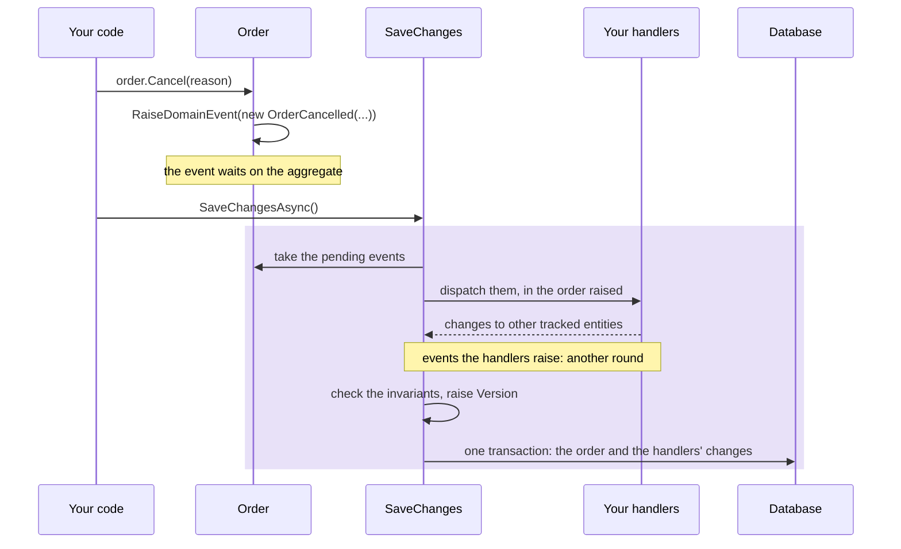
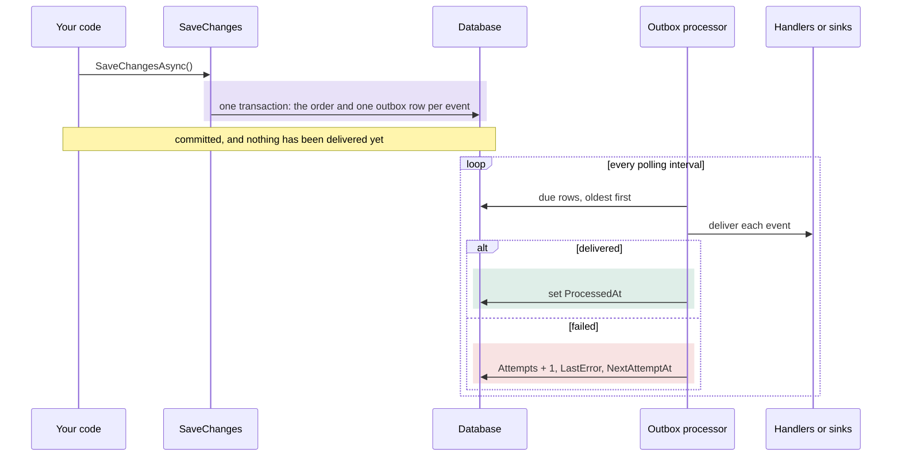
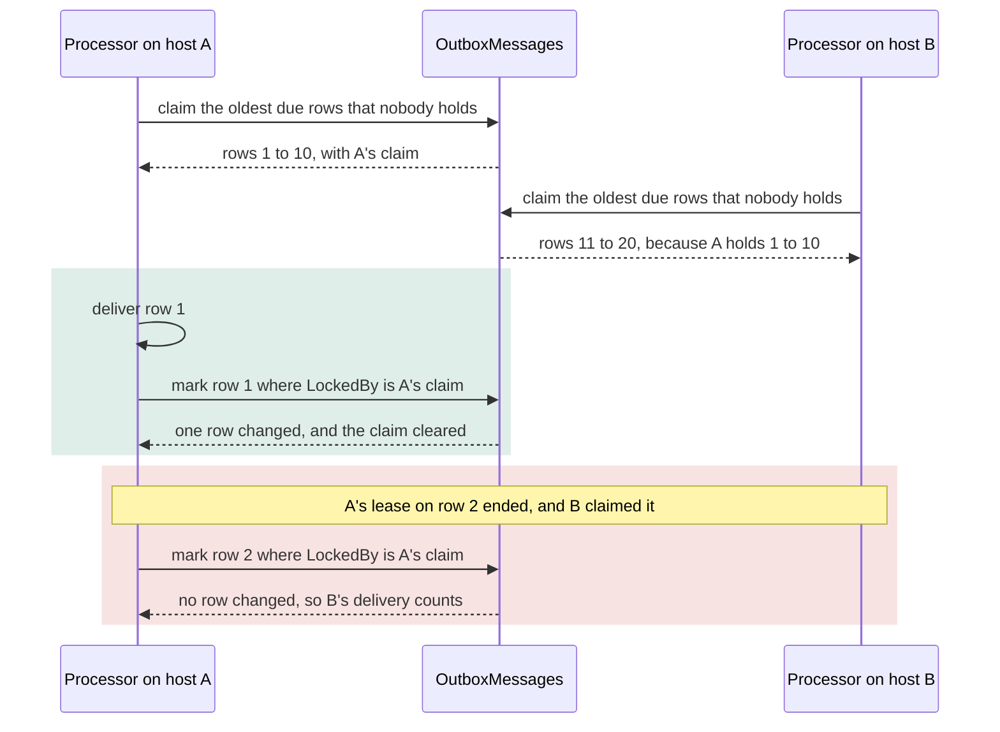

# Delivering domain events

Raising a domain event puts the event on the aggregate, and nothing else happens yet. An `OrderPlaced` event means
that a confirmation goes out, stock is reserved and a van is booked, but only once the event is delivered. This page
covers when delivery happens: inside the save, in the aggregate's transaction, or after the save, from a stored row
that survives a crash.

`DTS.DDD.EntityFramework` has one mode for each:

- **In-process dispatch** runs your handlers while `SaveChanges` runs.
- **The outbox** writes the events to a table in the same transaction, and delivers them afterwards.

Configure one of the two modes for production. If you configure neither, an aggregate that raised events refuses to
save, so no event is lost. See [When no delivery mode is configured](#when-no-delivery-mode-is-configured).

Both modes keep the event inside this process. To send the event to another process, add a sink to the outbox.
[Integration events](integration-events.md) covers sinks.

This page assumes a context set up as in [Entity Framework](entity-framework.md#setting-up-a-context).

## Choosing a delivery mode

In process, the handlers run inside the save. The changes that they make on the same context are written with the
aggregate, in one transaction. A handler that throws stops the save.

The diagram shows in-process dispatch. Purple: the steps inside `SaveChanges`, which all end in one transaction.



<details>
<summary>Show the code: dispatching in process</summary>

Register the toolkit's mediator as the dispatcher, register the module's handlers, and add the toolkit to the context:

```csharp
builder.Services.AddDDDToolkitEntityFramework(options => options.DispatchWithMediator());
builder.Services.AddOrderingHandlers();   // generated: every INotificationHandler of the module

builder.Services.AddDbContext<OrderingContext>((services, options) => options
    .UseNpgsql(connectionString)
    .UseDDDToolkit(services));
```

Every domain event is a notification of the toolkit's mediator, and a handler implements
`INotificationHandler<TEvent>` from `DTS.DDD.Mediator`. The handler runs in the scope of the saving context, so its
changes on that context are saved with the order:

**[`Ordering/Application/Orders/DomainEvents/OrderLog.cs`](../Examples/Modules/Ordering/Examples.Webshop.Ordering/Application/Orders/DomainEvents/OrderLog.cs)**

```csharp
[DomainEventName("ordering.order-cancelled")]
public sealed record OrderCancelled(OrderId OrderId, string Reason) : DomainEvent;

public sealed class OrderLog(ILogger<OrderLog> logger) : INotificationHandler<OrderCancelled>
{
    public ValueTask Handle(OrderCancelled notification, CancellationToken cancellationToken)
    {
        logger.LogInformation("Order {OrderId} was cancelled: {Reason}", notification.OrderId, notification.Reason);
        return default;
    }
}
```

See [In-process dispatch](#in-process-dispatch).

</details>

With the outbox, the save only writes the events, next to the aggregate. Delivery is a separate step after the
commit. The processor retries a failed delivery until it succeeds or reaches `MaxAttempts`.

The diagram shows the outbox. Purple: the save's one transaction. Green: a delivered event. Red: a failed delivery.



<details>
<summary>Show the code: the outbox</summary>

Map the outbox table in the context:

```csharp
protected override void OnModelCreating(ModelBuilder modelBuilder)
    => modelBuilder.AddDomainEventOutbox(Database);
```

Turn the outbox on, and run the processor that delivers from it:

```csharp
builder.Services.AddDDDToolkitEntityFramework(options =>
{
    options.DispatchWithMediator();   // where the processor delivers to
    options.UseOutbox(outbox => outbox.RegisterEventsFromAssemblyContaining<Program>());
});

builder.Services.AddOutboxBackgroundService<OrderingContext>(TimeSpan.FromSeconds(2));
```

The handlers are the same as in process. They must be idempotent, because a crash between the delivery and the mark
delivers the event again. See [The outbox](#the-outbox).

</details>

| | In-process | Outbox |
|---|---|---|
| When handlers run | Inside `SaveChanges`, before the write | After the commit, on the processor |
| Survives a crash | No | Yes |
| Handler failure | Aborts the save | Recorded on the row, retried |
| Delivery | Best-effort, at most once | At least once |
| Handlers must be idempotent | No | Yes |
| Extra table | No | Yes |
| Extra moving part | No | A processor or background service |

Use in-process dispatch for side effects in the same database, where the transaction gives the guarantee you need.
Use the outbox for everything that leaves the process, and give the outbox a sink for it.

You can map the outbox table from the start and switch modes later. The example context does this. A switch of mode
then changes only the registration, and the database schema stays the same.

## In-process dispatch

With `DispatchInProcess` and no outbox, handlers run inside `SaveChanges`, before the database write. With any
delegate that passes the events to your handlers, you get three things:

- The changes that a handler makes on the same `DbContext` are part of the same save, and so of the same
  transaction. The interceptor calls `DetectChanges` at the start of each round, so the round after the handlers
  sees those changes.
- A handler that throws aborts the save. Nothing is written.
- Events that handlers raise on tracked aggregates are dispatched in a further round.

You do not get durability. Delivery is best-effort:

- The interceptor takes the events off the aggregate before dispatch. Once a handler has them, the events exist
  only in memory. If the save then fails, the events are lost.
- Nothing survives a process crash.
- A handler that talks to the outside world has already sent the e-mail or made the HTTP call when a later failure
  rolls the transaction back.

Do not call `SaveChanges` from a handler in this mode. The save is already running and includes your changes.

When the saving context comes from a context pool, the handlers run in the scope that rented the context. That is
the scope that asked for the context, with `AddScopedFromPool`, or the scope that you named with `BindToScope`. A
pooled context without a scope is refused before any event is taken off the aggregate. The outbox needs no scope, so
a save that only writes outbox rows works from any pooled context. See
[Contexts from a pool](entity-framework.md#contexts-from-a-pool).

The events reach your handlers through a delegate. `DispatchWithMediator()` is that delegate for the toolkit's own
mediator, and you can write another one yourself.

### Dispatching with the toolkit's mediator

The toolkit has a mediator of its own for notifications. Its interfaces are in `DylansTechStack.DDD.Abstractions`,
in the namespace `DTS.DDD.Mediator`, and the implementation is in the core package. No other package is needed:

```csharp
builder.Services.AddDDDToolkitEntityFramework(options => options.DispatchWithMediator());
builder.Services.AddOrderingHandlers();   // generated: every INotificationHandler of the module
```

`DispatchWithMediator()` resolves `IPublisher` from the scope that owns the saving `DbContext`. It publishes each
event in the order raised, and awaits the handlers of each event before it starts the next one. The call serves both
delivery modes. Add `UseOutbox`, and the processor delivers through the same call.

`AddDDDToolkitEntityFramework` registers the publisher. Calling `DispatchWithMediator()` again changes nothing, so each
module whose outbox delivers in process may call it beside its `UseOutbox<TContext>`. It cannot be called beside a
`DispatchInProcess` delegate of the host's own.

Four rules apply:

**Every domain event is a notification.** `IDomainEvent` derives from `INotification`, so an event needs no marker of
its own. The events of the supporting packages are notifications too. A handler of
`SeatDeactivated<TenantId, SeatId>`, a closed generic event of the Tenancy package, is written like a handler of an
event of your own.

**The generator registers the handlers.** It writes `Add{Module}Handlers()` into every project that has a class that
implements `INotificationHandler<T>`, with one registration per handler and event type. A handler may be internal.
The generator closes the generics when the project compiles, so the mediator calls each handler without reflection.
It leaves out a class that its registration cannot name: a private or protected nested class, a class nested in a
generic type, a file-local class and an open generic class. Register such a class yourself with
`services.AddNotificationHandler<TEvent, THandler>()`.

**The handlers of a type and of its base types run.** A handler declared for an interface, such as
`INotificationHandler<IOrderingEvent>`, runs for every event that implements the interface. The handlers run one
after another, in the order they were registered. The generated registration lists a project's handlers by their
full name. The first exception stops the rest and propagates.

**An event without a handler is published to nobody.** That is not an error. The handlers are scoped, so a handler
that injects the `DbContext` gets the context that is saving.

### Notification behaviors

A notification behavior runs around each handler call, as a pipeline behavior runs around a request handler:

```csharp
internal sealed class TimeTheHandler<TNotification>(ILogger<TNotification> logger)
    : INotificationBehavior<TNotification>
    where TNotification : INotification
{
    public async ValueTask Handle(TNotification notification, NotificationHandlerDelegate<TNotification> next, CancellationToken cancellationToken)
    {
        var started = Stopwatch.GetTimestamp();
        await next(notification, cancellationToken);
        logger.LogDebug("{Notification} was handled in {Elapsed}", typeof(TNotification).Name, Stopwatch.GetElapsedTime(started));
    }
}
```

```csharp
builder.Services.AddNotificationBehavior(typeof(TimeTheHandler<>));
```

- A behavior is resolved for the type the handler is declared for. A handler of `IOrderingEvent` runs inside the
  behaviors of `IOrderingEvent`, whatever the event's own type is.
- An open generic behavior runs around the handlers of every type that satisfies its constraints. A closed behavior,
  such as one that implements `INotificationBehavior<OrderCancelled>`, runs around the handlers of that type alone.
- The behavior registered first is the outermost.
- A behavior that calls `next` twice, such as a retry, runs everything inside it twice.
- A behavior is scoped by default, so it can take the scope's services. With no behavior registered, a handler call
  allocates nothing in the mediator itself.

A behavior suits work that every handler of a kind needs. One example is the caller a handler of another module's
events runs as, on a host that requires an explicit current user.

### The dispatch delegate

`DispatchWithMediator()` is one delegate. In-process delivery is a delegate, and you can write it against any library,
or none.

Both modes deliver through the same delegate, so you write the handlers once:

```csharp
Func<IServiceProvider, IReadOnlyList<IDomainEvent>, CancellationToken, Task>
```

The provider is the scope that owns the saving `DbContext`. The events arrive in the order raised. Written against
the publisher of another library, such as MediatR's `IPublisher`, the delegate looks like this:

```csharp
builder.Services.AddDDDToolkitEntityFramework(options =>
{
    options.DispatchInProcess(async (services, events, cancellationToken) =>
    {
        var publisher = services.GetRequiredService<MediatR.IPublisher>();
        foreach (var domainEvent in events)
        {
            await publisher.Publish(domainEvent, cancellationToken);
        }
    });
});
```

A process has one delegate. A second `DispatchInProcess` call throws, and does not replace the first delegate.
## The outbox

With `UseOutbox`, nothing is dispatched at save time. The save adds one row per event to the saving context, so the
events commit atomically with the aggregate. A separate processor delivers them afterwards, through the same dispatch
delegate.

```csharp
builder.Services.AddDDDToolkitEntityFramework(options =>
{
    options.DispatchWithMediator();   // or your own DispatchInProcess(...) delegate
    options.UseOutbox(outbox => outbox.RegisterEventsFromAssemblyContaining<Program>());
});

builder.Services.AddOutboxBackgroundService<OrderingContext>(TimeSpan.FromSeconds(2));
```

The rows need a table in the context's model: `modelBuilder.AddDomainEventOutbox(Database)` in `OnModelCreating`
([The table](#the-table)). A save with an outbox configured and no table mapped throws, and the message names the
context.

An event is never lost, and never published for a transaction that rolled back. The events are rows in the
aggregate's transaction, so a rollback of the aggregate also rolls back its events.

The cost is at-least-once delivery. The processor marks a message processed only after its handlers returned, so a
crash in between delivers the message again. Handlers must be idempotent, keyed on `EventId`.

Two hosts that poll the same table do not deliver one message both. Each batch claims its rows first, and holds them
for a lease. See [Several processors on one table](#several-processors-on-one-table).

With this configuration the outbox is durable and still in-process. The processor passes each event to the same
delegate. Add a sink, and the row leaves the process instead:

```csharp
options.UseOutbox(outbox =>
{
    outbox.RegisterEventsFromAssemblyContaining<Program>();
    outbox.SendTo<ServiceBusSink>();
});
```

`outbox.AlsoDispatchInProcess = true` does both. See [Which delivery wins](integration-events.md#sinks-and-in-process-dispatch-together).
[Integration events](integration-events.md) covers sinks, the published contract that differs from your domain
event, and the inbox that makes at-least-once delivery safe to consume.

## The outbox in detail

### The table

Map the table in `OnModelCreating`:

```csharp
protected override void OnModelCreating(ModelBuilder modelBuilder)
{
    modelBuilder.AddDomainEventOutbox(Database);
}
```

`Database` is the context's property. `AddDomainEventOutbox` reads one thing from it, the provider name. The method
uses the provider name to give the timestamp columns the right type for your database. See
[Timestamps](#timestamps) below.

The table is `ddd.OutboxMessages` by default. The method takes `tableName` and `schema` to change that.
`schema: null` puts the table in the provider's default schema. SQLite has no schemas and ignores the argument, so on
SQLite the table is `OutboxMessages`. The mapping sets a primary key on `Id`, an index on `ProcessedAt`, and the
lengths below.

| Column | Type | Meaning |
|---|---|---|
| `Id` | `Guid`, key, never generated | The event's `EventId`. This is the idempotency key |
| `EventName` | `string`, required, 256 | The stable name, from `[DomainEventName]` or the convention, such as `ordering.order-placed` |
| `Payload` | `string`, required | The event, serialized with System.Text.Json |
| `Version` | `int` | The shape that the payload was written in, 1 unless the event type says otherwise. See [The outbox reading its own old rows](integration-events.md#old-rows-in-the-outbox) |
| `OccurredAt` | `DateTimeOffset` | Taken from the event |
| `AggregateType` | `string?`, 512 | CLR type name of the aggregate that raised the event |
| `AggregateId` | `string?`, 256 | The aggregate's key as text, with the parts joined by `\|` |
| `CreatedAt` | `DateTimeOffset` | When the row was written |
| `ProcessedAt` | `DateTimeOffset?` | When the handlers succeeded. `null` while the message is pending |
| `Attempts` | `int` | How many deliveries were attempted |
| `NextAttemptAt` | `DateTimeOffset?` | When a failed message may be tried again. `null` when it is due now. See [Failures, retries and poison messages](#failures-retries-and-poison-messages) |
| `LastError` | `string?`, 4000 | Type and message of the last failure |
| `LockedBy` | `string?`, 128, concurrency token | The claim of the processor that holds the row. `null` when no processor holds it. See [Several processors on one table](#several-processors-on-one-table) |
| `LockedUntil` | `DateTimeOffset?` | When that claim's lease ends. `null` when no processor holds the row |

`CreatedAt` comes from `options.TimeProvider`, which defaults to `TimeProvider.System`. Tests can replace it. The
processor takes the current time from the same provider when it compares `NextAttemptAt` and `LockedUntil`.

The index is on `ProcessedAt` only. `ProcessedAt` separates the few pending rows from the many delivered rows.
`NextAttemptAt` only divides the pending rows into due and waiting. The condition "`null`, or not after now" is not
one range that an index can seek. Adding `NextAttemptAt` to the index would therefore make the index bigger without
making the poll faster. `LockedUntil` has the same condition, and stays out of the index for the same reason.

Payloads are written with System.Text.Json through `outbox.JsonOptions`. By default these options are
case-insensitive on read, and include the toolkit's `SingleValueObjectConverterFactory`. Identifiers and single
value objects are therefore stored as their raw values. The same options read the payload back, so change them with
care once messages exist.

### Timestamps

`OccurredAt`, `CreatedAt`, `ProcessedAt` and `NextAttemptAt` are `DateTimeOffset` in the model. Their database type
depends on the provider, and you can choose another type:

```csharp
// The provider's own instant type.
modelBuilder.AddDomainEventOutbox(Database);

// A UTC DateTime column, on every provider.
modelBuilder.AddDomainEventOutbox(Database, timestamps: DomainEventTimestamps.UtcDateTime);
```

| Provider | `ProviderDefault` | `UtcDateTime` |
|---|---|---|
| PostgreSQL | `timestamp with time zone` | `timestamp with time zone` |
| SQL Server | `datetimeoffset` | `datetime2` |
| SQLite | UTC `DateTime` as text | UTC `DateTime` as text |

The outbox needs these columns to sort as instants. The processor reads pending messages oldest first, and compares
`NextAttemptAt` with the current time. SQLite stores a `DateTimeOffset` as text, and cannot order by it or compare
it. On SQLite the toolkit therefore converts to a UTC `DateTime`, whatever you ask for. Every other provider has an
instant type that orders correctly, and uses that type.

In both column types, the value is converted to UTC when it is written. A `DateTimeOffset` with `+02:00` is stored as
the same instant with offset zero, and reads back that way. The two column types therefore hold the same instants.
Npgsql needs this conversion too, because PostgreSQL refuses a `DateTimeOffset` whose offset is not zero.

`AddDomainEventInbox` takes the same argument for its `ProcessedAt`. Pass the same value to both.

If you write migrations by hand, `CreateDomainEventOutbox` and `CreateDomainEventInbox` also take `timestamps`, and
default to `ProviderDefault`. They read `MigrationBuilder.ActiveProvider`, so a hand-written table matches a
scaffolded one.

A database created by an earlier 3.0 build may have the older column type on SQL Server. Read
[From an earlier 3.0 build](migrating-to-3.md#from-an-earlier-30-build) before you upgrade such a database.

### Registering event types

The row stores a name, so the processor needs a map from names to types:

```csharp
options.UseOutbox(outbox =>
{
    outbox.RegisterEventsFromAssemblyContaining<Program>();
    outbox.RegisterEventsFromAssembly(typeof(OrderPlaced).Assembly);
    outbox.RegisterEvent<OrderCancelled>();
});
```

The three calls add to each other, so use any of them. Most applications need only the first. An assembly scan
registers every concrete type that implements `IDomainEvent`. Registering two types under the same stable name
throws an `ArgumentException` that names both types. That failure happens at start-up, before any delivery.

The stable name matters here. The row stores the name, and the processor reads the name back later, so the name
must not change while rows wait. The conventional name is the module and the class name in kebab case. It does not
change when the class moves to another namespace. When you rename the class, `[DomainEventName]` keeps the old name.
See [Stable names](domain-events.md#stable-names).

The generator can write this registration. With the Entity Framework package referenced, every assembly gets an
`Add{Module}IntegrationEvents()` method. The method registers each domain event of the assembly under its stored
name. The generator computes the names at compile time, so nothing is scanned at start-up:

```csharp
[assembly: Module("Ordering")]

[DomainEventName("ordering.order-received")]   // renamed from OrderReceived; rows keep the old name
public sealed record OrderPlaced(OrderId Order) : DomainEvent;

public sealed record OrderCancelled(OrderId Order) : DomainEvent;
```

**`IntegrationEventExtensions.g.cs`**, shortened

```csharp
public static OutboxOptions AddOrderingIntegrationEvents(this OutboxOptions outbox)
{
    ArgumentNullException.ThrowIfNull(outbox);
    outbox.RegisterEvent<OrderCancelled>("ordering.order-cancelled", 1);
    outbox.RegisterEvent<OrderPlaced>("ordering.order-received", 1);
    return outbox;
}
```

`OrderPlaced` is stored under its pinned name, and `OrderCancelled` under the conventional name. Call
`outbox.AddOrderingIntegrationEvents()` instead of the assembly scan. The same method registers what a module
publishes ([Integration events](integration-events.md#the-generated-registration)).

A domain project without an Entity Framework reference gets no such method. The module's project that references
Entity Framework, the project that holds the outbox, registers the domain project's events in its own
`Add{Module}IntegrationEvents()`:

- The events get the same names, which the domain project's `[assembly: Module]` decides.
- Any project with the same module counts. A project that references Entity Framework registers its own events.
- The events must be `public`. An event that the registering project cannot see is left out, and the toolkit
  reports diagnostic [DDD00033](diagnostics.md#ddd00033).

See [A module in layers](modules.md#a-module-in-layers).

An event name that nobody registered does not stop the processor. The processor records the failure on the row.
`LastError` names the missing event and the registration call, `Attempts` increases, and `ProcessedAt` stays null.
The processor continues with the rest of the batch. Register the type, and the next attempt delivers the row.

### Running the processor

For a hosted application, use the background service:

```csharp
builder.Services.AddOutboxBackgroundService<OrderingContext>(
    pollingInterval: TimeSpan.FromSeconds(2),
    batchSize: 100);
```

`AddOutboxBackgroundService` registers the processor, the polling options and the hosted service. `batchSize`
defaults to 100. On each tick the service drains the outbox, batch after batch, until a batch delivers nothing. Each
batch runs in a new service scope, so the processor and the handlers get a new context. A failure in a tick is
logged, and the next tick tries again.

To run the processor yourself, from a job scheduler or a test, register the processor alone:

```csharp
builder.Services.AddOutboxProcessor<OrderingContext>();
```

```csharp
var processor = scope.ServiceProvider.GetRequiredService<OutboxProcessor<OrderingContext>>();
var delivered = await processor.ProcessPendingAsync(batchSize: 100, cancellationToken);
```

`ProcessPendingAsync` claims the pending messages that are due and that no other processor holds, oldest first, by
`CreatedAt`, then `OccurredAt`, then `Id`. It delivers each message separately, and returns the number of messages
delivered successfully. The processor throws when it is constructed if the outbox is not enabled, or if it has
neither a sink nor a dispatch delegate.

Each message is saved through the same scoped context. A handler that resolves that context and changes an aggregate
commits its change together with the processed mark. Events that this change raises become new outbox rows.

The processor reads the claimed batch untracked. It attaches a row to the context while it delivers that row, and
detaches the row after its save. So each save compares one outbox row with its snapshot, and not every row of the
batch. A row that the context already tracks, because the caller saved its event through the same context, keeps its
entry and stays tracked. The processor reads such a row again first, because its values are from before the claim.

Cancellation stops the batch before the next message, and the delivery receives the token. When a delivery has
finished, the processor still saves its outcome, the mark or the failure. That save may run for 5 seconds after
cancellation was requested. So a message that was delivered just before the host stopped is marked, and is not
delivered again. The messages that the batch did not reach are released, so another processor can claim them at once.

### Failures, retries and poison messages

A handler that throws does not stop the batch. The processor then:

- writes the exception type and message to `LastError`, truncated at 4000 characters,
- increases `Attempts`,
- leaves `ProcessedAt` null,
- moves to the next message.

The message is retried later. On success, `LastError` is cleared.

A failed message is not retried at once. The processor writes to `NextAttemptAt` when the message may be tried
again, and loads only the messages that are due, still oldest first. The wait grows with every failure:

| After attempt | 1 | 2 | 3 | 4 and later |
|---|---|---|---|---|
| The message waits | 5 s | 25 s | 2 min 5 s | 10 min |

The wait has two effects:

- A message that keeps failing does not block the messages written after it. The next poll passes it.
- A sink that is down for a few seconds costs a message one attempt. A busy drain does not load the message again
  before its time.

`RetryDelay` sets the schedule. It receives the number of attempts so far, 1 after the first failure:

```csharp
options.UseOutbox(outbox => outbox.RetryDelay = attempts => TimeSpan.FromSeconds(30 * attempts));
```

`TimeSpan.Zero` retries on the next poll. `OutboxOptions.DefaultRetryDelay` is the default schedule, for a policy
that builds on it.

`MaxAttempts` defaults to 10. The processor no longer loads a message that reached it:

```csharp
options.UseOutbox(outbox => outbox.MaxAttempts = 5);
```

With both defaults, the processor gives up on a message that keeps failing about an hour after the first attempt.
The message stays in the table with its last error, for inspection, and with no `NextAttemptAt`. Reset `Attempts`,
and the next poll retries the message. To retry a message that is still waiting, set its `NextAttemptAt` to null.

Delivered rows also stay until something deletes them. `services.AddDomainEventRetention<TContext>(...)` deletes
delivered rows that are older than a window you choose, and never deletes a row that was not delivered. See
[Keeping the tables small](integration-events.md#keeping-the-tables-small).

A batch that delivers nothing ends the background service's drain for that tick, whether its messages failed or no
message was due. A sink that is down therefore gets one batch per tick, and not every message in a loop. The next
tick continues with the messages behind the failed ones, and with the failed messages whose time has come.

### Several processors on one table

Every host that runs `AddOutboxBackgroundService<TContext>` polls the same table, so three replicas run three
processors. Each batch therefore starts with a claim, and two processors do not deliver one message both. The claim
holds the rows for `LeaseDuration`, 5 minutes by default:

```csharp
options.UseOutbox<OrderingContext>(outbox =>
{
    outbox.RegisterEventsFromAssemblyContaining<Order>();
    outbox.LeaseDuration = TimeSpan.FromMinutes(5);
});
```



**The claim.** One `UPDATE` claims the batch. It writes a new `LockedBy` and a `LockedUntil` of now plus
`LeaseDuration` on the oldest rows that are due and that no processor holds. A row is held while its `LockedUntil`
is after now. The statement checks the condition twice: in the subquery that picks the oldest rows, and on each row
it changes. The database runs the second check after it locks the row, so a row that another processor claimed in
the meantime is left out. Postgres reads such a row again, SQL Server reads it under an update lock, and SQLite runs
one writer at a time. A second query loads the claimed rows by their `LockedBy`.

`LockedBy` holds the machine name, the process id and a Guid that is new for every batch. Two processors in one
process therefore hold different claims as well.

**The mark.** `LockedBy` is a concurrency token. The save that marks a message, delivered or failed, has the claim in
its `WHERE` clause, and sets `LockedBy` and `LockedUntil` back to `null`. A failed message is claimed again at its
`NextAttemptAt`. The mark is still one save on the processor's context, so a handler's change on that context still
commits with it.

**A takeover.** Another processor can claim a row after its lease ended. The first processor's mark then changes no
row, and its save fails. That processor:

- logs a warning,
- counts the message neither as delivered nor as failed, and writes no `LastError`,
- takes the save's changes off its context: the row, what a handler left unsaved, and the outbox rows of that
  change's events,
- rolls back its transaction under `DeliverInTransaction`, which takes a pgmq enqueue back too,
- goes on with the next message.

A lease that ended without a takeover does not stop the mark. Only another claim does.

**Half the lease.** The processor starts a message only while at least half the lease is left. When less is left, it
stops the batch and releases the rows it did not reach. The next batch claims them again with a new lease. So a
delivery that takes less than half the lease ends before the lease does, and no other processor can take its row.
The default of 5 minutes covers deliveries of up to 2.5 minutes. Set `LeaseDuration` to more than twice your slowest
delivery. It accepts up to one day.

**The release.** A batch that is cancelled, or whose save throws, also releases the rows it did not finish, with one
`UPDATE`. The release has a timeout of its own, 5 seconds. When it fails, the processor logs a warning, and the rows
wait for the end of their lease. A host that crashes releases nothing. Its rows wait for the end of their lease, at
most 5 minutes with the default.

**The clocks.** Each host compares `LockedUntil` with its own `options.TimeProvider`. A host whose clock runs ahead
takes rows over sooner. Keep the hosts' clocks synchronized, as NTP does.

### An outbox per context

`UseOutbox(...)` configures one outbox for every context. With a context per module, give each module that produces
events its own outbox, registered by that module:

```csharp
services.AddDDDToolkitEntityFramework(options => options.UseOutbox<OrderingContext>(outbox =>
{
    outbox.RegisterEventsFromAssemblyContaining<Order>();
    outbox.SendToModules();
}));

services.AddOutboxBackgroundService<OrderingContext>(TimeSpan.FromSeconds(2));
```

This works because `AddDDDToolkitEntityFramework` can be called any number of times. The first call registers the
services, and every call configures the process's single options object. Each module of a modular monolith
therefore registers its part next to its context:

- its outbox, with `options.UseOutbox<TContext>(...)`,
- the contracts it reads, with `options.MapIntegrationEvents(...)`.

The host keeps the settings for the whole process, such as a `DispatchInProcess` delegate of its own. That delegate
can be set only once. A second call throws, so one module's events cannot reach another module's publisher by
accident. `DispatchWithMediator()` is the exception. Every module may call it, because it sets the same delegate each
time.
[Integration events](integration-events.md#delivering-to-a-module-in-the-same-process) shows the module
registration from start to end.

A context uses its own outbox when it has one. Otherwise it uses the shared outbox. When neither exists, the context
has no outbox, and its events are dispatched in process at save time. `options.OutboxFor(typeof(TContext))` returns
which of the three applies. A processor for a context without an outbox refuses to start, and the message names the
context.

### Limits

- **The order is best-effort.** The processor loads messages oldest first. A failed message waits while later
  messages are delivered, so the delivery order can differ from the write order.
- **A waiting message waits for its time.** After a sink recovers, a message that failed during the outage is sent
  at its `NextAttemptAt`, up to 10 minutes later with the default schedule. The processor does not detect that the
  sink recovered. Set `NextAttemptAt` to null to send the waiting messages at once.
- **A slow failure takes its time.** The wait limits how often a failing message is tried. Each attempt still lasts
  as long as the sink takes to fail, and the processor delivers a batch one message at a time. A batch of 100
  messages that each wait for a 30-second timeout holds the processor for 50 minutes. Keep sink timeouts short, or
  batches small.
- **A delivery longer than half the lease can repeat.** Another processor can claim the row when the lease ends, and
  deliver the message again. Together with the crash window before `ProcessedAt` is written, this keeps delivery
  at-least-once. Handlers must be idempotent, keyed on `EventId`, which is `OutboxMessage.Id`.
- **Two claims at the same moment can leave one processor idle.** Both claims pick the same oldest rows. The second
  finds them held and claims nothing, so that processor's drain ends until its next tick. The claim does not use
  `FOR UPDATE SKIP LOCKED`, which Entity Framework does not write for every provider.
- **Delivery is not immediate.** It happens on the next poll after the commit.
- **Two sinks share one row.** When a message goes to more than one sink and one sink refuses it, the whole message
  is retried, and the sinks that accepted it receive it again. See
  [Integration events](integration-events.md#when-one-sink-fails-and-another-does-not).

`Tests/DTS.DDD.EntityFramework.Tests/OutboxTests.cs` tests the transactional write, the retries, `MaxAttempts`,
unknown event names and the background service. `OutboxRetryTests.cs` next to it tests the wait between attempts.
`OutboxLeaseTests.cs` tests the claim, a takeover, the release and two processors on one database. The provider tests
run two processors on Postgres and on SQL Server.

## The dispatch loop

Both modes run through the same loop in `PublishDomainEventsInterceptor`, once per `SaveChanges`:

1. Call `DetectChanges`, and take the pending events off every tracked aggregate. If there are none, stop.
2. In outbox mode, add a row per event and go back to step 1.
3. Otherwise, call the dispatch delegate with the whole batch, and go back to step 1.

The loop exists because a handler may change a tracked aggregate, and that change may raise another event.
`MaxDispatchRounds` limits the loop to 10 rounds by default. If another batch of events appears after that many
rounds, `SaveChanges` throws an `InvalidOperationException`. The message names the events that are still pending,
and suggests two causes, a handler that triggers itself or a limit that is too low. To raise the limit:

```csharp
options.MaxDispatchRounds = 20;
```

## When no delivery mode is configured

If an aggregate has pending events and neither `DispatchInProcess` nor `UseOutbox` was called, `SaveChanges` throws,
so the events are not dropped. The message names the aggregate types and both calls that fix the problem. A save
without pending events needs no delivery mode. A context whose aggregates raise no events therefore works without
one.

## Prefer `SaveChangesAsync`

The dispatch delegate is asynchronous, so a synchronous `SaveChanges` blocks on it. That is safe in console
applications and in ASP.NET Core, which have no synchronization context. Under a UI or legacy ASP.NET
synchronization context, the block can deadlock. Otherwise the two methods behave the same. Both dispatch the events
before the write.

## Why the toolkit has its own mediator

MediatR did this job for the first two major versions of the toolkit. From version 13, MediatR has a commercial
licence, and this repository prefers dependencies without a licence fee. Version 3.0 moved to
[Mediator](https://github.com/martinothamar/Mediator), which is MIT-licensed and uses a source generator.

Both libraries publish only types that implement their own `INotification`. A package of the toolkit cannot implement
an application's mediator interface, and the toolkit keeps every mediator library out of its packages. So the events
of Tenancy and Membership could reach no handler. [ZeroAlloc.Mediator](https://github.com/ZeroAlloc-Net/ZeroAlloc.Mediator)
was considered as well. Its generator also recognises only its own interfaces, and it writes an internal mediator into
each assembly, which a modular monolith cannot share between its projects.

The toolkit's mediator takes the design ideas it needs:

- The interfaces are the toolkit's own, in `DylansTechStack.DDD.Abstractions`, and `IDomainEvent` derives from
  `INotification`. Every event of every package is a notification without depending on a mediator library.
- A source generator in each module writes the registration, with the generics closed. A dispatch makes no call
  through reflection.
- A notification is dispatched on its runtime type, so an event that arrives as `IDomainEvent`, from a save or from
  an outbox row, reaches the handlers of its own type.
- The publisher is public and scoped, so every project of a module and the host can use it.

You can still use another library for the events. Write [the dispatch delegate](#the-dispatch-delegate) and publish
through its publisher. The requests of the examples run on Mediator for now.

## Where to look next

- [Entity Framework](entity-framework.md) for the registration, the mapping and the other interceptors.
- [Domain events](domain-events.md) for raising events and giving them stable names.
- [Integration events](integration-events.md) for sinks, published contracts and the inbox.
- [Invariants](invariants.md#at-the-save) for the check that runs after the handlers, before the write.
