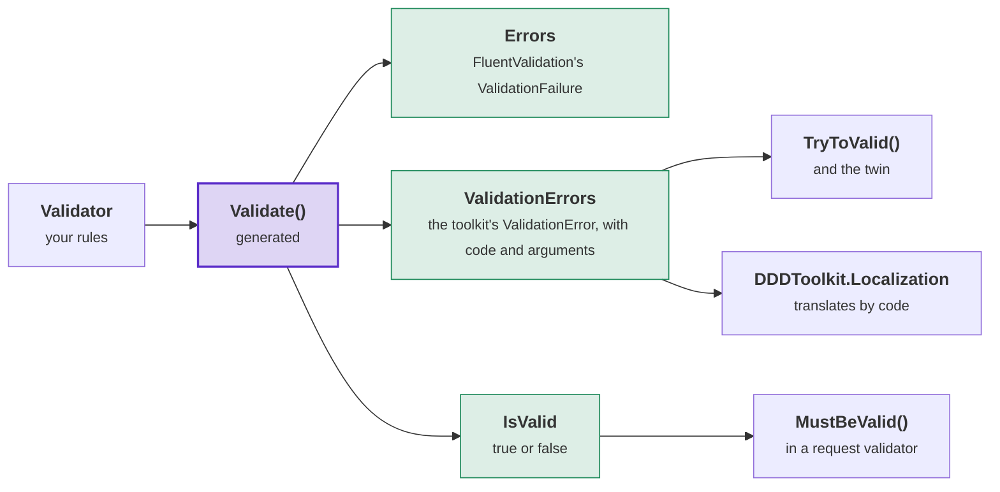

# FluentValidation

`DDDToolkit.FluentValidation` lets you write the rules of a value object as a
[FluentValidation](https://docs.fluentvalidation.net/) validator. It also lets a value object take part in the
validator you write for a command or a request. To write the rules of a value object by hand instead, see
[Value objects](value-objects.md#validation).

The package needs no registration. A value object creates its validator with `new` when it validates, and the
rest of the package is extension methods.

```bash
dotnet add package Temp.DDDToolkit.FluentValidation --prerelease
```

## A value object's rules

When a project references the package, the generator gives every value object a nested
`partial class Validator`. You write the other part of that class, with the rules:

```csharp
[SingleValueObject<string>]
public partial record EmailAddress
{
    public static EmailAddress Create(string value) => new(value);

    partial class Validator
    {
        public Validator() => RuleFor(x => x.Value).EmailAddress();
    }
}
```

The generator writes the base class of `Validator`, two `Validate` overrides that run it, and an `Errors`
property with the failures of the last run:

**EmailAddress.FluentValidation.g.cs** (shortened)

```csharp
partial record EmailAddress
{
    [Internal]
    [NotMapped]
    public ReadOnlyCollection<FluentValidation.Results.ValidationFailure> Errors => _errors.AsReadOnly();

    private List<FluentValidation.Results.ValidationFailure> _errors = new();

    protected override bool Validate()
    {
        var validator = new Validator();
        var result = validator.Validate(this);
        _errors = result.Errors;
        return result.IsValid;
    }

    protected override void Validate(ValidationErrorBuilder errors)
    {
        foreach (var failure in _errors)
        {
            // ... copies each failure, with its placeholder values as arguments, into a ValidationError
        }
    }

    partial class Validator : FluentValidation.AbstractValidator<EmailAddress>
    {
    }
}
```

So the generator states the base class, and you state the rules. A value object with several properties works
the same way, with one rule per property:

```csharp
[ValueObject]
public partial record Address
{
    public Address(string street, string city, string postalCode)
        => (Street, City, PostalCode) = (street, city, postalCode);

    public string Street { get; protected init; }
    public string City { get; protected init; }
    public string PostalCode { get; protected init; }

    partial class Validator
    {
        public Validator()
        {
            RuleFor(x => x.Street).NotEmpty();
            RuleFor(x => x.City).NotEmpty();
            RuleFor(x => x.PostalCode).Matches(@"^\d{4}\s?[A-Za-z]{2}$");
        }
    }
}
```

Which types get a validator:

| Declaration | Validator |
|---|---|
| `[ValueObject]` | Yes |
| `[SingleValueObject<T>]` | Yes |
| `[EntityId<T>] partial record`, the record form of an identifier | Yes |
| `[EntityId<T>] partial record struct` | No. A struct identifier is valid by construction. |

A value object that declares `Validate()` or `Validate(ValidationErrorBuilder)` itself, in any part, keeps its
own validation. It gets no `Validator`, no `Errors` and no generated overrides. So one project can mix value
objects with hand-written validation and value objects with rules. Only these two signatures count. A
`Validate` method with other parameters is an ordinary method, and the type still gets its validator.

## What the rules produce

Every member of the value object that validates now runs your validator: `IsValid`, `ToValid()`, `TryToValid()`
and the [always-valid twin](value-objects.md#the-always-valid-twin). The failures come out in two shapes, one
for each kind of caller.

In the diagram, purple is the generated `Validate()`, and green is what it fills:



<details>
<summary>Show the code: rules, a request validator and an endpoint</summary>

The value objects have their rules as above. The request validator adds the rules about the request, and checks
the value objects with `MustBeValid()`:

```csharp
public sealed record PlaceOrder(EmailAddress? Email, Address? ShipTo, int Quantity);

public sealed class PlaceOrderValidator : AbstractValidator<PlaceOrder>
{
    public PlaceOrderValidator()
    {
        RuleFor(x => x.Email).NotNull().MustBeValid();
        RuleFor(x => x.ShipTo).NotNull().MustBeValid();
        RuleFor(x => x.Quantity).GreaterThan(0);
    }
}
```

The endpoint converts the result into the toolkit's failures, and answers 400 with them:

```csharp
app.MapPost("/orders", (PlaceOrder body) =>
{
    var errors = new PlaceOrderValidator().Validate(body).ToValidationErrors();
    if (errors.Count > 0)
    {
        return Results.ValidationProblem(errors.ToErrorDictionary());
    }

    // ...
});
```

</details>

- `Errors` holds FluentValidation's `ValidationFailure`. Use it in code that already works with FluentValidation.
- `ValidationErrors` and `TryToValid()` return the toolkit's `ValidationError`. It carries the same property, code
  and attempted value. FluentValidation's placeholder values arrive in its `Arguments`. A caller reads all of
  this without a reference to FluentValidation:

```csharp
var email = EmailAddress.Create("nope");

email.IsValid;                          // false
email.Errors[0].PropertyName;           // "Value"

email.TryToValid(out var valid, out var errors);
errors[0].Code;                         // "EmailValidator"
errors[0].Message;                      // "'Value' is not a valid email address."
errors[0].AttemptedValue;               // "nope"
```

## A value object in a request validator

A value object validates itself. A validator that you write for a command or a request does not run those rules.
`MustBeValid()` adds the result of the value object to that validator, as one rule:

```csharp
public sealed class PlaceOrderValidator : AbstractValidator<PlaceOrder>
{
    public PlaceOrderValidator()
    {
        RuleFor(x => x.Email).NotNull().MustBeValid();
        RuleFor(x => x.ShipTo).NotNull().MustBeValid();
        RuleFor(x => x.Quantity).GreaterThan(0);
    }
}
```

`MustBeValid()` reports a failure on the property that holds the value object. So the caller gets one list of
failures, and no exception per field. For a request with an invalid email address, an empty city and a quantity
of 0, the list is:

| Property | Code | Message |
|---|---|---|
| `Email` | `ValueObjectValidator` | 'Email' is not a valid EmailAddress. |
| `ShipTo` | `ValueObjectValidator` | 'Ship To' is not a valid Address. |
| `Quantity` | `GreaterThanValidator` | 'Quantity' must be greater than '0'. |

- The code `ValueObjectValidator` is the constant `ValueObjectRules.ErrorCode`. A caller can branch on it.
- The type name of the value object is the argument `ValueObject` of the failure. It is not part of the message
  text, so a translation can place `{ValueObject}` where its grammar needs it ([Localization](localization.md)).
- `MustBeValid()` passes a `null` property, as FluentValidation's own rules do. Chain `NotNull()` before it when
  the value is required.
- `MustBeValid()` returns the rule builder, so `WithMessage()` and the other options still chain.

## Request and value object failures in one list

`ToValidationErrors()` converts a FluentValidation result, or any list of `ValidationFailure`, into the toolkit's
`ValidationError`. The failures of a request validator then go into the same list as the failures that
`TryToValid()` returns. An endpoint that answers with every failure at once uses this:

```csharp
public sealed record CheckoutRequest(string Street, string City, string PostalCode, int Quantity);

public sealed class CheckoutRequestValidator : AbstractValidator<CheckoutRequest>
{
    public CheckoutRequestValidator() => RuleFor(x => x.Quantity).GreaterThan(0);
}
```

```csharp
var errors = new List<ValidationError>(new CheckoutRequestValidator().Validate(body).ToValidationErrors());

if (!new Address(body.Street, body.City, body.PostalCode).TryToValid(out var shipTo, out var addressErrors))
{
    errors.AddRange(addressErrors.Prefixed("shipTo"));
}

if (errors.Count > 0)
{
    return Results.ValidationProblem(errors.ToErrorDictionary());
}
```

`Prefixed()` and `ToErrorDictionary()` are part of the toolkit, and work the same without FluentValidation
([Returning a refusal from an endpoint](value-objects.md#returning-a-refusal-from-an-endpoint)).

## Messages in the reader's language

FluentValidation writes `Message` in its own languages. `DDDToolkit.Localization` can write it in the reader's
language instead. Every failure arrives with its code, and with its placeholder values (`MaxLength`,
`ComparisonValue`, `ValueObject`) in `Arguments`. The localizer looks up a translation by the code, for your own
codes and for FluentValidation's, and fills it in from the arguments. The value object does not change. See
[Localization](localization.md).

## What it does not do

- **No dependency injection.** A value object creates its `Validator` with `new` each time it validates, so the
  constructor of `Validator` cannot take services. A rule that needs a service, such as "this email address is
  not taken yet", is a rule about the request. Put it in the request validator.
- **No asynchronous rules on a value object.** A value object validates synchronously, the first time something
  reads `IsValid`. So `MustAsync` and other asynchronous rules cannot run there. A request validator can have
  asynchronous rules of its own and run with `ValidateAsync`. `MustBeValid()` in it is a synchronous rule.
- **No rules across value objects.** The rules of a value object see only that value object. Put rules about the
  request as a whole in the request validator, next to `MustBeValid()`.
