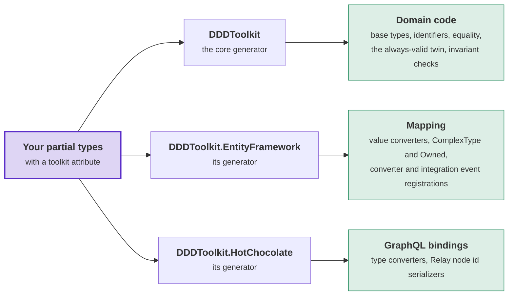

# What the generator writes

Every attribute in DDDToolkit is a request to a Roslyn source generator. The generator reads your declaration while the
project compiles, and it adds C# files to the same compilation. No runtime library inspects your types, nothing uses
reflection over them, and nothing is woven into the IL. The code that runs is the code on this page. You can open it,
read it and step through it like your own code.

The diagram shows the three generators. Purple is your code, and green is what each generator writes:



<details>
<summary>Show the code: turning the generators on</summary>

Each package carries its generator, so a package reference turns the generator on:

```bash
dotnet add package Temp.DDDToolkit --prerelease                   # base types and the core generator
dotnet add package Temp.DDDToolkit.EntityFramework --prerelease   # its generator: the mapping
dotnet add package Temp.DDDToolkit.HotChocolate --prerelease      # its generator: the GraphQL bindings
```

The registration methods that the generators write are named after the module the project declares. This sample
declares the module Shop with `DDD_Module` in its project file. A `Directory.Build.props` can set `DDD_Module` for a
whole folder of projects instead. `[assembly: Module]` in a file of the project has the same effect:

```xml
<PropertyGroup>
  <DDD_Module>Shop</DDD_Module>   <!-- AddShopConverters, AddShopIntegrationEvents, AddShopGraphQlRuntimeBindings -->
</PropertyGroup>
```

The generators' own package, `DDDToolkit.Analyzers`, lets them read that property, so the property works wherever the
generators run. [The module name in generated code](modules.md#the-module-name-in-generated-code) gives the order in
which the names are read, and [How the property reaches the generators](modules.md#how-the-property-reaches-the-generators)
gives the supported ways to reference the toolkit.

</details>

This page goes through the output for one small aggregate. The code comes from [`website/sample`](../website/sample).
The docs site compiles that sample to show the same files on its homepage, so this is the generators' real output.
The only changes are that the `global::` prefixes are removed and long files are shortened. Four files go in:

```csharp
[AggregateRoot<Guid>("ORD")]
public partial class Order
{
    public Order(OrderId id, Address shipTo) : base(id)
    {
        ShipTo = shipTo;
        RaiseDomainEvent(new OrderPlaced(id));
    }

    public Address ShipTo { get; private set; }

    public partial IReadOnlyList<OrderLine> Lines { get; }

    public sealed class MustHaveLines : IInvariant<Order>
    {
        public string Code => "ORDER_HAS_NO_LINES";

        public InvariantFailure? Check(Order order)
            => order.Lines.Count == 0
                ? "An order has at least one line."
                : null;
    }
}

[Entity<Guid>("LINE")]
public partial class OrderLine { /* Sku and Quantity */ }

[ValueObject]
public partial record Address(string Street, string City)
{
    protected override bool Validate() => Street.Length > 0 && City.Length > 0;
}

[DomainEventName("shop.order-placed")]
public sealed record OrderPlaced(OrderId Order) : DomainEvent;
```

58 lines go in, and 995 lines come out, in 16 files.

## Why the code is generated

- **The code is always present and current.** Add a property to a value object, and the next build updates its
  equality, its `With()` and its mapping. No second file has to be kept in step, and no reviewer has to check it.
- **The code costs what hand-written code costs.** Equality, conversions and invariant checks call your members
  directly. [Performance](performance.md) measures a struct id against the raw `Guid` it wraps, and the results are
  the same.
- **You pay only for what you use.** An entity without rules gets no list of rules and no check to run. The compiler
  removes an unimplemented `partial void CheckInvariants()` and every call to it.
- **Misuse is a compile error.** When the generator cannot handle a declaration, or the declaration would not do what
  it looks like, you get a [diagnostic](diagnostics.md) in the editor. You do not get a type that behaves like a plain
  class without telling you.
- **One declaration reaches every integration.** Reference `DDDToolkit.EntityFramework` or `DDDToolkit.HotChocolate`,
  and their generators add converters and bindings for the same types. Your declaration does not change.

## `[AggregateRoot]` and `[Entity]`

`Order.g.cs` gives the class its base type, with the identifier type that the attribute asked for. It also adds the
constructor that Entity Framework needs to create an object from a row:

**Order.g.cs, shortened**

```csharp
partial class Order : DDDToolkit.BaseTypes.AggregateRoot<Shop.OrderId>
{
    /// <summary>Parameterless constructor for persistence frameworks and serializers.</summary>
    protected Order()
    {
    }
```

The generator creates every rule nested in the class once, and keeps the rules in a static array. The checks run the
array, then the `CheckInvariants()` seam, then every child entity that the aggregate holds in a collection:

**Order.g.cs, shortened**

```csharp
    private static readonly DDDToolkit.Invariants.IInvariant<Shop.Order>[] __invariants =
    [
        new Shop.Order.MustHaveLines(),
    ];

    public override void EnsureInvariants()
    {
        System.Collections.Generic.List<DDDToolkit.Invariants.InvariantViolation>? violations = null;
        CollectInvariantViolations(ref violations, out var seamFailure);

        CollectChildInvariantViolations(ref violations);

        if (violations is null)
        {
            return;
        }

        ThrowInvariantViolations(violations, seamFailure);
    }
```

The list of violations is created on the first failure, so a consistent aggregate allocates nothing.
[Invariants](invariants.md) explains the two stages, `GetInvariantViolations()` to ask and `EnsureInvariants()` to
throw, and when the save runs them.

The `partial` collection property gets a field behind it:

**Order.g.cs, shortened**

```csharp
    private readonly System.Collections.Generic.List<Shop.OrderLine> _lines = new();

    private System.Collections.Generic.IReadOnlyList<Shop.OrderLine>? __linesView;

    /// <summary>Read-only view over <see cref="_lines"/>. Mutate the collection through the field.</summary>
    [Microsoft.EntityFrameworkCore.BackingField(nameof(_lines))]
    public partial System.Collections.Generic.IReadOnlyList<Shop.OrderLine> Lines => __linesView ??= _lines.AsReadOnly();
}
```

Code inside `Order` adds a line with `_lines.Add(...)`. Code outside `Order` can read `Lines` and cannot change the
list. Entity Framework loads and saves the field. This is the usual hand-written pattern for a collection inside its
aggregate, written by the generator.

`OrderLine.g.cs` is the same for the child entity, with `Entity<OrderLineId>` as the base class.

## The identifier

`[AggregateRoot<Guid>("ORD")]` names the id type after the class, so the generator writes `OrderId`. The project has
no `OrderId.cs`. `OrderId` is a `readonly record struct` around the `Guid`:

**OrderId.g.cs, shortened**

```csharp
[System.Text.Json.Serialization.JsonConverter(typeof(OrderId.SystemTextJsonConverter))]
public readonly partial record struct OrderId : DDDToolkit.Abstractions.Interfaces.IEntityId<System.Guid>, System.IComparable<OrderId>, System.IParsable<OrderId>, DDDToolkit.Interfaces.ISingleValue<OrderId, System.Guid>, DDDToolkit.Abstractions.Interfaces.ICreatableEntityId<OrderId>
{
    public const string IdPrefix = "ORD";

    public System.Guid Value { get; }

    public static OrderId CreateUnique() => new(System.Guid.NewGuid());

    public static OrderId CreateSequential() => new(System.Guid.CreateVersion7());

    public static OrderId Create() => CreateSequential();

    public override string ToString() => /* ORD_1b4e28ba-2fa1-11d2-883f-0016d3cca427 */;

    public static OrderId Parse(string input) { /* the prefix is optional */ }
    public static bool TryParse(string? input, out OrderId result) { /* ... */ }

    static OrderId DDDToolkit.Interfaces.ISingleValue<OrderId, System.Guid>.FromValue(System.Guid value) => new(value);

    public sealed class SystemTextJsonConverter : System.Text.Json.Serialization.JsonConverter<OrderId> { /* ... */ }
}
```

- `CreateSequential()` makes a version 7 `Guid`. A version 7 `Guid` is ordered by time, which suits a database index
  better than a random `Guid`.
- `Create()` makes a new `OrderId`, in code, before the save. Here `Create()` calls `CreateSequential()`. It implements
  `ICreatableEntityId<OrderId>`, so code that is generic over ids, such as a supporting domain's use cases, makes an id
  with `TId.Create()`.
- Declare a `Create()` of your own in the id's partial declaration, and the generator writes none. An id over a `long`
  or a `string` gets a `Create()` only that way.
- `ISingleValue` names the value type and the way back from a stored value. A project that stores the id without
  declaring it uses this interface.

[Identifiers](identifiers.md#creating-identifiers) covers the other value types, the record form, the prefix,
`Create()` and `ISingleValue`.

## `[ValueObject]`

`Address.g.cs` gives the record its base type, and equality over its components in declaration order:

**Address.g.cs, shortened**

```csharp
partial record Address : DDDToolkit.BaseTypes.ValueObject, DDDToolkit.Validation.IValidatable<ValidAddress>
{
    [System.Text.Json.Serialization.JsonInclude]
    public string Street { get; protected init; } = Street;

    [System.Text.Json.Serialization.JsonInclude]
    public string City { get; protected init; } = City;

    protected override System.Collections.Generic.IEnumerable<object?> GetEqualityComponents()
    {
        yield return Street;
        yield return City;
    }
```

The positional parameters become properties with a `protected init` setter. So code outside the record cannot use
`with` to make a changed copy that skips validation. The record offers `With()` instead, which copies with changes
and judges the copy afresh:

**Address.g.cs, shortened**

```csharp
    public virtual Address With(DDDToolkit.BaseTypes.Optional<string> street = default, DDDToolkit.BaseTypes.Optional<string> city = default)
        => this with { Street = street.Or(Street), City = city.Or(City) };
}
```

The generator also writes `ValidAddress`, the always-valid twin. Its only constructor validates, so a method that
takes a `ValidAddress` does not have to check it again:

**Address.g.cs, shortened**

```csharp
public partial record ValidAddress : Address, DDDToolkit.Abstractions.Interfaces.IAlwaysValid
{
    public ValidAddress(Address value) : base(value)
    {
        value.EnsureValidated();
        _isValid = true;
    }
```

[Value objects](value-objects.md) explains validation, the twin and `With()`.

## The event names

The generator writes every name under which the project's events are stored or published as a constant, in a class
named after the module:

**EventNames.g.cs, shortened**

```csharp
public static class ShopEventNames
{
    /// <summary><c>shop.order-placed</c>: <see cref="Shop.OrderPlaced"/> (version 1).</summary>
    public const string OrderPlaced = "shop.order-placed";
}
```

`OrderPlaced` fixes its name with `[DomainEventName]`. Without that attribute, the name would be the module name and
the class name in kebab case. [Stable names](domain-events.md#stable-names) has the rule, and the checks that the same
generator runs on the name.

## The module

This sample's build declares the module Shop from its `DDD_Module`. So the core generator writes the attribute that a
project would otherwise write itself. The analyzer, the runtime and every project that references the assembly read
this attribute:

**Module.g.cs, shortened**

```csharp
// The module this project's build declared: its DDD_Module. An [assembly: Module] of the project's
// own would have been kept instead, and nothing written here.
[assembly: DDDToolkit.Abstractions.Attributes.ModuleAttribute("Shop")]
```

The generator does not write this file when the project already declares `[assembly: Module]`, so the module is never
declared twice. [A module named by its folder](modules.md#a-module-named-by-its-folder) explains how and why.

## The access behavior

The core generator writes one file only in a project that references
[Mediator](https://github.com/martinothamar/Mediator). For an interface marked `[AccessRequests]`, it writes a pipeline
behavior and the call that registers it. The behavior runs the access check, which checks each request of the
interface against [what the request requires of its caller](access-requirements.md):

```csharp
[AccessRequests]
public interface IShopRequest : IRequireAccess;
```

**ShopAccessBehavior.g.cs, shortened**

```csharp
[assembly: AccessBehavior(typeof(IShopRequest), typeof(ShopAccessBehavior<,>),
    StreamBehavior = typeof(ShopAccessStreamBehavior<,>), Registration = "services.AddShopAccessBehavior()")]

public sealed class ShopAccessBehavior<TMessage, TResponse> : IPipelineBehavior<TMessage, TResponse>
    where TMessage : notnull, IShopRequest, IMessage
{
    private readonly AccessChecks<IShopRequest> _checks;

    public async ValueTask<TResponse> Handle(TMessage message, MessageHandlerDelegate<TMessage, TResponse> next, CancellationToken cancellationToken)
    {
        await _checks.RequireAsync(message, cancellationToken).ConfigureAwait(false);
        return await next(message, cancellationToken).ConfigureAwait(false);
    }
}

public static class ShopAccessBehaviorRegistration
{
    public static IServiceCollection AddShopAccessBehavior(this IServiceCollection services)
    {
        services.AddAccessChecks<IShopRequest>();
        services.TryAddEnumerable(ServiceDescriptor.Scoped(typeof(IPipelineBehavior<,>), typeof(ShopAccessBehavior<,>)));
        return services;
    }
}
```

Mediator sends a message that is answered with a stream through a separate pipeline. So the same file holds a second
class for such messages, and `AddShopAccessBehavior()` registers that class too:

**ShopAccessBehavior.g.cs, shortened**

```csharp
public sealed class ShopAccessStreamBehavior<TMessage, TResponse> : IStreamPipelineBehavior<TMessage, TResponse>
    where TMessage : IShopRequest, IStreamMessage
{
    public async IAsyncEnumerable<TResponse> Handle(TMessage message, StreamHandlerDelegate<TMessage, TResponse> next, [EnumeratorCancellation] CancellationToken cancellationToken)
    {
        await _checks.RequireAsync(message, cancellationToken).ConfigureAwait(false);
        await foreach (var item in next(message, cancellationToken).ConfigureAwait(false))
        {
            yield return item;
        }
    }
}
```

The toolkit references no dispatcher. The generator recognizes Mediator by its types, and it reads how to implement
the behaviors from the Mediator version the project references. A project that does not reference Mediator gets none
of these classes.

The file starts with an assembly attribute that lists what the file contains: the interface, both behaviors, and the
call that registers them. When the host registers the interface's checks, the registration reads this attribute and
adds the start-up check `access.behaviors-registered`. That check stops a host that handles a request of the interface
without the behavior in its pipeline ([When nothing asks the checks](access-requirements.md#handlers-reached-without-the-access-check)).

### The requirement of each request

A request can declare with an attribute who may send it. For such a request, the generator writes one line in the same
file, inside the interface, which is declared `partial` for this purpose. The line is the call that the attribute
stands for, written out. The generator writes the line with or without Mediator, because any code that runs the access
check reads it ([What a request declares](access-requirements.md#what-a-request-declares)):

```csharp
[AccessRequests]
public partial interface IShopRequest : IRequireAccess;

[RequiresPermission("shop.orders.cancel")]
public sealed record CancelOrder([OnResource] OrderId Order, [ExpectedVersion] long? ExpectedVersion = null) : IShopRequest;

[RequiresPermission("shop.orders.watchers")]                          // stop watching an order yourself, or take a watcher off with the permission
public sealed record StopWatching([OnResource] OrderId Order, [OrOwn] Guid Watcher) : IShopRequest;

[SignedIn]                                                     // stacked: both must hold, checked in this order
[RequiresPermission("shop.reports.export")]
public sealed record ExportSales : IShopRequest;
```

**ShopAccessBehavior.g.cs, shortened**

```csharp
using DDDToolkit_Generated_IRequireAccess = global::DDDToolkit.Access.IRequireAccess;

partial interface IShopRequest
{
    AccessRequirement DDDToolkit_Generated_IRequireAccess.RequiredAccess => this switch
    {
        CancelOrder request => MemberAccess.On("shop.orders.cancel", request.Order, request.ExpectedVersion),
        StopWatching request => AccessRequirement.Any(
            AccessRequirement.All(AccessRequirement.Own(request.Watcher), MemberAccess.Sees("shop.orders.watchers", request.Order)),
            MemberAccess.On("shop.orders.watchers", request.Order)),
        ExportSales => AccessRequirement.All(
            AccessRequirement.SignedIn(),
            TenancyAccess.AtTenant("shop.reports.export")),
        _ => throw new InvalidOperationException(this.GetType().FullName + " declares no access requirement: ..."),
    };
}
```

- The line names `IRequireAccess` through an alias that the file declares. So a namespace of the module called
  `DDDToolkit`, such as `Contoso.DDDToolkit.Shop`, does not hide the type.
- A request that implements `RequiredAccess` itself gets no line. C# uses the request's member instead of the
  interface's member.
- Several attributes on one request become `AccessRequirement.All` of their calls.
- `[OrOwn]` next to a permission becomes `AccessRequirement.Any` of the caller's own and the permission, with the
  caller's own first.
- Next to `[OnResource]`, the path through the caller's own still requires that the caller sees the resource, with
  `MemberAccess.Sees`. So on both paths, the access check reads the order, compares its version and keeps the
  [hold](membership/checks-and-saves.md#the-expert-hold) ([Requirements that combine](access-requirements.md#requirements-that-combine)).

The member marked `[OrOwn]` names the subject that the request acts on: the watcher who leaves. The handler acts only
on that watcher of that order. The access check compares the watcher with the caller. It does not check who owns the
order.

## `DDDToolkit.EntityFramework`

With the Entity Framework package referenced, its generator adds the mapping. Each id gets a value converter that
stores the id as its plain value:

**OrderId.Converter.g.cs**

```csharp
public readonly partial record struct OrderId
{
    public sealed class OrderIdConverter : Microsoft.EntityFrameworkCore.Storage.ValueConversion.ValueConverter<Shop.OrderId, System.Guid>
    {
        public OrderIdConverter() : base(static v => v.Value, static v => new Shop.OrderId(v))
        {
        }
    }
}
```

One method registers every converter in the project. The method is named after the module,
`<DDD_Module>Shop</DDD_Module>` in the project file. Call it from `ConfigureConventions`:

**ConverterExtensions.g.cs, shortened**

```csharp
public static Microsoft.EntityFrameworkCore.ModelConfigurationBuilder AddShopConverters(this Microsoft.EntityFrameworkCore.ModelConfigurationBuilder modelConfigurationBuilder)
{
    modelConfigurationBuilder.Properties<Shop.OrderId>().HaveConversion<Shop.OrderId.OrderIdConverter>();
    modelConfigurationBuilder.DefaultTypeMapping<Shop.OrderId>().HasConversion<Shop.OrderId.OrderIdConverter>();
    // the same for OrderLineId
    return modelConfigurationBuilder;
}
```

Value objects are marked `[ComplexType]`, so their fields become columns of the table that holds them. Child entities
are marked `[Owned]`, so Entity Framework saves them with their aggregate, and never alone.

`AddShopIntegrationEvents()` registers every domain event of the module with the outbox, under its stable name. Here
the name comes from `[DomainEventName]`:

**IntegrationEventExtensions.g.cs, shortened**

```csharp
outbox.RegisterEvent<Shop.OrderPlaced>("shop.order-placed", 1);
```

The outbox stores the name. So renaming the class does not break the rows that are already written. See
[Entity Framework](entity-framework.md) and [Integration events](integration-events.md).

A project without the Entity Framework package, such as a module's domain project, gets none of these files. The core
generator still makes every id and single value object implement `ISingleValue<TSelf, TValue>`. The module's project
that references Entity Framework writes the rest for the domain project:

- Its `Add{Module}Converters()` registers the domain project's ids with `SingleValueConverter<T, TValue>`.
- Its `Add{Module}IntegrationEvents()` names the domain project's events, which must be `public`.
- A registration that a package closes over the module's classes, such as `modelBuilder.AddTenancy()`, is written into
  that project too. It is not written into any project of the module above it. An API project that references it
  calls its public registration.

See [A module in layers](modules.md#a-module-in-layers).

## `DDDToolkit.HotChocolate`

With the HotChocolate package referenced, each id gets a type converter and a Relay node id serializer. One method
binds them all:

**BindingExtensions.g.cs, shortened**

```csharp
public static HotChocolate.Execution.Configuration.IRequestExecutorBuilder AddShopGraphQlRuntimeBindings(this HotChocolate.Execution.Configuration.IRequestExecutorBuilder builder)
{
    builder.BindRuntimeType<Shop.OrderId, HotChocolate.Types.UuidType>();
    builder.AddTypeConverter<Shop.OrderId.ChangeTypeProvider>();
    builder.AddNodeIdValueSerializer<Shop.OrderId.NodeIdValueSerializer>();
    // the same for OrderLineId

    // The struct ids, as keys HotChocolate's paging can order a list by: OrderBy(x => x.Id) in front of ToPageAsync.
    DDDToolkit.HotChocolate.Paging.SingleValueCursorKeySerializer<Shop.OrderId, System.Guid>.Register();
    // and for OrderLineId

    return builder;
}
```

An `OrderId` is a `UUID` in the schema. It can be the key inside a Relay node id, and the key that a paged list is
ordered by. See [GraphQL](graphql.md).

## The generated code in your own project

Go to definition on a generated member opens the generated file. In Visual Studio, the files are also listed under
**Dependencies → Analyzers**. To have them written to disk, add this to the project file:

```xml
<PropertyGroup>
  <EmitCompilerGeneratedFiles>true</EmitCompilerGeneratedFiles>
  <CompilerGeneratedFilesOutputPath>$(MSBuildProjectDirectory)\Generated</CompilerGeneratedFilesOutputPath>
</PropertyGroup>
```

Build, then look in `Generated/`, and add that folder to `.gitignore`. If a type with a toolkit attribute produced
nothing, the build output has a `DDD` diagnostic that says why. See [Diagnostics](diagnostics.md).
