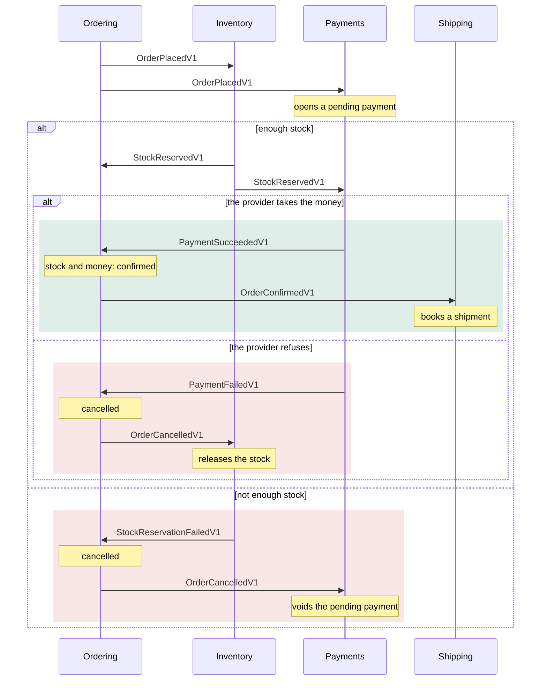
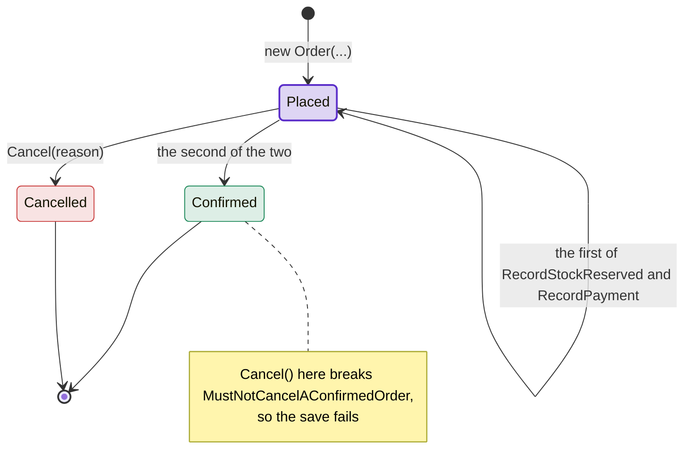

# Getting started

This page builds one module of a small shop, step by step. Each step adds one thing and shows what the generator
writes for it:

1. an identifier;
2. a value object;
3. an aggregate with its rules;
4. a test;
5. a database;
6. an HTTP endpoint;
7. a second module that reacts to the first.

Every snippet comes from [`Examples/ModularMonolith.Supabase`](../Examples/ModularMonolith.Supabase), a project
that builds and runs. Each snippet is shortened to the point of its step. The bold path above a snippet links to the
full file.

The shop has five modules: `Catalog`, `Ordering`, `Inventory`, `Payments` and `Shipping`. One host runs all five.
This page follows `Ordering`, and at the end `Shipping`, which reacts to `Ordering`. The other modules use the same
pieces.

## Install

```bash
dotnet add package Temp.DDDToolkit --prerelease
```

Version 3.x is published under `Temp.` package ids for now. The package `DDDToolkit` on nuget.org is still 2.0.22,
and these pages do not describe it. The namespaces are `DDDToolkit` in both. See [Packages](../README.md#packages).

These pages describe 3.2.0, which is in preview. The current preview is 3.2.0-preview.7. Until 3.2.0 is released,
add every `Temp.DDDToolkit.*` package with `--prerelease` or with `--version 3.2.0-preview.7`. Keep all the packages
at the same version. A package of this release next to a 3.1.0 package fails in one of two ways:

- Restore fails with NU1605, a package downgrade.
- The application fails at run time with a `MissingMethodException`.

`DDDToolkit` brings the base types and the core generators. The first steps need nothing else. Each integration has
a package of its own. The step that first uses an integration adds its package: Entity Framework when the aggregate
is stored, the testing kit when the aggregate is tested.

The libraries target .NET 10. The generators target `netstandard2.0` and reference nothing at run time, so they load
in any recent SDK without version conflicts.

## Declare an identifier

An order needs an id. With a plain `Guid`, code can pass a customer's `Guid` where an order's `Guid` belongs, and the
compiler cannot see the mistake. An identifier type turns that mistake into a compile error:

**[`Ordering.Contracts/OrderingContracts.cs`](../Examples/Modules/Ordering/Examples.Webshop.Ordering.Contracts/OrderingContracts.cs)**

```csharp
[EntityId<Guid>("ORD")]
public readonly partial record struct OrderId;
```

The declaration follows two rules:

- It is `partial`, so the generator can add to it.
- It is a record.

Use `readonly partial record struct` unless you have a reason to use a class. A struct id costs no allocation. The
generator writes the rest:

**OrderId.g.cs, shortened**

```csharp
[JsonConverter(typeof(OrderId.SystemTextJsonConverter))]
public readonly partial record struct OrderId : IEntityId<Guid>, IComparable<OrderId>, IParsable<OrderId>, ICreatableEntityId<OrderId>
{
    public const string IdPrefix = "ORD";

    public Guid Value { get; }

    public OrderId(Guid value) { Value = value; }

    public static OrderId CreateUnique() => new(Guid.NewGuid());
    public static OrderId CreateSequential() => new(Guid.CreateVersion7());
    public static OrderId Create() => CreateSequential();   // a new id, made in code before the save

    public override string ToString() => /* "ORD_" followed by the Guid */;

    public static OrderId Parse(string input) { /* the prefix is optional */ }
    public static bool TryParse(string? input, out OrderId result) { /* ... */ }

    public sealed class SystemTextJsonConverter : JsonConverter<OrderId> { /* ... */ }
}
```

Most identifiers need no declaration of their own. Name the raw value type on the entity, and the toolkit generates
the identifier together with the entity:

**[`Ordering/Domain/Aggregates/Orders/Entities/OrderLine.cs`](../Examples/Modules/Ordering/Examples.Webshop.Ordering/Domain/Aggregates/Orders/Entities/OrderLine.cs)**

```csharp
[Entity<Guid>("LINE")]
public partial class OrderLine    // also generates OrderLineId
```

Use this short form for an identifier that only its own aggregate uses. Use the explicit form for an identifier that
other code uses. `OrderId` has an explicit declaration because it is stored, parsed from URLs and sent to other
modules. A reader needs a file to navigate to. See [Identifiers](identifiers.md).

## Declare a value object

An order is shipped to an address. An address has no identity. Two addresses with the same street, city and postal
code are the same address. So an address is a value object, and its rules are part of its type:

**[`Ordering/Domain/ValueObjects/Address.cs`](../Examples/Modules/Ordering/Examples.Webshop.Ordering/Domain/ValueObjects/Address.cs)**

```csharp
[ValueObject]
public partial record Address
{
    public Address(string street, string city, string postalCode)
        => (Street, City, PostalCode) = (street, city, postalCode);

    [JsonInclude] public string Street { get; protected init; }
    [JsonInclude] public string City { get; protected init; }
    [JsonInclude] public string PostalCode { get; protected init; }

    protected override void Validate(ValidationErrorBuilder errors)
    {
        if (string.IsNullOrWhiteSpace(Street))
        {
            errors.Add("A street is required.", nameof(Street), "Required", Street);
        }
        // ...
    }
}
```

The setters are `protected init`. Code sets the properties of an address when it creates the address, and nothing
changes them afterwards ([DDD00010](diagnostics.md#ddd00010), [DDD00011](diagnostics.md#ddd00011)). The generator
writes the equality and an always-valid twin:

**Address.g.cs, shortened**

```csharp
partial record Address : ValueObject, IValidatable<ValidAddress>
{
    protected override IEnumerable<object?> GetEqualityComponents()
    {
        yield return Street;
        yield return City;
        yield return PostalCode;
    }

    public ValidAddress ToValid() => new(this);

    public virtual Address With(Optional<string> street = default, Optional<string> city = default, Optional<string> postalCode = default)
        => this with { Street = street.Or(Street), City = city.Or(City), PostalCode = postalCode.Or(PostalCode) };
}

public partial record ValidAddress : Address, IAlwaysValid
{
    public ValidAddress(Address value) : base(value)
    {
        value.EnsureValidated();
        _isValid = true;
    }
}
```

An `Address` can be invalid, for example when it comes straight from a form. A `ValidAddress` is always valid,
because its only constructor validates. So a method can ask for a checked address in its signature. The aggregate in
the next step does this. See [Value objects](value-objects.md).

This `Address` states its rules in a hand-written `Validate` override. If your team writes rules with
FluentValidation, a value object's rules can be a FluentValidation validator instead. See
[FluentValidation](fluent-validation.md).

## Declare an aggregate

The order is an aggregate. It has an identity, and it holds its lines. Code outside the order changes the lines only
through the order's methods, and those methods apply the order's rules:

**[`Ordering/Domain/Aggregates/Orders/Order.cs`](../Examples/Modules/Ordering/Examples.Webshop.Ordering/Domain/Aggregates/Orders/Order.cs)**

```csharp
[AggregateRoot<OrderId>]
public partial class Order
{
    public Order(OrderId id, ValidAddress shipTo, IEnumerable<OrderLine> lines) : base(id)
    {
        ShipTo = shipTo;
        _lines.AddRange(lines);
        Status = OrderStatus.Placed;
        Total = _lines.Aggregate(Money.Zero(), (total, line) => total.Plus(line.Subtotal));

        RaiseDomainEvent(new OrderPlaced(id, shipTo, /* the lines */, Total));
    }

    public Address ShipTo { get; private set; }

    public partial IReadOnlyList<OrderLine> Lines { get; }

    public Money Total { get; private set; }

    public OrderStatus Status { get; private set; }

    public void Cancel(string reason)
    {
        if (Status is OrderStatus.Cancelled)
        {
            return;
        }

        Status = OrderStatus.Cancelled;
        CancellationReason = reason;
        RaiseDomainEvent(new OrderCancelled(Id, reason));
    }
}
```

The constructor takes a `ValidAddress`, so the order does not validate the address again. `Money` is a value object
like `Address`. It comes from the shop's shared kernel.

`Lines` is declared `partial` and get-only. You declare the property, and the generator writes the field behind it.
Code inside `Order` adds lines to the field `_lines`. Code outside `Order` can read `Lines` and cannot change the
list. A setter on `Lines` is an error ([DDD00020](diagnostics.md#ddd00020)).

**Order.g.cs, shortened**

```csharp
partial class Order : AggregateRoot<OrderId>
{
    protected Order() { }   // for Entity Framework and serializers

    private readonly List<OrderLine> _lines = new();

    [BackingField(nameof(_lines))]
    public partial IReadOnlyList<OrderLine> Lines => __linesView ??= _lines.AsReadOnly();

    // the invariant checks of the next step
}
```

The base class brings three members:

- `Id`;
- `Version`, for optimistic concurrency;
- `RaiseDomainEvent`, which is protected, so only code inside the aggregate can raise an event.

See [Entities and aggregates](entities-and-aggregates.md) and [Domain events](domain-events.md).

## State an invariant

An invariant is a rule about a whole aggregate that must be true whenever code can read the aggregate. The generator
declares a partial method `CheckInvariants()` on every entity. The docs call this method the **seam**. A one-line
rule goes in the seam:

**[`Ordering/Domain/Aggregates/Orders/Order.cs`](../Examples/Modules/Ordering/Examples.Webshop.Ordering/Domain/Aggregates/Orders/Order.cs)**

```csharp
partial void CheckInvariants()
{
    if (Lines.Select(line => line.Sku).Distinct().Count() != Lines.Count)
    {
        throw InvariantViolation("An order may not name the same SKU on two lines.");
    }
}
```

A rule that needs a name, or a code that a caller can branch on, becomes a class of its own. Nest the class inside
the entity it checks. A nested class can read the entity's private state, and the generator finds it there:

**[`Ordering/Domain/Aggregates/Orders/Invariants/MustHaveLines.cs`](../Examples/Modules/Ordering/Examples.Webshop.Ordering/Domain/Aggregates/Orders/Invariants/MustHaveLines.cs)**

```csharp
public partial class Order
{
    public sealed class MustHaveLines : IInvariant<Order>
    {
        public string Code => "ORDER_HAS_NO_LINES";

        public InvariantFailure? Check(Order order)
            => order.Lines.Count == 0 ? "An order must have at least one line." : null;
    }
}
```

The generator finds the nested rules and writes the check. The check runs the rules first, then the seam, and then
the check of every line:

**Order.g.cs, shortened**

```csharp
private static readonly IInvariant<Order>[] __invariants =
[
    new Order.MustHaveLines(),
    new Order.MustNotCancelAConfirmedOrder(),
];

public override IReadOnlyList<InvariantViolation> GetInvariantViolations() { /* rules, seam, then each line */ }

public override void EnsureInvariants() { /* the same, and throws when a rule is broken */ }
```

The generated code has two methods:

- `GetInvariantViolations()` returns the broken rules as a list and does not throw. Call it before the save, when
  "not consistent yet" is an answer you want to handle.
- `EnsureInvariants()` throws when a rule is broken.

Called on the root, both methods check the whole aggregate: the order's rules and the rules of every line. Each
violation names the entity that reported it. Once the aggregate is stored with Entity Framework, every save runs the
check as well. So the rules hold at every save, and no code has to remember to call the check. An entity without
rules costs nothing. The compiler removes an unimplemented `partial void` method and every call to it. See
[Invariants](invariants.md).

## Test the aggregate

The aggregate needs no database, and neither does its test. `DDDToolkit.Testing` runs an action on an aggregate and
asserts on the domain events that the action raised:

```bash
dotnet add package Temp.DDDToolkit.Testing --prerelease
```

```csharp
var scenario = AggregateScenario.Given(Place());
scenario.IgnorePendingEvents();

scenario.When(order => order.Cancel("No stock.")).RaisedExactly<OrderCancelled>();
scenario.When(order => order.Cancel("Changed my mind.")).RaisedNothing();
```

Each `When` is judged only on the events its own action raised. So the second line asserts that a second
cancellation raises nothing. `WhenThrows` does the same for an action that must fail. It asserts two things: the
action threw the exception, and the action raised no event.

The aggregate calls `new OrderPlaced(...)` itself, so a test cannot set the event's timestamp with an initializer.
`DomainEventClock.Use` replaces the clock that new events read, for the current asynchronous flow only. `FixedClock`
is a `TimeProvider` that the test project declares:

**[`Tests/Examples.Webshop.Tests/OrderTests.cs`](../Tests/Examples.Webshop.Tests/OrderTests.cs)**

```csharp
var moment = new DateTimeOffset(2026, 9, 14, 9, 30, 0, TimeSpan.Zero);
using var scope = DomainEventClock.Use(new FixedClock(moment));

var order = Place();

order.PendingEvents().Should().OnlyContain(raised => raised.OccurredAt == moment);
```

See [Testing](testing.md).

## Store the aggregate with Entity Framework

```bash
dotnet add package Temp.DDDToolkit.EntityFramework --prerelease
```

Some projects reference a provider and a tool that ask for different Entity Framework versions. An example is
`Npgsql.EntityFrameworkCore.PostgreSQL` next to a newer `Microsoft.EntityFrameworkCore.Design` with
`PrivateAssets="all"`. The projects that reference such a project get the provider's older version, and they fail
with CS1705. To prevent this, name the version once in the project file. Use the version this repository builds
with:

```xml
<PackageReference Include="Microsoft.EntityFrameworkCore.Relational" Version="10.0.12" />
```

The Entity Framework package brings its own generator. The generator writes a value converter for every identifier,
so an `OrderId` is stored as a plain `uuid` column. It also writes one method per project that registers all the
converters:

**ConverterExtensions.g.cs, shortened**

```csharp
public static ModelConfigurationBuilder AddOrderingConverters(this ModelConfigurationBuilder modelConfigurationBuilder)
{
    modelConfigurationBuilder.Properties<OrderLineId>().HaveConversion<OrderLineId.OrderLineIdConverter>();
    modelConfigurationBuilder.DefaultTypeMapping<OrderLineId>().HasConversion<OrderLineId.OrderLineIdConverter>();
    // the same two lines for every other identifier and single value object in the project
    return modelConfigurationBuilder;
}
```

The method is named after the project. Set `DDD_Module` in the project file to choose the name. Without
`DDD_Module`, the generators use the assembly name with the dots removed. That name works, but it is hard to read:

```xml
<PropertyGroup>
  <DDD_Module>Ordering</DDD_Module>
</PropertyGroup>
```

`DDD_Module` also declares the project as the *module* Ordering. The module's domain events are stored under the
module's name, such as `ordering.order-placed`. While Ordering is the only module, the toolkit checks no boundary.
[Declare the module boundary](#declare-the-module-boundary), further down, explains what a module boundary is and
what checks it.

The context calls the generated method and the conventions that every context shares:

**[`Ordering/Infrastructure/Persistence/OrderingContext.cs`](../Examples/Modules/Ordering/Examples.Webshop.Ordering/Infrastructure/Persistence/OrderingContext.cs)**

```csharp
public sealed class OrderingContext(DbContextOptions<OrderingContext> options) : DbContext(options)
{
    public DbSet<Order> Orders => Set<Order>();

    protected override void ConfigureConventions(ModelConfigurationBuilder configurationBuilder)
    {
        configurationBuilder.AddDDDToolkitConventions();
        configurationBuilder.AddOrderingConverters();
    }
}
```

The domain model needs no configuration of its own:

- `OrderLine` is owned, because `[Entity]` generated `[Owned]`.
- Entity Framework finds `Lines` through the generated backing field.
- `Address` is stored in the order's table, because `[ValueObject]` generated `[ComplexType]`.
- `Version` is a concurrency token.

The example's context has a few more lines. They belong to the modules and the outbox, which come later on this page.

Register the toolkit, and add it to the context:

```csharp
builder.Services.AddDDDToolkitEntityFramework(options => options.DispatchWithMediator());

builder.Services.AddDbContext<OrderingContext>((services, options) => options
    .UseSqlite(connectionString)
    .UseDDDToolkit(services));
```

`UseDDDToolkit` adds the interceptors that run when the context saves. They deliver the domain events, run the
invariants and raise the version. Packages you register later bring more parts for a context, such as
[row level security](row-level-security.md) on Postgres or [Tenancy](tenancy/overview.md)'s save check. The same
`UseDDDToolkit` call adds those parts too, each in its place, so the context's options do not change.
[`UseDDDToolkit`](entity-framework.md#usedddtoolkit) has the details.

The argument of `AddDDDToolkitEntityFramework` says how domain events are delivered. The example hands them to
[Mediator](https://github.com/martinothamar/Mediator) handlers in the same process, with `DispatchWithMediator()`
from `DDDToolkit.Mediator`. The other way is the outbox, later on this page. An aggregate that raised events cannot
be saved until one of the two is configured, so no event is dropped. See [Domain event delivery](event-delivery.md).

Pass `UseDDDToolkit` the service provider that the `AddDbContext` callback gives you. Do not pass a provider you
built or stored yourself. The callback's provider belongs to the same scope as the context, so a handler that
injects `OrderingContext` receives the instance that saves. A [context pool](entity-framework.md#contexts-from-a-pool)
gives its callback the application's root provider. Make the same call there. The scope is then the scope that rents
the context. See [Entity Framework](entity-framework.md).

A context without `UseDDDToolkit` still saves, and it checks nothing. So the registration adds a start-up check that
finds such a context. The host runs this check before it serves anything, together with the checks of the other
registrations. One example is the check that the database has every migration, once the module runs on Supabase.
One line runs all the checks:

```csharp
builder.Services.RunStartupChecks();
```

The first check that fails stops the start. Its message says how to fix the problem. See
[Start-up checks](startup-checks.md).

## Refuse bad input without throwing

An endpoint turns a request into an order. The address in the request body comes from outside, so it may be invalid.
`ToValid()` throws, which suits a case where an invalid value is a bug. At an API boundary, invalid input is a normal
case that needs a normal answer. So use `TryToValid`, and return the failures:

**[`Ordering/Api/OrderingEndpoints.cs`](../Examples/Modules/Ordering/Examples.Webshop.Ordering/Api/OrderingEndpoints.cs)**

```csharp
app.MapPost("/orders", async (PlaceOrder body, OrderingContext orders, CancellationToken cancellationToken) =>
{
    var errors = new List<ValidationError>();

    if (!new Address(body.Street, body.City, body.PostalCode).TryToValid(out var shipTo, out var addressErrors))
    {
        errors.AddRange(addressErrors.Prefixed("shipTo"));
    }

    if (errors.Count > 0)
    {
        return Results.ValidationProblem(errors.ToErrorDictionary());
    }
    // ...
});
```

The caller gets a 400 response that lists the failures per field, such as `shipTo.Street` and `shipTo.PostalCode`.
These names point at the fields the caller filled in. Nothing is thrown, and `shipTo` is the `ValidAddress` that the
order's constructor asks for. See [Failure handling](value-objects.md#failure-handling).

## Handle a concurrency conflict

Every save that touches the aggregate increments `Version`, and the `WHERE` clause of the update checks the old value.
So a write from an old copy of the aggregate fails with a `ConcurrencyConflictException` that names the aggregate:

**[`Ordering/Api/OrderingEndpoints.cs`](../Examples/Modules/Ordering/Examples.Webshop.Ordering/Api/OrderingEndpoints.cs)**

```csharp
try
{
    await orders.SaveChangesAsync(cancellationToken);
}
catch (ConcurrencyConflictException conflict)
{
    return Results.Conflict(conflict.Message);
}
```

The toolkit does not retry, because no retry is safe in every case. In the example, the conflict is real. A customer
cancels an order at the same moment Payments reports that the money was taken. The second save is refused.

## Declare the module boundary

So far there is one module. The shop has five. Separate modules are only useful while code keeps them separate. If
Shipping uses Ordering's aggregates and tables, the two are one module with two names. The toolkit lets you declare
where the boundary is, and it checks the boundary.

One assembly is one module. The `DDD_Module` in the project file already declares the module. The build writes it
into the compiled assembly as `[assembly: Module("Ordering")]`. The projects of other modules read this attribute to
know which module the assembly belongs to. The example writes the attribute in a file of the project instead, with
the same effect:

**[`Ordering/Module.cs`](../Examples/Modules/Ordering/Examples.Webshop.Ordering/Module.cs)**

```csharp
[assembly: Module("Ordering")]
```

A module can have several projects, for example one per layer. Put a `Directory.Build.props` that sets `DDD_Module`
in the module's folder. It declares the module for every project below that folder, so no project needs its own file
for it ([A module named by its folder](modules.md#a-module-named-by-its-folder)).

The toolkit checks the boundary once a second assembly declares a module. From then on, everything an assembly
declares is private to its module, unless the module publishes it. The analyzer reports two things:

- code in another module that names a type this module did not publish ([DDD00022](diagnostics.md#ddd00022));
- another module that stores this module's entity ([DDD00023](diagnostics.md#ddd00023)).

Ordering publishes two things. It publishes its identifier, so other modules can refer to an order. It also
publishes the integration events of the next step. The example keeps both in a separate contracts project. The
other modules reference only this contracts project of Ordering:

**[`Ordering.Contracts/OrderingContracts.cs`](../Examples/Modules/Ordering/Examples.Webshop.Ordering.Contracts/OrderingContracts.cs)**

```csharp
[ModuleContract]
[EntityId<Guid>("ORD")]
public readonly partial record struct OrderId;
```

`[ModuleContract]` publishes the type. The contracts project declares `[assembly: Module("Ordering")]` too, so it
gets its own converter method with the same name. Ordering's method calls the contracts' method, so Ordering's
context still makes one call. Shipping references only Ordering's contracts. Shipping's context also makes one call,
because Shipping's method also registers the ids that the referenced modules publish:

```csharp
// Ordering's context: its own identifiers, and OrderId from the contracts
configurationBuilder.AddOrderingConverters();

// Shipping's context: its own identifiers, and OrderId from Ordering's contracts
configurationBuilder.AddShippingConverters();
```

[Module contracts](module-contracts.md) explains why a module publishes types, what belongs in a contract, and why
the contracts get a project of their own.

DDD00022 and DDD00023 are warnings, so a codebase that adopts modules sees the full list before it must fix
anything. When the list is empty, make the two rules errors:

**[`Examples.Webshop.Shipping.csproj`](../Examples/Modules/Shipping/Examples.Webshop.Shipping/Examples.Webshop.Shipping.csproj)**

```xml
<WarningsAsErrors>$(WarningsAsErrors);DDD00022;DDD00023</WarningsAsErrors>
```

See [Modules](modules.md).

## Publish an integration event

When an order is confirmed, Shipping must book a van. Ordering cannot call Shipping, because the call would cross the
boundary. Ordering should not need to know that Shipping exists. So Ordering publishes an **integration event**. An
integration event is a contract between modules. It is a separate class from the domain event, so the two can
change at different times:

**[`Ordering.Contracts/OrderingContracts.cs`](../Examples/Modules/Ordering/Examples.Webshop.Ordering.Contracts/OrderingContracts.cs)**

```csharp
[IntegrationEvent]
public sealed record OrderPlacedV1(
    OrderId OrderId, string City, string PostalCode, IReadOnlyList<OrderedLineV1> Lines, decimal Total, string Currency);

[IntegrationEvent]
public sealed record OrderConfirmedV1(OrderId OrderId, string City, string PostalCode);
```

You give the events no name. The toolkit publishes them as `ordering.order-placed` and `ordering.order-confirmed`,
from the module name and the class name in kebab case. The `V1` is the version. The build also writes the names as
constants, such as `OrderingEventNames.OrderPlaced`. See [Stable names](domain-events.md#stable-names).

For each event, one small class turns the domain event into the integration event. The class lives next to the
aggregate it publishes for:

**[`Ordering/Application/Orders/IntegrationEvents/Outbound/`](../Examples/Modules/Ordering/Examples.Webshop.Ordering/Application/Orders/IntegrationEvents/Outbound/)**

```csharp
public sealed class PublishOrderConfirmed : IOutboundIntegrationEvent<OrderConfirmed, OrderConfirmedV1>
{
    public ValueTask<OrderConfirmedV1?> CreateAsync(OrderConfirmed confirmed, CancellationToken cancellationToken)
        => new(new OrderConfirmedV1(confirmed.OrderId, confirmed.ShipTo.City, confirmed.ShipTo.PostalCode));
}
```

The message must not be lost when the process stops right after the order is saved. It must not be sent for an order
whose save failed. So the message goes through an **outbox**. The outbox is a table in Ordering's database. The save
writes the message to the outbox in the same transaction as the order. The context maps the outbox table:

```csharp
protected override void OnModelCreating(ModelBuilder modelBuilder)
    => modelBuilder.AddDomainEventOutbox(Database, schema: Schema);
```

Ordering's registration adds the publishing classes and sends what they make to the other modules. The registration
does not name those modules:

**[`Ordering/OrderingModule.cs`](../Examples/Modules/Ordering/Examples.Webshop.Ordering/OrderingModule.cs)**

```csharp
services.AddDDDToolkitEntityFramework(options => options.UseOutbox<OrderingContext>(outbox =>
{
    outbox.AddOrderingIntegrationEvents();   // generated when Ordering compiles
    outbox.SendToModules();
    outbox.AlsoDispatchInProcess = true;
}));

services.AddOutboxBackgroundService<OrderingContext>(pollingInterval: TimeSpan.FromSeconds(1));
```

The file itself calls `host.Publish(outbox)`, so the host can choose the transport between the modules. In one
process, that call is `outbox.SendToModules()`.

`AddOrderingIntegrationEvents()` is generated. It registers every domain event of the module under the name that the
outbox stores it as. It also registers every publishing class with the contract the class makes. So nothing is
scanned at start-up.

`SaveChanges` now writes the order and one outbox row in one transaction. Afterwards, the background service reads
the row, converts it and hands it to the other modules. Ordering has committed by then. So a consumer that fails
cannot undo the order, and a consumer that hits a concurrency conflict retries.

In the example, Inventory and Payments handle `OrderPlacedV1` and answer with contracts of their own. Ordering
confirms the order when both have answered yes. Ordering cancels the order when either answers no. This is the same
mechanism in the other direction. Shipping waits for `OrderConfirmedV1`.

The diagram shows the checkout as messages between the modules. Every contract goes to every module that handles it.
The diagram shows only the modules that act on a contract. The green band ends with a confirmed order, and the red
bands end with a cancelled order:



<details>
<summary>Show the code: Ordering's side of the checkout</summary>

Ordering has one small class for each contract it handles. The class loads the order and calls the order's method
for the event. The order decides what the event changes:

**[`Ordering/Application/Orders/IntegrationEvents/Inbound/Checkout.cs`](../Examples/Modules/Ordering/Examples.Webshop.Ordering/Application/Orders/IntegrationEvents/Inbound/Checkout.cs)**

```csharp
[IntegrationEventConsumer("ordering.checkout.stock-reserved")]
public sealed class RecordStockReservation(OrderingContext context) : IIntegrationEventHandler<StockReservedV1>
{
    public async Task HandleAsync(StockReservedV1 contract, IntegrationEventMessage message, CancellationToken cancellationToken)
        => (await Checkout.OrderAsync(context, contract.OrderId, cancellationToken)).RecordStockReserved(message.OccurredAt);
}

[IntegrationEventConsumer("ordering.checkout.payment-failed")]
public sealed class CancelWithoutPayment(OrderingContext context) : IIntegrationEventHandler<PaymentFailedV1>
{
    public async Task HandleAsync(PaymentFailedV1 contract, IntegrationEventMessage message, CancellationToken cancellationToken)
        => (await Checkout.OrderAsync(context, contract.OrderId, cancellationToken)).Cancel(contract.Reason);
}
```

None of these classes calls `SaveChanges`. The inbox saves the order together with the row that marks the message as
applied. The same save writes the events the order raised, such as `OrderConfirmed`, to Ordering's outbox, in the
same transaction. Ordering registers its handlers in its module registration, with methods the generator writes:

**[`Ordering/OrderingModule.cs`](../Examples/Modules/Ordering/Examples.Webshop.Ordering/OrderingModule.cs)**

```csharp
services.AddDDDToolkitEntityFramework(options => options.MapIntegrationEvents(contracts => contracts.AddOrderingIntegrationEvents()));
services.AddModuleIntegrationEvents<OrderingContext>(module => module.AddOrderingIntegrationEvents());
```

</details>

No module calls another module, and no module waits for an answer. Each module handles the events it receives and
publishes what happened. The order collects the answers. It confirms itself when it has both the stock and the
money, in either order.

The order's side of the checkout is a small state machine. The answers can arrive in any order. An answer that arrives
after the order is confirmed or cancelled changes nothing. In the diagram, purple is the state an order starts in,
green is confirmed and red is cancelled:



<details>
<summary>Show the code: the order's methods</summary>

**[`Ordering/Domain/Aggregates/Orders/Order.cs`](../Examples/Modules/Ordering/Examples.Webshop.Ordering/Domain/Aggregates/Orders/Order.cs)**

```csharp
public void RecordStockReserved(DateTimeOffset at)
{
    if (Status is not OrderStatus.Placed || StockReserved)
    {
        return;
    }

    StockReserved = true;
    ConfirmWhenReady(at);
}

public void RecordPayment(DateTimeOffset at)
{
    if (Status is not OrderStatus.Placed || Paid)
    {
        return;
    }

    Paid = true;
    ConfirmWhenReady(at);
}

private void ConfirmWhenReady(DateTimeOffset at)
{
    if (!StockReserved || !Paid)
    {
        return;
    }

    Status = OrderStatus.Confirmed;
    ConfirmedAt = at;
    RaiseDomainEvent(new OrderConfirmed(Id, ShipTo));
}
```

</details>

The host registers the modules, says how domain events that stay inside one module are delivered, and runs the
start-up checks that the registrations added. `host` holds the host's two choices: the database, and the transport
between the modules.

**[`Host/Program.cs`](../Examples/ModularMonolith.Supabase/Examples.Webshop.Host/Program.cs)**

```csharp
builder.Services.AddDDDToolkitEntityFramework(options => options.DispatchWithMediator());

builder.Services.AddCatalogModule(host);
builder.Services.AddOrderingModule(host);
builder.Services.AddInventoryModule(host);
builder.Services.AddPaymentsModule(host);
builder.Services.AddShippingModule(host);

builder.Services.RunStartupChecks();
```

## Consume an integration event once

Shipping books a shipment when it receives `OrderConfirmedV1`:

**[`Shipping/Application/Shipments/IntegrationEvents/Inbound/BookShipment.cs`](../Examples/Modules/Shipping/Examples.Webshop.Shipping/Application/Shipments/IntegrationEvents/Inbound/BookShipment.cs)**

```csharp
[IntegrationEventConsumer("shipping.booker")]
public sealed class BookShipment(ShippingContext context) : IIntegrationEventHandler<OrderConfirmedV1>
{
    public Task HandleAsync(OrderConfirmedV1 contract, IntegrationEventMessage message, CancellationToken cancellationToken)
    {
        context.Shipments.Add(new Shipment(
            ShipmentId.Create(), contract.OrderId, $"{contract.PostalCode}, {contract.City}", message.OccurredAt));

        return Task.CompletedTask;
    }
}
```

Three details of this handler matter:

- The handler is typed on the contract, `OrderConfirmedV1`, and never on Ordering's domain event. So Shipping needs no
  reference to Ordering's domain.
- The handler does not call `SaveChanges`. The inbox runs the handler and saves afterwards. One save, in one
  transaction, writes the shipment and the row that records that this consumer applied this message.
- The inbox keys on the consumer name, `shipping.booker`. So a message delivered twice is handled once.

Shipping registers itself as a consumer. It registers the contracts it reads and the handlers that run in its inbox.
The generator writes both methods when Shipping compiles, from the handlers it finds:

**[`Shipping/ShippingModule.cs`](../Examples/Modules/Shipping/Examples.Webshop.Shipping/ShippingModule.cs)**

```csharp
services.AddDDDToolkitEntityFramework(options =>
    options.MapIntegrationEvents(contracts => contracts.AddShippingIntegrationEvents()));

services.AddModuleIntegrationEvents<ShippingContext>(module => module.AddShippingIntegrationEvents());
```

Shipping's context maps the inbox table:

**[`Shipping/Infrastructure/Persistence/ShippingContext.cs`](../Examples/Modules/Shipping/Examples.Webshop.Shipping/Infrastructure/Persistence/ShippingContext.cs)**

```csharp
protected override void OnModelCreating(ModelBuilder modelBuilder)
    => modelBuilder.AddDomainEventInbox(Database, schema: Schema);
```

`schema: Schema` puts the table in the module's schema instead of the toolkit's default schema, `ddd`. This matters
when modules share a database, as they do on one Supabase project. Every module that consumes events needs an inbox,
and every module that publishes events needs an outbox. In one shared `ddd` schema, all modules would write to the
same two tables.

See [Integration events](integration-events.md).

## See the generated code

The generated code is ordinary C#, and reading it is the fastest way to understand the toolkit. Go to definition on a
generated member opens the file that holds it. To have the files written to disk, add this to the project file:

```xml
<PropertyGroup>
  <EmitCompilerGeneratedFiles>true</EmitCompilerGeneratedFiles>
  <CompilerGeneratedFilesOutputPath>$(MSBuildProjectDirectory)\Generated</CompilerGeneratedFilesOutputPath>
</PropertyGroup>
```

Build, then look in `Generated/`. Add that folder to `.gitignore`. [What the generator writes](generated-code.md)
goes through the output for a small aggregate, file by file.

A generated file is named after its type, with a suffix for some parts and a short hash at the end. Examples are
`Order.2c9e41f0.g.cs` for the entity and `Order.EntityFramework.5b17d3aa.g.cs` for its Entity Framework part. The hash
comes from the type's full name, so two types with the same name in different namespaces get different files. The
file name leaves out the namespace on purpose. The project's folder path usually spells the namespace already, and
Visual Studio must fit `{project}\Generated\{generator assembly}\{generator}\{file}` into 260 characters.

## When a type generates nothing

Every misuse reports a diagnostic with an id that starts with `DDD`. If a type with a toolkit attribute produced no
code, check the build output first. The diagnostic says what is wrong and which line to fix. See
[Diagnostics](diagnostics.md) for the full list.

## Run the example

```bash
dotnet run --project Examples/ModularMonolith.Supabase/Examples.Webshop.Host
```

Then work through
[`Examples.Webshop.Host.http`](../Examples/ModularMonolith.Supabase/Examples.Webshop.Host/Examples.Webshop.Host.http)
from the top. [`Examples/README.md`](../Examples/README.md) is the map of the folder. It says which file shows what,
and how to run the same host on a local Supabase instead of SQLite.
