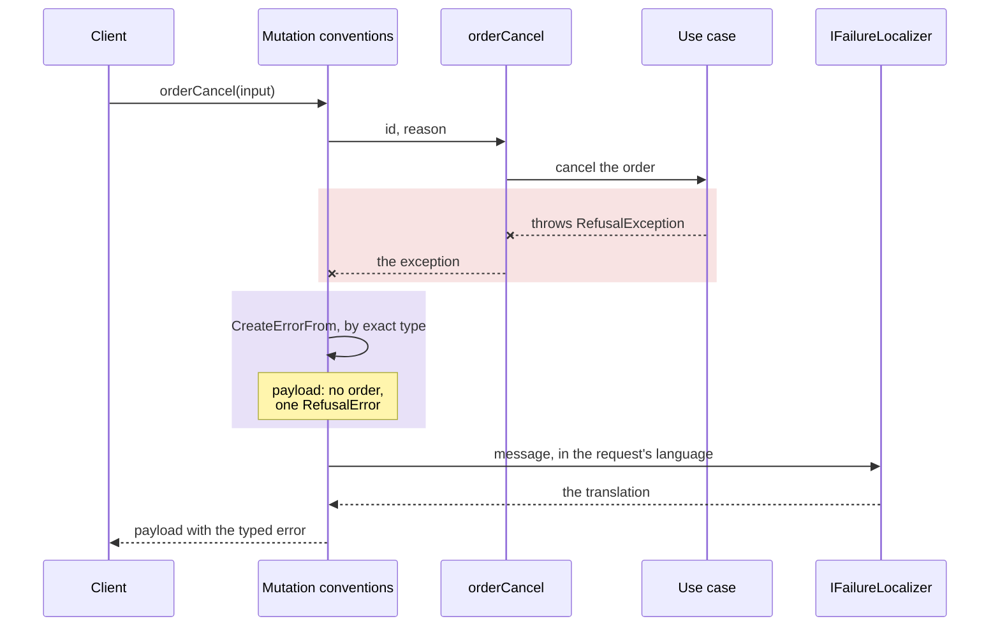
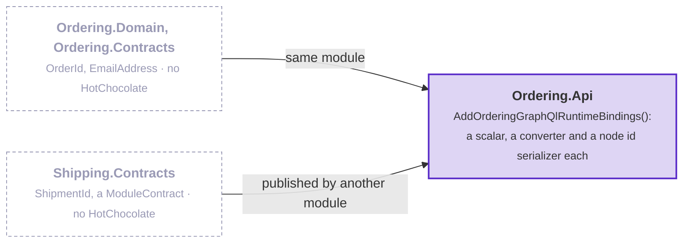
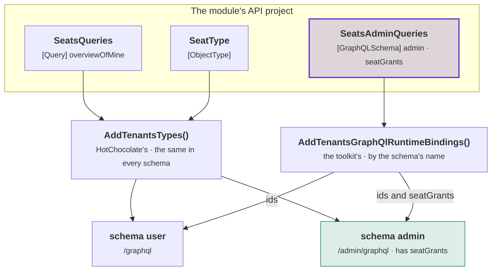
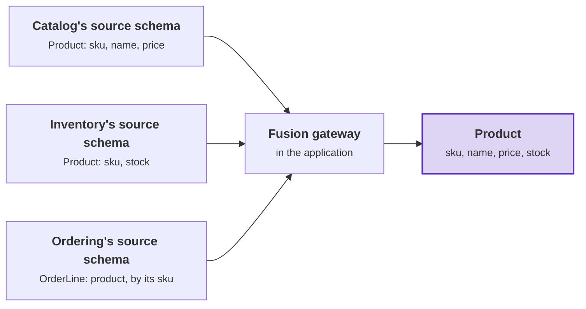
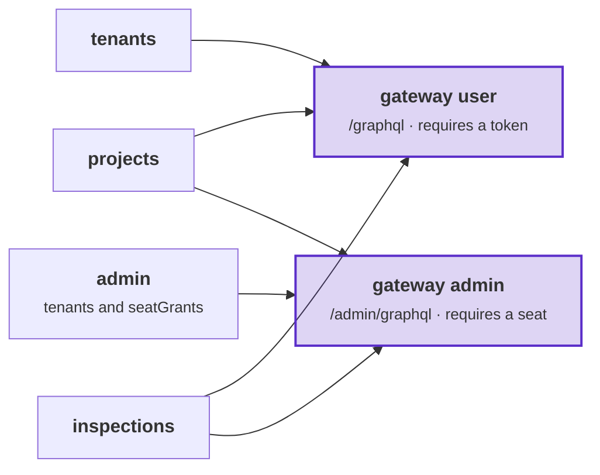
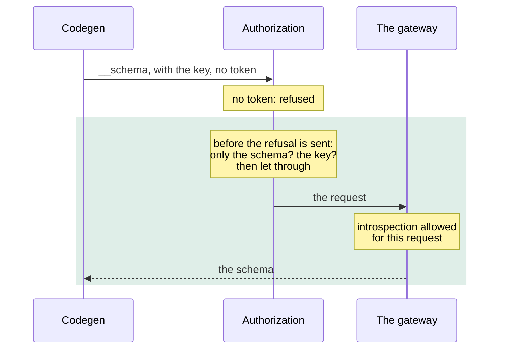

# GraphQL

`DDDToolkit.HotChocolate` adapts a domain model built with the toolkit to a HotChocolate GraphQL schema. Without
the package, HotChocolate publishes the model as it finds it:

- A strongly typed id becomes an object type with a `value` field. A client has to know that an `OrderId` wraps a
  `Guid`.
- The validation bookkeeping of value objects becomes public API.
- A method on an aggregate becomes a field that any query can run.

With the package, an `OrderId` is a `UUID` in the schema. The bookkeeping fields and the method fields are removed,
and every domain event implements one `DomainEvent` interface.

This page covers, in order: ids, the conventions every schema gets, errors in the response and in a mutation's
payload, a permission on a field, Relay, and paging by an id. Then come the parts for larger systems: a field for one
schema only, one schema over several modules, and pushing events to subscribed clients. The last sections show how
the generated bindings work. The [Tenancy sample](tenancy/the-sample.md#graphql-in-the-sample) is the reference
schema to read next to this page. The shop sample's schema is older, and writes by hand what HotChocolate now
generates.

## Install

```bash
dotnet add package Temp.DDDToolkit.HotChocolate --prerelease
```

The package contains its own source generator, so the package reference is the only build-time setup. The package
depends on `HotChocolate.AspNetCore`, so you do not add HotChocolate separately.

The package requires HotChocolate 16.6.9 or later. HotChocolate releases all its packages together, and an
application uses one version of all of them. Reference any other HotChocolate package at that same version.

## Register

Two kinds of call on the `IRequestExecutorBuilder` set up the toolkit:

```csharp
using DDDToolkit.HotChocolate;
using Ordering.Domain.GraphQl;   // generated
using SharedKernel.GraphQl;      // generated

builder.Services
    .AddGraphQLServer()
    .AddDDDToolkitTypes()
    .AddSharedKernelGraphQlRuntimeBindings()
    .AddOrderingGraphQlRuntimeBindings()
    .AddTypes();                     // HotChocolate's: your queries and mutations, see below
```

`AddDDDToolkitTypes()` registers the conventions. A schema calls it once, and a second call changes nothing. The
call does four things, each explained further down:

- `IgnoreInternalFieldsInterceptor` removes `[Internal]` members, the toolkit's bookkeeping. See
  [Internal members are removed from the schema](#internal-members-are-removed-from-the-schema).
- `DomainBehaviourFieldsInterceptor` removes the fields that HotChocolate makes from the methods of a domain type.
  See [Methods of domain types are removed](#methods-of-domain-types-are-removed).
- The call adds the `DomainEvent` interface type. See [The DomainEvent interface](#the-domainevent-interface).
- In a Fusion source schema, and only there, the call marks value objects `@shareable`. See
  [Value objects in a Fusion source schema](#value-objects-in-a-fusion-source-schema).

`Add{Module}GraphQlRuntimeBindings()` is generated. For the ids and single value objects of an assembly, it
registers:

- the scalar bindings,
- the type converters,
- the Relay node id serializers,
- a cursor key serializer for every struct identifier, so a paged list can be ordered by that identifier
  ([Paging by an id](#paging-by-an-id)).

The generator writes one such method per assembly that declares identifiers or single value objects. The method is
in the namespace `{AssemblyName}.GraphQl`, on a static class named `HotChocolateExtensions`. The `{Module}` part is
the module that the assembly declares. A project with `<DDD_Module>Ordering</DDD_Module>` or
`[assembly: Module("Ordering")]` gets `AddOrderingGraphQlRuntimeBindings`. A project that is not a module takes the
name from its `DDD_Module` property if it has one, and otherwise from its assembly name. See
[DDD_Module, and the package that brings it](modules.md#the-module-name-in-generated-code).

Two assemblies of one module get methods with the same name. Each method calls the methods of the module's other
assemblies that its assembly references. So a schema makes one call per module.

An assembly that declares no identifier and no single value object gets no method, with two exceptions:

- A module's project that binds the identifiers of the module's other projects
  ([Binding ids from other projects](#binding-ids-from-other-projects)).
- A project with a class of fields for one schema only (below).

The order of the calls does not matter. Each call records configuration, and HotChocolate builds the schema
afterwards. The example orders the calls from the conventions to your types.

A class of fields for one schema only is marked `[GraphQLSchema]`. The same `Add{Module}GraphQlRuntimeBindings()`
registers such a class, only for the schema that the builder builds. The host calls no other method. A project with
such a class gets the method even when it declares no identifier. See
[A field for one schema only](#a-field-for-one-schema-only).

`AddTypes()` comes from HotChocolate. HotChocolate's own generator writes it for a project that names it. The method
registers the project's GraphQL types, data loaders and operations. An operation is a static method marked
`[Query]`, `[Mutation]` or `[Subscription]`. The examples on this page use operations:

```csharp
[assembly: HotChocolate.Module("Types")]   // names the generated method: AddTypes()

public static class OrderQueries
{
    [Query]
    public static Task<Order?> GetOrderAsync(OrderId id, [Service] IOrderReads orders, CancellationToken cancellationToken)
        => orders.FindAsync(id, cancellationToken);
}
```

`[Service]` marks a parameter that HotChocolate injects. HotChocolate does not require the attribute. The examples
use it so a reader sees which parameters are the field's arguments. In a project that also declares the toolkit's
[`[assembly: Module]`](modules.md), write HotChocolate's `Module` attribute with its namespace. The two attributes
have the same name.

## Typed ids in the schema

An example id, and a field that returns it:

```csharp
[EntityId<Guid>("TST")]
public readonly partial record struct TicketId
{
    public static TicketId Create(Guid value) => new(value);
}
```

```csharp
public static class TicketQueries
{
    [Query]
    public static TicketId PrefixedId() => TicketId.CreateSequential();
}
```

Without the runtime bindings, HotChocolate binds the struct by convention and publishes its public members:

```graphql
type Query {
  prefixedId: TicketId!
}

type TicketId {
  value: UUID!
  isEmpty: Boolean!
}
```

With the generated bindings registered, the id becomes the scalar it wraps:

```graphql
type Query {
  prefixedId: UUID!
}
```

The generator wrote three lines for `TicketId` into the bindings method:

**`BindingExtensions.g.cs`**, shortened

```csharp
public static IRequestExecutorBuilder AddOrderingGraphQlRuntimeBindings(this IRequestExecutorBuilder builder)
{
    // ...
    builder.BindRuntimeType<TicketId, UuidType>();
    builder.AddTypeConverter<TicketId.ChangeTypeProvider>();
    builder.AddNodeIdValueSerializer<TicketId.NodeIdValueSerializer>();
    return builder;
}
```

- `BindRuntimeType` prints `TicketId` as `UUID`.
- `AddTypeConverter` registers a converter between `TicketId` and `Guid`, in both directions.
- `AddNodeIdValueSerializer` lets a `TicketId` be the key inside a Relay node id ([Relay node ids](#relay-node-ids)).

The generator also writes the two classes that these lines name into `TicketId`.
[How the bindings work](#how-the-bindings-work) shows them.

The prefix is not part of the wire format. `TicketId.Create(guid).ToString()` returns `"TST_..."`, and the same id
serializes as the bare `Guid`. Only `ToString` and `Parse` use the prefix. See [Prefixes](identifiers.md#prefixes).

### Struct ids, class ids and always-valid twins

All three bind to the same scalar:

| Declaration | Schema type |
|---|---|
| `[EntityId<Guid>] readonly partial record struct CatId` | `UUID` |
| `[EntityId<Guid>] partial record PersonId` | `UUID` |
| the generated `ValidPersonId` twin | `UUID` |

The twin uses the `ChangeTypeProvider` of the type it derives from. That provider contains the conversions for both
types. [The always-valid twin](value-objects.md#the-always-valid-twin) explains what the twin is for. A struct id has
no twin, so its provider contains one pair of conversions. [How the bindings work](#how-the-bindings-work) shows the
extra binding that a twin gets.

Nullability and lists follow from the CLR type, as for any other runtime type:

```graphql
cat: UUID!
nullableCat: UUID
cats: [UUID!]!
```

`CatId?` prints as `UUID` and serializes as `null` when it has no value. An optional struct id is therefore not
allocated on the heap, and still serializes correctly.

### Arguments and input objects

The binding applies to the runtime type in both directions, so the same mapping applies to input. A resolver
declares an id argument with the id type. The schema shows the scalar, and the resolver receives the id:

```csharp
[Query]
public static string DescribeTicketId(TicketId id) => id.ToString();
```

```graphql
describeTicketId(id: UUID!): String!
```

```graphql
{ describeTicketId(id: "44444444-4444-4444-4444-444444444444") }
```

This query returns `"TST_44444444-4444-4444-4444-444444444444"`. Only a real `TicketId` adds the prefix. A `string`
argument would return the value without it. Literals and variables both work. Declare a variable with the scalar:

```graphql
query Echo($id: UUID!) { echoCatId(id: $id) }
```

Input objects work the same way. HotChocolate publishes a plain class with typed id properties, with the ids as
scalars:

```csharp
public sealed class SeatReservation
{
    public TicketId Ticket { get; set; }

    public SeatNumber Seat { get; set; }
}
```

```graphql
input SeatReservationInput {
  ticket: UUID!
  seat: Int!
}
```

## The default scalar mapping

When a type has no `[GraphQLType<T>]` attribute, the generator picks the schema type from the CLR type that the id
or value object wraps:

| Wrapped CLR type | HotChocolate type | Schema type |
|---|---|---|
| `string` | `StringType` | `String` |
| `short` | `ShortType` | `Short` |
| `int` | `IntType` | `Int` |
| `long` | `LongType` | `Long` |
| `float` | `FloatType` | `Float` |
| `double` | `FloatType` | `Float` |
| `decimal` | `DecimalType` | `Decimal` |
| `bool` | `BooleanType` | `Boolean` |
| `DateTime` | `DateTimeType` | `DateTime` |
| `DateTimeOffset` | `DateTimeType` | `DateTime` |
| `DateOnly` | `DateType` | `Date` |
| `TimeOnly` | `LocalTimeType` | `LocalTime` |
| `Guid` | `UuidType` | `UUID` |

For any other wrapped type, the generator writes no `BindRuntimeType` line. The converter is still registered, but
HotChocolate publishes the type by convention, as an object type with a `value` field. To get another schema type,
name it yourself (next section).

In two rows, the wrapped type differs from the runtime type of the HotChocolate type:

- `DateTimeType` has the runtime type `DateTimeOffset`. An id or single value object over `DateTime` relies on
  HotChocolate's conversion between `DateTime` and `DateTimeOffset`.
- `FloatType` has the runtime type `double`. An id or single value object over `float` relies on HotChocolate's
  conversion between `float` and `double`.

The toolkit does not perform these conversions, and its tests do not cover these two pairs. In the other eleven
rows, the runtime types match. The tests run `Guid`, `int` and `string` end to end.

### Naming the schema type yourself

`[GraphQLType<TSchemaType>]` replaces the default for one type:

```csharp
using DDDToolkit.Abstractions.Attributes;
using DDDToolkit.HotChocolate.Attributes;
using HotChocolate.Types;

[GraphQLType<EmailAddressType>]
[SingleValueObject<string>]
public partial record EmailAddress
{
    public static EmailAddress Create(string value) => new(value);
}
```

The generator reads the attribute and binds the named schema type, for the value object and for its always-valid
twin:

**`BindingExtensions.g.cs`**, shortened

```csharp
builder.BindRuntimeType<EmailAddress, EmailAddressType>();
builder.BindRuntimeType<ValidEmailAddress, EmailAddressType>();
builder.AddTypeConverter<EmailAddress.ChangeTypeProvider>();
```

```graphql
email: EmailAddress!
```

Without the attribute, this field would be `String!`. `EmailAddressType` comes from `HotChocolate.Types.Scalars`.
Reference that package yourself, because the toolkit does not bring it in.

The attribute works on identifiers and on single value objects, declared as structs or as records:

```csharp
[EntityId<string>("USR")]
[GraphQLType<EmailAddressType>]
public readonly partial record struct LoginId
{
    public static LoginId Create(string value) => new(value);
}
```

`TSchemaType` must implement `HotChocolate.Types.ITypeDefinition`. The attribute is the toolkit's, in
`DDDToolkit.HotChocolate.Attributes`. HotChocolate's `GraphQLTypeAttribute` is a different attribute. It annotates
single members and arguments.

## Internal members are removed from the schema

The toolkit marks its bookkeeping members with `[Internal]`. `IgnoreInternalFieldsInterceptor` removes every such
member from the schema. The interceptor works on object types, input object types and interface types, so a hidden
member can be neither read nor written. Interface types need the same treatment. If a field stays on an interface
and is removed from an object that implements the interface, the schema is invalid.

The interceptor hides these members:

- `IsValid`, `IsValidated`, `EnsureValidated` and the FluentValidation integration's `Errors` on value objects.
- `DomainEvents` on an aggregate root.
- `GetInvariantViolations()` and `GetOwnInvariantViolations()` on every entity.

The interceptor hides nothing that is not marked. `Id` and `Version` stay, because they are part of the API:

```graphql
type Ticket {
  holder: EmailAddress!
  seat: Int!
  version: Long!
  id: UUID!
}
```

A query that asks for a hidden field fails validation. The field does not exist in the schema, so the response has
an `errors` array that names the field:

```graphql
{ issuedTicket { domainEvents { eventId } } }
```

A type that only a hidden member referenced, such as FluentValidation's `ValidationFailure`, is also left out of
the schema. [Why internal fields are removed instead of flagged](#why-internal-fields-are-removed-instead-of-flagged)
explains how.

See [Hiding members](value-objects.md#hiding-members) for what `[Internal]` means elsewhere, and
[Optimistic concurrency](entities-and-aggregates.md#optimistic-concurrency) for `Version`.

## Methods of domain types are removed

By default HotChocolate binds implicitly. Every public property, and every public method that returns a value,
becomes a field. A method's parameters become the field's arguments. For a domain type, this publishes the type's
behaviour. A `Money` with `Plus(Money)` and `Times(int)` would print as:

```graphql
type Money {
  plus(other: MoneyInput!): Money!
  times(quantity: Int!): Money!
  amount: Decimal!
  currency: String!
}
```

The schema would also contain a `MoneyInput`, only because `plus` needs one. On an aggregate the result is worse. A
method that changes state and returns a result would become a field, and an ordinary query would run it. GraphQL and
HotChocolate cannot tell a method with side effects from a method without them.

`AddDDDToolkitTypes()` therefore registers `DomainBehaviourFieldsInterceptor`. On every object type bound by
convention, the interceptor removes the fields that come from the methods of an entity, an aggregate or a value
object:

```graphql
type Money {
  amount: Decimal!
  currency: String!
}
```

- Properties stay, computed properties included. Make a value that belongs in the schema a property.
- A type declared with `BindFieldsExplicitly()` does not change. It publishes the fields it lists, including a
  method if you name one.
- Fields that a type extension adds stay.
- A method named with `descriptor.Field(...)`, on a type that still binds by convention, is removed with the
  others. HotChocolate records such a field in the same way as the fields it found itself. Declare that type with
  `BindFieldsExplicitly()` instead.

As with `[Internal]`, the interceptor removes the fields during discovery. A type that only a method's argument
referenced, such as `MoneyInput`, therefore never enters the schema.

## Failures as GraphQL errors

Without the toolkit, a resolver that throws `InvalidValueObjectException`, `InvariantViolationException` or
`RefusalException` returns "Unexpected Execution Error" to the client. The error has no code and does not say which
field or which rule failed. `AddDDDToolkitErrors()` registers an error filter that fixes this:

```csharp
services
    .AddGraphQLServer()
    .AddDDDToolkitTypes()
    .AddDDDToolkitErrors();
```

Each failure becomes a separate error, with its code in `extensions.code`:

```json
{
  "errors": [{
    "message": "Een order mag hooguit € 1.000,00 zijn.",
    "path": ["placeOrder"],
    "extensions": {
      "code": "Order.OverCreditLimit",
      "entity": "Order",
      "entityId": "ORD_…",
      "arguments": { "CreditLimit": 1000 }
    }
  }]
}
```

| Exception | Errors | Extensions |
| --- | --- | --- |
| `InvalidValueObjectException` | one per `ValidationError` | `code`, `field`, `arguments` |
| `InvariantViolationException` | one per `InvariantViolation`, children included | `code`, `entity`, `entityId`, `arguments` |
| `RefusalException` | one | `code`, `kind`, `arguments`, and `field` when the refusal names the input it is about (`RefusalException.FieldArgument`) |

The error never contains the rejected value, because that value may be a password. The filter passes every other
error through unchanged.

The message is in the reader's language when the application registered an `IFailureLocalizer`, by calling
`AddDDDToolkitLocalization()` from `DDDToolkit.Localization`. Without a localizer, the message is the text that the
domain wrote. The language is the request's UI culture, so call `app.UseRequestLocalization(...)` before
`app.MapGraphQL()`. See [Localization](localization.md).

A mutation has a better place for a failure than the top of the response:
[Typed errors in mutation payloads](#typed-errors-in-mutation-payloads). The error filter works next to the mutation
conventions. A refusal's `kind` uses the schema's enum spelling, `NOT_PERMITTED` unless the schema chose another
spelling. See [Spelling of enum values](#spelling-of-enum-values).

## Typed errors in mutation payloads

A top-level error suits a query that could not be answered. It suits a mutation less well:

- A refused command is a normal outcome.
- The client has to find the error in `errors` by its path.
- The schema does not say which errors a mutation can return.

`AddDDDToolkitMutationConventions()` turns on HotChocolate's mutation conventions for every mutation. It puts the
exception that the use case threw into the mutation's payload, as types that the schema declares:

```csharp
services
    .AddGraphQLServer()
    .AddDDDToolkitTypes()
    .AddDDDToolkitErrors()                  // queries, and whatever is not one of the four types below
    .AddDDDToolkitMutationConventions()
    .AddTypes();
```

A resolver declares nothing about errors. It takes its arguments, calls the use case and returns what changed:

```csharp
public static class OrderMutations
{
    // Refuses with a RefusalException when the order has shipped already.
    [Mutation]
    public static Task<Order> OrderCancelAsync(OrderId id, string? reason, [Service] CancelOrder cancel, CancellationToken cancellationToken)
        => cancel.RunAsync(id, reason, cancellationToken);
}
```

The conventions give the field one input object and a payload. The toolkit gives every payload the same four error
types:

```graphql
type Mutation {
  orderCancel(input: OrderCancelInput!): OrderCancelPayload!
}

input OrderCancelInput {
  id: UUID!
  reason: String
}

type OrderCancelPayload {
  order: Order
  errors: [OrderCancelError!]
}

union OrderCancelError = RefusalError | InvalidValuesError | BrokenRulesError | ConcurrencyConflictError
```

```graphql
interface CodedError {
  code: String!
  message: String!
  arguments: [FailureArgument!]!
}

type FailureArgument {
  name: String!
  value: String
}

type RefusalError implements CodedError {
  code: String!
  message: String!
  arguments: [FailureArgument!]!
  kind: RefusalKind!
  field: String
}

type InvalidValuesError implements CodedError {
  code: String!
  message: String!
  arguments: [FailureArgument!]!
  failures: [ValueFailure!]!
}

type ValueFailure {
  code: String!
  message: String!
  field: String
  arguments: [FailureArgument!]!
}

type BrokenRulesError implements CodedError {
  code: String!
  message: String!
  arguments: [FailureArgument!]!
  violations: [RuleViolation!]!
}

type RuleViolation {
  code: String!
  message: String!
  entity: String
  entityId: String
  arguments: [FailureArgument!]!
}

type ConcurrencyConflictError implements CodedError {
  code: String!
  message: String!
  arguments: [FailureArgument!]!
}
```

The schema also has a description for each of these types, each of their fields and each value of `RefusalKind`.
The listing above leaves the descriptions out. The toolkit writes these descriptions itself, for the client that
reads the schema. Otherwise HotChocolate would describe a type from the XML documentation next to its assembly. That
documentation is written for C# readers, and one build has the file while another build does not. The source
schemas of one gateway would then describe a shared type differently. With the toolkit's descriptions, every schema
with the conventions describes these types in the same way. HotChocolate describes your own types from your XML
documentation, as usual.

| Thrown | In `errors` | Content |
| --- | --- | --- |
| `RefusalException` | `RefusalError` | The refusal code and the kind. `field` is the refusal's `Field` argument (`RefusalException.FieldArgument`). A form shows the message under that input. |
| `InvalidValueObjectException` | `InvalidValuesError` | Code `invalid-value`, and one `ValueFailure` per `ValidationError`, each with its property. |
| `InvariantViolationException` | `BrokenRulesError` | The code, message and arguments of the first violation, and every violation in `violations`, children included. |
| `ConcurrencyConflictException` | `ConcurrencyConflictError` | Code `concurrency-conflict`. Another request changed the row first, or the [expected version](entity-framework.md#the-version-the-client-saw) differs from the stored version. |

A client reads every error type through the interface, and asks for more fields where it needs them:

```graphql
mutation {
  orderCancel(input: { id: "0198c1a2-7c3e-7d4f-9b1a-2f6e8d0c4b5a", reason: "Ordered twice" }) {
    order { id status }
    errors {
      ... on CodedError { code message arguments { name value } }
      ... on RefusalError { kind field }
    }
  }
}
```

```json
{
  "data": {
    "orderCancel": {
      "order": null,
      "errors": [{
        "code": "orders.already-shipped",
        "message": "Order ORD_0198c1a2 has shipped and cannot be cancelled.",
        "arguments": [{ "name": "Order", "value": "ORD_0198c1a2" }],
        "kind": "CONFLICT",
        "field": null
      }]
    }
  }
}
```

A command that succeeds returns `errors: null` and its result.

The diagram shows how a refusal travels from the use case into the payload:

1. The conventions take the arguments out of the input object, and the resolver calls the use case.
2. The use case throws.
3. The conventions match the exception, by its exact type, to an error type, and create the error with
   `CreateErrorFrom`.
4. The localizer phrases the message last, when the client's selection reaches the field.

Red: the exception. Purple: the step that turns the exception into a typed error.



<details>
<summary>Show the code: the registration behind this, and an error type of your own</summary>

```csharp
builder.Services.AddLocalization();
builder.Services.AddDDDToolkitLocalization(options => options.AddResource<OrderingFailures>());

builder.Services
    .AddGraphQLServer()
    .AddDDDToolkitTypes()
    .AddDDDToolkitErrors()
    .AddDDDToolkitMutationConventions()
    .AddTypes();

app.UseRequestLocalization("en", "nl");   // before MapGraphQL: the message is in the request's language
app.MapGraphQL();
```

For an exception of your own, write an error type and add it with `[Error<T>]` to the mutations that can throw the
exception. The error type implements `ICodedError`, the schema's interface for errors:

```csharp
public sealed class OutOfStockError : ICodedError
{
    private readonly OutOfStockException _exception;

    private OutOfStockError(OutOfStockException exception) => _exception = exception;

    public static OutOfStockError CreateErrorFrom(OutOfStockException exception) => new(exception);

    public string Code => "inventory.out-of-stock";

    public string GetMessage(IResolverContext context) => _exception.Message;

    public IReadOnlyList<FailureArgument> Arguments => [new("Sku", _exception.Sku)];
}

public static class OrderMutations
{
    [Mutation]
    [Error<OutOfStockError>]
    public static Task<Order> OrderPlaceAsync(...) => ...;
}
```

</details>

How the mutation conventions behave:

- **The message is phrased when the field is resolved.** The `IFailureLocalizer` that the application registered
  phrases the message in the request's language. Without a localizer, the message is the text that the domain wrote.
  The localizer looks up an `InvalidValuesError` and a `ConcurrencyConflictError` under their codes,
  `invalid-value` and `concurrency-conflict`, as it looks up a refusal under its refusal code. Put their
  translations in the same resources. See [Localization](localization.md).
- **Arguments are a list of names and text values.** GraphQL has no type for a map of mixed values. A string stays
  as it is. A boolean is `true` or `false`. A number is written as JSON writes it, in every culture. Any other value,
  such as an id, is its text. The rejected value is never in the list.
- **HotChocolate matches an error type by the exception's exact type.** A class derived from `RefusalException` is
  therefore not a typed error. It passes the conventions and reaches the client as a top-level coded error, through
  `AddDDDToolkitErrors()`. Throw `RefusalException` itself, with a refusal code. A class derived from
  `InvalidValueObjectException` or `InvariantViolationException` also arrives as a top-level coded error. A class
  derived from `ConcurrencyConflictException` arrives as a top-level error without a code.
- **Queries do not change.** A refused query returns a top-level error with `extensions.code`, as described
  [above](#failures-as-graphql-errors).
- **`CodedError` is the interface of every error type in the schema**, your own types included. HotChocolate adds
  the interface's fields to an error type that lacks them. An error type that does not implement `ICodedError`
  therefore builds, and then fails at run time when a mutation returns it.
- **The schema declares the types that the errors use** (`RefusalKind`, `FailureArgument`, `ValueFailure`,
  `RuleViolation`) as soon as the conventions are on, also in a schema without mutations. `RefusalKind` is also the
  type of the `kind` in a refused query's extensions.
- A second call of `AddDDDToolkitMutationConventions()` changes nothing. In a Fusion source schema the error types
  are `@shareable`. See [The conventions in a composed schema](#the-conventions-in-a-composed-schema).

### A check in front of every mutation

A check that runs before every mutation, such as "the caller is not suspended", is a field middleware that
a type interceptor adds. The check refuses by throwing a `RefusalException`, as a use case does. The conventions wrap
each mutation field in their own middleware, and only an exception thrown inside that middleware becomes a typed
error. So the place where the interceptor adds the check decides where the refusal arrives:

| Added in | Result |
| --- | --- |
| `OnBeforeCompleteMutationField`, the hook that passes an interceptor each mutation field | Inside the conventions. The client gets a `RefusalError` in the payload. |
| `OnBeforeCompleteType` of the mutation type, first in the field's middleware | Outside the conventions. The client gets a top-level coded error and no payload. |

```csharp
public sealed class AccountGate : TypeInterceptor
{
    public override void OnBeforeCompleteMutationField(ITypeCompletionContext completionContext, ObjectFieldConfiguration mutationField)
        => mutationField.MiddlewareConfigurations.Insert(0, new FieldMiddlewareConfiguration(next => async context =>
        {
            context.Services.GetRequiredService<AccountCheck>().RequireActive();   // yours: throws RefusalException
            await next(context);
        }));
}
```

## A permission on a field

Usually the query decides what a caller may read. The query returns what the caller may see and leaves out the
rest. A single field can need its own rule. For example, the caller may see a product but not its cost. A client
should be able to read that rule in the schema, and a caller who asks for the cost anyway should get a refusal.
HotChocolate's `[Authorize]` attribute does this, with a permission as its policy:

```csharp
[ObjectType<ProductOverview>]
internal static partial class ProductType
{
    [Authorize(CatalogPermissions.ViewCosts)]        // HotChocolate.Authorization; the permission is "catalog.costs.view"
    public static async Task<decimal?> GetCostAsync([Parent] ProductOverview product, ICostByProductIdDataLoader costs, CancellationToken cancellationToken)
        => await costs.LoadAsync(product.Id, cancellationToken);
}
```

HotChocolate and the toolkit do not know who holds a permission. The module knows. For each type that has a field
under a rule, the module writes a small class that implements `IFieldPermissions<TParent>`.
`AddDDDToolkitPermissionAuthorization()` registers an authorization handler that calls this class:

```csharp
internal sealed class ProductFieldPermissions : IFieldPermissions<ProductOverview>
{
    public async ValueTask<RefusalException?> RefusedAsync(ProductOverview parent, string permission, IResolverContext context, CancellationToken cancellationToken)
        => await context.Service<IHeldPermissionsByProductIdDataLoader>().LoadAsync(parent.Id, cancellationToken) is { } held && held.Contains(permission)
            ? null                                                                  // the caller holds it: the field is resolved
            : new RefusalException("catalog.not-permitted", RefusalKind.NotPermitted, "You may not see this.",
                new Dictionary<string, object?> { ["Permission"] = permission });
}

builder.Services.AddScoped<IFieldPermissions<ProductOverview>, ProductFieldPermissions>();

builder.Services
    .AddGraphQLServer()
    .AddDDDToolkitErrors()                  // shapes the refusal
    .AddDDDToolkitPermissionAuthorization();
```

A caller who holds the permission on the first product and not on the second gets this response:

```json
{
  "data": { "products": [{ "name": "Coffee", "cost": 4.10 }, { "name": "Tea", "cost": null }] },
  "errors": [{
    "message": "You may not see this.",
    "path": ["products", 1, "cost"],
    "extensions": { "code": "catalog.not-permitted", "kind": "NOT_PERMITTED", "arguments": { "Permission": "catalog.costs.view" } }
  }]
}
```

- **The schema shows the rule.** The field prints as `cost: Decimal @authorize(policy: "catalog.costs.view")`, in
  the module's source schema and in the schema that a gateway composes from it. For a property of the record itself,
  add the rule in the type class's `Configure`:
  `descriptor.Field(product => product.Sku).Authorize(CatalogPermissions.ViewSkus)`.
- **A refused field returns the module's refusal.** The field is `null`, and the object and its other fields stay.
  `errors` has one entry at the field's path, with the refusal code, the kind and the arguments.
  [`AddDDDToolkitErrors()`](#failures-as-graphql-errors) shapes this entry as it shapes a refused query. Return the
  same refusal that the module's access check returns for that permission. A client then reads one refusal code in both
  cases. The resolver does not run. A field under a rule must be nullable, because a refused non-null field makes
  its parent `null` too.
- **The check runs once per batch of parents.** The handler checks the permission for every parent, and checks the
  parents of a list in parallel. An `IFieldPermissions` that awaits a data loader keyed by the parent therefore runs
  one query for each batch that the loader sends, usually one per page. An implementation that reads by itself runs
  one query per row.
- **A rule on a field protects that field only.** In the example, the field's own resolver reads the cost, and a
  refusal stops that resolver. So nothing else returns the cost. When the value is part of a record that a query
  already returns, another route returns the value without a check: a route that writes that record, or another
  field over the record. In that case, apply the rule where the data is read. The query returns `null` for the value
  when the caller lacks the permission. The attribute declares the rule and returns the refusal. The Tenancy sample
  does this for a crew member's roles and for a role's permissions
  ([GraphQL in the sample](tenancy/the-sample.md#graphql-in-the-sample)).
- **A rule that nobody can check is refused.** In these cases the field returns an error that says what is missing,
  with HotChocolate's code for a missing policy, `AUTH_POLICY_NOT_FOUND`:
  - The parent's type has no registered `IFieldPermissions`.
  - The field has no parent (a `[Query]` method).
  - The rule names roles.
  - The rule applies after the resolver or during validation.

  An example message:
  `The permission 'catalog.costs.view' on 'Product.cost' has nobody to answer for it: no IFieldPermissions<ProductOverview> is registered.`
  An `[Authorize]` without a policy returns HotChocolate's `AUTH_NO_DEFAULT_POLICY`. The handler looks for an
  `IFieldPermissions` of the parent's own type first, and then of the types that type derives from. One
  `IFieldPermissions` for a base record therefore covers the records derived from it.
- **An application has one authorization handler** for all its schemas, in the application's services.
  `AddDDDToolkitPermissionAuthorization()` replaces another handler, such as the one that HotChocolate's ASP.NET Core
  policies register. A handler registered later replaces this one. In a modular application, call
  `AddDDDToolkitPermissionAuthorization()` on every source schema. That call gives each schema the `@authorize`
  directive.
- **The rule adds to the request's access check.** A resolver still sends a query that returns only what the caller
  may see. The field rule adds a refusal when a caller who may see the object asks for a field that the caller may
  not read.
- **Put the rule on the field.** HotChocolate applies a rule on a type to every field that returns the type. The
  handler would then be called for the objects that those fields belong to.

## Spelling of enum values

HotChocolate writes enum values in upper snake case, such as `NOT_PERMITTED`, as GraphQL convention has it. An
application whose REST API and database use `not_permitted` can use that one spelling everywhere. The host chooses
the spelling once for the schema:

```csharp
services
    .AddGraphQLServer()
    .AddDDDToolkitEnumValues(EnumValueSpelling.LowerSnakeCase)
    .AddDDDToolkitErrors();
```

```graphql
enum RefusalKind {
  invalid
  not_permitted
  not_found
  conflict
}
```

`AddDDDToolkitEnumValues` spells the values of the application's enums in responses, arguments and variables:

- `LowerSnakeCase` is what `JsonNamingPolicy.SnakeCaseLower` writes. A host gives that policy to the enum converter
  of its REST JSON (`new JsonStringEnumConverter(JsonNamingPolicy.SnakeCaseLower)`), so both APIs use the same
  spelling.
- `UpperSnakeCase` is HotChocolate's default spelling.

`AddDDDToolkitErrors()` spells the `kind` in a refused query's extensions as the schema spells its enums. The order
of the two calls does not matter. With the call above, `kind` is `not_permitted`. In a schema without
`AddDDDToolkitEnumValues`, `kind` is `NOT_PERMITTED`. A client therefore reads one spelling of `RefusalKind`, in a
query's extensions and in a mutation's `RefusalError`.

- A member with `[GraphQLName]` keeps that name.
- A member whose lower spelling would be `true`, `false` or `null` fails the schema build. GraphQL reads those three
  words as literals, so no document could name the value. Give the member a `[GraphQLName]`.
- HotChocolate's own enums keep HotChocolate's spelling, because HotChocolate's directives use that spelling. A
  source schema that printed `@serializeAs(type: string)` would not compose.
- The call registers HotChocolate's default naming conventions with this one change, XML documentation included. A
  schema with naming conventions of its own overrides `GetEnumValueName` there instead.
- In a composed schema, every source schema needs the same spelling. See
  [The conventions in a composed schema](#the-conventions-in-a-composed-schema).

## Relay node ids

HotChocolate's global object identification works with the toolkit's identifiers without changes. Make a type a
node as HotChocolate documents it, with the identifier as the id:

```csharp
builder.Services
    .AddGraphQLServer()
    .AddGlobalObjectIdentification()
    .AddDDDToolkitTypes()
    .AddOrderingGraphQlRuntimeBindings()
    .AddType<OrderType>();

public sealed class OrderType : ObjectType<Order>
{
    protected override void Configure(IObjectTypeDescriptor<Order> descriptor)
        => descriptor
            .ImplementsNode()
            .IdField(order => order.Id)                         // an OrderId
            .ResolveNode((context, id) => /* id is an OrderId */);
}
```

The generator writes one bindings method per project that declares identifiers. In the example shop, `OrderId` is
declared in Ordering's contracts project. Both projects belong to the module Ordering, so both methods are called
`AddOrderingGraphQlRuntimeBindings()`, and the module's method calls the contracts project's method. The single call
above therefore registers `OrderId` in either of the two projects.
[Module contracts](module-contracts.md#a-separate-contracts-project) explains why the example gives a module's contract a
separate project.

With this registration:

- `id` prints as `ID!` and contains a node id such as `T3JkZXI6ERER…`.
- `node(id:)` finds the order again.
- An argument declared `[ID<Order>] OrderId id` receives the `OrderId` inside the node id.
- Another type that points at an order can publish the reference as a node id of type `Order`, with
  `descriptor.Field(shipment => shipment.Order).ID("Order")`, without a reference to the `Order` class.

One generated class per identifier makes this work. HotChocolate writes a node id through an
`INodeIdValueSerializer` for the id's runtime type. HotChocolate has serializers for `Guid`, `string`, `int`, `long`
and `short`, and none for other types, so an `OrderId` would fail with *No serializer registered*. The generator
therefore adds a nested `NodeIdValueSerializer` to every identifier over one of those five types, and
`Add{Module}GraphQlRuntimeBindings()` registers it:

**`BindingExtensions.g.cs`**, shortened

```csharp
builder.AddNodeIdValueSerializer<OrderId.NodeIdValueSerializer>();
```

The serializer derives from HotChocolate's `CompositeNodeIdValueSerializer<OrderId>`, and writes the wrapped value
with HotChocolate's helpers. The node id is therefore byte for byte the node id that HotChocolate writes for the bare
`Guid`: `Order:` followed by the value. Any HotChocolate server reads it. A Fusion gateway reads it too. The gateway
routes `node(id:)` by the type name at the start, and does not read the value. A single value object gets no
serializer, because it is not an identity. [How the bindings work](#how-the-bindings-work) shows the generated class.

Do not use HotChocolate's `AddNodeIdValueSerializerFrom<OrderId>()` for a toolkit identifier. HotChocolate's
generator reads the members of the type. The toolkit's generator writes an identifier's `Value`, and source
generators do not see each other's output. HotChocolate's generator therefore finds no member. It writes a
serializer that writes nothing and reads every node id back as an empty id. The code compiles, and the toolkit
reports the call with diagnostic [DDD00032](diagnostics.md#ddd00032), a warning.

## Binding ids from other projects

The generator writes the nested `ChangeTypeProvider` and `NodeIdValueSerializer` into the project that declares the
identifier, and only when that project references this package. A module split into projects by layer
([A module in layers](modules.md#a-module-in-layers)) declares its identifiers in a domain or contracts project
without this package. The reason is the dependency. `DDDToolkit.HotChocolate` depends on `HotChocolate.AspNetCore`.
Every module that reads a contracts project references that project, so the package there would add ASP.NET Core to
all those modules. Instead, the module's API project, which builds the schema, binds those identifiers.

The diagram shows where the API project's bindings come from. Purple: the API project, which writes the bindings.
Grey: the projects without HotChocolate.



<details>
<summary>Show the code: what Ordering.Api registers</summary>

Every project of the module declares the module's name. The generator uses that name to find the module's
identifiers:

```csharp
[assembly: Module("Ordering")]
```

The API project declares no identifier and still gets the method:

```csharp
using Ordering.Api.GraphQl;   // generated

builder.Services
    .AddGraphQLServer()
    .AddDDDToolkitTypes()
    .AddOrderingGraphQlRuntimeBindings()
    .AddTypes();
```

</details>

Every identifier, single value object and always-valid twin implements `ISingleValue<TSelf, TValue>`. That interface
names the value and the way to create the type from the value
([Identifiers](identifiers.md#an-identifier-stored-by-another-project)). The package has one provider and one
serializer for all these types, in `DDDToolkit.HotChocolate.Types`: `SingleValueChangeTypeProvider<T, TValue>` and
`SingleValueNodeIdSerializer<T, TValue>`. In a project that references the package, the generated
`Add{Module}GraphQlRuntimeBindings()` registers them for the types of other projects:

**`BindingExtensions.g.cs` of Ordering.Api**, shortened

```csharp
builder.BindRuntimeType<EmailAddress, StringType>();
builder.AddTypeConverter<SingleValueChangeTypeProvider<EmailAddress, string>>();
builder.BindRuntimeType<OrderId, UuidType>();
builder.AddTypeConverter<SingleValueChangeTypeProvider<OrderId, Guid>>();
builder.AddNodeIdValueSerializer<SingleValueNodeIdSerializer<OrderId, Guid>>();
builder.BindRuntimeType<ValidEmailAddress, StringType>();
builder.AddTypeConverter<SingleValueChangeTypeProvider<ValidEmailAddress, string>>();
```

The method binds these types:

- **Every identifier and single value object of the module's other projects**: the projects that declare the same
  `[assembly: Module]`.
- **The published types of the other modules that the project references**: types marked `[ModuleContract]`, or
  public types in a [contracts project](modules.md#a-contracts-project). A module may name only these types of
  another module ([DDD00022](diagnostics.md#ddd00022)), so its schema can show only these.

The method skips these types:

- **A type with a nested provider.** The type's project references the package and binds the type in its own
  `Add{Module}GraphQlRuntimeBindings()`. A project of the same module that references that project calls that
  method from its own method, and does not bind the type again. For a type in another module's project, the schema
  calls that module's method.
- **A type of an assembly that declares no module**, such as a package or a shared kernel. No module's bindings can
  bind such a type. A project that declares no module binds only its own types.
- **A type that the project cannot name**: an `internal` type, or a type over a value declared in an assembly that
  the project does not reference. Generated code that names such a type would not compile.

Each bound type gets the binding that its own project would give it:

- The type prints as the [default scalar](#the-default-scalar-mapping) of its value. A value without a default
  scalar gets the converter only.
- An always-valid twin gets its own binding and provider, because no class nested in its parent converts it. The
  provider still creates the twin through its validating constructor.
- An identifier over `Guid`, `string`, `int`, `long` or `short` gets a node id serializer that writes the same node
  id as [the nested serializer](#relay-node-ids). A node id is therefore the same in whichever project binds the
  identifier.

`[GraphQLType<T>]` ([Naming the schema type yourself](#naming-the-schema-type-yourself)) is declared in this package.
A type with that attribute is therefore declared in a project that references the package, and normally has a nested
provider. When such a project takes the package without its generator, the API project binds the type like the
others, to the named schema type. If the API project cannot name that schema type, the method writes no binding. The
type then gets the converter only, and you add the binding yourself.

When two modules show the same published identifier, each module binds it. In one schema over both modules,
HotChocolate receives the same scalar, converter and serializer twice. The schema is the same as with one
registration.

When a schema shows a type that no generated method binds, such as a shared kernel's `CountryCode`, bind it by hand
with the same two classes:

```csharp
builder.Services
    .AddGraphQLServer()
    .BindRuntimeType<CountryCode, StringType>()
    .AddTypeConverter<SingleValueChangeTypeProvider<CountryCode, string>>();
```

A project that references the package keeps its nested classes and its own method. An application that does not
split its modules into layers sees no change.

## Paging by an id

HotChocolate pages an Entity Framework query with `ToPageAsync`. The query orders the list by keys that are unique
together, and a row's cursor contains those keys. An identifier is the natural last key, and works as a key without
changes:

```csharp
Page<Order> page = await context.Orders
    .OrderByDescending(order => order.PlacedAt)
    .ThenBy(order => order.Id)                     // an OrderId
    .ToPageAsync(paging, cancellationToken);       // paging: HotChocolate's PagingArguments
```

HotChocolate writes each key into the cursor with a serializer for the key's type. HotChocolate has serializers for
`Guid` and `string`, and none for unknown types. Ordering by an `OrderId` therefore fails with "The key type
`Ordering.OrderId` is not supported." The package contains the serializer, `SingleValueCursorKeySerializer<T, TValue>`
in `DDDToolkit.HotChocolate.Paging`. The generated `Add{Module}GraphQlRuntimeBindings()` registers it for every
struct identifier that the method binds, the project's own and those
[of other projects](#binding-ids-from-other-projects):

**`BindingExtensions.g.cs`**, shortened

```csharp
// The struct ids, as keys HotChocolate's paging can order a list by: OrderBy(x => x.Id) in front of ToPageAsync.
SingleValueCursorKeySerializer<OrderId, Guid>.Register();
```

- **The next page compares the column itself.** Entity Framework translates the id's `CompareTo`, so the statement
  is `WHERE "PlacedAt" < @value OR ("PlacedAt" = @value AND "Id" > @value2) ORDER BY "PlacedAt" DESC, "Id" LIMIT @p`.
- **An identifier's cursor is the cursor of its value.** The serializer passes the value to HotChocolate's
  serializer for the value's type. Ordering by `(Guid)order.Id`, with the identifier's conversion operator, needs no
  registration and gives the same cursors, with a cast of the column in the statement. A list paged that way keeps
  its cursors when it changes to ordering by the identifier.
- **The registration happens when the bindings are added, before the schema is built.** HotChocolate keeps its
  serializers in one list per process. A REST route that pages the same query can therefore use them from the first
  request. A host without a schema, or a test of the read side alone, registers an identifier itself:
  `SingleValueCursorKeySerializer<OrderId, Guid>.Register()`. A second registration does nothing.
- **Struct identifiers only.** Paging needs a key that compares to itself, and a generated `record struct`
  identifier does. A class identifier does not, and is not registered. An identifier over a value without a
  HotChocolate paging serializer is not registered either.
- **Refuse a cursor that belongs to another list.** The paging library reads a client's cursor leniently, in three
  ways:
  - A text that is not a cursor returns an empty page.
  - A cursor of a list ordered by other keys fails inside the read. `ToPageAsync` throws a `FormatException` when a
    value does not match its key's type.
  - A cursor of this list with an edited head is trusted. The head says how many pages to skip and how many rows
    the list has.

  Check the cursor against the query's keys before paging, and refuse it with your own refusal code. The Tenancy sample
  does this for all three cases:
  [A marker that is not the list's cursor](tenancy/sample/who-may-do-what.md#invalid-cursors).

`ToPageAsync` is HotChocolate's, in `GreenDonut.Data.EntityFramework`. The project that holds the context references
that package, directly or through `HotChocolate.Data.EntityFramework`. This package does not reference it, because
the serializer needs only what HotChocolate itself brings.

## The DomainEvent interface

`AddDDDToolkitTypes()` registers one GraphQL type: an interface over `IDomainEvent`.

```graphql
"Something that happened in the domain."
interface DomainEvent {
  "Unique, stable identifier of this occurrence. Use it for idempotent handling."
  eventId: UUID!
  "When the event occurred (UTC)."
  occurredAt: DateTime!
  "The runtime type name of the event."
  eventType: String!
}
```

The interface adds no event to the schema. The fields and types that you declare decide which events a client can
see. Expose events on purpose, for a reader who wants to know what happened rather than the current state. An
example is an order's history on a back-office screen.

Without the interface, each event type is an object type unrelated to the others. A field that returns several
kinds of event then needs a union that you declare. A union has no shared fields, so a client needs a fragment per
event type even to read when each event happened. With the interface, a resolver can return
`IReadOnlyList<IDomainEvent>`, which prints as `[DomainEvent!]!`. HotChocolate adds the interface to every event type
that you expose, because the event class implements `IDomainEvent`:

```graphql
type TicketIssued implements DomainEvent {
  ticketId: UUID!
  eventId: UUID!
  occurredAt: DateTime!
  eventType: String!
}
```

`eventId` and `occurredAt` come from the event. `eventType` is a resolver. It gives a client a discriminator without
a fragment per concrete type:

```graphql
{ latestEvent { ... on DomainEvent { eventType } } }
```

A domain event in the schema is a field that you chose to add, for a reader that you chose. Other parts of the
system learn about events in other ways. Another module reads an integration event. A subscribed client receives the
published contract, for the reasons in [The payload is the published contract](#the-payload-is-the-published-contract).

`eventType` returns the CLR type name of the event. `TicketIssued` returns `"TicketIssued"`, and the stored name
`ordering.ticket-issued` is not used. `[DomainEventName]` does not change the value, and renaming the class does.
Use `eventType` as a hint when you build a client. The stable name is
[`DomainEventName.For<T>()`](domain-events.md#stable-names).

## A field for one schema only

An application may serve two different schemas. One schema is for every caller, at `/graphql`. The other is for
administrators, at `/admin/graphql`, with fields that read other people's data. HotChocolate serves both. Each schema
is registered under a name, `AddGraphQLServer("admin")`, and each endpoint serves one schema,
`MapGraphQL("/admin/graphql", "admin")`. HotChocolate cannot put a field in one schema and leave it out of the
other. HotChocolate's generator registers everything it finds in a project, every `[Query]` method and every
`[ObjectType<T>]` class, in one method. Every schema that calls that method gets all of it.

`[GraphQLSchema]`, on a class of fields in the API project, names the schema that the class belongs to.

The diagram shows two schemas built from the same two calls. Purple: the class marked for the admin schema. Green:
the schema that gets the class's field.



<details>
<summary>Show the code: a class of the admin schema, and a host with two schemas</summary>

```csharp
// Tenants.Api/Seats/GraphQL/SeatsAdminQueries.cs
[GraphQLSchema("admin", OperationType.Query)]
internal static class SeatsAdminQueries
{
    // seatGrants(seatId: UUID!): [SeatGrant!]!, in the admin schema only
    public static async Task<IReadOnlyList<SeatGrant>> GetSeatGrantsAsync(SeatId seatId, [Service] ISender sender, CancellationToken cancellationToken)
        => await sender.Send(new SeatGrants(seatId), cancellationToken);
}
```

```csharp
// Program.cs
foreach (var name in new[] { "user", "admin" })
{
    builder.Services.AddGraphQLServer(name)
        .AddDDDToolkitTypes()
        .AddTenantsGraphQlRuntimeBindings()   // the toolkit's: the ids, and the classes marked for this name
        .AddTenantsTypes();                   // HotChocolate's: what its generator found, in every schema
}

app.MapGraphQL("/graphql", "user").RequireAuthorization();
app.MapGraphQL("/admin/graphql", "admin").RequireAuthorization("Administrators");
```

The toolkit's generator writes the marked class into the bindings method:

**`AddTenantsGraphQlRuntimeBindings()`**, generated, shortened

```csharp
public static IRequestExecutorBuilder AddTenantsGraphQlRuntimeBindings(this IRequestExecutorBuilder builder)
{
    builder.BindRuntimeType<SeatId, UuidType>();   // and the module's other ids, for every schema
    // ...

    switch (builder.Name)
    {
        case "admin":
            builder.AddTypeExtension<QueryFieldsOfAdmin_0>();   // descriptor.Field(typeof(SeatsAdminQueries).GetMethod("GetSeatGrantsAsync", ...))
            builder.ConfigureSchema(schema => schema.TryAddRootType(...Query...));
            break;
    }

    return builder;
}
```

</details>

Both schemas use the same two calls, as every schema does:

- HotChocolate's `AddTenantsTypes()` registers what HotChocolate's generator found, in both schemas.
- The toolkit's `AddTenantsGraphQlRuntimeBindings()` binds the module's ids as scalars in both schemas. It also
  registers the classes marked for the builder's schema name: for `"admin"` the fields of `SeatsAdminQueries`, for
  `"user"` no extra class.

`seatGrants` is therefore a field of the admin schema only. A document that asks `/graphql` for `seatGrants` fails
validation, before any resolver runs. Marking a class adds no work for the host, because there is no extra method to
call or to forget.

- **A class without the attribute is in every schema**, as before. Types, and fields that every caller is offered,
  need no mark. Mark only what one schema has and the others do not. A project that marks nothing gets the same
  bindings as before.
- **A marked class says what its methods are.** With `[GraphQLSchema("admin", OperationType.Query)]`, each public
  static method is a field of that schema's `Query`, like a `[Query]` method. `OperationType.Mutation` and
  `OperationType.Subscription` make mutation and subscription fields. HotChocolate binds such a method like a
  `[Query]` method that its generator found. `[Service]` parameters, a data loader, a `CancellationToken` and method
  attributes such as `[Lookup]` and `[Cost]` therefore work as usual. These methods are not fields: a method marked
  `[GraphQLIgnore]` or `[DataLoader]`, and the stream method that a subscription names with
  `[Subscribe(With = ...)]`. A class of two schemas has the attribute twice.
- **A marked class has nothing that HotChocolate's generator registers.** It has no `[Query]` on its methods, and no
  `[QueryType]` or `[ExtendObjectType]` on the class. Any of these would put the class into every schema.
  Diagnostic [DDD00062](diagnostics.md#ddd00062) reports them as an error, with the full list. DDD00062 also reports
  a class that would lose a field without a message: an instance method, a class with no field, and two methods that
  would become one field, such as two overloads.
- **The class and the host must use the same schema name**, as with a Fusion source schema. Put the name in a
  constant that both can read. HotChocolate's default schema, `AddGraphQLServer()`, is called `_Default`. To give one
  schema something that the other must not have, name both schemas and mark the classes of each.
- **Only root fields can be marked**: fields of `Query`, `Mutation` or `Subscription`. A field of one schema on a
  type that every schema shows, such as a seat's grants on `Seat`, has two options:
  - Register the field by hand in the schema that has it. The shop sample does this to add `product` to `OrderLine`
    for its gateway's schema only
    ([One schema over a modular monolith](#one-schema-over-a-modular-monolith), `AddOrderingProductStub`).
  - Return the data from a root field of its own, as `seatGrants(seatId:)` does.
- **A type appears where a field returns it.** A record that only a marked field returns, with no type class, is in
  the schemas that have such a field and in no other schema. HotChocolate infers the type from the field. A type
  class, `[ObjectType<T>]`, is registered by HotChocolate's generator in every schema. So a record that only one
  schema shows needs no type class. With a type class, every schema shows the type, also a schema with no field that
  returns it.
- **The schema decides who is offered a field. The request's access check decides who may use it.** A field sends
  its request, and the request's access check refuses every caller who lacks what the request requires, at either
  endpoint. An endpoint can require more of its callers, with
  `MapGraphQL("/admin/graphql", "admin").RequireAuthorization(...)`. That keeps the administration schema, including
  its introspection, away from callers who do not need it.

With [one schema over a modular monolith](#one-schema-over-a-modular-monolith), the two schemas are gateways. The
attribute says which schema a class belongs to. A gateway says which schemas form one endpoint. The
[Tenancy sample](tenancy/the-sample.md#graphql-in-the-sample) serves its administration this way:
[Several gateways](#several-gateways).

## One schema over a modular monolith

HotChocolate Fusion puts a gateway in front of several GraphQL services. The gateway composes their schemas, each
one a source schema, into one schema. `DDDToolkit.HotChocolate.Fusion.InMemory` applies this to the modules of a
monolith:

- Each module serves its own GraphQL source schema.
- A Fusion gateway inside the application composes the source schemas into one schema.
- The gateway calls the modules in memory, with no HTTP.

```bash
dotnet add package Temp.DDDToolkit.HotChocolate.Fusion.InMemory --prerelease
```

**The package requires HotChocolate Fusion 16.6.9 or later**, the same version as `DDDToolkit.HotChocolate`. The
package declares this dependency, so NuGet refuses an older HotChocolate. Without the declaration, the gateway would
fail at run time.

The diagram shows how the example shop composes its `Product`. No module references another module's classes. The
modules agree on a type name and a key. Purple: the one `Product` that a client sees.



<details>
<summary>Show the code: Inventory's Product and Ordering's reference to one</summary>

Inventory declares a `Product` type keyed on the SKU, with the one field that Inventory knows, `stock`. An internal
lookup lets the gateway fetch the product:

**[`Inventory/Api/GraphQL/ProductStock.cs`](../Examples/Modules/Inventory/Examples.Webshop.Inventory/Api/GraphQL/ProductStock.cs)**

```csharp
public sealed record InventoryProduct(string Sku);

public sealed class InventoryProductType : ObjectType<InventoryProduct>
{
    protected override void Configure(IObjectTypeDescriptor<InventoryProduct> descriptor)
    {
        descriptor.Name("Product");
        descriptor.BindFieldsExplicitly();
        descriptor.Directive(new EntityKey("sku"));
        descriptor.Field(product => product.Sku);
        descriptor
            .Field("stock")
            .Type<StockItemType>()
            .Resolve(async context => await context.DataLoader<StockItemBySkuDataLoader>()
                .LoadAsync(context.Parent<InventoryProduct>().Sku, context.RequestAborted));
    }
}

public static class ProductStockQueries
{
    [Query]
    [Lookup]
    [Internal]
    public static InventoryProduct? GetProductBySku(string sku) => new(sku);
}
```

Ordering knows only the SKU on an order line, and declares that the SKU identifies a `Product`. Only a schema that a
gateway composes needs this part, so the host calls `AddOrderingProductStub` for that schema. The part is written by
hand, because HotChocolate's generator registers what it finds in every schema of the project. A root field for one
schema can be marked instead ([A field for one schema only](#a-field-for-one-schema-only)). A field on a type, such
as `product` on `OrderLine`, is registered by hand like this:

**[`Ordering/Api/GraphQL/ProductStub.cs`](../Examples/Modules/Ordering/Examples.Webshop.Ordering/Api/GraphQL/ProductStub.cs)**

```csharp
public sealed record ProductStub(string Sku);

public sealed class OrderLineProductStub
{
    public ProductStub? GetProduct([Parent] OrderLine line) => new(line.Sku);
}

public static IRequestExecutorBuilder AddOrderingProductStub(this IRequestExecutorBuilder graphql) => graphql
    .AddObjectType<ProductStub>(product =>
    {
        product.Name("Product");
        product.BindFieldsExplicitly();
        product.Directive(new EntityKey("sku"));
        product.Field(stub => stub.Sku);
    })
    .AddTypeExtension(new ObjectTypeExtension<OrderLine>(line =>
    {
        line.BindFieldsExplicitly();
        line.Field("product").ResolveWith<OrderLineProductStub>(stub => stub.GetProduct(default!));
    }));
```

</details>

Two modules can each declare a `Product` with the same key field. A client sees one `Product`:

```csharp
// Catalog's source schema: the product's name and price, and the lookup it is fetched by
builder.Services.AddGraphQLServer("catalog").AddSourceSchemaDefaults().AddCatalogTypes()...;

// Inventory's: its own Product, keyed on the SKU, with the stock, and an internal lookup
builder.Services.AddGraphQLServer("inventory").AddSourceSchemaDefaults().AddInventoryTypes()...;

builder.Services.AddInMemoryFusionGateway();   // composes every source schema registered

var app = builder.Build();
app.MapInMemoryFusionGateway();                // /graphql
```

```graphql
{ productBySku(sku: "COFFEE-1KG") { name price { amount } stock { available } } }
#                                   └─ Catalog ─────────┘ └─ Inventory ─────┘
```

A module's GraphQL code is the same in the monolith and in a separate service behind a Fusion gateway. The modules
do not reference each other's classes. They share only a type's name and its key. `Examples/ModularMonolith.*`
register every module this way (see the examples' README).

`AddInMemoryFusionGateway()` without a name registers one gateway over every schema that the application registers.
An application with more than one surface, such as one for every caller and one for administrators, names a gateway per
surface and lists the schemas of each ([Several gateways](#several-gateways)). Every gateway is an endpoint. The host
adds requirements for its callers as it does on a route. A tool such as GraphQL Codegen reads the schema with the
application's schema key ([Reading the schema from a tool](#reading-the-schema-from-a-tool)).

The package handles four problems of the in-memory setup. The spike in `Tests/Spikes/DDDToolkit.Spikes.FusionInProcess`
shows the first two:

- **The gateway has its own service container inside the application.** HotChocolate and Fusion each register
  themselves as the single `IRequestExecutorProvider` of a container. The endpoint asks that provider for the
  gateway, and HotChocolate's in-memory connector asks it for the modules. With
  `AddGraphQLGatewayServer().AddInMemorySchema(...)` and more than one source schema, one of the two lookups fails
  ("The requested schema '_Default' does not exist"). The package passes the modules to the gateway explicitly,
  through the public classes that `AddInMemorySchema` uses.
- **A failed composition stops the start.** HotChocolate's in-memory connector reports a composition error only to
  the observers subscribed at that moment, and does not retry. The gateway would then wait for a schema forever. The
  package passes no source schema to the composer until the package listens for the result. The application's start
  therefore fails as soon as the composer refuses the source schemas, with every error that the composer found. If
  nothing is reported, the start fails after `InMemoryFusionGatewayOptions.CompositionTimeout` (30 seconds).
- **Relay works across modules.** The module that owns the type in a node id answers `node(id:)`.
- **Two lookups of one module, each for several keys, both return results.** Example: one response names the seats
  and the roles of a list of crews. The gateway sends both lookups to their owner in the same step, as one batch of
  two requests, each with one set of variables per key. HotChocolate's in-memory client (16.6.6 and 16.6.7) reads
  the variables of the second request from where the first request's variables begin. Every field that the batch
  should fill then returns "Unexpected Execution Error". The package sends the requests of such a batch one after the
  other. It passes every other batch to the client unchanged.

One rule comes from Fusion: every source schema's root query type must be called `Query`. A method marked `[Query]`
is already a field of `Query`. `AddQueryType<CatalogQuery>()` names the type `CatalogQuery`, and composition refuses
it.

### How the gateway calls a module

The gateway calls a module's source schema in memory. That call carries less than an HTTP request:

- **A scope of the application, created for the call.** The gateway passes no services to a source schema. The
  source schema creates a scope of the application's container for each call. This scope is not the HTTP request's
  scope. A scoped service that middleware filled is a different instance in a resolver, so a scoped service cannot
  carry values from middleware to a resolver.
- **Ambient values stay available.** The gateway awaits the call in the request's async flow. Values that the host's
  middleware made ambient before the gateway are therefore available in a resolver, in a lookup that the gateway
  calls in another module, and in a data loader. Examples are the caller that `Callers.Begin` made current, and the
  culture that request localization set. Such middleware runs in the pipeline before every endpoint, the gateway
  included.
- **The fields of a query run in parallel.** With a scope per resolver, each field gets its own scoped services, and
  so its own `DbContext`:

  ```csharp
  graphql.ModifyOptions(options =>
  {
      options.DefaultQueryDependencyInjectionScope = DependencyInjectionScope.Resolver;
      options.DefaultMutationDependencyInjectionScope = DependencyInjectionScope.Request;
  });
  ```

- **Each mutation field is a separate call.** A document with two mutations reaches the source schema as two calls.
  The second call starts after the first call has ended. With the request scope for mutations, as above, each
  mutation field gets its own scope. Each command therefore has its own unit of work.
- **Lookups for one response arrive together.** When a response names twenty products, the module that owns their
  stock gets one call. A data loader behind its lookup usually gets the twenty keys in one batch.
- **A gateway is an endpoint.** Require something of its callers as you would on a route:

  ```csharp
  app.UseAuthentication();
  app.UseAuthorization();
  app.MapInMemoryFusionGateway("/graphql", "user").RequireAuthorization();   // a token, or 401
  ```

  `MapInMemoryFusionGateway` with a name returns the endpoint's builder. The gateway over every schema,
  `AddInMemoryFusionGateway()` without a name, is also mapped by name when it requires something:
  `MapInMemoryFusionGateway("/graphql", InMemoryFusionGateway.DefaultName).RequireAuthorization()`. A group's
  requirements and prefix apply to a gateway mapped in the group, as to the group's routes. In `MapGroup("/api")` the
  gateway answers at `/api/graphql`, and its schema file is at `/api/graphql/schema.graphql`. A tool that only reads
  the schema has no token, and sends a key instead
  ([Reading the schema from a tool](#reading-the-schema-from-a-tool)).

- **A source schema that never finishes building blocks the start.** `CompositionTimeout` limits only the gateway's
  wait for the composed schema. HotChocolate builds every source schema at application start, in a hosted service
  that is registered before the gateway's, with no timeout. A schema that waits in `ConfigureSchemaAsync` for
  something that never arrives keeps the application from starting, whatever the timeout.

### The conventions in a composed schema

The host gives every module's schema the same conventions, in one place. The schemas then cannot disagree about a
type that they all declare:

```csharp
static IRequestExecutorBuilder AddHostConventions(this IRequestExecutorBuilder graphql) => graphql
    .AddDDDToolkitTypes()
    .AddDDDToolkitErrors()
    .AddDDDToolkitMutationConventions()
    .AddDDDToolkitEnumValues(EnumValueSpelling.LowerSnakeCase)
    .AddDDDToolkitEntityNullability();

builder.Services.AddGraphQLServer("catalog").AddSourceSchemaDefaults().AddHostConventions()...;
builder.Services.AddGraphQLServer("inventory").AddSourceSchemaDefaults().AddHostConventions()...;
```

- **The error types are shared.** Every module with the mutation conventions declares the same `RefusalError`,
  `InvalidValuesError`, `BrokenRulesError` and `ConcurrencyConflictError`. To the gateway, each is one type that
  several schemas return. In a source schema the toolkit marks these types `@shareable`, as it does value objects.
  The gateway's schema has each of them once.
- **One spelling.** An enum that two modules declare, such as `RefusalKind`, is one type to the gateway. The composer
  requires every schema to define every value of that enum. Modules with different spellings do not compose, and the
  application's start fails with a message like "The enum type 'RefusalKind' in schema 'catalog' must define the
  value 'NOT_PERMITTED'."
- **Failures pass through the gateway unchanged.** A refused mutation returns its `RefusalError` in the payload. A
  refused query returns its top-level error with `extensions.code`, `kind`, `arguments` and, when the refusal names
  an input, `field`. Both are in the request's language. The refusal of
  [a field under a permission](#a-permission-on-a-field) passes through in the same way.
- **Every field of an entity except its key may be null**, in every module's schema. A reference for which the owner
  returns nothing therefore reaches the client without an error. See
  [Types over application records](#types-over-application-records).

### References between modules

A module refers to another module's entity by its key only. The gateway fetches the other fields from the owner.
The rules, and what a client sees when the owner returns nothing:

- **Declare the key on both sides**, with `[EntityKey("id")]`. HotChocolate infers a key only from a lookup that
  returns one nullable object, so the owner's lookup returns `Product?`. A type that other modules refer to declares
  its key explicitly.
- **Make a lookup internal when only the gateway uses it.** Mark it `[Lookup]` and `[Internal]` (HotChocolate's
  attributes, from `HotChocolate.Types.Composite`). The gateway resolves references through the lookup, and the
  composed schema has no such field. A client that asks for the lookup fails validation, before any module is
  called. Keep a lookup public only when a client needs it. The module's printed schema shows an internal lookup as
  `@lookup @internal`.
- **A lookup returns nothing for a row that the caller may not read**, as for a row that does not exist. The client
  cannot tell the two cases apart. An internal lookup reads like every other query of the module, with the same
  check of what the caller may see.
- **A reference field is nullable.** The module that named the reference provided its key. The owner only adds
  fields. When the owner's lookup returns nothing, the result depends on what the client asked for:

  | The client asked the reference for | Result |
  | --- | --- |
  | its key only | `{ id }`, from the module that named it. The owner is not called. |
  | fields of the owner that may be null | An object with the key and those fields `null`, and no error. |
  | a field that the owner declares non-null | `null` for the reference, and one error at that field ("Cannot return null for non-nullable field", `HC0018`). The rest of the response stays. |

  A non-null reference field would make its parent `null` too. To return "nothing to read" without an entry in
  `errors`, declare the fields that other modules reach through a reference as nullable.
  `AddDDDToolkitEntityNullability()` does that for every entity at once. See
  [Types over application records](#types-over-application-records).
- **A mutation that takes an expected version returns the new version.** A client sends the version it read as an
  argument, `expectedVersion`, where a route takes `If-Match`. The use case passes the version to
  [`ExpectVersion`](entity-framework.md#the-version-the-client-saw), and a stale version returns a
  `ConcurrencyConflictError` in the payload. A mutation that returns what it changed, read after the save, gives the
  client the version for its next change without a second request.
- **A schema that names a node writes node ids.** With Relay, the module that owns the node type turns on global
  object identification with `MarkNodeFieldAsLookup`. A module that only refers to the node, with `[ID("Project")]`
  on the key, calls `AddGlobalObjectIdentification(registerNodeInterface: false)`. Without that call, the module
  writes the bare key, and the owner cannot read a bare key as a node id.

### Types over application records

A module's GraphQL type needs no separate record. HotChocolate's `[ObjectType<T>]` declares the type over the record
that the module's application layer already returns, so nothing is mapped. The record's properties are the fields.
A static method in the type class adds a field that the record does not have. HotChocolate resolves that field only
when a client asks for it.

```csharp
// Catalog's application layer: what its queries answer. Nothing here knows of GraphQL.
public sealed record ProductOverview(ProductId Id, string Name, string Sku);

// Catalog's API project
[ObjectType<ProductOverview>]
[EntityKey("id")]
internal static partial class ProductType
{
    static partial void Configure(IObjectTypeDescriptor<ProductOverview> descriptor) => descriptor.Name("Product");

    public static async Task<IReadOnlyList<Price>> GetPricesAsync(
        [Parent] ProductOverview product, IPricesByProductIdDataLoader prices, CancellationToken cancellationToken)
        => await prices.LoadAsync(product.Id, cancellationToken) ?? [];
}
```

The record declares `Name` as non-null, which is correct for the record. For a field of an entity that other modules
refer to, non-null is wrong. When Catalog returns nothing for a product, the gateway has to leave the name empty, and
[a non-null field turns that into an error](#references-between-modules). Declaring each field nullable by hand
would take a line for every field of every entity. `AddDDDToolkitEntityNullability()`, in the host's conventions,
makes every field of an object type with a key nullable, except the key:

```graphql
type Product @key(fields: "id") {
  prices: [Price!]
  id: UUID!
  name: String
  sku: String
}
```

A client may reach a product through another module's order line, when Catalog returns nothing for that product.
The client then gets `{ "id": "…", "name": null, "sku": null }` and no entry in `errors`. A field under
[a permission](#a-permission-on-a-field) becomes nullable through the same call, as a field that can be refused must
be.

- **An entity is an object type with a key**, the `@key` that the module's printed schema shows on it.
  `[EntityKey("id")]` on the type class or on the record adds the key. A type that other modules refer to declares a
  key anyway.
- **The fields in the key keep their declared nullability.** With a key of several fields,
  `"sku warehouse { id }"`, `sku` and `warehouse` stay as declared.
- **Only the outer type becomes nullable.** `[Price!]!` becomes `[Price!]`. The list may be absent, and each price
  in it is complete.
- **A type without a key does not change.** A type that has only its key, which is what a module has of another
  module's entity, does not change either. Every source schema can therefore make the call.
- **The way the field's type was declared does not matter.** The type may be inferred from the record, declared by
  a resolver of the type class, or named with `Type<T>()`.
- **An interface that the entity implements does not change.** A field that the entity shares with the interface
  must be nullable in the interface as well. Otherwise HotChocolate refuses the schema when it builds it.
- `null` now means "not there, or not visible to you". Write that in the type's description, because the schema no
  longer shows it.

### A module that keeps its GraphQL types internal

A module that exports one type, its entry point, can keep all its GraphQL code internal: the operation classes, the
records they return, the data loaders and the registration. HotChocolate's generated registration finds the `[Query]`
and `[Mutation]` methods of an internal class, and an internal data loader, as it finds public ones. HotChocolate
infers an object type only from a public class, so register each internal record by name:

```csharp
[assembly: HotChocolate.Module("DepotTypes")]

internal static IRequestExecutorBuilder AddDepotSchema(this IRequestExecutorBuilder graphql) => graphql
    .AddSourceSchemaDefaults()
    .AddDepotTypes()                       // generated: the operations of the internal classes, and the loaders
    .AddObjectType<DepotOutput>();         // internal record: registered, since it is not inferred
```

The generated `AddDepotTypes()` is public, on a public class of the module's project, also when the classes it
registers are internal. The method adds types to a schema, and gives no other access to the module. The fields of
`Query` are ordered by the names of their classes, and within a class in the order they are written.

### Testing your schemas

A test can check that the schema a client sees, and the schemas that the gateways compose, do not change by
accident. `InMemoryFusionSchemas` is a singleton that `AddInMemoryFusionGateway` registers. It prints both kinds of
schema, for a test that compares each with a committed file:

```csharp
[Fact]
public async Task The_schemas_are_the_committed_ones()
{
    await using var app = new WebApplicationFactory<Program>();
    var schemas = app.Services.GetRequiredService<InMemoryFusionSchemas>();

    foreach (var gateway in schemas.GatewayNames)       // "admin", "user", in ordinal order
    {
        (await schemas.PrintGatewayAsync(gateway)).Should().Be(await File.ReadAllTextAsync($"{gateway}.graphql"));
    }

    foreach (var name in schemas.SourceSchemaNames)     // every schema a gateway composes, once
    {
        (await schemas.PrintSourceAsync(name)).Should().Be(await File.ReadAllTextAsync($"{name}.source.graphql"));
    }
}
```

- `PrintGatewayAsync(name)` prints a gateway's composed schema, as its endpoint serves it for `?sdl`. It shows one
  `Product`, with no sign of how the gateway composed it. An application with one gateway calls
  `PrintGatewayAsync()` without a name.
- `PrintSourceAsync(name)` prints one module's schema, with the directives that the gateways compose by (`@key`,
  `@lookup`, `@internal`, `@shareable`). A changed key, or a type that is no longer shared, shows here.
- `SourceSchemaNamesOf(gateway)` returns the schemas that one gateway composes.

Source schemas print as soon as the application is built. A gateway's schema prints only when the gateway is mapped
and its source schemas compose. Otherwise the call fails, and the message says which of the two is missing.

### Several gateways

An application with more than one surface, such as one for every caller and one for administrators, names a gateway
per surface and lists the source schemas that each gateway composes. A schema can be in more than one gateway.

The diagram shows the Tenancy sample's two gateways and the schemas that each composes. Purple: the gateways, with
their endpoints.



[`[GraphQLSchema]`](#a-field-for-one-schema-only) says which schema a class of fields belongs to. A gateway says
which schemas form one endpoint. In the Tenancy sample, Tenancy registers its schema twice with the same calls. The
second registration is named `"admin"`, so it also gets the classes marked for `"admin"`. The administration gateway
composes the `admin` schema in place of `tenants`, with the same other modules as the `user` gateway. Its clients get
everything that the `user` gateway offers, plus other people's roles, in one schema. The `user` gateway has none of the
admin fields.

- **Each gateway composes only the schemas listed for it.** The `user` gateway never sees the administration's types.
  A document that names one of their fields fails when the gateway reads it, before anything runs. A listed name
  without a registered schema fails the mapping, and the message lists the registered names. Names are compared
  case-sensitively, so `"Admin"` next to `AddGraphQLServer("admin")` fails.
- **Every schema that a gateway lists is a source schema**, with `AddSourceSchemaDefaults()`, an administration
  schema too. A gateway resolves references to a module through that module's lookups. A module's lookups must
  therefore be in each of the module's source schemas that a gateway composes with other modules. A class of lookups
  marked for one schema is marked for both.
- **Each gateway has its own options.** Request limits, in `ConfigureGateway`, are set per gateway. Each gateway also
  sets who may read its schema, with `SchemaReaders`
  ([Reading the schema from a tool](#reading-the-schema-from-a-tool)).
- **The application starts when every gateway has a composed schema.** A gateway whose schemas do not compose fails
  the start with the composer's reason and the gateway's name. A gateway that is registered and not mapped also
  fails the start.
- **A gateway's name is unique.** Registering a second gateway under the same name fails at once. Mapping a name that
  no gateway has fails, and the message lists the names that exist. A gateway mapped at two paths is still one
  gateway.
- **The gateway over every schema still exists.** `AddInMemoryFusionGateway()`, with no name and no list, composes
  every schema that the application registers. Its name among the gateways is `InMemoryFusionGateway.DefaultName`.
  Next to named gateways it would also compose their schemas, so an application with several gateways names all of
  them.

<details>
<summary>Show the code: a module with two schemas, and a host with two gateways</summary>

The sample's files are [`Program.cs`](../Examples/Tenancy/Examples.Tenancy.Host/Program.cs) and
[`SampleGateways.cs`](../Examples/Tenancy/Examples.Tenancy.Host/GraphQL/SampleGateways.cs).

```csharp
// Tenants.Api/GraphQL/TenantsGraphQL.cs
// Two source schemas of the same calls. [GraphQLSchema("admin", ...)] puts SeatsAdminQueries into the second only;
// the lookups are marked for both.
var schema = Tenancy(services.AddGraphQLServer("tenants").AddSourceSchemaDefaults());
var administration = Tenancy(services.AddGraphQLServer("admin").AddSourceSchemaDefaults());
```

```csharp
// Program.cs
builder.Services.AddInMemoryFusionGateway("user", ["tenants", "projects", "inspections"],
    options => options.ConfigureGateway = gateway => gateway.AddMaxExecutionDepthRule(10, skipIntrospectionFields: true));
builder.Services.AddInMemoryFusionGateway("admin", ["admin", "projects", "inspections"],
    options => options.ConfigureGateway = gateway => gateway.AddMaxExecutionDepthRule(10, skipIntrospectionFields: true));

app.MapInMemoryFusionGateway("/graphql", "user").RequireAuthorization();
app.MapInMemoryFusionGateway("/admin/graphql", "admin").RequireAuthorization("seat-required");
```

</details>

HotChocolate serves a schema that is not a source schema, with `MapGraphQL("/admin/graphql", "admin")`. Such a
schema contains nothing of the other modules. No gateway fetches another module's types for it, and the schema key
below does not apply to it.

### Reading the schema from a tool

GraphQL Codegen, the Relay compiler's schema download and a build step that writes `schema.graphql` read a schema
without a signed-in caller. They send an introspection query, or download the schema file at `{path}?sdl` or
`{path}/schema.graphql`. For a gateway mapped in a group, the path includes the group's prefix. A gateway that
requires a token would refuse these tools. A tool therefore sends the application's schema key instead, in the
`X-GraphQL-Schema-Key` header.

The diagram shows a tool that reads the schema with the key. Green: the steps that the key allows.



The endpoint's authorization refuses the tool, as it refuses any request without a token. Before the refusal is
sent, the gateway checks the request. If the request reads only the schema and carries the key, the request goes on
to the gateway. The gateway allows introspection for that one request. Every other request gets the endpoint's usual
response. In Development the key is not needed, so a developer's codegen reads the schema of the application on the
developer's machine. That is the default. A gateway's `SchemaReaders` option changes it (below).

| The request, by default | In Development | Elsewhere, with the key | Elsewhere, without the key |
| --- | --- | --- | --- |
| reads the schema, without a token | returns the schema | returns the schema | refused, with 401 when the endpoint requires a token |
| reads the schema, with a token | returns the schema | returns the schema | the file returns 403. Introspection returns an error that names the header. |
| asks for anything else | as the endpoint requires | as the endpoint requires. The key opens nothing else. | as the endpoint requires |

- **Only the schema.** A request reads the schema when it asks for the schema file, or when every operation of its
  document asks only for `__schema`, `__type` or `__typename` at its root, fragments included. A request that could
  be read in two ways does not count. Examples are a JSON property given twice, a persisted operation, a batch, a
  field aliased `__schema`, a query string on a POST, a socket, and a body that is not text. The endpoint decides
  about such requests.
- **Outside Development, nobody reads the schema without the key**, a signed-in caller included. In production only
  the application's tools read its schema. The gateway refuses introspection to every request that does not only
  read the schema. It also refuses the schema file without the key. HotChocolate would otherwise serve that file to
  every `GET` that asks for it, whatever other operation the request carries. Whether HotChocolate runs that
  operation first depends on server options that a host may change (`EnableGetRequests`,
  `EnforceGetRequestsPreflightHeader`).
- **The host sets who reads a gateway's schema**, with `SchemaReaders` in the gateway's options:
  - `DevelopmentOrKey`: the default.
  - `KeyOnly`: the key is required in Development as well. Use it for a host that runs in Development where people
    other than its developers can reach it.
  - `Everyone`: for a public API whose schema is not secret. Schema requests also pass the endpoint's authorization.
  - `Nobody`: no request reads the schema, with or without the key. Clients use the committed file.

  One setting controls the authorization, introspection and the file. A schema is therefore never readable in one
  way and refused in another. `DisableIntrospection` in `ConfigureGateway` does not override the setting.
- **The key comes from configuration**, the setting `GraphQL:SchemaKey`. Do not put it in code. A host on a
  developer's machine runs in Development and needs no key. A deployed host reads the key from its configuration,
  such as the environment variable `GraphQL__SchemaKey` or its secret store. The tool reads the same secret from its
  environment, such as a CI secret or an untracked `.env` file. Give the same secret to both. The key has at least 32
  characters, or the mapping fails, because a short key can be guessed. Without a key, nothing reads the schema
  outside Development by default.
- **The key is compared in constant time and never logged.** A wrong key is logged as a warning, with the path it
  was sent to and without either key. The request is then handled as a request without a key.
- **The key passes the endpoint's authorization** through the application's `IAuthorizationMiddlewareResultHandler`.
  `AddInMemoryFusionGateway` wraps the host's handler and keeps its lifetime, so a scoped handler is still created
  per request. A handler that the host registered first, for example one that formats refusals in its own way, still
  handles every other refusal. A handler registered after `AddInMemoryFusionGateway` would replace the wrapper.
  Mapping a gateway by name then fails, and the message says to register the handler first.
  `MapInMemoryFusionGateway()` without a name maps an endpoint that requires nothing. No refusal reaches that
  endpoint, so the order does not matter there.
- **Gateways only.** A plain schema that the host maps with `MapGraphQL` does not accept the key. HotChocolate lets
  one interceptor per schema allow introspection for a request. In a plain schema, that interceptor belongs to the
  host. A gateway's container belongs to the package. To let an administration schema accept the key, serve it
  through a gateway, as above.

<details>
<summary>Show the code: the key, GraphQL Codegen, the Relay compiler and a public schema</summary>

```bash
# Once: the key, kept as one secret, GRAPHQL_SCHEMA_KEY in the build server's secrets and the host's store.
openssl rand -base64 32
```

```yaml
# .github/workflows/schema.yml
# The one secret, given to the host as configuration and to the tool as its environment.
env:
  GraphQL__SchemaKey: ${{ secrets.GRAPHQL_SCHEMA_KEY }}   # the host, when CI runs one outside Development
  GRAPHQL_SCHEMA_KEY: ${{ secrets.GRAPHQL_SCHEMA_KEY }}   # GraphQL Codegen and curl below
```

```ts
// codegen.ts
import type { CodegenConfig } from '@graphql-codegen/cli';

const config: CodegenConfig = {
  schema: [
    {
      'https://api.example.com/graphql': {
        headers: { 'X-GraphQL-Schema-Key': process.env.GRAPHQL_SCHEMA_KEY ?? '' },
      },
    },
  ],
  documents: ['src/**/*.graphql'],
  generates: { 'src/gql/': { preset: 'client' } },
};

export default config;
```

```bash
# The Relay compiler reads a file: download it, then point relay.config.json's "schema" at it.
curl -H "X-GraphQL-Schema-Key: $GRAPHQL_SCHEMA_KEY" https://api.example.com/graphql/schema.graphql -o schema.graphql
```

```csharp
// Program.cs
// A public API: every request reads the schema, wherever the application runs.
builder.Services.AddInMemoryFusionGateway("public", ["catalog"], options => options.SchemaReaders = SchemaReaders.Everyone);
```

</details>

The [Tenancy sample](tenancy/the-sample.md#graphql-in-the-sample) maps both its gateways with
`RequireAuthorization`. `GraphQLSchemaKeyTests` runs the sample's host in Production. The test downloads each
gateway's schema with the key, as a build server would, and checks that a download without the key is refused.

## Value objects in a Fusion source schema

A Fusion gateway composes one schema from the source schemas of several services. A field belongs to one source
schema unless it is marked `@shareable`, because the gateway must know which service resolves it. An entity has an
owner, and other services add fields to it by its key. A value object has no owner and no identity. `Money` in
Catalog's prices and `Money` in Payments' amounts are the same type. Every service that holds a `Money` returns the
same fields for it, and `@shareable` declares that. Without the directive, composition refuses the second service
that returns a `Money`:

```
The field 'Money.amount' in schema 'payments' must be shareable.
```

In a source schema, `AddDDDToolkitTypes()` therefore marks every value object type `@shareable`:

```csharp
builder.Services
    .AddGraphQLServer()
    .AddSourceSchemaDefaults()       // HotChocolate: this schema is one a gateway composes
    .AddDDDToolkitTypes();           // value objects become @shareable
```

```graphql
type Money @shareable {
  amount: Decimal!
  currency: String!
}
```

A schema without `AddSourceSchemaDefaults()` gets no directive. Entities are not shared. A service that adds fields
to another service's entity declares a stub of the entity, keyed on its id, as `Examples/Microservices.*` do for
`Order`.

## Pushing integration events to subscribers

`GraphQlSubscriptionSink` is an [integration event](integration-events.md) sink that publishes to HotChocolate's
`ITopicEventSender`. A message that leaves the outbox reaches the clients that hold a socket at that moment.

This sink differs from the other sinks. The in-process module sink tells another module that something happened.
pgmq tells another deployable the same thing. Both are integration. The message is durable and retried, and the
receiver gets the message even if the receiver was not running at the time.

A subscription has none of these properties:

- **Not durable.** Nothing is stored. A payload without a subscriber is dropped.
- **Connected clients only.** A client that reconnects has missed what happened while it was away. The client must
  read the state it needs again.
- **No acknowledgement.** The sink returns once the topic accepted the payload. The sink cannot know whether a socket
  stayed open long enough to deliver it.

Use the sink to keep a screen in step with the server. Do not use it to tell other parts of the system that an
order was placed. If a browser that misses an update would show wrong data, and not only a stale view, use another
mechanism.

### Registering the subscription sink

```csharp
builder.Services
    .AddGraphQLServer()
    .AddDDDToolkitTypes()
    .AddOrderingGraphQlRuntimeBindings()
    .AddInMemorySubscriptions()
    .AddTypes();

builder.Services.AddIntegrationEventSubscriptions(map => map.Publish<OrderPlacedV2>("orderPlaced"));
```

```csharp
options.UseOutbox(outbox =>
{
    outbox.PublishAs<OrderPlaced, OrderPlacedV2>(e => new OrderPlacedV2(e.OrderId.Value, e.Total.Amount));
    outbox.SendTo<GraphQlSubscriptionSink>();
});
```

The subscription field reads the same topic:

```csharp
public static class OrderSubscriptions
{
    [Subscription]
    [Subscribe(With = nameof(OnOrderPlacedAsync))]
    public static OrderPlacedV2 OrderPlaced([EventMessage] OrderPlacedV2 order) => order;

    public static ValueTask<ISourceStream<OrderPlacedV2>> OnOrderPlacedAsync(
        [Service] ITopicEventReceiver receiver,
        CancellationToken cancellationToken)
        => receiver.SubscribeAsync<OrderPlacedV2>("orderPlaced", cancellationToken);
}
```

```graphql
subscription { orderPlaced { orderId total } }
```

The sink pushes nothing until the map names the contract. A subscription payload is part of your schema, and the
schema lists only what you chose to publish.

### The payload is the published contract

A subscription payload is a schema type. It is declared on the subscription field and resolved through the schema.
The schema's authorization decides what the client may see, field by field. `[Internal]` members are already
removed, and an `[Authorize]` on a field still applies.

If the sink broadcast the domain event instead, it would push your internal record, with your identifiers and every
field you added since, to every client with a socket. The contract lists what you decided to publish. Other modules
read the same contract, so there is one published shape.

This path does no upcasting. An upcaster updates a payload that was written before the reader was deployed. A
subscription payload was produced seconds ago, by this process, against this schema. If the map does not name the
message's name **and version**, the sink does not push the message.

### Scoping a topic

A constant topic reaches every subscriber. To scope a topic, usually to one aggregate, build it from the message:

```csharp
map.Publish<OrderPlacedV2>(message => $"order:{message.AggregateId}");
```

When the factory returns `null`, the sink drops that one message.

A topic is not authorization. The topic decides which subscribers the sink notifies. The subscription field decides
who may subscribe and what they see. Put the `[Authorize]` on the field.

### Subscription transports

`AddInMemorySubscriptions()` works for a single process. HotChocolate also has transports for Postgres, Redis,
RabbitMQ and NATS. Use one of them when more than one server holds sockets, so the server that publishes is not
always the server that the client is connected to. The toolkit's sink sends through `ITopicEventSender` and works
with any of these transports.

The Postgres transport uses `LISTEN` and `NOTIFY`. Several servers share subscriptions with no extra infrastructure:
no Redis and no broker to run or pay for. With the [pgmq sink](transports.md#postgres-queues-pgmq), a Postgres
deployment carries both the durable path and the live path without another service.

`Tests/DDDToolkit.HotChocolate.Tests/SubscriptionSinkTests.cs` runs the sink against the real in-memory transport,
including a client that subscribes through the schema and receives what the outbox published.

## What this package does not do

The package maps identifiers and single value objects to scalars, and identifiers into Relay node ids. It does not
make a type a node. Call `ImplementsNode()` yourself. A `[ValueObject]` with several properties stays the object type
that HotChocolate infers, without its methods. The package generates no queries, mutations or resolvers. You write
the schema.

The same applies to subscriptions. The sink publishes a contract to a topic. You write the subscription field, its
arguments and its authorization, and you choose the transport.

## How the bindings work

Two generated parts turn an id into a scalar. A third part makes the id a node id.

For every identifier and single value object, the generator writes a nested `ChangeTypeProvider` class that
implements `HotChocolate.Utilities.IChangeTypeProvider`. The provider converts the object to its wrapped value and
back, and declines every other pair of types:

**`TicketId.HotChocolate.g.cs`**, shortened

```csharp
readonly partial record struct TicketId
{
    public sealed class ChangeTypeProvider : IChangeTypeProvider
    {
        public bool TryCreateConverter(Type source, Type target, HotChocolate.Utilities.ChangeTypeProvider root, [NotNullWhen(true)] out ChangeType? converter)
        {
            if (source == typeof(TicketId) && target == typeof(Guid))
            {
                converter = value => ((TicketId)value!).Value;
                return true;
            }

            if (source == typeof(Guid) && target == typeof(TicketId))
            {
                converter = value => new TicketId((Guid)value!);
                return true;
            }

            converter = null;
            return false;
        }
    }

    // ...
}
```

Called directly, the provider returns these results:

```csharp
var provider = new TicketId.ChangeTypeProvider();

// root is the fallback provider HotChocolate passes in; these converters never delegate to it.
provider.TryCreateConverter(typeof(TicketId), typeof(Guid), root, out var toValue);   // true
provider.TryCreateConverter(typeof(Guid), typeof(TicketId), root, out var fromValue); // true
provider.TryCreateConverter(typeof(TicketId), typeof(string), root, out var other);   // false
```

The registration method binds each runtime type to a schema type and registers its provider. This is the method
for a project that declares `EmailAddress`, `PersonId` and `TicketId`, among others:

**`BindingExtensions.g.cs`**, shortened

```csharp
namespace Ordering.Domain.GraphQl;

public static class HotChocolateExtensions
{
    public static IRequestExecutorBuilder AddOrderingGraphQlRuntimeBindings(this IRequestExecutorBuilder builder)
    {
        // ...
        builder.BindRuntimeType<EmailAddress, EmailAddressType>();
        builder.BindRuntimeType<ValidEmailAddress, EmailAddressType>();
        builder.AddTypeConverter<EmailAddress.ChangeTypeProvider>();
        // ...
        builder.BindRuntimeType<PersonId, UuidType>();
        builder.BindRuntimeType<ValidPersonId, UuidType>();
        builder.AddTypeConverter<PersonId.ChangeTypeProvider>();
        builder.AddNodeIdValueSerializer<PersonId.NodeIdValueSerializer>();
        // ...
        builder.BindRuntimeType<TicketId, UuidType>();
        builder.AddTypeConverter<TicketId.ChangeTypeProvider>();
        builder.AddNodeIdValueSerializer<TicketId.NodeIdValueSerializer>();

        // The struct ids, as keys HotChocolate's paging can order a list by: OrderBy(x => x.Id) in front of ToPageAsync.
        SingleValueCursorKeySerializer<TicketId, Guid>.Register();

        return builder;
    }
}
```

- The binding decides how the schema prints the type.
- The converter moves a value across the boundary in both directions.
- A type with an always-valid twin, such as the class id `PersonId`, gets a second binding for the twin. Its
  provider contains a second pair of conversions, between `ValidPersonId` and `Guid`.
- `EmailAddress` is bound to the schema type that its `[GraphQLType<T>]` names. It gets no node id serializer,
  because it is a single value object and not an identity.
- The last line is not part of the schema. It makes the struct identifier `TicketId` a key that a paged list can be
  ordered by. The class identifier `PersonId` gets no such line. See [Paging by an id](#paging-by-an-id).

The third part is the `NodeIdValueSerializer`, generated into every identifier over `Guid`, `string`, `int`, `long`
or `short`. It writes the wrapped value into a Relay node id and reads it back.
[Relay node ids](#relay-node-ids) explains why the toolkit writes this serializer instead of HotChocolate:

**`TicketId.HotChocolate.g.cs`**, shortened

```csharp
readonly partial record struct TicketId
{
    // ...

    public sealed class NodeIdValueSerializer : CompositeNodeIdValueSerializer<TicketId>
    {
        protected override NodeIdFormatterResult Format(Span<byte> buffer, TicketId value, out int written)
        {
            return TryFormatIdPart(buffer, value.Value, out written)
                ? NodeIdFormatterResult.Success
                : NodeIdFormatterResult.BufferTooSmall;
        }

        protected override bool TryParse(ReadOnlySpan<byte> buffer, out TicketId value)
        {
            if (TryParseIdPart(buffer, out Guid raw, out _))
            {
                value = new TicketId(raw);
                return true;
            }

            value = default;
            return false;
        }
    }
}
```

`TryFormatIdPart` and `TryParseIdPart` are HotChocolate's helpers. The node id therefore has the same format that
HotChocolate gives a bare `Guid`.

An identifier declared in a project without this package has none of the three nested parts. The project that builds
the schema registers `SingleValueChangeTypeProvider<T, TValue>` and `SingleValueNodeIdSerializer<T, TValue>` for the
identifier. These classes do the same through `ISingleValue`. See
[Binding ids from other projects](#binding-ids-from-other-projects).

## Why internal fields are removed instead of flagged

`IgnoreInternalFieldsInterceptor` takes `[Internal]` members out of the schema by removing their fields. HotChocolate
also has a per-field ignore flag, set at type completion. That flag alone is not enough.

A flagged field is left out of the printed schema. By type completion, however, HotChocolate has already registered
the types that the field refers to. Discovery walks the fields to find what each field depends on. If the
interceptor only flagged the FluentValidation integration's `Errors` at completion, `ValidationFailure` and its
`Severity` enum would stay registered as schema types that no field reaches.

The interceptor therefore removes the fields in `OnBeforeRegisterDependencies`, during type discovery and before
HotChocolate computes the dependencies. It also flags fields in `OnBeforeCompleteType`, for internal members that
appear after discovery, such as a merged type extension.

As a result, the schema has no type that only a hidden field referenced. `ValidationFailure` and `Severity` are
absent. So is the `ValidPersonName` twin that a value object's `[Internal]` `ToValid()` would otherwise add.
