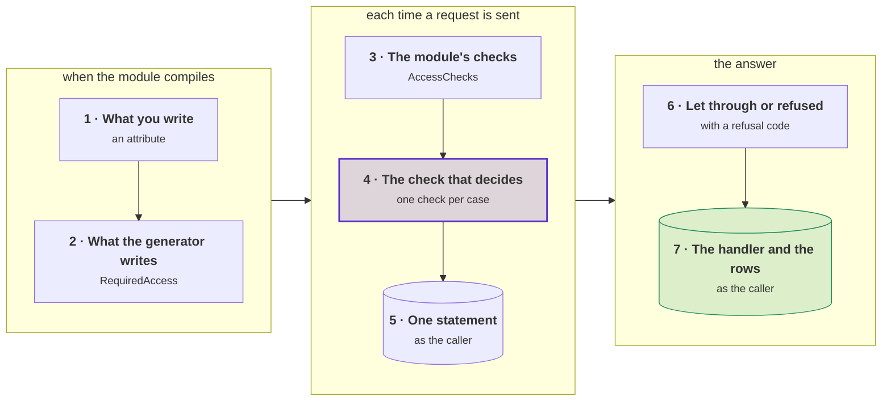
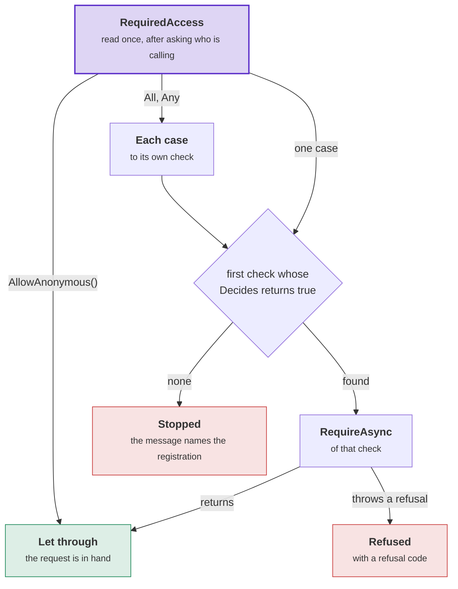
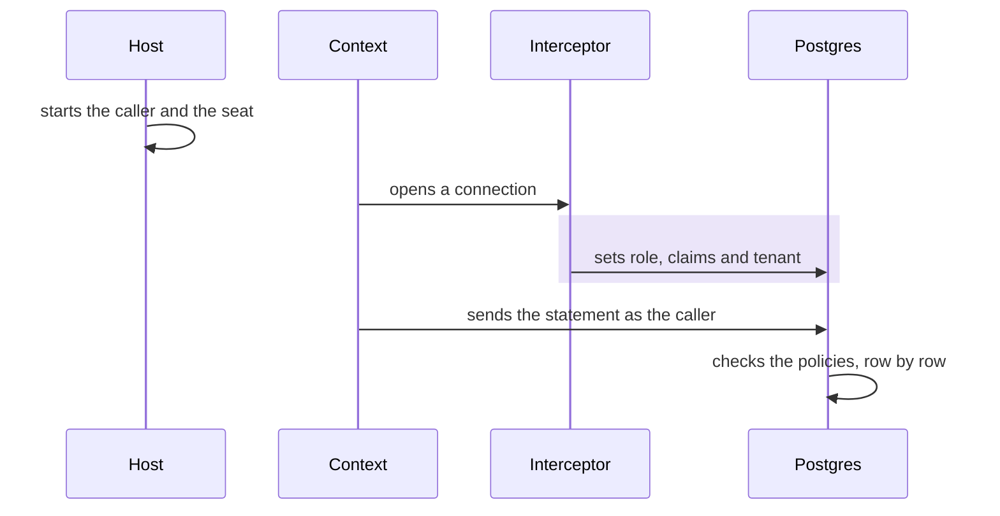
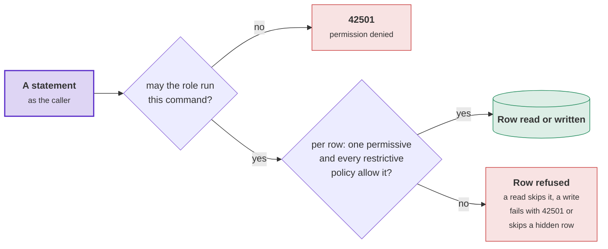
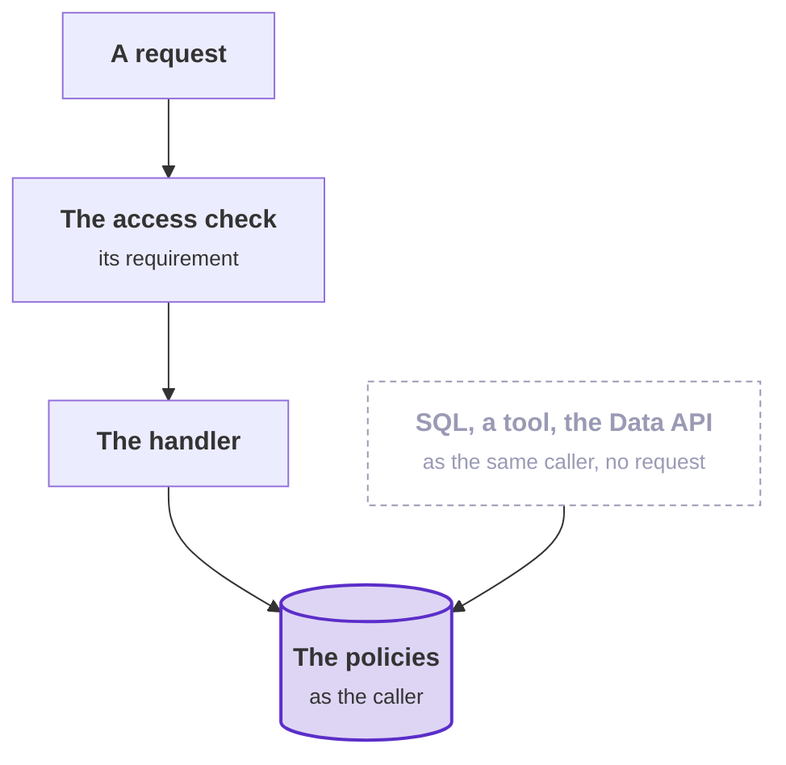
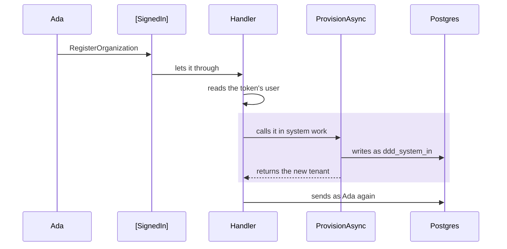

# How a request is checked

This page follows a request from the attribute above it to the rows that Postgres lets it read or write. It uses six
requests and six callers from the seed of the [Tenancy sample](../Examples/Tenancy). Four of the requests are the
sample's own. Each piece also has a page of its own:

- [Access requirements](access-requirements.md): the requirement and the access check.
- [Row level security](row-level-security.md): the caller on the connection, and the policies.
- [Tenancy](tenancy/overview.md) and [Membership](membership/overview.md): the requirements these packages decide.

Three questions decide what a caller can do with a row. Each is answered in a different place:

- **Who may send the request?** The request states a requirement. The access check holds the caller to it before the
  handler runs.
- **Which caller does the code run as?** The caller who sent the request, or system work. Trusted code starts
  system work explicitly around one piece of work, and the system work ends with that work.
- **Which rows may the code touch?** Every statement runs as that caller. Postgres checks the row level security
  (RLS) policies of each table, row by row, whatever the code before it did.

The diagram shows the seven layers a request passes. Purple: the check that decides. Green: the handler and the rows,
which the request reaches only when the access check lets it through.



Layers 1 and 2 happen when the code compiles. Layers 3 to 7 happen each time a request is sent. The access check runs in
C#, before the handler. The statement a check sends, and every statement of the handler, run in Postgres as the caller.
A layer with nothing to do is skipped. A requirement that reads nothing sends no statement, and a refused request never
reaches a table.

<details>
<summary>Show the code: one request through the seven layers</summary>

```csharp shortened
// 1. What you write: the sample's AddCrewMember, a permission on the project it names
[RequiresPermission(RequiredPermission)]
public sealed record AddCrewMember([OnResource] ProjectId Project, SeatId Seat, ProjectRoleId? Role, DateTimeOffset? Until, [ExpectedVersion] long? ExpectedVersion = null) : ICommand, IProjectsRequest;

// 2. What the generator writes into IProjectsRequest, when the module compiles
AddCrewMember request => MemberAccess.On("projects.crew.manage", request.Project, request.ExpectedVersion),

// 3 and 4. The behavior asks the module's checks; Membership's check decides MemberAccess<ProjectId>
await _checks.RequireAsync(message, cancellationToken);

// 5. One statement, as the caller: how the caller holds the permission on that project, and its version
// 6. Refused with the caller's own reason, projects.not-found, projects.not-permitted or a lost race; or let through
// 7. The handler saves the new crew member, and Postgres asks the policies of projects."ProjectCrewMembers"
```

</details>

## Six requests and six callers

The sample's seed has a tenant called **harbor** (Harbor Works). Its organization is a tree of units: the root, two
regions below it (North and South), and areas below those, such as North Coast. The project **Pier 7** is at North
Coast. Leo owns it, and Juno and Vic are on its crew. The project **Bay bridge** is at South Bay, and Juno is not on its
crew. Every request below is sent for harbor. Its `Tenant` header names the tenant, and the host looks up the caller's
seat there before anything else ([TenantHeader](../Examples/Tenancy/Examples.Tenancy.Host/Access/TenantHeader.cs)).

| Caller | Who it is | Runs on Postgres as |
|---|---|---|
| **Ada** | Harbor's first administrator. She has the Access admin and Area manager roles at the root, so she holds every permission in harbor. | `authenticated` |
| **Juno** | A seat at North Coast with no role in the organization. She is a surveyor on Pier 7's crew. That role gives no permission to manage the crew. | `authenticated` |
| **A new sign-in** | A person who signed in and has no seat in harbor. | `authenticated` |
| **Orla** | One of the application's operators. Her token carries the operators' role. She has no seat in any tenant. | `tenancy_operator` |
| **Anonymous** | A request without a token. | `anon` |
| **System work** | System work in harbor. Trusted code starts it with `TenancyUseCases.BeginSystemIn(harbor)`. Its scope is the module of the request it sends: `tenancy`, or `projects` for a request of the Projects module, because the projects' rules let only that scope through. | `ddd_system_in`, scope `tenancy` or `projects` |

| Request | What it does | What it requires | Where it comes from |
|---|---|---|---|
| `OrganizationUnits` | Lists the units the caller can read. | `[InTenant]`: a seat in the tenant | The sample's Tenants module |
| `AddOrganizationUnit` | Adds a unit below another unit. | `[RequiresPermission(TenancyPermissions.UnitsManage)]`, with `[AtUnit]` on the parent | The sample's Tenants module |
| `AddCrewMember` | Puts a seat on a project's crew. | `[RequiresPermission(RequiredPermission)]`, with `[OnResource]` on the project and `[ExpectedVersion]` on the version the caller read | The sample's Projects module |
| `RenameSeat` | Gives a seat another name. | `[RequiresPermission(RequiredPermission)]`, with `[OrOwn]` on the seat: the caller's own seat, or any seat with the permission | The sample's Tenants module |
| `TenantAuditLog` | Reads a tenant's audit log. | The property: an operator, or the permission that manages seats for the whole tenant | The audit log example in [Access requirements](access-requirements.md#access-checks-and-row-policies) |
| `RegisterOrganization` | Creates a new tenant, with the caller as its administrator. | `[SignedIn]`. The handler starts system work. | The registration example in [Tenancy](tenancy/who-may-do-what.md#requests-that-provision-a-tenant) |

Pick a request and a caller below. For each layer, the walk-through shows what happens for that pair, the code that
runs, and the statement sent to Postgres.

<div data-interactive="RequestWalkthrough">

> [!TIP]
> On the [docs site](https://dylansnel.github.io/DDDToolkit/docs/how-a-request-is-checked) this is a walk-through
> you can click through. Pick a request, a caller and a situation, and step through the seven layers. The walk-through
> shows only what is on this page. The tables in
> [Results for each request and caller](#results-for-each-request-and-caller) give the same answers.

</div>

The sample's routes already require a seat before they send a request of a module that needs one. A host may do this.
The walk-through starts at the send, because every entry point ends there. A route, a GraphQL field, a job and a test
all reach the same access check.

## 1. What you write

A request states who may send it. Most requests state it with attributes, because the requirement only names a
permission and the ids the request carries. A request implements the property `RequiredAccess` instead in two cases:
when the requirement is computed from the request's values, and when it combines cases that stacked attributes cannot
express, such as one caller or another, or two permissions at two places.

The sample's requests use attributes. A marker on a member states where the permission is held:

- `[AtUnit]`: at that unit, or at a unit above it.
- `[OnResource]`: on that resource, through its members.
- No marker: for the whole tenant.

`[OrOwn]` on a seat lets the caller through when the seat is the caller's own, as an alternative to the permission.
The permission is a constant of the catalogue. A request can declare its own constant for it, as `RenameSeat` and
`AddCrewMember` do. The handler then reads the same constant.

```csharp
[InTenant]
public sealed record OrganizationUnits : IQuery<IReadOnlyList<UnitListing>>, ITenantsRequest;

[RequiresPermission(TenancyPermissions.UnitsManage)]
public sealed record AddOrganizationUnit([AtUnit] OrganizationUnitId Parent, string Name, UnitKind? Kind) : ICommand<OrganizationUnitId>, ITenantsRequest;

[RequiresPermission(RequiredPermission)]
public sealed record RenameSeat([OrOwn] SeatId Seat, string? DisplayName) : ICommand, ITenantsRequest
{
    public const string RequiredPermission = TenancyPermissions.SeatsManage;
}
```

```csharp
[RequiresPermission(RequiredPermission)]
public sealed record AddCrewMember([OnResource] ProjectId Project, SeatId Seat, ProjectRoleId? Role, DateTimeOffset? Until, [ExpectedVersion] long? ExpectedVersion = null) : ICommand, IProjectsRequest
{
    public const string RequiredPermission = ProjectPermissionNames.ManageCrew;
}
```

The other two requests come from examples in [Access
requirements](access-requirements.md#access-checks-and-row-policies) and
[Tenancy](tenancy/who-may-do-what.md#requests-that-provision-a-tenant). They are not in the sample. The audit log lets
one caller or another through, so it implements the property. The registration lets any signed-in person through. Its
handler starts the system work that creates the tenant ([System work](#system-work)).

```csharp
public sealed record TenantAuditLog(TenantId Tenant, PagingArguments Paging) : IQuery<Page<AuditEntry>>, IAuditRequest
{
    AccessRequirement IRequireAccess.RequiredAccess => AccessRequirement.Any(
        TenancyAccess.Operator(),
        TenancyAccess.AtTenant(TenancyPermissions.SeatsManage));
}

[SignedIn]
public sealed record RegisterOrganization(string Slug, string Name, string AdministratorName) : ICommand<TenantId>, ITenantsRequest;
```

Each attribute stands for one method call, and the property can return the same call. Written with the property, the
sample's four requests and the registration look as below. The sample does not write them this way. Its
`AccessDeclarationTests` allow the property only for a requirement that no attribute can express, so a reviewer sees
one way of writing each requirement.

```csharp
public sealed record OrganizationUnits : IQuery<IReadOnlyList<UnitListing>>, ITenantsRequest
{
    AccessRequirement IRequireAccess.RequiredAccess => TenancyAccess.InTenant();
}

public sealed record AddOrganizationUnit(OrganizationUnitId Parent, string Name, UnitKind? Kind) : ICommand<OrganizationUnitId>, ITenantsRequest
{
    AccessRequirement IRequireAccess.RequiredAccess => TenancyAccess.AtUnit(TenancyPermissions.UnitsManage, Parent);
}

public sealed record RenameSeat(SeatId Seat, string? DisplayName) : ICommand, ITenantsRequest
{
    AccessRequirement IRequireAccess.RequiredAccess => AccessRequirement.Any(
        AccessRequirement.Own(Seat),
        TenancyAccess.AtTenant(TenancyPermissions.SeatsManage));
}

public sealed record AddCrewMember(ProjectId Project, SeatId Seat, ProjectRoleId? Role, DateTimeOffset? Until, long? ExpectedVersion = null) : ICommand, IProjectsRequest
{
    AccessRequirement IRequireAccess.RequiredAccess => MemberAccess.On(ProjectPermissionNames.ManageCrew, Project, ExpectedVersion);
}

public sealed record RegisterOrganization(string Slug, string Name, string AdministratorName) : ICommand<TenantId>, ITenantsRequest
{
    AccessRequirement IRequireAccess.RequiredAccess => AccessRequirement.SignedIn();
}
```

## 2. What the generator writes

When the module compiles, the toolkit's generator turns the attributes into plain C#. It reads every request of the
module's interface. For each request that states its requirement with attributes, it writes one line with the call
the attributes stand for. The lines go into the interface itself, which is why the interface is declared `partial`.
Together the lines form one `switch` on the request's type. This `switch` is the interface's default implementation of
`RequiredAccess`, which every request of the module inherits.

- A request that implements the property itself gets no line. C# uses a class's own implementation over the
  interface's default, so `TenantAuditLog` returns its own requirement. Every reader of the property gets the same
  requirement either way: the access check, a handler that asks it again, and a test.
- A request that the `switch` does not know, such as a request of another project that states nothing, reaches the
  last arm. The last arm throws, so a forgotten requirement lets nobody through.
- A module can declare a [default](access-requirements.md#a-modules-default) on its interface, as the sample's
  Projects module does with `[InTenant]`. Each request that states nothing then gets a line with the default, and the
  last arm returns the default too.

The two blocks below are the generator's output for this page's requests. The registration is a request of
`ITenantsRequest` here, so its line does not appear in the sample's own generated file.

```csharp title="TenantsAccessBehavior.g.cs for this page's requests, the interface's part, shortened"
using DDDToolkit_Generated_IRequireAccess = global::DDDToolkit.Access.IRequireAccess;

namespace Examples.Tenancy.Tenants.Application.Access;

// What the requests of ITenantsRequest that state their requirement with attributes require of their caller: the
// call each attribute stands for, written out by DDDToolkit, one line per request. A request that answers
// RequiredAccess itself answers with its own, which C# takes over this one, so it is never asked here.
partial interface ITenantsRequest
{
    AccessRequirement DDDToolkit_Generated_IRequireAccess.RequiredAccess => this switch
    {
        AddOrganizationUnit request => TenancyAccess.AtUnit("tenancy.units.manage", request.Parent),
        OrganizationUnits => TenancyAccess.InTenant(),
        RegisterOrganization => AccessRequirement.SignedIn(),
        RenameSeat request => AccessRequirement.Any(AccessRequirement.Own(request.Seat), TenancyAccess.AtTenant("tenancy.seats.manage")),
        // ... a line for each of the module's other requests that state their requirement with attributes
        _ => throw new InvalidOperationException(
            this.GetType().FullName + " declares no access requirement: it carries no requirement attribute, and does not answer RequiredAccess itself. "
            + "A request that declares nothing lets nobody through."),
    };
}
```

```csharp title="ProjectsAccessBehavior.g.cs for this page's requests, the interface's part, shortened"
partial interface IProjectsRequest
{
    AccessRequirement DDDToolkit_Generated_IRequireAccess.RequiredAccess => this switch
    {
        AddCrewMember request => MemberAccess.On("projects.crew.manage", request.Project, request.ExpectedVersion),
        // ... the module's other lines, and a last arm that answers the module's default, TenancyAccess.InTenant()
    };
}
```

No reflection runs, and nothing is looked up when a request is sent. Stacked attributes become `AccessRequirement.All`
of their calls, in the order they are written. `[OrOwn]` becomes `Any` of the caller's own and the permission
([The caller's own, or a permission](access-requirements.md#the-callers-own-or-a-permission)). When the project uses
Mediator, the same file also contains the pipeline behavior. The behavior asks the module's checks before every
handler of the interface. It reads the property, so it works the same for attributes and for the property.

<details>
<summary>Show the code: the behavior in the same file</summary>

```csharp title="TenantsAccessBehavior.g.cs, the behavior, shortened"
public sealed class TenantsAccessBehavior<TMessage, TResponse> : IPipelineBehavior<TMessage, TResponse>
    where TMessage : notnull, ITenantsRequest, IMessage
{
    private readonly AccessChecks<ITenantsRequest> _checks;

    public async ValueTask<TResponse> Handle(TMessage message, MessageHandlerDelegate<TMessage, TResponse> next, CancellationToken cancellationToken)
    {
        await _checks.RequireAsync(message, cancellationToken).ConfigureAwait(false);
        return await next(message, cancellationToken).ConfigureAwait(false);
    }
}

public static class TenantsAccessBehaviorRegistration
{
    public static IServiceCollection AddTenantsAccessBehavior(this IServiceCollection services)
    {
        AccessCheckServiceCollectionExtensions.AddAccessChecks<ITenantsRequest>(services);
        // ... and the behavior, put in the pipeline of every message of the interface
    }
}
```

</details>

## 3. The module's checks

Each module has its own set of checks, `AccessChecks<TRequests>`, one per request interface. The container makes one
set per scope. A request is checked only by the set of its own module's interface. A check is registered for one
interface, so the same check registered for two modules is two registrations, one per interface. The core's
`CallerAccessCheck` is first in every set, so the cases about who is calling work the same in every module. The checks
a module adds come after it, in the order they were added.

| The Tenants module's set, for `ITenantsRequest` | Added by | Decides |
|---|---|---|
| `CallerAccessCheck` | every set, first | `SignedIn()`, `Own(value)`, `OwnerOf(id)` |
| `TenancyAccessCheck` over `TenantsContext` | `services.AddTenancyAccess<ITenantsRequest, TenantsContext>()` | every `TenancyRequirement` |

| The Projects module's set, for `IProjectsRequest` | Added by | Decides |
|---|---|---|
| `CallerAccessCheck` | every set, first | `SignedIn()`, `Own(value)`, `OwnerOf(id)` |
| `TenancyAccessCheck` over `ProjectsContext` | `services.AddTenancyAccess<TenantId, SeatId, OrganizationUnitId, RoleId, IProjectsRequest, ProjectsContext>()` | every `TenancyRequirement` |
| `MemberAccessCheck<Project, ProjectId>` | `services.AddProjectMemberAccess<IProjectsRequest>()`, generated for the project's members | `MemberAccess<ProjectId>`: `On`, `Sees`, `SeenWith` |
| `ProjectsAccessCheck` | `services.AddAccessCheck<IProjectsRequest, ProjectsAccessCheck>()` | `ProjectsRequirement`, the module's own case |

Each check's `Decides` method is a type test on the requirement, such as `requirement is TenancyRequirement`. It reads
nothing. The set asks the checks in order and gives the requirement to the first check that returns `true`. The set
itself does three things:

- **It asks who is calling, first.** Before any check runs, the set asks the host's `ICallerAccessor` who is calling.
  In a host that [requires explicit callers](row-level-security.md#requiring-explicit-callers), work without a started caller
  fails here, whatever the request requires.
- **It lets `AllowAnonymous()` through itself.** `AccessRequirement.AllowAnonymous()`, which `[AllowAnonymous]` stands
  for, passes without asking any check.
- **It splits combinations.** For `All` and `Any`, the set gives each case to the check that decides that case. So
  cases of different packages combine, for example the core's case of the caller's own with a permission of Tenancy's.
  Every case must have a check before any case is asked.

When no check decides a requirement, the set stops the request with an `InvalidOperationException`. The message names
the missing registration, for example `AddTenancyAccess` for a case of Tenancy's. When a check lets the request
through, the request is [in hand](access-requirements.md#the-request-in-hand) for the handler that runs next and for
its save.

The diagram shows how the set handles one requirement. Purple: the requirement read from the request. Green: let
through. Red: refused or stopped.



<details>
<summary>Show the code: how the set is made and asked</summary>

```csharp shortened
// AddAccessChecks<TRequests>, the core's: the set of one interface, made per scope, the core's check first
services.TryAddScoped(provider => new AccessChecks<TRequests>(
    provider.GetServices<RegisteredAccessCheck<TRequests>>()
        .Select(registered => registered.Check)
        .Prepend(new CallerAccessCheck(callers, provider))));

// AddAccessCheck<TRequests, TCheck>, which a package's registration calls for the interface it is given
services.TryAddScoped<TCheck>();
services.TryAddEnumerable(ServiceDescriptor.Scoped<RegisteredAccessCheck<TRequests>, RegisteredAccessCheck<TRequests, TCheck>>());
```

```csharp shortened
// AccessChecks<TRequests>.RequireAsync, shortened
_callers?.AskWhoIsCalling();                                     // NoCallerException where nobody was begun

var requirement = request.RequiredAccess
    ?? throw new InvalidOperationException("... declares no access requirement ...");

var check = requirement switch
{
    AccessRequirement.Anyone => null,                            // let through by asking nobody
    AccessRequirement.Combined combined => new CombinedAccessCheck(CheckedCases(request, combined)),
    _ => CheckFor(requirement) ?? throw NothingDecides(request, requirement),
};

return RequestInHand.Take(request, requirement, check, cancellationToken);   // asks the check; in hand once it passed
```

</details>

## 4. The check that decides

Each case is decided by the check of the package that owns the case. Every check looks at the caller before it reads
anything. A caller who is nobody in the tenant is refused with the reason Tenancy gives for that caller, and no
statement is sent. Only four cases read from the database.

| The case | Its check | What it reads | Refused with |
|---|---|---|---|
| `SignedIn()` | the core's `CallerAccessCheck` | Nothing. It looks at the caller's token. | `access.not-signed-in`, 403 |
| `Own(seat)` | the core's `CallerAccessCheck` | Nothing. It compares with the caller's seat in the tenant, found when the request came in. | `access.not-own`, 403 |
| `OwnerOf(board)` | the core's `CallerAccessCheck` | One statement, sent by the storage: the owner column of the one row, read as the caller. Nothing for a caller who has no value of the owner's type. | `access.not-own`, 403. `access.not-found`, 404, for a row the caller cannot see ([The owner of an aggregate](access-requirements.md#the-owner-of-an-aggregate)) |
| `InTenant()` | Tenancy's | Nothing. The seat was found when the request came in. | The caller's own reason, such as `tenancy.not-seated`, 403 |
| `AtTenant(permission)` | Tenancy's | One statement for a seat: the permission at the tenant's root. Nothing for system work in the tenant, which holds every permission there. | `tenancy.not-permitted` with the permission, 403 |
| `AtUnit(permission, unit)` | Tenancy's | One statement for a seat: the permission at the unit or above it. For system work in the tenant: whether the unit belongs to the tenant. | `tenancy.not-permitted` with the permission and the unit, 403 |
| `RequiresOperator()` | Tenancy's | Nothing. It looks at the token's role. | `tenancy.operators-only`, 403 |
| `On(permission, project, version)` | Membership's | One statement: the project as the caller sees it, how the caller holds the permission there, and the project's version. Nothing for a caller who is nobody. | For nobody, the caller's own reason. For a project the caller cannot see, `projects.not-found`, 404. Without the permission, `projects.not-permitted` with the permission, 403. Then a changed version, 409. |
| `All(...)`, `Any(...)` | the set, case by case | What each case reads, in order, until the result is known | For `All`, the refusal of the first failing case. For `Any`, one `access.refused` with each case's reason, 403. |

Membership's check always tests in this order: nobody, not found, not permitted, version. So a caller who cannot see a
project learns nothing about it, not even that it exists. Only a caller who may act learns that somebody changed the
project since they read it. The check keeps what it read for the request. A save that uses
[the expert hold](membership/checks-and-saves.md#the-expert-hold) is checked against it.

<details>
<summary>Show the code: the core's check, Tenancy's, Membership's and the combinations'</summary>

```csharp shortened
// CallerAccessCheck, the core's, shortened: who is calling, with nothing read
public bool Decides(AccessRequirement requirement)
    => requirement is AccessRequirement.SignedInUser || (requirement is IOwnedRequirement owned && owned.CanBeAnswered(services));

switch (requirement)
{
    case AccessRequirement.SignedInUser:
        if (!callers.Current.IsSignedIn)                         // a token that names a user
            throw ToolkitRefusals.Refuse(ToolkitRefusals.NotSignedIn);
        return;
    case IOwnedRequirement owned:                                // the request names the value, never whose it is
        if (!owned.IsTheCallers(callers.Current, services))
            throw ToolkitRefusals.Refuse(ToolkitRefusals.NotOwn);
        return;
}
```

```csharp shortened
// TenancyAccessCheck, Tenancy.EntityFramework, shortened
public bool Decides(AccessRequirement requirement) => requirement is TenancyRequirement;

switch (requirement)
{
    case TenancyRequirement.InTenant:
        tenancy.RequireTenant();                                 // a seat here, or system work here
        break;
    case TenancyRequirement.AtTenant required:
        tenancy.RequireTenant();                                 // nobody is refused without a statement
        if (!await HoldsAtTenantAsync(required.Permission, cancellationToken))
            throw TenancyRefusals.Refuse(TenancyRefusals.NotPermitted, ("Permission", required.Permission));
        break;
    case TenancyRequirement.AtUnit<TUnitId> required:
        tenancy.RequireTenant();
        if (!await HoldsAtAsync(required.Permission, required.Unit, cancellationToken))
            throw TenancyRefusals.Refuse(TenancyRefusals.NotPermitted, ("Permission", required.Permission), ("Unit", required.Unit));
        break;
    case TenancyRequirement.Operator:
        if (!options.IsOperator(callers.Current))                // the token's role, never a seat
            throw TenancyRefusals.Refuse(TenancyRefusals.OperatorsOnly);
        break;
    default:
        throw new InvalidOperationException("... which Tenancy's access check does not decide ...");
}
```

```csharp shortened
// MemberAccessCheck<Project, ProjectId>, Membership, the case of a permission on a project, shortened
public bool Decides(AccessRequirement requirement) => requirement is MemberAccess<ProjectId>;

case MemberAccess<ProjectId>.On required:
    var hold = await access.RequireAsync(required.Resource, required.Permission, cancellationToken);
    //   nobody                         -> the caller's own refusal, tenancy.not-seated
    //   does not see the project       -> projects.not-found
    //   sees it, does not hold the permission -> projects.not-permitted
    if (required.ExpectedVersion is { } expected && expected != hold.Version)
        throw new ConcurrencyConflictException(typeof(Project), required.Resource);    // 409, only now
    kept.KeepFor(request, hold);                                 // what the save is held to
    break;
```

```csharp shortened
// CombinedAccessCheck, the core's, shortened: Any lets the first case that holds decide
case AccessRequirement.AnyOf any:
    var reasons = new List<RefusalReason>();
    foreach (var each in any.Cases)
    {
        try { await Require(each, request, cancellationToken); return; }   // the first that lets the caller through
        catch (RefusalException refused) { reasons.Add(RefusalReason.From(refused)); }
    }
    throw ToolkitRefusals.NoneMet(reasons);                      // one access.refused, every reason in it
case AccessRequirement.AllOf all:
    foreach (var each in all.Cases)
        await Require(each, request, cancellationToken);         // in order; the first refusal is the answer
    return;
```

</details>

## 5. The statement the check sends

A check that reads sends one statement through the module's own context. The statement runs as the caller, like every
other statement, so the policies apply to it too.

Tenancy's two queries read its read model:

- `SeatRights`: for each seat, the permissions its grants give at each unit.
- `OrganizationUnitPaths`: the closure table of the tree. It has one row for each pair of a unit and a unit at or below
  it. So "at North Coast or above it" is one join, without walking up the tree.

Membership's query is built from the rules of the resource, as one expression. The caller holds the permission on the
project in one of three ways: as a crew member in a role that gives the permission, as the project's owner, or from
above, through the permission held at the unit where the project is. The same statement also tests whether the caller
can see the project at all.

Entity Framework translates the queries' LINQ when the statement runs. The SQL on this page is therefore approximate,
and the real parameter names differ. The permission at North Coast or above it is one join on the closure table:

```sql shortened
-- HoldsAtAsync: the permission at the unit or above it, approximately what Entity Framework sends
SELECT EXISTS (
    SELECT 1 FROM "tenancy"."SeatRights" AS r
    INNER JOIN "tenancy"."OrganizationUnitPaths" AS p ON r."UnitId" = p."AncestorId"
    WHERE r."TenantId" = @tenant AND r."SeatId" = @seat AND r."Permission" = @permission
      AND r."StartsAt" <= @now AND (r."EndsAt" IS NULL OR r."EndsAt" > @now)
      AND p."TenantId" = @tenant AND p."DescendantId" = @unit)
```

<details>
<summary>Show the code: Tenancy's two queries, Membership's query, and the SQL each sends</summary>

```csharp shortened
// TenancyQueries, shortened: the two queries a check asks
public Task<bool> HoldsAtTenantAsync(string permission, CancellationToken cancellationToken)
    => executor.AnyAsync(
        from right in source.SeatRights
        where right.TenantId.Equals(tenant) && right.SeatId.Equals(seat) && right.Permission == permission
              && right.StartsAt <= now && (right.EndsAt == null || right.EndsAt > now)
        join root in source.Units on right.UnitId equals root.Id
        where root.TenantId.Equals(tenant) && !root.ParentId.HasValue
        select right.Permission,
        cancellationToken);

public Task<bool> HoldsAtAsync(string permission, TUnitId unit, CancellationToken cancellationToken)
    => executor.AnyAsync(UnitsWhereIHold(permission).Where(held => held.Equals(unit)), cancellationToken);
```

```sql shortened
-- HoldsAtTenantAsync: the permission at the tenant's root, approximately what Entity Framework sends
SELECT EXISTS (
    SELECT 1 FROM "tenancy"."SeatRights" AS r
    INNER JOIN "tenancy"."OrganizationUnits" AS root ON r."UnitId" = root."Id"
    WHERE r."TenantId" = @tenant AND r."SeatId" = @seat AND r."Permission" = @permission
      AND r."StartsAt" <= @now AND (r."EndsAt" IS NULL OR r."EndsAt" > @now)
      AND root."TenantId" = @tenant AND root."ParentId" IS NULL)
```

```sql shortened
-- HoldsAtAsync for system work in the tenant: every permission there, at a unit of the tenant, approximately
SELECT EXISTS (SELECT 1 FROM "tenancy"."OrganizationUnits" AS u WHERE u."TenantId" = @tenant AND u."Id" = @unit)
```

```sql shortened
-- EfMemberQuestions.HoldAsync: the project as the caller sees it, and how the permission is held, approximately
SELECT p."Version",
       EXISTS (SELECT 1 FROM "projects"."ProjectCrewMembers" AS m                 -- on the crew now,
               WHERE m."ProjectId" = p."Id" AND m."SeatId" = @seat
                 AND EXISTS (SELECT 1 FROM "projects"."ProjectCrewRoleGrants" AS h   -- in a role that gives the permission
                             INNER JOIN "projects"."ProjectRoles" AS k ON h."RoleId" = k."Id"
                             WHERE h."CrewMemberId" = m."Id" AND k."Status" = 'Active' AND @permission = ANY (k."Permissions")))
         OR p."OwnerSeatId" = @seat AS "AsMember",                                 -- or its owner
       p."UnitId" IN (SELECT path."DescendantId" FROM "tenancy".caller_permissions() AS r   -- or the permission where it sits
                      INNER JOIN "tenancy".tenant_unit_paths() AS path ON r."UnitId" = path."AncestorId"
                      WHERE r."SeatId" = @seat AND r."Permission" = @permission) AS "FromAbove"
FROM "projects"."Projects" AS p
WHERE p."Id" = @project
  AND (/* the caller sees it: on the crew, its owner, or projects.view where it sits */)
LIMIT 1
-- no row: projects.not-found; a row whose AsMember and FromAbove are both false: projects.not-permitted
```

```sql shortened
-- EfMemberQuestions.HoldAsync for system work: every permission, so only the project and its version
SELECT p."Version" FROM "projects"."Projects" AS p WHERE p."Id" = @project LIMIT 1
```

The crew part leaves out the time periods. A crew member and a role count from their start to their end, compared
with now, as a grant does. The Projects module reads Tenancy through functions, such as
`"tenancy".caller_permissions()`, instead of reading Tenancy's tables
([Modules read through functions](tenancy/postgres.md#read-functions-for-modules)). `caller_permissions()` runs as
the caller, so a seat reads only its own permissions.

</details>

### The caller on the connection

Before a statement runs, the connection is set to the caller. When a request comes in, the host starts two callers:

- the toolkit's caller, from the validated token;
- Tenancy's caller: the seat of that identity in the tenant the request names.

When a context opens a connection, the RLS interceptor sends one statement. The statement sets the
database role, the token's claims (as PostgREST does for each request) and Tenancy's tenant. Behind a pooler that
gives each transaction another server connection, the interceptor sets them for each transaction instead
([How the settings travel](row-level-security.md#settings-per-connection-or-per-transaction)).

The diagram shows the order. The shaded step sets the caller on the connection.



The policies read these settings:

- `auth.uid()` and `auth.jwt()` read the claims.
- The role decides which policies Postgres applies.
- `"tenancy".system_tenant()` reads Tenancy's tenant setting.
- `"tenancy".caller_seat()` finds the seat from the verified identity and that tenant. It returns only an active seat
  in an active tenant, so a wrong tenant finds no seat.

```sql shortened
-- the caller on the connection, as the interceptor sets it for each of the six; … is the rest of the statement
SELECT set_config('role', 'authenticated', false), set_config('request.jwt.claims', '{"sub":"<Ada>","role":"authenticated",…}', false), …, set_config('tenancy.caller_tenant', '<harbor>', false);
SELECT set_config('role', 'authenticated', false), set_config('request.jwt.claims', '{"sub":"<Juno>","role":"authenticated",…}', false), …, set_config('tenancy.caller_tenant', '<harbor>', false);
SELECT set_config('role', 'authenticated', false), set_config('request.jwt.claims', '{"sub":"<the new sign-in>","role":"authenticated",…}', false), …, set_config('tenancy.caller_tenant', '', false);
SELECT set_config('role', 'tenancy_operator', false), set_config('request.jwt.claims', '{"sub":"<Orla>","role":"tenancy_operator",…}', false), …, set_config('tenancy.caller_tenant', '', false);
SELECT set_config('role', 'anon', false), set_config('request.jwt.claims', '{"role":"anon"}', false), …, set_config('tenancy.caller_tenant', '', false);
SELECT set_config('role', 'ddd_system_in', false), set_config('request.jwt.claims', '{"role":"ddd_system_in","scope":"tenancy"}', false), …, set_config('tenancy.caller_tenant', '<harbor>', false);
```

<details>
<summary>Show the code: where the callers start, and the function that finds the seat</summary>

```csharp shortened
// The sample's TenantHeader.UseTenantSelection, shortened: both callers begun for the request
var caller = context.GetSupabaseCaller();                         // from the validated token, or anonymous
using (Callers.Begin(caller))
{
    var seat = await selection.ResolveAsync(caller, context.Request.Headers["Tenant"], context.RequestAborted);
    using (TenancyCallers.Begin(seat))                            // the seat in harbor, or nobody and why
    {
        await next(context);
    }
}
```

```sql title="20261027164316_access.tenants.ddd.sql, the caller's seat and tenant, shortened"
CREATE OR REPLACE FUNCTION "tenancy".system_tenant() RETURNS uuid
    LANGUAGE sql STABLE SET search_path = '' AS $function$
SELECT nullif(pg_catalog.current_setting('tenancy.caller_tenant', true), '')::pg_catalog.uuid
$function$;
CREATE OR REPLACE FUNCTION "tenancy".caller_seat() RETURNS uuid
    LANGUAGE sql STABLE SECURITY DEFINER SET search_path = '' AS $function$
SELECT s."Id" FROM "tenancy"."Seats" s
JOIN "tenancy"."Tenants" t ON t."Id" = s."TenantId"
WHERE s."Identity" = (SELECT auth.uid())
  AND s."TenantId" = (SELECT "tenancy".system_tenant())
  AND s."Status" = 'Active' AND t."Status" = 'Active'
$function$;
CREATE OR REPLACE FUNCTION "tenancy".caller_tenant() RETURNS uuid
    LANGUAGE sql STABLE SECURITY DEFINER SET search_path = '' AS $function$
SELECT s."TenantId" FROM "tenancy"."Seats" s WHERE s."Id" = (SELECT "tenancy".caller_seat())
$function$;
```

</details>

## 6. Let through or refused

When the check returns, the request is let through. The handler runs next, with the request in hand. When the check
refuses, it throws a `RefusalException` with a refusal code, a kind, and arguments such as the permission. The edge
turns the kind into an HTTP status: 403 for not permitted, 404 for not found. A changed version throws a
`ConcurrencyConflictException`, which the edge answers with 409. The client reads the refusal code. The handler of a
refused request does not run, so nothing it would read or write reaches a table.

```json
{
  "status": 403,
  "code": "access.refused",
  "title": "Access to this was refused.",
  "arguments": {
    "Reasons": [
      { "code": "access.not-own", "arguments": {} },
      { "code": "tenancy.not-permitted", "arguments": { "Permission": "tenancy.seats.manage" } }
    ]
  }
}
```

The refusal above is Juno renaming Leo's seat. Neither alternative holds, so `Any` gives one refusal with both reasons.
The access check is not the only place that refuses. A handler, or the use case of the package it calls, refuses what
only it can read. For example, the sample's `AddCrewMember` handler refuses a seat that is not active, and Tenancy's
provisioning refuses everyone except system work. The database also refuses a row that its policies do not allow, after
the access check let the request through.

## 7. The handler and the rows

The handler acts on the ids the request names, which are the ids the access check tested: the parent unit, the project,
the seat. Its statements run as the same caller. Postgres checks two things:

1. **The privileges.** May the caller's role run this command on this table at all?
2. **The policies, for each row.** A row passes when at least one permissive policy allows it and every restrictive
   policy allows it. Permissive policies grant access. Restrictive policies limit it. For example, Tenancy's
   restrictive policies keep every row to the caller's tenant.

The policies come from row access rules: the packages' rules, and the rules a module writes in C# in its
infrastructure project. The export writes them into `supabase/migrations`, with the functions they call and the
privileges they need ([Row access rules written in C#](row-level-security.md#row-access-rules-written-in-c)).

The diagram shows the two steps. Purple: the statement. Green: the row is read or written. Red: refused.



The policies decide per table. The access check decides per request. So a policy can allow more than one request
requires. Two examples:

- Tenancy's update policy on the seats lets a seat change its own row. It also lets a seat that manages seats or grants
  anywhere in the tenant change any seat's row, because every save of a seat writes the seat's version. The sample holds
  the name column to `RenameSeat`'s rule with a [column rule](row-level-security.md#column-rules), which is a trigger on
  that one column.
- Tenancy's read policy lets every member of a tenant read all its units. The sample's directory lists only the units a
  seat is placed at, and the units below them. The tree belongs to the whole organization, and Tenancy's own queries
  read it as their caller. So the units have no narrower default policy to replace, as the seats have ([Who reads the
  seats: a default you may replace](tenancy/postgres.md#default-read-policies-for-seats-and-invitations)).

The policies below are copied from the sample's export. The toolkit quotes schema names in all SQL it writes. The
insert policy on the units allows a new unit below a parent where the caller holds the permission that manages units.
This is the same permission at the same unit that the check tested:

```sql title="20261027164316_access.tenants.ddd.sql, the units' insert policy, shortened"
CREATE POLICY "Unit managers add below their units (insert) for authenticated" ON "tenancy"."OrganizationUnits" FOR INSERT TO authenticated
    WITH CHECK (("TenantId" = (SELECT "tenancy".caller_tenant())) AND ("ParentId" = ANY (ARRAY(SELECT "tenancy".units_where_i_hold_permission('tenancy.units.manage')))));
```

The Supabase export writes each table's privileges from the same policies
([Privileges from the policies](row-level-security.md#privileges-from-the-policies)). A role gets a command on a table
only when a permissive policy for that role allows the command. It gets `USAGE` on a schema only when it has a
privilege on a table in that schema. So:

- a role without a permissive policy that allows writing a table cannot write that table;
- a role without any permissive policy in a schema cannot use that schema.

In both cases Postgres refuses the statement with 42501, `permission denied`, before it checks any policy.

<details>
<summary>Show the code: the policies and functions the export writes for the units, the seats, the crew and the audit log</summary>

```sql title="20261027164316_access.tenants.ddd.sql, the units' other policies and the function they ask, shortened"
CREATE OR REPLACE FUNCTION "tenancy".units_where_i_hold_permission(permission text) RETURNS SETOF uuid
    LANGUAGE sql STABLE SECURITY DEFINER SET search_path = '' AS $function$
SELECT DISTINCT p."DescendantId" FROM "tenancy"."SeatRights" r
JOIN "tenancy"."OrganizationUnitPaths" p ON p."AncestorId" = r."UnitId" AND p."TenantId" = r."TenantId"
WHERE r."SeatId" = (SELECT "tenancy".caller_seat()) AND r."Permission" = $1 AND "tenancy".permission_is_live($1)
  AND r."StartsAt" <= pg_catalog.now() AND (r."EndsAt" IS NULL OR r."EndsAt" > pg_catalog.now())
$function$;
CREATE POLICY "Members read the units (select) for authenticated" ON "tenancy"."OrganizationUnits" FOR SELECT TO authenticated
    USING ("TenantId" = (SELECT "tenancy".caller_tenant()));
CREATE POLICY "System work reads its tenant (select) for ddd_system_in" ON "tenancy"."OrganizationUnits" FOR SELECT TO ddd_system_in
    USING ("TenantId" = (SELECT "tenancy".system_tenant()));
CREATE POLICY "Operators read every tenant (select) for tenancy_operator" ON "tenancy"."OrganizationUnits" FOR SELECT TO tenancy_operator
    USING (true);
CREATE POLICY "Tenancy work writes its tenant (insert) for ddd_system_in" ON "tenancy"."OrganizationUnits" FOR INSERT TO ddd_system_in
    WITH CHECK (("TenantId" = (SELECT "tenancy".system_tenant())) AND ((SELECT auth.jwt() ->> 'scope') = 'tenancy'));
CREATE POLICY "Closed to anonymous callers (all) for anon" ON "tenancy"."OrganizationUnits" AS RESTRICTIVE FOR ALL TO anon
    USING (false)
    WITH CHECK (false);
```

```sql title="20261027164316_access.tenants.ddd.sql, the seats and the name's column rule, shortened"
CREATE OR REPLACE FUNCTION "tenancy".holds_at_tenant(permission text) RETURNS boolean
    LANGUAGE sql STABLE SECURITY DEFINER SET search_path = '' AS $function$
SELECT EXISTS (SELECT 1 FROM "tenancy"."SeatRights" r
               JOIN "tenancy"."OrganizationUnits" u ON u."Id" = r."UnitId" AND u."TenantId" = r."TenantId"
               WHERE r."SeatId" = (SELECT "tenancy".caller_seat()) AND r."Permission" = $1 AND "tenancy".permission_is_live($1) AND r."StartsAt" <= pg_catalog.now() AND (r."EndsAt" IS NULL OR r."EndsAt" > pg_catalog.now())
                 AND u."ParentId" IS NULL)
$function$;
CREATE POLICY "Managers and the seat change it (update) for authenticated" ON "tenancy"."Seats" FOR UPDATE TO authenticated
    USING (("TenantId" = (SELECT "tenancy".caller_tenant())) AND ((SELECT "tenancy".holds_permission('tenancy.seats.manage')) OR (SELECT "tenancy".holds_permission('tenancy.grants.manage')) OR "Id" = (SELECT "tenancy".caller_seat())))
    WITH CHECK (("TenantId" = (SELECT "tenancy".caller_tenant())) AND ((SELECT "tenancy".holds_permission('tenancy.seats.manage')) OR (SELECT "tenancy".holds_permission('tenancy.grants.manage')) OR "Id" = (SELECT "tenancy".caller_seat())));
CREATE POLICY "Tenancy work writes its tenant (update) for ddd_system_in" ON "tenancy"."Seats" FOR UPDATE TO ddd_system_in
    USING (("TenantId" = (SELECT "tenancy".system_tenant())) AND ((SELECT auth.jwt() ->> 'scope') = 'tenancy'))
    WITH CHECK (("TenantId" = (SELECT "tenancy".system_tenant())) AND ((SELECT auth.jwt() ->> 'scope') = 'tenancy'));
CREATE OR REPLACE FUNCTION "tenancy".seats_displayname_column_rule() RETURNS trigger
    LANGUAGE plpgsql SET search_path = '' AS $body$
BEGIN
    IF CURRENT_USER = 'authenticated' THEN
        IF ((OLD."Id" = (SELECT "tenancy".caller_seat())) OR (SELECT "tenancy".holds_at_tenant('tenancy.seats.manage'))) IS NOT TRUE OR (OLD."Id" IS DISTINCT FROM NEW."Id" AND ((NEW."Id" = (SELECT "tenancy".caller_seat())) OR (SELECT "tenancy".holds_at_tenant('tenancy.seats.manage'))) IS NOT TRUE) THEN
            RAISE EXCEPTION USING ERRCODE = 'insufficient_privilege', CONSTRAINT = 'seats_displayname_column_rule', HINT = 'ddd:access.refused', MESSAGE = 'The column rule ''Name changes by the seat or with the seats permission'' does not let this caller change "DisplayName" of "tenancy"."Seats".';
        END IF;
    ELSIF CURRENT_USER IN ('anon', 'tenancy_operator') THEN
        RAISE EXCEPTION USING ERRCODE = 'insufficient_privilege', CONSTRAINT = 'seats_displayname_column_rule', HINT = 'ddd:access.refused', MESSAGE = 'No column rule is for this caller''s role, so it may not change "DisplayName" of "tenancy"."Seats".';
    END IF;
    RETURN NEW;
END
$body$;
CREATE TRIGGER seats_displayname_column_rule BEFORE UPDATE OF "DisplayName" ON "tenancy"."Seats"
    FOR EACH ROW WHEN (OLD."DisplayName" IS DISTINCT FROM NEW."DisplayName")
    EXECUTE FUNCTION "tenancy".seats_displayname_column_rule();
```

```sql title="20261027164317_access.projects.ddd.sql, the crew and the function it asks, shortened"
CREATE OR REPLACE FUNCTION "projects".projects_where_i_hold(text) RETURNS SETOF uuid
    LANGUAGE sql STABLE SECURITY DEFINER SET search_path = '' AS $function$
SELECT holding.id FROM "projects".projects_as_member_with($1) AS holding(id)
UNION
SELECT joined.id FROM "projects".projects_as_member() AS joined(id) WHERE $1 = 'projects.view'
UNION
SELECT r."Id" FROM "projects"."Projects" r WHERE $1 IN ('projects.view', 'projects.edit', 'projects.close', 'projects.crew.manage') AND r."OwnerSeatId" = (SELECT "tenancy".caller_seat())
UNION
SELECT r."Id" FROM "projects"."Projects" r WHERE $1 IS NOT NULL AND r."UnitId" IN (SELECT reached.place FROM "tenancy".units_where_i_hold_permission($1) AS reached(place))
UNION
SELECT r."Id" FROM "projects"."Projects" r WHERE (SELECT auth.role()) = 'ddd_system_in' AND (SELECT auth.jwt() ->> 'scope') IN ('projects') AND $1 IS NOT NULL
$function$;
CREATE POLICY "System work in its tenant (insert) for ddd_system_in" ON "projects"."ProjectCrewMembers" FOR INSERT TO ddd_system_in
    WITH CHECK (EXISTS (SELECT 1 FROM "projects"."Projects" r WHERE r."Id" = "projects"."ProjectCrewMembers"."ProjectId" AND r."TenantId" = (SELECT "tenancy".system_tenant())));
CREATE POLICY "Members change with the permission (insert) for authenticated" ON "projects"."ProjectCrewMembers" AS RESTRICTIVE FOR INSERT TO authenticated
    WITH CHECK ("ProjectId" IN (SELECT held.id FROM "projects".projects_where_i_hold('projects.crew.manage') AS held(id)) OR "ProjectId" IN (SELECT held.id FROM "projects".projects_where_i_hold('projects.owner.change') AS held(id)));
CREATE POLICY "Kept to its tenant (all) for authenticated" ON "projects"."ProjectCrewMembers" AS RESTRICTIVE FOR ALL TO authenticated
    USING (EXISTS (SELECT 1 FROM "projects"."Projects" r WHERE r."Id" = "projects"."ProjectCrewMembers"."ProjectId" AND r."TenantId" = (SELECT "tenancy".caller_tenant())))
    WITH CHECK (EXISTS (SELECT 1 FROM "projects"."Projects" r WHERE r."Id" = "projects"."ProjectCrewMembers"."ProjectId" AND r."TenantId" = (SELECT "tenancy".caller_tenant())));
```

The audit log is not part of the sample. Its two alternatives have two row rules on its table: one for the operators'
role, and one for a seat that manages seats. The export writes one policy for each rule. Tenancy adds the restrictive
policies it adds to every table that belongs to a tenant
([Access checks and row policies](access-requirements.md#access-checks-and-row-policies)). The operators' rule is
also what gives `tenancy_operator` its only privilege on the table, `SELECT`:

```sql shortened
-- the audit log's policies, as the export writes them from its two row rules
CREATE POLICY "Operators read the audit log (select) for tenancy_operator" ON "audit"."AuditEntries" FOR SELECT TO tenancy_operator
    USING (TRUE);
CREATE POLICY "Seat managers read the audit log (select) for authenticated" ON "audit"."AuditEntries" FOR SELECT TO authenticated
    USING ((SELECT "tenancy".holds_at_tenant('tenancy.seats.manage')));
-- Tenancy's own, on every table kept to a tenant: a seat reads its tenant's rows alone, and an operator writes none
CREATE POLICY "Kept to its tenant (all) for authenticated" ON "audit"."AuditEntries" AS RESTRICTIVE FOR ALL TO authenticated
    USING ("TenantId" = (SELECT "tenancy".caller_tenant()))
    WITH CHECK ("TenantId" = (SELECT "tenancy".caller_tenant()));
CREATE POLICY "Operators only read (insert) for tenancy_operator" ON "audit"."AuditEntries" AS RESTRICTIVE FOR INSERT TO tenancy_operator
    WITH CHECK (false);
-- ... and the same for update and delete
```

</details>

On the crew table, the permissive insert policy for signed-in callers, `"ProjectCrewMembers (insert) for
authenticated"`, lets anyone who may change the project add a row. Membership's restrictive policy, `"Members change
with the permission"`, narrows that to callers who hold `projects.crew.manage` (the permission that changes the
members) or `projects.owner.change` (the permission that names the owner). This restrictive policy is
[the lock on the member rows](membership/postgres.md#who-writes-the-member-rows). Because of it, a handler saves a
change to the caller's own place on the crew as system work, even after the access check let the caller through
([The caller's own on a resource](access-requirements.md#the-callers-own-on-a-resource)).

### Statements that skip the access check

The access check sees only requests. A statement sent without a request meets no check. Examples are your own SQL,
another module's code, a tool connected as the caller, and Supabase's Data API for an exposed schema. Only the policies
apply to such a statement, as the caller it runs as. The sample exposes none of its schemas to the Data API, so its only
entry point is its own API. The policies would apply to all of these statements in the same way.

The diagram shows both paths. Purple: the policies, which every statement meets. Grey: a statement without a request,
which skips the access check.



Policies are coarser than requirements. A policy decides who may change a row of a table, for every request that changes
it. For example, the projects' update policy lets a member who may close a project write the project's row. Only the
sample's column rule on a project's name and plan stops that member's own statement from renaming the project. For this
reason the toolkit reports the ways around the pipeline behavior that it can detect ([Handlers reached without the
access check](access-requirements.md#handlers-reached-without-the-access-check)), and a rule about one column is written
as a column rule.

For the six requests, this is what a refused caller gets when they send the statement directly. The
[result tables](#results-for-each-request-and-caller) give this answer for every refused caller:

| A refused caller | Sends directly | Postgres answers |
|---|---|---|
| Juno, `AddOrganizationUnit` | `INSERT INTO "tenancy"."OrganizationUnits"` below North Coast | Refused, 42501. The insert policy calls `units_where_i_hold_permission('tenancy.units.manage')`, and North Coast is not in the result. |
| Juno, `AddCrewMember` on Pier 7 | `INSERT INTO "projects"."ProjectCrewMembers"` | Refused, 42501. She may not change the project, and Membership's lock requires `projects.crew.manage`. |
| Juno, `RenameSeat` of Leo's seat | `UPDATE "tenancy"."Seats" SET "DisplayName" = ...` | `UPDATE 0`. The update policy hides Leo's row from her, so nothing changes. |
| Orla, `OrganizationUnits` | `SELECT * FROM "tenancy"."OrganizationUnits"` | Every unit of every tenant. Operators may read every tenant, although the request requires a seat. |
| Orla, any request that writes | `INSERT` or `UPDATE` on a table that belongs to a tenant | Refused, 42501, `permission denied`. No permissive policy lets her role write, so the role has only `SELECT`. Tenancy's restrictive policy `Operators only read` would also refuse every row. |
| The new sign-in, `OrganizationUnits` | The same `SELECT` | No rows. `caller_tenant()` finds no seat, so no unit is in the caller's tenant. |
| Any anonymous caller | Any statement | Refused, 42501, `permission denied`. No permissive policy is for `anon`, so `anon` cannot use the schemas of a module that belongs to a tenant. A restrictive policy also closes every table in them. |

## System work

System work is not a requirement. It is a scope. Trusted code starts it around a piece of work, and when the scope
ends, the previous caller is current again. Inside the scope, the connection runs as `ddd_system_in`, with the scope's
name in its claims. The policies for system work keep it to its tenant and its scope. No request can require system
work, so a caller cannot get the permissions of system work by sending a request.

`RegisterOrganization` shows both sides:

1. Its requirement, `[SignedIn]`, lets any signed-in person through: Ada, Juno, the new sign-in and Orla. An operator
   is a signed-in user too.
2. The handler reads the administrator from the caller's token first.
3. The handler then starts system work outside any tenant. Tenancy's provisioning creates a tenant only in this kind
   of system work.
4. The provisioning switches to system work in the new tenant, so every row it writes belongs to that tenant.
5. After the `using` block, the next statement runs as the person who sent the request again.

The diagram shows the registration. The shaded part runs as system work.



A handler that does not start the scope fails in the use case. Tenancy's provisioning refuses a seat with
`access.system-only`, and refuses a caller without a seat with that caller's own reason, `tenancy.not-seated`. System
work can also start before the request is sent. The sample's seeding does this. It starts system work in each tenant
and sends `MarkTenantAsDemo`. That request requires `[InTenant]`, which lets system work in the tenant through, and
its handler refuses everyone else ([System work](access-requirements.md#system-work)).

<details>
<summary>Show the code: the registration's handler, and the policy for the rows it writes</summary>

```csharp shortened
// RegisterOrganization's handler, from Tenancy's page, shortened
var caller = callers.Current;                                     // read before the system work begins
if (caller.UserId is not { } administrator || caller.Claim("is_anonymous") == "true")
{
    throw TenancyRefusals.Refuse(TenancyRefusals.IdentityRequired);
}

using (TenancyUseCases.BeginSystem())                             // system work outside any tenant, begun here
{
    var made = await tenants.ProvisionAsync(new TenancyUseCases.TenantToProvision(
        command.Slug, command.Name, TenantShape.Flat, command.Name, administrator), cancellationToken);
    return made.Tenant;
}                                                                 // the caller before it is current again
```

```sql title="20261027164316_access.tenants.ddd.sql, the tenant the provisioning writes, shortened"
CREATE POLICY "Tenancy work writes its tenant (insert) for ddd_system_in" ON "tenancy"."Tenants" FOR INSERT TO ddd_system_in
    WITH CHECK (("Id" = (SELECT "tenancy".system_tenant())) AND ((SELECT auth.jwt() ->> 'scope') = 'tenancy'));
```

</details>

## A requirement of your own

Some rules belong only to your module. For example, only a tenant on the Pro plan may export a board. No package knows
about plans, so the module declares its own requirement, its own check and its own attribute. The attribute stacks
with the packages' attributes like any other. There are four pieces:

- the requirement, a record;
- the attribute, marked with `[StatesRequirement]`, which names the call the attribute stands for;
- the check;
- the line that adds the check to the module's set.

```csharp
public enum Plan { Free, Team, Pro }

// The requirement: a record, so two that say the same are equal
public sealed record PlanAtLeast(Plan Plan) : AccessRequirement
{
    public static PlanAtLeast RequiresPlan(Plan plan) => new(plan);
}

// The attribute: [StatesRequirement] names the call it stands for, with its constructor's arguments
[StatesRequirement(typeof(PlanAtLeast), nameof(PlanAtLeast.RequiresPlan))]
[AttributeUsage(AttributeTargets.Class | AttributeTargets.Struct, Inherited = false)]
public sealed class RequiresPlanAttribute(Plan plan) : Attribute
{
    public Plan Plan { get; } = plan;
}
```

```csharp
// Yours: what answers which plan a tenant is on
public interface ITenantPlans
{
    ValueTask<Plan> CurrentAsync(TenantId tenant, CancellationToken cancellationToken);
}

// The check: Decides is a type test; RequireAsync asks who is calling before it reads, then returns or refuses
// with the module's code
public sealed class PlanCheck(TenancyAccessManager access, ITenantPlans plans) : IAccessCheck
{
    public bool Decides(AccessRequirement requirement) => requirement is PlanAtLeast;

    public async ValueTask RequireAsync(AccessRequirement requirement, IRequireAccess request, CancellationToken cancellationToken)
    {
        var required = (PlanAtLeast)requirement;
        var tenant = access.CurrentTenant.Require().Id;          // nobody in the tenant: refused with its own reason
        if (await plans.CurrentAsync(tenant, cancellationToken) < required.Plan)
        {
            throw new RefusalException("boards.plan-too-low", RefusalKind.NotPermitted, "That takes a higher plan.");
        }
    }
}

public static class BoardsModule
{
    // Beside Tenancy's check for the permission: services.AddTenancyAccess<..., IBoardsRequest, BoardsContext>()
    public static IServiceCollection AddBoardsAccess(this IServiceCollection services)
        => services.AddAccessCheck<IBoardsRequest, PlanCheck>();
}
```

```csharp
[AccessRequests]
public partial interface IBoardsRequest : IRequireAccess;

[RequiresPlan(Plan.Pro)]                                         // the module's own: the tenant's plan
[RequiresPermission(BoardPermissions.Export)]                                  // Tenancy's: a permission for the whole tenant
public sealed record ExportBoard(BoardId Board) : IBoardsRequest;
```

```csharp title="BoardsAccessBehavior.g.cs, the interface's part, shortened"
partial interface IBoardsRequest
{
    AccessRequirement DDDToolkit_Generated_IRequireAccess.RequiredAccess => this switch
    {
        ExportBoard => AccessRequirement.All(PlanAtLeast.RequiresPlan((Plan)(2)), TenancyAccess.AtTenant("boards.export")),
        // ... and the last arm
    };
}
```

The generator writes the two attributes as `All` of their calls, in the order they are written, so the plan is
checked first.

- **Who is calling comes first.** Like the packages' checks, `PlanCheck` looks at the caller before it reads anything.
  It takes `TenancyAccessManager`, closed over the application's ids, as the sample's checks do.
  `CurrentTenant.Require()` reads nothing, because the seat was found when the request came in. For a caller who is
  nobody in the tenant, it throws that caller's reason, `tenancy.not-seated`. So the new sign-in, an operator and an anonymous caller never learn a tenant's plan.
- **Then the plan, then the permission.** A seat of a tenant on the Free plan is refused with `boards.plan-too-low`, and
  the permission is not checked. On the Pro plan the permission is checked next, and a refusal there is Tenancy's.
- **Each case goes to its own check.** The set gives `PlanAtLeast` to `PlanCheck`, because `PlanCheck`'s type test
  matches it. It gives the permission's case to Tenancy's check.
- **A missing registration stops the request.** When a module forgets `AddBoardsAccess`, the set stops the request with
  a message that names `AddAccessCheck<IBoardsRequest, TCheck>()`.
- **The attribute is yours.** The generator knows no attribute by name. It reads only what `[StatesRequirement]`
  declares about the attribute ([Writing your own supporting domain](writing-a-supporting-domain.md)).

The plan check exists only in C#. No policy checks the plan unless you write a row rule for it. The access check
applies to the request, and the tables' rules apply to the rows.

## Results for each request and caller

These tables give the walk-through's answers, request by request. The columns:

- **The access check**: let through, or the refusal code and status.
- **Statement of the check**: the statement the check sends, or nothing.
- **The handler and the rows**: what the handler reads or writes, and what the policies allow. "none" means the
  handler does not run.
- **Sent directly**: what Postgres answers a refused caller who sends the statement without a request
  ([Statements that skip the access check](#statements-that-skip-the-access-check)). A dash (–) means the access check
  let the caller through, or refused for a reason other than a missing permission.

### OrganizationUnits

| Caller | The access check | Statement of the check | The handler and the rows | Sent directly |
|---|---|---|---|---|
| Ada | let through, because she has a seat in harbor | nothing, because the seat was found when the request came in | every unit of harbor. She is placed at the root, and the directory lists the units she is placed at and every unit below them. | – |
| Juno | let through | nothing | North Coast only, where she is placed. Tenancy's policy would let her read every unit of harbor. | – |
| the new sign-in | `tenancy.not-seated`, 403 | nothing | none, because the handler does not run | no row, because `caller_tenant()` finds no seat, so no unit is in the caller's tenant |
| Orla | `tenancy.not-seated`, 403 | nothing | none | every unit of every tenant. Operators may read every tenant, although the request requires a seat. |
| Anonymous | `tenancy.not-seated`, 403 | nothing | none | refused, 42501. `anon` cannot use Tenancy's schema, and a restrictive policy also closes every table in it. |
| System work | let through, because system work in harbor counts as working in the tenant | nothing | every unit of harbor, allowed by the policy for system work in its tenant | – |

### AddOrganizationUnit

| Caller and parent | The access check | Statement of the check | The handler and the rows | Sent directly |
|---|---|---|---|---|
| Ada, below North Coast | let through, because she holds `tenancy.units.manage` at the root, which is above North Coast | `HoldsAtAsync`, one statement | a new unit below North Coast. The insert policy checks the same permission at the parent. | – |
| Ada, below Meadow Gardens' root | `tenancy.not-permitted`, 403, with the permission and the unit | `HoldsAtAsync`. Her permissions are only harbor's. | none | refused, 42501. The row is not in her tenant, and its parent is not one of the units where she holds the permission. |
| Juno, either | `tenancy.not-permitted`, 403, with the permission and the unit | `HoldsAtAsync` | none | refused, 42501. The parent is not in `units_where_i_hold_permission('tenancy.units.manage')` for her. |
| the new sign-in, Orla, Anonymous | `tenancy.not-seated`, 403 | nothing, because a caller who is nobody is refused before any statement | none | refused, 42501. The insert policy finds no tenant for the new sign-in. Orla's role has only `SELECT` on the units. `anon` cannot use the schema. |
| System work, below North Coast | let through, because system work holds every permission in harbor, and North Coast is in harbor | whether the unit is in harbor | a new unit below North Coast, allowed by the policy for Tenancy's own work, scope `tenancy` | – |
| System work, below Meadow Gardens' root | `tenancy.not-permitted`, 403 | whether the unit is in harbor. It is not. | none | refused, 42501. The policy for Tenancy's work writes only rows of harbor, the tenant that `system_tenant()` returns. |

### AddCrewMember

| Caller, project and version | The access check | Statement of the check | The handler and the rows | Sent directly |
|---|---|---|---|---|
| Ada, either project, the version she read | let through, because she holds `projects.crew.manage` at the root, which counts from above | `HoldAsync`, one statement | the seat is on the crew. The permissive policy and Membership's lock both allow her. | – |
| Ada, an old version | a changed version, 409 `concurrency-conflict`. The version is compared only after the check finds that she may act. | `HoldAsync` | none. Read the project again, and decide again. | – |
| Juno, Pier 7 | `projects.not-permitted`, 403, with the permission. She can see the project, but a surveyor has no permission to manage the crew. | `HoldAsync` | none | refused, 42501. Pier 7 is not in `projects_where_i_hold('projects.crew.manage')` for her, so Membership's lock refuses the row. |
| Juno, Bay bridge | `projects.not-found`, 404. She cannot see the project, so for her it does not exist. | `HoldAsync`, which returns no row | none | refused, 42501. Membership's lock refuses her row as well. |
| the new sign-in, Orla, Anonymous | `tenancy.not-seated`, 403 | nothing | none | refused, 42501. The crew's policies find no seat for the new sign-in. Orla's role has only `SELECT` on the crew table. `anon` cannot use the schema. |
| System work, the version it read | let through, because the projects' own work, in its scope, holds every permission | the project and its version | the seat is on the crew, allowed by the policy for system work in its tenant and Membership's lock, which lets the projects' scope through | – |
| System work, an old version | a changed version, 409 `concurrency-conflict` | the project and its version | none | – |

### RenameSeat

| Caller and seat | The access check | Statement of the check | The handler and the rows | Sent directly |
|---|---|---|---|---|
| Ada, her own | let through, because it is her own seat, the first alternative | nothing | renamed. The policy and the column rule both let a seat change its own name. | – |
| Ada, Leo's | let through. The seat is not hers, so the check tests `tenancy.seats.manage` for the whole tenant, which she holds. | `HoldsAtTenantAsync` | renamed. She holds the permission that the policy and the column rule require. | – |
| Juno, her own | let through, because it is her own seat | nothing | renamed | – |
| Juno, Leo's | `access.refused`, 403, with `access.not-own` and `tenancy.not-permitted` | `HoldsAtTenantAsync` | none | UPDATE 0. The update policy hides Leo's row from her, so nothing changes. |
| the new sign-in | `access.refused`, 403, with `access.not-own` and `tenancy.not-seated` | nothing | none | UPDATE 0. The update policy finds no seat of theirs in harbor, so it lets them change no row. |
| Orla, Anonymous | `access.refused`, 403, with `access.not-own` and `tenancy.not-seated` | nothing | none | refused, 42501. Orla's role has only `SELECT` on the seats. `anon` cannot use the schema. |
| System work, either | let through. System work has no seat, so the check tests the permission, and system work holds every permission in harbor. | nothing | renamed, allowed by the policy for Tenancy's own work. The column rule checks only the roles `authenticated`, `anon` and `tenancy_operator`, so system work passes it. | – |

### TenantAuditLog

| Caller and row rules | The access check | Statement of the check | The handler and the rows | Sent directly |
|---|---|---|---|---|
| Ada | let through. She is not an operator, so the check tests `tenancy.seats.manage` for the whole tenant, which she holds. | `HoldsAtTenantAsync` | harbor's entries, through the seat managers' rule, limited to her tenant | – |
| Juno | `access.refused`, 403, with `tenancy.operators-only` and `tenancy.not-permitted` | `HoldsAtTenantAsync` | none | no row, because she does not hold the permission that the seat managers' rule requires |
| the new sign-in | `access.refused`, 403, with `tenancy.operators-only` and `tenancy.not-seated` | nothing | none | no row, because they have no seat that manages seats |
| Anonymous | `access.refused`, 403, with `tenancy.operators-only` and `tenancy.not-seated` | nothing | none | refused, 42501. No permissive policy is for `anon`, so it has no privilege on the table. |
| Orla | let through, because she is an operator, the first alternative | nothing | harbor's entries, through the operators' rule | – |
| Orla, with the operators' rule forgotten | let through | nothing | 42501, permission denied. Without the rule, no permissive policy is for her role, so the Supabase export grants the role nothing on the table. This is an error, not a refusal, so the host answers 500. When the host grants the privileges itself, she gets an empty page instead, with no reason given. | – |
| System work | let through. System work is not an operator, so the check tests the permission, and system work holds every permission in harbor. | nothing | harbor's entries, allowed by the policy for system work in its tenant | – |

### RegisterOrganization

| Caller and handler | The access check | Statement of the check | The handler and the rows | Sent directly |
|---|---|---|---|---|
| Ada, Juno, the new sign-in, Orla | let through, because they are signed in | nothing | a new tenant, the caller its administrator, written as system work in that tenant | – |
| Ada or Juno, the system work forgotten | let through | nothing | none. The provisioning refuses a seat with `access.system-only`, 403. | – |
| the new sign-in or Orla, the system work forgotten | let through | nothing | none. The provisioning refuses a caller without a seat with that caller's own reason, `tenancy.not-seated`, 403. | – |
| Anonymous | `access.not-signed-in`, 403 | nothing | none | refused, 42501. No policy lets a caller write a tenant, and `anon` cannot use the schema. |
| System work | `access.not-signed-in`, 403, because system work is not a signed-in user | nothing | none | refused, 42501. System work in harbor cannot write another tenant's row. |

## Where to look next

- [Access requirements](access-requirements.md): the requirements and their attributes, combinations, the request in
  hand, and testing the requirements.
- [Row level security](row-level-security.md): the caller on the connection, row access rules, column rules, and
  what happens when the policies refuse what C# allowed.
- [Tenancy](tenancy/who-may-do-what.md#what-a-request-requires-of-its-caller) and
  [Membership](membership/beside-an-organization.md#with-tenancy): the requirements they decide, and the policies they
  ship.
- [Who may do what, in the sample](tenancy/the-sample.md#who-may-do-what-in-the-sample): the sample's modules, and how
  to run them.
