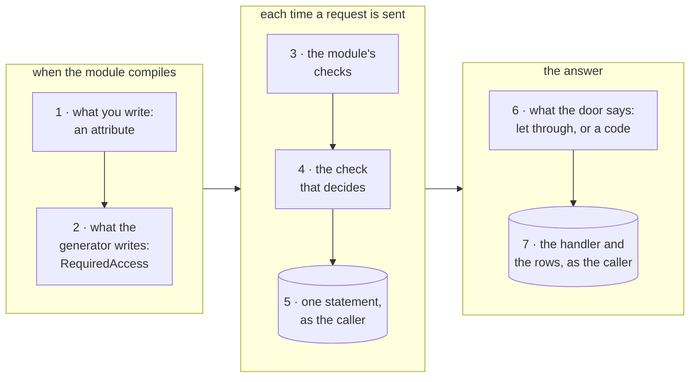
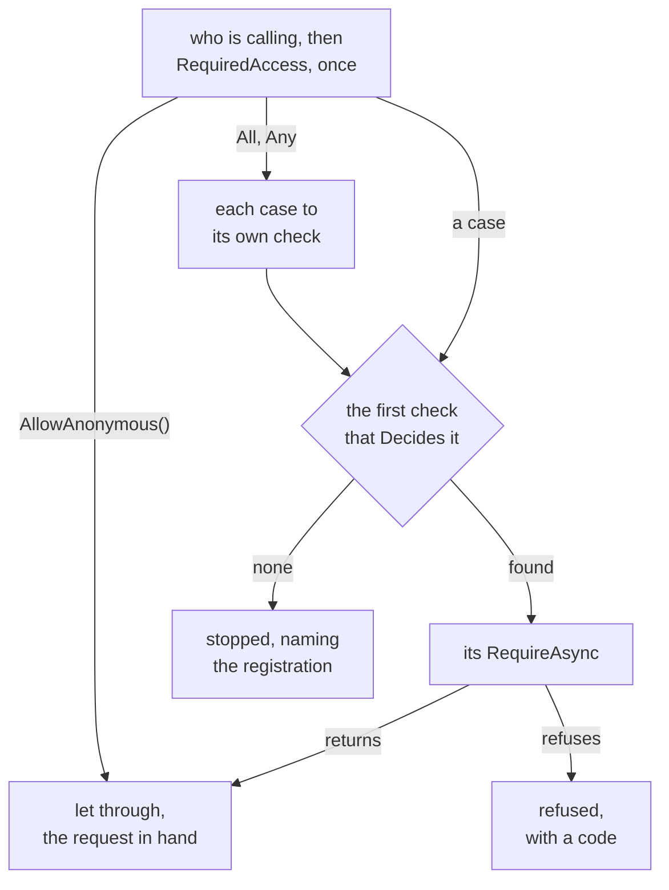
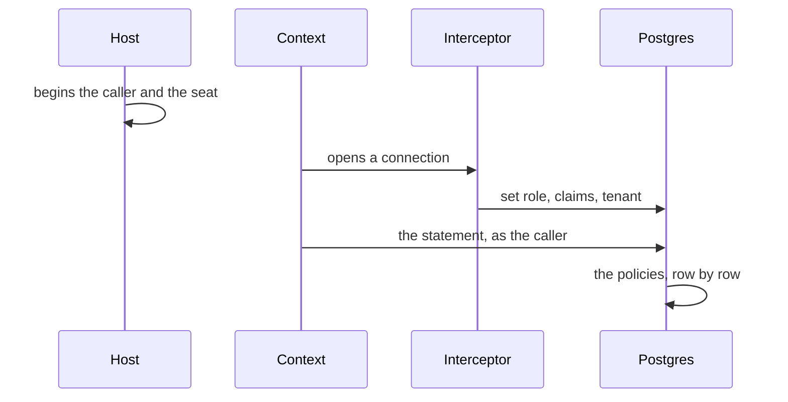
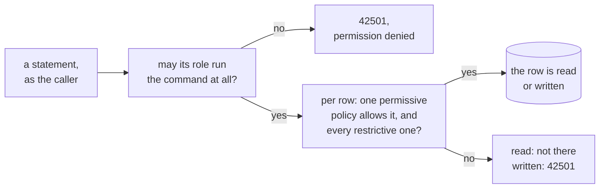
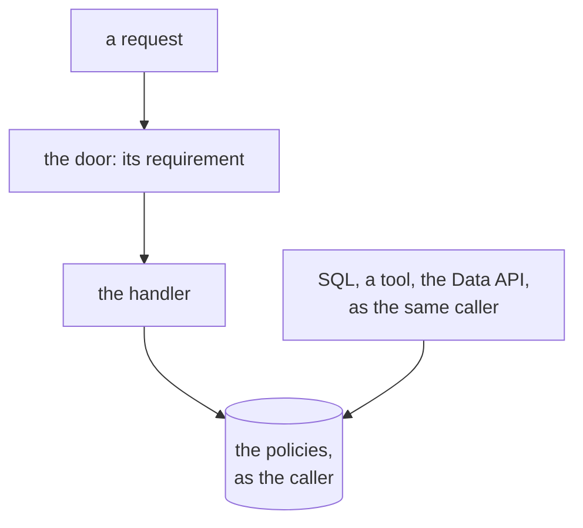
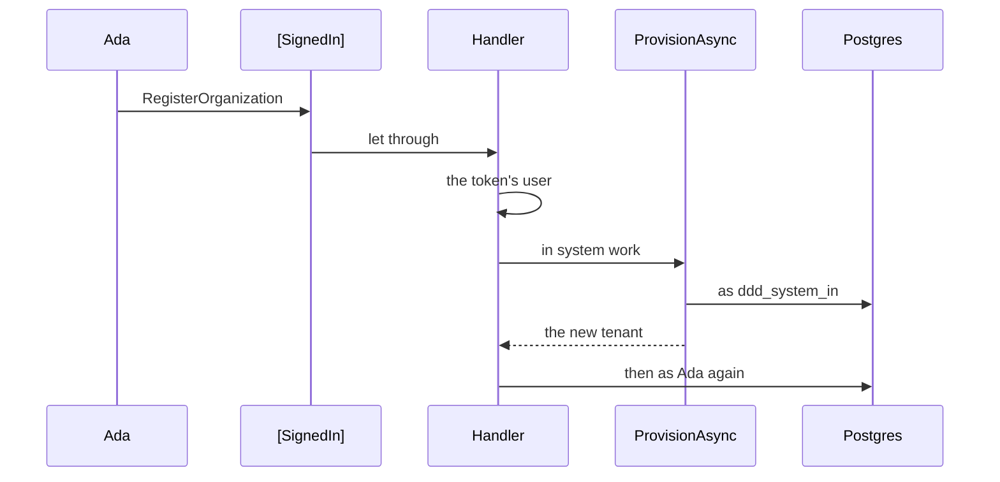

# How a request is checked

This page follows one request from the attribute written above it to the rows Postgres lets it touch. The other
pages explain each piece on its own: [Access requirements](access-requirements.md) the requirement and the checks,
[Row level security](row-level-security.md) the caller on the connection and the policies,
[Tenancy](tenancy.md) and [Membership](membership.md) the cases they decide. Here they are put in the order a
request meets them, for six requests, four of them the [Tenancy sample](../Examples/Tenancy)'s own, and six callers
of the sample's seed.

Three questions stand between a caller and a row, and each is answered in a place of its own:

- **Who may send the request.** The request states a requirement, and the module's checks hold the caller to it
  before the handler runs. This is the door.
- **With what rights the code runs.** The caller who sent the request, or system work, which trusted code begins
  on purpose around the work and which ends with it.
- **Which rows it may touch.** Every statement runs as that caller, and Postgres asks the policies of each table,
  row by row, whatever the code above it did.



The first two layers happen when the code compiles. The other five happen each time a request is sent: the checks
run in C#, before the handler; the statement they send and every statement the handler sends run in Postgres, as
the caller. A layer that has nothing to do is passed by: a requirement that reads nothing sends no statement, and a
request the door refused never reaches a table.

<details>
<summary>Show the code: one request through the seven layers</summary>

```csharp shortened
// 1. What you write: the sample's AddCrewMember, a permission on the project it names
[RequiresPermission(RequiredPermission)]
public sealed record AddCrewMember([OnResource] ProjectId Project, SeatId Seat, ProjectRoleId? Role, DateTimeOffset? Until, [ExpectedVersion] long? ExpectedVersion = null) : ICommand, IProjectsRequest;

// 2. What the generator writes into IProjectsRequest, when the module compiles
AddCrewMember request => MemberAccess.On("projects.crew.manage", request.Project, request.ExpectedVersion),

// 3 and 4. The behavior asks the module's checks; Membership's check decides MemberAccess<ProjectId>
await _checks.RequireAsync(message, cancellationToken);

// 5. One statement, as the caller: how the caller holds the permission on that project, and its version
// 6. Refused with the caller's own reason, projects.not-found, projects.not-permitted or a lost race; or let through
// 7. The handler saves the new crew member, and Postgres asks the policies of projects."ProjectCrewMembers"
```

</details>

## Six requests and six callers

The sample's seed has a tenant called **harbor**, Harbor Works. Its organization is a tree of units: the root, two
regions below it, North and South, and areas below those, North Coast among them. The project **Pier 7** sits at
North Coast; Leo owns it, and Juno and Vic are on its crew. **Bay bridge** sits at South Bay, and Juno is not on
its crew. Every request below is sent for harbor: its `Tenant` header names it, and the host looks up the caller's
seat there before anything else ([TenantHeader](../Examples/Tenancy/Examples.Tenancy.Host/Access/TenantHeader.cs)).

| Caller | Who it is | Runs on Postgres as |
|---|---|---|
| **Ada** | harbor's first administrator: Access admin and Area manager at the root, so she holds every permission in harbor | `authenticated` |
| **Juno** | a seat at North Coast with no role of the organization, and a surveyor on Pier 7's crew, which gives no permission to manage it | `authenticated` |
| **A new sign-in** | a person who signed in and has no seat in harbor | `authenticated` |
| **Orla** | one of the application's operators: her token carries the operators' role, and she has no seat anywhere | `tenancy_operator` |
| **Anonymous** | a request with no token | `anon` |
| **System work** | the application's own work in harbor, begun by trusted code with `TenancyUseCases.BeginSystemIn(harbor)`, in the scope of the module whose request it sends: `tenancy`, and `projects` for a request of Projects', the one the projects' rules let through | `ddd_system_in`, scope `tenancy` or `projects` |

| Request | What it does | What it requires | Where it is from |
|---|---|---|---|
| `OrganizationUnits` | lists the units the caller reads | `[InTenant]`: a seat in the tenant | the sample's Tenants module |
| `AddOrganizationUnit` | adds a unit below another | `[RequiresPermission(TenancyPermissions.UnitsManage)]`, `[AtUnit]` on the parent | the sample's Tenants module |
| `AddCrewMember` | puts a seat on a project's crew | `[RequiresPermission(RequiredPermission)]`, `[OnResource]` on the project, `[ExpectedVersion]` on the version read | the sample's Projects module |
| `RenameSeat` | gives a seat another name | `[RequiresPermission(RequiredPermission)]` with `[OrOwn]` on the seat: your own seat, or any with the permission | the sample's Tenants module |
| `TenantAuditLog` | reads a tenant's audit log | the property: an operator, or the permission that manages seats for the whole tenant | the audit log of [Access requirements](access-requirements.md#the-door-and-the-rows) |
| `RegisterOrganization` | makes a new tenant with the caller as its administrator | `[SignedIn]`, and system work the handler begins | the registration of [Tenancy](tenancy.md#who-may-ask-and-what-the-work-runs-as) |

Pick a request and a caller below, and follow each layer: what it does for that pair, the code it runs, and the
statement it sends.

<div data-interactive="RequestWalkthrough">

> [!TIP]
> On the [docs site](https://dylansnel.github.io/DDDToolkit/docs/how-a-request-is-checked) this is a walk-through
> you can click through: pick a request, a caller and a situation, and step through the seven layers. Everything
> it shows is on this page; [Every request, every caller](#every-request-every-caller) has its answers as tables.

</div>

The sample's routes ask for a seat before they send a request of a seated module, as a host may. The walk-through
starts where every way in ends, at the send: a route, a GraphQL field, a job or a test all reach the same door.

## 1. What you write

A request says who may send it, and nothing more. It says it with an attribute where the requirement reads no
value of the request but a permission and the ids it carries, which is nearly always, and with the property
`RequiredAccess` where the requirement is computed from its values or combines cases no stack of attributes says:
one caller or another, two permissions in two places.

So the sample's requests carry attributes. A marker on a member says where a permission is held: `[AtUnit]` at that
unit or above it, `[OnResource]` on that resource through its members, nothing for the whole tenant. `[OrOwn]` on
a seat makes the caller's own seat the other way in. The permission is a constant of the catalogue; a request may name
one of its own, as `RenameSeat` and `AddCrewMember` do, so its handler reads the same permission.

```csharp
[InTenant]
public sealed record OrganizationUnits : IQuery<IReadOnlyList<UnitListing>>, ITenantsRequest;

[RequiresPermission(TenancyPermissions.UnitsManage)]
public sealed record AddOrganizationUnit([AtUnit] OrganizationUnitId Parent, string Name, UnitKind? Kind) : ICommand<OrganizationUnitId>, ITenantsRequest;

[RequiresPermission(RequiredPermission)]
public sealed record RenameSeat([OrOwn] SeatId Seat, string? DisplayName) : ICommand, ITenantsRequest
{
    public const string RequiredPermission = TenancyPermissions.SeatsManage;
}
```

```csharp
[RequiresPermission(RequiredPermission)]
public sealed record AddCrewMember([OnResource] ProjectId Project, SeatId Seat, ProjectRoleId? Role, DateTimeOffset? Until, [ExpectedVersion] long? ExpectedVersion = null) : ICommand, IProjectsRequest
{
    public const string RequiredPermission = ProjectPermissionNames.ManageCrew;
}
```

The other two are the examples of [Access requirements](access-requirements.md#the-door-and-the-rows) and
[Tenancy](tenancy.md#who-may-ask-and-what-the-work-runs-as), not the sample's. The audit log lets one caller or
another through, so it answers the property; the registration lets any signed-in person through, and its handler
begins the system work that makes the tenant ([System work: a scope, and back](#system-work-a-scope-and-back)):

```csharp
public sealed record TenantAuditLog(TenantId Tenant, PagingArguments Paging) : IQuery<Page<AuditEntry>>, IAuditRequest
{
    AccessRequirement IRequireAccess.RequiredAccess => AccessRequirement.Any(
        TenancyAccess.RequiresOperator(),
        TenancyAccess.AtTenant(TenancyPermissions.SeatsManage));
}

[SignedIn]
public sealed record RegisterOrganization(string Slug, string Name, string AdministratorName) : ICommand<TenantId>, ITenantsRequest;
```

Each attribute stands for one call, and the property says the same as that call. Written as the property, the
sample's four and the registration would read as below. The sample does not write them so: its `AccessDeclarationTests` hold a request
that answers the property to what no attribute says, so a reviewer reads one way of saying each thing.

```csharp
public sealed record OrganizationUnits : IQuery<IReadOnlyList<UnitListing>>, ITenantsRequest
{
    AccessRequirement IRequireAccess.RequiredAccess => TenancyAccess.InTenant();
}

public sealed record AddOrganizationUnit(OrganizationUnitId Parent, string Name, UnitKind? Kind) : ICommand<OrganizationUnitId>, ITenantsRequest
{
    AccessRequirement IRequireAccess.RequiredAccess => TenancyAccess.AtUnit(TenancyPermissions.UnitsManage, Parent);
}

public sealed record RenameSeat(SeatId Seat, string? DisplayName) : ICommand, ITenantsRequest
{
    AccessRequirement IRequireAccess.RequiredAccess => AccessRequirement.Any(
        AccessRequirement.Own(Seat),
        TenancyAccess.AtTenant(TenancyPermissions.SeatsManage));
}

public sealed record AddCrewMember(ProjectId Project, SeatId Seat, ProjectRoleId? Role, DateTimeOffset? Until, long? ExpectedVersion = null) : ICommand, IProjectsRequest
{
    AccessRequirement IRequireAccess.RequiredAccess => MemberAccess.On(ProjectPermissionNames.ManageCrew, Project, ExpectedVersion);
}

public sealed record RegisterOrganization(string Slug, string Name, string AdministratorName) : ICommand<TenantId>, ITenantsRequest
{
    AccessRequirement IRequireAccess.RequiredAccess => AccessRequirement.SignedIn();
}
```

## 2. What the generator writes

An attribute is plain C# by the time the code runs. When the module compiles, the toolkit's generator reads every
request of the module's interface and writes one line for each that states its requirement with attributes, the
call the attributes stand for, into the interface itself, which is declared `partial` for that reason. The lines
are one `switch` on the request's type, and they are the interface's implementation of `RequiredAccess`: a default
every request of the module gets.

A request that answers the property itself gets no line. C# takes a class's own implementation over the
interface's default, so `TenantAuditLog` answers with its own, and every reader of the property reads the same
requirement either way: the checks, a handler that asks them again, a test. A request the switch does not know, one
of another project that states nothing, is the last arm, and is stopped: a requirement somebody forgot never opens
a door. A module that says a [default](access-requirements.md#a-modules-default) on its interface, as the sample's
Projects module says `[InTenant]`, gets a line with the default for each request that states nothing, and a last arm
that answers the default too.

The two blocks below are what the generator writes for this page's requests. The registration is among them, as a
request of `ITenantsRequest`, so its line is one the sample's own file does not have.

```csharp title="TenantsAccessBehavior.g.cs for this page's requests, the interface's part, shortened"
using DDDToolkit_Generated_IRequireAccess = global::DDDToolkit.Access.IRequireAccess;

namespace Examples.Tenancy.Tenants.Application.Access;

// What the requests of ITenantsRequest that state their requirement with attributes require of their caller: the
// call each attribute stands for, written out by DDDToolkit, one line per request. A request that answers
// RequiredAccess itself answers with its own, which C# takes over this one, so it is never asked here.
partial interface ITenantsRequest
{
    AccessRequirement DDDToolkit_Generated_IRequireAccess.RequiredAccess => this switch
    {
        AddOrganizationUnit request => TenancyAccess.AtUnit("tenancy.units.manage", request.Parent),
        OrganizationUnits => TenancyAccess.InTenant(),
        RegisterOrganization => AccessRequirement.SignedIn(),
        RenameSeat request => AccessRequirement.Any(AccessRequirement.Own(request.Seat), TenancyAccess.AtTenant("tenancy.seats.manage")),
        // ... a line for each of the module's other requests that state their requirement with attributes
        _ => throw new InvalidOperationException(
            this.GetType().FullName + " declares no access requirement: it carries no requirement attribute, and does not answer RequiredAccess itself. "
            + "A request that declares nothing lets nobody through."),
    };
}
```

```csharp title="ProjectsAccessBehavior.g.cs for this page's requests, the interface's part, shortened"
partial interface IProjectsRequest
{
    AccessRequirement DDDToolkit_Generated_IRequireAccess.RequiredAccess => this switch
    {
        AddCrewMember request => MemberAccess.On("projects.crew.manage", request.Project, request.ExpectedVersion),
        // ... the module's other lines, and a last arm that answers the module's default, TenancyAccess.InTenant()
    };
}
```

Nothing is read by reflection and nothing is looked up when a request is sent. Stacked attributes become
`AccessRequirement.All` of their calls, in the order they are written, and `[OrOwn]` becomes `Any` of the caller's
own and the permission ([Yours, or the permission](access-requirements.md#yours-or-the-permission)). Where the project uses Mediator the
same file holds the pipeline behavior, which asks the module's checks before every handler of the interface; it
reads the property, so it never knows which way a request said it.

<details>
<summary>Show the code: the behavior the same file holds</summary>

```csharp title="TenantsAccessBehavior.g.cs, the behavior, shortened"
public sealed class TenantsAccessBehavior<TMessage, TResponse> : IPipelineBehavior<TMessage, TResponse>
    where TMessage : notnull, ITenantsRequest, IMessage
{
    private readonly AccessChecks<ITenantsRequest> _checks;

    public async ValueTask<TResponse> Handle(TMessage message, MessageHandlerDelegate<TMessage, TResponse> next, CancellationToken cancellationToken)
    {
        await _checks.RequireAsync(message, cancellationToken).ConfigureAwait(false);
        return await next(message, cancellationToken).ConfigureAwait(false);
    }
}

public static class TenantsAccessBehaviorRegistration
{
    public static IServiceCollection AddTenantsAccessBehavior(this IServiceCollection services)
    {
        AccessCheckServiceCollectionExtensions.AddAccessChecks<ITenantsRequest>(services);
        // ... and the behavior, put in the pipeline of every message of the interface
    }
}
```

</details>

## 3. The module's checks

A module's requests are held to the checks of the module's interface, and to no other module's: the set is
`AccessChecks<TRequests>`, one per interface, made once per scope. A check is registered for an interface, so the
same check registered for two modules is two entries, and the container keeps them apart by the interface they are
for. The core's `CallerAccessCheck` comes first in every set, so the cases about who is calling mean the same
everywhere; the checks a module adds follow, in the order they were added.

| The Tenants module's set, for `ITenantsRequest` | Added by | Decides |
|---|---|---|
| `CallerAccessCheck` | every set, first | `SignedIn()`, `Own(value)`, `OwnerOf(id)` |
| `TenancyAccessCheck` over `TenantsContext` | `services.AddTenancyAccess<ITenantsRequest, TenantsContext>()` | every `TenancyRequirement` |

| The Projects module's set, for `IProjectsRequest` | Added by | Decides |
|---|---|---|
| `CallerAccessCheck` | every set, first | `SignedIn()`, `Own(value)`, `OwnerOf(id)` |
| `TenancyAccessCheck` over `ProjectsContext` | `services.AddTenancyAccess<TenantId, SeatId, OrganizationUnitId, RoleId, IProjectsRequest, ProjectsContext>()` | every `TenancyRequirement` |
| `MemberAccessCheck<Project, ProjectId>` | `services.AddProjectMemberAccess<IProjectsRequest>()`, generated for the project's members | `MemberAccess<ProjectId>`: `On`, `Sees`, `SeenWith` |
| `ProjectsAccessCheck` | `services.AddAccessCheck<IProjectsRequest, ProjectsAccessCheck>()` | `ProjectsRequirement`, the module's own case |

Each check says what it decides with a type test on the requirement, `requirement is TenancyRequirement`, which
reads nothing. The set asks them in order and gives the requirement to the first that says yes. Three things are
the set's own:

- **Who is calling, first.** Before any check, the set asks the host's `ICallerAccessor` who is calling. In a host
  that [requires explicit callers](row-level-security.md#fail-closed-callers), work nobody began a caller for fails
  there, whatever the request requires.
- **Anyone, by asking nobody.** `AccessRequirement.AllowAnonymous()`, what `[AllowAnonymous]` stands for, is let
  through by the set itself.
- **Combinations, case by case.** `All` and `Any` are decided by asking each case of the check that decides it
  alone, so cases of different owners combine: the caller's own of the core's with a permission of Tenancy's. Every case
  must have its check before any is asked.

A requirement no check decides is not let through: the set stops the request with an exception that names the
registration that is missing, `AddTenancyAccess` for one of Tenancy's cases. Once a check lets the request through,
the request is [in hand](access-requirements.md#the-request-in-hand) for the handler that runs next and the save
it ends with.



<details>
<summary>Show the code: how the set is made and asked</summary>

```csharp shortened
// AddAccessChecks<TRequests>, the core's: the set of one interface, made per scope, the core's check first
services.TryAddScoped(provider => new AccessChecks<TRequests>(
    provider.GetServices<RegisteredAccessCheck<TRequests>>()
        .Select(registered => registered.Check)
        .Prepend(new CallerAccessCheck(callers, provider))));

// AddAccessCheck<TRequests, TCheck>, which a package's registration calls for the interface it is given
services.TryAddScoped<TCheck>();
services.TryAddEnumerable(ServiceDescriptor.Scoped<RegisteredAccessCheck<TRequests>, RegisteredAccessCheck<TRequests, TCheck>>());
```

```csharp shortened
// AccessChecks<TRequests>.RequireAsync, shortened
_callers?.AskWhoIsCalling();                                     // NoCallerException where nobody was begun

var requirement = request.RequiredAccess
    ?? throw new InvalidOperationException("... declares no access requirement ...");

var check = requirement switch
{
    AccessRequirement.Anyone => null,                            // let through by asking nobody
    AccessRequirement.Combined combined => new CombinedAccessCheck(CheckedCases(request, combined)),
    _ => CheckFor(requirement) ?? throw NothingDecides(request, requirement),
};

return RequestInHand.Take(request, requirement, check, cancellationToken);   // asks the check; in hand once it passed
```

</details>

## 4. The check that decides

Each case belongs to whoever can decide it, and each check asks the caller before it reads anything: a caller that
is nobody in the tenant is refused with its own reason, without a statement made for it. Only four cases read.

| The case | Its check | What it reads | Refused with |
|---|---|---|---|
| `SignedIn()` | the core's `CallerAccessCheck` | nothing: the caller's token | `access.not-signed-in`, 403 |
| `Own(seat)` | the core's `CallerAccessCheck` | nothing: the caller's seat in the tenant, found when the request came in | `access.not-own`, 403 |
| `OwnerOf(board)` | the core's `CallerAccessCheck` | one statement, the storage's: the owner's column of the one row, as the caller; nothing for a caller with no own of the owner's type | `access.not-own`, 403; `access.not-found`, 404, for a row the caller does not see ([The owner of an aggregate](access-requirements.md#the-owner-of-an-aggregate)) |
| `InTenant()` | Tenancy's | nothing: the seat, found when the request came in | the caller's own reason, such as `tenancy.not-seated`, 403 |
| `AtTenant(permission)` | Tenancy's | one statement: the permission at the tenant's root, for a seat; nothing for system work in the tenant, which holds every permission there | `tenancy.not-permitted` with the permission, 403 |
| `AtUnit(permission, unit)` | Tenancy's | one statement: the permission at the unit or above it, for a seat; for system work in the tenant, whether the unit is the tenant's | `tenancy.not-permitted` with the permission and the unit, 403 |
| `RequiresOperator()` | Tenancy's | nothing: the token's role | `tenancy.operators-only`, 403 |
| `On(permission, project, version)` | Membership's | one statement: the project as the caller sees it, how the caller holds the permission there, and its version; nothing for a caller who is nobody | the caller's own reason for nobody; `projects.not-found`, 404, for a project the caller does not see; `projects.not-permitted` with the permission, 403; then a lost race, 409 |
| `All(...)`, `Any(...)` | the set, case by case | what each case reads, in order, until it is decided | for `All` the first failing case's own; for `Any` one `access.refused` with each case's reason, 403 |

Membership's order is the same for every request: nobody, then not found, then not permitted, then the version.
So a caller who does not see a project learns nothing about it, not even that it exists, and only a caller who may
act learns that somebody changed it since they read it. What the check read it keeps for the request: a save under
[the expert hold](membership.md#the-expert-hold) is held to it.

<details>
<summary>Show the code: the core's check, Tenancy's, Membership's and the combinations'</summary>

```csharp shortened
// CallerAccessCheck, the core's, shortened: who is calling, with nothing read
public bool Decides(AccessRequirement requirement)
    => requirement is AccessRequirement.SignedInUser || (requirement is IOwnedRequirement owned && owned.CanBeAnswered(services));

switch (requirement)
{
    case AccessRequirement.SignedInUser:
        if (!callers.Current.IsSignedIn)                         // a token that names a user
            throw ToolkitRefusals.Refuse(ToolkitRefusals.NotSignedIn);
        return;
    case IOwnedRequirement owned:                                // the request names the value, never whose it is
        if (!owned.IsTheCallers(callers.Current, services))
            throw ToolkitRefusals.Refuse(ToolkitRefusals.NotOwn);
        return;
}
```

```csharp shortened
// TenancyAccessCheck, Tenancy.EntityFramework, shortened
public bool Decides(AccessRequirement requirement) => requirement is TenancyRequirement;

switch (requirement)
{
    case TenancyRequirement.InTenant:
        answers.RequireTenant();                                 // a seat here, or system work here
        break;
    case TenancyRequirement.AtTenant required:
        answers.RequireTenant();                                 // nobody is refused without a statement
        if (!await HoldsAtTenantAsync(required.Permission, cancellationToken))
            throw TenancyRefusals.Refuse(TenancyRefusals.NotPermitted, ("Permission", required.Permission));
        break;
    case TenancyRequirement.AtUnit<TUnitId> required:
        answers.RequireTenant();
        if (!await HoldsAtAsync(required.Permission, required.Unit, cancellationToken))
            throw TenancyRefusals.Refuse(TenancyRefusals.NotPermitted, ("Permission", required.Permission), ("Unit", required.Unit));
        break;
    case TenancyRequirement.Operator:
        if (!options.IsOperator(callers.Current))                // the token's role, never a seat
            throw TenancyRefusals.Refuse(TenancyRefusals.OperatorsOnly);
        break;
    default:
        throw new InvalidOperationException("... which Tenancy's access check does not decide ...");
}
```

```csharp shortened
// MemberAccessCheck<Project, ProjectId>, Membership, the case of a permission on a project, shortened
public bool Decides(AccessRequirement requirement) => requirement is MemberAccess<ProjectId>;

case MemberAccess<ProjectId>.On required:
    var hold = await access.RequireAsync(required.Resource, required.Permission, cancellationToken);
    //   nobody                         -> the caller's own refusal, tenancy.not-seated
    //   does not see the project       -> projects.not-found
    //   sees it, does not hold the permission -> projects.not-permitted
    if (required.ExpectedVersion is { } expected && expected != hold.Version)
        throw new ConcurrencyConflictException(typeof(Project), required.Resource);    // 409, only now
    kept.KeepFor(request, hold);                                 // what the save is held to
    break;
```

```csharp shortened
// CombinedAccessCheck, the core's, shortened: Any lets the first case that holds decide
case AccessRequirement.AnyOf any:
    var reasons = new List<RefusalReason>();
    foreach (var each in any.Cases)
    {
        try { await Require(each, request, cancellationToken); return; }   // the first that lets the caller through
        catch (RefusalException refused) { reasons.Add(RefusalReason.From(refused)); }
    }
    throw ToolkitRefusals.NoneMet(reasons);                      // one access.refused, every reason in it
case AccessRequirement.AllOf all:
    foreach (var each in all.Cases)
        await Require(each, request, cancellationToken);         // in order; the first refusal is the answer
    return;
```

</details>

## 5. The statement at the door

A check that reads sends one statement, over the module's own context, and the statement runs as the caller, like
every other: it is held to the policies too. Tenancy answers its two questions from its read model: `SeatRights`,
which holds for each seat the permissions its grants give at each unit, and `OrganizationUnitPaths`, the closure table of
the tree, which holds every pair of a unit and a unit at or below it, so "at North Coast or above it" is one join and no
walk up the tree. Membership answers from the rules of the resource, written as one expression: as a member of
the crew in a role that gives the permission, as its owner, or from above, the permission held where the project sits; and,
around it, whether the caller sees the project at all.

What Entity Framework sends is written when the statement runs, from the questions' LINQ, so the SQL on this page
is approximately what it sends, with parameter names of its own. The permission at North Coast or above it is one join
on the closure table:

```sql shortened
-- HoldsAtAsync: the permission at the unit or above it, approximately what Entity Framework sends
SELECT EXISTS (
    SELECT 1 FROM "tenancy"."SeatRights" AS r
    INNER JOIN "tenancy"."OrganizationUnitPaths" AS p ON r."UnitId" = p."AncestorId"
    WHERE r."TenantId" = @tenant AND r."SeatId" = @seat AND r."Permission" = @permission
      AND r."StartsAt" <= @now AND (r."EndsAt" IS NULL OR r."EndsAt" > @now)
      AND p."TenantId" = @tenant AND p."DescendantId" = @unit)
```

<details>
<summary>Show the code: Tenancy's two questions, Membership's, and the SQL each sends</summary>

```csharp shortened
// TenancyQuestions, shortened: the two questions a check asks
public Task<bool> HoldsAtTenantAsync(string permission, CancellationToken cancellationToken)
    => executor.AnyAsync(
        from right in source.SeatRights
        where right.TenantId.Equals(tenant) && right.SeatId.Equals(seat) && right.Permission == permission
              && right.StartsAt <= now && (right.EndsAt == null || right.EndsAt > now)
        join root in source.Units on right.UnitId equals root.Id
        where root.TenantId.Equals(tenant) && !root.ParentId.HasValue
        select right.Permission,
        cancellationToken);

public Task<bool> HoldsAtAsync(string permission, TUnitId unit, CancellationToken cancellationToken)
    => executor.AnyAsync(UnitsWhereIHold(permission).Where(held => held.Equals(unit)), cancellationToken);
```

```sql shortened
-- HoldsAtTenantAsync: the permission at the tenant's root, approximately what Entity Framework sends
SELECT EXISTS (
    SELECT 1 FROM "tenancy"."SeatRights" AS r
    INNER JOIN "tenancy"."OrganizationUnits" AS root ON r."UnitId" = root."Id"
    WHERE r."TenantId" = @tenant AND r."SeatId" = @seat AND r."Permission" = @permission
      AND r."StartsAt" <= @now AND (r."EndsAt" IS NULL OR r."EndsAt" > @now)
      AND root."TenantId" = @tenant AND root."ParentId" IS NULL)
```

```sql shortened
-- HoldsAtAsync for system work in the tenant: every permission there, at a unit of the tenant, approximately
SELECT EXISTS (SELECT 1 FROM "tenancy"."OrganizationUnits" AS u WHERE u."TenantId" = @tenant AND u."Id" = @unit)
```

```sql shortened
-- EfMemberQuestions.HoldAsync: the project as the caller sees it, and how the permission is held, approximately
SELECT p."Version",
       EXISTS (SELECT 1 FROM "projects"."ProjectCrewMembers" AS m                 -- on the crew now,
               WHERE m."ProjectId" = p."Id" AND m."SeatId" = @seat
                 AND EXISTS (SELECT 1 FROM "projects"."ProjectCrewRoleGrants" AS h   -- in a role that gives the permission
                             INNER JOIN "projects"."ProjectRoles" AS k ON h."RoleId" = k."Id"
                             WHERE h."CrewMemberId" = m."Id" AND k."Status" = 'Active' AND @permission = ANY (k."Permissions")))
         OR p."OwnerSeatId" = @seat AS "AsMember",                                 -- or its owner
       p."UnitId" IN (SELECT path."DescendantId" FROM "tenancy".caller_permissions() AS r   -- or the permission where it sits
                      INNER JOIN "tenancy".tenant_unit_paths() AS path ON r."UnitId" = path."AncestorId"
                      WHERE r."SeatId" = @seat AND r."Permission" = @permission) AS "FromAbove"
FROM "projects"."Projects" AS p
WHERE p."Id" = @project
  AND (/* the caller sees it: on the crew, its owner, or projects.view where it sits */)
LIMIT 1
-- no row: projects.not-found; a row whose AsMember and FromAbove are both false: projects.not-permitted
```

```sql shortened
-- EfMemberQuestions.HoldAsync for the application's own work: every permission, so only the project and its version
SELECT p."Version" FROM "projects"."Projects" AS p WHERE p."Id" = @project LIMIT 1
```

The periods are left out of the crew's part: a crew member and a role count from their start to their end,
compared with now, as a grant does. The Projects module reads Tenancy through functions,
`"tenancy".caller_permissions()` and the others, rather than its tables ([Modules read through
functions](tenancy.md#modules-read-through-functions)); `caller_permissions()` runs as the caller, so a seat reads its
own rights and nobody else's.

</details>

### The caller on the connection

Every statement says who it runs as before it runs. The host begins the caller when a request comes in: the
toolkit's caller from the validated token, and Tenancy's caller, the seat that identity has in the tenant the
request names. When a context opens a connection, the row level security interceptor sets the database role and the
token's claims on it, the way PostgREST does for each request, and Tenancy's tenant beside them, in one statement.
Through a pooler that hands each transaction another server connection it sets them for each transaction instead
([How the settings travel](row-level-security.md#how-the-settings-travel)).



What the policies read comes from those settings: `auth.uid()` and `auth.jwt()` read the claims, the policies for
a role are the ones Postgres asks, and `"tenancy".system_tenant()` reads Tenancy's setting. `"tenancy".caller_seat()` finds the seat from the verified identity and
that tenant, and only an active one in an active tenant, so a wrong tenant reaches no seat.

```sql shortened
-- the caller on the connection, as the interceptor sets it for each of the six; … is the rest of the statement
SELECT set_config('role', 'authenticated', false), set_config('request.jwt.claims', '{"sub":"<Ada>","role":"authenticated",…}', false), …, set_config('tenancy.caller_tenant', '<harbor>', false);
SELECT set_config('role', 'authenticated', false), set_config('request.jwt.claims', '{"sub":"<Juno>","role":"authenticated",…}', false), …, set_config('tenancy.caller_tenant', '<harbor>', false);
SELECT set_config('role', 'authenticated', false), set_config('request.jwt.claims', '{"sub":"<the new sign-in>","role":"authenticated",…}', false), …, set_config('tenancy.caller_tenant', '', false);
SELECT set_config('role', 'tenancy_operator', false), set_config('request.jwt.claims', '{"sub":"<Orla>","role":"tenancy_operator",…}', false), …, set_config('tenancy.caller_tenant', '', false);
SELECT set_config('role', 'anon', false), set_config('request.jwt.claims', '{"role":"anon"}', false), …, set_config('tenancy.caller_tenant', '', false);
SELECT set_config('role', 'ddd_system_in', false), set_config('request.jwt.claims', '{"role":"ddd_system_in","scope":"tenancy"}', false), …, set_config('tenancy.caller_tenant', '<harbor>', false);
```

<details>
<summary>Show the code: where the caller is begun, and the function that finds the seat</summary>

```csharp shortened
// The sample's TenantHeader.UseTenantSelection, shortened: both callers begun for the request
var caller = context.GetSupabaseCaller();                         // from the validated token, or anonymous
using (Callers.Begin(caller))
{
    var seat = await selection.ResolveAsync(caller, context.Request.Headers["Tenant"], context.RequestAborted);
    using (TenancyCallers.Begin(seat))                            // the seat in harbor, or nobody and why
    {
        await next(context);
    }
}
```

```sql title="20261026210726_access.tenants.ddd.sql, the caller's seat and tenant, shortened"
CREATE OR REPLACE FUNCTION "tenancy".system_tenant() RETURNS uuid
    LANGUAGE sql STABLE SET search_path = '' AS $function$
SELECT nullif(pg_catalog.current_setting('tenancy.caller_tenant', true), '')::pg_catalog.uuid
$function$;
CREATE OR REPLACE FUNCTION "tenancy".caller_seat() RETURNS uuid
    LANGUAGE sql STABLE SECURITY DEFINER SET search_path = '' AS $function$
SELECT s."Id" FROM "tenancy"."Seats" s
JOIN "tenancy"."Tenants" t ON t."Id" = s."TenantId"
WHERE s."Identity" = (SELECT auth.uid())
  AND s."TenantId" = (SELECT "tenancy".system_tenant())
  AND s."Status" = 'Active' AND t."Status" = 'Active'
$function$;
CREATE OR REPLACE FUNCTION "tenancy".caller_tenant() RETURNS uuid
    LANGUAGE sql STABLE SECURITY DEFINER SET search_path = '' AS $function$
SELECT s."TenantId" FROM "tenancy"."Seats" s WHERE s."Id" = (SELECT "tenancy".caller_seat())
$function$;
```

</details>

## 6. What the door says

A check that returns lets the request through, and the handler runs next, with the request in hand. A check that
refuses throws a refusal: a code, a kind, and arguments such as the permission. The edge turns the kind into a status, 403
for not permitted, 404 for not found, 409 for a lost race, and the code is what a client reads. The handler of a
refused request does not run, so nothing it would read or write reaches a table.

```json
{
  "status": 403,
  "code": "access.refused",
  "title": "Access to this was refused.",
  "arguments": {
    "Reasons": [
      { "code": "access.not-own", "arguments": {} },
      { "code": "tenancy.not-permitted", "arguments": { "Permission": "tenancy.seats.manage" } }
    ]
  }
}
```

That is Juno renaming Leo's seat: neither way in holds, so `Any` answers once, with both reasons. The door is not the
only refusal a caller meets. A handler, or the use case of the package it calls, refuses what only it can read:
the sample's `AddCrewMember` handler refuses a seat that is not active, Tenancy's provisioning refuses everyone but
system work. And the database refuses a row its policies do not allow, after the door let the request through.

## 7. The handler and the rows

The handler acts on what the request names, which is what the door checked: the parent unit, the project, the
seat. Its statements run as the same caller. Postgres first asks whether the caller's role may run the command on
the table at all, its privileges, and then, for each row, the policies of the table for that role. A row passes
when one permissive policy allows it, and every restrictive policy as well: the permissive ones say who may, and
the restrictive ones narrow that, as Tenancy's keep every row to the caller's tenant. The policies come from row
access rules, the packages' own and those a module writes in C# beside its infrastructure, and are exported into
`supabase/migrations` with the functions they ask and the privileges they need
([Row access rules written in C#](row-level-security.md#row-access-rules-written-in-c)).



The policies decide per table and the door per request, so a policy may let through more than one request
requires. Tenancy's policy on the seats lets a seat change its own row, and a seat that manages seats or grants
anywhere in the tenant change any, because every save of a seat writes its version; the sample holds the name to
`RenameSeat`'s own rule with a [column rule](row-level-security.md#column-rules), a trigger on that one column.
Every member of a tenant reads all its units through Tenancy's policy, while the sample's directory lists only the
units a seat is placed in and below: the tree is the organization's, and Tenancy's questions read it as their caller,
so it has no narrower default to replace, as the seats have
([Who reads the seats: a default you may replace](tenancy.md#who-reads-the-seats-a-default-you-may-replace)).

The policies below are the sample's, as its export wrote them, with the schemas quoted, as everywhere the toolkit
writes SQL. A unit is added below a parent where the caller holds the permission that manages units, the same permission at the
same unit the door asked about:

```sql title="20261026210726_access.tenants.ddd.sql, the units' insert policy, shortened"
CREATE POLICY "Unit managers add below their units (insert) for authenticated" ON "tenancy"."OrganizationUnits" FOR INSERT TO authenticated
    WITH CHECK (("TenantId" = (SELECT "tenancy".caller_tenant())) AND ("ParentId" = ANY (ARRAY(SELECT "tenancy".units_where_i_hold_permission('tenancy.units.manage')))));
```

The Supabase export writes each table's privileges from the same policies: a role gets each command one permissive
policy for it allows, and `USAGE` on the schemas of those tables, and no more
([Privileges from the policies](row-level-security.md#privileges-from-the-policies)). So a role no permissive
policy lets write a table may not write it at all, and a role no permissive policy of a schema is for may not use
that schema: Postgres refuses the statement with 42501, `permission denied`, before it asks a policy.

<details>
<summary>Show the code: the policies and functions the export writes for the units, the seats, the crew and the audit log</summary>

```sql title="20261026210726_access.tenants.ddd.sql, the units' other policies and the function they ask, shortened"
CREATE OR REPLACE FUNCTION "tenancy".units_where_i_hold_permission(permission text) RETURNS SETOF uuid
    LANGUAGE sql STABLE SECURITY DEFINER SET search_path = '' AS $function$
SELECT DISTINCT p."DescendantId" FROM "tenancy"."SeatRights" r
JOIN "tenancy"."OrganizationUnitPaths" p ON p."AncestorId" = r."UnitId" AND p."TenantId" = r."TenantId"
WHERE r."SeatId" = (SELECT "tenancy".caller_seat()) AND r."Permission" = $1 AND "tenancy".permission_is_live($1)
  AND r."StartsAt" <= pg_catalog.now() AND (r."EndsAt" IS NULL OR r."EndsAt" > pg_catalog.now())
$function$;
CREATE POLICY "Members read the units (select) for authenticated" ON "tenancy"."OrganizationUnits" FOR SELECT TO authenticated
    USING ("TenantId" = (SELECT "tenancy".caller_tenant()));
CREATE POLICY "System work reads its tenant (select) for ddd_system_in" ON "tenancy"."OrganizationUnits" FOR SELECT TO ddd_system_in
    USING ("TenantId" = (SELECT "tenancy".system_tenant()));
CREATE POLICY "Operators read every tenant (select) for tenancy_operator" ON "tenancy"."OrganizationUnits" FOR SELECT TO tenancy_operator
    USING (true);
CREATE POLICY "Tenancy work writes its tenant (insert) for ddd_system_in" ON "tenancy"."OrganizationUnits" FOR INSERT TO ddd_system_in
    WITH CHECK (("TenantId" = (SELECT "tenancy".system_tenant())) AND ((SELECT auth.jwt() ->> 'scope') = 'tenancy'));
CREATE POLICY "Closed to anonymous callers (all) for anon" ON "tenancy"."OrganizationUnits" AS RESTRICTIVE FOR ALL TO anon
    USING (false)
    WITH CHECK (false);
```

```sql title="20261026210726_access.tenants.ddd.sql, the seats and the name's column rule, shortened"
CREATE OR REPLACE FUNCTION "tenancy".holds_at_tenant(permission text) RETURNS boolean
    LANGUAGE sql STABLE SECURITY DEFINER SET search_path = '' AS $function$
SELECT EXISTS (SELECT 1 FROM "tenancy"."SeatRights" r
               JOIN "tenancy"."OrganizationUnits" u ON u."Id" = r."UnitId" AND u."TenantId" = r."TenantId"
               WHERE r."SeatId" = (SELECT "tenancy".caller_seat()) AND r."Permission" = $1 AND "tenancy".permission_is_live($1) AND r."StartsAt" <= pg_catalog.now() AND (r."EndsAt" IS NULL OR r."EndsAt" > pg_catalog.now())
                 AND u."ParentId" IS NULL)
$function$;
CREATE POLICY "Managers and the seat change it (update) for authenticated" ON "tenancy"."Seats" FOR UPDATE TO authenticated
    USING (("TenantId" = (SELECT "tenancy".caller_tenant())) AND ((SELECT "tenancy".holds_permission('tenancy.seats.manage')) OR (SELECT "tenancy".holds_permission('tenancy.grants.manage')) OR "Id" = (SELECT "tenancy".caller_seat())))
    WITH CHECK (("TenantId" = (SELECT "tenancy".caller_tenant())) AND ((SELECT "tenancy".holds_permission('tenancy.seats.manage')) OR (SELECT "tenancy".holds_permission('tenancy.grants.manage')) OR "Id" = (SELECT "tenancy".caller_seat())));
CREATE POLICY "Tenancy work writes its tenant (update) for ddd_system_in" ON "tenancy"."Seats" FOR UPDATE TO ddd_system_in
    USING (("TenantId" = (SELECT "tenancy".system_tenant())) AND ((SELECT auth.jwt() ->> 'scope') = 'tenancy'))
    WITH CHECK (("TenantId" = (SELECT "tenancy".system_tenant())) AND ((SELECT auth.jwt() ->> 'scope') = 'tenancy'));
CREATE OR REPLACE FUNCTION "tenancy".seats_displayname_column_rule() RETURNS trigger
    LANGUAGE plpgsql SET search_path = '' AS $body$
BEGIN
    IF CURRENT_USER = 'authenticated' THEN
        IF ((OLD."Id" = (SELECT "tenancy".caller_seat())) OR (SELECT "tenancy".holds_at_tenant('tenancy.seats.manage'))) IS NOT TRUE OR (OLD."Id" IS DISTINCT FROM NEW."Id" AND ((NEW."Id" = (SELECT "tenancy".caller_seat())) OR (SELECT "tenancy".holds_at_tenant('tenancy.seats.manage'))) IS NOT TRUE) THEN
            RAISE EXCEPTION USING ERRCODE = 'insufficient_privilege', CONSTRAINT = 'seats_displayname_column_rule', HINT = 'ddd:access.refused', MESSAGE = 'The column rule ''Name changes by the seat or with the seats permission'' does not let this caller change "DisplayName" of "tenancy"."Seats".';
        END IF;
    ELSIF CURRENT_USER IN ('anon', 'tenancy_operator') THEN
        RAISE EXCEPTION USING ERRCODE = 'insufficient_privilege', CONSTRAINT = 'seats_displayname_column_rule', HINT = 'ddd:access.refused', MESSAGE = 'No column rule is for this caller''s role, so it may not change "DisplayName" of "tenancy"."Seats".';
    END IF;
    RETURN NEW;
END
$body$;
CREATE TRIGGER seats_displayname_column_rule BEFORE UPDATE OF "DisplayName" ON "tenancy"."Seats"
    FOR EACH ROW WHEN (OLD."DisplayName" IS DISTINCT FROM NEW."DisplayName")
    EXECUTE FUNCTION "tenancy".seats_displayname_column_rule();
```

```sql title="20261026203139_access.projects.ddd.sql, the crew and the function it asks, shortened"
CREATE OR REPLACE FUNCTION "projects".projects_where_i_hold(text) RETURNS SETOF uuid
    LANGUAGE sql STABLE SECURITY DEFINER SET search_path = '' AS $function$
SELECT holding.id FROM "projects".projects_as_member_with($1) AS holding(id)
UNION
SELECT joined.id FROM "projects".projects_as_member() AS joined(id) WHERE $1 = 'projects.view'
UNION
SELECT r."Id" FROM "projects"."Projects" r WHERE $1 IN ('projects.view', 'projects.edit', 'projects.close', 'projects.crew.manage') AND r."OwnerSeatId" = (SELECT "tenancy".caller_seat())
UNION
SELECT r."Id" FROM "projects"."Projects" r WHERE $1 IS NOT NULL AND r."UnitId" IN (SELECT reached.place FROM "tenancy".units_where_i_hold_permission($1) AS reached(place))
UNION
SELECT r."Id" FROM "projects"."Projects" r WHERE (SELECT auth.role()) = 'ddd_system_in' AND (SELECT auth.jwt() ->> 'scope') IN ('projects') AND $1 IS NOT NULL
$function$;
CREATE POLICY "System work in its tenant (insert) for ddd_system_in" ON "projects"."ProjectCrewMembers" FOR INSERT TO ddd_system_in
    WITH CHECK (EXISTS (SELECT 1 FROM "projects"."Projects" r WHERE r."Id" = "projects"."ProjectCrewMembers"."ProjectId" AND r."TenantId" = (SELECT "tenancy".system_tenant())));
CREATE POLICY "Members change with the permission (insert) for authenticated" ON "projects"."ProjectCrewMembers" AS RESTRICTIVE FOR INSERT TO authenticated
    WITH CHECK ("ProjectId" IN (SELECT held.id FROM "projects".projects_where_i_hold('projects.crew.manage') AS held(id)) OR "ProjectId" IN (SELECT held.id FROM "projects".projects_where_i_hold('projects.owner.change') AS held(id)));
CREATE POLICY "Kept to its tenant (all) for authenticated" ON "projects"."ProjectCrewMembers" AS RESTRICTIVE FOR ALL TO authenticated
    USING (EXISTS (SELECT 1 FROM "projects"."Projects" r WHERE r."Id" = "projects"."ProjectCrewMembers"."ProjectId" AND r."TenantId" = (SELECT "tenancy".caller_tenant())))
    WITH CHECK (EXISTS (SELECT 1 FROM "projects"."Projects" r WHERE r."Id" = "projects"."ProjectCrewMembers"."ProjectId" AND r."TenantId" = (SELECT "tenancy".caller_tenant())));
```

The audit log is not the sample's. Its two ways through the door are two row rules on its own table, one for the
operators' role and one for a seat that manages seats, which the export writes as a policy each; Tenancy adds the
restrictive ones of every table kept to a tenant ([The door and the rows](access-requirements.md#the-door-and-the-rows)).
The operators' rule is also what gives `tenancy_operator` its one privilege on the table, `SELECT`:

```sql shortened
-- the audit log's policies, as the export writes them from its two row rules
CREATE POLICY "Operators read the audit log (select) for tenancy_operator" ON "audit"."AuditEntries" FOR SELECT TO tenancy_operator
    USING (TRUE);
CREATE POLICY "Seat managers read the audit log (select) for authenticated" ON "audit"."AuditEntries" FOR SELECT TO authenticated
    USING ((SELECT "tenancy".holds_at_tenant('tenancy.seats.manage')));
-- Tenancy's own, on every table kept to a tenant: a seat reads its tenant's rows alone, and an operator writes none
CREATE POLICY "Kept to its tenant (all) for authenticated" ON "audit"."AuditEntries" AS RESTRICTIVE FOR ALL TO authenticated
    USING ("TenantId" = (SELECT "tenancy".caller_tenant()))
    WITH CHECK ("TenantId" = (SELECT "tenancy".caller_tenant()));
CREATE POLICY "Operators only read (insert) for tenancy_operator" ON "audit"."AuditEntries" AS RESTRICTIVE FOR INSERT TO tenancy_operator
    WITH CHECK (false);
-- ... and the same for update and delete
```

</details>

The crew's permissive policy for a signed-in caller, `"ProjectCrewMembers (insert) for authenticated"`, lets
whoever may change the project add a row; Membership's restrictive lock, `"Members change with the permission"`, narrows
that to the permission that changes the members, `projects.crew.manage`, or the one that names the owner. That lock is
[the second lock](membership.md#on-postgres-the-second-lock), and it is why a request the door let through for its
own seat may still be saved as the application's work ([The caller's own on a resource](access-requirements.md#the-callers-own-on-a-resource)).

### Going round the door

The door holds only what passes it. A statement that never went through a request, SQL of your own, another
module's code, a tool connected as the caller, or Supabase's Data API where a schema is exposed to it, meets no
check: it meets the policies, as the caller it runs as. The sample exposes none of its schemas to the Data API, so
there the only way in is its own API, but the policies would hold every one of these just the same.



What they hold is coarser than what one request requires. A policy says who may change a row of a table, for every
request that changes it: the projects' update policy lets a member that may close a project write its row, and only
the sample's column rule on a project's name and plan keeps that member's own statement from renaming it. That is
why the toolkit watches the ways round the behavior that it can see
([When nothing asks the checks](access-requirements.md#when-nothing-asks-the-checks)), and why a rule about a column
is a column rule.

For the six requests, a caller the door refused who goes round it finds this, and the tables of [Every request,
every caller](#every-request-every-caller) give the answer for each caller the door refused:

| A caller the door refused | Sends, round the door | Postgres answers |
|---|---|---|
| Juno, `AddOrganizationUnit` | `INSERT INTO "tenancy"."OrganizationUnits"` below North Coast | refused, 42501: the insert policy asks `units_where_i_hold_permission('tenancy.units.manage')`, and North Coast is not in it |
| Juno, `AddCrewMember` on Pier 7 | `INSERT INTO "projects"."ProjectCrewMembers"` | refused, 42501: she may not change the project, and Membership's lock asks for `projects.crew.manage` |
| Juno, `RenameSeat` of Leo's seat | `UPDATE "tenancy"."Seats" SET "DisplayName" = ...` | `UPDATE 0`: the update policy hides Leo's row from her, so nothing changes |
| Orla, `OrganizationUnits` | `SELECT * FROM "tenancy"."OrganizationUnits"` | every unit of every tenant: operators read every tenant, though the request requires a seat |
| Orla, any request that writes | `INSERT` or `UPDATE` on a table kept to a tenant | refused, 42501, `permission denied`: no permissive policy lets her role write, so it holds only `SELECT`, and Tenancy's restrictive `Operators only read` refuses every row it would write as well |
| the new sign-in, `OrganizationUnits` | the same `SELECT` | no row: `caller_tenant()` finds no seat, so no unit is its tenant's |
| anybody anonymous | anything | refused, 42501, `permission denied`: no permissive policy is for `anon`, so it may not use the schemas of a module kept to a tenant, and a restrictive policy closes every table of them as well |

## System work: a scope, and back

System work is no requirement. It is a scope that trusted code begins around the work it does, and when the scope
ends the caller before it is current again. Inside it, the connection runs as `ddd_system_in` with the scope's name in
its claims, and the policies of system work hold it to its tenant and its scope. Outside it, nobody holds what it
holds: no request requires system work, so no caller opens a door by asking for it.

`RegisterOrganization` shows both halves. Its requirement lets any signed-in person through: Ada, Juno, the new
sign-in and Orla, an operator being a signed-in user too. Its handler reads the administrator from the caller's own
token first, then begins system work outside any tenant, the only work Tenancy's provisioning lets make a tenant.
The provisioning moves on to system work in the tenant it makes, so every row it writes is that tenant's, and the
next statement after the `using` runs as the person who sent the request again.



A handler that forgets the scope gets no further than the use case: Tenancy's provisioning refuses a seat with
`access.system-only`, and a caller with no seat with its own reason. System work begun around a send works the
other way round, and the sample's seeding does it: it begins system work in each tenant and sends
`MarkTenantAsDemo`, whose requirement, `[InTenant]`, lets system work there through, and whose handler refuses
everyone else ([System work is a scope](access-requirements.md#system-work-is-a-scope)).

<details>
<summary>Show the code: the registration's handler, and the policy its rows meet</summary>

```csharp shortened
// RegisterOrganization's handler, from Tenancy's page, shortened
var caller = callers.Current;                                     // read before the system work begins
if (caller.UserId is not { } administrator || caller.Claim("is_anonymous") == "true")
{
    throw TenancyRefusals.Refuse(TenancyRefusals.IdentityRequired);
}

using (TenancyUseCases.BeginSystem())                             // system work outside any tenant, begun here
{
    var made = await tenants.ProvisionAsync(new TenancyUseCases.TenantToProvision(
        command.Slug, command.Name, TenantShape.Flat, command.Name, administrator), cancellationToken);
    return made.Tenant;
}                                                                 // the caller before it is current again
```

```sql title="20261026210726_access.tenants.ddd.sql, the tenant the provisioning writes, shortened"
CREATE POLICY "Tenancy work writes its tenant (insert) for ddd_system_in" ON "tenancy"."Tenants" FOR INSERT TO ddd_system_in
    WITH CHECK (("Id" = (SELECT "tenancy".system_tenant())) AND ((SELECT auth.jwt() ->> 'scope') = 'tenancy'));
```

</details>

## A requirement of your own

Some rules belong to your module alone: a board is exported only by a tenant on the Pro plan. No package knows
plans, so the module states the rule as a requirement of its own, decides it with a check of its own, and says it
with an attribute of its own, which stacks beside the packages' attributes like any other. Four pieces: the
requirement, a record; the attribute, marked with `[StatesRequirement]` to name the call it stands for; the check;
and the line that adds the check to the module's set.

```csharp
public enum Plan { Free, Team, Pro }

// The requirement: a record, so two that say the same are equal
public sealed record PlanAtLeast(Plan Plan) : AccessRequirement
{
    public static PlanAtLeast RequiresPlan(Plan plan) => new(plan);
}

// The attribute: [StatesRequirement] names the call it stands for, with its constructor's arguments
[StatesRequirement(typeof(PlanAtLeast), nameof(PlanAtLeast.RequiresPlan))]
[AttributeUsage(AttributeTargets.Class | AttributeTargets.Struct, Inherited = false)]
public sealed class RequiresPlanAttribute(Plan plan) : Attribute
{
    public Plan Plan { get; } = plan;
}
```

```csharp
// Yours: what answers which plan a tenant is on
public interface ITenantPlans
{
    ValueTask<Plan> CurrentAsync(TenantId tenant, CancellationToken cancellationToken);
}

// The check: Decides is a type test; RequireAsync asks who is calling before it reads, then returns or refuses
// with the module's code
public sealed class PlanCheck(ITenancyAnswers<TenantId, SeatId, OrganizationUnitId, RoleId> answers, ITenantPlans plans) : IAccessCheck
{
    public bool Decides(AccessRequirement requirement) => requirement is PlanAtLeast;

    public async ValueTask RequireAsync(AccessRequirement requirement, IRequireAccess request, CancellationToken cancellationToken)
    {
        var required = (PlanAtLeast)requirement;
        var tenant = answers.RequireTenant().Tenant;             // nobody in the tenant: refused with its own reason
        if (await plans.CurrentAsync(tenant, cancellationToken) < required.Plan)
        {
            throw new RefusalException("boards.plan-too-low", RefusalKind.NotPermitted, "That takes a higher plan.");
        }
    }
}

public static class BoardsModule
{
    // Beside Tenancy's check for the permission: services.AddTenancyAccess<..., IBoardsRequest, BoardsContext>()
    public static IServiceCollection AddBoardsAccess(this IServiceCollection services)
        => services.AddAccessCheck<IBoardsRequest, PlanCheck>();
}
```

```csharp
[AccessRequests]
public partial interface IBoardsRequest : IRequireAccess;

[RequiresPlan(Plan.Pro)]                                         // the module's own: the tenant's plan
[RequiresPermission(BoardPermissions.Export)]                                  // Tenancy's: a permission for the whole tenant
public sealed record ExportBoard(BoardId Board) : IBoardsRequest;
```

```csharp title="BoardsAccessBehavior.g.cs, the interface's part, shortened"
partial interface IBoardsRequest
{
    AccessRequirement DDDToolkit_Generated_IRequireAccess.RequiredAccess => this switch
    {
        ExportBoard => AccessRequirement.All(PlanAtLeast.RequiresPlan((Plan)(2)), TenancyAccess.AtTenant("boards.export")),
        // ... and the last arm
    };
}
```

The two attributes are `All` of their calls, in the order they are written, so the plan is asked first. Like the
packages' checks, `PlanCheck` asks who is calling before it reads anything. Tenancy's answers, which come with
Tenancy closed over the application's ids, as the sample's own checks take them, read nothing for
`RequireTenant()`, since the seat was found when the request came in, and refuse a caller who is nobody in the
tenant with its own reason, `tenancy.not-seated`. So the new sign-in, an operator and an anonymous caller never
learn a tenant's plan. A seat of a tenant on the Free plan is refused with `boards.plan-too-low` before the permission is
asked; on Pro the permission is asked next, and its refusal is Tenancy's own. The set gives `PlanAtLeast` to `PlanCheck`,
since its type test is the one that says yes, and the permission's case to Tenancy's check, as before. A module that forgets `AddBoardsAccess` has its request
stopped, with a message that names `AddAccessCheck<IBoardsRequest, TCheck>()`. The attribute is yours like the
check: the generator knows no attribute by name, only what `[StatesRequirement]` says about it
([Writing your own supporting domain](writing-a-supporting-domain.md)).

The plan stays in C#. No policy knows it until you write a row rule that asks it: the door holds the request, and the
rows are held by whatever rules the tables have.

## Every request, every caller

What the walk-through shows, request by request. "The door" is what the checks answer; "At the door" the statement
they send; "The rows" what the handler then reads or writes, and the policies say; "Round the door" what Postgres
answers a caller the door refused who sends the statement themselves ([Going round the door](#going-round-the-door)),
with "–" where the door let the caller through, or refused for something other than a right.

### OrganizationUnits

| Caller | The door | At the door | The rows | Round the door |
|---|---|---|---|---|
| Ada | let through: a seat in harbor | nothing: the seat was found when the request came in | every unit of harbor: she is placed at the root, and the directory lists her units and every unit below them | – |
| Juno | let through | nothing | North Coast only, where she is placed; Tenancy's policy would let her read every unit of harbor | – |
| the new sign-in | `tenancy.not-seated`, 403 | nothing | none: the handler does not run | no row: `caller_tenant()` finds no seat, so no unit is its tenant's |
| Orla | `tenancy.not-seated`, 403 | nothing | none | every unit of every tenant: operators read every tenant, though the request requires a seat |
| Anonymous | `tenancy.not-seated`, 403 | nothing | none | refused, 42501: `anon` may not use Tenancy's schema, and a restrictive policy closes every table of it as well |
| System work | let through: system work in harbor works in the tenant | nothing | every unit of harbor, under the policy of system work in its tenant | – |

### AddOrganizationUnit

| Caller and parent | The door | At the door | The rows | Round the door |
|---|---|---|---|---|
| Ada, below North Coast | let through: `tenancy.units.manage` at the root, which is above North Coast | `HoldsAtAsync`, one statement | a new unit below North Coast; the insert policy asks the same permission at the parent | – |
| Ada, below Meadow Gardens' root | `tenancy.not-permitted`, 403, with the permission and the unit | `HoldsAtAsync`: her permissions are harbor's | none | refused, 42501: the row is not of her tenant, and its parent is none of the units where she holds the permission |
| Juno, either | `tenancy.not-permitted`, 403, with the permission and the unit | `HoldsAtAsync` | none | refused, 42501: the parent is not among `units_where_i_hold_permission('tenancy.units.manage')` for her |
| the new sign-in, Orla, Anonymous | `tenancy.not-seated`, 403 | nothing: nobody is refused before a statement | none | refused, 42501: the insert policy finds no tenant of the new sign-in's, Orla's role holds only `SELECT` on the units, and `anon` may not use the schema |
| System work, below North Coast | let through: every permission in harbor, and North Coast is harbor's | whether the unit is harbor's | a new unit below North Coast, under the policy of Tenancy's own work, scope `tenancy` | – |
| System work, below Meadow Gardens' root | `tenancy.not-permitted`, 403 | whether the unit is harbor's: it is not | none | refused, 42501: the policy of Tenancy's work writes only rows of harbor, the tenant `system_tenant()` names |

### AddCrewMember

| Caller, project and version | The door | At the door | The rows | Round the door |
|---|---|---|---|---|
| Ada, either project, the version she read | let through: `projects.crew.manage` from above, held at the root | `HoldAsync`, one statement | the seat is on the crew; the permissive policy and Membership's lock both let her | – |
| Ada, an old version | a lost race, 409 `concurrency-conflict`, asked only once she may act | `HoldAsync` | none: read the project again, and decide again | – |
| Juno, Pier 7 | `projects.not-permitted`, 403, with the permission: she sees it, a surveyor holds no permission to manage the crew | `HoldAsync` | none | refused, 42501: Pier 7 is not among `projects_where_i_hold('projects.crew.manage')` for her, so Membership's lock refuses the row |
| Juno, Bay bridge | `projects.not-found`, 404: she does not see it, as if it did not exist | `HoldAsync`: no row | none | refused, 42501: Membership's lock refuses her row as well |
| the new sign-in, Orla, Anonymous | `tenancy.not-seated`, 403 | nothing | none | refused, 42501: the crew's policies find no seat of the new sign-in's, Orla's role holds only `SELECT` on the crew, and `anon` may not use the schema |
| System work, the version it read | let through: the projects' own work, in their scope, holds every permission | the project and its version | the seat is on the crew, under the policy of system work in its tenant and Membership's lock, which lets the projects' scope through | – |
| System work, an old version | a lost race, 409 `concurrency-conflict` | the project and its version | none | – |

### RenameSeat

| Caller and seat | The door | At the door | The rows | Round the door |
|---|---|---|---|---|
| Ada, her own | let through: her own seat, the first way in | nothing | renamed: the policy and the column rule both let a seat change its own name | – |
| Ada, Leo's | let through: not her own, then `tenancy.seats.manage` for the whole tenant | `HoldsAtTenantAsync` | renamed: she holds the permission the policy and the column rule ask | – |
| Juno, her own | let through: her own seat | nothing | renamed | – |
| Juno, Leo's | `access.refused`, 403, with `access.not-own` and `tenancy.not-permitted` | `HoldsAtTenantAsync` | none | UPDATE 0: the update policy hides Leo's row from her, so nothing changes |
| the new sign-in | `access.refused`, 403, with `access.not-own` and `tenancy.not-seated` | nothing | none | UPDATE 0: the update policy finds no seat of theirs in harbor, so it lets them change no row |
| Orla, Anonymous | `access.refused`, 403, with `access.not-own` and `tenancy.not-seated` | nothing | none | refused, 42501: Orla's role holds only `SELECT` on the seats, and `anon` may not use the schema |
| System work, either | let through: no seat of its own, then every permission in harbor | nothing | renamed, under the policy of Tenancy's own work; the column rule holds callers, not the application's own work | – |

### TenantAuditLog

| Caller and row rules | The door | At the door | The rows | Round the door |
|---|---|---|---|---|
| Ada | let through: not an operator, then `tenancy.seats.manage` for the whole tenant | `HoldsAtTenantAsync` | harbor's entries, through the seat managers' rule, kept to her tenant | – |
| Juno | `access.refused`, 403, with `tenancy.operators-only` and `tenancy.not-permitted` | `HoldsAtTenantAsync` | none | no row: the seat managers' rule lets her read none, as she does not hold the permission |
| the new sign-in | `access.refused`, 403, with `tenancy.operators-only` and `tenancy.not-seated` | nothing | none | no row: no seat of theirs manages seats |
| Anonymous | `access.refused`, 403, with `tenancy.operators-only` and `tenancy.not-seated` | nothing | none | refused, 42501: no permissive policy is for `anon`, so it holds no privilege on the table |
| Orla | let through: an operator, the first way in | nothing | harbor's entries, through the operators' rule | – |
| Orla, with the operators' rule forgotten | let through | nothing | 42501, permission denied: with the rule gone no permissive policy is for her role, so the Supabase export grants it nothing on the table; an error, not a refusal, so the host answers 500. Where the host grants the privileges itself, an empty page instead, and nothing says why | – |
| System work | let through: not an operator, then every permission in harbor | nothing | harbor's entries, under the policy of system work in its tenant | – |

### RegisterOrganization

| Caller and handler | The door | At the door | The rows | Round the door |
|---|---|---|---|---|
| Ada, Juno, the new sign-in, Orla | let through: signed in | nothing | a new tenant, the caller its administrator, written as system work in that tenant | – |
| Ada or Juno, the system work forgotten | let through | nothing | none: the provisioning refuses a seat, `access.system-only`, 403 | – |
| the new sign-in or Orla, the system work forgotten | let through | nothing | none: the provisioning refuses a caller with no seat with its own reason, `tenancy.not-seated`, 403 | – |
| Anonymous | `access.not-signed-in`, 403 | nothing | none | refused, 42501: no policy lets a caller write a tenant, and `anon` may not use the schema |
| System work | `access.not-signed-in`, 403: system work is nobody's sign-in | nothing | none | refused, 42501: system work in harbor writes no other tenant's row |

## Where to look next

- [Access requirements](access-requirements.md): the vocabulary, combinations, the request in hand, and holding it
  with a test.
- [Row level security](row-level-security.md): the caller on the connection, row access rules, column rules, and
  what happens when the policies refuse what C# allowed.
- [Tenancy](tenancy.md#what-a-request-requires-of-its-caller) and [Membership](membership.md#with-tenancy): the cases
  they decide, and the policies they ship.
- [Who may do what, in the sample](tenancy.md#who-may-do-what-in-the-sample): the sample's modules, and how to run
  them.
