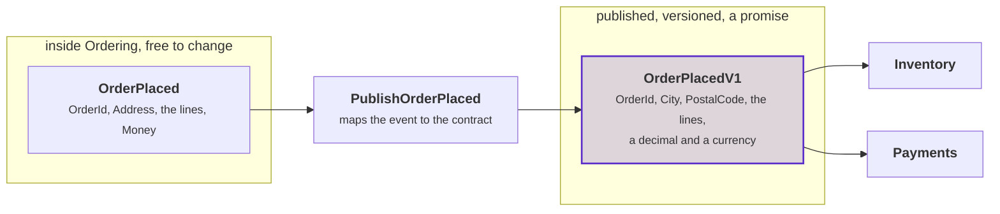
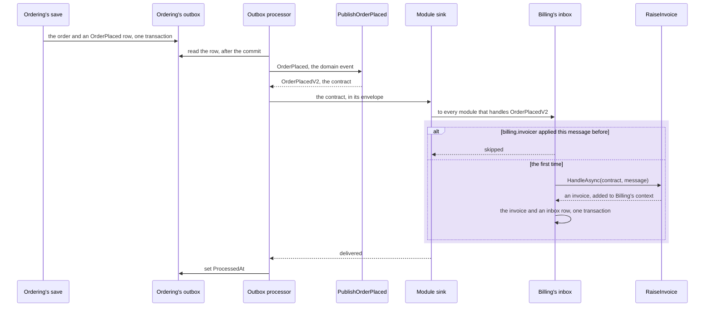
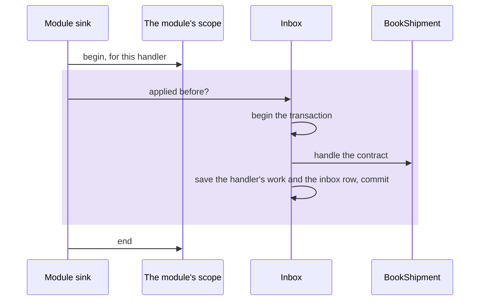
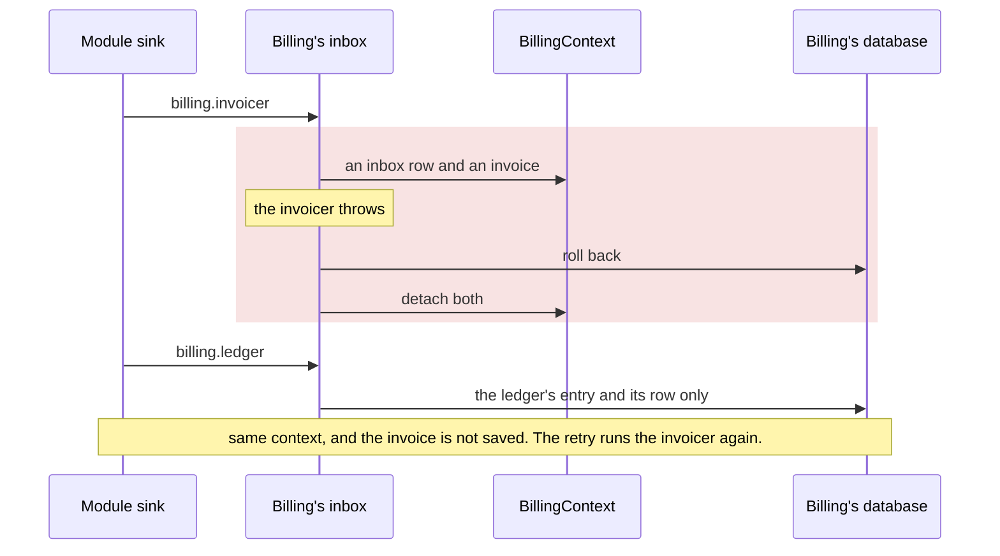
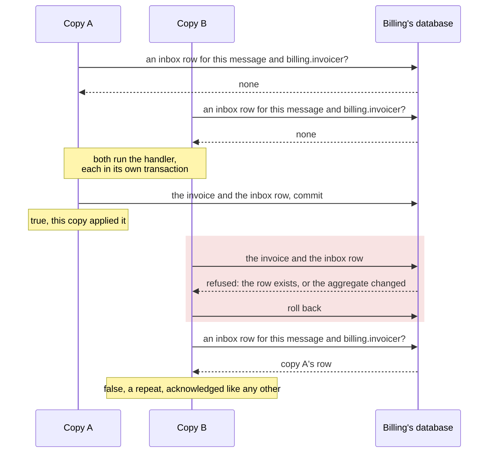
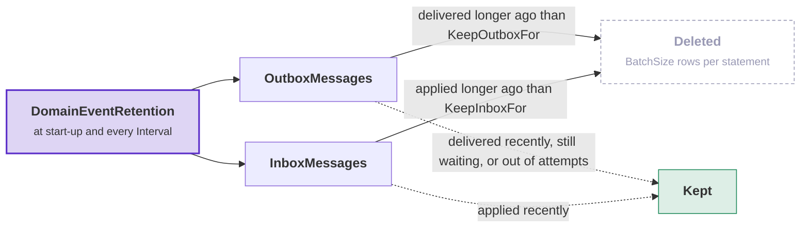
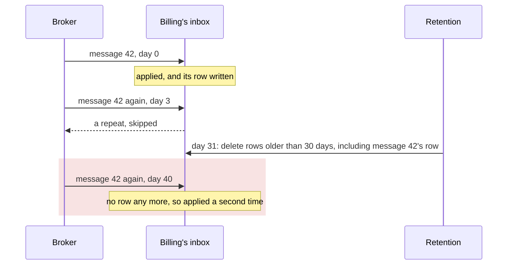

# Integration events

When something happens in one module, another module often has to react. Ordering places an order, and Billing
creates an invoice for it. Billing cannot handle Ordering's domain event directly. That would need a reference to
Ordering's domain assembly, with its ids, its value objects and every other type the event uses. After that, Ordering
cannot change any of those types without breaking Billing's build.

Ordering publishes an integration event instead: a small record, usually of primitives, that Ordering owns. Billing
reads it without knowing anything else about Ordering. This page covers how to declare an integration event, how to
deliver it, and how to handle it safely at the other end. It continues where [the outbox](event-delivery.md#the-outbox)
stops. The outbox stores a domain event durably, and this page covers the rest of the way.

Usually the module that reacts runs in the same process. This page is written for that case, because it is the common
one. When a module moves to a process of its own, only the way the message travels changes
([Transports](transports.md)).

`DDDToolkit.EntityFramework` gives you four things:

- **A mapping** between the event you raise and the message you publish, so the two can change at different times.
- **A sink interface**, so the outbox has somewhere to deliver to. A sink for the modules in the same process is
  included.
- **An inbox**, so a consumer can receive the same message twice and do the work once.
- **Versioning**, so this year's build can read a payload that last year's build wrote.

It is not a message bus. Between processes it hands its messages to pgmq, Wolverine or MassTransit, and keeps only the
outbox and the inbox on each side ([Transports](transports.md)).

## Domain events and integration events

The two look the same in C#. They differ in who reads them:

| | Domain event | Integration event |
|---|---|---|
| Who reads it | Code inside one module | Other modules, other services, other teams |
| Who owns the shape | You, today | Everyone who deployed code against it |
| Renaming a field | A refactoring | A breaking change |
| Carries | Your ids and value objects | Usually primitives |
| Lifetime | As long as the aggregate | As long as the oldest consumer |

A domain event is internal. `OrderPlaced(OrderId, CustomerName, Money)` uses your types, because only code in the
same module reads it. When code outside the module reads it, the record becomes a published schema, and every field
is a promise.

In the example shop, the domain event uses Ordering's types. The contract uses plain types, because it must stay
readable after Ordering changes. In the diagram, purple marks the contract, which the other modules read:



<details>
<summary>Show the code: the domain event, the contract and the class between them</summary>

**[`Ordering/Application/Orders/IntegrationEvents/Outbound/PublishOrderPlaced.cs`](../Examples/Modules/Ordering/Examples.Webshop.Ordering/Application/Orders/IntegrationEvents/Outbound/PublishOrderPlaced.cs)**

```csharp
// Ordering's own event, with Ordering's own types
[DomainEventName("ordering.order-placed")]
public sealed record OrderPlaced(OrderId OrderId, Address ShipTo, IReadOnlyList<OrderPlaced.Line> Lines, Money Total)
    : DomainEvent, INotification
{
    public sealed record Line(string Sku, int Quantity);
}

// what the other modules get, in Ordering's contracts project
[IntegrationEvent("ordering.order-placed", Version = 1)]
public sealed record OrderPlacedV1(
    OrderId OrderId, string City, string PostalCode, IReadOnlyList<OrderedLineV1> Lines, decimal Total, string Currency);

// the one place that knows both
public sealed class PublishOrderPlaced : IOutboundIntegrationEvent<OrderPlaced, OrderPlacedV1>
{
    public ValueTask<OrderPlacedV1?> CreateAsync(OrderPlaced placed, CancellationToken cancellationToken)
        => new(new OrderPlacedV1(
            placed.OrderId,
            placed.ShipTo.City,
            placed.ShipTo.PostalCode,
            [.. placed.Lines.Select(line => new OrderedLineV1(line.Sku, line.Quantity))],
            placed.Total.Amount,
            placed.Total.Currency));
}
```

</details>

The boundary in the first row of the table is the **module**, also inside one process. A record that only another
assembly in the same solution deserializes is already a published schema, because you cannot change the record
without changing that assembly.

So an integration event is part of the module's published contract. The contract is the short list of types that
other modules may use, and the module can change every other type freely. `[IntegrationEvent]` puts a type on that
list. [Module contracts](module-contracts.md) explains why a module publishes types, what else belongs on the list,
and why the example shop keeps it in a `*.Contracts` project.

## Choosing what is published

The domain event belongs to Ordering and uses Ordering's types:

```csharp
public sealed record OrderPlaced(OrderId OrderId, CustomerName Customer, Money Total) : DomainEvent;
```

The contract is what the other modules read. It uses primitives:

```csharp
[IntegrationEvent]
public sealed record OrderPlacedV2(Guid OrderId, string Customer, decimal Total, string Currency);
```

`[IntegrationEvent]` marks the type as a contract. Its name and version come from the module and the class name. In
`[assembly: Module("Ordering")]`, this contract is published as `ordering.order-placed` version 2, the same name that
its domain event is stored under. Pin the name in the attribute only when the default would be wrong, usually after a
class rename: `[IntegrationEvent("ordering.order-placed")]`. See [Stable names](domain-events.md#stable-names) for
the full rule, and [Versioning and upcasting](#versioning-and-upcasting) for what the version is for.

The outbox publishes the contract only after you register how the domain event becomes the contract. By default
nothing is mapped. The outbox publishes the domain event as it is, under the name it stored, and reuses the JSON
already in the row. There is no second type, no second serialization and no configuration. Until you separate the two,
the mapping costs nothing.

To publish the contract, register a mapping:

```csharp
options.UseOutbox<OrderingContext>(outbox =>
{
    outbox.RegisterEventsFromAssemblyContaining<Order>();

    outbox.PublishAs<OrderPlaced, OrderPlacedV2>(e => new OrderPlacedV2(
        e.OrderId.Value,
        e.Customer.Value,
        e.Total.Amount,
        e.Total.Currency));
});
```

Now `OrderPlaced` can gain a field, lose a field or get a new name, and the published message does not change until
you change `OrderPlacedV2` on purpose. Every sink receives what the mapping returns. The sink for the other modules in
this process is described [below](#delivering-to-a-module-in-the-same-process).

Two more options:

```csharp
// This event is for this module only. Local handlers still get it; no sink is called.
outbox.DoNotPublish<CustomerCreditChecked>();

// Publish only some occurrences. Returning null drops that one message.
outbox.PublishAs<OrderPlaced, OrderPlacedV2>(e => e.Total.Amount < 1000 ? null : Map(e));
```

### A class per published event

A lambda is fine for one line. When a module publishes five events, its registration becomes the place where every
contract is built. A lambda also has no services and cannot await. The mapping is application code. Put it next to
the aggregate it publishes for, and keep it out of the composition root.

So the mapping can also be a class. The class is the outbound counterpart of the `IIntegrationEventHandler<TContract>`
that a consuming module writes ([below](#delivering-to-a-module-in-the-same-process)):

```csharp
public sealed class PublishOrderPlaced : IOutboundIntegrationEvent<OrderPlaced, OrderPlacedV2>
{
    public ValueTask<OrderPlacedV2?> CreateAsync(OrderPlaced placed, CancellationToken cancellationToken)
        => new(new OrderPlacedV2(placed.OrderId.Value, placed.Customer.Value, placed.Total.Amount, placed.Total.Currency));
}
```

```csharp
options.UseOutbox<OrderingContext>(outbox =>
{
    outbox.AddOrderingIntegrationEvents();   // generated: every domain event and every IOutboundIntegrationEvent in the module
});
```

The generator writes `AddOrderingIntegrationEvents()` when the module compiles, and names it after the module. It
replaces both the `RegisterEventsFromAssemblyContaining` line and the `PublishAs` lambda.
[The generated registration](#the-generated-registration) shows what is in it.

A class can implement the interface more than once, to publish several events. Everything else works as for
`PublishAs`:

- returning `null` drops that one message;
- a domain event has one mapping, however it was registered, and a second mapping throws at start-up;
- events without a mapping are published as they are.

The outbox creates the class with `new` once per message, and takes each constructor parameter from the scope the
outbox processor runs in. When the class throws, the delivery fails, as it does when a sink fails. The outbox records
the error on the row and retries the message.

Name the class after what it does, like a handler: `PublishOrderPlaced` next to `BookShipment` and `RecordPayment`.
Avoid "Publisher" in the name, because the class sends nothing. The sink sends the message.

### When the mapping runs

The outbox row always stores the domain event. The mapping runs at delivery, after the save. This has three
advantages:

- The row is an exact record of what happened in the domain.
- The in-process path and the sink path read the same row.
- You fix a wrong mapping with a deployment, without a data migration. Reset `Attempts`, and the rows go out again in
  the new shape.

The cost is that the domain event type must still exist and still deserialize when the processor runs.
[Versioning and upcasting](#versioning-and-upcasting) covers this.

## Delivering to a module in the same process

Integration events exist so that another module can react. In a modular monolith, that module runs in the same
process. So this sink is the most useful one in the package, and the one to use first.

The diagram follows one message, from the save in Ordering to the handler in Billing. The purple band is Billing's
inbox, which skips a message that the handler applied before:



<details>
<summary>Show the code: the registration of both modules</summary>

Ordering publishes through its outbox to the modules in this process:

```csharp
// inside AddOrderingModule
services.AddDDDToolkitEntityFramework(options => options.UseOutbox<OrderingContext>(outbox =>
{
    outbox.AddOrderingIntegrationEvents();   // generated: its domain events and its outbound classes
    outbox.SendToModules();
}));
services.AddOutboxBackgroundService<OrderingContext>(TimeSpan.FromSeconds(2));
```

One class maps the domain event to the contract for the other modules:

```csharp
public sealed class PublishOrderPlaced : IOutboundIntegrationEvent<OrderPlaced, OrderPlacedV2>
{
    public ValueTask<OrderPlacedV2?> CreateAsync(OrderPlaced placed, CancellationToken cancellationToken)
        => new(new OrderPlacedV2(placed.OrderId.Value, placed.Customer.Value, placed.Total.Amount, placed.Total.Currency));
}
```

Billing handles the contract. It registers the contracts it reads and the handlers that run under its inbox:

```csharp
[IntegrationEventConsumer("billing.invoicer")]
public sealed class RaiseInvoice(BillingContext context) : IIntegrationEventHandler<OrderPlacedV2>
{
    public Task HandleAsync(OrderPlacedV2 contract, IntegrationEventMessage message, CancellationToken cancellationToken)
    {
        context.Invoices.Add(new Invoice(contract.OrderId, contract.Total));
        return Task.CompletedTask;
    }
}

// inside AddBillingModule
services.AddDDDToolkitEntityFramework(options =>
    options.MapIntegrationEvents(contracts => contracts.AddBillingIntegrationEvents()));   // generated
services.AddModuleIntegrationEvents<BillingContext>(module => module.AddBillingIntegrationEvents());   // generated
```

Both contexts map their tables: `modelBuilder.AddDomainEventOutbox(Database)` in Ordering's context, and
`modelBuilder.AddDomainEventInbox(Database)` in Billing's context. The rest of this section explains each part.

</details>

A handler that fails makes the delivery fail, and the processor tries again later. Every module gets the message
again, and each inbox skips what its module already applied. This makes at-least-once delivery safe.

Each module registers its own half, next to its own context. The producing module registers what it publishes, and
sends it to the other modules:

```csharp
// inside AddOrderingModule
services.AddDDDToolkitEntityFramework(options => options.UseOutbox<OrderingContext>(outbox =>
{
    outbox.AddOrderingIntegrationEvents();   // generated: its domain events and its outbound classes
    outbox.SendToModules();
}));
services.AddOutboxBackgroundService<OrderingContext>(TimeSpan.FromSeconds(2));
```

`SendToModules()` is the sink. It hands each message that the outbox delivers to the modules in this process that
handle it. The background service is the processor. It reads the outbox rows after the commit and hands them to the
sink ([Running the processor](event-delivery.md#running-the-processor)).

A consuming module writes a handler for the contract:

```csharp
[IntegrationEventConsumer("billing.invoicer")]
public sealed class RaiseInvoice(BillingContext context) : IIntegrationEventHandler<OrderPlacedV2>
{
    public Task HandleAsync(OrderPlacedV2 contract, IntegrationEventMessage message, CancellationToken cancellationToken)
    {
        context.Invoices.Add(new Invoice(contract.OrderId, contract.Total));
        return Task.CompletedTask;
    }
}
```

`[IntegrationEventConsumer]` names the handler for the inbox. The inbox records that `billing.invoicer` applied a
message. [Each handler has its own inbox row](#each-handler-has-its-own-inbox-row) explains why the name matters.
`message` is the envelope the contract arrived in, with its id, its published name and the time the thing happened.
[Transports](transports.md#why-a-sink-receives-an-envelope) lists what it carries.

The consuming module then registers the contracts it reads and the handlers that run under its inbox:

```csharp
// inside AddBillingModule
services.AddDDDToolkitEntityFramework(options =>
    options.MapIntegrationEvents(contracts => contracts.AddBillingIntegrationEvents()));   // generated
services.AddModuleIntegrationEvents<BillingContext>(module => module.AddBillingIntegrationEvents());   // generated
```

- `MapIntegrationEvents` registers the contracts Billing reads, so that a delivered payload can be read back into an
  `OrderPlacedV2`.
- `AddModuleIntegrationEvents<BillingContext>` registers Billing as a consumer: its handlers, and the inbox in
  `BillingContext` that guards them.
- The generator writes the `Add{Module}IntegrationEvents()` methods when the module compiles. So nothing is found,
  read or created by reflection at run time ([The generated registration](#the-generated-registration)).

Neither module names the other. `SendToModules()` offers every message to every module registered with
`AddModuleIntegrationEvents`. Each module runs only its own handlers, under its own inbox, in its own context. A third
module that wants `OrderPlacedV2` registers itself the same way, and nothing in Ordering or Billing changes. The host
only calls `AddOrderingModule` and `AddBillingModule` ([the example](../Examples/ModularMonolith.Supabase)).

Every module can call `AddDDDToolkitEntityFramework` like this, because each call configures the same options.
Settings for the whole process, such as `DispatchWithMediator()`, stay in the host. A second call that sets the
dispatch delegate throws an `InvalidOperationException`, so one module cannot replace the delegate of another module
without notice.

### The handler takes the contract

Type the handler on the contract, `IIntegrationEventHandler<OrderPlacedV2>`, and never on the domain event. A handler
typed on `OrderPlaced` makes the billing module reference the ordering module's domain assembly, with `OrderId`,
`Money` and every other type that record uses. Ordering then cannot rename a field without breaking another build, and
the two modules become one module in two folders.

`OrderPlacedV2` is a record of primitives that both modules can see. Ordering owns and publishes it. Billing reads it.
Neither module knows anything else about the other.

When the contract is registered, the sink reads the payload from `message.Payload` and deserializes it into the
consumer's own object, as it would for a message from a queue. So a handler cannot change an object that the producer
still holds, and a module that later moves to its own process behaves the same from its first day. When no contract
is registered under the message's name and version, the sink hands over `message.Body`, the object the outbox built. A
message with a body and no payload comes from a broker that deserializes by type, MassTransit or Wolverine. The sink
hands over that body as it is.

### Delivery after the commit

A direct call from Ordering into Billing runs inside Ordering's transaction. If Billing throws, Ordering's order is
rolled back. A bug in an unrelated module can then refuse an order.

The outbox separates the two. Ordering commits, and the row is stored durably. The consumers run afterwards, on the
background service's next poll. If Billing fails, Billing's handler is retried later, and the order stays committed.

### Each handler has its own inbox row

Delivery is at least once, so a message will be delivered again. Every handler runs inside the inbox, keyed on the
message id and the handler's consumer name. One `SaveChanges`, in one transaction, writes the handler's changes and
the row that marks the message applied.

On a retry, this gives the following result:

| | First run | Retry |
|---|---|---|
| `billing.invoicer` | applied, row written | skipped |
| `search.indexer` | threw, nothing written | runs again |

The message as a whole counts as failed while any handler fails. So the outbox row stays pending and is picked up
again. Handlers that already succeeded do not run twice.

The inbox keys on the name in `[IntegrationEventConsumer("billing.invoicer")]`. Without the attribute, the name is the
full CLR type name, which changes when you rename or move the class. The inbox cannot tell a renamed consumer from a
new one, and runs the whole backlog through it again. Name your consumers, as you name your events.

### The inbox table

The consuming context maps the inbox table:

```csharp
protected override void OnModelCreating(ModelBuilder modelBuilder)
{
    modelBuilder.AddDomainEventInbox(Database);
}
```

A module that also publishes maps its outbox next to it, with `modelBuilder.AddDomainEventOutbox(Database)`.

`AddModuleIntegrationEvents<TContext>(...)` registers the module, its inbox and its handlers together. Handlers should
write through that same `TContext`, because the inbox row is in the transaction of that context. Two handlers with one
consumer name in one module are refused at registration. The inbox could not tell them apart, and the second handler
would never run.

A failure names the module and the consumer: `BillingContext/billing.invoicer`. When a second module fails, the first
module does not run again. Each module's inbox records what that module applied.

Delivery uses no reflection. `Handle<TContract, THandler>()` stores a typed call to the handler when you register it,
and the sink uses that call.

### Who the handlers run as

Under [row level security (RLS)](row-level-security.md), the user a handler runs as decides which rows the handler
sees and may write. The handler's inbox row is written in the same transaction. A user that the handler begins
itself comes too late. By then the inbox has read and begun its transaction, and the handler's scope ends before the
inbox saves. So a module sets the user where it registers its handlers, with a scope. The delivery begins the scope
before it asks the inbox anything, and ends it after the commit:

```csharp
services.AddModuleIntegrationEvents<ShippingContext>(module => module
    .Around((services, message, contract) => services.GetRequiredService<ICurrentUser>().BeginSystem("shipping"))
    .Handle<OrderPlacedV1, BookShipment>());
```

In the diagram, everything in the purple band runs as the user that the scope began:



<details>
<summary>Show the code: a scope that reads the message</summary>

```csharp
services.AddModuleIntegrationEvents<ShippingContext>(module => module
    // begun around every delivery, outermost first
    .Around((services, message, contract) => services.GetRequiredService<ICurrentUser>().BeginSystem(
        message.Name == "ordering.order-placed" ? "shipping" : "shipping-cancellations"))
    .Handle<OrderPlacedV1, BookShipment>()
    .Handle<OrderCancelledV1, CancelShipment>());
```

</details>

- A scope may return `null` to begin nothing for a message. The handler then runs as the current user. Where the
  host requires an explicit current user, the current user is nobody, and the handler's first query fails. So with
  that option, a module begins a user for every message it handles.
- Each handler gets its own scope, and the scope also ends when the handler fails.
- You can call `Around` more than once. The scopes nest in the order you add them.
- Every way a message reaches a module goes through the scopes: the module sink, and the receivers of pgmq, Wolverine
  and MassTransit.

`IntegrationEventScopes.System` runs the handlers as system work without a scope, which RLS lets past every policy.
Where the host [requires an explicit current user](row-level-security.md#requiring-an-explicit-current-user), this scope is the only way to
run handlers as system work, so the choice is written where the handlers are registered. In such a host, a module
without a scope does not run its handlers. The delivery fails with a `NoCurrentUserException` that names the module, before
the module's inbox is read, and the outbox or the transport retries it.

### Limits of the module sink

A consumer cannot have its own retry schedule. One outbox row is one message. A consumer that keeps failing keeps the
row pending until `MaxAttempts`. After that, the processor no longer picks up the row, and its `LastError` shows the
failure. If one consumer needs a different retry policy, give it its own outbox table and its own processor.

The module sink does not order messages ([Delivery guarantees](#delivery-guarantees)).

## The generated registration

`DDDToolkit.EntityFramework.Analyzers` writes a module's integration event registration as code. It writes one
`Add{Module}IntegrationEvents()` for each of the three places that need one, in the namespace
`{assembly}.IntegrationEvents`. `{Module}` is the module the assembly declares, with `<DDD_Module>` or
`[assembly: Module]`. A project that is no module takes the name from its `<DDD_Module>`, or else from its assembly
name without the dots. [The module name in generated code](modules.md#the-module-name-in-generated-code) has the order.

In the example on this page, Ordering declares one domain event, `OrderPlaced`, and one outbound class,
`PublishOrderPlaced`. Its build writes the registration for the outbox:

**`IntegrationEventExtensions.g.cs`** in Ordering, shortened:

```csharp
namespace Ordering.IntegrationEvents;

public static class IntegrationEventExtensions
{
    public static OutboxOptions AddOrderingIntegrationEvents(this OutboxOptions outbox)
    {
        ArgumentNullException.ThrowIfNull(outbox);
        outbox.RegisterEvent<OrderPlaced>("ordering.order-placed", 1);
        outbox.PublishWith<OrderPlaced, OrderPlacedV2>("ordering.order-placed", 2, static services => new PublishOrderPlaced());
        return outbox;
    }

    // ... the two overloads for the contract registry and the module's handlers, which register
    // nothing: Ordering has no handler
}
```

Billing declares one handler, `RaiseInvoice`. Its build writes the other two registrations:

**`IntegrationEventExtensions.g.cs`** in Billing, shortened:

```csharp
namespace Billing.IntegrationEvents;

public static class IntegrationEventExtensions
{
    // ... the overload for the outbox, which registers nothing: Billing raises no domain event

    public static IntegrationEventContractRegistry AddBillingIntegrationEvents(this IntegrationEventContractRegistry contracts)
    {
        ArgumentNullException.ThrowIfNull(contracts);
        contracts.Register<OrderPlacedV2>("ordering.order-placed", 2);
        return contracts;
    }

    public static ModuleIntegrationEvents<TContext> AddBillingIntegrationEvents<TContext>(this ModuleIntegrationEvents<TContext> module) where TContext : DbContext
    {
        ArgumentNullException.ThrowIfNull(module);
        module.Handle<OrderPlacedV2, RaiseInvoice>("ordering.order-placed", "billing.invoicer", static services => new RaiseInvoice(ServiceProviderServiceExtensions.GetRequiredService<BillingContext>(services)));
        return module;
    }
}
```

Line by line, this is everything the two modules register:

- `RegisterEvent<OrderPlaced>("ordering.order-placed", 1)` adds the domain event to the outbox's map from stored name
  to type. The processor reads a row back through this map. The name is the event's `[DomainEventName]`.
  `OrderPlaced` has none, so the name is the module and the class name. The version is the event's
  `[IntegrationEvent(Version = n)]`, otherwise the version its class name ends in, otherwise 1. Every concrete domain
  event of the project is listed, also when it does not leave the module, because the outbox stores all of them.
- `PublishWith<OrderPlaced, OrderPlacedV2>(...)` is the mapping that `PublishAs` would make, with a class instead of a
  lambda. It holds the contract's published name and version, read from its class name and `[IntegrationEvent]`, and
  the code that creates `PublishOrderPlaced` for each message. The published name also tells this process that it
  publishes `ordering.order-placed` itself, so a [transport](transports.md) does not ask a broker for it.
- `contracts.Register<OrderPlacedV2>("ordering.order-placed", 2)` tells the contract registry which type to read a
  payload of that name and version as. The module sink and the inbox read through this registry. Only the contracts
  that this module's handlers take are listed. The contracts it publishes are not listed.
- `module.Handle<OrderPlacedV2, RaiseInvoice>(...)` does three things:
  - it registers `RaiseInvoice` in the container as scoped, created by the lambda;
  - it adds the handler to Billing's consumers under `billing.invoicer`, the name its inbox rows carry;
  - it records that this process handles `ordering.order-placed`. A transport subscribes to that name.

The `BillingContext` in that lambda comes from the handler's constructor. The registration calls the constructor with
the most parameters, and takes each parameter from the scope the message is delivered in:

- `GetRequiredService` for an ordinary parameter;
- `GetService` for a reference type with a default value;
- the scope itself for an `IServiceProvider`.

The compiler reads everything that a run-time registration would read from attributes, and the generator writes it out
as literals:

- the stored name and version of every domain event, and the published name and version of every contract (the
  convention, `[DomainEventName]`, `[IntegrationEvent]`);
- the consumer name of every handler (`[IntegrationEventConsumer]`, otherwise the class's full name).

The outbox and the processor then look up names in the registries, and never ask a type. Nothing is scanned, read or
created by reflection. Add a handler class, and the next build registers it.

A class that the registration cannot create with `new` is left out, and the build reports
[DDD00033](diagnostics.md#ddd00033) as a warning. This applies to a class:

- with no constructor the module can call;
- whose two longest constructors have the same number of parameters;
- with a parameter type the module cannot see;
- with `ref`, `out` or `params` parameters.

The registrations that use reflection (`RegisterEventsFromAssemblyContaining`, `RegisterFromAssemblyContaining`,
`Handle<TContract, THandler>()`) work for code without the generator.

## Adding data to a contract

A mapping class can take services, so it can add data that the domain event does not carry, such as a product's name
from the module's own read model. Be careful what you read, because of when the class runs. The processor reaches the
row after the event happened, and a retry runs the class again. A query in the class reads the current state, which
may differ from the state when the event was raised. If one sink accepted the first attempt and another sink failed,
the retry can even hand the second sink a different payload under the same message id. The first consumer's inbox
then ignores that payload.

| What the contract needs | Where it comes from |
|---|---|
| Data already in the domain event | Map it. This is almost always the answer. |
| Stable or cosmetic data of this module (a name, a category) | A read from the module's own context in the class is fine. |
| Data that must be correct as of the event (a price, an address, a status) | **The domain event.** Add the data there. Do not read it in the class. |
| Data that another module owns | Neither. Keep a read model of it in this module, fed by the other module's events. |

The class only reads. With [`DeliverInTransaction`](transports.md#postgres-queues-pgmq), a
write would commit together with the mark that says the message was sent.

## Where an integration event comes from

An integration event is always a mapping of a domain event. A domain event reaches the outbox only when an aggregate
raised it. The save collects the events from the tracked aggregates and writes them in the same transaction as the
change. This is the guarantee, and nothing publishes outside it:

- A domain service makes a decision, and an aggregate records it.
- A handler that makes a decision calls a method on an aggregate.
- Neither one publishes anything itself. A message sent outside the save can go out for a change that rolled back, or
  be lost for a change that committed.

### Refusals and invalid contracts

A refusal is an outcome too. Other modules act on "not enough stock" or "payment declined", so record it like any
other outcome. The shop's `StockReservation.Refused(...)` stores a refused reservation and raises `StockRefused`, and
`PublishStockRefused` maps it. A recorded refusal also makes a retried message harmless. The second attempt finds the
decision already made, and does not decide again, possibly differently.

Not every refusal is an outcome. For an incoming message, three cases look alike and need different handling:

| The failure | Example | What to do |
|---|---|---|
| A rule of this module | Only euros are accepted. A name is already taken. | Record a refusal on an aggregate, and publish it. |
| The contract carries an invalid value | A negative total, an empty currency | The producer has a bug. Throw, with the reasons. The message is retried, stops at `MaxAttempts`, and stays in the table with its `LastError`. |
| A race on a unique index | Two consumers create the same name at the same time | Let the `DbUpdateException` throw. On the retry, the explicit check finds the other row and takes the refusal branch. |

For the second case, convert the contract to your value objects with `TryToValid` instead of `ToValid()`. Then the
exception says which field was wrong:

```csharp
if (!new Money(contract.Total, contract.Currency).TryToValid(out var total, out var errors))
{
    throw new InvalidOperationException($"{message.Name} {message.MessageId} carries an invalid total: {string.Join("; ", errors.Select(e => e.Message))}");
}
```

A synchronous caller is different. An invalid request changed nothing, and no other module needs to know about it. So
the caller gets a `ValidationProblem`, and nothing is published.

## Folders for the event classes

In the example shop, each module keeps both directions next to the aggregate or read model they belong to, split by
kind and by direction:

```
Application/
    Orders/
        DomainEvents/                  OrderLog               (this module's own events, in process)
        IntegrationEvents/
            Inbound/                   RecordPayment, CancelWithoutStock, ...
            Outbound/                  PublishOrderPlaced, PublishOrderConfirmed, ...
    ReadModels/
        CatalogPrices/
            CatalogPrice.cs
            IntegrationEvents/
                Inbound/               RecordListedPrice, RecordChangedPrice
```

Every outbound class has an owner, because an aggregate raises every domain event. An inbound class belongs to the
aggregate or read model it changes. A module's `*.Contracts` project shows what the module promises the other modules
([Module contracts](module-contracts.md#a-separate-contracts-project)).

## Using the inbox directly

All delivery above is at least once, so a consumer will see the same message twice at some point. The inbox makes the
repeat harmless. `SendToModules` uses the inbox for you. For a message from another source, use the inbox yourself:

```csharp
protected override void OnModelCreating(ModelBuilder modelBuilder)
{
    modelBuilder.AddDomainEventInbox(Database);
}
```

```csharp
builder.Services.AddDomainEventInbox<BillingContext>();
```

```csharp
public sealed class OrderPlacedConsumer(DomainEventInbox<BillingContext> inbox, BillingContext context)
{
    public async Task Consume(IntegrationEventMessage message, CancellationToken cancellationToken)
    {
        await inbox.ExecuteOnceAsync<OrderPlacedV2>(message, "billing.invoicer", (order, received, token) =>
        {
            context.Invoices.Add(new Invoice(order.OrderId, order.Total));
            return Task.CompletedTask;
        },
        cancellationToken);

        // Acknowledge the message either way. A repeat is not an error.
    }
}
```

`ExecuteOnceAsync` returns `true` when your handler ran, and `false` when this consumer had applied the message
before. Both results mean success.

The steps, in order:

1. Read the payload as the type you asked for, with any upcasters applied.
2. Look for a row with this message id and this consumer. If it exists, return `false` and do nothing.
3. Start a transaction. If the caller already has one, join it.
4. Add the inbox row.
5. Run your handler.
6. Call `SaveChanges`, which writes the handler's changes and the row together.
7. Commit, unless the transaction is the caller's.

Steps 4 to 7 make the inbox safe. One `SaveChanges` in one transaction writes the row that marks the message applied
and the changes of applying it. So at no point does one exist without the other. A crash anywhere in between rolls
back both, and the next delivery applies the message cleanly.

When a step fails, the inbox rolls back the transaction and the change tracker. It detaches everything the attempt
started to track, including the inbox row. Without this, the next save on the same context would write the failed
handler's changes without their row, and the retry would apply them a second time. The module sink runs all handlers
of a module on one context, so the next save is usually the next consumer's save. Entities that the context tracked
before the attempt stay tracked.

In the diagram, the red band is the failed handler. Its transaction rolls back, and its rows are detached:



<details>
<summary>Show the code: two consumers in one module</summary>

Two handlers of the same contract, each under its own consumer name. They run one after the other, on the one
`BillingContext` of the delivery's scope:

```csharp
services.AddModuleIntegrationEvents<BillingContext>(module => module
    .Handle<OrderPlacedV2, RaiseInvoice>()      // [IntegrationEventConsumer("billing.invoicer")]
    .Handle<OrderPlacedV2, PostToLedger>());    // [IntegrationEventConsumer("billing.ledger")]
```

</details>

The key is the pair of message and consumer. Two consumers of the same message each get a row, and each runs once. So
a consumer added later does not make the existing consumers process the backlog again. Choose consumer names you will
not want to change, as you choose a `[DomainEventName]`.

Other overloads hand you the raw envelope, or only the message id, if you want to deserialize yourself.

### Limits of the inbox

The inbox cannot undo work outside the database. If your handler sends an e-mail and the transaction then rolls back,
the row is gone and the e-mail is sent. The fix has the same shape as the outbox. Write a row in the transaction, and
let another process act on that row afterwards.

For the same reason, the inbox cannot stop two copies of a message from running at the same time. A broker that
delivers in parallel can hand two copies to two handlers before either one has saved. Both find no inbox row, and
both run. One save inserts the inbox row. The other save fails on that row and rolls back everything it wrote, so the
database ends up with one effect. Anything the losing copy did outside its transaction happened twice, such as a
counter in memory or a call to another system. Only what a handler does through its module's context happens exactly
once.

The losing copy is not reported as a failure. After its transaction is rolled back, the inbox looks for the row again.
If the winner's row is there, the inbox returns `false`, as for any other repeat. It does not matter whether the losing
copy failed on the inbox row or on an aggregate that the winner changed first. The broker then sees a handled message,
and does not retry it. Inside a caller's transaction, the inbox throws instead, because only the caller can roll that
transaction back. The caller's retry then finds the row.

In the diagram, the red band is the failed save of copy B:



<details>
<summary>Show the code: what a consumer sees</summary>

The consumer does not change. Both results mean success, so it acknowledges the message either way:

```csharp
var applied = await inbox.ExecuteOnceAsync<OrderPlacedV2>(message, "billing.invoicer", (order, received, token) =>
{
    context.Invoices.Add(new Invoice(order.OrderId, order.Total));
    return Task.CompletedTask;
},
cancellationToken);

// true: this copy applied the message.
// false: it had been applied already, before this copy arrived or while it ran.
```

</details>

The inbox does not order messages either. If message B arrives before message A, the inbox applies B. Handlers that
depend on order must check it themselves, usually with a version or a sequence number in the payload.

## Versioning and upcasting

A name stays the same when the class moves, and `[DomainEventName]` keeps the name when the class is renamed. The
**shape** of the payload must also stay readable, and that is harder. Once the outbox has published a payload,
something has stored it, queued it, or is about to read it. A payload written before a deployment must be readable
after the deployment.

Two places must read old payloads, and the toolkit covers both.

### Old rows in the outbox

Every outbox row records the shape it was written in, in a `Version` column. The version is
`[IntegrationEvent(Version = n)]` on the event type, otherwise the version its class name ends in. An event that never
changed shape states nothing, and is version 1.

When a row's version matches the type registered under its name, nothing changes. This is true for every row until
you add a version. When the version does not match, the processor reads the payload as the type registered for that
older version, and then upcasts it.

```csharp
public sealed record OrderPlacedV1(OrderId OrderId, Money Total) : DomainEvent;                    // ordering.order-placed, version 1
public sealed record OrderPlacedV2(OrderId OrderId, Money Total, Channel Channel) : DomainEvent;   // ordering.order-placed, version 2
```

```csharp
options.MapIntegrationEvents(contracts => contracts
    .UpcastFrom<OrderPlacedV1, OrderPlacedV2>(v1 => new OrderPlacedV2(v1.OrderId, v1.Total, Channel.Unknown)));
```

The two classes share a name, because the default name leaves out the suffix. Each class states its version in its
class name, so there is nothing to keep in sync. To keep raising `OrderPlaced` instead of `OrderPlacedV2`, put the
version in the attribute: `[IntegrationEvent(Version = 2)]`. A class name without a suffix is version 1, and two
version 1 classes under one name fail the build ([DDD00036](diagnostics.md#ddd00036)). If you pin the name, pin the
same name on every version. `RegisterEvent<TEvent>()` and `RegisterEventsFromAssembly` refuse an event whose
`[DomainEventName]` and `[IntegrationEvent]` give two different names, because the outbox could then never match a
stored row to a version.

Two types under one domain event name are fine. `RegisterEvent` and `RegisterEventsFromAssembly` use the newest type
to write new events, and use the older type only to read.

The processor does not guess at a row whose shape no registered type matches. The message fails, `LastError` names the
version and the call that would fix it, and the row waits for a person.

An outbox table created by an earlier 3.0 build may not have the `Version` column yet
([From an earlier 3.0 build](migrating-to-3.md#from-an-earlier-30-build)).

### Old messages at a consumer

The receiving side reads through the same registry. So you write a handler against one shape, and the handler never
checks a version number:

```csharp
await inbox.ExecuteOnceAsync<OrderPlacedV2>(message, "billing.invoicer", (order, received, token) =>
{
    context.Invoices.Add(new Invoice(order.OrderId, order.Total));
    return Task.CompletedTask;
});
```

A version 1 message arrives, is deserialized as `OrderPlacedV1`, is upcast, and reaches the handler as
`OrderPlacedV2`. The module sink does the same for every handler it calls. So a handler typed on the current contract
keeps working when an older message arrives.

### Rules for versions

- **Add a version when you break the payload.** Removing a field, renaming a field, or changing its meaning is a
  break. Adding an optional field is not.
- **Register each step.** Register v1 to v2 and v2 to v3, and a v1 payload arrives as v3. Adding v4 later is one more
  line, and the existing upcasters stay as they are.
- **An upcaster fills in the fields that the old payload never had.** This cannot be avoided, and it is why a new
  version is a decision. Use a value the consumer can recognize, such as an explicit `Unknown`. Do not use a value
  that looks like real data.
- **Never delete the old record.** It is the only type that can read a payload written against it. It costs one file.
- **An upcaster is a pure function.** It runs on the read path, possibly for every message in a backlog. Do not call
  the database from it.

The version also travels on the envelope. A consumer that does not use upcasting can check `message.Version` without
parsing the body first.

## Sinks and in-process dispatch together

| Configured | What the processor does |
|---|---|
| `DispatchInProcess` only | Calls the delegate with the domain event. |
| One or more `SendTo` | Publishes the message to every sink. It does not call the delegate. |
| Both | Publishes to the sinks, and skips the delegate. |
| Both, with `AlsoDispatchInProcess = true` | Calls the delegate first, with the domain event. Then publishes to the sinks, with the contract. |

```csharp
options.UseOutbox<OrderingContext>(outbox =>
{
    outbox.SendToModules();
    outbox.AlsoDispatchInProcess = true;   // handlers inside this module, and the other modules
});
```

With `AlsoDispatchInProcess`, a local handler that throws fails the message before any sink sees it. This order is
correct. Publishing a message whose local side effect failed would announce something that did not happen.

Use the delegate for handlers inside the producing module, which may see the domain event. Use the module sink for
everything outside that module.

A processor with neither a sink nor a delegate throws an `InvalidOperationException` when it is created. The message
names both calls.

## When one sink fails and another does not

The processor tries every sink, in registration order. A sink that throws does not stop the sinks after it.

The message as a whole then counts as failed. It is not marked processed, `Attempts` goes up, and `LastError` records
an `IntegrationEventDeliveryException` that names the sinks that threw. The next attempt hands the message to **all**
sinks again, including the sinks that accepted it before.

This follows from one row per message. Progress per sink would need one row per sink per message. That is a different
table with different failure modes, and this package does not have it. So with two sinks over the same outbox, both
sinks must handle a repeat. If one of your transports cannot, give it its own outbox table and its own processor, or
put a queue in front of it.

The module sink is the exception, because it keeps that record itself. Each consuming module has an inbox row per
consumer, so the module's handlers keep their progress across a retry.

## Delivery guarantees

- **At least once, end to end.** Every step can repeat. The outbox marks a row processed only after the delivery
  returned. A queue delivers again what was not archived. A retry delivers again to sinks that already accepted the
  message. No step is exactly once on the wire.
- **Two narrow exceptions.** With
  [`DeliverInTransaction`](transports.md#postgres-queues-pgmq) and a sink that writes to the
  same database, the delivery and the mark commit together, so that one step does not repeat. And the module sink's
  inbox rows make a consumer skip a message it already applied.
- **Idempotency is keyed on `MessageId`.** It is the domain event's `EventId`, the same on every delivery, and the
  inbox stores it. If you write your own deduplication, key it on `MessageId` only.
- **The inbox remembers a message only as long as its row exists.** With [retention](#keeping-the-tables-small), a
  message that arrives again after its row was deleted is applied again.
- **Order is best effort.** The processor loads the oldest rows first. But a failed message is retried after messages
  written later, two processors can interleave, and a queue has its own order. Do not depend on delivery order.
- **Delivery is not immediate.** It happens on the next poll of the background service, after the commit.
- **Nothing is lost, and nothing is published for a rolled-back transaction.** The outbox guarantees this, because the
  same transaction writes the rows and the aggregate.

## Tables, schema and migrations

The outbox and the inbox are in a `ddd` schema by default, apart from your domain tables. Infrastructure tables are
easier to grant, purge and ignore in a schema of their own.

```csharp
modelBuilder.AddDomainEventOutbox(Database);                            // ddd.OutboxMessages
modelBuilder.AddDomainEventInbox(Database);                             // ddd.InboxMessages
modelBuilder.AddDomainEventInbox(Database, "Consumed", schema: "msg");  // msg.Consumed
modelBuilder.AddDomainEventInbox(Database, schema: null);               // the provider's default schema
```

SQLite has no schemas. Its provider drops the schema when it writes an identifier, so the tables are `OutboxMessages`
and `InboxMessages` there, and everything works unchanged. There is nothing to configure.

[pgmq](transports.md#postgres-queues-pgmq) creates its own tables in its own `pgmq` schema.
They are not part of your model, and you do not migrate them.

The inbox table has four columns:

| Column | Type | Meaning |
|---|---|---|
| `MessageId` | `Guid`, key | The message's id |
| `Consumer` | `string`, key, 256 | Who applied it |
| `MessageName` | `string?`, 256 | The published name, for when you read the table by hand |
| `ProcessedAt` | `DateTimeOffset` | When the handler finished |

If you scaffold migrations, there is nothing else to do. Both tables are part of your model once the calls are in
`OnModelCreating`, so `dotnet ef migrations add` writes them, with the schema.

If you write migrations by hand:

```csharp
public partial class AddMessaging : Migration
{
    protected override void Up(MigrationBuilder migrationBuilder)
    {
        migrationBuilder.CreateDomainEventOutbox();
        migrationBuilder.CreateDomainEventInbox();
    }

    protected override void Down(MigrationBuilder migrationBuilder)
    {
        migrationBuilder.DropDomainEventInbox();
        migrationBuilder.DropDomainEventOutbox();
    }
}
```

The helpers take the same `tableName` and `schema` arguments as the model builder, so pass the same values in both
places. They create the schema first where the provider has schemas, and leave the schema out where it does not.
Tests check the shapes against the model, so a hand-written migration and a scaffolded one create the same table.

## Keeping the tables small

Neither table shrinks by itself. The outbox marks a row delivered and keeps it. The inbox writes a row for every
message that every consumer applies. Retention deletes the rows that are older than you want to keep:

```csharp
services.AddDomainEventRetention<OrderingContext>(retention =>
{
    retention.KeepOutboxFor = TimeSpan.FromDays(7);
    retention.KeepInboxFor = TimeSpan.FromDays(30);
});
```

This registers `DomainEventRetention<OrderingContext>` and a background service. The service runs retention at
start-up, and then every `Interval`, one hour by default.

In the diagram, purple marks the retention run, green marks the rows it keeps, and grey marks the rows it deletes:



<details>
<summary>Show the code: what the example shop keeps, and running retention yourself</summary>

Each module registers its own retention, next to its own outbox. Ordering has both tables. Catalog only publishes and
Shipping only consumes, so those two set one window each:

```csharp
// inside AddOrderingModule
services.AddDomainEventRetention<OrderingContext>(retention =>
{
    retention.KeepOutboxFor = TimeSpan.FromDays(7);
    retention.KeepInboxFor = TimeSpan.FromDays(30);
});

// inside AddCatalogModule: an outbox and no inbox
services.AddDomainEventRetention<CatalogContext>(retention => retention.KeepOutboxFor = TimeSpan.FromDays(7));

// inside AddShippingModule: an inbox and no outbox
services.AddDomainEventRetention<ShippingContext>(retention => retention.KeepInboxFor = TimeSpan.FromDays(30));
```

To run retention from your own scheduler, skip the registration and call it directly:

```csharp
var retention = new DomainEventRetention<OrderingContext>(context, new DomainEventRetentionOptions<OrderingContext>
{
    KeepInboxFor = TimeSpan.FromDays(30),
});

await retention.DeleteExpiredAsync(cancellationToken);                                     // by the windows
await retention.DeleteDeliveredOutboxMessagesAsync(DateTimeOffset.UtcNow.AddDays(-7), cancellationToken); // or by a cutoff
```

</details>

- Each run deletes with `ExecuteDelete`, in the database and without the change tracker, `BatchSize` rows per
  statement (1000 by default). So a large backlog is deleted in many short transactions, and never in one long one.
- Both windows count from `ProcessedAt`, which both tables index.
- A window you leave unset leaves its table alone. A context with only an inbox sets only `KeepInboxFor`. With no
  window set at all, `AddDomainEventRetention` throws an `ArgumentException`.
- An [event log](entity-framework.md#an-event-log) has its own window, `KeepEventLogFor`, which counts from
  `RecordedAt`. When it is shorter than the time the log's table keeps a row, the run throws an
  `InvalidOperationException`, because the table refuses to delete a younger row.
- Retention deletes only delivered outbox rows. A row that still waits, or that ran out of attempts, stays however old
  it is. It is work that somebody still has to look at.

### How long to keep the inbox

The inbox window needs more thought than the outbox window. An inbox row is what makes a repeat recognizable. Once
the row is deleted, the same message delivered again is applied again.

In the diagram, the red band is the second application of the message:



<details>
<summary>Show the code: the window, and what the consumer gets each time</summary>

```csharp
// inside AddBillingModule: the window of Billing's inbox
services.AddDomainEventRetention<BillingContext>(retention => retention.KeepInboxFor = TimeSpan.FromDays(30));
```

```csharp
var applied = await inbox.ExecuteOnceAsync<OrderPlacedV2>(message, "billing.invoicer", (order, received, token) =>
{
    context.Invoices.Add(new Invoice(order.OrderId, order.Total));
    return Task.CompletedTask;
},
cancellationToken);

// day 0:  true, the invoice and the inbox row are written
// day 3:  false, the row is there, so the message is a repeat
// day 40: true, the row was deleted on day 31: a second invoice
```

</details>

So keep inbox rows longer than any message can take to arrive again. Count the broker's own retention, the outbox's
retries, and an operator who resets `Attempts` on a row that failed last week. Days are usually right for the outbox,
and weeks for the inbox.

## Where to look next

- [Transports](transports.md): pgmq, Wolverine, MassTransit, and writing your own sink.
- [Module contracts](module-contracts.md): why a module publishes contracts, and where to keep them.
- [Domain events](domain-events.md): raising and draining events, and
  [how an event is named](domain-events.md#stable-names).
- [Delivering domain events](event-delivery.md): the outbox itself, the processor, retries and `MaxAttempts`.
- [GraphQL](graphql.md#pushing-integration-events-to-subscribers): the subscription sink.
- `Tests/DDDToolkit.EntityFramework.Tests/ModuleIntegrationEventTests.cs`: the module sink, and retries per consumer.
- `Tests/DDDToolkit.EntityFramework.Tests/OutboundIntegrationEventTests.cs`: the outbound classes.
- `Tests/DDDToolkit.Analyzers.Tests/Integrations/IntegrationEventsGeneratorTests.cs`: the generated registration and
  DDD00033.
- `Tests/DDDToolkit.EntityFramework.Tests/EventVersioningTests.cs`: upcasting on both read paths.
- `Tests/DDDToolkit.EntityFramework.Tests/IntegrationEventTests.cs`: the sink contract, and the behaviour when one of
  several sinks fails.
- `Tests/DDDToolkit.EntityFramework.Tests/InboxTests.cs`: a crash between handling and marking, a copy that loses the
  race to another copy, and the outbox and inbox together.
- `Tests/DDDToolkit.EntityFramework.Tests/RetentionTests.cs`: what retention deletes and what it keeps.
- `Tests/DDDToolkit.EntityFramework.Tests/MessagingSchemaTests.cs`: the schema override and the migration helpers.
