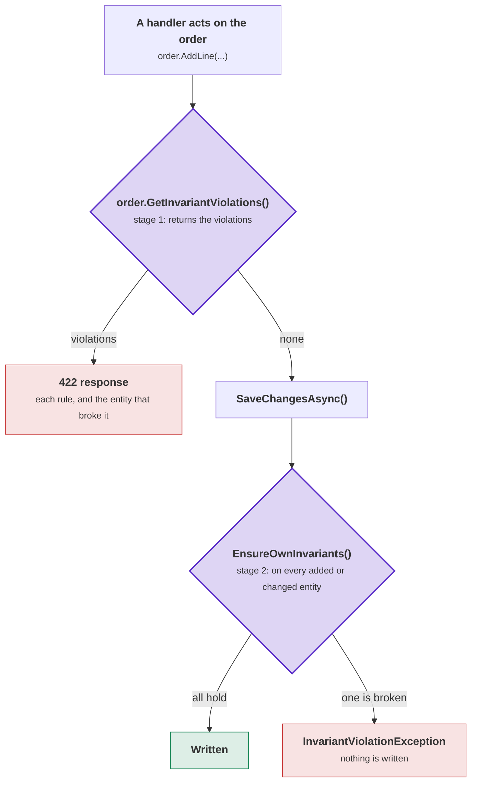

# Invariants

An invariant is a rule that must be true of a whole aggregate whenever code can read the aggregate. Examples:

- An order with no lines is not an order.
- A tab may never total more than its limit.
- Exactly one address of a customer is the billing address.

An invariant is different from a field check ("this field is required") and from input validation ("this input looks
wrong"). Vernon's first rule of aggregate design is to model true invariants within one consistency boundary
([Designing aggregates](aggregate-design.md)). This page shows where the toolkit lets you write them.

A rule written as an `if` in a handler holds only while every handler repeats it. A new handler that removes a line
without the check stores an order that the domain says cannot exist. Nobody notices until somebody reads the row. A
rule stated on the aggregate runs for the aggregate, whichever method changed it.

The toolkit defines no invariants, because your invariants are about your domain. The toolkit supplies three things:

- a place to write the rules;
- two moments at which the rules are checked;
- a guarantee that the second moment, the save, never skips the check.

This page first shows how to write a rule, then when the checks run and how much one check covers. It ends with the
limits of the checks and the reasons behind the design.

## Stating a rule

An entity states a rule in one of two ways. The choice affects what a caller can do with a broken rule.

### The seam

The generator declares a partial method, `CheckInvariants()`, on every `[Entity<TId>]` and `[AggregateRoot<TId>]`.
The docs call this method the **seam**. Implement it in your part of the class:

```csharp
[AggregateRoot<OrderId>]
public partial class Order
{
    public partial IReadOnlyList<OrderLine> Lines { get; }

    public OrderStatus Status { get; private set; }

    partial void CheckInvariants()
    {
        if (Status != OrderStatus.Draft && Lines.Count == 0)
        {
            throw InvariantViolation("A placed order must have at least one line.");
        }
    }
}
```

Write the method as shown: `partial void`, without an accessibility modifier, in a file of your own. The generator
writes the declaration.

`InvariantViolation(...)` is a protected helper on `Entity<TId>`. It builds an `InvariantViolationException` that
already holds the aggregate's type and id, so the message names the broken object. An overload takes several
messages, so one check can report every problem it found:

```csharp
partial void CheckInvariants()
{
    var problems = new List<string>();

    if (Lines.Count == 0) problems.Add("An order must have at least one line.");
    if (Total > CreditLimit) problems.Add($"An order may not exceed the credit limit of {CreditLimit}.");

    if (problems.Count > 0) throw InvariantViolation(problems);
}
```

The seam reports by throwing. Code can also check an aggregate without an exception, which is the first of the
[two stages](#the-two-stages) below. That stage catches the exception from the seam. It turns each message into a
violation with the code `InvariantViolation.SeamCode`, which is the string `"CheckInvariants"`. The seam has no place
to give a code of its own, so its violations get a code that names their source.

### A named invariant

The other way is one class per rule. The class implements `IInvariant<T>` and is nested inside the entity it checks:

```csharp
// Ordering/Invariants/MustHaveLines.cs
public partial class Order
{
    public sealed class MustHaveLines : IInvariant<Order>
    {
        /// <summary>The code a caller branches on, instead of matching on the message.</summary>
        public const string ViolationCode = "ORDER_HAS_NO_LINES";

        public string Code => ViolationCode;

        public InvariantFailure? Check(Order order)
            => order.Status != OrderStatus.Draft && order._lines.Count == 0
                ? "A placed order must have at least one line."
                : null;
    }
}
```

`Check` returns `null` when the rule holds. Otherwise it returns what is wrong, in the domain's words, as an
`InvariantFailure`. A string converts to an `InvariantFailure`, so a rule with only a message returns the message.
`Check` returns `null` instead of a violation object, so a rule that holds allocates nothing. This matters because the
check runs for every changed entity on every save. The generated code pairs the failure with `Code`, so you write the
code once.

A message that contains values should also pass the values on. Then the message can be
[phrased in another language](localization.md) without the number fixed inside the sentence:

```csharp
public InvariantFailure? Check(Order order)
    => order.Total <= order.CreditLimit
        ? null
        : new InvariantFailure($"An order may total at most {order.CreditLimit}.")
            .With("CreditLimit", order.CreditLimit);
```

The values arrive on the violation as `InvariantViolation.Arguments`.

The generator finds the nested rules and creates one instance of each in a static array. It runs the rules before the
seam. Both stages run the same array. For the `Order` above, with `MustHaveLines` and a seam, the generator writes the
seam's declaration, the array, and one method that runs both:

**Order.g.cs, shortened**

```csharp
partial class Order : AggregateRoot<Shop.OrderId>
{
    // ...

    partial void CheckInvariants();

    private static readonly IInvariant<Shop.Order>[] __invariants =
    [
        new Shop.Order.MustHaveLines(),
    ];

    private void CollectInvariantViolations(
        ref List<InvariantViolation>? violations,
        out InvariantViolationException? seamFailure)
    {
        foreach (var invariant in __invariants)
        {
            // Null means the rule holds, and a rule that holds allocates nothing.
            var failure = invariant.Check(this);
            if (failure is not null)
            {
                violations ??= new List<InvariantViolation>();
                violations.Add(new InvariantViolation(invariant.Code, failure.Message, typeof(Shop.Order), Id) { Arguments = failure.Arguments });
            }
        }

        seamFailure = null;

        try
        {
            CheckInvariants();
        }
        catch (InvariantViolationException failure)
        {
            // ... kept as seamFailure, and each message it carries becomes a violation with InvariantViolation.SeamCode
        }
    }
```

Nothing is looked up at run time. The array names the rules, and the list of violations is created on the first
failure. So a consistent order allocates nothing in this method.

### Choosing between the seam and a named rule

The seam needs less code. A small rule is one `if` inside the class it checks, with no extra type, file, code or name.
An aggregate with one short rule gains nothing from a nested class. Use the seam by default.

Use a named rule when one of these is true:

- **The rule needs a name.** `MustShipSomewhereWeDeliver` shows the rule in the file tree. A condition inside an `if`
  shows the rule only to the reader of the method body.
- **A caller must branch on which rule broke.** This is the main reason. Every violation from the seam carries
  `SeamCode`. An application that answers "no lines" differently from "over the credit limit" could only tell the two
  apart by their messages, and a message is not a stable API. A named rule has a code, and the nested type holds it:
  `Order.MustHaveLines.ViolationCode`.
- **The rule needs a test of its own.** `new Order.MustHaveLines().Check(order)` is a unit test without a method call
  on the aggregate, without an exception to catch and without a database. The seam can only be tested through the
  entity.
- **The entity has several rules, and more keep coming.** A seam with six `if` statements and a hand-built list of
  problems is hard to read. Six named rules each report themselves, and none needs to know about the others.

An entity can use both. The rules that need a name get a class, and the short rules stay in the seam.
[`Examples/ModularMonolith.Supabase`](../Examples/ModularMonolith.Supabase) does this. The order has named rules, the
line has a named rule, and one rule stays in the order's seam.

To find seam rules that should become named rules, look for violations with `InvariantViolation.SeamCode`. Each one
came from a seam and has no code that a caller can use.

## The two stages

A broken invariant means something different before the save and at the save.

**Before the save, the application asks.** A user added a line, a handler took the last item out of a basket, or a
command built part of an aggregate and will finish it later. "Not consistent yet" is a real answer here. The caller
wants to use the answer: show it, log it, or put it in a response. `GetInvariantViolations()` returns the violations
and never throws. An empty list means consistent.

**At the save, the check enforces.** The transaction is the consistency boundary. An aggregate that is about to be
written in a broken state means that something went wrong earlier. `EnsureInvariants()` throws
`InvariantViolationException`. The save runs the same throwing check on each entity it writes, so the save stops and
nothing reaches the database ([At the save](#at-the-save)).

The diagram shows both stages for one handler. Purple marks the two checks, green is a successful save, and red is a
refusal:



<details>
<summary>Show the code: a rule, a handler that asks, and the save that checks</summary>

A rule is a class nested in the entity it checks. The generator finds it, so there is nothing to register:

```csharp
public partial class Order
{
    public sealed class MustHaveLines : IInvariant<Order>
    {
        public string Code => "ORDER_HAS_NO_LINES";

        public InvariantFailure? Check(Order order)
            => order.Lines.Count == 0 ? "An order must have at least one line." : null;
    }
}
```

A handler that wants to answer instead of fail asks before it saves:

```csharp
order.AddLine(command.Sku, command.Quantity);        // the domain acts

var violations = order.GetInvariantViolations();     // the order's rules and every line's
if (violations.Count > 0)
{
    return Results.UnprocessableEntity(violations.Select(v => new { v.Code, v.Message }));
}

await context.SaveChangesAsync(cancellationToken);   // the interceptor still checks
```

The save checks because `UseDDDToolkit` adds the interceptor to the context:

```csharp
builder.Services.AddDbContext<OrderingContext>((services, options) => options
    .UseNpgsql(connectionString)
    .UseDDDToolkit(services));
```

See [Checking in a handler before the save](#checking-in-a-handler-before-the-save) and [At the save](#at-the-save).

</details>

```csharp
var broken = order.GetInvariantViolations();   // stage 1: returns the violations
order.EnsureInvariants();                      // stage 2: throws when a rule is broken
```

| | `GetInvariantViolations()` | `EnsureInvariants()` |
|---|---|---|
| Question | Is the aggregate consistent yet? | May the aggregate be stored? |
| Returns | `IReadOnlyList<InvariantViolation>` | nothing, or throws |
| Consistent | an empty list | returns |
| Broken | the violations, each with its code | throws `InvariantViolationException` |
| Called by | your application, when it wants to know | the save, before every write ([At the save](#at-the-save)) |
| Covers | the whole aggregate, children included | the same |

The last row surprises many readers. [Checking the whole aggregate](#checking-the-whole-aggregate) explains it.

### Why `EnsureInvariants` throws

The throwing check runs in the middle of a save. A save has no place to return a list, and no caller is waiting to
read one. A return value that nobody reads gets dropped. An exception cannot be ignored by accident, and that is the
guarantee. With a return value, the guarantee would depend on every future caller remembering to read it.

Also, at the save, the aggregate's methods have already changed the aggregate. The changed state is a fact, and no
question is left to answer.

The two stages never disagree. The generated code runs both through one method that collects the violations. They
differ only at the end. `GetInvariantViolations()` returns the list. `EnsureInvariants()` throws once, with every
message in the exception:

**Order.g.cs, shortened**

```csharp
    public override IReadOnlyList<InvariantViolation> GetInvariantViolations()
    {
        List<InvariantViolation>? violations = null;
        CollectInvariantViolations(ref violations, out _);
        CollectChildInvariantViolations(ref violations);

        if (violations is null)
        {
            return Array.Empty<InvariantViolation>();
        }

        return violations;
    }

    public override void EnsureInvariants()
    {
        List<InvariantViolation>? violations = null;
        CollectInvariantViolations(ref violations, out var seamFailure);

        CollectChildInvariantViolations(ref violations);

        if (violations is null)
        {
            return;
        }

        ThrowInvariantViolations(violations, seamFailure);
    }
```

`CollectChildInvariantViolations` asks the lines, as the next section explains. The toolkit uses no exceptions for
control flow on this path. An `IInvariant<T>` never throws. The only exception on the way is the one from your seam,
and one `catch` turns it into violations so the asking stage can return them.

## Checking the whole aggregate

A check on an aggregate root covers the whole aggregate. It runs the root's rules and seam first. Then it asks every
child entity the root holds, and each child asks its own children the same way. One call returns one list, and the
list says whether the aggregate may exist.

This is what "the aggregate is the consistency boundary" means in code. The root is the boundary. A check that covered
only the root object would be a field check. A handler that adds a line and asks the order whether the change was
allowed would get an answer about half the aggregate, with no sign that the lines were skipped.

A child entity states its rules in the same two ways. A line that names no SKU is broken on any order, so that rule
belongs to the line:

```csharp
public partial class OrderLine
{
    public sealed class MustNameASku : IInvariant<OrderLine>
    {
        public const string ViolationCode = "LINE_HAS_NO_SKU";

        public string Code => ViolationCode;

        public InvariantFailure? Check(OrderLine line)
            => string.IsNullOrWhiteSpace(line.Sku) ? "A line must name the thing it is ordering." : null;
    }
}
```

`Order` never mentions the rule, and a check on the order reports it:

```csharp
var broken = order.GetInvariantViolations();   // the order's rules, and every line's
order.EnsureInvariants();                      // the same, and throws instead of returning a list
```

The generator writes the walk over the collections that the entity declares. You opt in to nothing and maintain
nothing. For `Order`, the walk reads the field behind `Lines`:

**Order.g.cs, shortened**

```csharp
    private void CollectChildInvariantViolations(ref List<InvariantViolation>? violations)
    {
        foreach (var child in _lines)
        {
            if (child is null)
            {
                continue;
            }

            var broken = child.GetInvariantViolations();
            if (broken.Count == 0)
            {
                continue;
            }

            violations ??= new List<InvariantViolation>();
            for (var index = 0; index < broken.Count; index++)
            {
                violations.Add(broken[index]);
            }
        }
    }
```

Each line answers with its own `GetInvariantViolations()`. So a child with children of its own asks them in turn. A
child collection added later is checked without a change to the root. A rule added to `OrderLine` is reported by
`Order` as soon as it compiles.

### Checking in a handler before the save

The walk exists for this case. The handler changes an aggregate, asks what the change broke, and refuses the request.
Loading and saving need a `DbContext`. The check does not. It reads a graph of objects in memory, and nothing in the
database changes the result.

```csharp
public async Task<IResult> Handle(AddLine command, CancellationToken cancellationToken)
{
    var order = await orders.FindAsync([command.Order], cancellationToken);
    if (order is null)
    {
        return Results.NotFound();
    }

    order.AddLine(command.Sku, command.Quantity);        // the domain acts

    var violations = order.GetInvariantViolations();     // the order's rules and every line's
    if (violations.Count > 0)
    {
        return Results.UnprocessableEntity(violations.Select(v => new
        {
            v.Code,
            v.Message,
            entity = v.EntityType?.Name,                 // "OrderLine"
            id = v.EntityId?.ToString(),                 // "LINE_0199b1c0-..."
        }));
    }

    await context.SaveChangesAsync(cancellationToken);   // the interceptor still checks
    return Results.Ok();
}
```

Every violation names the entity that reported it. So the caller learns "line LINE_0199b1c0 names no SKU" instead of
"something in this order is wrong". The caller does not search the aggregate for the object a message is about. The
caller also does not read the message to find out which rule broke, because it can branch on the code:

```csharp
if (violations.FirstOrDefault(v => v.Code == OrderLine.MustNameASku.ViolationCode) is { } blank)
{
    return Results.UnprocessableEntity(new { blank.Code, blank.Message, line = blank.EntityId });
}
```

A named rule makes that branch possible. A rule in the seam reports `InvariantViolation.SeamCode`, which tells the
caller only where the violation came from. `EntityType` and `EntityId` are nullable, because a violation you construct
by hand need not carry them. Every violation the toolkit produces carries both.

`EnsureInvariants()` puts the same information in its message. The exception names the aggregate that was checked, so
the aggregate's own violations appear as plain messages. Only a child's violation starts with that child's type, id
and code:

```
The Order 'ORD_0199b1c0' broke 2 invariants: An order may not name the same SKU on two lines.
OrderLine LINE_0199b1c2 LINE_HAS_NO_SKU: A line must name the thing it is ordering.
```

The message is one line, wrapped here. The toolkit throws one `InvariantViolationException`. It keeps the exception
from the seam as its inner exception, and its `Violations` property holds the same messages for code that reads them
one by one.

## When the checks run

### At the save

The transaction is the consistency boundary. An aggregate may be inconsistent halfway through one of its own methods,
but it must never be *stored* in a broken state. So the toolkit checks at the save.

`UseDDDToolkit` registers an `InvariantInterceptor`. Before every `SaveChanges`, the interceptor runs the throwing
check on these objects:

- every tracked entity the save adds or modifies, child entities included;
- the aggregate root of each changed child.

An exception stops the save, and nothing is written.

```csharp
services.AddDDDToolkitEntityFramework();
services.AddDbContext<ShopContext>((sp, db) => db.UseSqlite(cs).UseDDDToolkit(sp));
```

Nothing else needs to be switched on. The argument that `AddDDDToolkitEntityFramework` usually takes says how domain
events are delivered, which is a separate topic. See [Domain event delivery](event-delivery.md). The interceptors run
in this order:

| Order | Interceptor | Why in this place |
|---|---|---|
| 1 | `PublishDomainEventsInterceptor` | Handlers run before the save and may change tracked aggregates. |
| 2 | `InvariantInterceptor` | It sees what those handlers changed. |
| 3 | `AggregateVersionInterceptor` | It runs after both, so a save that the invariants refuse leaves no version raised. |
| 4 | `DatabaseRefusalInterceptor` | It only answers a save that the database refused, so it has nothing to do before the save. |

The interceptor does not check two kinds of object:

- **An entity that is being deleted.** A deleted row has no state left to be consistent.
- **An aggregate that this save does not touch**, even when the aggregate is loaded and broken. Rows that were already
  wrong are a migration problem, and this save did not cause them.

### Rules of child entities

A child `[Entity<TId>]` has all four check methods, and the save checks the child directly. A line that breaks a rule
about lines reports it, in its own words, with its own id. The root does not need to know the rule exists.

The save calls `EnsureOwnInvariants()` on each object. The save already has the full list of objects in front of it,
the root and each changed child alike. If it called the walking methods, it would report a child twice: once for the
child, and once through its root. Only a caller that does not list the objects itself wants the walking methods. That
is the only difference between the two pairs.

The save builds its list from the change tracker, never from a navigation property. The tracker knows only what was
loaded and what changed. So building the list cannot trigger a lazy load, cannot run a query, and cannot fail on a
graph whose children were never loaded. A generated `foreach (var line in _lines)` could do all three. This is why
the list is built in the persistence layer and not in the entity.

**A rule that spans several children belongs on the root.** "No two lines may name the same SKU" is not a rule of one
line. No line can see the other lines, and no line knows whether it is the one at fault. Only the root sees all the
lines, and only the root can state a rule about a child that this save did not touch:

```csharp
partial void CheckInvariants()
{
    if (_lines.Select(line => line.Sku).Distinct().Count() != _lines.Count)
    {
        throw InvariantViolation("An order may not name the same SKU on two lines.");
    }
}
```

**Do not call `child.EnsureInvariants()` from the root's seam.** The root already asks every child. A seam that asks
again reports every broken line twice: once from the seam, and once from the generated walk. The seam is the place for
rules about several children, like the one above.

### Running the checks by hand

All four check methods are public on every entity and aggregate root. So a unit test or a command handler can run them
without a database:

```csharp
var order = new Order(OrderId.CreateUnique(), customer);
order.AddLine(sku: "", quantity: 1);

// [ InvariantViolation("LINE_HAS_NO_SKU", "A line must name...", typeof(OrderLine), LINE_0199...) ]
order.GetInvariantViolations();      // the order's rules and every line's
order.EnsureInvariants();            // the same, and throws instead of returning a list

order.GetOwnInvariantViolations();   // the order's rules only, for a caller that walks the graph itself
order.EnsureOwnInvariants();         // the same, and throws
```

For a unit of work with several aggregates, `InvariantInterceptor` offers the same two stages over a `DbContext`:

```csharp
InvariantInterceptor.CheckInvariants(context);                // throws, as the save would
var broken = InvariantInterceptor.GetInvariantViolations(context);   // returns the violations, and writes nothing
```

Both methods choose the same objects as the interceptor, so they report what the save would do. Neither method saves.
Use these methods when the question spans several aggregates in one unit of work. Use the aggregate's methods when you
hold the aggregate, which is the usual case, and when your domain code should not mention a `DbContext`.

## Putting the violations in your own result type

The toolkit returns the failures and ships no `Result<T>`, for the same reasons as
[value objects](value-objects.md#why-not-a-result-type). Teams already use FluentResults, ErrorOr, OneOf or a type of
their own. A result type spreads into every signature, and a codebase with its own result type would end up with two.
Wrapping the call takes a few lines of your own:

```csharp
public static Result Consistency(this IHasInvariants entity)
{
    var violations = entity.GetInvariantViolations();

    return violations.Count == 0
        ? Result.Ok()
        : Result.Fail(violations.Select(v => new Error(v.Message)
            .WithMetadata("code", v.Code)
            .WithMetadata("entity", v.EntityId)));      // which child, when it was a child
}
```

One call on the aggregate covers the whole aggregate, children included. So a wrapper like this needs no knowledge of
the shape of the graph. The check becomes an ordinary step in a handler, with nothing thrown and nothing saved:

```csharp
public async Task<Result> Handle(AddLine command, CancellationToken cancellationToken)
{
    var order = await orders.FindAsync([command.Order], cancellationToken);

    order.AddLine(command.Sku, command.Quantity);

    var consistency = order.Consistency();
    if (consistency.IsFailed)
    {
        return consistency;      // nothing was saved, and nothing was thrown
    }

    await context.SaveChangesAsync(cancellationToken);
    return Result.Ok();
}
```

The interceptor still checks the `SaveChangesAsync` on the last line. The check in the handler does not replace the
interceptor. It returns the result as a value where the handler wants it, and the exception at the save stays for the
case nobody foresaw.

Branch on the code, never on the message:

```csharp
if (violations.Any(v => v.Code == Order.MustStayWithinTheCreditLimit.ViolationCode))
{
    return Result.Fail(new CreditLimitExceeded());
}
```

For a whole request, ask the context instead of each aggregate:

```csharp
var violations = InvariantInterceptor.GetInvariantViolations(context);
if (violations.Count > 0)
{
    return Results.UnprocessableEntity(violations.Select(v => new { v.Code, v.Message }));
}
```

To answer in the reader's language, pass the violations through `Localized(localizer)` first. See
[Localization](localization.md). On the throwing path, the same violations, with their codes and arguments, are in
`InvariantViolationException.InvariantViolations`.

The violations come in a fixed order: each root before the children it owns, so the list follows the shape of the
aggregate. The aggregate's own walk uses the same order: the object's rules, then its seam, then each child collection
in declaration order.

## Invariants and validation

Validation and invariants answer different questions, and the toolkit keeps them apart.

| | Validation | Invariant |
|---|---|---|
| Question | Is this input acceptable? | Can this state exist at all? |
| Subject | One value object or one field | The whole aggregate |
| Audience | The user who typed the input | The programmer who wrote the method |
| Toolkit support | `[ValueObject]`, `ValidationError`, FluentValidation | `CheckInvariants()`, `IInvariant<T>` |
| Failure | `ValidationError`s that you show in a form | `InvariantViolation`, or an exception at the save |

A validator sees one object at a time. "An order may not exceed the customer's credit limit" reads the lines, the
order's header and a number from elsewhere. No single property carries that rule. A validator also runs only where
code calls it. The save-time check runs at every commit, and that is what makes it a guarantee.

`InvariantViolation` and `ValidationError` are separate types for the same reason. Code that reads one type never
receives the other. An `InvariantViolationException` in production is not a message for a user. It means an aggregate
method let its object into a state that the domain says cannot exist. The fix belongs in that method or in its
caller. Catch `ConcurrencyConflictException` and retry. Catch a validation failure and report it. An invariant
violation is neither case.

## Rules across two aggregates

**The checks on this page cannot check an invariant that spans two aggregates, and they should not.**

"A customer's open orders may not exceed the customer's credit limit" is a rule about one `Customer` and every `Order`
that refers to it. Neither kind of rule can enforce it. `Order`'s rules only see the order. To check this rule, the
order would have to load the customer and every other order of the customer. Even then, two concurrent saves could
each see a total that was true a moment earlier, and together write a pair of rows that breaks the rule.

The aggregate boundary exists for this reason. If a rule must hold inside one transaction, the objects it reads are one
aggregate, with one root, one version and one lock. That is a design choice, and it costs contention. If the objects
are separate aggregates, the rule is eventually consistent, and you decide what happens in the time between:

- Raise a domain event (`OrderPlaced`), and let a handler check the rule and react. The handler can reject the order,
  flag the customer, or open a task for a person. See [Domain events](domain-events.md) and the
  [outbox](event-delivery.md#the-outbox).
- Or move the number that must be exact into one aggregate. A `CreditLine` aggregate that holds the reserved amount can
  guarantee its own total, and the order reserves against the credit line first.

Either way, your design must say what happens between the two saves. The toolkit does not close that gap. It checks
what it can guarantee: one aggregate in one transaction.

## Why a rule is a nested type

A rule must be nested in the entity it checks. There are two reasons.

**A nested type can read private state.** A nested type sees the private members of the type around it, so
`MustHaveLines` above reads `_lines` directly. A rule elsewhere would need the aggregate to expose what the rule reads,
so the aggregate's public surface would grow for every rule.

**The generator finds nested rules at no cost.** The generator holds the entity's symbol when it writes the entity, and
the nested types belong to that symbol. Finding rules by searching the whole compilation for implementations of
`IInvariant<Order>` would make every entity's output depend on every file in the project. An incremental generator
could then no longer reuse its earlier output.

One file per rule, each as another part of the entity, keeps the entity from becoming one large class:

```
Ordering/
  Order.cs                          the aggregate
  Invariants/
    MustHaveLines.cs                public partial class Order { public sealed class ... }
    MustShipSomewhereWeDeliver.cs
    MustStayWithinTheCreditLimit.cs
```

The generator creates one instance of each rule per entity type and reuses it for every check. So a rule has two more
requirements:

- It is **stateless**. The entity it checks is the argument of `Check`, never a field.
- It has an **accessible parameterless constructor**.

The analyzer reports each mistake with a diagnostic:

| Diagnostic | What it reports |
|---|---|
| [DDD00024](diagnostics.md#ddd00024) | A rule that is not nested inside an entity, so nothing runs it |
| [DDD00025](diagnostics.md#ddd00025) | A rule nested inside one type but written for another type |
| [DDD00026](diagnostics.md#ddd00026) | Two rules of one entity with the same code |
| [DDD00027](diagnostics.md#ddd00027) | A rule that the generated code cannot construct |

Without these diagnostics, each mistake would leave a rule that compiles and passes its own unit test, and never runs
at a save.

### Why the seam returns `void`

A seam that returned a list would read better than a seam that throws, but it cannot work. C# only removes a partial
method that returns `void`. A partial method with any other return type must have an implementation, so every entity
in your solution would need an empty one. Because the seam is `partial void`, an aggregate that states no invariants
gets an `EnsureInvariants` whose compiled body contains no call. A test reads the emitted IL and asserts that the body
holds only `ret` (and `nop` in a Debug build).

For a `Customer` with no rules, no seam and no child collections, the generated checks contain the call to the seam
and nothing else, and the compiler removes that call:

**Customer.g.cs, shortened**

```csharp
    partial void CheckInvariants();

    // ...

    public override void EnsureOwnInvariants()
    {
        CheckInvariants();
    }

    public override IReadOnlyList<InvariantViolation> GetInvariantViolations() => GetOwnInvariantViolations();

    public override void EnsureInvariants()
    {
        CheckInvariants();
    }
```

Named rules do not have this limit. An `IInvariant<T>` is an ordinary type with an ordinary return value, and
returning `null` for "the rule holds" costs nothing.

## The check follows collections only

The walk covers the collections of child entities that a type declares. It reads the generated backing field, and not
the read-only property. It does not follow a single reference from one entity to another.

This is a design decision. A child that holds a property back to its parent is a common shape. If the walk followed
single references, it would go from root to child to root to child until the stack ran out. A visited set would stop
that, but a visited set allocates memory on every call. Most calls find nothing broken, and today the consistent path
allocates nothing, on every changed entity at every save. A `HashSet` there, for a shape that an aggregate does not
have, would cost more than it gives.

An aggregate has a root that owns collections of children. Following collections only rules out cycles, costs nothing
and misses no real aggregate. A single reference to *another* aggregate is not a child. It is an id, and the other
aggregate checks its own consistency ([Rules across two aggregates](#rules-across-two-aggregates)).

## How the save chooses what to check

The walk and the save check different sets of objects, on purpose.

| | The walk | The save |
|---|---|---|
| Runs on | an aggregate you hold | a `DbContext` |
| Reaches | every child in the graph | every tracked entity that this save adds or modifies |
| Finds the objects | with the generated `foreach` over `_lines` | with the change tracker |
| Queries the database | never, and it cannot trigger a lazy load | never, and it reads no navigation property |
| Called by | your handler, when it wants to know | `InvariantInterceptor`, before every `SaveChanges` |
| Calls | `EnsureInvariants` / `GetInvariantViolations` | `EnsureOwnInvariants` / `GetOwnInvariantViolations` |

All four methods are members of `IHasInvariants`, so the persistence layer can call them on any entity without
knowing its id type.

The walk checks more objects. The save checks the objects it is about to write, because a save deals in partial
graphs: a root loaded without its collection, a child that the unit of work never saw, an aggregate built from two
queries. A generated `foreach` over `_lines` on such a graph could trigger a lazy load, run a query, or fail. So the
persistence layer finds the objects to check, and the entity does not.

For the same reason, "the collection might not be loaded" does not shape the walk. Loading is a persistence question,
and the persistence layer answers it. While a handler works on an aggregate, the aggregate is in memory and complete.

The result: **the walk is the stricter of the two checks**. Every object the save checks, the walk checked too. So an
aggregate that passes the walk always passes the save. The reverse is not true. The walk reports a broken line that the
save skips, because nothing about the line changed. A rule broken by a row that nobody touched is still broken when you
ask the aggregate, and it still does not stop this save.

## Checking one object without its children

`EnsureOwnInvariants()` and `GetOwnInvariantViolations()` check one object and not the objects it holds. Use them for
one reason only: **you walk the graph yourself** and check every object you find. If you call the walking methods from
such a walk, every child is reported twice, once for itself and once through its root. The interceptor walks the
graph this way, which is why it calls the methods for one object. A traversal you write yourself is the same case.

Code that holds an aggregate and wants to know whether it is consistent calls `GetInvariantViolations()`. If you call
the one-object methods to avoid a collection that may not be loaded, you are in the persistence case, and
[`InvariantInterceptor`](#running-the-checks-by-hand) already handles it with the change tracker.

The one-object methods also matter for an entity you write by hand instead of generating it. State its rules in
`EnsureOwnInvariants` and `GetOwnInvariantViolations`, because the walking methods of `Entity<TId>` call the
one-object methods. If you override only `GetInvariantViolations`, a check on the object still works, but the save
calls the one-object method and finds nothing.

## Cost at run time

An entity that states no rules and holds no children costs nothing at run time:

- The compiler removes an unimplemented partial method and every call to it.
- The generator writes no array of rules when there are none.
- The generator writes no walk when there are no child collections.
- The interceptor calls `EnsureOwnInvariants`, whose compiled body is then empty.

An entity with rules costs one static array, built once per entity type, and one virtual call per rule per check. The
list of violations is created on the first failure, and never on the consistent path. The consistent path is the path
that runs for every changed entity on every save. The generated checks use no reflection, no attribute scan, no
expression tree and no LINQ.

The walk costs one `foreach` over each child collection and one call per child. A child with no violations adds
nothing, because no list exists yet. So a consistent aggregate of a root and a hundred lines allocates nothing, and the
check can run on a hot path. The generator writes the walk only over collections whose element type is an `[Entity]`
or an `[AggregateRoot]`. A collection of value objects, identifiers or strings costs nothing.

The interceptor walks the change tracker to choose the objects to check. `AggregateVersionInterceptor` already makes the
same walk for versioning. The interceptor reads no navigation properties.

## See also

- [Entities and aggregates](entities-and-aggregates.md) for what belongs inside the boundary.
- [Value objects](value-objects.md) for the validation of a single value.
- [Entity Framework](entity-framework.md) for the interceptors and what each one guarantees.
- [Testing aggregates](testing.md#testing-invariants) for asserting on invariants in a unit test.
- [Diagnostics](diagnostics.md#ddd00024) for DDD00024 to DDD00027, the four mistakes that leave a rule that never
  runs.
