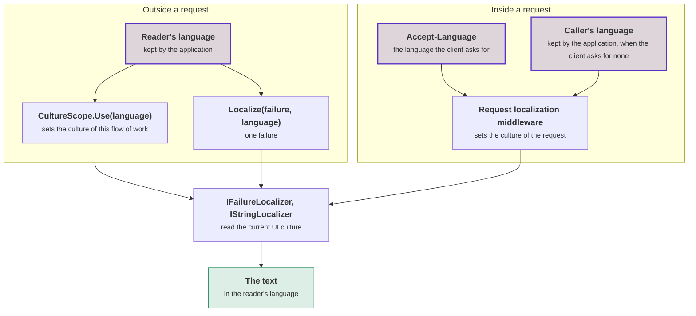

# Localization

Every failure that the toolkit reports carries three things:

- a stable **code**;
- a **message** in the words of the domain;
- the **arguments** that the message was built from.

`DDDToolkit.Localization` uses the code and the arguments to write the failure in the reader's language, at the
moment the failure becomes a response.

This covers every failure that the toolkit hands you:

- `ValidationError`, from a value object or a FluentValidation validator;
- `InvariantViolation`, from `GetInvariantViolations()`, or from `InvariantViolationException.InvariantViolations`
  when the invariants throw;
- `RefusalException`, from a refused command.

## Where translation happens

The domain never reads a culture. An invariant also runs when a background job saves, and that job has no reader
to ask for a language. So the domain reports what is wrong, and the edge of the application, such as an
endpoint, writes the text:

| Part of the failure | Example | What the edge does with it |
|---|---|---|
| Code | `Till.OverLimit` | Looks it up in your resx, for the current UI culture. |
| Message | "A till holds at most 100…" | Keeps it as the fallback, for a code without a translation. |
| Arguments | `{ Limit: 100, Cash: 150 }` | Fills them into the translated template. |

A failure whose code has no translation keeps the domain's message. So adding localization never makes a response
worse.

## Setup

```bash
dotnet add package Temp.DDDToolkit.Localization --prerelease
```

The interface `IFailureLocalizer` is in the core package `DDDToolkit`. So an integration can ask for a localizer
without a dependency on how the translations are stored. `DDDToolkit.Localization` has the implementation, which
reads translations through `IStringLocalizer`.

```csharp
builder.Services.AddLocalization();
builder.Services.AddDDDToolkitLocalization(options => options.AddResource<SharedFailures>());

var app = builder.Build();
app.UseRequestLocalization("en", "nl");
```

- `SharedFailures` is an empty marker class. `SharedFailures.resx`, `SharedFailures.nl.resx` and the files of the
  other languages sit next to it. The localizer finds them the same way `IStringLocalizer<SharedFailures>` does.
- The localizer asks the sources in the order they were added.
- `AddLocalizer(IStringLocalizer)` adds a localizer that you built yourself, such as one that reads translations
  from a database.
- The localizer is a singleton. It reads the language on every call.

The language is `CultureInfo.CurrentUICulture`, which the request localization middleware sets for each request.
Numbers and dates in a message use the format of `CultureInfo.CurrentCulture`. Without a request, the code that
writes the text sets the language ([Texts outside a request](#texts-outside-a-request)).

## Writing translations

The key is the code of the failure. The value is a template with named placeholders:

```xml
<data name="Till.OverLimit" xml:space="preserve">
  <value>In deze kassa mag hooguit {Limit:C} zitten, en er zit {Cash:C} in.</value>
</data>
<data name="MaximumLengthValidator" xml:space="preserve">
  <value>{PropertyName} is hooguit {MaxLength} tekens lang.</value>
</data>
```

- `{Name}` is replaced by the argument with that name. The name is matched without regard to case.
- `{Name:format}` applies a .NET format string. `{Limit:C}` is a currency amount in the current culture.
- `{{` and `}}` are literal braces.
- A placeholder without a value stays as written. So a typo shows on screen, and the failure path throws no
  exception.

A template can also name these members of the failure:

| Failure | Placeholders |
| --- | --- |
| `ValidationError` | `{PropertyName}`, `{AttemptedValue}`, `{Code}` |
| `InvariantViolation` | `{EntityType}`, `{EntityId}`, `{Code}` |
| `RefusalException` | `{Code}`, `{Kind}` |

When an argument has the same name as a member, the argument wins.

The localizer looks up an invariant violation as `{EntityType}.{Code}` first, and then as the code alone. So a
rule that several entities share can have one translation, and one entity can still get its own sentence.
`Drawer.NotNegative` wins over `NotNegative`.

## Localizing failures in an endpoint

`IFailureLocalizer` translates one failure. The extension methods `Localized(localizer)` and
`ToErrorDictionary(localizer)` translate a list. They replace only the message and keep the code and the
arguments, so a caller can still branch on the code:

```csharp
app.MapPost("/subscribers", (SubscribeRequest body, IFailureLocalizer localizer) =>
{
    if (!EmailAddress.Create(body.Email).TryToValid(out var email, out var errors))
    {
        return Results.ValidationProblem(errors.Prefixed("email").ToErrorDictionary(localizer));
    }

    return Results.Ok(subscribers.Add(email));
});
```

```csharp
var violations = order.GetInvariantViolations();
if (violations.Count > 0)
{
    return Results.UnprocessableEntity(violations.Localized(localizer).Select(v => new { v.Code, v.Message }));
}
```

When the invariants throw, `InvariantViolationException.InvariantViolations` holds the same violations, with their
codes and arguments. They are in the same order as the messages in `Violations`:

```csharp
catch (InvariantViolationException exception)
{
    return Results.UnprocessableEntity(exception.InvariantViolations.Localized(localizer)
        .Select(v => new { v.Code, v.Message }));
}
```

## Adding arguments to a failure

A template fills its placeholders from the `Arguments` of the failure. So a failure whose message names a value
must also carry that value as an argument.

### Value objects

A rule that you write by hand passes its values next to its message:

```csharp
protected override void Validate(ValidationErrorBuilder errors)
{
    if (Value.Length > 40)
    {
        errors.Add("A street is at most 40 characters.", nameof(Value), "Street.TooLong", Value,
            new Dictionary<string, object?> { ["MaxLength"] = 40 });
    }
}
```

`new ValidationError(...).With("MaxLength", 40)` does the same for a single failure.

With [FluentValidation](fluent-validation.md) you write nothing extra. Every placeholder value that FluentValidation
knows arrives in `Arguments`: `MaxLength`, `TotalLength`, `ComparisonValue`, `PropertyName`, and anything you add
with `context.MessageFormatter.AppendArgument`. The code of the failure (`MaximumLengthValidator`, `NotEmptyValidator`,
...) is the key. The same holds for `result.ToValidationErrors()` on a validator of your own.

FluentValidation also has its own translations, and uses them for `Message`. But a value object validates once and
caches the result. So that message is in the language that was current the first time something asked. The
localizer translates the failure when your code asks for the text, in the language that is current then.

### Invariants

`IInvariant<T>.Check` returns an `InvariantFailure`. A string converts to an `InvariantFailure`, so a rule without
values returns its message. A rule whose message names values adds them with `With`:

```csharp
public partial class Order
{
    public sealed class MustStayWithinTheCreditLimit : IInvariant<Order>
    {
        public const string ViolationCode = "Order.OverCreditLimit";

        public string Code => ViolationCode;

        public InvariantFailure? Check(Order order)
            => order.Total <= order.CreditLimit
                ? null
                : new InvariantFailure($"An order may total at most {order.CreditLimit}.")
                    .With("CreditLimit", order.CreditLimit)
                    .With("Total", order.Total);
    }
}
```

The rule is nested in the entity it checks, because the generator looks for rules there. When the rule holds,
`Check` returns `null` and allocates nothing.

The `CheckInvariants()` seam reports strings. All its violations carry the code `InvariantViolation.SeamCode`
(`CheckInvariants`), so a translation cannot tell them apart. A rule that needs a translation needs its own code,
so give the rule [a type of its own](invariants.md#a-named-invariant).

### Refusals

A refused command throws `RefusalException`, with a `Code`, a `Kind`, and the `Arguments` that its message names.

- `IFailureLocalizer.Localize(refusal)` looks the refusal up by its code, like any other failure. A template can
  name the arguments, `{Code}` and `{Kind}`.
- The interface has a default body for this method, which returns the refusal's own message. So a localizer that
  you wrote before refusals existed still compiles and works.
- The edge picks the HTTP status from `Kind`: `Invalid` is 400, `NotPermitted` is 403, `NotFound` is 404 and
  `Conflict` is 409.

A refusal of kind `Invalid` about one input names that input in the argument `RefusalException.FieldArgument`
(`"Field"`). A form can then show the text under that input:

```csharp
throw new RefusalException(
    "subscription.plan-name-invalid",
    RefusalKind.Invalid,
    "A plan's name takes 1 to 40 characters.",
    new Dictionary<string, object?> { [RefusalException.FieldArgument] = "name", ["Max"] = 40 });
```

- The value is the domain's name for the input. An edge that names the input differently maps the name, as
  `Prefixed("shipTo")` does for the failures of a value object.
- `Field` is an argument. `RefusalException` has no `Field` property, because a refusal about the whole command
  has no field to name.

The toolkit and its packages keep their codes in a class. Each code has its kind and its English text in that
class. `Refuse` makes the refusal:

- `throw TenancyRefusals.Refuse(TenancyRefusals.SeatNotFound);`
- `throw ToolkitRefusals.Refuse(ToolkitRefusals.RoleNotAllowed, ("Role", role));` also fills in `{Role}` in the
  text.

A module can keep its own codes the same way. A handler then writes
`throw ProjectRefusals.Refuse(ProjectRefusals.NotFound)`, and the kind and the text are written once. The Tenancy
sample's `ProjectRefusals` is such a class. Its English and Dutch texts are in the resource files next to it.

## GraphQL

`DDDToolkit.HotChocolate` has an error filter that does all of this for GraphQL. Every failure that the toolkit
throws becomes a GraphQL error, with its code in the extensions and its message in the reader's language. A
refusal becomes one error. Its kind is in the `kind` extension, and the input it names is in the `field`
extension. A validation failure has its property in the `field` extension too.

```csharp
services.AddGraphQLServer()
    .AddDDDToolkitTypes()
    .AddDDDToolkitErrors();
```

See [GraphQL](graphql.md#failures-as-graphql-errors).

With `AddDDDToolkitMutationConventions()`, the failures of a mutation are typed errors in its payload. The same
localizer writes their `message` fields. Two of these errors have a code of the toolkit: `invalid-value` and
`concurrency-conflict`. The localizer looks these codes up like the code of a refusal. Give them a text in your
resources, and a client reads that text. See
[Typed errors in mutation payloads](graphql.md#typed-errors-in-mutation-payloads).

## Texts outside a request

In a request, the middleware has set the reader's language. A mail, a notice, the result of a job or a line in an
export has no request. Its reader is often someone other than the person who started the work. The domain still
does not read a culture. The code that writes the text sets the reader's language.

In the diagram, purple is where the language comes from, and green is the result:



<details>
<summary>Show the code: a mail in its reader's language</summary>

```csharp
// The application keeps a language per reader: their own, else their organization's, else its default.
var language = await readers.LanguageOfAsync(recipient, cancellationToken);

using (CultureScope.Use(language))
{
    mail.Subject = texts["report-ready.subject"];           // IStringLocalizer reads the current UI culture
    mail.Body = texts["report-ready.body", report.Name, report.MadeAt];
}

// One failure, without a scope around it:
var why = localizer.Localize(refusal, language);
```

</details>

- `CultureScope.Use(culture)` sets both the current culture and the current UI culture until the scope is
  disposed. Disposing restores the two previous cultures, also when the work inside throws.
- `CultureScope.Use` takes a `CultureInfo` or the name of a culture, such as the `"nl"` that the application keeps
  for a reader.
- Everything inside the scope uses that culture: `IFailureLocalizer`, `IStringLocalizer`, and the format of numbers
  and dates.

The current culture belongs to a flow of work. It follows an `await` inside the scope, and work started inside the
scope starts with that culture. The culture does not reach work that was already running. It also does not flow
back from an `async` method to its caller. So open and dispose a scope in one method, with `using`.

For a single failure, an overload takes the culture:

```csharp
string Localize(this IFailureLocalizer localizer, RefusalException refusal, CultureInfo culture);
string Localize(this IFailureLocalizer localizer, ValidationError error, CultureInfo culture);
string Localize(this IFailureLocalizer localizer, InvariantViolation violation, CultureInfo culture);
```

Each overload calls the localizer inside a scope. So a localizer of your own, which reads the current UI culture,
also answers in that culture.

An exception handler needs these overloads too. The request localization middleware comes after the exception
handler in the pipeline, and sets the culture inside its own `async` method. When an exception reaches the
handler, that culture is gone, and a plain `Localize(refusal)` answers in the server's language. The middleware's choice is still on the
request, so the handler passes it:

```csharp
var culture = httpContext.Features.Get<IRequestCultureFeature>()?.RequestCulture.UICulture
              ?? CultureInfo.GetCultureInfo("en");
problem.Title = localizer.Localize(refusal, culture);
```

## Translations in a browser app

A front end with its own translations does not need the server's sentences. The server and the client share the
code and the arguments. The client shows the message only when it has no translation for the code.

- **The code is the translation key, unchanged.** `subscription.plan-name-invalid` and `Till.OverLimit` are valid
  keys in every common translation format. So the client's file has the same keys as your resx, and a test can
  compare the two lists.
- **The arguments fill the client's template.** They arrive by name, as values: `{ "Max": 40 }`,
  `{ "Min": 1, "Max": 200 }`. The client formats numbers and dates itself.
- **The message is the fallback.** When the server is deployed first, the client's file may not know a new code
  yet. The client then shows the message, in the reader's language when the request named one.
- **`Field` places the text under its input.** A refusal about one input carries `Field`, and a failure of a value
  object carries `PropertyName`. In GraphQL both arrive as `field`. A form finds the input by that name, and shows
  a failure without one at the top.

Send `Accept-Language` from the client anyway, so the fallback message is in the reader's language.

## Translations per module

Calls to `AddDDDToolkitLocalization()` add up. So each module registers its own translations in its own
composition method. The localizer asks every source, in the order of the calls:

```csharp
public static IServiceCollection AddOrdering(this IServiceCollection services)
    => services.AddDDDToolkitLocalization(o => o.AddResource<OrderingFailures>());

public static IServiceCollection AddShipping(this IServiceCollection services)
    => services.AddDDDToolkitLocalization(o => o.AddResource<ShippingFailures>());
```

### Permission descriptions

An administrator reads a text for each permission on the screen where roles are made. That text is the
`Description` of the permission's level, in the `[Permissions]` class that declares it
([Declaring a module's permissions](tenancy/roles-and-permissions.md#declaring-a-modules-permissions)). The
description is the English text and the fallback. A translation is a resx entry under the permission's name.
`IFailureLocalizer.Text(key, fallback)` returns the entry in the current UI culture, or the fallback:

```csharp
var description = localizer.Text(permission.Name, permission.Description);   // "orders.view": "De orders zien."
```

Keep the texts of the permissions in their own pair of files next to the class, such as
`OrderingPermissionTexts.resx` and `OrderingPermissionTexts.nl.resx`. Add them the same way a module adds the
texts of its refusals. The English file repeats the descriptions, so a translator has every text in one file per
language. The Tenancy sample's catalogue reads its permission texts this way, and a test checks each English file
against the descriptions.

## A package's texts under your own codes

A package that ships texts names each text once, in its own resx. Some packages refuse under a prefix that you
choose, per module or per resource. Then a failure carries your code, and the resx has the package's name for the
entry. Add the resx with a map: for each code that a failure carries, the name of the entry that holds its text.

```csharp
services.AddDDDToolkitLocalization(o => o.AddResource<SubscriptionFailures>(new Dictionary<string, string>
{
    ["billing.plan-closed"] = "subscription.plan-closed",
}));
```

- The localizer answers only the codes in the map.
- Several codes can read one entry.
- You can add the same resx once for each set of codes.
- [The check](#checking-that-everything-is-translated) follows your codes to their entries, language by language.
- A package whose codes you choose gives you the map.

### Texts a package's registration offers

A package that knows the codes at registration can add the map itself. Its registration offers its texts with the
map, and you write nothing for them:

```csharp
// In the package's registration: the texts of what this resource refuses with, under the codes it was given
services.AddFailureTexts<MembershipFailures>(rules.Codes.TextKeys);

// In your host: nothing about the package's texts
services.AddDDDToolkitLocalization(o => o.AddResource<SharedFailures>());
```

[Membership](membership/overview.md) offers its texts this way, once for each resource you register, under the
codes of that resource.

- **An offer adds no localizer.** `AddFailureTexts` is in the core package and registers a `FailureTexts`. Only
  `AddDDDToolkitLocalization` reads it. An application that does not translate its failures gets no localizer from
  a package, and its failures keep their own messages.
- **Your texts come first.** The localizer asks your sources first, then every offer in the order it was made,
  then the toolkit's own messages. So a reader gets your text for a package's code, whether you added it before or
  after the package's registration.
- **An offer needs no `AddLocalization()`.** The localizer reads an offer from the package's assembly and its
  satellite assemblies, by the name of the marker type. The folder of your own resources does not matter.
  [The check](#checking-that-everything-is-translated) reads an offer like any other source, under the name of its
  resx.

## A sample in two languages

The Tenancy sample (`Examples/Tenancy`) answers in English or Dutch, by the request's `Accept-Language` header. It
combines the parts above:

- **The texts are next to the codes.** Each module keeps a marker class with its two resource files next to the
  refusals they translate: `Aggregates/Projects/ProjectFailures.resx` and `.nl.resx` next to `ProjectRefusals.cs`.
  The table in `ProjectRefusals` keeps the English, so the domain reads no resource. The neutral resx repeats that
  English, and a test checks that the two are equal.
- **Each module registers its own texts.** The module's entry calls the registration of its application project,
  which calls `AddDDDToolkitLocalization(texts => texts.AddResource<ProjectFailures>())`. The Tenants module adds
  the package's `TenancyFailures` and the texts of the rules that the application added. The host calls
  `AddLocalization()`, and first adds the texts of the codes that the host answers itself.
- **A code has one text.** Inspections passes three of the codes of Projects on, and has no text of its own for
  them.
- **The host picks the language per request**, from the header and nothing else
  (`Host/Languages/RequestLanguages.cs`). It calls `app.UseRequestLocalization()` after tenant selection and before
  authorization.
- **The exception handler passes the language.** `RefusalProblems` opens
  `CultureScope.Use(RequestLanguages.LanguageOf(httpContext))` around the text it writes, for the reason under
  [Texts outside a request](#texts-outside-a-request).
- **GraphQL follows.** The sample's gateway at `/graphql` runs after the same middleware. So the `message` of a
  refusal, in a mutation's payload or as a query's error, is in the request's language too.
- **The UI has a switch.** The UI keeps the language in its session. It shows its own pages from `UiTexts.resx` in
  that language, passing the language with every lookup, and sends it as `Accept-Language` with every call.

Tests in `Tests/Examples.Tenancy.Tests/Host/Languages` check that:

- every code that the host can answer has a text in both languages, through the localizer that the host
  registered;
- every entry of one file is in the other file, with the same placeholders;
- no Dutch text addresses the reader.

One scenario sends the same refused request twice, and reads the answer in Dutch and in English. Another scenario
reads one refusal, for a caller without a seat, from a route and from GraphQL.

The Dutch texts state what is the case or what is needed, without "je" or "u". The choice between the two belongs
to the application, and a text without either fits both.

## The toolkit's own messages

The toolkit writes eight messages itself, and ships them in English and Dutch:

| Code | Where it comes from | Placeholders |
| --- | --- | --- |
| `Unspecified` | A `Validate()` that returned `false` without a reason. | `{ValueObject}` |
| `ValueObjectValidator` | `MustBeValid()` in `DDDToolkit.FluentValidation`. | `{PropertyName}`, `{ValueObject}` |
| `access.refused` | `ToolkitRefusals.Refused`, in two cases. `DDDToolkit.EntityFramework` makes it when a row level security (RLS) policy or a guard of the database refuses a save. A request that lets one caller or another through (`AccessRequirement.Any`, `[OrOwn]`) makes it when the caller is neither. Its argument `Reasons` then lists the code and the arguments of each case. | none |
| `access.role-not-allowed` | `ToolkitRefusals.RoleNotAllowed`. `DDDToolkit.EntityFramework.Postgres` makes it for a token whose role is on none of the host's lists, before anything runs for it. | `{Role}` |
| `access.not-signed-in` | `ToolkitRefusals.NotSignedIn`. A request requires a caller who signed in (`AccessRequirement.SignedIn()`), and the caller did not sign in, or is system work. | none |
| `access.system-only` | `ToolkitRefusals.SystemOnly`. Only system work may do this, and the caller is not system work. That includes work that began no user. The methods of Tenancy's managers that only system work may call, such as provisioning, make it, and so does a handler that only system work may run. | none |
| `access.not-own` | `ToolkitRefusals.NotOwn`. A request about the caller's own (`AccessRequirement.Own(value)`, `[Own]`) names a value that the caller does not have. | none |
| `access.not-found` | `ToolkitRefusals.NotFound`. A request about the owner of an aggregate (`AccessRequirement.OwnerOf`, or `[Own]` or `[OrOwn]` on the id of an aggregate with an `[Owner]`) names an aggregate with no row for the caller. The row does not exist, or RLS or a query filter hides it from the caller. | none |

The localizer asks these messages last. So a key with the same name in your own resx overrides them. To add
another language, add these eight keys to your resx for that language. A refusal of a request that lets one
caller or another through is translated by its own code, `access.refused`. A client that shows each reason
translates each entry of `Reasons` by its code, the same way.

Override a message in every language you support. `IStringLocalizer` falls back from `SharedFailures.nl.resx` to
`SharedFailures.resx` before the localizer asks the toolkit. So an override in the neutral file alone gives Dutch
readers your English text instead of the toolkit's Dutch text. [The check](#checking-that-everything-is-translated)
reports this case as `Hidden`.

## Checking that everything is translated

`FailureTranslations` checks that every failure you expect has a translation in every language you support. A
missing translation then fails a test before a reader sees it:

```csharp
[Fact]
public void Every_failure_is_translated_in_every_language()
    => FailureTranslations
        .Check(localizer, "en", "nl", "de")         // the first is the language of your neutral resx
        .Invariants(typeof(Order).Assembly)          // every IInvariant, found and asked for its code
        .Codes("Street.TooLong", "City.Required")    // codes your value objects report
        .ToolkitCodes()                              // the toolkit's own messages
        .Verify();
```

`localizer` is the localizer that the application registers, from a service provider built the way the
application builds it. The check follows each key through each source as the localizer does at run time, one
language level at a time: `nl-NL`, then `nl`, then the neutral resx. `Verify()` throws
`MissingFailureTranslationsException` with a report, by language and then by key:

```text
3 failure translations are missing or hidden:

  nl     Nobody.Knows                     missing: no source knows it, so readers get the domain's own message.
  nl     ValueObjectValidator             hidden: SharedFailures.resx has it only in its neutral (en) resx, which
                                          wins over the toolkit's nl text. Add it to the nl resx too.
  de     Order.OverCreditLimit            fallsback: readers get SharedFailures.resx's neutral (en) text.
```

| Problem | Meaning |
| --- | --- |
| `Missing` | No source knows the key, so readers get the domain's own message. |
| `FallsBack` | No source translates the key into this language, so readers get your neutral text or the toolkit's English. |
| `Hidden` | The toolkit translates the key, but your neutral resx answers first. |

`Invariants(...)` finds the invariants for you. It creates every `IInvariant` in the assemblies you name, and asks
each one for its code. Either of the two keys of an invariant counts. The codes of your value objects and of
FluentValidation are strings in your code, so name the ones you expect with `Codes(...)`.

`Findings()` returns the same report as a list, for a test that asserts something narrower. The check needs no
test framework, so it also works at start-up in development:

```csharp
if (app.Environment.IsDevelopment())
{
    FailureTranslations.Check(app.Services.GetRequiredService<IFailureLocalizer>(), "en", "nl")
        .Invariants(typeof(Order).Assembly)
        .Verify();
}
```
