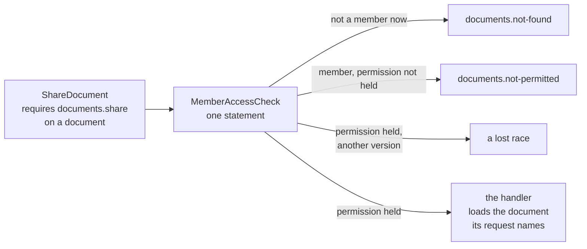
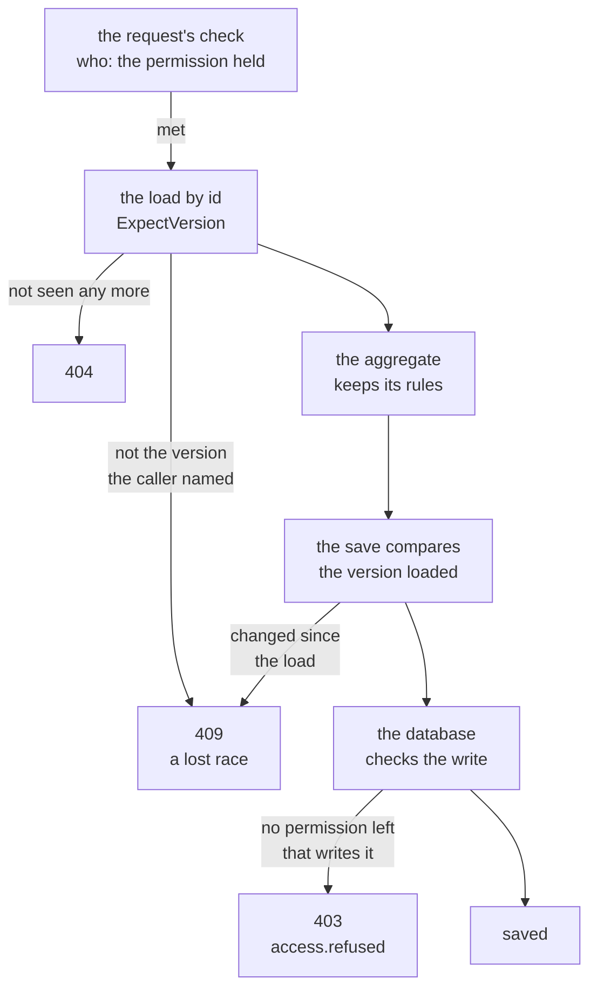
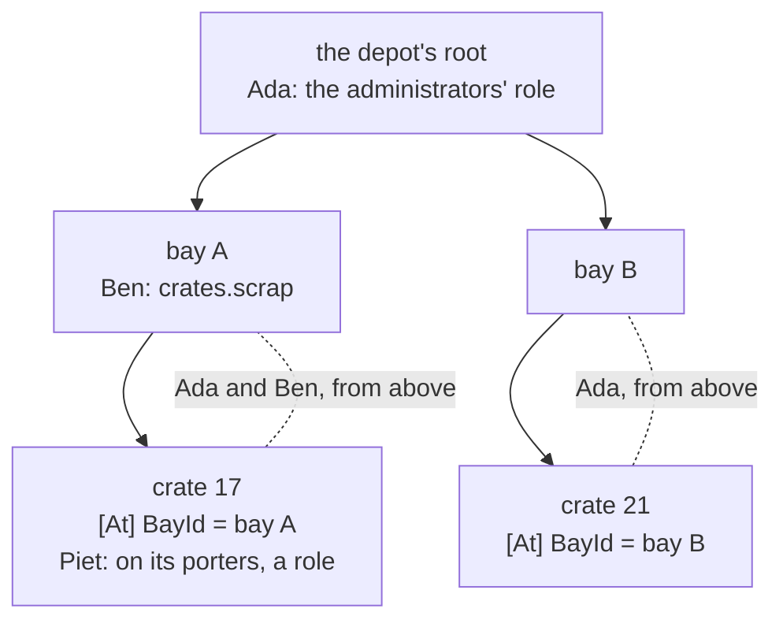
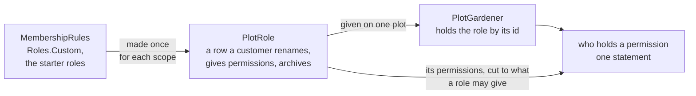
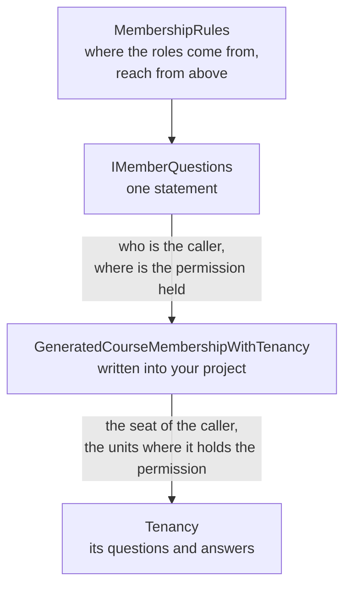
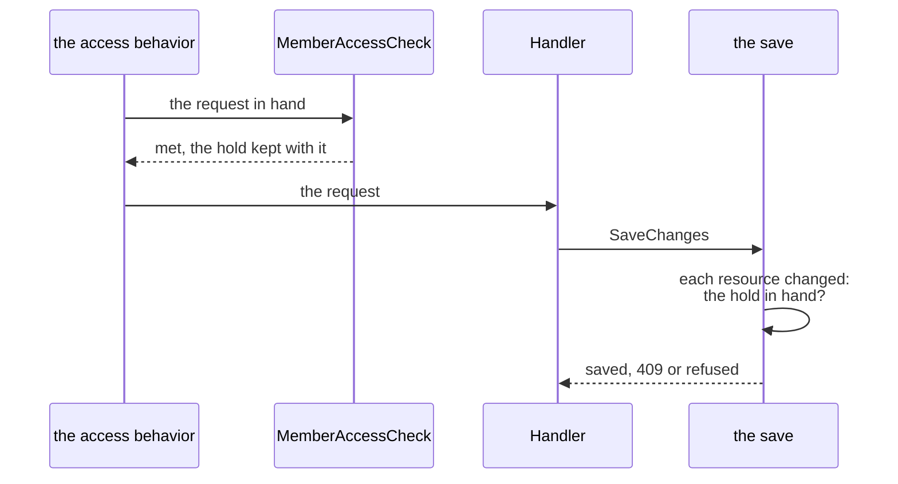

# Membership

> [!NOTE]
> The Membership packages are published as `Temp.DDDToolkit.Supporting.Membership`, `.EntityFramework` and
> `.Postgres`, under a `Temp.` id like [every 3.x package](migrating-to-3.md#the-package-ids), and first as
> prereleases: the names on this page can change until a release that is not one.

Membership is the toolkit's second [supporting domain](writing-a-supporting-domain.md): who may do what on
one **resource**, through being a **member** of it. A document shared with people, a case file with a team,
a folder with its staff: each has members for a period, who hold roles for a period, and one owner who
cannot be lost. The package keeps those rules and answers who holds which permission; the resource, its words, its
database and [who may give a role](#who-may-give-a-role-is-yours-to-decide) stay yours.

It comes in three packages:

| Package | What it holds |
|---|---|
| `DDDToolkit.Supporting.Membership` | The member template, the member list with its rules, the role template for [roles a customer makes](#roles-a-customer-makes), the rules of access as one declaration, and the access questions and requirements. No database in it. Its generator writes [the member list](#the-member-list-is-written-for-you) on your aggregate. |
| `DDDToolkit.Supporting.Membership.EntityFramework` | `HasMembers()` and `IsCustomRole()` for your context, two registrations per resource named after it, `AddDocumentMembership()` and `AddDocumentMemberAccess()`, and the access questions answered inside your own statements. Works on every provider. Its generator writes what joins a resource to [Tenancy](#with-tenancy), in an application that has both. |
| `DDDToolkit.Supporting.Membership.Postgres` | The same questions as four SQL functions per resource, for your [row access rules](row-level-security.md#row-access-rules-written-in-c) to ask, and a start-up check. |

It needs nothing else: no dispatcher, and no [Tenancy](tenancy.md). Members are your users, unless you say
[who else they are](#beside-an-organization). In an application that has Tenancy as well, a member can be a
seat, and [what joins the two](#with-tenancy) is written for you.

A resource with one owner and nobody else on it needs none of this: the aggregate marks the property that names its
owner `[Owner]`, and a request marks its id `[Own]` or `[OrOwn]`, as for a value of the caller's own
([The owner of an aggregate](access-requirements.md#the-owner-of-an-aggregate)). Membership is for several people on
one resource, each for a period, with the roles they hold there.

The [Tenancy sample](../Examples/README.md#the-tenancy-sample) is the worked example of all three beside
Tenancy. Its Projects module keeps a project's crew as members, who are seats, and the project roles each
tenant keeps for its crews, made from three starter roles when a tenant is set up and the tenant's own to
change from then on; the database's functions and lock are written from the same rules.
[Who may do what, in the sample](tenancy.md#who-may-do-what-in-the-sample) walks through it.

## A document and the people it is shared with

The whole of it, for one resource whose members are your users: a document, the people it is shared with,
and one command that shares it. The code below is all there is to write, and it compiles as it stands; the
`using` lines are left out.

**The domain.** The aggregate stays yours, declared as it always was. You declare a **member class** with
the package's template, naming the resource it is a member of, and keep the owner and the members on your
aggregate, marking the property that names the owner `[Owner]`:

```csharp
[EntityId<Guid>] public readonly partial record struct UserId;
[EntityId<Guid>] public readonly partial record struct DocumentId;
[EntityId<Guid>] public readonly partial record struct DocumentShareId;

// A member of a document: its row's id, who a member is, what a role is known by, and the resource
[Member<DocumentShareId, UserId, NamedRole, Document>]
public sealed partial class DocumentShare;

[AggregateRoot<DocumentId>]
public sealed partial class Document
{
    public Document(DocumentId id, UserId owner, DateTimeOffset now) : base(id)
    {
        OwnerId = owner;
        Members.Open(now);                           // the owner is a member, for good, holding no role
    }

    [Owner]
    public UserId OwnerId { get; private set; }      // holds what the permissions give an owner, by owning

    public bool Archived { get; private set; }

    public partial IReadOnlyList<DocumentShare> Shares { get; }

    public void ShareWith(UserId user, NamedRole role, MemberPeriod period, DateTimeOffset now, UserId? by)
    {
        if (Archived)                                // your own guard, in front of the member list
        {
            throw new RefusalException("documents.archived", RefusalKind.Conflict, "The document is archived.");
        }

        Members.Add(user, role, period, now, by);    // Members: written for you, over Shares
    }
}
```

`Members` is the document's **member list**, a `MemberList` over `Shares`. You do not declare it: the
package's generator [writes it](#the-member-list-is-written-for-you) from the collection and the owner. It
writes three more things onto `Document` with it: its name, `documents`, the class's name made plural, which
its codes and its functions in the database are named after; the codes it refuses under, `Codes`,
`documents.already-member` and the rest; and the scope of its module's own system work, `filing` here. A class
whose name should not be what its codes say keeps another with `[Members("Papers")]`
([Names](#names)).

**The permissions.** What is asked on a document is declared once, in a class of permissions: every public
constant of it a permission, with where it is asked and how it is held there.

```csharp
[Permissions]
public static class DocumentPermissions
{
    /// <summary>See a document.</summary>
    [On<Document>(EveryMember = true)]
    public const string View = "documents.view";

    /// <summary>Change a document.</summary>
    [On<Document>]
    public const string Edit = "documents.edit";

    /// <summary>Say who a document is shared with, and hand it on.</summary>
    [On<Document>(LocksMembers = true, LocksOwner = true)]
    public const string Share = "documents.share";
}
```

`[On<Document>]` says the permission is asked on one document. The owner holds every one of them by owning the
document, unless one says `Owner = false`; a role can give each, unless one says `InRoles = false`; and the one
marked `EveryMember` is held by everybody on the document, whatever role they hold. `LocksMembers` and
`LocksOwner` name the permission your commands require to change the members and to hand the document on, so a
database that checks every row holds a statement that reaches it past your application to it as well
([who writes the member rows](#who-writes-the-member-rows)). [The settings of a permission](#the-settings-of-a-permission)
has every one of them.

**The rules.** Who holds which permission through the members is one declaration, which the code that checks a
request and the database both read. Made through the document's type, it reads the name, the codes and the
permissions off it, and says what is left: the roles a member can be given.

```csharp
public static class DocumentMembership
{
    public static MembershipRules Rules { get; } = MembershipRules.For<Document>(
        Roles.Fixed([new("contributor", [DocumentPermissions.View, DocumentPermissions.Edit]), new("onlooker", [DocumentPermissions.View])]));
}
```

`Roles.Fixed` declares roles in code, the same for every document. A customer that makes roles of its own has
`Roles.Custom` ([Roles a customer makes](#roles-a-customer-makes)), and roles kept elsewhere, an organization's,
`Roles.External` ([Beside an organization](#beside-an-organization)). Who a member is follows from what it is known
by: a `UserId` over a `Guid` is the caller's own id. Nothing else needs saying here.

**The wiring.** Your context maps the members, and your services register the resource:

```csharp
public sealed class FilingContext(DbContextOptions<FilingContext> options) : DbContext(options)
{
    public DbSet<Document> Documents => Set<Document>();

    protected override void ConfigureConventions(ModelConfigurationBuilder configuration)
    {
        configuration.AddDDDToolkitConventions();
        configuration.AddFilingConverters();         // your ids, stored by the converters generated for your module
    }

    // Both member tables, owned by the document; the owner is the property it marks [Owner]
    protected override void OnModelCreating(ModelBuilder modelBuilder)
        => modelBuilder.Entity<Document>().HasMembers(document => document.Shares);
}

public static class FilingModule
{
    public static IServiceCollection AddFiling(this IServiceCollection services, Action<DbContextOptionsBuilder> database)
    {
        services.AddDbContext<FilingContext>(database);                             // your context, on your provider
        services.AddDocumentMembership<FilingContext>(DocumentMembership.Rules);    // the access questions of documents
        services.AddDocumentMemberAccess<IFilingRequest>();                         // their check, for your requests
        services.RequireExplicitCallers();                                          // work that says nothing about who it runs as fails
        return services.AddScoped<DocumentHandlers>();
    }
}
```

`AddDocumentMembership` and `AddDocumentMemberAccess` are generated for your member class and named after
the resource it names. `HasMembers` adds two tables to your model, `DocumentShares` and
`DocumentShareRoles`: add a migration for them, as for any change to it.

**A request and its handler.** A request says what it requires, and its handler changes the document the
request names, which is the one that was checked. The permission is held on the document, so the request requires
it with `[RequiresPermission]` and marks the document `[OnResource]`, and the version the caller read `[ExpectedVersion]`;
the toolkit's generator writes `MemberAccess.On("documents.share", request.Document, request.ExpectedVersion)` for
it, into the module's interface, which is partial for that:

```csharp
[AccessRequests]
public partial interface IFilingRequest : IRequireAccess;           // what every request of your module implements

[RequiresPermission(DocumentPermissions.Share)]
public sealed record ShareDocument([OnResource] DocumentId Document, UserId With, string Role, DateTimeOffset? Until, [ExpectedVersion] long? ExpectedVersion = null) : IFilingRequest;

public sealed class DocumentHandlers(
    FilingContext db,
    MemberAdmission<DocumentId, UserId, NamedRole> admission,
    ICallerAccessor callers,
    TimeProvider clock)
{
    // Writing a document: whoever writes it owns it
    public async Task<DocumentId> WriteAsync(CancellationToken cancellationToken)
    {
        var owner = new UserId(callers.Current.UserId!.Value);
        var document = new Document(DocumentId.Create(), owner, clock.GetUtcNow());
        db.Documents.Add(document);
        await db.SaveChangesAsync(cancellationToken);
        return document.Id;
    }

    // Sharing one: reached once the check let the request through
    public async Task HandleAsync(ShareDocument command, CancellationToken cancellationToken)
    {
        var role = new NamedRole(command.Role);                                      // "contributor"
        await admission.RequireRoleAsync(role, cancellationToken);                   // one of the roles the rules declare

        var document = await db.Documents.SingleOrDefaultAsync(row => row.Id == command.Document, cancellationToken)
            ?? throw Document.Codes.Refuse(MembershipRefusals.NotFound);             // gone since the check
        db.ExpectVersion(document, command.ExpectedVersion);                         // If-Match: a stale version is a 409

        var now = clock.GetUtcNow();
        document.ShareWith(command.With, role, MemberPeriod.Between(now, command.Until), now, by: new UserId(callers.Current.UserId!.Value));
        await db.SaveChangesAsync(cancellationToken);
    }
}
```

Something asks the checks in front of the handler: `AccessChecks<IFilingRequest>.RequireAsync(request)`, one
call from your dispatcher or an endpoint filter, or, with the Mediator library, the behavior the generator
writes for an interface marked `[AccessRequests]`. [Access requirements](access-requirements.md) has both,
and what `IRequireAccess`, `AccessRequirement` and `Checked<T>` are. A permission on a resource, `[RequiresPermission(permission)]` with
`[OnResource]` on the resource and `[ExpectedVersion]` on the version read (`MemberAccess.On(permission, resource,
expectedVersion)`), and `[SeenWith<TResourceId>(permission)]` for a query that shows the resources a permission is held on
(`MemberAccess.SeenWith<TResourceId>(permission)`, [Inside your own statements](#inside-your-own-statements)), are two of
[the requirements every request picks from](access-requirements.md#the-vocabulary), beside the toolkit's
`[SignedIn]` and the rest, and Tenancy's `[InTenant]` and the rest: a request of a module with members says which,
and none leaves it to a package. `[OnResource]` marks the id of a resource with members, an aggregate root a class
declared with `[Member<...>]` names; on another id it is [DDD00081](diagnostics.md#ddd00081). A requirement computed
from the request's values answers `RequiredAccess` with the calls instead.

Membership's cases combine with the others ([Requirements that combine](access-requirements.md#requirements-that-combine)).
The resource is what the request acts on, so `[OrOwn]` goes beside `[OnResource]`: a member leaves on their own, or
anybody with the permission on the resource takes them off, `LeaveDocument([OnResource] DocumentId Document, [OrOwn] UserId
Member)`, which is `AccessRequirement.Any(AccessRequirement.All(AccessRequirement.Own(request.Member),
MemberAccess.Sees(permission, request.Document)), MemberAccess.On(permission, request.Document))`, with what says the caller's own
`UserId` registered beside it ([Yours, or the permission](access-requirements.md#yours-or-the-permission)). `MemberAccess.Sees` is the
caller's own way through on the resource: the caller sees the document, holding the permission there or not, and the check
reads it, refuses one it does not see with `documents.not-found`, compares the version `[ExpectedVersion]` names and
keeps the hold, as `On` does. The handler still finds the member on that document. Where a permission is marked
`LocksMembers`, the database's lock lets a member row change only for a caller that holds it, so the handler saves
the caller's own place as the application's own work once its request is the one in hand
([The caller's own on a resource](access-requirements.md#the-callers-own-on-a-resource)).

A permission of Membership's and one of Tenancy's on one request are `AccessRequirement.All`: moving a project takes the permission
to edit it, on the project, and the permission that opens a project, at the unit it goes to,
`All(MemberAccess.On(ProjectPermissionNames.Edit, Project, ExpectedVersion), TenancyAccess.AtUnit(ProjectPermissionNames.Open, To))`. The
check of each case is the one that decides it alone, so the two packages' checks, registered for the same interface,
each answer theirs. What a case of Membership's keeps for the [expert hold](#the-expert-hold) is kept once the whole
combination let the caller through, and only for the cases it was let through by; a permission on each of two documents keeps
a hold on each, `All(MemberAccess.On(permission, From), MemberAccess.On(permission, To))`, and each save is held to its own.

With the behavior, `AddDocumentMemberAccess`
also brings the start-up check that the behavior is in the pipeline, and a handler called past it is a warning;
see [When nothing asks the checks](access-requirements.md#when-nothing-asks-the-checks).



<details>
<summary>Show the code: what the check does</summary>

```csharp shortened
// MemberAccessCheck<Document, DocumentId>.RequireAsync, the package's, shortened
case MemberAccess<DocumentId>.On required:
{
    // The caller's own refusal when it is nobody, then not-found, then not-permitted: one statement
    var hold = await questions.RequireAsync(required.Resource, required.Permission, cancellationToken);

    // Only now, with the document seen and the permission held, so a caller without access learns nothing from a version
    if (required.ExpectedVersion is { } expected && expected != hold.Version)
    {
        throw new ConcurrencyConflictException(typeof(Document), required.Resource);
    }

    kept.KeepFor(request, hold);                    // for the expert hold; the handler takes nothing of it
    break;
}
```

</details>

**Who is calling.** `RequireExplicitCallers()` is there because of who holds every permission: the application
itself. Work that says nothing about who it runs as counts as the application, so a host that never
[says who is calling](row-level-security.md#running-queries-as-the-caller) would let every request through.
With it such work [fails instead](row-level-security.md#fail-closed-callers), and a request reaches the
questions only as the caller your host began.

**Why each piece is yours to write.** The package knows nothing of your resource but what these lines say:

| You write | Because |
|---|---|
| `DocumentShareId` | A member row is a child entity of your aggregate, and a child entity has an id: what its table is keyed by, beside the document. |
| The member class, in one line | It is your class and your table, and the place for what only you know of a member: a property, or a rule about it. |
| `NamedRole` in it | What a member holds a role by: a name, where the roles are in code, and an id, where [roles are rows](#roles-a-customer-makes). |
| `[Owner]` on `OwnerId` | The owner is a column of your resource, and a fact of it. The statement that answers who holds a permission reads it there, and so do the database's functions and the mapping, so it is said once, on the class. |
| `Shares` | Members live inside your aggregate: loaded and saved with it, under its one version. |
| `now` in the constructor | The aggregate reads no clock. The owner holds no role, so there is nothing else to hand in. |
| Your guard in `ShareWith` | It is the whole hook: a document that changes no more simply does not call the member list. |
| `DocumentPermissions` | What is asked on a document is yours to name, once: the request requires the constant, the rules read it, the database's functions are written from it, and a permission that is in no class is held by nobody. Its summary is the text an administrator reads. |
| The roles in the rules | Which roles there are, and what each gives, is your product's to say. A role that lists what is no permission of a document, or one no role gives, is refused where the rules are made. |
| `HasMembers(shares)` | The model is your context's to build: which collection is the member list, and what its tables are called. |
| `AddDocumentMembership<FilingContext>(rules)` | Closed over your classes already. Which context maps the document, and which rules apply, only you know. |
| `AddDocumentMemberAccess<IFilingRequest>()` | A check is added for one request interface, and a module may have several resources, or ask about another module's: this says whose requests the document's check decides. |
| `IFilingRequest` | What tells your module's requests from another's: the [checks are registered for it](access-requirements.md#what-a-request-declares). |
| `[RequiresPermission]`, `[OnResource]` and `[ExpectedVersion]` | Which permission a command takes is yours to say, and on which of the request's ids it is held; the generator writes the call, so it is no field of the request. The version is the one the caller read, for a command that sends it: it is compared after the permission, so a caller without access learns nothing from it. |
| `partial` on `IFilingRequest` | The generator writes `RequiredAccess` into it from its requests' attributes, one line per request. |
| `MemberAdmission<DocumentId, UserId, NamedRole>` in the constructor | Membership's use cases are small classes generic over your ids alone, three at most, so they read where they are taken, and a module with several kinds of resource names each one's by its own ids. None is nested in one class over your classes, as Tenancy's use cases are, so there is no class such as Tenancy's `TenancyUseCases` to name them through, and no alias to write ([Calling a use case](tenancy.md#calling-a-use-case)). |
| `RequireRoleAsync` in the handler | The member list takes any role: it cannot know which roles there are. `MemberAdmission` asks the rules, and, where you registered them, whether the one to be made a member is known (`RequireMemberAsync` and an `IMemberDirectory`) and whether a role goes to a member at all (`IMemberRolePolicy`). |
| `ExpectVersion` after the load | The check and the load are two statements. The version the caller named is held again where the handler loads, so a change in between is a lost race; a caller that named none asked for the document as it is. The rest is there already ([from the check to the save](#from-the-check-to-the-save)). |

### The member list is written for you

`Members` is a private property the package's generator writes on the resource a member class names. Every
part of it is said elsewhere already, the four types by the member class and the rest by the resource, so
you write your own methods and guards over it, and not the line itself.

<details>
<summary>Show the code: what the generators write for the document</summary>

```csharp title="Document.Members.g.cs"
partial class Document
{
    private global::DDDToolkit.Supporting.Membership.MemberList<global::Filing.DocumentShare, global::Filing.DocumentShareId, global::Filing.UserId, global::DDDToolkit.Supporting.Membership.NamedRole> Members
        => new(_shares, OwnerId, Codes);
}
```

```csharp title="Document.Membership.g.cs, shortened"
partial class Document : global::DDDToolkit.Supporting.Membership.IMembershipResource
{
    public static global::DDDToolkit.Supporting.Membership.MembershipCodes Codes { get; } = global::DDDToolkit.Supporting.Membership.MembershipCodes.Under("documents");

    static string IMembershipResource.MembershipName => "documents";
    static MembershipCodes IMembershipResource.MembershipCodes => Codes;
    static string? IMembershipResource.MembershipScope => "filing";
}
```

```csharp title="MembershipEntityFrameworkServiceCollectionExtensions.*.Registration.g.cs, shortened"
internal static partial class GeneratedMembershipEntityFrameworkServiceCollectionExtensions
{
    public static IServiceCollection AddDocumentMembership<TContext>(this IServiceCollection services, MembershipRules rules)
        where TContext : DbContext
        => MembershipEntityFrameworkServiceCollectionExtensions.AddMembership<DocumentShare, DocumentShareId, UserId, NamedRole, TContext, Document, DocumentId>(services, rules);

    public static IServiceCollection AddDocumentMemberAccess<TRequests>(this IServiceCollection services)
        where TRequests : class, IRequireAccess
        => MembershipEntityFrameworkServiceCollectionExtensions.AddMemberAccess<Document, DocumentId, TRequests>(services);
}
```

</details>

It is written from three things the resource declares, and only when each is the only one of its kind there,
so that nothing is guessed: the get-only `partial` collection of the member class, the property marked
`[Owner]`, of what a member is known by (`UserId` here), and the static `MembershipCodes`, which the generator
writes as well unless the resource declares its own. A new member row's id
is made in code by the id itself, `DocumentShareId.Create()`, which the generator writes for an
`[EntityId<Guid>]`; a row keyed by a `long` declares its own `Create()`. [DDD00059](diagnostics.md#ddd00059)
lists each with what stands in its way, and says which it is when the list is not written.

For every other shape you write the list yourself, on the resource, and the generator leaves a resource that
declares one alone: codes kept in a class of their own, a collection that is itself called `Members`.

```csharp
private MemberList<DocumentShare, DocumentShareId, UserId, NamedRole> Members
    => new(_shares, OwnerId, DocumentRefusals.Membership);
```

`_shares` is the field the toolkit keeps `Shares` in. A resource that has no list, and cannot be given one,
is told what stands in the way when it is built: [DDD00059](diagnostics.md#ddd00059).

### Names

A resource with members is named after its class, made plural: `Document` is `documents`, `CraneBoard` is
`crane-boards`, `Category` is `categories`. The name is written twice, in lower case: with a dash between its
words for the codes the resource refuses under, `crane-boards.already-member`, and with an underscore for its
functions in the database, `crane_boards_i_see`. Only the last word is made plural, by the plain English rules,
so a class whose plural is another word says its own with `[Members]`:

```csharp
[Members("People")]                     // people.already-member, people_i_see
[AggregateRoot<PersonId>]
public sealed partial class Person;
```

What `[Members]` says is taken as it is and written the same two ways: `People`, `CraneBoards` or
`crane-boards`. One that cannot be, with a space in it or a digit first, is [DDD00091](diagnostics.md#ddd00091),
and the resource's rules do not compile until it is put right.

The name is what a client reads in a code and what the database's functions are called, so renaming the class
renames both: clients that branch on `documents.already-member` read another code, and the next access file
makes new functions. The export compares the names it writes with those the newest access file recorded, with
the class each came from, and says once, in the build that writes the new file, which are gone and which are new
([DDD00090](diagnostics.md#ddd00090)). A class renamed on purpose keeps its old name with `[Members("Documents")]`;
one that should take the new name needs nothing more.

The scope of the module's own system work is named the same way, after the module: `filing` for the module
`Filing`. It is the scope the rules let through unless they say otherwise ([System work](#system-work)).

### The settings of a permission

A permission is a public constant of a static class marked `[Permissions]`, and its **level** is the attribute
on it, which says where it is asked: `[On<Document>]` on one document, and with [Tenancy](#with-tenancy)
`[AtTenant]` for the whole tenant or `[AtUnit]` at a unit. One class can hold permissions of every level; the
module's catalogue lists them all. A permission asked on a document says how it is held there:

| Setting | Unless said | Said |
|---|---|---|
| `Owner` | the owner holds it by owning the document | `Owner = false`: the owner holds it only as anybody would, from above say; for a permission no owner holds by owning, such as one that names another owner |
| `EveryMember` | being a member gives nothing by itself | `EveryMember = true`: every member holds it, whatever roles it holds; usually the one that sees the document. One permission at most |
| `InRoles` | a role can give it | `InRoles = false`: no role gives it, so the owner and reach from above alone hold it; for one a customer must never hand out |
| `LocksMembers` | it locks nothing | `LocksMembers = true`: what your commands that change the members require, which a database that checks every row holds the member rows to ([who writes the member rows](#who-writes-the-member-rows)). One at most |
| `LocksOwner` | it locks nothing | `LocksOwner = true`: what your command that hands a document on requires, which the database holds the owner column to. One at most |
| `FromAbove` | it reaches the document from above, where the rules let one be reached so | `FromAbove = false`: held where the document sits, it gives nothing on it ([beside an organization](#beside-an-organization)) |

Every level takes three more. Its summary, as text, is what the permission lets somebody do, the text an
administrator reads where roles are made; `Description = "..."` says it instead. Either is the English text: a
translation of yours, under the permission's key in a resx your failure localizer reads, says it in another
language, as refusal texts are said ([Localization](localization.md)). `Implies` names what holding it brings with
it, so a role with only this one does what those let it do too. And `Retired = true` keeps a permission nobody
holds any more, so a role that lists it keeps it and no stored right breaks: a permission is retired, and never
deleted.

The generator reads the class and nothing else. A class marked `[Permissions]` that is not static, a constant
without a level and a permission declared twice in it are [DDD00092](diagnostics.md#ddd00092); `[On<T>]` on a class that
is no resource with members, and two permissions that each say `EveryMember`, `LocksMembers` or `LocksOwner`, are
[DDD00093](diagnostics.md#ddd00093); and rules made for a resource no permission is declared on are
[DDD00094](diagnostics.md#ddd00094), where they are made.


## From the check to the save

The check runs before the handler, and the handler loads, changes and saves after it. Between the two, other
requests go on: somebody renames the document, takes a role from the caller, revokes what reached it from
above. What holds a change through that, on the default path, is what is already there, each doing one thing:

1. **The request's requirement**, `[RequiresPermission(permission)]` on the `[OnResource]` document with its `[ExpectedVersion]`, before the handler: who
   may, and, where the caller named the version it read, that the document is still at it.
2. **The load by id.** The handler loads the document its request names, which is the one that was checked,
   and holds it to the version the caller named, with one line: `db.ExpectVersion(document, command.ExpectedVersion)`.
   A document changed between the check and the load is the same 409 as at the check. A caller that named no
   version asked for the document as it is, and gets it.
3. **The save** compares the version it loaded, so a change between the load and the save is a lost race too.
4. **The aggregate's own rules** keep the document right, whatever version it is at: an archived document
   takes no member, the owner stays.
5. **The database**, where it checks every row as the caller ([on Postgres](#on-postgres-the-second-lock), with
   row level security forced), checks the write once more. A caller that lost every permission that writes the
   document since the check is refused there, `access.refused`, 403, and nothing is written; one the
   document is hidden from by then finds none to load, 404.

So permission is about who, and the version is about what the caller read. How the caller holds the permission, and
until when, a rule of yours [asks the questions for](#who-may-give-a-role-is-yours-to-decide), in one
statement.



<details>
<summary>Show the code: the handler, and a store that loads with the version</summary>

```csharp
// The handler, with the context: two lines for the load
var document = await db.Documents.SingleOrDefaultAsync(row => row.Id == command.Document, cancellationToken)
    ?? throw Document.Codes.Refuse(MembershipRefusals.NotFound);
db.ExpectVersion(document, command.ExpectedVersion);       // none named: nothing to compare

// Or behind a store of yours, which the handler calls in one line:
// var document = await store.LoadAsync(command.Document, command.ExpectedVersion, cancellationToken)
//     ?? throw Document.Codes.Refuse(MembershipRefusals.NotFound);
public async Task<Document?> LoadAsync(DocumentId id, long? expectedVersion, CancellationToken cancellationToken)
{
    var document = await db.Documents.SingleOrDefaultAsync(row => row.Id == id, cancellationToken);
    if (document is not null)
    {
        db.ExpectVersion(document, expectedVersion);
    }

    return document;
}
```

</details>

What happens to a rename of the Tenancy sample's projects, with a change played between its check and its
handler, on Postgres with the policies forced (`AccessHoldScenarios`):

| Between the check and the handler | The rename |
|---|---|
| the caller's role that gave the permission is taken | 403 `access.refused`: the database refuses the write |
| what reached the project from above is revoked, or the project moved out of reach | 404: there is none to load |
| somebody else renamed it, and the caller named the version it read | 409, at the load |
| somebody else renamed it, and the caller named no version | saved: the last write wins, which is what a caller that names no version asks for |
| the project moved to a place where the caller still holds the permission | saved: who the caller is did not change |

What the default path does not do, in plain sight:

- **The database checks what its policies say, and nothing finer.** A policy that lets any permission that writes a
  row through lets a caller through that lost the command's own permission and kept another one between the check
  and the save. Write the policy per permission where that matters.
- **A handler reached around its checks** is held by the database alone, to what its caller may: a caller
  that may do it does it. Whatever sends your requests asks the checks; a test can hold that. A save your
  handler runs as the application's own work is held by no row rule at all, so begin that work only for a
  request whose check let it through: `RequestInHand.Current.Request` is then that very request
  ([the request in hand](access-requirements.md#the-request-in-hand)), as in the Tenancy sample's
  `OwnPlaceOnTheCrew`.
- **The save is not tied to the version the check read.** For a caller that named no version, a change
  between the check and the load is the last write that wins. [The expert hold](#the-expert-hold) ties it, and
  refuses a handler reached around its checks, with one line.

## Who may give a role is yours to decide

The package keeps the members and answers who holds which permission. Adding a member, giving or taking a role
and handing a resource to another owner are yours to allow: the package has no permission of its own for any of
them, and no rule about who gives what to whom. Each of your commands requires what you choose.

**A permission on the resource.** The usual rule, and one line on the request: the one `ShareDocument` has above.
Whoever holds `documents.share` on the document shares it, with anyone, in any role, for as long as they
say. The owner holds it by owning the document, as it holds every permission said for the owner, so the owner
may. A member may when one of its roles gives the permission, which is your rules' to say.

**A rule of your own.** Anything further you write in the handler. The questions say until when the caller
holds the permission, in one statement, so "nobody gives a role for longer than they hold the permission themselves" is a
few lines:

```csharp
[RequiresPermission("folders.staff")]
public sealed record AdmitStaff([OnResource] FolderId Folder, StaffCode Staff, NamedRole Role, DateTimeOffset? Until, [ExpectedVersion] long? ExpectedVersion = null) : IFilingRequest;

// In the handler:
var hold = await questions.RequireAsync(command.Folder, "folders.staff", cancellationToken);   // IMemberQuestions<FolderId>
if (hold.Until is { } mine && (command.Until is not { } theirs || theirs > mine))
{
    throw new RefusalException("folders.longer-than-held", RefusalKind.NotPermitted,
        "Nobody is put on a folder for longer than you hold the permission to put them there.");
}

await admission.RequireMemberAsync(command.Staff, cancellationToken);   // MemberAdmission<FolderId, StaffCode, NamedRole>
await admission.RequireRoleAsync(command.Role, cancellationToken);
var now = clock.GetUtcNow();
folder.Admit(command.Staff, command.Role, MemberPeriod.Between(now, command.Until), now, by);
```

- **`MemberHold.Until`** is the first moment the caller no longer holds the permission, as its membership and its
  roles stand now. It has no end, `null`, for the owner and for the application's own work. For a permission that
  being a member gives it is the end of the membership; for a permission a role gives, the end of the last role
  that gives it now, or of the membership if that ends sooner. For a permission held from above, see
  [held from above for as long as it is seen](#beside-an-organization).
- **The package applies no rule of its own here.** Not "no further than your own hold", and not "never to
  yourself": a caller who passes what your command requires gives what your handler lets it give.
- **How the caller holds the permission,** `MemberHold.Via`, is in the same answer, for a rule about that.

## What the package keeps

- **A member is on the list once, for a period.** A membership that ended is over: the member comes back
  with a new one, without the roles of the old. One that still runs, or is still to start, is the member's
  one membership: adding the member again is refused, whenever the new one would start. `Add` and `GiveRole`
  take the moment they are called at for that, next to the period: what has ended by then is replaced, and
  nothing else.
- **A member holds each role once, for a period of its own.** A role counts only while its membership does.
- **There is one owner,** always a member, with no end, holding no role: it holds what the permissions give
  an owner, by owning. `Members.Open(now)` in the resource's constructor puts it on the list. The owner is
  not removed, and is given no role, until somebody else is named owner (`documents.owner-protected`).
- **An owner's place has no end, and keeps none.** `Members.NameOwner(member, formerOwner, now)` names another:
  a member from then on, put on the list when it was not on it, and the roles it held go, since it holds by
  owning now. Naming an owner takes away the end the new owner's membership had, and handing the resource on
  again does not put it back: somebody who was on a resource for a week and owned it for a day is on it for
  good. The same holds for a start: somebody who was to come next month is a member from the day they are
  named. The owner before becomes what your command says, `FormerOwner.StaysAs(role)`, a member with no end in
  that role, or `FormerOwner.Leaves`, nobody on the list: there is no default, since the owner held no role to
  fall back to. `NameOwner` answers what it changed (`OwnerNamed`): whether the new owner was added or its
  membership began anew, the roles that went, the end it lifted, `EndLifted`, the start it moved, `StartMoved`,
  and what the owner before became. Keep the end, and take the member off the list then, if a new owner is to
  leave when they would have.
- **Members live inside your aggregate.** They are loaded and saved with it, under its one version, so
  `If-Match` on the resource covers its members. Your own guard runs in front of every change, and you
  raise your own events from what the member list answers: the package raises none.
- **Refusals carry your codes.** `MembershipCodes.Under("documents")` gives `documents.not-found`,
  `documents.already-member` and so on, and its `Refuse` makes the refusal under them:
  `throw Document.Codes.Refuse(MembershipRefusals.NotFound)` is `documents.not-found`. `With` renames one, and
  `WithMemberArgument("Staff")` names the argument a refusal carries the member in.
- **The texts come with the registration.** English and Dutch, under your codes: registering a resource
  offers them to your [failure localizer](localization.md#texts-a-packages-registration-offers), so an
  application that calls `AddDDDToolkitLocalization()` adds no line for them, and one that does not is given
  nothing. A text of your own for one of these codes is asked first.

Two rules are about the whole list, so the member list has a check for each, `OneMembershipPerMember()` and
`OwnerStays()`. The list refuses both before anything changes. Two invariants of your aggregate that call
the checks are a net under code that changed the collection some other way, and are yours to add or to
leave out:

```csharp
// Nested in Document, so they run whenever the document is checked, under the document's own codes
public sealed class OneSharePerUser : IInvariant<Document>
{
    public string Code => Codes[MembershipRefusals.AlreadyMember];

    public InvariantFailure? Check(Document entity) => entity.Members.OneMembershipPerMember();
}

public sealed class OwnerKeepsAPlace : IInvariant<Document>
{
    public string Code => Codes[MembershipRefusals.OwnerProtected];

    public InvariantFailure? Check(Document entity) => entity.Members.OwnerStays();
}
```

For a screen that lists the members of a resource, `MemberOverviews.From(document.Shares, document.OwnerId, now)`
puts them in the one order every answer lists members in: the owner first, then by when each membership
starts, each with its roles and whether they count now. It reads nothing.

## Who holds a permission

| The permission is | Held by |
|---|---|
| on the resource, said for the owner (`Owner`, unless `Owner = false`) | the owner, by owning the resource, with no end and no role |
| given by a role (in `Roles.Fixed`, or on the role's row where [a customer makes the roles](#roles-a-customer-makes)), and one a role may give (`InRoles`, or a permission of another module `otherPermissions` lets through) | a member now, holding that role now |
| marked `EveryMember` | every member now, whatever roles it holds |
| held where the resource sits, or above it (`reachFromAbove`, unless `FromAbove = false`) | whoever you answer holds it there |
| any permission | the application itself, and its work in a scope the rules let through (`systemScopes`) |

What an owner may do is the permissions said for the owner, and nothing through a role: the owner holds no role,
and none is given to it. So a permission no owner should hold by owning says `Owner = false`, and a request that
requires one the owner does hold lets the owner through already: `[OrOwn]` beside its `[OnResource]` says nothing
more, [DDD00096](diagnostics.md#ddd00096).

`EveryMember` marks the one permission that being a member gives by itself, usually the one that sees the
resource. The document's `View` is it: a member sees the document whatever roles it holds.

A caller who is neither a member now nor the owner does not see the resource, unless it holds the permission that
sees it [from above](#beside-an-organization): `not-found`, exactly as for one that does not exist. A caller
that sees it and does not hold the permission is `not-permitted`, naming it. A version that is not the one the
caller read is compared last.

Who the caller is as a member follows from what a member is known by: the user id of its token for a member id
over a `Guid`, as for the document, and the caller's seat for a seat of [Tenancy](#with-tenancy). Rules that say
otherwise name it: `members: MemberSource.Claim("app_metadata.staff")` for one over a text, or
`MemberSource.Resolved(...)` for [an id you resolve yourself](#beside-an-organization). Only a signed-in
user is anybody's member, or holds anything from above: a caller who did not sign in reaches nothing, and
nothing is read for it. The same goes for one whose token lacks that id or claim, where nothing above
reaches the resource.

### System work

The application itself, `Caller.System`, holds every permission on every resource. Work in a scope,
`Caller.SystemIn("filing")`, is not the application itself: it is nobody's member, and holds every permission on
a resource whose rules let its scope through, and nothing on any other. Left out, the rules let one scope
through, the module's own, which the resource carries: `filing` for a document of the module `Filing`
([Names](#names)). So the module's own work on its documents, a seeding or a handler that saves as the
application, needs nothing said. `systemScopes` replaces it: name the scopes to let through, the module's own
among them to keep it, or `[]` for none.

```csharp
// The boards' own work, and the nightly import that fills them, which runs in a scope of its own
public static MembershipRules Rules { get; } = MembershipRules.For<Board>(
    Roles.Custom(starters: [new("editor", [BoardPermissions.View, BoardPermissions.Edit])]),
    systemScopes: ["boards", "boards-import"]);
```

Name a scope for the work it is. Another module's work is not above your rules, and neither is Tenancy's: the
scope `tenancy` is what work that calls Tenancy's use cases runs in, provisioning a tenant, placing a seat or
giving a grant among it, so rules that let it through would let every such piece of work do everything on every
board. On Postgres the scope reaches the database too: the role scoped system work runs as may ask the
resource's functions, and [the lock](#who-writes-the-member-rows) lets work in another scope write no member row.

## Inside your own statements

`IMemberQuestions<DocumentId>` answers one resource (`HoldAsync`, and `RequireAsync` and `ViaAsync` over it) and
many (`PermissionsOnAsync`, the permissions held on up to 200 resources), each in one statement. For your own queries it
hands out a **reach**, which you put into the query, so a list is one statement and never ids fetched
first:

```csharp
// The query that lists: nothing is refused, the statement leaves out what the caller does not reach
[SeenWith<DocumentId>("documents.view")]
public sealed record ListDocuments : IFilingRequest;

var seen = questions.Reach("documents.view");                    // IMemberQuestions<DocumentId>
var page = await db.Documents.Within(seen).OrderBy(document => document.Id).Take(20).ToListAsync(cancellationToken);

// Your own columns next to how a permission is held and until when, for what you tell another module about a document
var act = questions.Reach("documents.edit");
var answer = await db.Documents.Where(document => document.Id == id)
    .Within(seen)
    .Reached(act)
    .Select(found => new { found.Resource.Archived, found.AsMember, found.FromAbove, found.Until })
    .FirstOrDefaultAsync(cancellationToken);
var via = answer is null ? null : act.Via(answer.AsMember, answer.FromAbove);

// What the caller may do with each row of a page
var permissions = await db.Documents.Where(document => ids.Contains(document.Id))
    .PermissionsOn(questions.PermissionReach(["documents.edit", "documents.share"]))
    .ToListAsync(cancellationToken);
```

A query declares `[SeenWith<DocumentId>(permission)]`: the checks [fail closed](access-requirements.md#what-answers-it),
so a request that declares nothing is stopped, and this is what a list declares. It refuses nobody for want
of the permission. The reach is the filter. So it is a query's to declare: on a message of Mediator's that is no query, a
command or a plain `IRequest`, it is [DDD00082](diagnostics.md#ddd00082), since there it would let the handler run
unchecked, and a test of yours holds
the rest ([holding it with a test](access-requirements.md#holding-it-with-a-test)).
A caller who did not sign in reaches nothing under any rules, so the check refuses it, `documents.not-permitted`
naming the permission, and the query's statement is never sent: a database that checks every row may refuse that
caller's role your schema outright rather than answer nothing. With [Tenancy](#with-tenancy), a list that
declares `SeenWith` asks nothing of Tenancy: a caller who names no tenant gets an empty list, where a command,
which declares one of Tenancy's cases, is refused with `tenancy.tenant-required`.

The questions read on a context of their own where you registered a factory for the context (a pooled one
with `AddScopedFromPool`), since the questions of one request may be asked side by side, and otherwise on
the request's context. Where the resource, or the role class of [roles a customer makes](#roles-a-customer-makes),
has a query filter that reads a member of your context, they read on the request's own context instead: a
rule you keep on that context is one a context made for one reading knows nothing of. A filter that reads
what is around the work, as [Tenancy's](tenancy.md) does, holds on every context.

A reach is data: it goes into a query on whichever context you run it. One kind is told which context that
is, a reach that puts a query of its own into yours: the rows of [roles a customer makes](#roles-a-customer-makes),
or [an answer of yours](#beside-an-organization). On the request's own context nothing more is said; a query
on a context made for one reading hands that context over, `db.Crates.Within(reach, db)`.

## Several kinds of resource

An application with documents and folders declares a member class, rules and a `HasMembers` call for each,
and registers each. Everything is asked for by the resource, so neither touches the other: its own tables,
codes, functions, member list, `IMemberQuestions<FolderId>` and `MemberAdmission<FolderId, StaffCode, NamedRole>`.
The module's one request interface takes a check per resource.

Each member class names its resource, and the registrations are
[named after it](writing-a-supporting-domain.md#a-registration-named-after-what-it-is-for), with one member
class in a project as with several. A second resource changes no call that was there:

```csharp
[Member<FolderMemberId, StaffCode, NamedRole, Folder>]
public sealed partial class FolderMember;

services.AddDocumentMembership<FilingContext>(DocumentMembership.Rules);
services.AddDocumentMemberAccess<IFilingRequest>();
services.AddFolderMembership<FilingContext>(FolderMembership.Rules);
services.AddFolderMemberAccess<IFilingRequest>();
```

A resource has one member class: two that name the same resource are refused when the project is built
([DDD00045](diagnostics.md#ddd00045)), and so is a member class that names something that is no aggregate
root of yours, a child entity included ([DDD00050](diagnostics.md#ddd00050)). Either is said once, on the
member class to fix, and a domain project without the registrations hears it as
[DDD00060](diagnostics.md#ddd00060); the list of the class the resource keeps is written all the same.

`HasMembers` takes your names for the two tables and for the member's column; the owner is the property the
folder marks `[Owner]`:

```csharp
modelBuilder.Entity<Folder>().HasMembers(folder => folder.Staff,
    new MemberTableNames("FolderStaff", "FolderStaffRoles", MemberColumn: "StaffCode"));
```

Both tables are kept under the resource's whole key. The parts a resource declares with
[`[KeyPart]`](composite-keys.md) are carried into them, each under its own name. A key you give with
`HasKey` is said before `HasMembers`: one said afterwards does not reach the member tables, and is refused
where the mapping is read.

## On Postgres: the second lock

`DDDToolkit.Supporting.Membership.Postgres` writes four functions per resource: the resources the caller is a
member of, those where it holds a role that gives a permission, those it sees, and those it holds a permission on, as a
member, as the owner or from above. They answer what the access questions answer, from the same rules and the
same permissions. What a
caller reads and changes of a resource is yours to say, in
[row access rules](row-level-security.md#row-access-rules-written-in-c) that ask the last two by the resource's
id, and the member tables follow the resource's rules, as every table of an aggregate's entities does.

Membership brings no part to a context's options: the member tables are your context's own, and so is the way
it is wired. A context wired with `UseDDDToolkit` runs as its caller once row level security is registered, so these
policies hold it with nothing more to write, and with [Tenancy](#with-tenancy) it has Tenancy's save check as well
([`UseDDDToolkit`](entity-framework.md#usedddtoolkit)). The one line of Membership's that can go on a context is
[the expert hold](#the-expert-hold), `UseMemberHolds`, which no registration brings: a host writes it after
`UseDDDToolkit` for a context it wants held.

```csharp
// The rules the resource is registered with, marked as those of its member class: the export writes the functions from them
public static class DocumentMembership
{
    [MembershipRules<DocumentShare>]
    public static MembershipRules Rules { get; } = MembershipRules.For<Document>(Roles.Fixed([...]));
}

// What your rules ask, a line each: the documents a caller sees, and those it holds a permission on, by the document's id
[ResourceAccessContract<DocumentId>(ResourceAccessSet.Seen)]
public static partial class DocumentsISee;

[ResourceAccessContract<DocumentId>(ResourceAccessSet.HeldOn)]
public static partial class DocumentsWhereIHold;

[RowAccess<Document>(RowOperations.Read, To = [RowAccessRoles.User])]
public static partial class UsersReadTheDocumentsTheySee
{
    public static bool Allows(Document document, Caller caller) => DocumentsISee.Ids().Contains(document.Id);
}

[RowAccess<Document>(RowOperations.Change, To = [RowAccessRoles.User])]
public static partial class UsersChangeTheDocumentsTheyWorkOn
{
    public static bool Allows(Document document, Caller caller) => DocumentsWhereIHold.Ids("documents.edit").Contains(document.Id);
}

// Where the resources are registered: the package's start-up check of the database
services.AddMembershipPostgres();

// The host, before it serves anything: every check the registrations brought, this one among them
services.RunStartupChecks();
```

- **The rules are yours to mark** because only your application has them. The package declares itself a
  contributor, so the project that runs the export writes its functions because it references the package,
  directly or through the module that stores the resource
  ([policies a package ships](row-level-security.md#policies-a-package-ships)), and makes its contribution
  once for every member marked `[MembershipRules<TMember>]`, a static property or field of type
  `MembershipRules`, closed over the member class the mark names: two kinds of resource are two marks. The
  rules the registration is called with are a value the build cannot read, so the mark is what tells it which
  rules are the resource's. Two marks for one member class, or one on a member of another type, stop the build
  ([DDD00071](diagnostics.md#ddd00071)); none at all is [DDD00054](diagnostics.md#ddd00054), and none of the
  package's SQL is written. A mark a library keeps internal is one the exporting project does not see, so the
  library reports it where it is declared ([DDD00070](diagnostics.md#ddd00070)). The access file names
  `MembershipRowAccessContribution<DocumentShare>` and the package's assembly above what it writes, without a
  version, so a release of your application leaves the file as it is.
- **The questions are yours to declare**, a line each, because a rule is written into a policy when the
  project is built, and the generator translates `DocumentsISee.Ids().Contains(document.Id)` from a declaration
  it can read. The declaration names no function: it says the document's id and the set, and the export writes
  the policy with the function this contribution answers that set with, whatever the rules call it. A rule
  that asks the documents when the export is not written with their contribution is refused, naming the rule
  and the resource. The id may be declared, as `DocumentId` is here, or be the one the toolkit writes for
  `[AggregateRoot<Guid>] public partial class Document`, in the project that declares it. In an application of
  several modules the declarations are the owning module's contracts, which other modules' rules ask as its
  own rules do, and no other module declares one of its own:
  [a resource's access, asked by its id](row-level-security.md#a-resources-access-asked-by-its-id).
- **The functions' names** follow from the resource's name ([Names](#names)): `documents_as_member`,
  `documents_as_member_with`, `documents_i_see` and `documents_where_i_hold` for `documents`. Nothing of yours
  asks them by name, and the start-up check holds the database to them. A class renamed gives the next access
  file new functions, and drops the old: keep the name with `[Members]` where the database should keep them.
- **Who may ask them** follows from your row access rules on the resource. The functions run as their owner with
  an empty search path, and only the database roles your rules on the document are written for may ask them,
  with the role scoped system work runs as while the rules let a scope through:

  | Your rules on the resource are written for | The functions may be asked by |
  |---|---|
  | signed-in users, `RowAccessRoles.User` | `authenticated` |
  | a role of your own as well, `To = [RowAccessRoles.User, "staff"]` | `authenticated` and `staff` |
  | callers who did not sign in, `anon`, among the others | the others alone: a caller who did not sign in is nobody's member and holds nothing |
  | any of these, while the rules let a scope through (`systemScopes`, the module's own unless said) | `ddd_system_in` as well, the role [scoped system work](row-level-security.md#the-scoped-system-role) runs as, which is then answered every resource, as in C# |

  A rule you add for another role grants it the functions with the next access file, which names them in the
  `-- Executed by:` line of each function's body. Whether a period applies is asked of the database's clock.
- **The check** is the [start-up check](startup-checks.md) `membership.functions-in-place`, which
  `AddMembershipPostgres()` brings and the host runs with its other checks, after the migrations';
  `MembershipPostgresChecks.EnsureFunctionsAreInPlaceAsync` is the same by hand. The call is the only thing that
  brings it: what the package writes reaches the database through the export, so nothing else of it is
  registered at run time, and a host that leaves the call out runs its other checks and not this one, without a
  word. Make it where the resources are registered, next to the registration of each. It refuses a database that
  lacks a function of any registered resource, or has one that does
  not run as its owner, has no empty search path, answers no set, was written from other rules than the
  resource is registered with or by another version of the package, may be executed by every role or by one
  its `-- Executed by:` line does not name, or may not be executed by a role it names. It reads the line of a function's
  body that names its rules: a body rewritten by hand under that line is not found. Rules you forget to mark
  get no functions. With none marked the build warns ([DDD00054](diagnostics.md#ddd00054)); with several
  resources, one marked is enough for the build, and this check is what finds the resource whose rules are
  not.

### Who writes the member rows

That the member tables follow the resource's rules has a consequence. A row knows no command: whoever your
rule lets change a resource writes its member rows and its owner column, by any statement that reaches the
database, past the check in front of your handler. Somebody who only edits a document could give itself a
role on it, or make itself its owner, and an owner holds what an owner holds. So the permissions mark the ones
your commands require for that, and the package writes a lock from them:

```csharp
[Permissions]
public static class DocumentPermissions
{
    [On<Document>(EveryMember = true)]
    public const string View = "documents.view";

    [On<Document>]
    public const string Edit = "documents.edit";

    // What your commands that change the shares require, and your command that hands a document on
    [On<Document>(LocksMembers = true, LocksOwner = true)]
    public const string Share = "documents.share";
}
```

| The permissions mark | The database then holds |
|---|---|
| `LocksMembers` | a restrictive policy on both member tables: a row is added, changed or removed only on a resource the caller holds that permission on, or the one that locks the owner, since naming an owner writes member rows too |
| `LocksMembers`, where a [customer makes the roles](#roles-a-customer-makes) | a second restrictive policy on the table of the roles a member holds: a role added or changed there is one the caller sees in your role table, asked as the caller, so your rules on that table decide which |
| `LocksOwner` | a trigger on the resource's table: a statement that would leave a row with another owner is refused, as a policy refuses, unless the caller held that permission on the resource before. A new row had no owner before, so whom it names is your rule about adding a resource to hold |
| either, with `reachFromAbove` | nothing about where a resource sits: the lock asks what the caller holds where the resource sits when the statement runs, so the column that says where is yours to hold |

- **You still decide who may.** The two marks are what the database is told, and nothing else: no code
  of the package gates a command by them, and your commands declare what they require as before.
- **What decides who holds a permission, the lock takes as the rows say it.** Three columns are yours to hold,
  since who may change them is your decision and not the package's:
  - *The owner of a new resource.* Your rule about adding one says whom a caller may name: ask that the
    owner is the caller unless the caller may name owners, as your command does. The sample's
    `SeatsOpenProjectsWhereTheyMay` asks that.
  - *Where a resource sits*, for one [reached from above](#beside-an-organization). Whoever your rule lets
    change the resource could move it, by a statement of its own, to a place where it holds the permission that
    changes the owner or the members, and use the permission there. Hold the column with a trigger of your own, as
    the sample's `UnitChangesWithItsPermissions` does, or leave it out of what callers may change.
  - *Who may be put on a member list.* Who a member's row is of is fixed once it is there (`HasMembers`
    maps it so, and the exported privileges leave it out of UPDATE), but who is added is your rules'. The
    sample's `CrewSeatsOfTheProjectsTenant` adds a crew member only for a seat of the project's tenant.
- **The resource's other columns follow your rule for changing it.** The lock holds the member rows and the
  owner column. Every other column of the resource is written by whoever your rule lets change the resource,
  and that rule asks for any permission that changes it, since a row knows no command: in the sample, a seat that only
  manages a project's crew may change the project's row, because adding a member bumps the project's version.
  Where a column's command asks a stricter permission than that, hold the column with a
  [column rule](row-level-security.md#column-rules), a rule with `Columns` that asks the functions for the permission
  the command asks: the sample's `NameAndPlanChangeWithTheEditPermission` holds a project's name and planned days to
  `projects.edit`, and `StateChangesWithTheClosePermission` its state to `projects.close`. The owner column stays the
  lock's, written from the permission the rules name with nothing of yours, and held by the start-up check below; a
  column rule of your own on it would hold it a second time.
- **It narrows, and allows nothing.** The lock is for every database role that may ask the functions, on top
  of your own rules: the roles your rules on the resource are written for, and the role of scoped system work.
  So system work in a scope the rules do not let through writes no member row and names no owner, and work in
  one they do holds every permission, and passes. Reading stays what your rules say. The application itself and
  the role that owns the tables are not held by it.
- **Permissions that mark neither** leave the member rows and the owner column to your own rule about changing
  the resource. The start-up check then says so, a line for each such resource, returned and logged as a
  warning, and refuses nothing. That is sound where your rule admits exactly who may change the members
  and name the owner, or where no caller reaches the database past your application. Marking the permission
  that locks the members without the one that locks the owner leaves a way round: whoever makes itself owner
  holds what an owner holds.
- **A refusal of the lock reaches your caller as `access.refused`.** A policy's refusal is read as every
  policy's is, and the trigger refuses as the toolkit's access guards do: `42501`, its own name as the constraint
  (`documents_owner_stays`), and the toolkit's hint. A save it refuses, from a handler whose caller lost the permission
  between the check and the save say, is a `RefusalException` with that code, a 403, and a warning that names
  the trigger; see [When the database refuses](row-level-security.md#when-the-database-refuses).
- **The check holds the lock too:** a database where a policy of the lock is gone for a role, or the
  trigger is disabled, is refused at start-up.
- **Each statement is asked as it runs,** as every policy is. A resource is opened with its owner on the
  list, and those rows pass like any other. The owner sees the resource from the moment its row names it, so
  a read rule that asks the resources seen, `DocumentsISee.Ids()`, lets the owner write the member rows of a resource it has just opened, in the
  same save; and an owner holds the permissions said for the owner, so let it hold the one that locks the
  members where a caller opens a resource as itself. And an owner that hands
  its own resource on, holding the permissions by owning it alone, holds them no longer once the owner column has
  changed: the rows a hand-over writes after that are not its to write, under the lock or under a rule of
  yours that asks what the caller holds. Somebody who holds the permission through a role, or
  [from above](#beside-an-organization), hands a resource on as itself. An owner's own hand-over is saved
  as the application's own work, once your command's check let it through: the handler knows that by the
  [request in hand](access-requirements.md#the-request-in-hand), `RequestInHand.Current.Request` being its command,
  and saves as the caller otherwise.
- **For a resource the database checks.** On a resource with no row access rules of yours the lock's
  policies would be the only ones on the member tables, and nobody would read a row of them.

## Beside an organization

A resource often stands beside something that knows people already: an organization with places for its
people, roles of its own and units in a tree. A resource's roles do not have to come from there, and
neither does anything else. The rules say three things apart from each other. Each has the default a
document has, and any of the one goes with any of the others:

| The rules say | Left out | Said, and what you answer then |
|---|---|---|
| **Who a member is** | what follows from the member id: the caller's own id for one over a `Guid`, its seat for a seat of [Tenancy](#with-tenancy) | `members: MemberSource.Resolved(...)`: an id you resolve for the caller, such as its place in the organization. You answer it with an `ICallerMember<TResourceId, TMemberId>`. |
| **Where the roles come from** | always said: `Roles.Fixed([...])`, declared in the rules, held by name | `Roles.External(...)`: rows you keep, held by their id. You answer which of them give a permission with an `IRolesWithPermission<TResourceId, TRoleId>`, and which there are with an `IMemberRoles<TResourceId, TRoleId>`. Or `Roles.Custom(...)`: [rows a customer makes](#roles-a-customer-makes), kept for the resource, with nothing for you to answer. |
| **Whether something above reaches it** | nothing: its members and its owner alone | `reachFromAbove: ...`, with a permission marked `EveryMember`, and `[At]` on the property of the resource's class that says where it hangs. You answer where the caller holds a permission with an `IPlacesReached<TResourceId, TPlaceId>`. |

So the people of an organization can be the members of a resource whose roles are its own, declared in its
rules or made by a customer; or its roles can be the organization's as well; with or without a permission held
higher up reaching it.

**Reach from above** is what lets whoever runs a part of the organization act on what hangs there without being
put on each resource. Ada holds the administrators' role at the root, and reaches every crate of the depot; Ben
holds `crates.scrap` at bay A, and scraps the crates that stand there, and no other; Piet is on crate 17 as one
of its porters, and holds there what his role gives, wherever the crate stands. And a crate whose owner has left
is still reached by somebody, who can hand it to a new owner: through its members alone, it would be nobody's to
hand on.



A crate in a depot, with every one of the three said:

```csharp
// A member is a porter of the depot, and a role is one of the depot's
[Member<CratePorterId, PorterId, DepotRoleId, Crate>]
public sealed partial class CratePorter;

[AggregateRoot<CrateId>]
public sealed partial class Crate
{
    [At] public BayId BayId { get; private set; }               // where the crate stands: what reaches it from above
    [Owner] public PorterId OwnerId { get; private set; }
    public partial IReadOnlyList<CratePorter> Porters { get; }
}

[Permissions]
public static class CratePermissions
{
    [On<Crate>(EveryMember = true)] public const string See = "crates.see";
    [On<Crate>] public const string Pack = "crates.pack";
    [On<Crate>(Owner = false, InRoles = false)] public const string Move = "crates.move";   // held from above alone
    [On<Crate>] public const string Scrap = "crates.scrap";
}

// The depot's functions in the database, each named once, by its logical name
public static class DepotFunctions
{
    public static DatabaseFunction CallerPorter { get; } = new("depot", "caller_porter");
    public static DatabaseFunction RolesWithPermission { get; } = new("depot", "roles_with_permission");
    public static DatabaseFunction BaysWhereIHold { get; } = new("depot", "bays_where_i_hold");
}

public static MembershipRules Rules { get; } = MembershipRules.For<Crate>(
    Roles.External(DepotFunctions.RolesWithPermission, otherPermissions: OtherPermissions.AllBut("depot.manage")),   // the depot's roles; not its own permission
    members: MemberSource.Resolved(DepotFunctions.CallerPorter),
    reachFromAbove: DepotFunctions.BaysWhereIHold);

// OnModelCreating: the members; where a crate stands is its [At] property
modelBuilder.Entity<Crate>().HasMembers(crate => crate.Porters);

// Services: the resource, with the class that answers for the depot
services.AddCrateMembership<DepotContext, CratesInTheDepot>(CrateMembership.Rules);
```

The class is yours, because the organization is: one class that implements the ports the rules need, handed
to the registration, which registers each port it implements for that resource. A port you registered before
stays, and rules that need one nobody answers are refused when the application starts, with what to
register.

```csharp
public sealed class CratesInTheDepot(DepotDesk desk, DepotContext db)
    : ICallerMember<CrateId, PorterId>, IMemberRoles<CrateId, DepotRoleId>,
      IRolesWithPermission<CrateId, DepotRoleId>, IPlacesReached<CrateId, BayId>
{
    // Who the caller is as a member, or nobody: from what you know of the caller already
    public PorterId? Find(Caller caller) => desk.ActivePorterOf(caller);

    // The roles that give a permission: a query, which goes into the statement that asks
    public IQueryable<DepotRoleId> RolesWith(DbContext context, Caller caller, string permission)
        => context.Set<DepotRolePermission>().Where(given => given.Permission == permission).Select(given => given.RoleId);

    // Where the caller holds a permission: each place it is held at, and every place below
    public IQueryable<BayId> PlacesReached(DbContext context, Caller caller, string permission)
    {
        var user = caller.UserId;
        return from porter in context.Set<Porter>()
               where porter.UserId == user && porter.Active     // a porter the depot let go holds nothing
               join hold in context.Set<BayHold>() on porter.Id equals hold.PorterId
               where hold.Permission == permission
               join path in context.Set<BayPath>() on hold.BayId equals path.AboveId
               select path.BayId;
    }

    // Which roles there are: what the admission asks before a role is given
    public async ValueTask<bool> ExistsAsync(DepotRoleId role, CancellationToken cancellationToken)
        => await db.Roles.AnyAsync(kept => kept.Id == role && kept.InUse, cancellationToken);
}
```

- **A member is who you say.** `Find` is asked about every signed-in caller, and answers nobody for one
  that does not count: such a caller is nobody's member, whatever rows name it. It reads nothing: look
  your caller up where the request begins. `Require` refuses a caller you refuse outright, before anything
  is read; left as it is, it refuses nobody.
- **Above is asked about everybody who signed in.** Reach from above is for callers on no member list, so
  `PlacesReached` is asked about a caller `Find` answered nobody for as well. Say there too whether the
  caller still counts: answered from the caller's id alone, it lets somebody you let go keep what they held.
- **A role gives what the rules let it.** Whatever a role holds where it is kept, it gives a member only a
  permission of the crate a role may give (`InRoles`), or a permission of another module `otherPermissions` lets through:
  `OtherPermissions.AllBut("depot.manage")` lets every permission through but the depot's own, and left out none is. No permission
  from above is cut by that: it is about members.
- **Seen from above by the permission every member holds.** A caller who holds `crates.see` where the crate
  stands, or above it, sees the crate as its porters do, and holds on it whatever else it holds there, but for
  a permission marked `FromAbove = false`. Without it the crate is not there for it, so rules that reach from
  above have a permission marked `EveryMember`, or are refused where they are made. The questions answer only
  for what the caller sees. A reach says where one permission is held, seen or not, as the function for it does:
  in a statement of your own, put the reach that sees in front, `db.Crates.Within(seen).Within(act)`.
- **Where a crate stands is a fact of the crate.** `[At]` marks the one property of the aggregate root that says
  so, never nullable: a crate that stands nowhere could not be reached from above
  ([DDD00097](diagnostics.md#ddd00097)). The mapping and the functions read it there, so rules that reach from
  above a class that marks none are [DDD00098](diagnostics.md#ddd00098).
- **Members come first.** A caller that holds a permission as a member and from above holds it as a member:
  `Via` is `Members`, then `Above`.
- **Held from above for as long as it is seen.** Only you know until when a permission is held above, so the
  package knows no end of it. `MemberHold.Until` is `null` for a caller that sees the resource from above
  as well, whatever its membership and its roles say. For one that sees the resource as a member alone it
  is the end of that membership: the resource is not there for it after.
- **Still one statement.** What you answer is a query over rows your context maps, put into the statement
  that asks, [on the context it runs on](#inside-your-own-statements).

**On Postgres** the [four functions](#on-postgres-the-second-lock) ask functions of yours, each by the
`DatabaseFunction` the rules name, its logical name `owner/name`: one without parameters that answers the
caller's member id or `NULL`, and two that take a permission and answer the role ids, and the places. You define them
as [a contribution of your own](row-level-security.md#policies-a-package-ships), which the project that runs
the export lists, `[assembly: UseRowAccessContribution(typeof(DepotRowAccess))]`, beside the resource's the
package writes:

```csharp
public sealed class DepotRowAccess : IRowAccessContribution
{
    public string Owner => "depot";

    public RowAccessContributionResult? Contribute(DbContext context, RowAccessExport export)
    {
        if (context.Model.FindEntityType(typeof(Porter)) is not { } porters)
        {
            return null;                                        // this context does not map the depot
        }

        var id = RowAccessModel.Column(porters, nameof(Porter.Id));
        var user = RowAccessModel.Column(porters, nameof(Porter.UserId));
        var active = RowAccessModel.Column(porters, nameof(Porter.Active));
        return new(
            Functions:
            [
                // depot/caller_porter: runs as its owner, and is granted to nobody
                new ContributedFunction(DepotFunctions.CallerPorter.Name, "", "uuid",
                    $"SELECT p.{id} FROM {RowAccessModel.Table(porters)} p WHERE p.{user} = {{caller:uid}} AND p.{active}",
                    SecurityDefiner: true),
                // depot/roles_with_permission and depot/bays_where_i_hold: each takes the permission as text, and answers a set
            ],
            Policies: [],
            Statements: []);
    }
}
```

- **A function is named once,** as a `DatabaseFunction` value the rules and your contribution both read, so
  nothing is typed twice. The export refuses a name that nothing it is written with defines, and the start-up
  check refuses functions written from rules that name other ones.
- **Grant them to nobody.** The four functions run as their owner, so yours need not be executable by a
  caller, and a caller cannot ask who it is or which roles give what.
- **Answer for the caller by a condition of your own,** its id or a claim, and never by a policy. The four
  functions ask yours as their owner, past whatever policies your tables have, so a function that reads
  "the caller's rows" answers for everybody's. The two that take a permission are never asked without one.
- **A host whose database answers nothing itself names no function:** `MemberSource.Resolved()` and
  `Roles.External()`. Rules that reach from above say `reachFromAbove: true` then, and the place's function
  follows from its type, which only a package that keeps the places answers.

Where the organization is [Tenancy](tenancy.md), a member is a seat, the roles can be the tenant's, and
the place is an organization unit. The class is then [written for you](#with-tenancy), and the functions are
Tenancy's own, `TenancyFunctions.CallerSeat`, `TenancyFunctions.RolesWithPermission` and
`TenancyFunctions.UnitsWhereIHold`, of which the rules name the roles' alone. Neither package references the
other.

## Roles a customer makes

The roles of a document above are the ones its rules declare: the same for everybody, changed by a deploy.
A resource can keep its roles as rows instead, which a customer makes for itself at run time: a name, what
the role is for, and the permissions it gives, chosen from what your rules let a member's role give. A role is
given on one resource and counts only there. That makes three places a role can come from:

| Where a role comes from | A member holds it by | Who makes it | What it gives is read from |
|---|---|---|---|
| Declared in the rules, `Roles.Fixed([...])` | its name, `NamedRole` | you, in code | the rules |
| Kept for the resource, `Roles.Custom(...)` | the id of your role class | a customer, at run time | the role's row, in your own context |
| Kept elsewhere, `Roles.External(...)` | the id of whatever keeps it | whoever keeps it | what you answer, [beside an organization](#beside-an-organization) |

A plot in a garden, whose roles each garden makes for itself:

```csharp
[EntityId<Guid>] public readonly partial record struct PlotRoleId;

// The role class: an aggregate of its own beside the resource, named for the resource it is a role of
[CustomRole<PlotRoleId, Plot>]
public sealed partial class PlotRole
{
    public PlotRole(PlotRoleId id, GardenId garden, CustomRoleDraft draft) : base(id, draft, PlotMembership.Rules)
        => GardenId = garden;

    public GardenId GardenId { get; private set; }               // yours: whose a role is
}

// A member holds a role by the role class's id
[Member<PlotGardenerId, UserId, PlotRoleId, Plot>]
public sealed partial class PlotGardener;

[Permissions]
public static class PlotPermissions
{
    [On<Plot>(EveryMember = true)] public const string See = "plots.see";
    [On<Plot>] public const string Plant = "plots.plant";
    [On<Plot>] public const string Water = "plots.water";
    [On<Plot>(LocksMembers = true)] public const string Fence = "plots.fence";
    [On<Plot>(InRoles = false, LocksOwner = true)] public const string Sell = "plots.sell";   // the owner's alone
}

// Roles are rows; the roles named here are the starter roles every garden begins with
public static MembershipRules Rules { get; } = MembershipRules.For<Plot>(
    Roles.Custom(starters: [new("tender", [PlotPermissions.See, PlotPermissions.Plant, PlotPermissions.Water]),
                            new("waterer", [PlotPermissions.See, PlotPermissions.Water])]));

// OnModelCreating: the package's part of a role, then yours
modelBuilder.Entity<PlotRole>(role =>
{
    role.IsCustomRole();
    role.HasIndex(row => new { row.GardenId, row.Name }).IsUnique()
        .RefusesAs("plots.role-name-taken", "Another role of this garden is called {Name} already.");
    role.HasIndex(row => new { row.GardenId, row.MadeFrom }).IsUnique();
    role.HasQueryFilter(row => row.GardenId == CurrentGarden);    // your rule: a request reads its own garden's roles
});

// Services: nothing new. The rules say the roles are kept, and the model says where
services.AddPlotMembership<GardenContext>(PlotMembership.Rules);
```



<details>
<summary>Show the code: making a garden's starter roles</summary>

The roles the rules declare are the starter roles: what a customer begins with. You ask for them when a
scope is set up, a customer of yours or the whole application, by handing over the roles that scope has, and
make what is missing with your own constructor:

```csharp
var existing = await db.PlotRoles.IgnoreQueryFilters().Where(role => role.GardenId == garden).ToListAsync(cancellationToken);
foreach (var draft in StarterRoles.Missing(PlotMembership.Rules, existing))
{
    db.PlotRoles.Add(new PlotRole(PlotRoleId.Create(), garden, draft));
}
```

</details>

A starter role is made once. It is told by what it was made from, `MadeFrom`, and not by its name or its
status, so one a customer renamed or archived is not made again, and the unique index over your scope and
`MadeFrom` keeps two requests that ask at the same moment apart. No starter role is the owner's: the owner holds
no role, so a customer renames, archives and changes the permissions of every one of them, and a scope with no roles at all still
has resources and owners.

A role is made with your constructor, and changed with three operations of the package's. Each answers what
happened, so you raise your own events: the package raises none.

```csharp
var role = new PlotRole(PlotRoleId.Create(), garden, new CustomRoleDraft("Fencer", "Keeps the rabbits out.", ["plots.fence"]));

bool renamed = role.Rename("Hedger", "Keeps the rabbits out.", PlotMembership.Rules);     // the name and what it is for, both as they are to be
RolePermissionsSet set = role.SetPermissions(["plots.see", "plots.fence"], PlotMembership.Rules);       // set.Added, set.Removed
role.Archive(PlotMembership.Rules);
```

- **Each takes the resource's rules.** A role is a row and carries none: the rules are your one declaration
  of what a member's role can give and of the codes it refuses under, and handing them in keeps both out of
  the row. The constructor of your class is where you say them for a new role.
- **A permission is one a member's role can give.** Every permission of a role is a permission of the plot a role may give,
  `InRoles`, or the change is refused, `plots.permission-not-for-members`, naming the permissions: `plots.sell` is in no
  role. That is asked again where a role's permissions are read, so a permission you mark `InRoles = false` later is
  given by no role, whatever its row still holds. Roles that hold permissions of other modules as well, an
  inspection's on a project say, say so with `otherPermissions`: `Roles.Custom(starters: [...], otherPermissions:
  OtherPermissions.AllBut(...))` lets every other permission through but the ones named, those the module declares at
  another level and those no role gives among them.
- **A name is trimmed and not empty,** at most 120 characters, and a description is at most 1000: either is
  refused under `plots.role-name-invalid`, which names the field. `Rename` takes both as they are to be:
  no description, `null`, clears the one there was. That a name is used once is an index you declare, over
  your own columns and `Name`, as above: `RefusesAs` gives the refusal your own code. The package knows of
  no such column.
- **An archived role gives nothing from then on,** is not given again, and stays on the members that hold
  it, so what they held still has a name. It changes no more (`plots.role-archived`).
- **Every role is archived alike.** None is the owner's: what the owner may do is the permissions said for the
  owner, and does not hang on a role. A role is archived and never removed; who may delete a row of the table is
  your rules', and callers need no DELETE on it.
- **Where a role came from is written once.** `IsCustomRole` maps `MadeFrom` as fixed once the row is there
  (`IsFixedAfterInsert`): a save that changed it is refused, and where the export writes the privileges from
  the policies, a caller may update every column of a role but that one. A starter role is found by it.
- **Who may make, change or archive a role** is a requirement on your command, like
  [who may give one](#who-may-give-a-role-is-yours-to-decide).

**Whose a role is, is yours.** The package assumes no customer, no tenant and no column for one. You add
the column to your class, set it in your constructor, and keep one customer's rows from another's by your
own rule, as for any aggregate: a query filter, or a [row access rule](row-level-security.md#row-access-rules-written-in-c).
What the package asks about roles before a role is given, whether a role is one in use (`MemberAdmission`), it
reads through the request's own context, so your rule applies to it: a role of another customer is no role there
is. A query filter applies where a role's permissions are read as well,
[inside the access questions' statement](#inside-your-own-statements). An application without customers keeps one
set of roles, and declares the two indexes over `Name` and over `MadeFrom` alone. An
application that finds a scope's roles some other way registers its own `IMemberRoles<TResourceId, TRoleId>`
before the resource, and the admission asks that.

**Read where it is kept.** Which roles give a permission is a subquery over your role table inside the one
statement that reads the members, so every question stays one statement. On Postgres the
[four functions](#on-postgres-the-second-lock) join the role table of the same context, for a role in use
that holds the permission: no function of yours is asked, and nothing is registered for the roles. Their
fingerprint covers that a customer makes the roles and what a member's role can give, so the start-up check refuses
functions written before either changed; a starter role more changes no function. A second resource with
kept roles declares a role class, rules and a mapping of its own, and neither's roles are the other's.

**What the database holds, and what it leaves to you.** The functions run as their owner and find a role by
its id. A rule you keep in your context, a query filter, does not reach them: a role of one customer that got
onto another's resource gives nothing where your application asks, and gives its permissions where the database is
asked. Who could write such a row, and what holds each:

- **Your application** asks the admission before a role is given, `RequireRoleAsync`, in a request your rule
  applies to: a role of another customer is no role there is.
- **A caller that writes the rows itself,** past your application, is held by the lock where a permission
  is marked `LocksMembers`: a role it adds to a member, or changes a member's role into, is one it sees in your
  role table. That is asked as the caller, under your [row access rules](row-level-security.md#row-access-rules-written-in-c)
  on the role table, so the rule that shows a caller its own customer's roles is the one that keeps another
  customer's off its resources. Say whose a role is in that rule, from the caller's token or a function of
  yours, as you say it in your query filter; a rule that shows every signed-in user every role keeps nothing
  apart. Keep the resources a caller may change to that same customer by your rules on them, as
  [Tenancy's policy](#with-tenancy) keeps a tenant's rows: a caller shown one customer's roles that could
  change another customer's resource could put the one on the other. The callers that change members read
  the roles they give, as your access questions already do, and the roles of the rows they change, archived
  ones too: a member's role whose period changes is asked the same.
- **Your application's own work** and the role that owns the tables are not held, as for the rest of the
  lock: they write what your commands checked. A row written before the lock was there is not looked at
  again; if a store of yours may have one, a query over your scope columns finds it.

A role's row decides what everybody who holds the role may do, so who may change it is worth a rule in the
database as well as a requirement on your command. The role table is your aggregate's and gets no policy and no
trigger from the package: give it row access rules of its own, as for any aggregate callers can reach past your
application. A rule that lets signed-in users read their own customer's roles and nobody write them is enough to
turn row security on. The start-up check holds you to it: a role table without row security that a database role
which may ask the resource's functions may write is refused.

## With Tenancy

Where the organization is [Tenancy](tenancy.md), the class [beside an organization](#beside-an-organization)
has you write is written for you. Neither package references the other. In a project that references both,
Membership's generator notices Tenancy and writes, for each member class whose members are seats, the class
that joins the two and a registration named after the resource.

**What you write.** The member class says that a member is a seat, by taking Tenancy's seat id as its member
id, and who a member is follows from that. The rules say where the roles come from and whether a permission held in
the organization reaches a course; Tenancy's functions answer both in the database without being named. And
one registration takes the place of `AddCourseMembership`:

```csharp
namespace Campus.Courses;

// A member is a seat of the tenant, and holds roles of courses, which a customer makes
[Member<CourseTutorId, SeatId, CourseRoleId, Course>]
public sealed partial class CourseTutor;

[AggregateRoot<CourseId>]
public sealed partial class Course
{
    [Owner] public SeatId OwnerSeatId { get; private set; }
    [At] public OrganizationUnitId UnitId { get; private set; }    // where a course hangs in the organization
    public partial IReadOnlyList<CourseTutor> Tutors { get; }
}

[Permissions]
public static class CoursePermissions
{
    [On<Course>(EveryMember = true)] public const string See = "courses.see";
    [On<Course>] public const string Grade = "courses.grade";
    [On<Course>] public const string Outline = "courses.outline";
    [On<Course>(InRoles = false)] public const string Dissolve = "courses.dissolve";
    [AtUnit] public const string Open = "courses.open";             // asked at a unit, as Tenancy asks it
}

public static class CourseMembership
{
    public static MembershipRules Rules { get; } = MembershipRules.For<Course>(
        Roles.Custom(starters: [new("tutor", [CoursePermissions.See, CoursePermissions.Grade]),
                                new("convenor", [CoursePermissions.See, CoursePermissions.Outline])]),
        reachFromAbove: true);                                      // a permission held at a course's unit, or above it
}

// OnModelCreating, in the context of the courses: Tenancy's read model beside them
modelBuilder.AddTenancyReadModel<TenantId, SeatId, OrganizationUnitId, RoleId>("tenancy");
modelBuilder.Entity<Course>(course =>
{
    course.ScopeToTenant(row => row.TenantId);
    course.HasMembers(row => row.Tutors);
});

// Services: the one registration, and the course's check for your requests
services.AddCourseMembershipWithTenancy<CampusContext>(CourseMembership.Rules);
services.AddCourseMemberAccess<ICampusRequest>();
```



<details>
<summary>Show the code: what the generator writes</summary>

`AddCourseMembershipWithTenancy` registers the resource as `AddCourseMembership` does, with a class that
answers each of Membership's questions from one of Tenancy's:

```csharp title="GeneratedMembershipWithTenancyExtensions.AddCourseMembershipWithTenancy.g.cs, shortened"
namespace DDDToolkit.Supporting.Membership.EntityFramework;

internal static partial class GeneratedMembershipWithTenancyExtensions
{
    public static IServiceCollection AddCourseMembershipWithTenancy<TContext>(this IServiceCollection services, MembershipRules rules)
        where TContext : DbContext
    {
        if (rules.Members.Kind is MemberSourceKind.CallerId or MemberSourceKind.Claim)
        {
            throw new ArgumentException("...");                  // a member is a seat, which no token carries
        }

        services.TryAddScoped<GeneratedCourseMembershipWithTenancy<TContext>>(
            provider => new GeneratedCourseMembershipWithTenancy<TContext>(provider, rules));

        return MembershipEntityFrameworkServiceCollectionExtensions.AddMembership<
            CourseTutor, CourseTutorId, SeatId, CourseRoleId, TContext, Course, CourseId,
            GeneratedCourseMembershipWithTenancy<TContext>>(services, rules);
    }
}

internal sealed class GeneratedCourseMembershipWithTenancy<TContext> :
    ICallerMember<CourseId, SeatId>, IMemberDirectory<CourseId, SeatId>, IPlacesReached<CourseId, OrganizationUnitId>
    where TContext : DbContext
{
    // _tenancy is ITenancyAnswers<TenantId, SeatId, OrganizationUnitId, RoleId>, _catalogue is the TenancyCatalogue

    public SeatId? Find(Caller caller)
    {
        var current = _tenancy.Caller;
        return current.Kind == TenancyCallerKind.Seat ? current.Seat : null;
    }

    public void Require(Caller caller) => _tenancy.RequireTenant();

    public async ValueTask<bool> IsActiveAsync(SeatId member, CancellationToken cancellationToken)
        => await AskAsync(
            tenancy => tenancy.Seats().AnyAsync(seat => seat.Id.Equals(member) && seat.Status == SeatStatus.Active, cancellationToken),
            cancellationToken);

    public IQueryable<OrganizationUnitId> PlacesReached(DbContext context, Caller caller, string permission)
    {
        var tenancy = _tenancy.Over(context);
        return _catalogue.Knows(permission) ? tenancy.UnitsWhereIHold(permission) : tenancy.Units().Where(unit => false).Select(unit => unit.Id);
    }
}
```

</details>

That is the usual shape, with two kinds of roles, each kept where it belongs: the organization's roles in
Tenancy, given at a unit and counting for everything below it, and a resource's own roles in Membership,
[made by a customer](#roles-a-customer-makes), given on one resource and counting only there. A resource
can have its members hold the tenant's roles instead, which the member class says by holding a role by
Tenancy's role id:

| | A resource's own roles | The tenant's roles on the member list |
|---|---|---|
| The member class | `[Member<CourseTutorId, SeatId, CourseRoleId, Course>]` | `[Member<LabTechnicianId, SeatId, RoleId, Lab>]` |
| The rules say | `Roles.Custom(...)` | `Roles.External(TenancyFunctions.RolesWithPermission)` |
| A role of the organization | reaches the resource from above | reaches it from above, and gives its permissions where it is given on the member list, cut to what a role may give |

What the written class answers:

- **A member is the caller's seat,** as Tenancy found it for the request. The application's own work in a
  tenant is nobody's member. It holds every permission on a resource whose rules let the scope it runs in through,
  the module's own unless they say otherwise, and nothing on any other: Tenancy's own work holds nothing on a
  course ([System work](#system-work)). Somebody without an active seat in
  the tenant is refused where a question refuses, before anything is read, with Tenancy's own code:
  `tenancy.not-seated`, `tenancy.seat-suspended`, `tenancy.tenant-required`. A suspended seat is nobody:
  the rows that name it still apply, and reach nothing.
- **Somebody is made a member while their seat is active,** in the tenant the caller acts in:
  `MemberAdmission` asks Tenancy. A seat of another tenant is no seat there. Tenancy answers from the seats the
  caller reads, every seat of the tenant unless a [read rule on your seat class](tenancy.md#who-reads-the-seats-a-default-you-may-replace)
  narrows that on Postgres; a seat the caller does not read is then refused as one that does not exist is.
- **A permission held in the organization reaches the resource from above:** held at the unit the resource sits at,
  or at one above it. `Via` says `Above`. Only a permission of Tenancy's catalogue can be held there, and the
  permissions of the module's `[Permissions]` classes are in it already: Tenancy's generator lists them, and
  the host adds every module's list ([A module states its permissions once](tenancy.md#a-module-states-its-permissions-once)).
  A permission marked `FromAbove = false` is held by nobody from above, and asking about it is no mistake. A role given in the
  organization for a while reaches the resource until the moment it ends. The hold does not name that
  moment, as [beside any organization](#beside-an-organization), so a rule of yours that reads the hold's
  end asks Tenancy for the end of what is held there.
- **The tenant's roles, where the member class holds them.** The class then also answers which of the
  tenant's roles in use give a permission, and whether a role is one of them. An archived role gives nothing where it
  is still held.
- **Still one statement.** Tenancy's answers are queries over its read model in your context, put into the
  statement that asks.
- **Rules that take a member from the caller's token are refused** when the application starts. A seat's id
  is over the same value as a user's, so `MemberSource.CallerId` would otherwise be accepted and read a user
  for a seat. Left out, who a member is follows from the seat id, as it should.
- **A port you registered before stays,** as with a class of your own.

It is written into the project that gets `AddCourseMembership`, the one that declares the member class or
the project of its module that holds the context, when that project references Tenancy's Entity Framework
package. And only for seats:

- **The member id is the seat's.** Tenancy's ids are your own, so the generator reads them from the classes
  you declared with Tenancy's templates, in the project or in one it references. A member class whose member
  id is not the id of your `[SeatAggregate<SeatId>]` class is a resource shared among other people, such as
  the users of your identity provider. It gets nothing, and registers as before, with `AddDocumentMembership`.
- **A module that knows the organization only by its ids** cannot be told which of them are Tenancy's:
  the classes are another module's. Its registration takes the ones it could not be given, the tenant's, the
  unit's and the role's, and the role's is left out where the members hold the tenant's roles by it:

  ```csharp
  services.AddCourseMembershipWithTenancy<CoursesContext, TenantId, OrganizationUnitId, RoleId>(CourseMembership.Rules);
  ```

  Such a project cannot be told the seat's id from any other id either, so the registration is there for
  each of its member classes, and takes the member id for the seat's. Call it for a resource whose members
  are seats, and `AddDocumentMembership` for one whose members are not.

- **Without Tenancy nothing is written,** and an application without an organization builds as it did.

**What stays yours.**

- **The rules.** What they say is yours, and so is what they leave out: a resource of a tenant can take its
  members from somewhere else, keep its roles any of the three ways, or be reached by nothing from above.
  Tenancy's functions answer who the caller is and where it holds a permission without being named; the tenant's roles
  are named, `Roles.External(TenancyFunctions.RolesWithPermission)`, since roles can be kept in other ways.
- **Your context and your class.** The context maps Tenancy's read model beside the resource,
  `AddTenancyReadModel`, or `AddTenancyReadFunctions` on a database that
  [keeps the rights itself](tenancy.md#modules-read-through-functions). Where a resource sits is a fact of its
  class, `[At]` on its unit.
- **The tenant on your rows.** Membership knows no tenant. The resource and your role class are kept to
  their tenant by Tenancy's own rule, `ScopeToTenant`, like every row of a tenant, and a tenant's starter
  roles are made when you set the tenant up.
- **On Postgres,** the project that runs the export writes Tenancy's contribution, from the catalogue you mark
  `[TenancyCatalogue]`, and one for each resource whose rules you mark `[MembershipRules<TMember>]`, because it
  references both packages. The files are written together, so a function of a resource's finds Tenancy's in whatever schema its
  context puts it, and the export refuses a name nothing defines. Tenancy keeps every row to its tenant;
  what a seat reads inside it is your [row access rule](#on-postgres-the-second-lock), asking the resource's
  functions.

## The expert hold

The default path holds a change to who its caller is, and to the version its caller named. A host that wants
more switches the **expert hold** on, with one line on the context and none in a handler:

```csharp
services.AddDbContext<FilingContext>((serviceProvider, options) => options
    .UseNpgsql(connectionString)
    .UseDDDToolkit(serviceProvider)
    .UseMemberHolds(serviceProvider));             // every save of a document held to its request's check
```

From then on every save that changes a resource with members, a member or a role of one included, is held
to what the access check of its request read of that resource: the version it read it at.

| The save changes | Under the hold |
|---|---|
| the resource its request's check read, at that version | saved |
| that resource, changed since the check, version named or not | 409, a lost race, whatever changed: a rename, a crew row, a move |
| a resource no check of its request read, a handler called directly, a transport around the pipeline, a save after the request's handling returned, another resource than the request names | refused with an `InvalidOperationException`, and nothing is saved |
| any other resource, as the application's own work that trusted code began (`Callers.Begin(Caller.System)`, or a scope the rules name) | saved: system work needs no check. A resource the request's check did read stays held to its version, whoever saves it |
| a new resource | saved: there was nothing to check |

The handler is handed nothing and passes nothing on. What ties the save to the check is the **request in
hand** ([`RequestInHand`](access-requirements.md#the-request-in-hand)): `AccessChecks.RequireAsync` puts the
request in hand for the flow of work that asked, the method that runs the handler next, from the moment the
checks let it through; `MemberAccessCheck` keeps what it read with it, in `Checked<MemberHold<DocumentId>>`;
and at the save the hold finds it there, for each resource the save changes.



<details>
<summary>Show the code: what the save asks</summary>

```csharp shortened
// MemberHoldInterceptor, the package's, shortened
foreach (var root in ChangedRoots(context))                // changed or deleted, or a member or a role beneath it
{
    if (resource.HoldInHand(root.Entity) is { } hold)      // Checked<MemberHold<DocumentId>>.TryFindInHand, for this document
    {
        var expected = SavedBefore(root, hold) ?? hold.Version;   // once a save of this handling succeeded: the version it left
        if (root.Property("Version").OriginalValue is not long loaded || loaded != expected)
        {
            throw new ConcurrencyConflictException(root.Metadata.ClrType, hold.Resource);
        }

        continue;                                          // and the save compares that version, as every save does
    }

    if (IsOwnWork(resource.Rules))                         // begun by trusted code, and the host answers it too
    {
        continue;
    }

    throw new InvalidOperationException("Document ... was changed with no request in hand ... Nothing was saved.");
}
```

</details>

- **Why the flow and not the scope.** A scope can handle more than one request: the mutations of one GraphQL
  request, or a query sent before a command. A hold a query's check kept in the same scope must not let a
  handler called directly save, and it does not: what the save finds is what the request whose handling it is
  in passed with, and nothing of another.
- **Ask the checks and run the handler in one `async` method.** The behavior the generator writes does, and so
  does [a dispatcher of your own](access-requirements.md#asking-the-checks-without-mediator) that awaits
  `RequireAsync` and then the handler. A helper that only asks the checks has the request in hand inside itself
  alone, and every save after it is refused. A dispatcher that is not an `async` method, one that chains the
  handler onto the checks and returns the task, leaves the request in hand for its caller, and a handler that
  caller then calls directly would be held as part of the request.
- **Save inside the access behavior.** What is in hand is gone once the access behavior returned, so a save
  after that is refused, on every command. A unit-of-work behavior that saves after the handler has to run
  inside the access behavior, so it is registered after it: where the access behavior is added with
  `Add{Module}AccessBehavior()`, the unit of work is added after that call as well, not listed in
  `MediatorOptions.PipelineBehaviors`, whose behaviors run first. And an endpoint does not save after `Send`.
- **A handler may save twice.** The first save is held to the check; once it succeeded, the next is held to
  the version that save left. A save that failed counts for nothing: tried again with the stored values
  taken as the loaded ones, it is not at the version the check read, and is a 409 again.
- **The save has to compare the version.** A model that does not map `Version` as a concurrency token is
  refused at the first held save, and `UseMemberHolds` before `UseDDDToolkit`, or before `UseDDDToolkitCore` on a
  context given the toolkit's base alone, is refused where the context is built: the hold runs after the domain
  event handlers, so it holds what they change too. Written twice, it holds once.
- **What changes is held, whoever changes it in the handling.** A domain event handler that runs in the save
  and changes another resource with members is refused, unless it begins the application's own work for it.
- **It costs no statement.** It compares versions the context loaded already. What it adds over the default
  path is a 409 for a change the caller's own rights did not depend on, a document moved to a place where the
  caller still holds the permission say, and a refusal for a handler reached around its checks.
- **Off, it does nothing,** and `MemberAccessCheck` keeps what it read all the same: that costs nothing either.

The Tenancy sample ships the default path. Its tests switch the hold on for Projects' context, with the same
line through `ConfigureDbContext`, and play the races both ways: `AccessHoldScenarios`.

## What it does not do

- **Know an organization.** It keeps no people, no roles of an organization's and no tree of places, and
  references no package that does. What a resource [beside one](#beside-an-organization) needs, you
  answer, in a class you write, or, where the organization is Tenancy, in one
  [written into your project](#with-tenancy). The roles it does keep are a resource's own, given on one
  resource and counting only there.
- **Decide who gives a role.** That is [yours](#who-may-give-a-role-is-yours-to-decide).
- **Groups, or access through another resource.** A member is one id. A thing whose access is another
  resource's asks that resource's questions.
