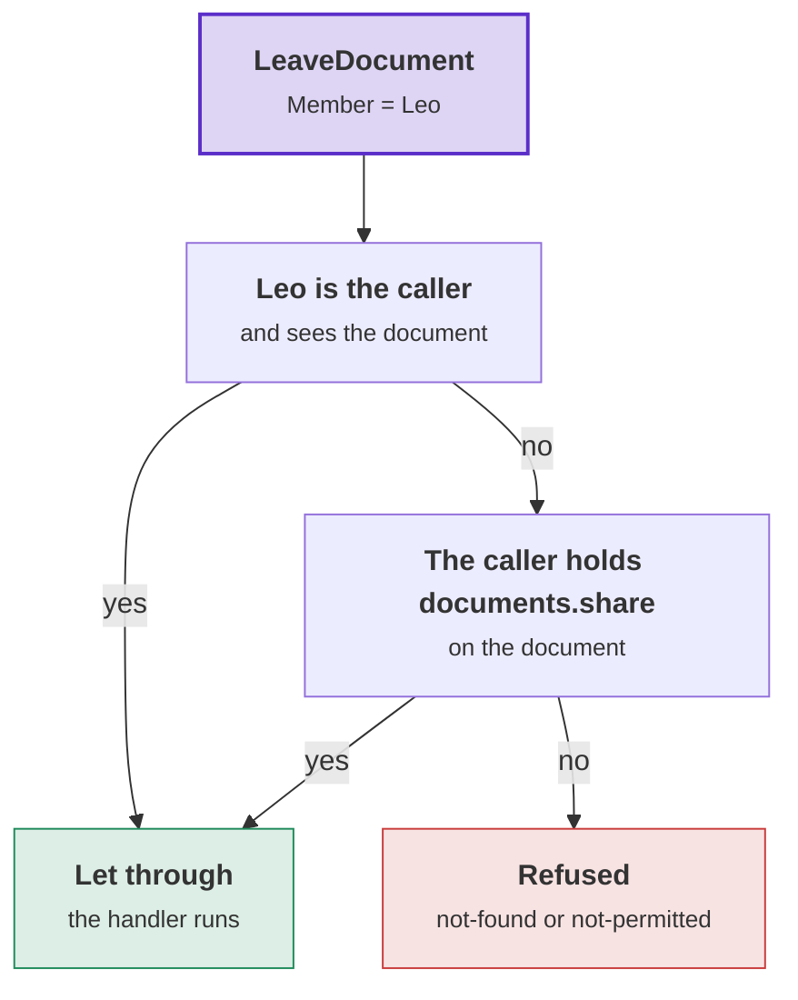

# Membership: from the check to the save

Read this page when you write commands, lists, or work that no person does. It covers how a request on a resource is
checked, what stops a change between the check and the save, access inside your own queries, system work, and the
expert hold.

## Requirements that combine

Membership adds two requirements to [the vocabulary](../access-requirements.md#requirements-and-their-attributes):

| On the request | The call | For |
|---|---|---|
| `[RequiresPermission(p)]`, with `[OnResource]` on the resource and `[ExpectedVersion]` on the version read | `MemberAccess.On(p, resource, expectedVersion)` | a request on one resource |
| `[SeenWith<TResourceId>(p)]` | `MemberAccess.SeenWith<TResourceId>(p)` | a list ([Access in your own queries](#access-in-your-own-queries)) |

Both [combine](../access-requirements.md#requirements-that-combine) with the other requirements. Each package
registers its check for the same request interface, and each check decides its own cases.

**The caller's own, or the permission.** Put `[OrOwn]` beside `[OnResource]`. A member can then leave a document,
and anybody with the permission can take any member off. With `[RequiresPermission(DocumentPermissions.Share)]`, the
request `LeaveDocument([OnResource] DocumentId Document, [OrOwn] UserId Member)` gets this requirement:
`Any(All(Own(request.Member), MemberAccess.Sees(DocumentPermissions.Share, request.Document)), MemberAccess.On(DocumentPermissions.Share, request.Document))`
([Yours, or the permission](../access-requirements.md#the-callers-own-or-a-permission)).

The diagram shows the two ways through when Leo sends `LeaveDocument`. Purple: the request. Green: let through. Red:
refused.



- `MemberAccess.Sees` requires that the caller sees the document, whether or not the caller holds the permission.
  Like `On`, it refuses with `documents.not-found`, compares the version and keeps the hold.
- Where a permission is marked `ManagesMembers`, the database lets only callers with that permission write member
  rows. A member without it cannot remove its own row. So the member manager saves that change as the resource's own
  work, for the request this check let through
  ([The caller's own place](resources-and-members.md#the-callers-own-place)).

**Membership and Tenancy together.** Moving a project requires edit on the project and open at the unit it moves to:
`All(MemberAccess.On(ProjectPermissionNames.Edit, Project, ExpectedVersion), TenancyAccess.AtUnit(ProjectPermissionNames.Open, To))`.

**Combined requirements and the expert hold.** The [expert hold](#the-expert-hold) keeps one hold for each case that
let the caller through, once the full combination let the caller through. `All(MemberAccess.On(p, From),
MemberAccess.On(p, To))` keeps one hold per document.

## From the check to the save

Other requests can run between the check and the save. On the default path, five steps stop a change that is no
longer allowed:

| Step | What it checks | Refused with |
|---|---|---|
| 1. The request's check | The caller holds the permission. Then, the version the caller named is the current one. | `not-found`, `not-permitted`, 409 |
| 2. The load by id at the version named: the member manager's `expectedVersion`, or `db.ExpectVersion(document, command.ExpectedVersion)` in a handler of yours | The checked resource still exists at the version named. With no version named, any version passes. | 404 when the resource is gone, 409 |
| 3. The save | The resource is still at the version the handler loaded. | 409 |
| 4. The aggregate's rules | Rules that apply at any version, such as "an archived document takes no member" and "the owner stays". | your codes |
| 5. The database, which checks every row as the caller ([On Postgres](postgres.md)) | The write, for a caller who lost every permission that writes the resource. | 403 `access.refused`. A resource that is hidden by then is a 404 at the load. |

The permission is about who acts. The version is about what the caller read. A rule about how, and until when, the
caller holds the permission goes [in the handler](permissions-and-roles.md#who-may-give-a-role).

The Tenancy sample's tests (`AccessHoldScenarios`) rename a project after a change between the check and the
handler. They run on Postgres, with the policies forced:

| Between the check and the handler | The rename |
|---|---|
| The role that gave the permission is taken away. | 403 `access.refused`, from the database |
| The reach from above is revoked, or the project moves out of reach. | 404, because the load finds nothing |
| Somebody else renames the project, and the caller named its version. | 409, at the load |
| Somebody else renames the project, and the caller named no version. | Saved. The last write wins. |
| The project moves to a place where the caller still holds the permission. | Saved |

The default path has three limits:

- **It checks nothing finer than the policies.** A policy that lets any writing permission through also lets
  through a caller who lost the command's permission and kept another one. Where that matters, write the policy per
  permission.
- **When a handler is reached around its checks, only the database checks the write**, against what the caller may
  do. Add a test that proves your request sender runs the checks. In such a handler no checked request is in hand, so
  a member manager asks the access manager for the caller's permission before it changes anything. No row rule restricts a save
  that runs as system work. So begin system work only for a request whose check passed.
  `RequestInHand.Current.Request` is that request
  ([The request in hand](../access-requirements.md#the-request-in-hand)). The member manager does this for a change
  to the caller's own place.
- **The save is not tied to the version the check read.** For a caller who named no version, the last write wins.
  [The expert hold](#the-expert-hold) adds that tie.

## Access in your own queries

Your code asks what the caller holds in two places: in a handler, through the resource's access manager, and inside
a query of your own, through `WhereIHold`. Each answer runs one statement. The examples use the document of
[Resources and members](resources-and-members.md#a-document-and-the-people-it-is-shared-with).

### The access manager

[`MembershipAccessManager<Document>`](reference/managers.md#membershipaccessmanagertresource) answers questions about
the current caller and documents. `AddDocumentMembership` registers it per scope, and a handler takes it like any
service. Each question takes the document, or the document's id:

| Question | Returns | Refuses |
|---|---|---|
| `HoldAsync(document, p)` | a `MemberHold<Document>`: how the caller holds `p` (`Via`), until when (`Until`), and the document's `Version`. `null` when the caller does not see the document. | nobody |
| `RequireAsync(document, p)` | the hold | the caller's own refusal when the caller is nobody, then `documents.not-found`, then `documents.not-permitted` |
| `ViaAsync(document, p)` | how the caller holds `p` (`Members`, `Above` or `System`), or `null` | the caller's own refusal, then `documents.not-found` |
| `PermissionsOnAsync(documents, ps)` | which of `ps` the caller holds on each document it sees, for at most 200 documents (`MembershipAccessManager.MostResources`) | nobody |

This handler shows a document and whether the caller may edit it:

```csharp
[RequiresPermission(DocumentPermissions.View)]
public sealed record ShowDocument([OnResource] DocumentId Document) : IFilingRequest;

public sealed class ShowDocumentHandler(FilingContext db, MembershipAccessManager<Document> documentAccess)
{
    // Runs after the check let the request through: the caller holds documents.view on the document
    public async Task<DocumentView> HandleAsync(ShowDocument query, CancellationToken cancellationToken)
    {
        var document = await db.Documents.SingleOrDefaultAsync(row => row.Id == query.Document, cancellationToken)
            ?? throw Document.Codes.Refuse(MembershipRefusals.NotFound);

        // How the caller holds documents.edit on this document, or null when the caller does not hold it
        var edit = await documentAccess.ViaAsync(document, DocumentPermissions.Edit, cancellationToken);
        return new DocumentView(document.Id, document.Archived, CanEdit: edit is not null);
    }
}
```

- **An answer names the resource the way the question named it.** Asked with the document, `HoldAsync` returns a
  `MemberHold<Document>`, and `PermissionsOnAsync` keys its answer by the documents. Asked with an id, as in
  `documentAccess.HoldAsync(command.Document, ...)`, the hold is a `MemberHold<DocumentId>`, and the answer is keyed
  by the ids.
- **An answer that shows a button lets no command through.** The access check checks the command's permission when
  the command runs.
- **Each question answers for the caller who is current when the question runs.** Inside system work that the
  handler began, a question answers for the system work.
- **The access manager answers what a caller holds.** The member manager asks it for the permission marked
  `ManagesMembers` before a change. A rule beyond that permission is yours
  ([Who may give a role](permissions-and-roles.md#who-may-give-a-role)).

### The resources a caller holds a permission on

`db.Documents.WhereIHold(DocumentPermissions.View)` keeps the documents the caller holds `documents.view` on. It is
part of your query, so a list runs as one statement and fetches no ids first
([tutorial step 6](tutorial.md#step-6-open-a-board-see-it-list-them)). On the set, `WhereIHold` finds the context. A
query that starts with a filter of yours passes the context it runs on:

```csharp
[SeenWith<DocumentId>(DocumentPermissions.View)]
public sealed record ListOpenDocuments : IFilingRequest;

public sealed class ListOpenDocumentsHandler(FilingContext db)
{
    public async Task<IReadOnlyList<Document>> HandleAsync(ListOpenDocuments query, CancellationToken cancellationToken)
        => await db.Documents.Where(document => !document.Archived)   // a filter of yours first
            .WhereIHold(DocumentPermissions.View, db)                  // then WhereIHold, with the context
            .ToListAsync(cancellationToken);
}
```

- **The rules come from the services the context was made with.** For a context registered with `AddDbContext`,
  those are the services of the request's scope. Bind a context from a pool or a factory to the scope first:
  `context.BindToScope(scope.ServiceProvider)`.
- **The context must be the one the resource is registered with.** `WhereIHold` throws an
  `InvalidOperationException` for a resource that is not registered with Membership, or is registered with another
  context. The message names the registration to add.

### What the caller may do with each row

`db.Documents.WhereIHold([DocumentPermissions.Edit, DocumentPermissions.Share])` returns one
`PermissionOn<Document>` for each document the caller sees and each of the permissions it holds there. A pair has
the document, `Resource`, and the `Permission`. A list uses the pairs to show the buttons of each row:

```csharp
var buttons = await db.Documents.WhereIHold([DocumentPermissions.Edit, DocumentPermissions.Share])
    .Select(pair => new { pair.Resource.Id, pair.Permission })
    .ToListAsync(cancellationToken);
```

- A permission is one pair on a document, however many ways the caller holds the permission there.
- A query that does not start at the set passes the context, as above: `query.WhereIHold(permissions, db)`.
- [Tutorial step 9](tutorial.md#step-9-what-the-caller-may-do-on-a-board) shows the pairs in a list handler, and
  `PermissionsOnAsync` for one board.

### The lower level: a reach

`WhereIHold` is built on a **reach**: the resources the caller holds one permission on, as a part of a statement.
The access manager makes a reach: `documentAccess.Reach(permission)` for a permission, and
`documentAccess.ReachSeen()` for the documents the caller sees. Two steps take a reach:

- `Within(reach)` keeps the resources the reach covers.
- `Reached(reach)` keeps every resource, and adds how the reach covers each one: `AsMember`, `FromAbove` and
  `Until`.

Use a reach for your own columns next to how a permission is held, or for one reach that several statements use:

```csharp
// The document's own column next to how the caller holds documents.edit, and until when
var seen = documentAccess.ReachSeen();                       // MembershipAccessManager<Document>
var edit = documentAccess.Reach(DocumentPermissions.Edit);
var answer = await db.Documents.Where(document => document.Id == id)
    .Within(seen)
    .Reached(edit)
    .Select(found => new { found.Resource.Archived, found.AsMember, found.FromAbove, found.Until })
    .FirstOrDefaultAsync(cancellationToken);
var via = answer is null ? null : edit.Via(answer.AsMember, answer.FromAbove);
```

- **A reach covers one permission, and ignores whether the caller sees the document.** Put `Within(seen)` in front,
  as above, so the statement answers only about documents the caller sees
  ([Reach from above](beside-an-organization.md#reach-from-above)).
- `edit.Via(asMember, fromAbove)` turns the two columns into a `MemberVia`, system work included.

### Lists and `[SeenWith]`

**A list declares `[SeenWith<DocumentId>(permission)]`**, because the checks
[fail closed](../access-requirements.md#what-answers-it):

- `[SeenWith]` refuses nobody for lacking the permission. `WhereIHold` in the query is the filter. So `[SeenWith]`
  goes on queries only. On a Mediator command or a plain `IRequest` it is [DDD00082](../diagnostics.md#ddd00082).
  With another dispatcher, a [test](../access-requirements.md#testing-the-requirements) checks it.
- A caller who did not sign in reaches nothing. The check refuses that caller with `documents.not-permitted`, and no
  statement is sent.
- With Tenancy, the check first refuses a caller without an active seat in the tenant, with Tenancy's code:
  `tenancy.tenant-required` when the caller names no tenant, `tenancy.not-seated` or `tenancy.seat-suspended`. A
  list is refused the same way as a command.

### The context a question runs on

- **The access manager's questions** run on a context of their own when you registered a context factory (for
  example a pool with `AddScopedFromPool`), because the questions of one request may run side by side. Without a
  factory, they run on the request's context.
- **They run on the request's context** when the resource or the custom role class has a query filter that reads a
  member of your context. A context made for one reading does not know that member's value. A filter that reads the
  ambient work, such as [Tenancy's](../tenancy/keeping-tenants-apart.md), works on every context.
- **`WhereIHold` runs on the context of your query.** On the set it finds that context. On a query that does not start
  at the set, you pass it.
- **A reach works on any context.** Some reaches add a subquery of their own, over custom role rows or over
  [what you return](beside-an-organization.md#an-organization-of-your-own). On a context other than the request's,
  pass that context as well: `db.Crates.Within(reach, db)`.

## System work

- **System work without a scope**, `access.BeginSystem()` on the core's `AccessManager`, holds every permission on
  every resource.
- **Scoped system work**, `access.BeginSystem("filing")`, is nobody's member. It holds every permission where the rules
  let its scope through, and nothing elsewhere.
- **By default, the rules let the module's own scope through**, for example `filing` for the module `Filing`
  ([Names](resources-and-members.md#names)). So a seeding, or a handler that saves as system work, needs no setting.
- **With Tenancy, begin system work in the module's scope** on `TenancyAccessManager`:
  `access.BeginSystemIn(tenant, actingSeat: seat, scope: "boards")`. Without `scope`, `BeginSystemIn` runs in the
  `tenancy` scope, which holds nothing on a board.
- **A command marked `[Operator]`** runs its handler as system work, recorded as the operator who sent it. The work
  runs in the `tenancy` scope unless the attribute names another. A Boards command for operators names the module's
  scope, `[Operator(Scope = "boards")]`, to hold every permission on every board.
- **`systemScopes` replaces the default.** Name the scopes, including the module's scope if you want to keep it, or
  pass `[]` for none. A scope has lower case letters, digits, `_` and `-`, and each scope is named once:

  ```csharp
  // The boards' own work, and the nightly import, which runs in its own scope
  public static MembershipRules Rules { get; } = MembershipRules.For<Board>(
      Roles.Custom(starters: [new("editor", [BoardPermissions.View, BoardPermissions.Edit])]),
      systemScopes: ["boards", "boards-import"]);
  ```

- **Name a scope after the work it does, and never use `tenancy`.** System work for Tenancy runs in the `tenancy`
  scope: provisioning a tenant, accepting an invitation, and every `BeginSystemIn(tenant)` without a scope. With
  `tenancy` in `systemScopes`, all of that work would hold every permission on every board.
- **On Postgres**, the scoped system role may call the functions. [The lock](postgres.md#who-writes-the-member-rows)
  refuses member row writes from work in a scope the rules do not name.

## The expert hold

The **expert hold** ties every save to the check of its request. You switch it on with one line on the context:

```csharp
services.AddDbContext<FilingContext>((serviceProvider, options) => options
    .UseNpgsql(connectionString)
    .UseDDDToolkit(serviceProvider)
    .UseMemberHolds(serviceProvider));             // ties every save of a document to its request's check
```

A save that changes a resource with members, or one of its members or roles, then has these results:

| The save changes | Result |
|---|---|
| the resource the check read, at that version | saved |
| that resource, changed since the check, whether or not a version was named | 409, whatever changed |
| a resource that no check of the request read: a handler called directly, a transport that bypasses the pipeline, a save after the handling returned, or another resource than the request names | refused with `InvalidOperationException`. Nothing is saved. A member manager refuses a caller without the permission before that, with `not-permitted`. |
| another resource, as system work begun by trusted code (`access.BeginSystem()`, or a scope the rules name) | saved. A resource the check read is still tied to its version. |
| a new resource | saved |

- **The hold finds the check through [the request in hand](../access-requirements.md#the-request-in-hand).**
  `AccessChecks.RequireAsync` puts the request in hand for the flow of work that called it. `MemberAccessCheck` keeps
  what it read with the request (`Checked<MemberHold<DocumentId>>`). The save looks it up there. The handler passes
  nothing.
- **The hold follows the flow of work.** One scope can handle several requests, such as GraphQL mutations, or a query
  before a command. A hold that a query's check kept lets no directly called handler save.
- **Run the checks and the handler in one `async` method.** The generated behavior does this, and so does
  [a dispatcher of your own](../access-requirements.md#asking-the-checks-without-mediator) that awaits both. A helper
  that only runs the checks has the request in hand inside the helper alone, so every later save is refused. A
  dispatcher without `async` that returns the chained task leaves the request in hand for its caller.
- **Save inside the access behavior.** Register a unit of work after `Add{Module}AccessBehavior()`. Do not register
  it in `MediatorOptions.PipelineBehaviors`, because those behaviors run first. An endpoint does not save after
  `Send`.
- **A second save** is tied to the version the first save left. A failed save counts for nothing. Retried with the
  values as loaded, it is a 409 again.
- **`Version` must be a concurrency token.** Otherwise the first held save is refused. `UseMemberHolds` goes after
  `UseDDDToolkit` or `UseDDDToolkitCore`. Otherwise the context is refused when it is built. Calling
  `UseMemberHolds` twice adds the hold once.
- **The hold runs after the domain event handlers.** A domain event handler that changes another resource with
  members is refused, unless it begins system work.
- **The hold costs no extra statement.** It adds a 409 for a change the caller's rights did not depend on, such as a
  move to a place where the caller still holds the permission. It also refuses a handler reached around its checks.
  When the hold is off, it does nothing.

The Tenancy sample ships the default path. Its tests switch the hold on through `ConfigureDbContext` and run the
races both ways (`AccessHoldScenarios`).
