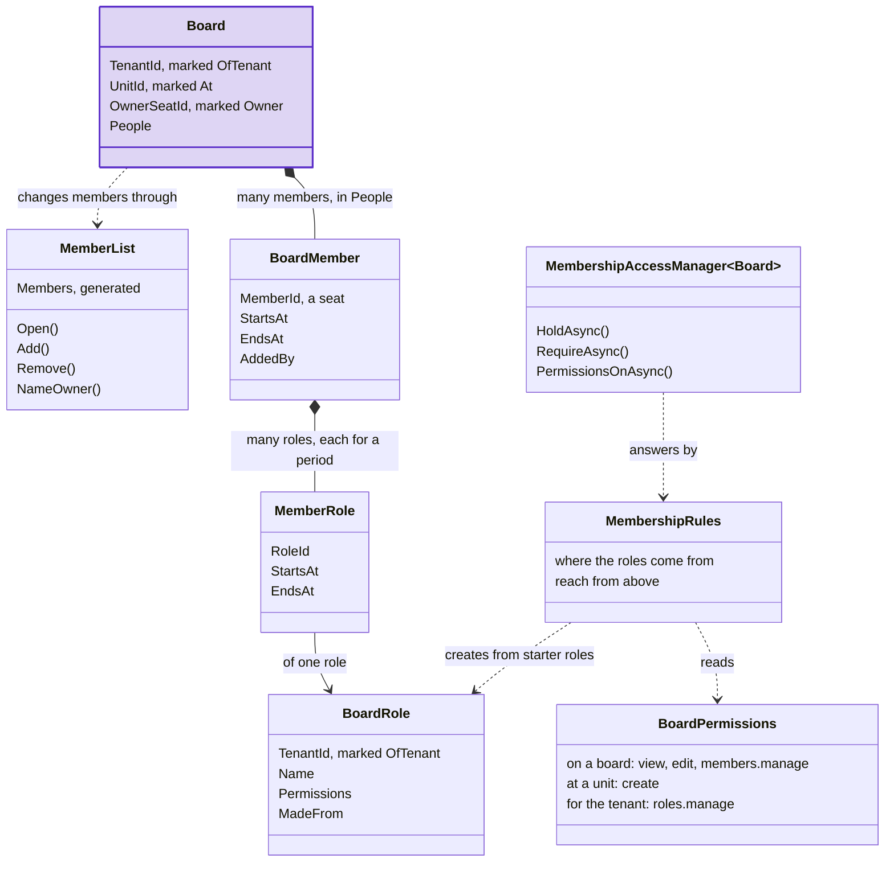
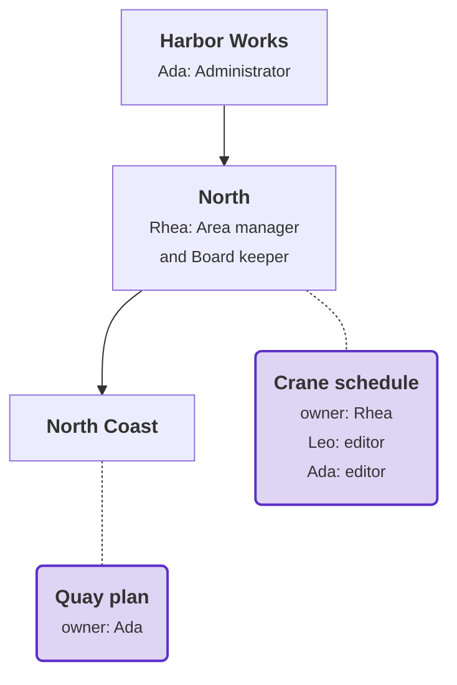

# Membership

Membership is a package for access to **one thing** through **the people on it**: a board with its members, a case
file with its team. This page explains what Membership is for, what it covers, and its classes. The
[tutorial](tutorial.md) then adds it to the Harbor application of the [Tenancy tutorial](../tenancy/tutorial.md).

## What it is for

[Tenancy](../tenancy/overview.md) decides what a seat may do **at a unit**: a permission granted at North counts at
North and every unit below it. Many applications also need access to **one thing**:

- Rhea opens a board, Crane schedule, and adds Leo to it as an editor.
- Leo can edit that board. He gets no permissions at North, and none on other boards.
- Rhea owns the board. She decides who is on it, and nobody can remove her from it.

Membership stores the members and their roles, and checks each request against them before your handler runs. Your
application keeps the board itself, its names, and the rule for who may add whom.

## What it does

- **Members**: who is on a resource. Each membership starts at a set time, and ends at a set time or never.
- **Roles on a resource**: a member holds roles there, each for its own period. A role counts only on that resource.
- **One owner**: the owner is always a member. The owner stays on the resource until somebody else becomes owner.
- **Rules for the member list**: a person is on the list once, holds each role once, and the owner cannot be removed.
- **The check before a handler**: does the caller hold this permission on this board? If not, the handler does not
  run.
- **Lists in one query**: `db.Boards.WhereIHold(BoardPermissions.View)` makes the boards a caller holds a permission
  on a subquery of your own query. Your code does not fetch a list of ids first.
- **Questions in a handler**: `MembershipAccessManager<Board>` returns how the caller holds a permission on a board,
  and which permissions the caller holds on several boards. Use it for a rule of your own or for the buttons of a
  screen.
- **Reach from above**, with an organization: a permission held at the unit where a board hangs, or above it, counts
  on the board.
- **On Postgres**: functions that your row level security (RLS) policies call, and a lock on the member rows.

## What it does not do

- **Decide who may add a member or give a role**: each of your commands requires the permission you choose.
- **Store the resource**: the board is your aggregate, with your fields, in your context.
- **Store an organization**: use [Tenancy](../tenancy/overview.md), or your own. Membership also works without one.
- **Write your RLS policies**: your row access rules say what a caller reads and changes of a board.
- **Groups, or access through another resource**: a member is one id.

## With Tenancy, or without

- **Without Tenancy**: a member is one of your users, identified by the user id in its token.
- **With Tenancy**: a member is a **seat**. A board then belongs to one tenant, and a suspended seat loses access to
  every board. The generator writes the code that connects the two packages into your project. Neither package
  references the other.
- Everything else works the same. The tutorial uses Tenancy, because Harbor has it.

## How the classes connect

The classes of a board with members, and how they connect. The board (purple) is your aggregate. The access manager
is the package's service, which your handlers take:

- a board has many members;
- a member holds roles, each for a period;
- each role is one of the tenant's board roles;
- the rules read your permissions, and create the board roles from your starter roles;
- the access manager answers questions about the caller and boards, by the rules.

| Class | What it is | In Harbor |
|---|---|---|
| **Resource** | The one thing access is about: an aggregate of yours that has members. | A board: Crane schedule |
| **Member** (`BoardMember`) | Someone on the resource, for a period. With Tenancy, a seat. You declare it in one line, from the package's template. | Leo's seat, on Crane schedule |
| **Member list** (`Members`) | The rules for the members, over your collection: each person once, and the owner stays. The generator adds it to your aggregate. | `Members.Add(...)`, inside the board |
| **Owner** (`[Owner]`) | One per resource, and always a member. The owner holds no role. The owner holds every permission marked for the owner. | Rhea |
| **Role** | A named set of permissions, given to a member on one resource. | editor |
| **Role hold** (`MemberRole`) | One role held by one member. It starts at a set time, and ends at a set time or never. It counts only while the membership lasts. | Leo holds editor on Crane schedule |
| **Custom role** (`BoardRole`) | A role stored as a row of the tenant. The tenant can rename it and change its permissions. A **starter role** is one every tenant gets a copy of. | The tenant's editor, made from the starter role `editor` |
| **Permission** and its **level** | One thing a caller may do, as a string, with the level where the check asks for it: on one resource (`[On<Board>]`), at a unit (`[AtUnit]`), or for the whole tenant (`[AtTenant]`). | `boards.edit` on a board, `boards.create` at North |
| **Rules** (`MembershipRules`) | One declaration per kind of resource: where the roles come from, and whether a permission held above reaches the resource. The C# check and the database functions read the same rules. | `BoardMembership.Rules` |
| **Access manager** (`MembershipAccessManager<Board>`) | The service your handlers ask what the current caller holds on one kind of resource. Each question takes the resource, or its id. | `PermissionsOnAsync([board], ...)`, for the buttons of a board's screen |
| **Reach from above** | A permission held at the unit where a resource hangs (`[At]`), or above it, counts on the resource for a caller who is not a member. | Ada's Administrator role at the root reaches every board |
| **Lock** | A database check: only a caller who holds the permission you mark can change a member row or the owner column. | Only a caller with `boards.members.manage` can write Crane schedule's member rows |

## Who holds a permission on a board

A caller holds a permission on a board in five cases. One query checks all five:

| The caller | Holds | In Harbor |
|---|---|---|
| is the owner | every permission marked for the owner (all of them, except one marked `Owner = false`) | Rhea, on Crane schedule |
| is a member now | the one permission marked `EveryMember`, whatever roles the member holds | Leo sees Crane schedule |
| holds a role on the board now | what the role gives, limited to the permissions a role may give (`InRoles`) | Leo edits it, as editor |
| holds the permission at the board's unit, or above it | that permission, with reach from above | Ada, from the root |
| is system work in the module's scope | every permission | seed data written as system work in `boards` |

A caller who holds none of these does not see the board, and gets `boards.not-found`, the same answer as for a
board that does not exist. A caller who sees the board but lacks the permission gets `boards.not-permitted`.

> [!TIP]
> On the [docs site](https://dylansnel.github.io/DDDToolkit/docs/membership#who-holds-a-permission-on-a-board) this
> section has an explorer. Pick Ada, Rhea, Leo or system work, a board and a permission. The explorer answers each of
> the five ways with yes or no and why. It then gives the answer to the tutorial's request: let through,
> `boards.not-found` or `boards.not-permitted`.

## Reach from above: a permission held at the board's unit

With reach from above, a permission held in the organization counts on the boards below it. At the end of the
tutorial, Harbor has two boards. Units are square and show the roles granted there. Boards are purple and rounded,
with a dotted line to the unit where they hang, and show their owner and their members with their roles:

| Person | Sees | Why |
|---|---|---|
| Leo | Crane schedule | He is a member. He holds no permission in the organization. |
| Rhea | Crane schedule and Quay plan | She owns Crane schedule. Her `boards.view` at North reaches Quay plan at North Coast. |
| Ada | both boards | Her role at the root reaches every board in the tenant. She is also an editor on Crane schedule. |

## What your application decides

Most choices have a default. The smallest application decides only where the roles come from.

| Choice | Default | What you can do instead |
|---|---|---|
| Where the roles come from | No default: the rules must say it. | `Roles.Fixed([...])`: roles in code, the same for every tenant. `Roles.Custom(starters: [...])`: rows the tenant keeps and changes, as in the tutorial. `Roles.External(...)`: roles stored elsewhere, such as Tenancy's ([Beside an organization](beside-an-organization.md#three-settings-of-the-rules)). |
| Who may add a member, give a role or name an owner | You decide per command. The package has no permission for it. | Require a permission on the board, such as the tutorial's `boards.members.manage`, and write further rules in the handler ([Who may give a role](permissions-and-roles.md#who-may-give-a-role)). |
| What the owner holds | Every permission on the board. | Mark a permission `Owner = false` to keep it from the owner. |
| What every member holds | Nothing. | Mark one permission `EveryMember = true`, usually the one that shows the board. Reach from above needs it. |
| What a role may give | Every permission on the board. | `InRoles = false` keeps a permission out of every role. `otherPermissions` lets permissions of other modules in. |
| The lock on the member rows and the owner | Off. Any caller your row rules let change a board can write them, and the start-up check warns. | `LocksMembers = true` and `LocksOwner = true` on the permission your commands require ([Who writes the member rows](postgres.md#who-writes-the-member-rows)). |
| Reach from above | Off. Only the members and the owner have access. | `reachFromAbove: true`, and `[At]` on the property that holds the board's unit. |
| How the caller's member id is found | From the member id's type: the caller's seat for Tenancy's seat id, the user id for an id over a `Guid`. | `members: MemberSource.Claim(...)` reads a claim of the token. `MemberSource.Resolved(...)` uses an id you resolve. |
| System work | System work in the module's scope, `boards`, holds every permission on every board. | `systemScopes: [...]` names other scopes, `[]` none ([System work](checks-and-saves.md#system-work)). |
| The name in refusal codes and functions | The class name in the plural: `boards.not-found`, `boards_i_see`. | `[Members("...")]` on the class ([Names](resources-and-members.md#names)). |
| A save tied to its check | Off. The check, the load by id, the version, the board's rules and RLS protect a change. | `UseMemberHolds` on the context ([The expert hold](checks-and-saves.md#the-expert-hold)). |
| How the tables are mapped | By convention. A context with `AddDDDToolkitConventions()` maps a resource's members and a custom role class. A role class with `[OfTenant]` also gets a unique index on the tenant and the name, and one on the tenant and the starter role. | `HasMembers(...)` and `IsCustomRole()` in `OnModelCreating`, for table names of your own ([Several kinds of resource](resources-and-members.md#several-kinds-of-resource)). |
| With or without Tenancy | Works without: members are your users. | Add Tenancy's Entity Framework package to the project: members become seats, and the connecting code is generated ([With Tenancy](beside-an-organization.md#with-tenancy)). |

## Where to go next

- **Build it:** the [tutorial](tutorial.md), step by step, on the Harbor application.
- **Look something up:** one page per topic, with every detail:
  - [Resources and members](resources-and-members.md): the packages, a resource without Tenancy, the member list,
    names, several kinds of resource.
  - [Permissions and roles](permissions-and-roles.md): the settings of a permission, who holds one, who may give a
    role, roles a tenant makes.
  - [Checks and saves](checks-and-saves.md): combined requirements, from the check to the save, the access manager
    and your own queries, system work, the expert hold.
  - [Postgres](postgres.md): the functions, the lock on the member rows, the start-up check.
  - [Beside an organization](beside-an-organization.md): with Tenancy, or with an organization of your own.
  - [Design and limits](design.md): why you write each piece yourself, and what Membership does not do.
- **Every class and method:** the [API reference](reference/resource-and-members.md).
- **The organization around it:** [Tenancy](../tenancy/overview.md).
