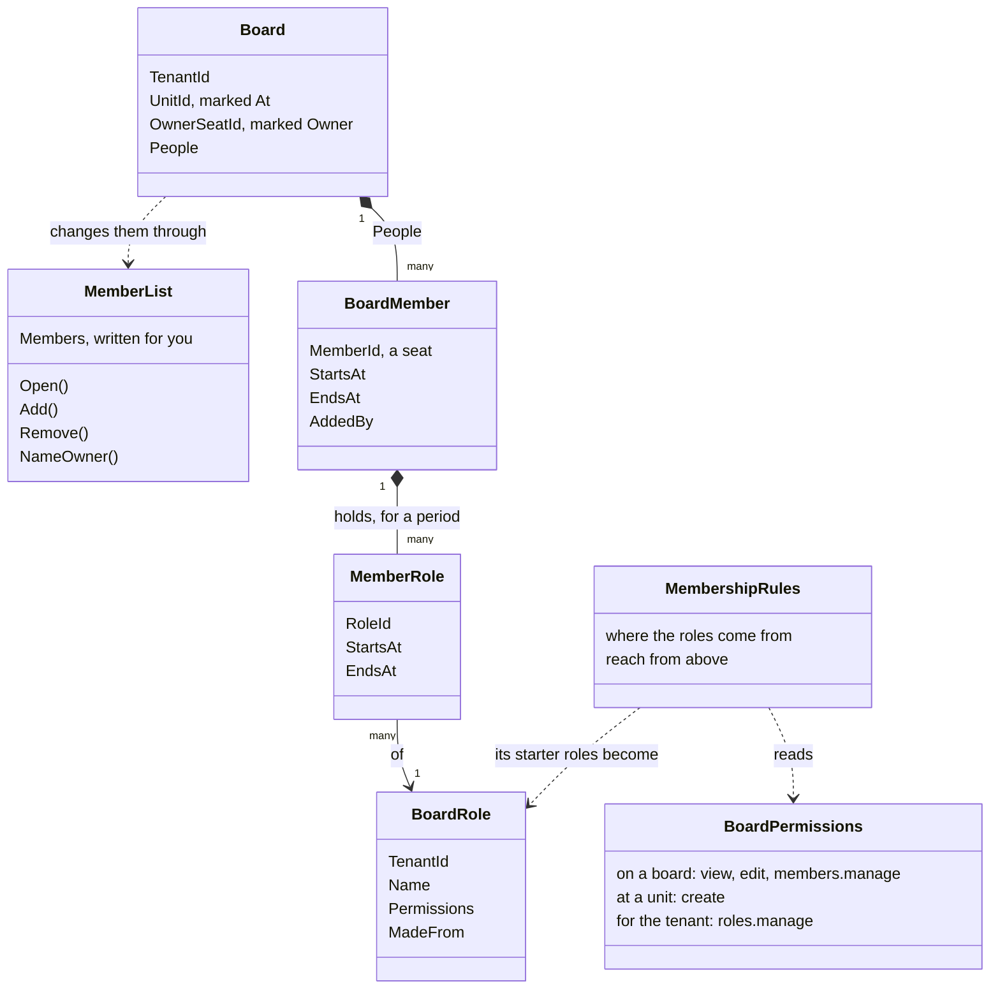
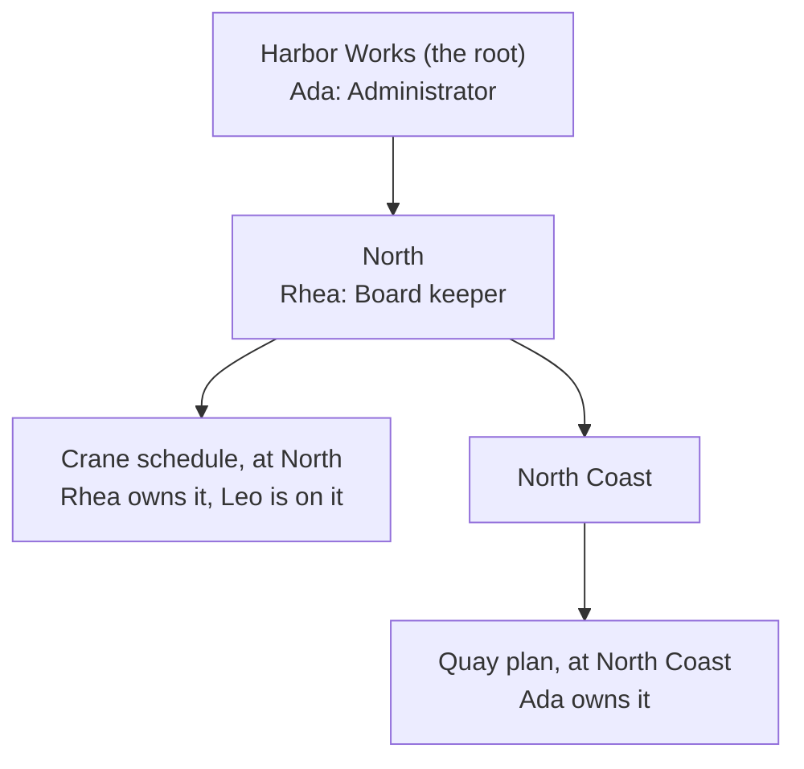

# Membership

Membership is a package for access to **one thing** through **the people on it**: a board with its members, a case
file with its team. This page: what it is for, its scope, and its pieces. The [tutorial](tutorial.md) then adds it to
the Harbor application of the [Tenancy tutorial](../tenancy/tutorial.md).

## What it is for

[Tenancy](../tenancy/overview.md) answers what a seat may do **where**: a permission given at North counts for
everything at North and below. Much access is about **one thing** instead:

- Rhea opens a board, Crane schedule, and puts Leo on it as an editor.
- Leo edits that one board. He gets nothing at North, and no other board.
- Rhea owns the board: she says who is on it, and cannot be taken off it.

Every application with things people share needs these rules, and none is special because of them. So Membership
keeps them once; your application keeps the thing itself, its words, and who may add whom.

## What it does

- **Members**: who is on a resource, each from a moment, until a moment or for good.
- **Roles on a resource**: a member holds roles there, each for a period of its own. A role counts only on that
  one resource.
- **One owner**: always a member, never taken off until somebody else is named owner.
- **The rules about the list**: a member is on it once, holds a role once, and the owner stays.
- **The check before a handler**: does the caller hold this permission on this board? If not, the handler never runs.
- **Lists in one query**: the boards a caller may see, as part of your own query, never ids fetched first.
- **Reach from above**, beside an organization: a permission held where a board hangs, or above it, counts on the
  board.
- **On Postgres**: functions your row level security (RLS) policies ask, and a lock on the member rows.

## What it does not do

- **Decide who may add a member or give a role**: each command of yours requires what you choose.
- **Keep the resource**: the board is your aggregate, with your fields, in your context.
- **Keep an organization**: that is [Tenancy](../tenancy/overview.md), or yours. Membership works without one.
- **Write your policies**: what a caller reads and changes of a board, your row access rules say.
- **Groups, or access through another resource**: a member is one id.

## With Tenancy, or without

- **Without**: a member is one of your users, known by the user id of its token.
- **With Tenancy**: a member is a **seat**, so a board belongs to one tenant, and a suspended seat is on no board any
  more. What joins the two packages is generated into your project; neither references the other.
- The rest is the same either way. The tutorial uses Tenancy, because Harbor has it.

## How the pieces connect

Every class of a board with members, and how they point at each other. Read from the top: a board keeps its
members, a member holds roles for a period, a role is one of the tenant's board roles, and the rules read the
permissions.

| Piece | What it is | In Harbor |
|---|---|---|
| **Resource** | The one thing access is about: an aggregate of yours that has members. | A board: Crane schedule |
| **Member** (`BoardMember`) | Someone on the resource, for a period. With Tenancy, a seat. Declared by you, in one line, with the package's template. | Leo's seat, on Crane schedule |
| **Member list** (`Members`) | The rules about the members, over your collection: on it once, the owner stays. Written onto your aggregate for you. | `Members.Add(...)`, inside the board |
| **Owner** (`[Owner]`) | Exactly one, always a member, holding no role: it holds what the permissions give an owner, by owning. | Rhea |
| **Role** | A named set of permissions, given to a member on one resource. | editor |
| **Role hold** (`MemberRole`) | One role held by one member, from a moment, until a moment or for good. It counts only while the membership does. | Leo holds editor on Crane schedule |
| **Custom role** (`BoardRole`) | A role kept as a row of the tenant's, which it renames and changes. A **starter role** is one every tenant starts with. | The tenant's editor, made from the starter role `editor` |
| **Permission** and its **level** | One thing you may do, as a string, and where it is asked: on one resource (`[On<Board>]`), at a unit (`[AtUnit]`), or for the whole tenant (`[AtTenant]`). | `boards.edit` on a board, `boards.create` at North |
| **Rules** (`MembershipRules`) | One declaration per kind of resource: where the roles come from, whether something above reaches it. The check in C# and the functions in the database read the same rules. | `BoardMembership.Rules` |
| **Reach from above** | A permission held where a resource hangs (`[At]`), or above it, counts on the resource, for somebody not on it. | Ada's Administrator at the root reaches every board |
| **Lock** | The database's own check: a member row, or the owner column, changes only for a caller that holds the permission you mark. | Only who holds `boards.members.manage` writes Crane schedule's member rows |

## Who holds a permission on a board

Five ways, checked in one query:

| The caller | Holds | In Harbor |
|---|---|---|
| is the owner | every permission marked for the owner (all of them, unless one says `Owner = false`) | Rhea, on Crane schedule |
| is a member now | the one permission marked `EveryMember`, whatever its roles | Leo sees Crane schedule |
| holds a role there now | what the role gives, cut to what a role may give (`InRoles`) | Leo edits it, as editor |
| holds the permission where the board hangs, or above | that permission, with reach from above | Ada, from the root |
| is system work in the module's scope | every permission | a seeding that runs as `boards` |

A caller that holds none does not see the board: `boards.not-found`, exactly as for a board that does not exist. One
that sees it and lacks the permission gets `boards.not-permitted`.

## Reach from above: a permission held where a board hangs

With reach from above, the organization reaches the boards that hang in it. Who sees which board in Harbor, once the
tutorial is done:

- **Leo** sees Crane schedule only: he is on it.
- **Rhea** sees both: she owns one, and her `boards.view` at North reaches the other from above.
- **Ada** sees both: her role at the root reaches every board of the tenant.

## What your application decides

Most have a default, so the smallest application decides only where the roles come from.

| Choice | The default | What you can do instead |
|---|---|---|
| Where the roles come from | No default: the rules say it. | `Roles.Fixed([...])`: in code, the same for everybody. `Roles.Custom(starters: [...])`: rows the tenant keeps and changes, as in the tutorial. `Roles.External(...)`: roles kept elsewhere, such as Tenancy's own ([Beside an organization](beside-an-organization.md#beside-an-organization)). |
| Who may add a member, give a role, name an owner | Yours, per command: the package has no permission of its own for it. | Require a permission on the board, as the tutorial's `boards.members.manage`, and write any further rule in the handler ([Who may give a role](permissions-and-roles.md#who-may-give-a-role-is-yours-to-decide)). |
| What the owner holds | Every permission on the board. | `Owner = false` on a permission the owner should not hold by owning. |
| What every member holds | Nothing, by being a member. | `EveryMember = true` on one permission, usually the one that sees the board. Reach from above needs it. |
| What a role may give | Every permission on the board. | `InRoles = false` keeps one out of every role. `otherPermissions` lets permissions of other modules in. |
| The lock on the member rows and the owner | None: whoever your rules let change a board writes them, and the start-up check warns. | `LocksMembers = true` and `LocksOwner = true` on the permission your commands require ([Who writes the member rows](postgres.md#who-writes-the-member-rows)). |
| Reach from above | Off: the members and the owner only. | `reachFromAbove: true`, and `[At]` on the property that says where a board hangs. |
| Who a member is | Follows from the member id: the caller's seat for Tenancy's seat id, the user id for an id over a `Guid`. | `members: MemberSource.Claim(...)`, a claim of the token, or `MemberSource.Resolved(...)`, an id you resolve. |
| System work | Work in the module's own scope, `boards`, holds every permission on every board. | `systemScopes: [...]` names others, `[]` none ([System work](checks-and-saves.md#system-work)). |
| The name in codes and functions | The class's name made plural: `boards.not-found`, `boards_i_see`. | `[Members("...")]` on the class ([Names](resources-and-members.md#names)). |
| A save tied to its check | Off: the check, the load by id, the version, the board's rules and RLS hold a change. | `UseMemberHolds` on the context ([The expert hold](checks-and-saves.md#the-expert-hold)). |
| With or without Tenancy | Works alone: members are your users. | With Tenancy's Entity Framework package in the project, members are seats and the join is generated ([With Tenancy](beside-an-organization.md#with-tenancy)). |

## Where to go next

- **Build it:** the [tutorial](tutorial.md), step by step, on the Harbor application.
- **Look something up:** a page per topic, each with every detail of its part:
  - [Resources and members](resources-and-members.md): the packages, a whole resource without Tenancy, the member
    list, names, several kinds of resource.
  - [Permissions and roles](permissions-and-roles.md): the settings of a permission, who holds one, who may give a
    role, roles a customer makes.
  - [Checks and saves](checks-and-saves.md): requirements that combine, from the check to the save, lists, system
    work, the expert hold.
  - [On Postgres](postgres.md): the functions, the lock on the member rows, the start-up check.
  - [Beside an organization](beside-an-organization.md): with Tenancy, or an organization of your own.
  - [Design and limits](design.md): why each piece is yours to write, what it does not do.
- **Every class and method:** the [API reference](reference/resource-and-members.md).
- **The organization around it:** [Tenancy](../tenancy/overview.md).
