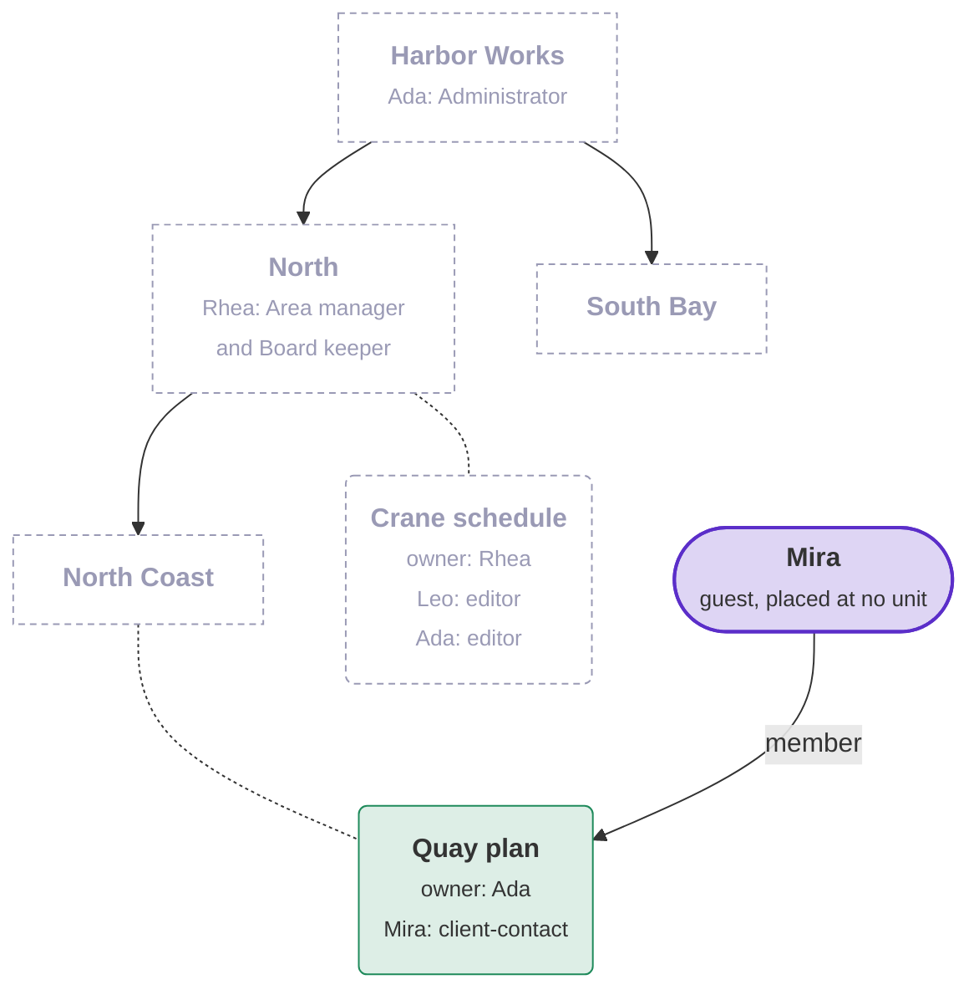
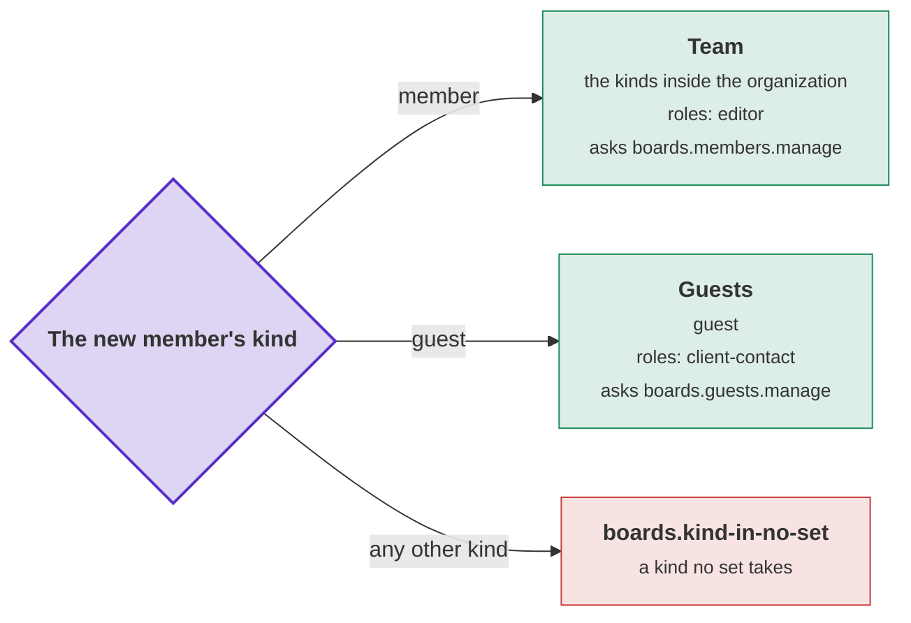

# Membership: people from outside the organization

This part continues the Harbor app of the [Membership tutorial](tutorial.md). It brings in a person who does not work
for Harbor Works, and gives her one board.

## Where we are: the Harbor app with its boards

The [Tenancy tutorial](../tenancy/tutorial.md) built Harbor. The [Membership tutorial](tutorial.md) added its Boards
module. Harbor has:

- the tenant Harbor Works, with the units Harbor Works (the root), North, North Coast below North, and South Bay;
- Ada, Administrator at the root, and Rhea, Area manager and Board keeper at North;
- Leo, with a seat at North and no role there;
- Crane schedule at North, owned by Rhea, with Leo and Ada in the role `editor`;
- Quay plan at North Coast, owned by Ada, with no other member;
- a host on Supabase that runs every request as its caller, who is named by the header `X-Dev-User`.

Everybody with a seat so far works for Harbor Works. Each seat is placed at a unit, and reads the tenant's units and
roles.

## What we build

Harbor Works builds a quay for a client. Mira is the client's site manager. She works for the client, and follows the
work on Quay plan.

At the end of this part:

- Mira has a seat in Harbor Works of the kind `guest`, outside the organization.
- Her seat is placed at no unit and holds no role of the organization.
- She is a member of Quay plan, in the role `client-contact`.
- She sees Quay plan and its members. She cannot edit it.
- She sees no other board, and none of Harbor Works' units or roles.

The diagram shows what Mira sees. Purple: Mira. Green: what she sees. Grey, dashed: what she does not see.



| Person | Kind of seat | Sees | Can change | Why |
|---|---|---|---|---|
| Mira | `guest` | Quay plan and its members | nothing | Her role gives `boards.view`. No other permission lists guests. |
| Ada | `member`, inside | both boards, every unit | both boards | Her Administrator role at the root reaches every board, as before. |
| Rhea, Leo | `member`, inside | as before | as before | Nothing changes for them. |

When it is done, you can try these with plain HTTP requests:

- Ada invites Mira at North Coast. Leo gets `403`: he holds no `tenancy.externals.invite`.
- Mira accepts. Her seat is placed at no unit, and `GET /units` answers her `[]`.
- Ada adds Mira to Quay plan as `client-contact`. As `editor` she gets `400`: that role is not for guests.
- Mira lists her boards and gets Quay plan alone. Renaming it gets her `403`.

Each step says where we are, why the step comes now, and what it adds. It explains the idea, shows every file whole
with the new lines highlighted, and lists what those lines do.

## Step 1: kinds of seat

**Where we are.** Every seat of Harbor Works is inside the organization. Tenancy cannot tell an employee from anybody
else.

**Why now.** What a seat may see depends on its kind. The later steps read the kind, so the kinds come first.

**What we want.** Two kinds of seat, declared in Tenancy's contracts project: Harbor's employees, inside the
organization, and guests, outside it. Tenancy's catalogue knows them.

### The idea: a seat has a kind

- **Kind of seat**: what a person is to the tenant. Each kind is inside the organization or outside it. Ada is an
  employee of Harbor Works, inside it. Mira is a guest, outside it.
- **Inside the organization**: the seat is placed at units and holds roles there. It reads the tenant's units, roles
  and seats.
- **Outside the organization**: the seat is placed at no unit, so it holds no role of the organization. It reads its
  own seat and its tenant. It reads no unit and no role. Of the other seats it reads only its fellow members' (step 5).
- **A seat keeps its kind.** The kind is set when the seat is added and never changes. A person who changes kind gets
  a new seat.
- **The built-in kind**: an application that declares no kinds has one kind, `member`, inside the organization. So far
  Harbor declared none. Ada's, Rhea's, Leo's and Tove's seats have the kind `member`.
- **Harbor keeps that value for its employees.** The constant `Employee` holds `SeatKinds.Member`, which is `member`.
  The seats Harbor has stay employees, and the database needs no change.
- **Where kinds are declared**: in a static partial class marked `[SeatKinds]`, in the contracts project of the module
  that holds Tenancy. Other modules read the kinds from there, as they read Tenancy's ids.
- **The catalogue**: Tenancy reads the kinds from your part of the catalogue, an `ApplicationCatalogue`. Harbor had
  none, so Tenancy used its default. Marked `[TenancyCatalogue]`, the same value reaches the export, which writes the
  kinds into the database's policies.

### What you write

**The contracts project.** **Why:** the markers of the kinds and their generator are in Tenancy's markers package. The
contracts project references only that package of Tenancy's, so other modules still see no Tenancy class.

**`src/Modules/Tenancy/Harbor.Tenancy.Contracts/Harbor.Tenancy.Contracts.csproj`**

```xml {3,6-7}
<Project Sdk="Microsoft.NET.Sdk">

  <!-- What the other modules may use of Tenancy: its ids, and the kinds of seat. -->
  <ItemGroup>
    <PackageReference Include="DylansTechStack.DDD" />
    <!-- [SeatKinds], [InOrganization] and [OutsideOrganization], and the generator that writes All. -->
    <PackageReference Include="DylansTechStack.Tenancy.Abstractions" />
  </ItemGroup>

</Project>
```

**The kinds.** **Why:** each kind is one constant, so every module names the same string.

**`Harbor.Tenancy.Contracts/HarborSeatKinds.cs`**

```csharp {5-6,9-10,12-13}
using DTS.Tenancy;

namespace Harbor.Tenancy.Contracts;

[SeatKinds]
public static partial class HarborSeatKinds
{
    // The value every seat had while Harbor declared no kinds, so those seats are employees.
    [InOrganization]
    public const string Employee = SeatKinds.Member;

    [OutsideOrganization]
    public const string Guest = "guest";
}
```

**Harbor's part of the catalogue.** **Why:** the host gives it to Tenancy, and the export finds it by its mark. One
value serves both, so they cannot disagree.

**`Harbor.Tenancy.Application/HarborCatalogue.cs`**

```csharp {6,8-9}
using DTS.Tenancy.Catalogue;
using Harbor.Tenancy.Contracts;

namespace Harbor.Tenancy.Application;

public static class HarborCatalogue
{
    [TenancyCatalogue]
    public static ApplicationCatalogue Application { get; } = new(SeatKinds: HarborSeatKinds.All);
}
```

**The registration.** **Why:** Tenancy builds its catalogue from the options. Without this line it builds the default
one, with the kind `member` alone.

**`Harbor.Tenancy.Infrastructure/TenancyInfrastructure.cs`**

```csharp {4,24}
using DTS.DDD.EntityFramework;
using DTS.Tenancy.EntityFramework;
using DTS.Tenancy.Postgres;
using Harbor.Tenancy.Application;
using Harbor.Tenancy.Application.Access;
using Harbor.Tenancy.Application.Units;
using Harbor.Tenancy.Infrastructure.Persistence;
using Microsoft.EntityFrameworkCore;
using Microsoft.Extensions.DependencyInjection;

namespace Harbor.Tenancy.Infrastructure;

public static class TenancyInfrastructure
{
    public static IServiceCollection AddTenancyInfrastructure(this IServiceCollection services, string connectionString)
    {
        services.AddDDDToolkitEntityFramework(options => options.UseOutbox<TenancyContext>(outbox =>
            outbox.AddTenancyDomainEvents()));

        services.AddDbContext<TenancyContext>((provider, options) => options
            .UseNpgsql(connectionString)
            .UseDDDToolkit(provider));

        services.AddTenancy<TenancyContext>(options => options.Catalogue = HarborCatalogue.Application);
        services.AddTenancyPostgres();
        services.AddTenancyAccess<ITenancyRequest, TenancyContext>();
        services.AddScoped<IUnitReads, UnitReads>();
        return services;
    }
}
```

**Who am I.** **Why:** the answer of `GET /me` now says the caller's kind, so you can see it in the steps that follow.

**`Harbor.Tenancy.Application/Seats/WhoAmI/WhoAmI.cs`**

```csharp {14,27}
namespace Harbor.Tenancy.Application.Seats.WhoAmI;

[InTenant]
public sealed record WhoAmIQuery : IQuery<MyOverview>, ITenancyRequest;

public sealed class WhoAmIHandler(SeatService seats) : IQueryHandler<WhoAmIQuery, MyOverview>
{
    public async ValueTask<MyOverview> Handle(WhoAmIQuery query, CancellationToken cancellationToken)
    {
        var overview = await seats.WhoAmIAsync(cancellationToken);
        return new MyOverview(
            overview.Tenant.Slug.Value,
            overview.Seat.Id,
            overview.Seat.Kind,
            overview.Seat.JobTitle,
            [
                .. overview.Seat.Placements.Select(placement => new MyPlacement(
                    placement.UnitId,
                    overview.UnitOf(placement.UnitId).Path,
                    placement.IsPrimary,
                    [.. placement.Grants.Select(grant => new MyGrant(overview.RoleOf(grant.RoleId)?.Name ?? "", grant.AppliesAt(overview.AsOf)))])),
            ],
            [.. overview.Permissions.Select(permission => new MyPermission(permission.Permission, permission.AtTenant, [.. permission.Reaches.Select(unit => unit.Path)]))]);
    }
}

public sealed record MyOverview(string Tenant, SeatId Seat, string Kind, string? JobTitle, IReadOnlyList<MyPlacement> Placements, IReadOnlyList<MyPermission> Permissions);

public sealed record MyPlacement(OrganizationUnitId UnitId, string Unit, bool Primary, IReadOnlyList<MyGrant> Grants);

public sealed record MyGrant(string Role, bool AppliesNow);

public sealed record MyPermission(string Permission, bool AtTenant, IReadOnlyList<string> Reaches);
```

### What it does

- `[SeatKinds]`: the generator writes `All` into the class. `All` lists each kind as a `SeatKind`, in the order of the
  constants.
- `[InOrganization]` and `[OutsideOrganization]`: each constant has one of the two. A value is lowercase letters,
  digits and dashes, starting with a letter.
- The default kind is the kind a seat gets when nothing names one. Harbor has one kind inside the organization, so
  `Employee` is the default.
- `new(SeatKinds: HarborSeatKinds.All)`: the rest of the catalogue keeps its defaults. Ada's Administrator role still
  holds every permission.
- `NarrowOutsideSeats` is on by default. It is the setting that narrows what a seat outside the organization reads.
- `overview.Seat.Kind` is the seat's kind, as stored. `overview.Seat.InOrganization` says its side.
- The build reports a `[SeatKinds]` class it cannot read, such as a constant with no marker
  ([DDD10002](../diagnostics.md#ddd10002)).

### Run it

Build the host. The export writes a new `<v>_access.tenancy.ddd.sql`, with the kinds in Tenancy's functions and
policies. Apply it with `npx supabase migration up --local`, and start the host again. The start-up check refuses a
database written with other kinds.

### Try it

```http
GET /me
X-Dev-User: d0000000-0000-4000-8000-000000000001
Tenant: harbor
```

The answer is Ada's seat, as in the Tenancy tutorial, with `"kind": "member"`.

> **Going further.** Every rule of a `[SeatKinds]` class, and what a seat outside the organization reads:
> [Kinds of seat](../tenancy/your-module.md#kinds-of-seat).

## Step 2: inviting a guest

**Where we are.** Harbor knows the kind `guest`. Nobody has a guest's seat.

**Why now.** Mira has no seat in Harbor Works. An invitation is how a person gets one.

**What we want.** Ada invites Mira at North Coast. Mira accepts, and has a seat of the kind `guest`.

### The idea: an invitation from outside the organization

- **Invitation**: it reserves a seat for an e-mail address. Accepting it makes the seat. Tenancy's invitations are off
  until you declare an invitation class.
- **From outside the organization**: the invitation is for a kind outside the organization. It offers no placement
  and no role. Accepting it makes a seat of that kind, placed at no unit.
- **`tenancy.externals.invite`**: Tenancy's permission to invite people from outside at a unit. Ada's Administrator
  role holds it at the root. Leo holds nothing at a unit, so he does not.
- **The permission manages no access.** A seat that holds it brings a person in. It gives that person nothing in the
  organization.
- **What the request requires**: `[AtUnit(TenancyPermissions.ExternalsInvite)]` on the unit. The request names the
  permission and the unit, so the check can ask before the handler runs. `IssueOutsideAsync` asks again.
- **The token**: issuing answers it once. Tenancy keeps only its digest. Your code hands the token to the person.
- **Accepting**: the person signs in and sends the token. Accepting needs no tenant, because the token names the
  invitation, and so its tenant.

### What you write

**The invitation's id.** **Why:** like the other ids of Tenancy, it is in the contracts project.

**`Harbor.Tenancy.Contracts/ValueObjects/InvitationId.cs`**

```csharp {5-6}
using DTS.DDD.Abstractions.Attributes;

namespace Harbor.Tenancy.Contracts.ValueObjects;

[EntityId<Guid>]
public readonly partial record struct InvitationId;
```

**The invitation class.** **Why:** declaring it turns invitations on. The generator then writes `InvitationService`
for your classes.

**`Harbor.Tenancy.Domain/Aggregates/Invitations/Invitation.cs`**

```csharp {6-7}
using DTS.Tenancy;
using Harbor.Tenancy.Contracts.ValueObjects;

namespace Harbor.Tenancy.Domain.Aggregates.Invitations;

[InvitationAggregate<InvitationId>]
public sealed partial class Invitation;
```

**The context.** **Why:** the invitations need two tables: the invitations, and the digests of their tokens.

**`Harbor.Tenancy.Infrastructure/Persistence/TenancyContext.cs`**

```csharp {5-6,23}
using DTS.DDD.EntityFramework.Conventions;
using DTS.DDD.EntityFramework.Outbox;
using DTS.DDD.EntityFramework.Supabase;
using DTS.Tenancy.EntityFramework;
using Harbor.Tenancy.Contracts.ValueObjects;
using Harbor.Tenancy.Domain.Aggregates.Invitations;
using Harbor.Tenancy.Infrastructure.Converters;
using Microsoft.EntityFrameworkCore;

namespace Harbor.Tenancy.Infrastructure.Persistence;

// Its migrations are written for Supabase, and the host checks them at start-up.
[SupabaseMigrations]
public sealed class TenancyContext(DbContextOptions<TenancyContext> options) : DbContext(options)
{
    // The schema of this module's tables.
    public const string Schema = "tenancy";

    protected override void OnModelCreating(ModelBuilder modelBuilder)
    {
        modelBuilder.HasDefaultSchema(Schema);
        modelBuilder.AddTenancy(database: Database);
        modelBuilder.AddTenancyInvitations<Invitation, InvitationId>();
        modelBuilder.AddDomainEventOutbox(Database, schema: Schema);
    }

    protected override void ConfigureConventions(ModelConfigurationBuilder configurationBuilder)
    {
        configurationBuilder.AddDDDToolkitConventions();
        configurationBuilder.StoreDateTimeOffsetsAsUtc();
        configurationBuilder.AddTenancyConverters();
    }
}
```

**The registration.** **Why:** it registers `InvitationService`, and the outbox stores the invitations' events.

**`Harbor.Tenancy.Infrastructure/TenancyInfrastructure.cs`**

```csharp {7,19,26}
using DTS.DDD.EntityFramework;
using DTS.Tenancy.EntityFramework;
using DTS.Tenancy.Postgres;
using Harbor.Tenancy.Application;
using Harbor.Tenancy.Application.Access;
using Harbor.Tenancy.Application.Units;
using Harbor.Tenancy.Contracts.ValueObjects;
using Harbor.Tenancy.Infrastructure.Persistence;
using Microsoft.EntityFrameworkCore;
using Microsoft.Extensions.DependencyInjection;

namespace Harbor.Tenancy.Infrastructure;

public static class TenancyInfrastructure
{
    public static IServiceCollection AddTenancyInfrastructure(this IServiceCollection services, string connectionString)
    {
        services.AddDDDToolkitEntityFramework(options => options.UseOutbox<TenancyContext>(outbox =>
            outbox.AddTenancyDomainEvents().AddTenancyInvitationEvents<InvitationId>()));

        services.AddDbContext<TenancyContext>((provider, options) => options
            .UseNpgsql(connectionString)
            .UseDDDToolkit(provider));

        services.AddTenancy<TenancyContext>(options => options.Catalogue = HarborCatalogue.Application);
        services.AddTenancyInvitations<TenancyContext>();
        services.AddTenancyPostgres();
        services.AddTenancyAccess<ITenancyRequest, TenancyContext>();
        services.AddScoped<IUnitReads, UnitReads>();
        return services;
    }
}
```

**Inviting a guest.** **Why:** the request states the permission and the unit. The handler names the kind, so a
client cannot ask for another one.

**`Harbor.Tenancy.Application/Invitations/InviteGuest/InviteGuest.cs`**

```csharp {6,13}
using DTS.Tenancy.Catalogue;
using Harbor.Tenancy.Contracts;

namespace Harbor.Tenancy.Application.Invitations.InviteGuest;

public sealed record InviteGuestCommand(string Address, [AtUnit(TenancyPermissions.ExternalsInvite)] OrganizationUnitId Unit)
    : ICommand<InvitationService.IssuedInvitation>, ITenancyRequest;

public sealed class InviteGuestHandler(InvitationService invitations) : ICommandHandler<InviteGuestCommand, InvitationService.IssuedInvitation>
{
    // A guest's seat, at the unit the request names. The answer holds the token, this once.
    public async ValueTask<InvitationService.IssuedInvitation> Handle(InviteGuestCommand command, CancellationToken cancellationToken)
        => await invitations.IssueOutsideAsync(command.Address, HarborSeatKinds.Guest, command.Unit, lifetime: null, cancellationToken);
}
```

**Accepting.** **Why:** the person has no seat yet, so the request requires a signed-in caller and nothing more.

**`Harbor.Tenancy.Application/Invitations/AcceptInvitation/AcceptInvitation.cs`**

```csharp {3-4,7,15}
namespace Harbor.Tenancy.Application.Invitations.AcceptInvitation;

[SignedIn]
public sealed record AcceptInvitationCommand(string Token) : ICommand<InvitationService.AcceptedInvitation>, ITenancyRequest
{
    // A record prints its members, and a token must not end up in a log.
    public override string ToString() => nameof(AcceptInvitationCommand);
}

public sealed class AcceptInvitationHandler(InvitationService invitations)
    : ICommandHandler<AcceptInvitationCommand, InvitationService.AcceptedInvitation>
{
    // Harbor's development header carries no verified address, so the token and the sign-in are what accepts.
    public async ValueTask<InvitationService.AcceptedInvitation> Handle(AcceptInvitationCommand command, CancellationToken cancellationToken)
        => await invitations.AcceptAsync(command.Token, verifiedAddress: null, cancellationToken);
}
```

**The routes.**

**`Harbor.Tenancy.Api/Invitations/Rest/InvitationsEndpoints.cs`**

```csharp {15-19,21-25,30,32}
using Harbor.Tenancy.Application.Invitations.AcceptInvitation;
using Harbor.Tenancy.Application.Invitations.InviteGuest;
using Harbor.Tenancy.Contracts.ValueObjects;
using Mediator;
using Microsoft.AspNetCore.Builder;
using Microsoft.AspNetCore.Http;
using Microsoft.AspNetCore.Routing;

namespace Harbor.Tenancy.Api.Invitations.Rest;

internal static class InvitationsEndpoints
{
    public static IEndpointRouteBuilder MapInvitationsEndpoints(this IEndpointRouteBuilder routes)
    {
        routes.MapPost("/invitations/guests", async (NewGuest body, ISender sender, CancellationToken cancellationToken) =>
        {
            var issued = await sender.Send(new InviteGuestCommand(body.Address, body.Unit), cancellationToken);
            return Results.Ok(new { invitation = issued.Invitation.Id, kind = issued.Invitation.Kind, unit = issued.Invitation.UnitId, token = issued.Token });
        });

        routes.MapPost("/invitations/accept", async (Acceptance body, ISender sender, CancellationToken cancellationToken) =>
        {
            var accepted = await sender.Send(new AcceptInvitationCommand(body.Token), cancellationToken);
            return Results.Ok(new { tenant = accepted.Tenant.Slug.Value, seat = accepted.Seat.Id, kind = accepted.Seat.Kind });
        });

        return routes;
    }

    public sealed record NewGuest(string Address, OrganizationUnitId Unit);

    public sealed record Acceptance(string Token);
}
```

**`Harbor.Tenancy.Api/TenancyModule.cs`**: maps the invitations' routes too.

```csharp {2,20}
using Harbor.Tenancy.Api.Development;
using Harbor.Tenancy.Api.Invitations.Rest;
using Harbor.Tenancy.Api.Roles.Rest;
using Harbor.Tenancy.Api.Seats.Rest;
using Harbor.Tenancy.Api.Units.Rest;
using Harbor.Tenancy.Application;
using Harbor.Tenancy.Infrastructure;
using Microsoft.AspNetCore.Routing;
using Microsoft.Extensions.DependencyInjection;

namespace Harbor.Tenancy.Api;

// The module's entry: the host calls these, and nothing else of the module.
public static class TenancyModule
{
    public static IServiceCollection AddTenancyModule(this IServiceCollection services, string connectionString)
        => services.AddTenancyInfrastructure(connectionString).AddTenancyApplication();

    public static IEndpointRouteBuilder MapTenancyModule(this IEndpointRouteBuilder routes)
        => routes.MapUnitsEndpoints().MapSeatsEndpoints().MapRolesEndpoints().MapInvitationsEndpoints();

    public static IEndpointRouteBuilder MapTenancyDevelopment(this IEndpointRouteBuilder routes)
        => routes.MapDevelopmentEndpoints();
}
```

Create the migration for the two new tables:

```powershell
dotnet ef migrations add Invitations --project src/Modules/Tenancy/Harbor.Tenancy.Infrastructure --startup-project src/Modules/Tenancy/Harbor.Tenancy.Infrastructure --output-dir Persistence/Migrations
```

### What it does

- `[InvitationAggregate<InvitationId>]`: the generator writes the other half of `Invitation`, which derives from the
  invitation template. It also writes `InvitationService`, in the global namespace.
- `AddTenancyInvitations<Invitation, InvitationId>()` maps `Invitations` and `InvitationDigests`.
  `services.AddTenancyInvitations<TenancyContext>()` registers `InvitationService` per scope.
- `AddTenancyInvitationEvents<InvitationId>()`: issuing, accepting and cancelling each raise an event, saved with the
  change.
- `[AtUnit(TenancyPermissions.ExternalsInvite)] Unit`: Tenancy's check asks for the permission at that unit or above
  it. Leo is refused before the handler runs.
- `IssueOutsideAsync(...)` asks for the permission again. It refuses a kind inside the organization with
  `tenancy.invitation-kind`. The invitation keeps the unit it was issued at, and offers no role.
- `issued.Token` is the only place the token appears. A second read of the invitation has no token.
- `AcceptAsync(...)` makes a seat of the invitation's kind, placed at no unit and granted no role. The acceptance raises
  `tenancy.seat-added` and `tenancy.invitation-accepted`.
- An acceptance checks the issuer again. When Ada no longer holds `tenancy.externals.invite` at North Coast, accepting
  fails with `tenancy.invitation-unbacked`.

### Run it

Build the host. The export writes `<v>_Invitations.tenancy.ddd.sql`, from the migration, and a new
`<v>_access.tenancy.ddd.sql`. Apply them with `npx supabase migration up --local`, and start the host again.

### Try it

1. As Leo (`X-Dev-User` ending in `0003`): `POST /invitations/guests` with
   `{ "address": "mira@client.example", "unit": "<North Coast's id>" }`: `403`, `tenancy.not-permitted`, "You lack the
   permission tenancy.externals.invite."
2. As Ada: the same request: `200`, with `"kind": "guest"`, the unit, and the token. Keep the token.
3. As Mira (`X-Dev-User` ending in `0005`), with no `Tenant` header: `POST /invitations/accept` with
   `{ "token": "<the token>" }`: `200`, with `"tenant": "harbor"`, her seat's id and `"kind": "guest"`. Keep the seat's id.
4. As Mira, with `Tenant: harbor`: `GET /me`: `"kind": "guest"`, no placements and no permissions.
5. As Mira: `GET /units`: `[]`. A seat outside the organization reads no unit.
6. As Mira: `GET /boards`: `[]`. She is a member of no board yet.

> **Going further.** Who lists and cancels such an invitation, and fields of your own on it:
> [Invitations from outside the organization](../tenancy/invitations.md#invitations-from-outside-the-organization).

## Step 3: kinds on a permission

**Where we are.** Mira has a guest's seat. She sees nothing.

**Why now.** A member of a board holds what its roles give. Before Mira is a member, each permission says whether a
guest may hold it at all.

**What we want.** `boards.view` lists guests. Every other permission on a board stays inside the organization.

### The idea: a permission lists the kinds that may hold it

- **`Kinds`**: a setting of `[On<Board>]`. It lists the kinds of seat that may hold the permission on a board. A list
  entry is a kind by its value, or a whole side of the organization.
- **The two sides**: `SeatKinds.InOrganization` stands for every kind inside the organization.
  `SeatKinds.OutsideOrganization` stands for every kind outside it.
- **Left out**, the list is `[SeatKinds.InOrganization]`. So `boards.edit`, `boards.members.manage` and the rest stay
  inside the organization.
- **The filter**: a member holds a permission through its role only when its kind is on the permission's list. A role
  that gives `boards.edit` to a guest gives the guest nothing.
- **The kind is on the member row.** The member service copies the seat's kind onto the row when it adds the member.
  The check reads the row, so it needs no question to Tenancy.
- **Seeing follows the filter.** A member sees a board only when its kind may hold the permission every member holds,
  here `boards.view`.
- **Reach from above checks the caller's own kind.** A permission held at a place counts on the board only when the
  caller's kind is on the permission's list. Tenancy places only seats inside the organization at a unit. A place of
  your own may answer a seat outside the organization. That seat then holds only the permissions whose list names its
  kind or its side.
- **The owner counts as inside the organization.** An owner is always inside.

| Permission | `Kinds` | Mira, as a member with a role that gives it |
|---|---|---|
| `boards.view` | `[SeatKinds.InOrganization, HarborSeatKinds.Guest]` | holds it |
| `boards.edit` | left out | does not hold it |
| `boards.members.manage` | left out | does not hold it |

### What you write

**The permissions.** **Why:** the list goes where the permission is declared, so C# and the database read the same
line.

**`Harbor.Boards.Application/Access/BoardPermissions.cs`**

```csharp {3,6,13}
using DTS.DDD.Access;
using DTS.Membership.Access;
using DTS.Tenancy;
using DTS.Tenancy.Access;
using Harbor.Boards.Domain.Aggregates.Boards;
using Harbor.Tenancy.Contracts;

namespace Harbor.Boards.Application.Access;

[Permissions]
public static class BoardPermissions
{
    [On<Board>(EveryMember = true, Kinds = [SeatKinds.InOrganization, HarborSeatKinds.Guest], Description = "See a board and who is on it")]
    public const string View = "boards.view";

    [On<Board>(Description = "Change a board")]
    public const string Edit = "boards.edit";

    [On<Board>(InRoles = false, ManagesMembers = true, NamesOwner = true, Description = "Say who is on a board, and in which role")]
    public const string ManageMembers = "boards.members.manage";

    [AtUnit(Description = "Open a board at a unit")]
    public const string Create = "boards.create";

    [AtTenant(Description = "Make and change the roles of boards")]
    public const string ManageRoles = "boards.roles.manage";
}
```

### What it does

- `Kinds = [...]`: the generator writes the list into the permission's declaration. `MembershipRules.For<Board>` reads
  it from there.
- `HarborSeatKinds.Guest` names the kind by its value, `guest`. The join with Tenancy reads a member's kind from its
  seat, so the rules can name it.
- At start-up, the join checks that every kind the rules name is a kind of the catalogue.
- The export writes the lists into the boards' functions. A member row whose kind is not on the list counts for nothing
  there.
- The build reports a list that is no list of kinds, such as an empty one ([DDD11001](../diagnostics.md#ddd11001)).

### Run it

Build the host. The export writes a new `<v>_access.boards.ddd.sql`. Apply it with
`npx supabase migration up --local`, and start the host again.

### Try it

As Ada: `POST /boards/<Quay plan's id>/members` with `{ "seat": "<Mira's seat>", "role": "<editor's id>" }`: `409`,
`boards.kind-in-no-set`, "That one cannot be a member here. No role set takes the kind guest." The board's roles are
for the kinds inside the organization. Step 4 adds roles for guests.

> **Going further.** Every setting of a permission: [The settings of a permission](permissions-and-roles.md#the-settings-of-a-permission).

## Step 4: role sets

**Where we are.** `boards.view` lists guests. Every role of a board is for the seats inside the organization, so no
role takes a guest.

**Why now.** Mira needs a role that is meant for guests. Who may add a guest is another decision than who may add a
colleague.

**What we want.** Two role sets on boards. Team holds the employees' roles. Guests holds `client-contact`, which gives
`boards.view` and nothing else. A new permission, `boards.guests.manage`, says who adds guests.

### The idea: roles in sets, one set per group of kinds

- **Role set**: a named group of a board's roles, for some kinds of seat. A member is in the one set its kind is in.
- **The set follows from the kind.** Adding a member names no set. Rhea's kind puts her in Team. Mira's kind puts her
  in Guests.
- **A kind is in one set.** The rules refuse a kind in two sets.
- **A role is in one set.** A member holds only roles of its own set. `editor` is for Team, so Mira cannot hold it.
- **A role holds only what its set's kinds may hold.** `client-contact` may give `boards.view`. It may not give
  `boards.edit`, whose list leaves guests out.
- **Each set has its own permission that manages its members.** The first set uses the permission marked
  `ManagesMembers`, `boards.members.manage`. Every other set names its own with `membersManagedWith`.
- **A permission that manages a set is held by the kinds it lists.** `boards.guests.manage` lists no kinds, so only
  seats inside the organization manage the guests.
- **Starter roles per set**: each set has its own starter roles. A tenant gets its copy of each, as it got `editor`.

The diagram shows how the member service picks the set and the permission it asks for. Purple: the member's kind.
Green: a set that takes it. Red: no set takes it.



### What you write

**The permission for guests.** **Why:** Guests needs a permission of its own that manages its members. Like
`boards.members.manage`, no role gives it, so the owner decides.

**`Harbor.Boards.Application/Access/BoardPermissions.cs`**

```csharp {22-23}
using DTS.DDD.Access;
using DTS.Membership.Access;
using DTS.Tenancy;
using DTS.Tenancy.Access;
using Harbor.Boards.Domain.Aggregates.Boards;
using Harbor.Tenancy.Contracts;

namespace Harbor.Boards.Application.Access;

[Permissions]
public static class BoardPermissions
{
    [On<Board>(EveryMember = true, Kinds = [SeatKinds.InOrganization, HarborSeatKinds.Guest], Description = "See a board and who is on it")]
    public const string View = "boards.view";

    [On<Board>(Description = "Change a board")]
    public const string Edit = "boards.edit";

    [On<Board>(InRoles = false, ManagesMembers = true, NamesOwner = true, Description = "Say who is on a board, and in which role")]
    public const string ManageMembers = "boards.members.manage";

    [On<Board>(InRoles = false, Description = "Say which guests are on a board, and in which role")]
    public const string ManageGuests = "boards.guests.manage";

    [AtUnit(Description = "Open a board at a unit")]
    public const string Create = "boards.create";

    [AtTenant(Description = "Make and change the roles of boards")]
    public const string ManageRoles = "boards.roles.manage";
}
```

**The rules.** **Why:** the sets go where the roles were declared. `editor` moves into Team, unchanged.

**`Harbor.Boards.Application/Access/BoardMembership.cs`**

```csharp {2,5,15-21}
using DTS.Membership.Access;
using DTS.Tenancy;
using Harbor.Boards.Domain.Aggregates.Boards;
using Harbor.Boards.Domain.Aggregates.Boards.Entities;
using Harbor.Tenancy.Contracts;

namespace Harbor.Boards.Application.Access;

public static class BoardMembership
{
    // The export writes the boards' functions in the database from these rules.
    [MembershipRules<BoardMember>]
    public static MembershipRules Rules { get; } = MembershipRules.For<Board>(
        Roles.Custom(
            sets:
            [
                RoleSet.Named("Team", kinds: [SeatKinds.InOrganization],
                    starters: [new("editor", [BoardPermissions.View, BoardPermissions.Edit])]),
                RoleSet.Named("Guests", kinds: [HarborSeatKinds.Guest],
                    starters: [new("client-contact", [BoardPermissions.View])],
                    membersManagedWith: BoardPermissions.ManageGuests),
            ],
            managedWith: BoardPermissions.ManageRoles),
        reachFromAbove: true);
}
```

**The rule for changing a board.** **Why:** adding a guest raises the board's version, so it updates the board's row.
The database's rule lets the guests' permission through, as it lets the members' one.

**`Harbor.Boards.Infrastructure/Access/BoardRowRules.cs`**

```csharp {23,30}
using DTS.DDD.Abstractions.Access;
using DTS.DDD.Abstractions.Attributes;
using Harbor.Boards.Application.Access;
using Harbor.Boards.Contracts.ValueObjects;
using Harbor.Boards.Domain.Aggregates.Boards;

namespace Harbor.Boards.Infrastructure.Access;

[RowAccess<Board>(RowOperations.Read, To = [RowAccessRoles.User])]
public static partial class MembersSeeTheirBoards
{
    public static bool Allows(Board board, IRowUser user) => user.Sees<BoardId>().Contains(board.Id);
}

[RowAccess<Board>(RowOperations.Create, To = [RowAccessRoles.User])]
public static partial class CreatorsOpenTheirOwnBoards
{
    public static bool Allows(Board board, IRowUser user)
        => user.UnitsWhereIHold(BoardPermissions.Create).Contains(board.UnitId)
            && board.OwnerSeatId == user.CurrentSeatId();
}

// ManageMembers and ManageGuests are here because adding a member raises the board's version, which updates its row.
[RowAccess<Board>(RowOperations.Change, To = [RowAccessRoles.User])]
public static partial class EditorsAndManagersChangeBoards
{
    public static bool Allows(Board board, IRowUser user)
        => user.Holds<BoardId>(BoardPermissions.Edit).Contains(board.Id)
            || user.Holds<BoardId>(BoardPermissions.ManageMembers).Contains(board.Id)
            || user.Holds<BoardId>(BoardPermissions.ManageGuests).Contains(board.Id);
}
```

### What it does

- `RoleSet.Named("Team", ...)` is the first set. Its role rows store no set, so the tenant's `editor` row is in Team
  already.
- `RoleSet.Named("Guests", ...)`: its role rows store `guests`, the set's name as a code.
- `kinds: [SeatKinds.InOrganization]`: every kind inside the organization is in Team, `member` among them.
- `membersManagedWith: BoardPermissions.ManageGuests`: the member service asks `boards.guests.manage` for every change
  to a guest. It asks `boards.members.manage` for a member of Team, as before.
- `InRoles = false`: no board role gives `boards.guests.manage`. The owner holds it by owning the board. Ada's
  Administrator role at the root holds it from above.
- `MembershipRules.For` throws for rules that contradict themselves. A guest's starter role with `boards.edit` is
  refused, and so is a kind in two sets.
- `SyncStarterRoles()` makes each tenant's `client-contact` at the next start, in the set Guests.
- The export writes the lock on the member rows for each set. It asks the permission of the row's set. It also lets
  the permission marked `NamesOwner` through, because naming an owner writes a member row.
- The tables did not change, so there is no new migration.

### Run it

Build the host. The export writes a new `<v>_access.boards.ddd.sql`. Apply it with
`npx supabase migration up --local`, and start the host again.

### Try it

1. As Ada: `GET /board-roles`: `editor` and `client-contact`, each with its id. Keep the id of `client-contact`.
2. As Ada: `POST /boards/<Quay plan's id>/members` with Mira's seat and `editor`: `400`, `boards.role-not-in-set`,
   "That role is not one for this member's kind." Mira's kind put her in Guests. `editor` is a role of Team.

> **Going further.** Sets of fixed roles, and every check the rules make: [Kinds of seat and role
> sets](permissions-and-roles.md#kinds-of-seat-and-role-sets).

## Step 5: Mira on Quay plan

**Where we are.** Quay plan has a role for guests, and a permission that adds them.

**Why now.** Everything Mira needs is in place. What is left is a request that adds a guest.

**What we want.** Ada adds Mira to Quay plan as `client-contact`. Mira sees Quay plan and its members, cannot edit it,
and sees nothing else.

### The idea: a request for each set

- **One request per set.** Adding a guest requires `boards.guests.manage` on the board. Adding a colleague requires
  `boards.members.manage`. Each request states the permission of its set.
- **The member service asks too.** It reads the new member's kind, finds the set, and asks that set's permission. A
  caller who sends `AddMemberCommand` with a guest's seat still needs `boards.guests.manage`.
- **The member row keeps the kind.** Mira's row on Quay plan stores `guest`. The answer shows it, so a screen can show
  the team and the guests apart.
- **Fellow members**: a seat outside the organization reads the seats of the members of its boards, beside its own.
  Mira reads Ada's seat, because both are on Quay plan. She reads no seat of anybody else.

### What you write

**Adding a guest.** **Why:** the request states the guests' permission. The member service checks the seat, finds the
set from its kind, checks the role against the set, and saves.

**`Harbor.Boards.Application/Boards/AddGuest/AddGuest.cs`**

```csharp {3,5,8-9}
namespace Harbor.Boards.Application.Boards.AddGuest;

public sealed record AddGuestCommand([OnResource(BoardPermissions.ManageGuests)] BoardId Board, SeatId Seat, BoardRoleId Role) : ICommand<Board>, IBoardsRequest;

public sealed class AddGuestHandler(BoardMemberService members) : ICommandHandler<AddGuestCommand, Board>
{
    // From now, with no end, in a role of the guests' set, added by the caller's seat.
    public async ValueTask<Board> Handle(AddGuestCommand command, CancellationToken cancellationToken)
        => await members.AddAsync(command.Board, command.Seat, command.Role, until: null, cancellationToken);
}
```

**The routes.** **Why:** `POST /boards/{board}/guests` sends the new request. Each member in an answer shows its kind.

**`Harbor.Boards.Api/Boards/Rest/BoardsEndpoints.cs`**

```csharp {1,35-36,49}
using Harbor.Boards.Application.Boards.AddGuest;
using Harbor.Boards.Application.Boards.AddMember;
using Harbor.Boards.Application.Boards.EditBoard;
using Harbor.Boards.Application.Boards.GetBoard;
using Harbor.Boards.Application.Boards.ListBoard;
using Harbor.Boards.Application.Boards.OpenBoard;
using Harbor.Boards.Contracts.ValueObjects;
using Harbor.Boards.Domain.Aggregates.BoardRoles.ValueObjects;
using Harbor.Boards.Domain.Aggregates.Boards;
using Harbor.Tenancy.Contracts.ValueObjects;
using Mediator;
using Microsoft.AspNetCore.Builder;
using Microsoft.AspNetCore.Http;
using Microsoft.AspNetCore.Routing;

namespace Harbor.Boards.Api.Boards.Rest;

internal static class BoardsEndpoints
{
    public static IEndpointRouteBuilder MapBoardsEndpoints(this IEndpointRouteBuilder routes)
    {
        routes.MapGet("/boards", async (ISender sender, CancellationToken cancellationToken)
            => Results.Ok((await sender.Send(new ListBoardQuery(), cancellationToken)).Select(found => Describe(found.Board, found.May))));
        routes.MapGet("/boards/{board}", async (BoardId board, ISender sender, CancellationToken cancellationToken) =>
        {
            var found = await sender.Send(new GetBoardQuery(board), cancellationToken);
            return Results.Ok(Describe(found.Board, found.May));
        });
        routes.MapPost("/boards", async (NewBoard body, ISender sender, CancellationToken cancellationToken)
            => Results.Ok(Describe(await sender.Send(new OpenBoardCommand(body.Unit, body.Name), cancellationToken))));
        routes.MapPut("/boards/{board}", async (BoardId board, EditedBoard body, ISender sender, CancellationToken cancellationToken)
            => Results.Ok(Describe(await sender.Send(new EditBoardCommand(board, body.Name), cancellationToken))));
        routes.MapPost("/boards/{board}/members", async (BoardId board, NewMember body, ISender sender, CancellationToken cancellationToken)
            => Results.Ok(Describe(await sender.Send(new AddMemberCommand(board, body.Seat, body.Role), cancellationToken))));
        routes.MapPost("/boards/{board}/guests", async (BoardId board, NewMember body, ISender sender, CancellationToken cancellationToken)
            => Results.Ok(Describe(await sender.Send(new AddGuestCommand(board, body.Seat, body.Role), cancellationToken))));

        return routes;
    }

    // The handlers answer the board whole. What leaves the API is chosen here.
    private static object Describe(Board board, IReadOnlyList<string>? may = null) => new
    {
        board = board.Id,
        name = board.Name,
        unit = board.UnitId,
        owner = board.OwnerSeatId,
        version = board.Version,
        members = board.People.Select(member => new { seat = member.MemberId, kind = member.Kind, roles = member.Roles.Select(role => role.RoleId) }),
        may,
    };

    public sealed record NewBoard(OrganizationUnitId Unit, string Name);

    public sealed record EditedBoard(string Name);

    public sealed record NewMember(SeatId Seat, BoardRoleId Role);
}
```

```powershell
dotnet build Harbor.slnx
```

### What it does

- `[OnResource(BoardPermissions.ManageGuests)] Board`: Membership's check asks `boards.guests.manage` on the board. Ada
  owns Quay plan, so she holds it.
- `members.AddAsync(...)`: with two sets, the service reads the seat's kind first. Mira's kind puts her in Guests. The
  service then asks Guests' permission, which the request's check answered already.
- A role of Team is refused with `boards.role-not-in-set`. A seat of a kind no set takes is refused with
  `boards.kind-in-no-set`.
- `member.Kind`: the kind on the member row, `guest` for Mira and `member` for Ada. `member.InOrganization` says its
  side.
- Mira's role gives `boards.view`, which lists guests. So she sees Quay plan, and the read policy lets her read the
  board and its member rows.
- `PermissionsOnAsync` answers her no permission on Quay plan, so `may` is empty.
- An owner is always a seat inside the organization. Naming Mira the owner of a board is refused with
  `boards.owner-outside-organization`.
- `GET /board-roles` answers Mira the tenant's board roles, as it answers every seat of the tenant. The rule
  `SeatsReadTheirTenantsBoardRoles` of the Membership tutorial lets every seat read them.
- Tenancy's restrictive policies keep a seat outside the organization from units, roles and placements. A rule of yours
  cannot widen them.

### Try it

1. As Ada: `POST /boards/<Quay plan's id>/guests` with `{ "seat": "<Mira's seat>", "role": "<client-contact's id>" }`:
   `200`, the board, with Mira among its members, `"kind": "guest"`.
2. As Mira: `GET /boards`: Quay plan, with an empty `may`.
3. As Mira: `GET /boards/<Quay plan's id>`: `200`, with two members. Ada is the owner, with no role and
   `"kind": "member"`. Mira holds `client-contact`.
4. As Mira: `PUT /boards/<Quay plan's id>` with `{ "name": "Quay plan, by the client" }`: `403`,
   `boards.not-permitted`, "Doing this needs the permission boards.edit."
5. As Mira: `GET /boards/<Crane schedule's id>`: `404`, `boards.not-found`. She does not see it, so it is not there for
   her.
6. As Mira: `GET /units`: `[]`. `GET /me`: no placements and no permissions.

You can check the database too. Open psql in the database with `docker exec -it supabase_db_harbor psql -U postgres`.
Then act as Mira, the same way the API sets up each connection.

```sql
begin;
set local role authenticated;
select set_config('request.jwt.claims', '{"sub":"d0000000-0000-4000-8000-000000000005","role":"authenticated"}', true);
select set_config('tenancy.current_tenant', '<tenant id>', true);

select "Name" from boards."Boards";                          -- Quay plan
select count(*) from tenancy."OrganizationUnits";            -- 0
select "Id" from tenancy."Seats";                            -- Mira's seat and Ada's
update boards."Boards" set "Name" = 'By hand';               -- UPDATE 0
rollback;
```

The policy for changing a board leaves Mira no row, so the update changes nothing.

> **Going further.** What a seat outside the organization reads, table by table:
> [What a seat outside the organization reads](../tenancy/postgres.md#what-a-seat-outside-the-organization-reads).
> The lock per set and the kind guard: [Membership on Postgres](postgres.md).

## What you built

| Step | What now works |
|---|---|
| 1 | Two kinds of seat in Tenancy's contracts, employees inside the organization and guests outside it, in Harbor's catalogue |
| 2 | An invitation for a guest at a unit, which needs `tenancy.externals.invite` there, and a seat placed at no unit when it is accepted |
| 3 | `boards.view` open to guests, and every other permission on a board kept inside the organization |
| 4 | Two role sets, Team and Guests, each managed with its own permission, and the starter role `client-contact` |
| 5 | Mira on Quay plan as `client-contact`: she sees that board and its members, changes nothing, and sees nothing else |

Next: [What the packages guarantee](../package-guarantees.md) lists each rule of this part with the test that proves it.
The topic pages describe each part in detail: [Kinds of seat](../tenancy/your-module.md#kinds-of-seat) and
[Kinds of seat and role sets](permissions-and-roles.md#kinds-of-seat-and-role-sets).
