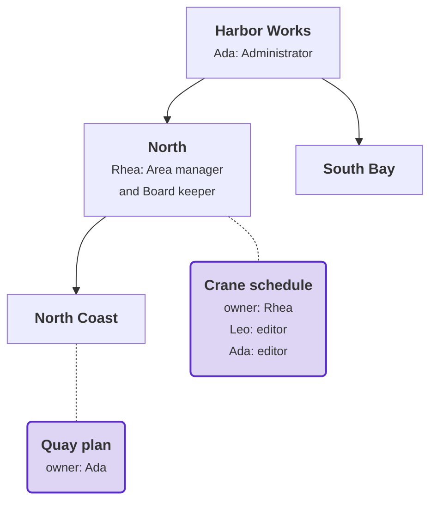
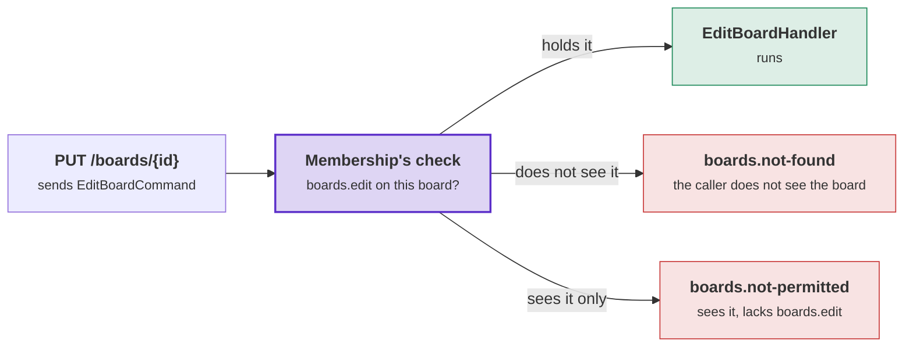

# Membership: the tutorial

This tutorial adds a Boards module to the Harbor application, one step at a time. Read the [overview](overview.md)
first. It explains the words the steps use: resource, member, owner, role and reach from above.

## Where we are: the Harbor app from the Tenancy tutorial

The [Tenancy tutorial](../tenancy/tutorial.md) built Harbor. It has:

- the tenant Harbor Works, with the units Harbor Works (the root), North, North Coast below North, and South Bay;
- Ada, Administrator at the root, and Rhea, Area manager at North. Leo has no seat yet;
- a second tenant, Meadow Gardens, with Tove as its administrator. This tutorial does not use it;
- a host on Supabase that runs every request as its caller.

## What we build

A module called Boards. A board belongs to a tenant and hangs at a unit. It has one owner and members, and the
members hold roles that the tenant keeps. At the end of the tutorial, Harbor Works has two boards. Units are square
and show the roles granted there. Boards are purple and rounded, with a dotted line to the unit where they hang, and
show their owner and their members with their roles:



| Person | Sees | Can change | Why |
|---|---|---|---|
| Rhea | both boards | Crane schedule | She owns Crane schedule. Her `boards.view` at North reaches Quay plan. She holds no `boards.edit` there. |
| Leo | Crane schedule | Crane schedule's name | He is a member with the role editor. |
| Ada | both boards | both boards | Her Administrator role at the root reaches every board. She also adds herself to Crane schedule as an editor. |

When it is done, you can try these with plain HTTP requests:

- Rhea opens Crane schedule at North and adds Leo as an editor.
- Leo renames Crane schedule. Adding a member gets him `403`: an editor does not hold `boards.members.manage`.
- Rhea renames Quay plan and gets `403`. She sees the board, but her roles give no `boards.edit` there.
- Rhea lists her boards with what she may do on each: `boards.edit` and `boards.members.manage` on Crane schedule,
  neither on Quay plan.

Each step says where we are, why the step comes now, and what it adds. It explains the idea, shows every file
whole with the new lines highlighted, and lists what those lines do.

The module gets the same five projects as Tenancy, one per layer:

| Project | What it holds | Membership's package in it |
|---|---|---|
| `Harbor.Boards.Contracts` | What other modules may use: a board's id, and the questions a row rule asks about boards. | none, only the toolkit |
| `Harbor.Boards.Domain` | The classes: a board, its member, a board role. | `Supporting.Membership` |
| `Harbor.Boards.Application` | The permissions, the rules, the requests and their handlers. | none, it gets the domain's |
| `Harbor.Boards.Infrastructure` | The context, its migrations, and the database's own rules. | `Supporting.Membership.Postgres` |
| `Harbor.Boards.Api` | The routes, and the one call the host makes to add the module. | none |

```text
src/
├── Harbor.Host/
└── Modules/
    ├── Tenancy/
    └── Boards/
        ├── Harbor.Boards.Contracts/
        ├── Harbor.Boards.Domain/
        ├── Harbor.Boards.Application/
        ├── Harbor.Boards.Infrastructure/
        └── Harbor.Boards.Api/
```

## Step 1: the board, its members and its roles

**Where we are.** Harbor runs with one module, Tenancy. No code knows about boards yet.

**Why now.** Every later step uses the classes this step declares. The permissions name the board, the context maps
it, and the requests load it.

**What we want.** A board class, its member class and its role class, with their ids, in two new projects. The
projects build with 0 warnings.

### The idea: a board, its members and its owner

- **Resource**: the board. It is an ordinary aggregate root in your domain. Membership requires no base class and no
  class attribute on it.
- **Member**: a seat on the board for a period. The period starts at a moment and ends at a moment, or never. You
  declare the member class in one line, `[Member<...>]`. Membership's **template** adds the rest: who the member is,
  from when, until when, who added the member, and the roles the member holds. The four type arguments are the
  member row's id type, the member's id type, the role's id type, and the board class.
- **Why a member is a seat** (Tenancy's `SeatId`) instead of a user:
  - a board belongs to one tenant, and a seat does too;
  - a suspended seat loses access to every board;
  - when you add a member, Membership checks with Tenancy that the seat is active in this tenant;
  - the caller's seat is the caller's member identity on a board, so you write no code to find it.
- **Owner**: one property of the board, marked `[Owner]`. It records whose board it is. The owner is always a member
  and cannot be removed. The owner holds no role. Instead, each permission says whether the owner holds it (step 2).
- **Member list**: the object that applies the rules about members, such as "a seat is on the board once" and "the
  owner stays". The generator adds it to your board as a private property, `Members`. It works on your collection
  `People` and on the owner property. `Members.Open(now)` in the board's constructor puts the owner on the board.
- **Managers**: the generator also writes two classes into the domain project. `BoardMemberManager`, named after the
  member class, opens a board, adds and removes members, gives and takes roles, and lists who is on a board.
  `BoardRoleManager`, named after the role class, makes, changes and lists the tenant's board roles. Each manager
  checks, loads, changes and saves. The board has no method that changes its members. Steps 6 and 7 use the
  managers.
- **Custom role**: a role stored as a row of the tenant. The tenant may rename it and change it. The role template
  has the name, the permissions, and the starter role it was made from. You add the role's tenant, `TenantId`,
  yourself, because Membership does not know about tenants.
- **The tenant of a row**: `[OfTenant]` marks the property that says which tenant a board or a role belongs to. The
  marker is a fact about the class, like `[Owner]`, so it goes on the domain class. It comes from Tenancy's markers
  package, `Supporting.Tenancy.Abstractions`, which has nothing else of Tenancy's. Step 3 shows what the context does
  with it.
- **The rules are passed in**: the role checks its permissions against the rules (step 2). The rules live in the
  application layer, and the role's constructor takes them. The domain describes what a board is. The application
  layer decides who may do what with a board.
- **The name**: Membership names the resource `boards`, the class name in the plural. Refusal codes start with it,
  such as `boards.already-member`, and so do the database functions, such as `boards_i_see`. `[Members("...")]` on
  the class sets another name.

### What you write

**The package versions**, at the root. **Why:** this adds the three Membership packages, Tenancy's Entity Framework
package and Tenancy's markers package. Boards' context uses the Entity Framework package to read Tenancy's rows
(step 3). Boards' domain project takes `[OfTenant]` from the markers package. All versions stay in one file.

**`Directory.Packages.props`**

```xml {10-14}
<Project>
  <PropertyGroup>
    <ManagePackageVersionsCentrally>true</ManagePackageVersionsCentrally>
  </PropertyGroup>

  <ItemGroup>
    <PackageVersion Include="DylansTechStack.DDD" Version="3.2.0-preview.13" />
    <PackageVersion Include="DylansTechStack.Tenancy" Version="3.2.0-preview.13" />
    <PackageVersion Include="DylansTechStack.Tenancy.Postgres" Version="3.2.0-preview.13" />
    <PackageVersion Include="DylansTechStack.Tenancy.EntityFramework" Version="3.2.0-preview.13" />
    <PackageVersion Include="DylansTechStack.Tenancy.Abstractions" Version="3.2.0-preview.13" />
    <PackageVersion Include="DylansTechStack.Membership" Version="3.2.0-preview.13" />
    <PackageVersion Include="DylansTechStack.Membership.EntityFramework" Version="3.2.0-preview.13" />
    <PackageVersion Include="DylansTechStack.Membership.Postgres" Version="3.2.0-preview.13" />
    <PackageVersion Include="DylansTechStack.DDD.EntityFramework.Supabase" Version="3.2.0-preview.13" />
    <PackageVersion Include="Npgsql.EntityFrameworkCore.PostgreSQL" Version="10.0.3" />
    <PackageVersion Include="Microsoft.EntityFrameworkCore.Relational" Version="10.0.12" />
    <PackageVersion Include="Microsoft.EntityFrameworkCore.Design" Version="10.0.12" />
  </ItemGroup>
</Project>
```

**The contracts project.** **Why:** other modules may store a board's id. That id is all a module's contracts publish
of its boards: a row access rule of any module asks about a board by its id. Like Tenancy's contracts project, it
references only the toolkit's core package.

**`src/Modules/Boards/Harbor.Boards.Contracts/Harbor.Boards.Contracts.csproj`**

```xml {5}
<Project Sdk="Microsoft.NET.Sdk">

  <!-- What the other modules may use of Boards: a board's id, and the questions about boards a row access rule asks. -->
  <ItemGroup>
    <PackageReference Include="DylansTechStack.DDD" />
  </ItemGroup>

</Project>
```

**The domain project.** **Why:** it gets the member and role templates, and the generator that writes the member
list and the two managers. From Tenancy, it references the contracts project and the markers package, for
`[OfTenant]`. A board stores Tenancy's ids and cannot change a seat.

**`src/Modules/Boards/Harbor.Boards.Domain/Harbor.Boards.Domain.csproj`**

```xml {5,7,13}
<Project Sdk="Microsoft.NET.Sdk">

  <!-- The board classes: a board, the seats on it, and the roles a tenant keeps for boards. -->
  <ItemGroup>
    <PackageReference Include="DylansTechStack.Membership" />
    <!-- [OfTenant], Tenancy's marker of the tenant a board or a role belongs to, and nothing else of Tenancy's. -->
    <PackageReference Include="DylansTechStack.Tenancy.Abstractions" />
  </ItemGroup>

  <ItemGroup>
    <ProjectReference Include="..\Harbor.Boards.Contracts\Harbor.Boards.Contracts.csproj" />
    <!-- A board belongs to a tenant, hangs at a unit, and its members are seats: Tenancy's ids, from its contracts. -->
    <ProjectReference Include="..\..\Tenancy\Harbor.Tenancy.Contracts\Harbor.Tenancy.Contracts.csproj" />
  </ItemGroup>

</Project>
```

**The three ids.** **Why:** member rows and role rows each have an id. `[EntityId<Guid>]` writes `Create()`, and the
member list calls it to make a new row's id in code. Other modules may use the board's id, so it goes in the
contracts project. The other two ids stay in the domain project.

**`Harbor.Boards.Contracts/ValueObjects/BoardId.cs`**

```csharp {5-6}
using DTS.DDD.Abstractions.Attributes;

namespace Harbor.Boards.Contracts.ValueObjects;

[EntityId<Guid>]
public readonly partial record struct BoardId;
```

**`Harbor.Boards.Domain/Aggregates/Boards/ValueObjects/BoardMemberId.cs`**

```csharp {5-6}
using DTS.DDD.Abstractions.Attributes;

namespace Harbor.Boards.Domain.Aggregates.Boards.ValueObjects;

[EntityId<Guid>]
public readonly partial record struct BoardMemberId;
```

**`Harbor.Boards.Domain/Aggregates/BoardRoles/ValueObjects/BoardRoleId.cs`**

```csharp {5-6}
using DTS.DDD.Abstractions.Attributes;

namespace Harbor.Boards.Domain.Aggregates.BoardRoles.ValueObjects;

[EntityId<Guid>]
public readonly partial record struct BoardRoleId;
```

**The member class.** **Why:** the member class and its table are yours. The attribute says what a member is, and the
template adds the rest.

**`Harbor.Boards.Domain/Aggregates/Boards/Entities/BoardMember.cs`**

```csharp {9-10}
using DTS.Membership;
using Harbor.Boards.Domain.Aggregates.BoardRoles.ValueObjects;
using Harbor.Boards.Domain.Aggregates.Boards.ValueObjects;
using Harbor.Tenancy.Contracts.ValueObjects;

namespace Harbor.Boards.Domain.Aggregates.Boards.Entities;

// Its row's id, who a member is, what a role is known by, and the board it is a member of.
[Member<BoardMemberId, SeatId, BoardRoleId, Board>]
public sealed partial class BoardMember;
```

**The board.** **Why:** the members are part of the board aggregate. They are loaded and saved with the board, and a
change to them raises the board's version. The board does not read a clock, so the constructor takes `now`.

**`Harbor.Boards.Domain/Aggregates/Boards/Board.cs`**

```csharp {18,21,28-29,31}
using DTS.DDD.Abstractions.Attributes;
using DTS.Tenancy;
using Harbor.Boards.Contracts.ValueObjects;
using Harbor.Boards.Domain.Aggregates.Boards.Entities;
using Harbor.Tenancy.Contracts.ValueObjects;

namespace Harbor.Boards.Domain.Aggregates.Boards;

[AggregateRoot<BoardId>]
public sealed partial class Board
{
    public Board(BoardId id, TenantId tenantId, OrganizationUnitId unitId, string name, SeatId owner, DateTimeOffset now) : base(id)
    {
        TenantId = tenantId;
        UnitId = unitId;
        Name = name;
        OwnerSeatId = owner;
        Members.Open(now);
    }

    [OfTenant]
    public TenantId TenantId { get; private set; }

    public OrganizationUnitId UnitId { get; private set; }

    public string Name { get; private set; } = string.Empty;

    [Owner]
    public SeatId OwnerSeatId { get; private set; }

    public partial IReadOnlyList<BoardMember> People { get; }
}
```

**The role class.** **Why:** a role belongs to a tenant, so it has a `TenantId`, marked `[OfTenant]`. The constructor
takes the rules, so a role cannot give a permission that the rules do not allow in a role. Step 7 shows who calls it for
the tenant's first roles.

**`Harbor.Boards.Domain/Aggregates/BoardRoles/BoardRole.cs`**

```csharp {10,13-14,16-17}
using DTS.Membership;
using DTS.Membership.Access;
using DTS.Tenancy;
using Harbor.Boards.Domain.Aggregates.BoardRoles.ValueObjects;
using Harbor.Boards.Domain.Aggregates.Boards;
using Harbor.Tenancy.Contracts.ValueObjects;

namespace Harbor.Boards.Domain.Aggregates.BoardRoles;

[CustomRole<BoardRoleId, Board>]
public sealed partial class BoardRole
{
    public BoardRole(BoardRoleId id, TenantId tenantId, CustomRoleDraft draft, MembershipRules rules) : base(id, draft, rules)
        => TenantId = tenantId;

    [OfTenant]
    public TenantId TenantId { get; private set; }
}
```

Add the two projects to the solution, and build:

```powershell
dotnet sln Harbor.slnx add --solution-folder src/Modules/Boards src/Modules/Boards/Harbor.Boards.Contracts/Harbor.Boards.Contracts.csproj src/Modules/Boards/Harbor.Boards.Domain/Harbor.Boards.Domain.csproj
dotnet build Harbor.slnx
```

### What it does

- `[AggregateRoot<BoardId>]`: the toolkit's attribute for an aggregate root whose id type is `BoardId`. With it,
  `Board` derives from the toolkit's `AggregateRoot<BoardId>`, which `: base(id)` calls. That base class has `Id` and
  `Version`. The toolkit's Entity Framework package raises `Version` on every save that touches the board. A save
  from a stale version throws a `ConcurrencyConflictException`.
- `[Member<...>]`: the generator writes the other half of `BoardMember`, which derives from the member template.
- `People`: a get-only `partial` property. The generator writes its body over a private list, and the member list
  stores the members in that list.
- On `Board`, the generator writes `Members`, which works on `People` and on the property marked `[Owner]`. It also
  writes `Codes`, which makes refusals with codes that start with `boards.`.
- `Members.Open(now)` puts the owner on the board from now, with no end and no role.
- `[CustomRole<...>]`: `BoardRole` derives from the role template. The template checks a new role's name and
  permissions against the rules passed to the constructor.
- `CustomRoleDraft` holds what a new role is made from: a name, a description, the permissions, and the starter role
  it is made from, if any. Step 7 shows where the drafts of the starter roles come from.

- The generator writes `BoardMemberManager` and `BoardRoleManager` in the global namespace. Each has one
  constructor, and the registration of step 5 adds both to the container.

The generated files are in the domain project, under **Dependencies → Analyzers**. `Board.Members` holds one line:
the member list. `BoardMemberManager` and `BoardRoleManager` hold the managers. `Board.MemberManagement` declares the
board's hooks, which step 7 explains.

> **Going further.** What is written, and when it is not: [The generated member list](resources-and-members.md#the-generated-member-list)
> and [The managers](resources-and-members.md#the-managers).

## Step 2: the permissions and the rules

**Where we are.** The classes exist. No code says yet who may do what with a board.

**Why now.** The rules read the permissions, and the later steps read the rules: the context (step 3), the database
functions (step 4) and every request (step 6).

**What we want.** Five permissions, each declared once with the level where it is checked. And the rules, in one
declaration: each tenant has its own board roles, starts with one role called `editor`, and changes its roles with
`boards.roles.manage`.

### The idea: a permission has a level

- **Permission**: a string that a request requires and a role gives, as in Tenancy.
- **Level**: where the permission is checked. There are three levels:

  | Level | Attribute | In Harbor |
  |---|---|---|
  | on one board | `[On<Board>]` | `boards.view`, `boards.edit`, `boards.members.manage` |
  | at a unit | `[AtUnit]` | `boards.create`: the board does not exist yet, so the check is at the unit where the board will hang |
  | for the whole tenant | `[AtTenant]` | `boards.roles.manage`: managing the tenant's board roles |

- **On a board**, each permission also says who holds it there:

  | Setting | Default | In Harbor |
  |---|---|---|
  | `Owner` | on: the owner holds it | all three |
  | `EveryMember` | off: being a member gives no permission by itself | `boards.view`: every member sees the board |
  | `InRoles` | on: a role may give it | `boards.members.manage` sets `false`: no board role gives it, so the owner decides who is on a board |

- **Rules**: one declaration per kind of resource, `MembershipRules.For<Board>(...)`. From the board's type, the rules
  read the resource name, the refusal codes and the permissions. You only say where the roles come from.
- **Where roles come from**: there are three kinds.

  | Kind | Who makes them | In code |
  |---|---|---|
  | Fixed | you, in code, the same for every tenant | `Roles.Fixed([...])` |
  | Custom | the tenant, as rows, at run time | `Roles.Custom(starters: [...])`, with a role class |
  | External | another system that stores roles, such as Tenancy | `Roles.External(...)` |

  Harbor's roles are custom. Every tenant starts with a copy of each **starter role**, and the tenant can change its
  copy. Harbor has one starter role, `editor`, with `boards.view` and `boards.edit`. Step 7 shows when the copy is made.
- **Who changes the custom roles**: `managedWith` names the permission that makes, renames, changes and archives
  them. Harbor names `boards.roles.manage`, a permission for the whole tenant. Without `managedWith`, only system work
  changes the roles.
- **Application layer**: the permissions and the rules live in the application project. The domain project describes
  what a board is. The application project decides who may do what.
- **Tenancy's catalogue**: Tenancy's generator adds every permission of a `[Permissions]` class to Tenancy's
  catalogue. So a Tenancy role can hold `boards.create` at North. The host collects these permissions in step 5.
- **Tenancy's ids in Boards**: Boards uses Tenancy's ids from Tenancy's contracts project, and none of Tenancy's
  classes. So the generator cannot tell by itself which of Boards' ids are Tenancy's. One line,
  `[assembly: TenancyIds<TenantId, SeatId, OrganizationUnitId, RoleId>]`, names them. The generator then writes
  Tenancy's names into Boards without type arguments:
  - `TenancyAccessManager` in this project: who the caller is, and the caller's tenant and seat (step 6);
  - `modelBuilder.AddTenancyReadFunctions()` in the infrastructure project (step 3);
  - `AddTenancyAccess<TRequests, TContext>()` and `AddBoardMembershipWithTenancy<TContext>(rules)` there too
    (step 5).

### What you write

**The application project.** **Why:** the requests go in this project. Tenancy's core package brings the two levels
Tenancy knows, `[AtUnit]` and `[AtTenant]`, and the `TenancyIds` line.

**`src/Modules/Boards/Harbor.Boards.Application/Harbor.Boards.Application.csproj`**

```xml {6-7}
<Project Sdk="Microsoft.NET.Sdk">

  <!-- The requests of Boards and their handlers, a folder per feature, and who holds which permission on a board. -->
  <ItemGroup>
    <ProjectReference Include="..\Harbor.Boards.Domain\Harbor.Boards.Domain.csproj" />
    <!-- Tenancy's levels for a permission held in the organization, [AtUnit] and [AtTenant], and its access manager. -->
    <PackageReference Include="DylansTechStack.Tenancy" />
  </ItemGroup>

</Project>
```

**Tenancy's ids.** **Why:** with this line, no code of Boards names Tenancy's ids as type arguments. Write it once,
in this project. The infrastructure project references this one and gets the line's names too.

**`Harbor.Boards.Application/TenancyIds.cs`**

```csharp {4-5}
using DTS.Tenancy;
using Harbor.Tenancy.Contracts.ValueObjects;

// The ids of Tenancy's tenant, seat, unit and role. The generator writes Tenancy's names into the module over these ids.
[assembly: TenancyIds<TenantId, SeatId, OrganizationUnitId, RoleId>]
```

**The permissions.** **Why:** each permission is declared once. A request requires the constant, the rules read it,
and the export writes the database functions from it. A screen for making roles shows the description.

**`Harbor.Boards.Application/Access/BoardPermissions.cs`**

```csharp {8,11,14,17,20,23}
using DTS.DDD.Access;
using DTS.Membership.Access;
using DTS.Tenancy.Access;
using Harbor.Boards.Domain.Aggregates.Boards;

namespace Harbor.Boards.Application.Access;

[Permissions]
public static class BoardPermissions
{
    [On<Board>(EveryMember = true, Description = "See a board and who is on it")]
    public const string View = "boards.view";

    [On<Board>(Description = "Change a board")]
    public const string Edit = "boards.edit";

    [On<Board>(InRoles = false, Description = "Say who is on a board, and in which role")]
    public const string ManageMembers = "boards.members.manage";

    [AtUnit(Description = "Open a board at a unit")]
    public const string Create = "boards.create";

    [AtTenant(Description = "Make and change the roles of boards")]
    public const string ManageRoles = "boards.roles.manage";
}
```

**The rules.** **Why:** the C# check and the database functions both read this one value, so they always agree.

**`Harbor.Boards.Application/Access/BoardMembership.cs`**

```csharp {8-11}
using DTS.Membership.Access;
using Harbor.Boards.Domain.Aggregates.Boards;

namespace Harbor.Boards.Application.Access;

public static class BoardMembership
{
    public static MembershipRules Rules { get; } = MembershipRules.For<Board>(
        Roles.Custom(
            starters: [new("editor", [BoardPermissions.View, BoardPermissions.Edit])],
            managedWith: BoardPermissions.ManageRoles));
}
```

```powershell
dotnet sln Harbor.slnx add --solution-folder src/Modules/Boards src/Modules/Boards/Harbor.Boards.Application/Harbor.Boards.Application.csproj
dotnet build Harbor.slnx
```

### What it does

- `[Permissions]`: every public constant in the class is a permission. The attribute on the constant sets its level.
- `Description`: the text a screen shows for the permission.
- `MembershipRules.For<Board>`: the owner holds the three permissions on a board. Every member holds `boards.view`. A
  role may give `boards.view` and `boards.edit`.
- `new("editor", [...])`: a starter role, with its name and its permissions.
- `managedWith: BoardPermissions.ManageRoles`: the role manager of step 7 requires `boards.roles.manage` for every
  change to a board role. Joined to Tenancy in step 5, the caller must hold it for the whole tenant.
- `MembershipRules.For` checks the rules when it runs, and throws for rules that contradict themselves. For example,
  a starter role with `boards.members.manage` is refused, because no role may give that permission.
- `[assembly: TenancyIds<...>]`: the order of the ids is tenant, seat, unit, role. A project that declares Tenancy's
  classes needs no such line, because the generator reads the ids from the classes.

> **Going further.** Every setting of a permission, `Implies` and `Retired` among them:
> [The settings of a permission](permissions-and-roles.md#the-settings-of-a-permission).

## Step 3: where it is stored

**Where we are.** The classes and the rules exist. Nothing stores boards yet.

**Why now.** A request that opens a board must save it somewhere. The export also writes the database functions of
step 4 from this model.

**What we want.** A context for Boards with its tables in the schema `boards`, the first migration, and a mark on the
rules for the export.

### The idea: the conventions map the board and the role

- Boards has its own context and its own schema, like Tenancy.
- **Conventions**: `AddDDDToolkitConventions()` in `ConfigureConventions` runs the conventions that the markers on your
  classes name. `[Member<...>]` and `[CustomRole<...>]` name Membership's, and `[OfTenant]` names Tenancy's. You write
  no line for the board or the role in `OnModelCreating`.
- **The members**: the board's collection of `BoardMember` becomes two tables: the members, and the roles each member
  holds. The board owns both tables, and they are saved with the board. The owner is the property marked `[Owner]`.
  `HasMembers(row => row.People, names)` in `OnModelCreating` does the same by hand, for table names of your own.
- **The role**: Membership maps the columns it adds to a role row: name, description, permissions, status, the starter
  role the role was made from (`FromStarterRole`), and what that starter role gave it (`PermissionsFromStarterRole`). The
  role marks its tenant, so Membership also adds two unique indexes. One allows each role name once per tenant. The other
  allows each starter role once per tenant.
- **The tenant filter and the save check**: Tenancy's convention adds both to every class with a property marked
  `[OfTenant]`, here the board and the role. A query returns only the rows of the caller's tenant. The save check
  refuses a row of another tenant.
- `AddTenancyReadFunctions()` maps Tenancy's rows, the rights and the units, through Tenancy's database functions. So
  a question such as "does Rhea hold `boards.create` at North" becomes part of this context's query. The query reads
  no Tenancy table directly. The generator wrote this call for Boards from the `TenancyIds` line of step 2, so the
  call names no id type.
- **The mark**, `[MembershipRules<BoardMember>]`: the build cannot read which rules a registration call receives. The
  mark tells the build which rules belong to the board. The export writes the board's database functions from those
  rules.

### What you write

**The infrastructure project.** **Why:** Membership's Postgres package brings Membership's Entity Framework package
with it. Tenancy's Entity Framework package is referenced next to it. With both, the generator writes the code that
joins Membership to Tenancy (step 5).

**`src/Modules/Boards/Harbor.Boards.Infrastructure/Harbor.Boards.Infrastructure.csproj`**

```xml {14-15}
<Project Sdk="Microsoft.NET.Sdk">

  <!-- Where Boards is stored: its context, its migrations, and what the database checks of boards. -->
  <ItemGroup>
    <ProjectReference Include="..\Harbor.Boards.Application\Harbor.Boards.Application.csproj" />
  </ItemGroup>

  <PropertyGroup>
    <!-- dotnet ef runs this project as its own startup project. -->
    <GenerateRuntimeConfigurationFiles>true</GenerateRuntimeConfigurationFiles>
  </PropertyGroup>

  <ItemGroup>
    <PackageReference Include="DylansTechStack.Membership.Postgres" />
    <PackageReference Include="DylansTechStack.Tenancy.EntityFramework" />
    <PackageReference Include="DylansTechStack.DDD.EntityFramework.Supabase" />
    <PackageReference Include="Npgsql.EntityFrameworkCore.PostgreSQL" />
    <PackageReference Include="Microsoft.EntityFrameworkCore.Relational" />
    <PackageReference Include="Microsoft.EntityFrameworkCore.Design" PrivateAssets="all" />
  </ItemGroup>

</Project>
```

**The context.** **Why:** your context builds the model. It reads Tenancy's rows, and leaves the board and the role to
the conventions.

**`Harbor.Boards.Infrastructure/Persistence/BoardsContext.cs`**

```csharp {25,27,32,34}
using DTS.DDD.EntityFramework.Conventions;
using DTS.DDD.EntityFramework.Supabase;
using DTS.Tenancy.EntityFramework;
using Harbor.Boards.Domain.Aggregates.BoardRoles;
using Harbor.Boards.Domain.Aggregates.Boards;
using Harbor.Boards.Infrastructure.Converters;
using Microsoft.EntityFrameworkCore;

namespace Harbor.Boards.Infrastructure.Persistence;

[SupabaseMigrations]
public sealed class BoardsContext(DbContextOptions<BoardsContext> options) : DbContext(options)
{
    public const string Schema = "boards";

    public DbSet<Board> Boards => Set<Board>();

    public DbSet<BoardRole> BoardRoles => Set<BoardRole>();

    protected override void OnModelCreating(ModelBuilder modelBuilder)
    {
        modelBuilder.HasDefaultSchema(Schema);

        // Tenancy's rows, read through its functions, so a question about the organization is part of this context's queries.
        modelBuilder.AddTenancyReadFunctions("tenancy");

        // The conventions map the members, the role, the tenant and the role's two indexes.
    }

    protected override void ConfigureConventions(ModelConfigurationBuilder configurationBuilder)
    {
        configurationBuilder.AddDDDToolkitConventions();
        configurationBuilder.StoreDateTimeOffsetsAsUtc();
        configurationBuilder.AddBoardsConverters();
    }
}
```

**The rules, marked.** **Why:** the export reads the mark. Without it, the build gives warning DDD00054 and writes no
functions for boards.

**`Harbor.Boards.Application/Access/BoardMembership.cs`**

```csharp {3,9-10}
using DTS.Membership.Access;
using Harbor.Boards.Domain.Aggregates.Boards;
using Harbor.Boards.Domain.Aggregates.Boards.Entities;

namespace Harbor.Boards.Application.Access;

public static class BoardMembership
{
    // The export writes the boards' functions in the database from these rules.
    [MembershipRules<BoardMember>]
    public static MembershipRules Rules { get; } = MembershipRules.For<Board>(
        Roles.Custom(
            starters: [new("editor", [BoardPermissions.View, BoardPermissions.Edit])],
            managedWith: BoardPermissions.ManageRoles));
}
```

```powershell
dotnet sln Harbor.slnx add --solution-folder src/Modules/Boards src/Modules/Boards/Harbor.Boards.Infrastructure/Harbor.Boards.Infrastructure.csproj
dotnet build Harbor.slnx
dotnet ef migrations add Boards --project src/Modules/Boards/Harbor.Boards.Infrastructure --startup-project src/Modules/Boards/Harbor.Boards.Infrastructure --output-dir Persistence/Migrations
```

### What it does

- `[SupabaseMigrations]`, `StoreDateTimeOffsetsAsUtc`: the same as in Tenancy's context. The database functions
  compare member periods in SQL, so the times are stored as UTC.
- `AddTenancyReadFunctions("tenancy")`: `"tenancy"` is the schema of Tenancy's functions, the schema of Tenancy's
  context.
- `AddBoardsConverters()` is generated for the module. It stores Boards' ids, and the Tenancy ids from Tenancy's
  contracts, as their `Guid`.
- The migration creates the schema `boards` with four tables: `Boards`, `BoardPeople` (the members, named after the
  board and its collection), `BoardMemberRoles` and `BoardRoles`. It creates none of Tenancy's tables.
- The role's two unique indexes are in the migration too, as `IX_BoardRoles_TenantId_Name` and
  `IX_BoardRoles_TenantId_FromStarterRole`.

> **Going further.** Your own table and column names: [Several kinds of resource](resources-and-members.md#several-kinds-of-resource).

## Step 4: the database's own rules

**Where we are.** Boards has tables. No rule says yet who may read or write them.

**Why now.** Harbor runs every query as its caller, under row level security (RLS). Tenancy's policies on a table only
narrow access to the caller's tenant. They allow nothing by themselves. So without a rule of yours, no seat can read
any board. The export in step 5 writes your rules as policies.

**What we want.** Rules for who may read, open and change a board, and for who may read and write a board role. And a
lock on the member rows and on the owner column.

### The idea: a rule in C#, a policy in the database

- **Row access rule**: a static class with `[RowAccess<T>(...)]` and one method, `Allows(row, user)`. Your
  application never calls this method. The export translates it into a policy, and Postgres applies the policy to
  every query.
- **The rule's user**: `Allows` takes an `IRowUser`. Everything a rule asks, it asks of that user. A handler has no
  `IRowUser`, so what only the database answers cannot be called from a handler.
- **Asking about boards**: a policy calls the functions that Membership writes from the rules. A rule asks by the
  board's id, so it names no function, and the module's contracts need to hold nothing but `BoardId`. Harbor asks two
  questions:
  - `user.Sees<BoardId>()`: the boards the caller sees;
  - `user.Holds<BoardId>(permission)`: the boards the caller holds a given permission on.
- **Asking about the organization**: a rule asks Tenancy's questions of the same user, such as
  `user.UnitsWhereIHold(...)` and `user.CurrentSeatId()`.
- **A policy cannot see the command.** Adding a member raises the board's version, so it updates the board row. So
  the rule for changing a board allows anyone who may edit the board or manage its members. The check before the
  handler tells the two commands apart.
- **The permission that manages the members.** `ManagesMembers` marks the permission that changes who is on a board
  and which roles they hold. `NamesOwner` marks the permission that hands a board to another owner. The member manager
  of step 7 requires them. Without them, it changes the members only for system work.
- **The lock.** The member tables follow the board's rules. Without a lock, Leo, who may edit a board, could write its
  member rows with his own SQL statement, or make himself the owner. From the two marks, Membership also writes a
  policy on the member tables and a trigger on the owner column.
- **The name of a rule** says who may do what to which rows: `MembersSeeTheirBoards`. The export names the policy after
  the class, so a name such as `BoardRead` tells a reader of the database nothing.
- **System work.** `To = [RowAccessRoles.User]` makes a rule for signed-in callers. Tenancy's own policy lets system work
  read and write the rows of the tenant it acts in, on every table marked `[OfTenant]`. Step 7 relies on that.

Harbor's rules:

| Rule | Table | Operation | Allowed when |
|---|---|---|---|
| `MembersSeeTheirBoards` | `Boards` | read | the caller sees the board |
| `CreatorsOpenTheirOwnBoards` | `Boards` | create | the caller holds `boards.create` at the board's unit, and owns it |
| `EditorsAndManagersChangeBoards` | `Boards` | change | the caller holds `boards.edit` or `boards.members.manage` on it |
| `SeatsReadTheirTenantsBoardRoles` | `BoardRoles` | read | the role is of the caller's tenant |
| `RoleManagersWriteBoardRoles` | `BoardRoles` | create, change | the caller holds `boards.roles.manage` for the whole tenant |

### What you write

**The rules on boards.** **Why:** your application decides what a seat may read and change on a board. Membership
writes no policy on your board table. A rule asks about boards by their id and never names a database function. The
export finds the function.

**`Harbor.Boards.Infrastructure/Access/BoardRowRules.cs`**

```csharp {9,12,15,19-20,24,28-29}
using DTS.DDD.Abstractions.Access;
using DTS.DDD.Abstractions.Attributes;
using Harbor.Boards.Application.Access;
using Harbor.Boards.Contracts.ValueObjects;
using Harbor.Boards.Domain.Aggregates.Boards;

namespace Harbor.Boards.Infrastructure.Access;

[RowAccess<Board>(RowOperations.Read, To = [RowAccessRoles.User])]
public static partial class MembersSeeTheirBoards
{
    public static bool Allows(Board board, IRowUser user) => user.Sees<BoardId>().Contains(board.Id);
}

[RowAccess<Board>(RowOperations.Create, To = [RowAccessRoles.User])]
public static partial class CreatorsOpenTheirOwnBoards
{
    public static bool Allows(Board board, IRowUser user)
        => user.UnitsWhereIHold(BoardPermissions.Create).Contains(board.UnitId)
            && board.OwnerSeatId == user.CurrentSeatId();
}

// ManageMembers is here because adding a member raises the board's version, which updates the board's row.
[RowAccess<Board>(RowOperations.Change, To = [RowAccessRoles.User])]
public static partial class EditorsAndManagersChangeBoards
{
    public static bool Allows(Board board, IRowUser user)
        => user.Holds<BoardId>(BoardPermissions.Edit).Contains(board.Id)
            || user.Holds<BoardId>(BoardPermissions.ManageMembers).Contains(board.Id);
}
```

**The rules on board roles.** **Why:** a role row sets what every member with that role may do. So the database also
limits who may write a role row.

**`Harbor.Boards.Infrastructure/Access/BoardRoleRowRules.cs`**

```csharp {8,11,14,17}
using DTS.DDD.Abstractions.Access;
using DTS.DDD.Abstractions.Attributes;
using Harbor.Boards.Application.Access;
using Harbor.Boards.Domain.Aggregates.BoardRoles;

namespace Harbor.Boards.Infrastructure.Access;

[RowAccess<BoardRole>(RowOperations.Read, To = [RowAccessRoles.User])]
public static partial class SeatsReadTheirTenantsBoardRoles
{
    public static bool Allows(BoardRole role, IRowUser user) => role.TenantId == user.CurrentTenant();
}

[RowAccess<BoardRole>(RowOperations.Create | RowOperations.Change, To = [RowAccessRoles.User])]
public static partial class RoleManagersWriteBoardRoles
{
    public static bool Allows(BoardRole role, IRowUser user) => user.HoldsAtTenant(BoardPermissions.ManageRoles);
}
```

**The marks**, on `boards.members.manage`. **Why:** the member manager requires this permission for every change to
the members (step 7), and for naming a new owner. The database's lock checks the same permission.

**`Harbor.Boards.Application/Access/BoardPermissions.cs`**

```csharp {17}
using DTS.DDD.Access;
using DTS.Membership.Access;
using DTS.Tenancy.Access;
using Harbor.Boards.Domain.Aggregates.Boards;

namespace Harbor.Boards.Application.Access;

[Permissions]
public static class BoardPermissions
{
    [On<Board>(EveryMember = true, Description = "See a board and who is on it")]
    public const string View = "boards.view";

    [On<Board>(Description = "Change a board")]
    public const string Edit = "boards.edit";

    [On<Board>(InRoles = false, ManagesMembers = true, NamesOwner = true, Description = "Say who is on a board, and in which role")]
    public const string ManageMembers = "boards.members.manage";

    [AtUnit(Description = "Open a board at a unit")]
    public const string Create = "boards.create";

    [AtTenant(Description = "Make and change the roles of boards")]
    public const string ManageRoles = "boards.roles.manage";
}
```

Build again: `dotnet build Harbor.slnx`. In step 5, the export writes the policies and you apply them to the
database.

### What it does

- `IRowUser`: the rule's user, from `DTS.DDD.Abstractions.Access`. That `using` is the only one the questions need.
- `Harbor.Boards.Contracts` holds only `BoardId`. A rule of any module sees the id, asks the question, and the question
  answers only for the caller. So a module has no class to publish per question. A question that nothing answers is
  refused when the export writes the access file.
- `user.Sees<BoardId>()` takes no argument. `user.Holds<BoardId>(permission)` takes the permission.
- `user.UnitsWhereIHold(permission)` and `user.CurrentSeatId()` take no type argument. The generator closes Tenancy's
  questions over the ids of the `TenancyIds` line of step 2, in each project of the module.
- `RowOperations`: the statements a rule allows. The values are `Read`, `Create`, `Change`, `Remove` and `All`.
  Combine them with `|`, as the role rule does with `Create | Change`. Harbor has no `Remove` rule, so a signed-in
  caller's `DELETE` on these tables removes no row.
- `To = [RowAccessRoles.User]`: the rule is for signed-in callers, the database role `authenticated`. Another value
  is `RowAccessRoles.Anonymous`, for callers without a user (`anon`).
- `user.Sees<BoardId>().Contains(board.Id)` becomes a subquery in the policy. The subquery calls the boards function once
  per statement.
- The create rule makes the database check the same thing as the command: the owner is the caller's seat.
- `user.CurrentTenant()`: the tenant of the caller's seat. `user.HoldsAtTenant(permission)`: whether
  the caller's seat holds the permission now, at the root, so for the whole tenant.
- `ManagesMembers`: the member manager adds, changes and removes members only for a caller who holds
  `boards.members.manage` on the board. In the database, a member row is written only on such a board.
- `NamesOwner`: the member manager names a new owner only for a caller with that permission on the board. In the
  database, only such a caller can change the owner column.
- Without the marks, a start-up check logs a warning. The member rows then follow your rule for changing a board.

> **Going further.** Everything the lock holds and leaves to you: [Who writes the member rows](postgres.md#who-writes-the-member-rows).

## Step 5: the module's registration and the host

**Where we are.** The module builds. Nothing registers it, and the host does not reference it.

**Why now.** The requests of step 6 need a check before each handler. The database needs the new tables, functions
and policies.

**What we want.** `AddBoardsModule(connectionString)`, called by the host, and an up-to-date database.

### The idea: two packages check Boards' requests

- **One interface per module**, as in Tenancy. Every request of Boards implements `IBoardsRequest`, which is marked
  `[AccessRequests]`. The generator writes the behavior that runs the checks before each handler.
- **Two checks**, both registered for `IBoardsRequest`, decide the requirements:
  - Tenancy's check decides: in the tenant, a permission at a unit, and a permission for the whole tenant;
  - Membership's check decides: a permission on one board.

  When no registered check decides a requirement, the behavior refuses every caller.
- **The generator joins Membership to Tenancy.** The project references both packages, so the generator writes
  `AddBoardMembershipWithTenancy`. With it, the caller's seat is the caller's member identity, a new member's seat
  must be active in the tenant, and `boards.roles.manage` is checked for the whole tenant. The `TenancyIds` line of
  step 2 names Tenancy's ids, and the member class names the seat id, so the call names only the context.
- **The access manager and the managers of boards.** `AddBoardMembershipWithTenancy` also registers
  `MembershipAccessManager<Board>`, `BoardMemberManager` and `BoardRoleManager` per scope. A handler takes the access
  manager to ask what the caller holds on a board (step 9), and the managers to change members and read roles (steps 6
  and 7).
- **Each tenant's starter roles.** `AddBoardMembershipWithTenancy` also registers what makes a tenant's `editor` role.
  Step 7 explains it.
- **Ada's role lacks the new permissions.** Her Administrator role was made from Tenancy's default administrators'
  starter role when Harbor Works was provisioned, before boards existed. That starter role holds every permission in
  the catalogue. `SyncStarterRoles()` in the host adds the board permissions to her role when the host starts.
  Changes that the tenant made to its roles stay.

**What this looks like on a request.** Step 7 writes this request and its handler. You do not write it now. It shows
what the checks of this step do. `[OnResource(BoardPermissions.Edit)]` asks for `boards.edit`, on the board it
marks. Membership's check decides it, and `Handle` runs only when the check passes:

```csharp
public sealed record EditBoardCommand(
    [OnResource(BoardPermissions.Edit)] BoardId Board,            // what the caller needs: boards.edit, on this board
    string Name)
    : ICommand<Board>, IBoardsRequest;                             // IBoardsRequest: the behavior checks it

public sealed class EditBoardHandler(IBoardRepository boards) : ICommandHandler<EditBoardCommand, Board>
{
    // Runs only for a caller who holds boards.edit on this board.
    public async ValueTask<Board> Handle(EditBoardCommand command, CancellationToken cancellationToken)
    {
        var board = await boards.FindAsync(command.Board, cancellationToken)
            ?? throw Board.Codes.Refuse(MembershipRefusals.NotFound);
        board.Rename(command.Name);
        await boards.SaveAsync(cancellationToken);
        return board;
    }
}
```

What happens when a route sends it. Purple is the check, green is the path to the handler, red are the refusals:



A caller who does not see the board gets the same answer as for a board that does not exist, so nobody learns which
boards exist.

### What you write

**The module's request interface.** **Why:** this interface separates Boards' requests from other modules' requests,
so each module's checks decide only that module's requests.

**`Harbor.Boards.Application/Access/IBoardsRequest.cs`**

```csharp {5-6}
using DTS.DDD.Abstractions.Attributes;

namespace Harbor.Boards.Application.Access;

[AccessRequests]
public partial interface IBoardsRequest : IRequireAccess;
```

**`Harbor.Boards.Application/GlobalUsings.cs`**: the namespaces every request file of the module uses.

```csharp
global using DTS.DDD.Access;
global using DTS.DDD.Mediator;
global using DTS.Membership.Access;
global using DTS.Tenancy.Access;
global using Harbor.Boards.Application.Access;
global using Harbor.Boards.Contracts.ValueObjects;
global using Harbor.Boards.Domain.Aggregates.BoardRoles;
global using Harbor.Boards.Domain.Aggregates.BoardRoles.ValueObjects;
global using Harbor.Boards.Domain.Aggregates.Boards;
global using Harbor.Tenancy.Contracts.ValueObjects;
```

**The application's registration.** **Why:** the generator writes the behavior next to `IBoardsRequest`, in this
project. `AddBoardsAccessBehavior` is in the namespace of `IBoardsRequest`, one namespace below this class, so the
`global using` of `Harbor.Boards.Application.Access` above is what makes the call compile. `AddBoardsHandlers()` is
generated into this project as well, and registers its handlers with the toolkit's mediator.

**`Harbor.Boards.Application/BoardsApplication.cs`**

```csharp {8}
using Microsoft.Extensions.DependencyInjection;

namespace Harbor.Boards.Application;

public static class BoardsApplication
{
    public static IServiceCollection AddBoardsApplication(this IServiceCollection services)
        => services.AddBoardsHandlers().AddBoardsAccessBehavior();
}
```

**The infrastructure's registration.** **Why:** both packages' checks read through the board context, so they are
registered next to it.

**`Harbor.Boards.Infrastructure/BoardsInfrastructure.cs`**

```csharp {23,26-28}
using DTS.DDD.EntityFramework;
using DTS.Membership.EntityFramework;
using DTS.Membership.Postgres;
using DTS.Tenancy.EntityFramework;
using Harbor.Boards.Application.Access;
using Harbor.Boards.Infrastructure.Persistence;
using Harbor.Tenancy.Contracts.ValueObjects;
using Microsoft.EntityFrameworkCore;
using Microsoft.Extensions.DependencyInjection;

namespace Harbor.Boards.Infrastructure;

public static class BoardsInfrastructure
{
    public static IServiceCollection AddBoardsInfrastructure(this IServiceCollection services, string connectionString)
    {
        services.AddDDDToolkitEntityFramework();
        services.AddDbContext<BoardsContext>((provider, options) => options
            .UseNpgsql(connectionString)
            .UseDDDToolkit(provider));

        // Tenancy's checks for Boards' requests: in the tenant, a permission at a unit or for the whole tenant.
        services.AddTenancyAccess<IBoardsRequest, BoardsContext>();

        // The boards with their members, joined to Tenancy, and Membership's check for a permission on a board.
        services.AddBoardMembershipWithTenancy<BoardsContext>(BoardMembership.Rules);
        services.AddBoardMemberAccess<IBoardsRequest>();
        services.AddMembershipPostgres();
        return services;
    }
}
```

**The API project and the module's entry.** **Why:** the host references only this project of Boards, and calls only
these two methods.

**`src/Modules/Boards/Harbor.Boards.Api/Harbor.Boards.Api.csproj`**

```xml
<Project Sdk="Microsoft.NET.Sdk">

  <!-- The module's entry: its registration and its routes. The host references this project and nothing else of the module. -->
  <ItemGroup>
    <ProjectReference Include="..\Harbor.Boards.Application\Harbor.Boards.Application.csproj" />
    <ProjectReference Include="..\Harbor.Boards.Infrastructure\Harbor.Boards.Infrastructure.csproj" />
    <FrameworkReference Include="Microsoft.AspNetCore.App" />
  </ItemGroup>

</Project>
```

**`Harbor.Boards.Api/BoardsModule.cs`**

```csharp {11-12}
using Harbor.Boards.Application;
using Harbor.Boards.Infrastructure;
using Microsoft.AspNetCore.Routing;
using Microsoft.Extensions.DependencyInjection;

namespace Harbor.Boards.Api;

// The module's entry: the host calls these, and nothing else of the module.
public static class BoardsModule
{
    public static IServiceCollection AddBoardsModule(this IServiceCollection services, string connectionString)
        => services.AddBoardsInfrastructure(connectionString).AddBoardsApplication();

    // The routes; each later step adds its own.
    public static IEndpointRouteBuilder MapBoardsModule(this IEndpointRouteBuilder routes)
        => routes;
}
```

**The host.** **Why:** the host now references Boards' API project, so the generated mediator includes Boards'
handlers too.

**`src/Harbor.Host/Harbor.Host.csproj`**

```xml {5}
<Project Sdk="Microsoft.NET.Sdk.Web">

  <ItemGroup>
    <ProjectReference Include="..\Modules\Tenancy\Harbor.Tenancy.Api\Harbor.Tenancy.Api.csproj" />
    <ProjectReference Include="..\Modules\Boards\Harbor.Boards.Api\Harbor.Boards.Api.csproj" />
  </ItemGroup>

  <PropertyGroup>
    <!-- Every build writes the SQL file of each migration that has none, into supabase/migrations. -->
    <SupabaseMigrationsExport>Write</SupabaseMigrationsExport>
    <!-- The role the API logs in as: the build writes its migration, without a login or a password. -->
    <SupabaseLoginRole>harbor_api</SupabaseLoginRole>
  </PropertyGroup>

</Project>
```

**`src/Harbor.Host/Program.cs`**

```csharp {3-4,15,17,27}
using DTS.DDD.EntityFramework.Supabase;
using DTS.DDD.Startup;
using DTS.Tenancy;
using Harbor.Boards.Api;
using Harbor.Host;
using Harbor.Host.Requests;
using Harbor.Tenancy.Api;

var builder = WebApplication.CreateBuilder(args);
var database = builder.Configuration.GetConnectionString("Supabase")
    ?? throw new InvalidOperationException("ConnectionStrings:Supabase is not set.");

builder.Services.AddSupabaseRowLevelSecurity();
builder.Services.AddTenancyModule(database);
builder.Services.AddBoardsModule(database);
builder.Services.AddTenancyPermissionsOfModules();
builder.Services.SyncStarterRoles();
builder.Services.AddSupabaseMigrations();
builder.Services.AddProblemDetails();
builder.Services.AddExceptionHandler<RefusalsAsProblems>();
builder.Services.RunStartupChecks();

var app = builder.Build();
app.UseExceptionHandler();
app.UseUserAndTenant();
app.MapTenancyModule();
app.MapBoardsModule();
if (app.Environment.IsDevelopment())
{
    app.MapTenancyDevelopment();
}

app.Run();
```

```powershell
dotnet sln Harbor.slnx add --solution-folder src/Modules/Boards src/Modules/Boards/Harbor.Boards.Api/Harbor.Boards.Api.csproj
```

### What it does

- `AddDDDToolkitEntityFramework()`: the same registration as in Tenancy's module, here without an outbox. Each call
  adds to the same options.
- `AddTenancyAccess<IBoardsRequest, BoardsContext>()` registers Tenancy's checks for Boards' requests, and
  `TenancyAccessManager` per scope. The checks read through this context's read functions. The generator wrote the
  call for Boards from the `TenancyIds` line.
- `AddBoardMembershipWithTenancy<BoardsContext>(BoardMembership.Rules)` registers, over this context and joined to
  Tenancy, the access manager `MembershipAccessManager<Board>`, the queries on `db.Boards`, and the two managers.
  The managers load and save on this context.
- `AddBoardMemberAccess<IBoardsRequest>()` registers Membership's check for Boards' requests.
- `AddMembershipPostgres()` adds a start-up check: the database functions and the lock must match the rules the host
  runs with.
- `AddTenancyPermissionsOfModules()` is unchanged. It now also registers Boards' five permissions.

### Run it

1. Build the host: `dotnet build`. The export writes three files into `supabase/migrations`:
   - `<v>_Boards.boards.ddd.sql`: the migration of step 3;
   - `<v>_access.tenancy.ddd.sql`: a new version of Tenancy's access file, because Tenancy's catalogue now has
     Boards' permissions;
   - `<v>_access.boards.ddd.sql`: five functions for boards, the policies of step 4, and the lock.
2. Apply them: `npx supabase migration up --local`.
3. Run the host as in the Tenancy tutorial. The start-up checks pass, including `membership.functions-in-place`. The
   log shows:

   ```text
   The starter roles are synced in 2 tenants: 2 roles were made, 2 roles followed their starter roles, ...
   ```

   The Administrator role of both tenants now holds the board permissions: Ada's in Harbor Works and Tove's in
   Meadow Gardens. Each tenant also has a role `editor` now. Step 7 explains where it came from.

## Step 6: open a board, get it, list them

**Where we are.** The module is registered and has no routes.

**Why now.** A member needs a board, so the board comes first.

**What we want.** Rhea opens a board at North, gets it, and finds it in her list. Ada is not on the board, so she does
not see it yet.

### The idea: three requests, and what each one answers

- Each request states what it requires. The check before the handler enforces it:

  | Request | Requires | Checked by |
  |---|---|---|
  | `OpenBoardCommand` | `[AtUnit(BoardPermissions.Create)]` on its unit: `boards.create` | Tenancy, at that unit or above. The board does not exist yet, so nobody is a member of it. |
  | `GetBoardQuery` | `[OnResource(BoardPermissions.View)]` on its board: `boards.view` | Membership, on that board |
  | `ListBoardQuery` | `[InTenant]` | Tenancy: the caller works in the tenant. The read policy of step 4 decides which boards the list holds. |

- **Request names.** A request is `<Feature>Query` or `<Feature>Command`, and its handler is `<Feature>Handler`. The
  file and the folder carry the feature's name, so `Boards/ListBoard/ListBoard.cs` holds `ListBoardQuery` and
  `ListBoardHandler`. Reading one thing is `Get`. A list is singular: `ListBoardQuery`.
- **Hidden boards**: for a board the caller does not see, the answer is `404`, `boards.not-found`. An id that is not a
  board gets the same answer, so a caller cannot find out that a board exists.
- **A list does not filter again.** Harbor runs every query as its caller. The read policy `MembersSeeTheirBoards` of
  step 4 already leaves out the boards the caller does not see. So a list is `db.Boards`, and the request says
  `[InTenant]`.
- **`WhereIHold` answers another question.** `db.Boards.WhereIHold(BoardPermissions.Edit)` keeps the boards on which the
  caller holds `boards.edit`: the boards a caller may edit, from among those it sees. On a database without row level
  security, `db.Boards.WhereIHold(BoardPermissions.View)` with `[SeenWith<BoardId>(BoardPermissions.View)]` on the
  request is what keeps a list to the caller's boards. Harbor needs neither in this step.
- **Handlers answer the aggregate, queries too.** All three requests answer `Board`. The route picks what leaves the API,
  in one method, `Describe`. A client that wants other fields changes that method, and no handler changes.
- **Repository**: the handlers read boards, and save a change to the board itself, through `IBoardRepository`. The
  interface is in the application project, and the infrastructure project implements it. The repository loads a board
  whole, with `Include(board => board.People).ThenInclude(member => member.Roles)`, because `Describe` reads the members
  and their roles.
- **Opening through the member manager**: `BoardMemberManager.OpenAsync(board)` checks that the owner may be a
  member, adds the board and saves it. With Tenancy, the owner must be an active seat of the tenant. The manager asks
  no permission for a new board, because the request's check asked `boards.create` at the unit.
- **The owner is the caller**: the handler takes `TenancyAccessManager`, Tenancy's access manager. Its
  `CurrentTenant.RequireSeat()` returns the caller's tenant and seat. The create rule of step 4 makes the database check
  the same.
- **The order of the members**: `Include` sets no order, so `board.People` lists the members in the order the database
  returns them. `BoardMemberManager.ListAsync(board)` returns the owner first, then the others by when each membership
  starts. Use it for a screen that needs that order.

### What you write

**The repository.** **Why:** the application project does not reference Entity Framework. It declares what it needs
from storage in an interface.

**`Harbor.Boards.Application/Boards/IBoardRepository.cs`**

```csharp {8}
namespace Harbor.Boards.Application.Boards;

// Where the handlers read boards and save a change to a board itself. The infrastructure project implements it.
public interface IBoardRepository
{
    Task<Board?> FindAsync(BoardId id, CancellationToken cancellationToken);

    Task<IReadOnlyList<Board>> ListAsync(CancellationToken cancellationToken);

    Task SaveAsync(CancellationToken cancellationToken);
}
```

**`Harbor.Boards.Infrastructure/Persistence/BoardRepository.cs`**

```csharp {13,18}
using Harbor.Boards.Application.Boards;
using Harbor.Boards.Contracts.ValueObjects;
using Harbor.Boards.Domain.Aggregates.Boards;
using Microsoft.EntityFrameworkCore;

namespace Harbor.Boards.Infrastructure.Persistence;

// A board comes whole: with the people on it and the roles each holds. Which boards a caller reads is the read policy's.
internal sealed class BoardRepository(BoardsContext db) : IBoardRepository
{
    public Task<Board?> FindAsync(BoardId id, CancellationToken cancellationToken)
        => db.Boards
            .Include(board => board.People).ThenInclude(member => member.Roles)
            .SingleOrDefaultAsync(board => board.Id == id, cancellationToken);

    public async Task<IReadOnlyList<Board>> ListAsync(CancellationToken cancellationToken)
        => await db.Boards
            .Include(board => board.People).ThenInclude(member => member.Roles)
            .OrderBy(board => board.Name)
            .ToListAsync(cancellationToken);

    public Task SaveAsync(CancellationToken cancellationToken) => db.SaveChangesAsync(cancellationToken);
}
```

**`Harbor.Boards.Infrastructure/BoardsInfrastructure.cs`**: registers the repository.

```csharp {6,31}
using DTS.DDD.EntityFramework;
using DTS.Membership.EntityFramework;
using DTS.Membership.Postgres;
using DTS.Tenancy.EntityFramework;
using Harbor.Boards.Application.Access;
using Harbor.Boards.Application.Boards;
using Harbor.Boards.Infrastructure.Persistence;
using Harbor.Tenancy.Contracts.ValueObjects;
using Microsoft.EntityFrameworkCore;
using Microsoft.Extensions.DependencyInjection;

namespace Harbor.Boards.Infrastructure;

public static class BoardsInfrastructure
{
    public static IServiceCollection AddBoardsInfrastructure(this IServiceCollection services, string connectionString)
    {
        services.AddDDDToolkitEntityFramework();
        services.AddDbContext<BoardsContext>((provider, options) => options
            .UseNpgsql(connectionString)
            .UseDDDToolkit(provider));

        // Tenancy's checks for Boards' requests: in the tenant, a permission at a unit or for the whole tenant.
        services.AddTenancyAccess<IBoardsRequest, BoardsContext>();

        // The boards with their members, joined to Tenancy, and Membership's check for a permission on a board.
        services.AddBoardMembershipWithTenancy<BoardsContext>(BoardMembership.Rules);
        services.AddBoardMemberAccess<IBoardsRequest>();
        services.AddMembershipPostgres();

        services.AddScoped<IBoardRepository, BoardRepository>();
        return services;
    }
}
```

**Opening a board.** **Why:** the board does not exist yet, so the request requires a permission at the unit. The
caller becomes the owner.

**`Harbor.Boards.Application/Boards/OpenBoard/OpenBoard.cs`**

```csharp {3,6,13,16-17}
namespace Harbor.Boards.Application.Boards.OpenBoard;

public sealed record OpenBoardCommand([AtUnit(BoardPermissions.Create)] OrganizationUnitId Unit, string Name) : ICommand<Board>, IBoardsRequest;

public sealed class OpenBoardHandler(
    BoardMemberManager members,
    TenancyAccessManager access,
    TimeProvider clock) : ICommandHandler<OpenBoardCommand, Board>
{
    public async ValueTask<Board> Handle(OpenBoardCommand command, CancellationToken cancellationToken)
    {
        // The caller's tenant and seat: the board is the tenant's, and the caller owns it.
        var scope = access.CurrentTenant.RequireSeat();

        // The member manager checks the owner's seat with the tenant, adds the board and saves it.
        var board = new Board(BoardId.Create(), scope.Id, command.Unit, command.Name, scope.Seat, clock.GetUtcNow());
        return await members.OpenAsync(board, cancellationToken);
    }
}
```

**Getting one board.** **Why:** the request requires a permission on that board. It answers the board.

**`Harbor.Boards.Application/Boards/GetBoard/GetBoard.cs`**

```csharp {5,7,9-11}
using DTS.Membership;

namespace Harbor.Boards.Application.Boards.GetBoard;

public sealed record GetBoardQuery([OnResource(BoardPermissions.View)] BoardId Board) : IQuery<Board>, IBoardsRequest;

public sealed class GetBoardHandler(IBoardRepository boards) : IQueryHandler<GetBoardQuery, Board>
{
    public async ValueTask<Board> Handle(GetBoardQuery query, CancellationToken cancellationToken)
        => await boards.FindAsync(query.Board, cancellationToken)
            ?? throw Board.Codes.Refuse(MembershipRefusals.NotFound);
}
```

**Listing the boards.** **Why:** the read policy of step 4 decides which boards the list holds, so the request and the
repository filter nothing.

**`Harbor.Boards.Application/Boards/ListBoard/ListBoard.cs`**

```csharp {3-4,8-9}
namespace Harbor.Boards.Application.Boards.ListBoard;

[InTenant]
public sealed record ListBoardQuery : IQuery<IReadOnlyList<Board>>, IBoardsRequest;

public sealed class ListBoardHandler(IBoardRepository boards) : IQueryHandler<ListBoardQuery, IReadOnlyList<Board>>
{
    public async ValueTask<IReadOnlyList<Board>> Handle(ListBoardQuery query, CancellationToken cancellationToken)
        => await boards.ListAsync(cancellationToken);
}
```

**The routes.** **Why:** each route only sends its request. The behavior checks the request before the handler runs.
Every handler answers the board, and `Describe` decides which of its fields leave the API.

**`Harbor.Boards.Api/Boards/Rest/BoardsEndpoints.cs`**

```csharp {5,18-23,28-37}
using Harbor.Boards.Application.Boards.GetBoard;
using Harbor.Boards.Application.Boards.ListBoard;
using Harbor.Boards.Application.Boards.OpenBoard;
using Harbor.Boards.Contracts.ValueObjects;
using Harbor.Boards.Domain.Aggregates.Boards;
using Harbor.Tenancy.Contracts.ValueObjects;
using DTS.DDD.Mediator;
using Microsoft.AspNetCore.Builder;
using Microsoft.AspNetCore.Http;
using Microsoft.AspNetCore.Routing;

namespace Harbor.Boards.Api.Boards.Rest;

internal static class BoardsEndpoints
{
    public static IEndpointRouteBuilder MapBoardsEndpoints(this IEndpointRouteBuilder routes)
    {
        routes.MapGet("/boards", async (ISender sender, CancellationToken cancellationToken)
            => Results.Ok((await sender.Send(new ListBoardQuery(), cancellationToken)).Select(Describe)));
        routes.MapGet("/boards/{board}", async (BoardId board, ISender sender, CancellationToken cancellationToken)
            => Results.Ok(Describe(await sender.Send(new GetBoardQuery(board), cancellationToken))));
        routes.MapPost("/boards", async (NewBoard body, ISender sender, CancellationToken cancellationToken)
            => Results.Ok(Describe(await sender.Send(new OpenBoardCommand(body.Unit, body.Name), cancellationToken))));

        return routes;
    }

    // The handlers answer the board whole. What leaves the API is chosen here.
    private static object Describe(Board board) => new
    {
        board = board.Id,
        name = board.Name,
        unit = board.UnitId,
        owner = board.OwnerSeatId,
        version = board.Version,
        members = board.People.Select(member => new { seat = member.MemberId, roles = member.Roles.Select(role => role.RoleId) }),
    };

    public sealed record NewBoard(OrganizationUnitId Unit, string Name);
}
```

**`Harbor.Boards.Api/BoardsModule.cs`**: the module maps the routes.

```csharp {1,16}
using Harbor.Boards.Api.Boards.Rest;
using Harbor.Boards.Application;
using Harbor.Boards.Infrastructure;
using Microsoft.AspNetCore.Routing;
using Microsoft.Extensions.DependencyInjection;

namespace Harbor.Boards.Api;

// The module's entry: the host calls these, and nothing else of the module.
public static class BoardsModule
{
    public static IServiceCollection AddBoardsModule(this IServiceCollection services, string connectionString)
        => services.AddBoardsInfrastructure(connectionString).AddBoardsApplication();

    public static IEndpointRouteBuilder MapBoardsModule(this IEndpointRouteBuilder routes)
        => routes.MapBoardsEndpoints();
}
```

### What it does

- `[AtUnit(BoardPermissions.Create)] Unit`: Rhea needs `boards.create` at that unit or above it, from a Tenancy role.
  The marker names the permission, so the request needs no other attribute.
- `TenancyAccessManager`: the class the generator wrote into this project from the `TenancyIds` line. It is the same
  access manager the Tenancy module's handlers take.
- `access.CurrentTenant.RequireSeat()` returns the caller's tenant, as `Id`, and the caller's seat, as `Seat`, which is
  never `null`. A caller without a tenant gets the refusal its request got. System work in the tenant answers the seat it
  acts for. System work that acts for no seat gets an `InvalidOperationException`, which names the overload of
  `BeginSystemIn` that takes a seat.
- `TimeProvider`: .NET's clock. Tenancy registers `TimeProvider.System` unless the host registered another one, such
  as a fixed clock in a test. The handler passes `clock.GetUtcNow()` to the board, because the board reads no clock.
- `BoardId.Create()` makes the new board's id in code, before the save.
- `members.OpenAsync(board)` refuses an owner whose seat is not active in the tenant with `boards.member-not-active`.
  Otherwise it adds the board, saves it and returns it.
- `[OnResource(BoardPermissions.View)] Board`: before the handler runs, the check reads that board. It refuses a
  caller who does not see the board, and a caller who sees it without the permission.
- `Board.Codes.Refuse(MembershipRefusals.NotFound)`: for a board deleted between the check and the load. The refusal
  uses the board's code, `boards.not-found`.
- `[InTenant]`: Tenancy's check lets through a seat of the tenant. `db.Boards` then returns the rows the policies leave.
- `Include(board => board.People).ThenInclude(member => member.Roles)`: the query loads the two member tables with the
  boards. A membership that has ended is in the list too. `member.AppliesAt(now)` says whether it counts at a moment.
- `Describe`: `board.Version` is the board's version, which every save that changes the board or its members raises.
  `.Select(Describe)` calls the same method for each board of a list.

### Try it

Rhea does not hold `boards.create` yet. Ada makes a Tenancy role with it and grants the role to Rhea at North. She uses
the routes from the Tenancy tutorial:

```http
POST /roles
X-Dev-User: d0000000-0000-4000-8000-000000000001
Tenant: harbor
Content-Type: application/json

{ "name": "Board keeper", "description": "Opens boards", "permissions": ["boards.create", "boards.view"] }
```

1. As Ada: `POST /grants` with Rhea's seat, North, and that role.
2. As Rhea (`X-Dev-User` ending in `0002`): `POST /boards` with `{ "unit": "<North's id>", "name": "Crane schedule" }`:
   `200`, the board with its id. Keep the id.
3. As Rhea: `POST /boards` at the root: `403`, `tenancy.not-permitted`, "You lack the permission boards.create."
4. As Rhea: `GET /boards`: Crane schedule, with her seat as its owner.
5. As Rhea: `GET /boards/<id>`: `version` 1, `owner` Rhea's seat, and one member, Rhea, with no roles.
6. As Ada: `GET /boards`: `[]`. The read policy leaves the board out. `GET /boards/<id>`: `404`, `boards.not-found`. Ada
   holds `boards.view` at the root, and Rhea holds it at North. Until step 8, a permission held at a unit does not count
   on a board. Only the board's owner and members hold permissions on it.

> **Going further.** A command that names the version its caller read, `[ExpectedVersion]`, and what stops a change
> between the check and the save: [From the check to the save](checks-and-saves.md#from-the-check-to-the-save). A
> query that does not start at `db.Boards`, and the lower level under `WhereIHold`:
> [Access in your own queries](checks-and-saves.md#access-in-your-own-queries).

## Step 7: members

**Where we are.** Rhea owns a board and is alone on it. Leo has no seat. Harbor Works has a role `editor` since step 5.

**Why now.** This step shows the main feature of Membership: a person gets access to one board by being a member of
it.

**What we want.** Rhea adds Leo to her board as an editor. Leo can edit that board, and may not add members to it.

### The idea: where `editor` came from, who may add a member, and what a role gives

- **A tenant's starter roles work as Tenancy's do.** The rules of step 2 declare `editor`, and
  `AddBoardMembershipWithTenancy` of step 5 registers what makes the tenant's copy. You write no command and no route
  for it:

  | What changes | What happens to the tenant's role |
  |---|---|
  | A new tenant is provisioned | It has `editor` right after `ProvisionAsync`. |
  | A host starts, and a tenant lacks `editor` | `SyncStarterRoles()` makes the role. Harbor Works and Meadow Gardens got theirs this way in step 5. |
  | `editor` gains a permission in the rules | The next start adds it to the role. |
  | `editor` loses a permission in the rules | The next start takes it out of the role. |
  | The tenant took a permission out of its role | It stays out, while `editor` still holds it. |
  | The tenant added a permission to its role | It stays. |
  | The tenant renamed the role | The role still follows `editor`. |
  | The tenant archived the role | The role follows nothing, and is not made again. |

- **The generator calls your constructor.** It finds the public constructor of `BoardRole` by its parameter types, in any
  order: the role id, the tenant id, `CustomRoleDraft`, and optionally `MembershipRules`. It makes the id with
  `BoardRoleId.Create()`. The registration has an optional parameter `makeRole`, for names, descriptions or ids of your
  own:

  ```csharp
  services.AddBoardMembershipWithTenancy<BoardsContext>(BoardMembership.Rules, makeRole: (provider, tenant, draft) =>
      new BoardRole(BoardRoleId.Create(), tenant, draft with { Name = "Editor", Description = "Edits a board" }, BoardMembership.Rules));
  ```

  Where no constructor fits, `makeRole` is required, so the compiler reports it at the call.
- **It runs as system work in the tenant**, in a scope of its own. Tenancy's policy of step 4 lets that work write the
  tenant's rows, so `RoleManagersWriteBoardRoles` does not apply to it.
- **It is not one transaction.** Boards has its own context, so the tenant is saved first. A failure after that does not
  fail `ProvisionAsync`. It is logged as an error, and the next `SyncStarterRoles()` makes the role.
- **The role manager checks `managedWith`.** Every change a request makes to a board role requires
  `boards.roles.manage`, the permission the rules of step 2 name. Joined to Tenancy, the caller must hold it for the whole
  tenant.
- **The member manager checks the permission marked `ManagesMembers`.** `BoardMemberManager.AddAsync` requires
  `boards.members.manage` on the board. The owner holds it, and no role can give it. The request's check asks the
  same permission on the same board, so the manager uses that answer and asks nothing again.
- **The member manager checks what the member list cannot know**, before anything changes:
  - the seat is an active seat of this tenant;
  - the role is one of this tenant's board roles, and is in use.
- **The member list then applies its rules**: it refuses a seat that is already on the board with `409`,
  `boards.already-member`.
- **Period**: a membership starts now. `until: null` gives it no end, and a moment ends it then.
- **What a role gives**: `editor` gives `boards.view` and `boards.edit` on each board where a member holds it. It
  gives nothing else.
- **Hooks for your own rules**: the board has no method that changes its members. A guard of your own, such as "a
  closed board takes no new members", goes in `OnChangingMembers`. This is a `partial` method that the generator
  declares on the board, and the member manager calls it before every change. `OnMemberAdded`, `OnRoleGiven` and the
  other hooks run after a change, for events of your own. Harbor needs none of them.

### What you write

**The board's rename.** **Why:** renaming changes the board itself, so the board has a method for it. The members
change only through the member manager, so the board gets no method for them.

**`Harbor.Boards.Domain/Aggregates/Boards/Board.cs`**

```csharp {33}
using DTS.DDD.Abstractions.Attributes;
using DTS.Tenancy;
using Harbor.Boards.Contracts.ValueObjects;
using Harbor.Boards.Domain.Aggregates.Boards.Entities;
using Harbor.Tenancy.Contracts.ValueObjects;

namespace Harbor.Boards.Domain.Aggregates.Boards;

[AggregateRoot<BoardId>]
public sealed partial class Board
{
    public Board(BoardId id, TenantId tenantId, OrganizationUnitId unitId, string name, SeatId owner, DateTimeOffset now) : base(id)
    {
        TenantId = tenantId;
        UnitId = unitId;
        Name = name;
        OwnerSeatId = owner;
        Members.Open(now);
    }

    [OfTenant]
    public TenantId TenantId { get; private set; }

    public OrganizationUnitId UnitId { get; private set; }

    public string Name { get; private set; } = string.Empty;

    [Owner]
    public SeatId OwnerSeatId { get; private set; }

    public partial IReadOnlyList<BoardMember> People { get; }

    public void Rename(string name) => Name = name;
}
```

**Listing the roles.** **Why:** adding a member needs a role's id. Any seat of the tenant may read the roles.

**`Harbor.Boards.Application/BoardRoles/ListBoardRole/ListBoardRole.cs`**

```csharp {3-4,8-9}
namespace Harbor.Boards.Application.BoardRoles.ListBoardRole;

[InTenant]
public sealed record ListBoardRoleQuery : IQuery<IReadOnlyList<BoardRole>>, IBoardsRequest;

public sealed class ListBoardRoleHandler(BoardRoleManager roles) : IQueryHandler<ListBoardRoleQuery, IReadOnlyList<BoardRole>>
{
    public async ValueTask<IReadOnlyList<BoardRole>> Handle(ListBoardRoleQuery query, CancellationToken cancellationToken)
        => await roles.ListAsync(cancellationToken);
}
```

**Adding a member.** **Why:** the request states who may send it. The member manager checks the seat and the role,
then loads the board, adds the member and saves.

**`Harbor.Boards.Application/Boards/AddMember/AddMember.cs`**

```csharp {3,5,8-9}
namespace Harbor.Boards.Application.Boards.AddMember;

public sealed record AddMemberCommand([OnResource(BoardPermissions.ManageMembers)] BoardId Board, SeatId Seat, BoardRoleId Role) : ICommand<Board>, IBoardsRequest;

public sealed class AddMemberHandler(BoardMemberManager members) : ICommandHandler<AddMemberCommand, Board>
{
    // From now, with no end, in the role, added by the caller's seat.
    public async ValueTask<Board> Handle(AddMemberCommand command, CancellationToken cancellationToken)
        => await members.AddAsync(command.Board, command.Seat, command.Role, until: null, cancellationToken);
}
```

**Editing a board.** **Why:** this command requires `boards.edit`, which a role can give. The `editor` role gives
it.

**`Harbor.Boards.Application/Boards/EditBoard/EditBoard.cs`**

```csharp {5,7,9,14}
using DTS.Membership;

namespace Harbor.Boards.Application.Boards.EditBoard;

public sealed record EditBoardCommand([OnResource(BoardPermissions.Edit)] BoardId Board, string Name) : ICommand<Board>, IBoardsRequest;

public sealed class EditBoardHandler(IBoardRepository boards) : ICommandHandler<EditBoardCommand, Board>
{
    public async ValueTask<Board> Handle(EditBoardCommand command, CancellationToken cancellationToken)
    {
        var board = await boards.FindAsync(command.Board, cancellationToken)
            ?? throw Board.Codes.Refuse(MembershipRefusals.NotFound);

        board.Rename(command.Name);
        await boards.SaveAsync(cancellationToken);
        return board;
    }
}
```

**The routes.**

**`Harbor.Boards.Api/BoardRoles/Rest/BoardRolesEndpoints.cs`**

```csharp {14-15,20}
using Harbor.Boards.Application.BoardRoles.ListBoardRole;
using Harbor.Boards.Domain.Aggregates.BoardRoles;
using DTS.DDD.Mediator;
using Microsoft.AspNetCore.Builder;
using Microsoft.AspNetCore.Http;
using Microsoft.AspNetCore.Routing;

namespace Harbor.Boards.Api.BoardRoles.Rest;

internal static class BoardRolesEndpoints
{
    public static IEndpointRouteBuilder MapBoardRolesEndpoints(this IEndpointRouteBuilder routes)
    {
        routes.MapGet("/board-roles", async (ISender sender, CancellationToken cancellationToken)
            => Results.Ok((await sender.Send(new ListBoardRoleQuery(), cancellationToken)).Select(Describe)));

        return routes;
    }

    private static object Describe(BoardRole role) => new { role = role.Id, name = role.Name, permissions = role.Permissions };
}
```

**`Harbor.Boards.Api/Boards/Rest/BoardsEndpoints.cs`**: adds routes to edit a board and to add a member, next to
the others.

```csharp {1,2,7,27-30,48,50}
using Harbor.Boards.Application.Boards.AddMember;
using Harbor.Boards.Application.Boards.EditBoard;
using Harbor.Boards.Application.Boards.GetBoard;
using Harbor.Boards.Application.Boards.ListBoard;
using Harbor.Boards.Application.Boards.OpenBoard;
using Harbor.Boards.Contracts.ValueObjects;
using Harbor.Boards.Domain.Aggregates.BoardRoles.ValueObjects;
using Harbor.Boards.Domain.Aggregates.Boards;
using Harbor.Tenancy.Contracts.ValueObjects;
using DTS.DDD.Mediator;
using Microsoft.AspNetCore.Builder;
using Microsoft.AspNetCore.Http;
using Microsoft.AspNetCore.Routing;

namespace Harbor.Boards.Api.Boards.Rest;

internal static class BoardsEndpoints
{
    public static IEndpointRouteBuilder MapBoardsEndpoints(this IEndpointRouteBuilder routes)
    {
        routes.MapGet("/boards", async (ISender sender, CancellationToken cancellationToken)
            => Results.Ok((await sender.Send(new ListBoardQuery(), cancellationToken)).Select(Describe)));
        routes.MapGet("/boards/{board}", async (BoardId board, ISender sender, CancellationToken cancellationToken)
            => Results.Ok(Describe(await sender.Send(new GetBoardQuery(board), cancellationToken))));
        routes.MapPost("/boards", async (NewBoard body, ISender sender, CancellationToken cancellationToken)
            => Results.Ok(Describe(await sender.Send(new OpenBoardCommand(body.Unit, body.Name), cancellationToken))));
        routes.MapPut("/boards/{board}", async (BoardId board, EditedBoard body, ISender sender, CancellationToken cancellationToken)
            => Results.Ok(Describe(await sender.Send(new EditBoardCommand(board, body.Name), cancellationToken))));
        routes.MapPost("/boards/{board}/members", async (BoardId board, NewMember body, ISender sender, CancellationToken cancellationToken)
            => Results.Ok(Describe(await sender.Send(new AddMemberCommand(board, body.Seat, body.Role), cancellationToken))));

        return routes;
    }

    // The handlers answer the board whole. What leaves the API is chosen here.
    private static object Describe(Board board) => new
    {
        board = board.Id,
        name = board.Name,
        unit = board.UnitId,
        owner = board.OwnerSeatId,
        version = board.Version,
        members = board.People.Select(member => new { seat = member.MemberId, roles = member.Roles.Select(role => role.RoleId) }),
    };

    public sealed record NewBoard(OrganizationUnitId Unit, string Name);

    public sealed record EditedBoard(string Name);

    public sealed record NewMember(SeatId Seat, BoardRoleId Role);
}
```

**`Harbor.Boards.Api/BoardsModule.cs`**: maps the roles' routes too.

```csharp {1,17}
using Harbor.Boards.Api.BoardRoles.Rest;
using Harbor.Boards.Api.Boards.Rest;
using Harbor.Boards.Application;
using Harbor.Boards.Infrastructure;
using Microsoft.AspNetCore.Routing;
using Microsoft.Extensions.DependencyInjection;

namespace Harbor.Boards.Api;

// The module's entry: the host calls these, and nothing else of the module.
public static class BoardsModule
{
    public static IServiceCollection AddBoardsModule(this IServiceCollection services, string connectionString)
        => services.AddBoardsInfrastructure(connectionString).AddBoardsApplication();

    public static IEndpointRouteBuilder MapBoardsModule(this IEndpointRouteBuilder routes)
        => routes.MapBoardsEndpoints().MapBoardRolesEndpoints();
}
```

### What it does

- `AddMemberCommand` and `EditBoardCommand` answer the board as the change left it. Their routes answer it with `Describe`.
- What the generator wrote in step 5 calls `BoardRoleManager.FollowStarterRolesAsync`. It compares `FromStarterRole`, so a
  renamed role still counts as made. A seat that calls this method gets `access.system-only`.
- A starter role whose name the tenant already gave another role fails that tenant's save, because of the unique index
  on the tenant and the name. The sync reports it at each start, until the tenant renames that role.
- `roles.ListAsync(...)`: every board role of the caller's tenant, archived ones included, ordered by name. The
  tenant filter keeps other tenants' roles out.
- `[OnResource(BoardPermissions.ManageMembers)] Board`, `boards.members.manage`: the owner passes the check. A member
  fails it, whatever role the member holds.
- `members.AddAsync(...)` refuses with the board's codes: `boards.member-not-active` for a seat that is not active in
  the tenant, and `boards.role-not-for-members` for a role that is not one of the tenant's board roles in use.
- The member list then adds Leo, with the role for the same period, and refuses him a second time. The manager saves
  the board and returns it.
- The manager stores the caller's seat on the member row, as `AddedBy`. It is `null` when system work without a seat
  adds a member.

### Try it

1. As Rhea: `GET /board-roles`: `editor`, its id, `["boards.edit", "boards.view"]`. Keep the id. Every seat of the tenant
   reads the roles, and no request made this role.
2. As Ada: `POST /dev/tenants` with `{ "slug": "quay", "name": "Quay" }`, then `GET /board-roles` with `Tenant: quay`: one
   role, `editor`, with an id of its own. A new tenant has it right away.
3. As Ada: `POST /seats` with `{ "identity": "d0000000-0000-4000-8000-000000000003", "unit": "<North's id>" }`: Leo's
   seat.
4. As Rhea: `POST /boards/<id>/members` with `{ "seat": "<Leo's seat>", "role": "<editor's id>" }`: `200`, the board,
   with Leo and `editor` among its members.
5. As Leo: `GET /boards`: Crane schedule. `PUT /boards/<id>` with `{ "name": "Crane schedule, week 44" }`: `200`, the
   board with its new name.
6. As Leo: `POST /boards/<id>/members` with Ada's seat: `403`, `boards.not-permitted`, "Doing this needs the permission
   boards.members.manage."
7. As Rhea: Leo again: `409`, `boards.already-member`.
8. As Rhea: `GET /boards/<id>`: `version` 3, with Rhea, the owner, who holds no role, and Leo with `editor`.

You can test the lock of step 4 without the API. Open psql in the database with
`docker exec -it supabase_db_harbor psql -U postgres`. Then act as Leo, the same way the API sets up each connection
([The caller on the connection](../how-a-request-is-checked.md#the-caller-on-the-connection)). The tenant id is the
`tenant` value that `POST /dev/tenants` returned in the Tenancy tutorial.

```sql
begin;
set local role authenticated;
select set_config('request.jwt.claims', '{"sub":"d0000000-0000-4000-8000-000000000003","role":"authenticated"}', true);
select set_config('tenancy.current_tenant', '<tenant id>', true);

update boards."Boards" set "Name" = 'By hand' where "Id" = '<board id>';             -- UPDATE 1: he may edit it
update boards."Boards" set "OwnerSeatId" = '<Leo seat id>' where "Id" = '<board id>';  -- refused
rollback;
```

The lock's trigger refuses the second statement with the hint `ddd:access.refused`. Leo may change the board but not
its owner. If he inserts a member row by hand, the lock's policy on `BoardPeople` refuses that row too.

> **Going further.** A role the tenant makes itself, renames or archives: [Roles a customer makes](permissions-and-roles.md#roles-a-customer-makes).
> Every rule of following a starter role: [Starter roles](permissions-and-roles.md#starter-roles).
> A rule of your own, such as "never for longer than you hold it yourself": [Who may give a role](permissions-and-roles.md#who-may-give-a-role).
> Every method of both managers, and the hooks: [The managers](resources-and-members.md#the-managers).

## Step 8: reach from above

**Where we are.** Leo is an editor on Crane schedule. Ada is administrator at the root and sees no board. Rhea holds
`boards.view` at North, but it gives her nothing on a board she does not own.

**Why now.** People in an organization need access to the boards in their part of it, without being added to each
board. And when a board's owner leaves, someone above must still be able to hand the board to a new owner.

**What we want.** Ada reaches every board. Rhea reaches every board at North and below. Leo still reaches only the
board he is a member of.

### The idea: a permission held at a board's unit counts on the board

- `[At]` marks the property that holds the board's unit, where the board hangs. This is a fact about the board, so it
  goes on the domain class. The marker comes from Membership's markers package, `Supporting.Membership.Abstractions`,
  in the namespace `DTS.Membership`. The Membership package references it, so the domain project
  needs no new reference.
- `reachFromAbove: true`: a permission held at that unit, or above it, counts on the board. The code that joins
  Membership to Tenancy (step 5) reads where the caller holds the permission from Tenancy's queries in C#, and from
  Tenancy's functions in the database.
- **Seeing from above**: a caller above sees a board through the permission every member holds, here `boards.view`.
  `MembershipRules.For` throws for rules with `reachFromAbove` and no `EveryMember` permission.
- **`FromAbove`**: on by default, so every permission on a board counts from above. A permission marked
  `FromAbove = false` counts only for the owner and the members.
- **`InRoles = false` limits only the board's roles.** A permission held above still counts. Ada's Administrator
  role holds `boards.members.manage` at the root, so she may manage the members of any board.
- **Members come first**: when a caller holds a permission both as a member and from above, Membership reports it as
  held through membership.
- **The unit decides who reaches the board**, so moving a board changes who can reach it. Harbor has no command that
  moves a board, so `[At(Fixed = true)]` fixes the unit once the board is saved. `Fixed` is false by default, so an
  application that moves its boards writes `[At]` alone.

### What you write

**`Harbor.Boards.Domain/Aggregates/Boards/Board.cs`**

```csharp {2,25-26}
using DTS.DDD.Abstractions.Attributes;
using DTS.Membership;
using DTS.Tenancy;
using Harbor.Boards.Contracts.ValueObjects;
using Harbor.Boards.Domain.Aggregates.Boards.Entities;
using Harbor.Tenancy.Contracts.ValueObjects;

namespace Harbor.Boards.Domain.Aggregates.Boards;

[AggregateRoot<BoardId>]
public sealed partial class Board
{
    public Board(BoardId id, TenantId tenantId, OrganizationUnitId unitId, string name, SeatId owner, DateTimeOffset now) : base(id)
    {
        TenantId = tenantId;
        UnitId = unitId;
        Name = name;
        OwnerSeatId = owner;
        Members.Open(now);
    }

    [OfTenant]
    public TenantId TenantId { get; private set; }

    // Where the board hangs: a permission held here, or above, reaches the board. A board never moves.
    [At(Fixed = true)]
    public OrganizationUnitId UnitId { get; private set; }

    public string Name { get; private set; } = string.Empty;

    [Owner]
    public SeatId OwnerSeatId { get; private set; }

    public partial IReadOnlyList<BoardMember> People { get; }

    public void Rename(string name) => Name = name;
}
```

**`Harbor.Boards.Application/Access/BoardMembership.cs`**

```csharp {14-15}
using DTS.Membership.Access;
using Harbor.Boards.Domain.Aggregates.Boards;
using Harbor.Boards.Domain.Aggregates.Boards.Entities;

namespace Harbor.Boards.Application.Access;

public static class BoardMembership
{
    // The export writes the boards' functions in the database from these rules.
    [MembershipRules<BoardMember>]
    public static MembershipRules Rules { get; } = MembershipRules.For<Board>(
        Roles.Custom(
            starters: [new("editor", [BoardPermissions.View, BoardPermissions.Edit])],
            managedWith: BoardPermissions.ManageRoles),
        reachFromAbove: true);
}
```

### What it does

- `[At]` and `reachFromAbove: true`: the boards functions call Tenancy's function for the units where the caller holds
  a permission. They then include the boards that hang at those units or below them. So the read policy of step 4 now
  lets those boards through too, and `db.Boards` lists them. Membership's check does the same in C#.
- `Fixed = true`: Membership's mapping fixes `UnitId` once the row exists, as `IsFixedAfterInsert()` does in a context.
  Entity Framework throws on a save that changes a board's unit. The export also leaves `UnitId` out of the columns a
  caller may update.
- The tables did not change, so there is no new migration. The export writes a new `<v>_access.boards.ddd.sql`.

### Run it

Build the host, run `npx supabase migration up --local`, and start the host again.

### Try it

1. As Ada: `GET /boards`: Crane schedule. `GET /boards/<id>`: `200`, with its members.
2. As Ada: `POST /boards` with `{ "unit": "<North Coast's id>", "name": "Quay plan" }`: Ada owns it.
3. As Rhea: `GET /boards`: Crane schedule and Quay plan. Her `boards.view` at North reaches North Coast.
4. As Leo: `GET /boards`: Crane schedule only. He holds no permission in the organization.
5. As Rhea: `PUT /boards/<Quay plan's id>`: `403`, `boards.not-permitted`, "Doing this needs the permission
   boards.edit." Board keeper gives only `boards.create` and `boards.view`.
6. As Ada: `POST /boards/<Crane schedule's id>/members` with her own seat and `editor`: `200`. Ada is not a member or
   the owner of the board. Her `boards.members.manage` at the root reaches it.
7. As Ada: `GET /boards/<Crane schedule's id>`: three members. Rhea is the owner and holds no role. Leo and Ada each
   hold `editor`.

> **Going further.** A command that moves a board, and a trigger that guards the unit column instead:
> [Who writes the member rows](postgres.md#who-writes-the-member-rows). Reach from above without Tenancy:
> [An organization of your own](beside-an-organization.md#an-organization-of-your-own).

## Step 9: what the caller may do on a board

**Where we are.** Rhea, Leo and Ada each reach the boards the diagram at the start shows. A command that a caller may
not send gets a refusal from the access check.

**Why now.** A screen shows a button only for what the caller may do, such as Rename or Add member. The screen needs
that answer before the caller sends a command. Since step 8, the answer differs per person and per board.

**What we want.** `GET /boards/{id}` and `GET /boards` also say, for each board, which of `boards.edit` and
`boards.members.manage` the caller holds. Each answer costs one statement.

### The idea: asking what the caller holds

- **Showing and checking are separate steps.** The answer decides which buttons the screen shows. Each command still
  requires its permission, and the access check checks the permission again when the command runs.
- **The access manager**: `MembershipAccessManager<Board>` answers what the current caller holds on boards. The
  registration of step 5 adds it per scope, and a handler takes it like any service. For example, the question "which
  of `boards.edit` and `boards.members.manage` does the caller hold on Crane schedule?" returns both for Rhea. Each
  question takes a board, or a board's id:

  | Question | Returns | Refuses |
  |---|---|---|
  | `HoldAsync(board, p)` | how the caller holds `p` (`Via`: `Members`, `Above` or `System`), until when, and the board's version. `null` when the caller does not see the board. | nobody |
  | `ViaAsync(board, p)` | how the caller holds `p`, or `null` | `boards.not-found` for a board the caller does not see |
  | `RequireAsync(board, p)` | the hold | as the access check does: `boards.not-found`, then `boards.not-permitted` |
  | `PermissionsOnAsync(boards, ps)` | which of `ps` the caller holds on each board it sees, for at most 200 boards | nobody |

- **Pairs in a query**: `db.Boards.WhereIHold([BoardPermissions.Edit, BoardPermissions.ManageMembers])` returns one
  `PermissionOn<Board>` for each board and each permission the caller holds on it. A pair has the board, `Resource`,
  and the `Permission`. A board the caller does not see is in no pair. The pairs are a query of the context, so a list
  reads them in one statement, however many boards it has.

### What you write

**The repository.** **Why:** the pairs are an Entity Framework query, so the infrastructure project reads them. The
application project receives the permissions per board id.

**`Harbor.Boards.Application/Boards/IBoardRepository.cs`**

```csharp {10}
namespace Harbor.Boards.Application.Boards;

// Where the handlers read boards and save a change to a board itself. The infrastructure project implements it.
public interface IBoardRepository
{
    Task<Board?> FindAsync(BoardId id, CancellationToken cancellationToken);

    Task<IReadOnlyList<Board>> ListAsync(CancellationToken cancellationToken);

    Task<ILookup<BoardId, string>> PermissionsOnVisibleAsync(IReadOnlyCollection<string> permissions, CancellationToken cancellationToken);

    Task SaveAsync(CancellationToken cancellationToken);
}
```

**`Harbor.Boards.Infrastructure/Persistence/BoardRepository.cs`**

```csharp {1,23-28}
using DTS.Membership.EntityFramework;
using Harbor.Boards.Application.Boards;
using Harbor.Boards.Contracts.ValueObjects;
using Harbor.Boards.Domain.Aggregates.Boards;
using Microsoft.EntityFrameworkCore;

namespace Harbor.Boards.Infrastructure.Persistence;

// A board comes whole: with the people on it and the roles each holds. Which boards a caller reads is the read policy's.
internal sealed class BoardRepository(BoardsContext db) : IBoardRepository
{
    public Task<Board?> FindAsync(BoardId id, CancellationToken cancellationToken)
        => db.Boards
            .Include(board => board.People).ThenInclude(member => member.Roles)
            .SingleOrDefaultAsync(board => board.Id == id, cancellationToken);

    public async Task<IReadOnlyList<Board>> ListAsync(CancellationToken cancellationToken)
        => await db.Boards
            .Include(board => board.People).ThenInclude(member => member.Roles)
            .OrderBy(board => board.Name)
            .ToListAsync(cancellationToken);

    // One pair for each board the caller sees and each of the permissions it holds there.
    public async Task<ILookup<BoardId, string>> PermissionsOnVisibleAsync(IReadOnlyCollection<string> permissions, CancellationToken cancellationToken)
        => (await db.Boards.WhereIHold(permissions)
                .Select(pair => new { pair.Resource.Id, pair.Permission })
                .ToListAsync(cancellationToken))
            .ToLookup(pair => pair.Id, pair => pair.Permission);

    public Task SaveAsync(CancellationToken cancellationToken) => db.SaveChangesAsync(cancellationToken);
}
```

**What a query answers now.** **Why:** the board stays whole, and the answer says beside it what the caller holds on it.

**`Harbor.Boards.Application/Boards/BoardWithPermissions.cs`**

```csharp {3}
namespace Harbor.Boards.Application.Boards;

public sealed record BoardWithPermissions(Board Board, IReadOnlyList<string> May);
```

**Getting one board.** **Why:** the handler has the board already, so it asks the access manager about that board.

**`Harbor.Boards.Application/Boards/GetBoard/GetBoard.cs`**

```csharp {5,7-9,11,16-19}
using DTS.Membership;

namespace Harbor.Boards.Application.Boards.GetBoard;

public sealed record GetBoardQuery([OnResource(BoardPermissions.View)] BoardId Board) : IQuery<BoardWithPermissions>, IBoardsRequest;

public sealed class GetBoardHandler(
    IBoardRepository boards,
    MembershipAccessManager<Board> boardAccess) : IQueryHandler<GetBoardQuery, BoardWithPermissions>
{
    public async ValueTask<BoardWithPermissions> Handle(GetBoardQuery query, CancellationToken cancellationToken)
    {
        var board = await boards.FindAsync(query.Board, cancellationToken)
            ?? throw Board.Codes.Refuse(MembershipRefusals.NotFound);

        // Which of the two permissions the caller holds on this board: one statement, for the screen's buttons.
        var held = await boardAccess.PermissionsOnAsync([board], [BoardPermissions.Edit, BoardPermissions.ManageMembers], cancellationToken);
        IReadOnlyList<string> may = held.TryGetValue(board, out var permissions) ? [.. permissions] : [];
        return new BoardWithPermissions(board, may);
    }
}
```

**Listing the boards.** **Why:** the list has many boards, so it reads the pairs in one statement instead of one question
per board.

**`Harbor.Boards.Application/Boards/ListBoard/ListBoard.cs`**

```csharp {4,6,8,12-14}
namespace Harbor.Boards.Application.Boards.ListBoard;

[InTenant]
public sealed record ListBoardQuery : IQuery<IReadOnlyList<BoardWithPermissions>>, IBoardsRequest;

public sealed class ListBoardHandler(IBoardRepository boards) : IQueryHandler<ListBoardQuery, IReadOnlyList<BoardWithPermissions>>
{
    public async ValueTask<IReadOnlyList<BoardWithPermissions>> Handle(ListBoardQuery query, CancellationToken cancellationToken)
    {
        var found = await boards.ListAsync(cancellationToken);

        // Which of the two permissions the caller holds on each of those boards, in one more statement.
        var may = await boards.PermissionsOnVisibleAsync([BoardPermissions.Edit, BoardPermissions.ManageMembers], cancellationToken);
        return [.. found.Select(board => new BoardWithPermissions(board, [.. may[board.Id]]))];
    }
}
```

**The routes.** **Why:** the two queries answer the board with what the caller may do on it, and `Describe` adds that to
what leaves the API. The commands answer the board alone.

**`Harbor.Boards.Api/Boards/Rest/BoardsEndpoints.cs`**

```csharp {22-27,39,47}
using Harbor.Boards.Application.Boards.AddMember;
using Harbor.Boards.Application.Boards.EditBoard;
using Harbor.Boards.Application.Boards.GetBoard;
using Harbor.Boards.Application.Boards.ListBoard;
using Harbor.Boards.Application.Boards.OpenBoard;
using Harbor.Boards.Contracts.ValueObjects;
using Harbor.Boards.Domain.Aggregates.BoardRoles.ValueObjects;
using Harbor.Boards.Domain.Aggregates.Boards;
using Harbor.Tenancy.Contracts.ValueObjects;
using DTS.DDD.Mediator;
using Microsoft.AspNetCore.Builder;
using Microsoft.AspNetCore.Http;
using Microsoft.AspNetCore.Routing;

namespace Harbor.Boards.Api.Boards.Rest;

internal static class BoardsEndpoints
{
    public static IEndpointRouteBuilder MapBoardsEndpoints(this IEndpointRouteBuilder routes)
    {
        routes.MapGet("/boards", async (ISender sender, CancellationToken cancellationToken)
            => Results.Ok((await sender.Send(new ListBoardQuery(), cancellationToken)).Select(found => Describe(found.Board, found.May))));
        routes.MapGet("/boards/{board}", async (BoardId board, ISender sender, CancellationToken cancellationToken) =>
        {
            var found = await sender.Send(new GetBoardQuery(board), cancellationToken);
            return Results.Ok(Describe(found.Board, found.May));
        });
        routes.MapPost("/boards", async (NewBoard body, ISender sender, CancellationToken cancellationToken)
            => Results.Ok(Describe(await sender.Send(new OpenBoardCommand(body.Unit, body.Name), cancellationToken))));
        routes.MapPut("/boards/{board}", async (BoardId board, EditedBoard body, ISender sender, CancellationToken cancellationToken)
            => Results.Ok(Describe(await sender.Send(new EditBoardCommand(board, body.Name), cancellationToken))));
        routes.MapPost("/boards/{board}/members", async (BoardId board, NewMember body, ISender sender, CancellationToken cancellationToken)
            => Results.Ok(Describe(await sender.Send(new AddMemberCommand(board, body.Seat, body.Role), cancellationToken))));

        return routes;
    }

    // The handlers answer the board whole. What leaves the API is chosen here.
    private static object Describe(Board board, IReadOnlyList<string>? may = null) => new
    {
        board = board.Id,
        name = board.Name,
        unit = board.UnitId,
        owner = board.OwnerSeatId,
        version = board.Version,
        members = board.People.Select(member => new { seat = member.MemberId, roles = member.Roles.Select(role => role.RoleId) }),
        may,
    };

    public sealed record NewBoard(OrganizationUnitId Unit, string Name);

    public sealed record EditedBoard(string Name);

    public sealed record NewMember(SeatId Seat, BoardRoleId Role);
}
```

```powershell
dotnet build Harbor.slnx
```

### What it does

- `MembershipAccessManager<Board>`: its type argument is the board class alone. The registration of step 5 made it for
  Boards' context and ids.
- `PermissionsOnAsync([board], [...])`: one statement. The answer is keyed by the boards the handler passed. A board
  the caller does not see, or holds none of the permissions on, is not in the answer, so `may` is then empty. One
  question takes at most 200 boards (`MembershipAccessManager.MostResources`).
- Each question has an overload that takes the board's id instead, for a handler that has not loaded the board:
  `boardAccess.PermissionsOnAsync([query.Board], [...])`. That answer is keyed by the ids.
- `WhereIHold([...])`: a pair is one row per permission on a board, however many ways the caller holds it there. The
  query goes on from the pair to the board's columns, here `pair.Resource.Id`.
- `may[board.Id]`: an `ILookup` returns no permissions for a board without pairs.
- `db.Boards.WhereIHold([...])` keeps its place here: the question is what the caller may do on the boards it sees, and
  the read policy does not answer that.
- `BoardWithPermissions` holds the whole board, so `Describe` works as before. The responses of the two queries get the
  field `may`. A command's answer has `may` as `null`.

### Try it

1. As Rhea: `GET /boards`: Crane schedule with `may` `boards.edit` and `boards.members.manage`, because she owns it.
   Quay plan with an empty `may`. Of the permissions on a board, her roles at North give only `boards.view`.
2. As Leo: `GET /boards`: Crane schedule with `may` `boards.edit`. The role editor gives no
   `boards.members.manage`.
3. As Ada: `GET /boards`: both boards, each with both permissions. Her Administrator role at the root reaches both
   boards.
4. As Ada: `GET /boards/<Crane schedule's id>`: `may` holds both permissions. She holds `boards.edit` as a member,
   through the role editor, and `boards.members.manage` from above.

> **Going further.** A rule of your own over how and until when the caller holds a permission:
> [Who may give a role](permissions-and-roles.md#who-may-give-a-role). A list that reads its own columns next to how
> a permission is held: [Access in your own queries](checks-and-saves.md#access-in-your-own-queries).

## What you built

| Step | What now works |
|---|---|
| 1-3 | A board with members, an owner and the tenant's roles, and its tables |
| 4 | Database rules for who reads and changes a board, and the lock on its members |
| 5 | The module registered and checked by Tenancy and Membership, and Ada's role updated with the board permissions |
| 6 | Opening a board at a unit through the member manager, getting it and listing the boards the read policy lets through, each answered by one `Describe` |
| 7 | A tenant's starter roles made and kept up to date without a line of yours, and members that the owner adds through the member manager, with a role that counts on that one board |
| 8 | A permission held at a unit counting on every board at that unit and below it |
| 9 | Each board answered with what the caller may do on it, for one board and for a list |

Next: the topic pages describe each part in detail, starting with [Resources and members](resources-and-members.md).
The [API reference](reference/resource-and-members.md) lists every class and method.
