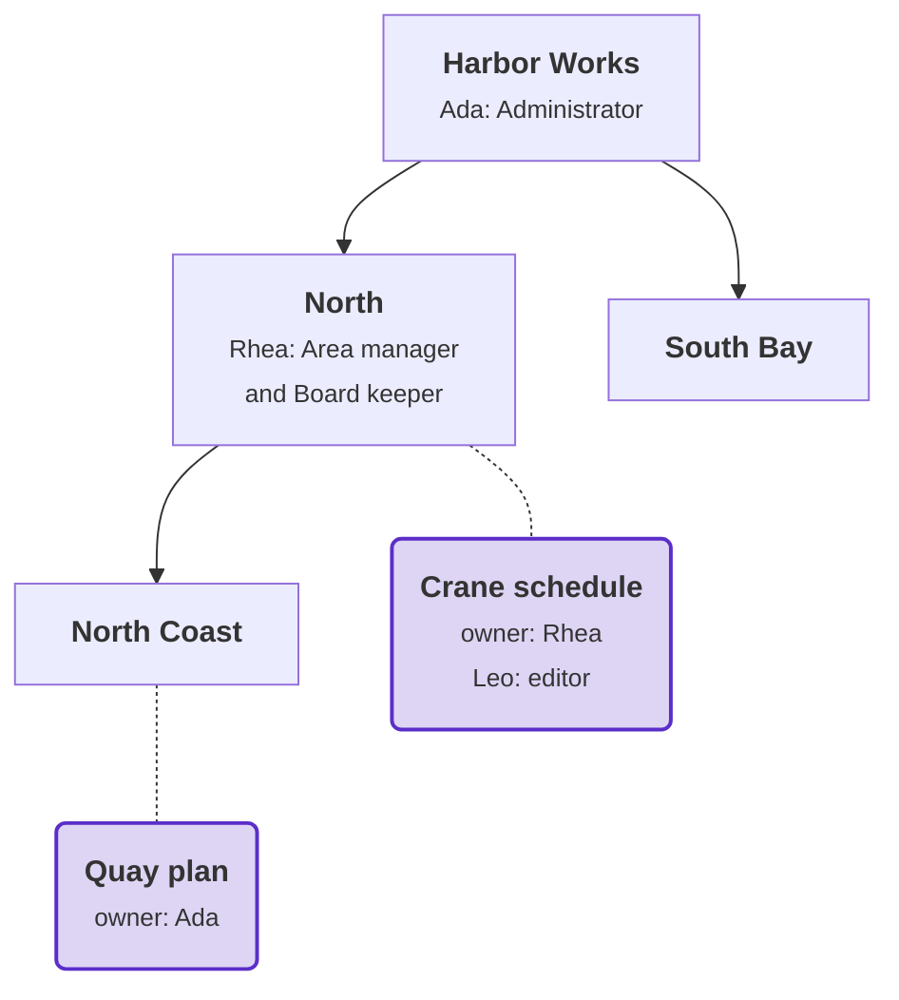
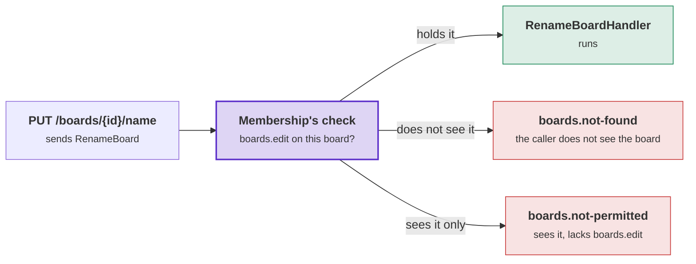

# Membership: the tutorial

This tutorial adds a Boards module to the Harbor application, one step at a time. Read the [overview](overview.md)
first. It explains the words the steps use: resource, member, owner, role and reach from above.

## Where we are: the Harbor app from the Tenancy tutorial

The [Tenancy tutorial](../tenancy/tutorial.md) built Harbor. It has:

- the tenant Harbor Works, with the units Harbor Works (the root), North, North Coast below North, and South Bay;
- Ada, Administrator at the root, and Rhea, Area manager at North. Leo has no seat yet;
- a second tenant, Meadow Gardens, with Tove as its administrator. This tutorial does not use it;
- a host on Supabase that runs every request as its caller.

## What we build

A module called Boards. A board belongs to a tenant and hangs at a unit. It has one owner and members, and the
members hold roles that the tenant keeps. At the end of the tutorial, Harbor Works has two boards. Units are square;
boards are purple and rounded, with a dotted line to the unit where they hang:



| Person | Sees | Can change | Why |
|---|---|---|---|
| Rhea | both boards | Crane schedule | She owns Crane schedule. Her `boards.view` at North reaches Quay plan; she holds no `boards.edit` there. |
| Leo | Crane schedule | Crane schedule's name | He is a member with the role editor. |
| Ada | both boards | both boards | Her Administrator role at the root reaches every board. |

When it is done, you can try these with plain HTTP requests:

- Rhea opens Crane schedule at North and adds Leo as an editor.
- Leo renames Crane schedule. Adding a member gets him `403`: an editor does not hold `boards.members.manage`.
- Rhea renames Quay plan and gets `403`: she sees it, but her roles give no `boards.edit` there.

Each step says where we are, why the step comes now, and what it adds. It explains the idea, shows every file
whole with the new lines highlighted, and lists what those lines do.

The module gets the same five projects as Tenancy, one per layer:

| Project | What it holds | Membership's package in it |
|---|---|---|
| `Harbor.Boards.Contracts` | What other modules may use: a board's id, and the questions a row rule asks about boards. | none, only the toolkit |
| `Harbor.Boards.Domain` | The classes: a board, its member, a board role. | `Supporting.Membership` |
| `Harbor.Boards.Application` | The permissions, the rules, the requests and their handlers. | none, it gets the domain's |
| `Harbor.Boards.Infrastructure` | The context, its migrations, and the database's own rules. | `Supporting.Membership.Postgres` |
| `Harbor.Boards.Api` | The routes, and the one call the host makes to add the module. | none |

```text
src/
├── Harbor.Host/
└── Modules/
    ├── Tenancy/
    └── Boards/
        ├── Harbor.Boards.Contracts/
        ├── Harbor.Boards.Domain/
        ├── Harbor.Boards.Application/
        ├── Harbor.Boards.Infrastructure/
        └── Harbor.Boards.Api/
```

## Step 1: the board, its members and its roles

**Where we are.** Harbor runs with one module, Tenancy. No code knows about boards yet.

**Why now.** Every later step uses the classes this step declares. The permissions name the board, the context maps
it, and the requests load it.

**What we want.** A board class, its member class and its role class, with their ids, in two new projects. The
projects build with 0 warnings.

### The idea: a board, its members and its owner

- **Resource**: the board. It is an ordinary aggregate root in your domain. Membership requires no base class and no
  class attribute on it.
- **Member**: a seat on the board for a period. The period starts at a moment and ends at a moment, or never. You
  declare the member class in one line, `[Member<...>]`. Membership's **template** adds the rest: who the member is,
  from when, until when, who added the member, and the roles the member holds. The four type arguments are the
  member row's id type, the member's id type, the role's id type, and the board class.
- **Why a member is a seat** (Tenancy's `SeatId`) instead of a user:
  - a board belongs to one tenant, and a seat does too;
  - a suspended seat loses access to every board;
  - when you add a member, Membership checks with Tenancy that the seat is active in this tenant;
  - the caller's seat is the caller's member identity on a board, so you write no code to find it.
- **Owner**: one property of the board, marked `[Owner]`. It records whose board it is. The owner is always a member
  and cannot be removed. The owner holds no role. Instead, each permission says whether the owner holds it (step 2).
- **Member list**: the object that applies the rules about members, such as "a seat is on the board once" and "the
  owner stays". The generator adds it to your board as a private property, `Members`. It works on your collection
  `People` and on the owner property. Your methods change the members only through `Members`. `Members.Open(now)`
  puts the owner on the board.
- **Custom role**: a role stored as a row of the tenant. The tenant may rename it and change it. The role template
  has the name, the permissions, and the starter role it was made from. You add the role's tenant, `TenantId`,
  yourself, because Membership does not know about tenants.
- **The tenant of a row**: `[OfTenant]` marks the property that says which tenant a board or a role belongs to. The
  marker is a fact about the class, like `[Owner]`, so it goes on the domain class. Step 3 shows what the context does
  with it.
- **The rules are passed in**: the role checks its permissions against the rules (step 2). The rules live in the
  application layer, and the role's constructor takes them. The domain describes what a board is. The application
  layer decides who may do what with a board.
- **The name**: Membership names the resource `boards`, the class name in the plural. Refusal codes start with it,
  such as `boards.already-member`, and so do the database functions, such as `boards_i_see`. `[Members("...")]` on
  the class sets another name.

### What you write

**The package versions**, at the root. **Why:** this adds the three Membership packages, and Tenancy's Entity
Framework package. Boards' context uses that package to read Tenancy's rows (step 3). All versions stay in one file.

**`Directory.Packages.props`**

```xml {10-13}
<Project>
  <PropertyGroup>
    <ManagePackageVersionsCentrally>true</ManagePackageVersionsCentrally>
  </PropertyGroup>

  <ItemGroup>
    <PackageVersion Include="Temp.DDDToolkit" Version="3.2.0-preview.5" />
    <PackageVersion Include="Temp.DDDToolkit.Supporting.Tenancy" Version="3.2.0-preview.5" />
    <PackageVersion Include="Temp.DDDToolkit.Supporting.Tenancy.Postgres" Version="3.2.0-preview.5" />
    <PackageVersion Include="Temp.DDDToolkit.Supporting.Tenancy.EntityFramework" Version="3.2.0-preview.5" />
    <PackageVersion Include="Temp.DDDToolkit.Supporting.Membership" Version="3.2.0-preview.5" />
    <PackageVersion Include="Temp.DDDToolkit.Supporting.Membership.EntityFramework" Version="3.2.0-preview.5" />
    <PackageVersion Include="Temp.DDDToolkit.Supporting.Membership.Postgres" Version="3.2.0-preview.5" />
    <PackageVersion Include="Temp.DDDToolkit.EntityFramework.Supabase" Version="3.2.0-preview.5" />
    <PackageVersion Include="Npgsql.EntityFrameworkCore.PostgreSQL" Version="10.0.3" />
    <PackageVersion Include="Microsoft.EntityFrameworkCore.Relational" Version="10.0.12" />
    <PackageVersion Include="Microsoft.EntityFrameworkCore.Design" Version="10.0.12" />
    <PackageVersion Include="Mediator.Abstractions" Version="3.0.2" />
    <PackageVersion Include="Mediator.SourceGenerator" Version="3.0.2" />
  </ItemGroup>
</Project>
```

**The contracts project.** **Why:** other modules may store a board's id. Step 4 adds the contracts that row access
rules, including other modules' rules, use to ask about boards. Like Tenancy's contracts project, it references only
the toolkit's core package.

**`src/Modules/Boards/Harbor.Boards.Contracts/Harbor.Boards.Contracts.csproj`**

```xml {5}
<Project Sdk="Microsoft.NET.Sdk">

  <!-- What the other modules may use of Boards: a board's id, and the questions about boards a row access rule asks. -->
  <ItemGroup>
    <PackageReference Include="Temp.DDDToolkit" />
  </ItemGroup>

</Project>
```

**The domain project.** **Why:** it gets the member and role templates, and the generator that writes the member
list. From Tenancy, it references only the contracts project. A board stores Tenancy's ids and cannot change a seat.

**`src/Modules/Boards/Harbor.Boards.Domain/Harbor.Boards.Domain.csproj`**

```xml {5,11}
<Project Sdk="Microsoft.NET.Sdk">

  <!-- The board classes: a board, the seats on it, and the roles a tenant keeps for boards. -->
  <ItemGroup>
    <PackageReference Include="Temp.DDDToolkit.Supporting.Membership" />
  </ItemGroup>

  <ItemGroup>
    <ProjectReference Include="..\Harbor.Boards.Contracts\Harbor.Boards.Contracts.csproj" />
    <!-- A board belongs to a tenant, hangs at a unit, and its members are seats: Tenancy's ids, from its contracts. -->
    <ProjectReference Include="..\..\Tenancy\Harbor.Tenancy.Contracts\Harbor.Tenancy.Contracts.csproj" />
  </ItemGroup>

</Project>
```

**The three ids.** **Why:** member rows and role rows each have an id. `[EntityId<Guid>]` writes `Create()`, and the
member list calls it to make a new row's id in code. Other modules may use the board's id, so it goes in the
contracts project. The other two ids stay in the domain project.

**`Harbor.Boards.Contracts/ValueObjects/BoardId.cs`**

```csharp {5-6}
using DDDToolkit.Abstractions.Attributes;

namespace Harbor.Boards.Contracts.ValueObjects;

[EntityId<Guid>]
public readonly partial record struct BoardId;
```

**`Harbor.Boards.Domain/Aggregates/Boards/ValueObjects/BoardMemberId.cs`**

```csharp {5-6}
using DDDToolkit.Abstractions.Attributes;

namespace Harbor.Boards.Domain.Aggregates.Boards.ValueObjects;

[EntityId<Guid>]
public readonly partial record struct BoardMemberId;
```

**`Harbor.Boards.Domain/Aggregates/BoardRoles/ValueObjects/BoardRoleId.cs`**

```csharp {5-6}
using DDDToolkit.Abstractions.Attributes;

namespace Harbor.Boards.Domain.Aggregates.BoardRoles.ValueObjects;

[EntityId<Guid>]
public readonly partial record struct BoardRoleId;
```

**The member class.** **Why:** the member class and its table are yours. The attribute says what a member is, and the
template adds the rest.

**`Harbor.Boards.Domain/Aggregates/Boards/Entities/BoardMember.cs`**

```csharp {9-10}
using DDDToolkit.Supporting.Membership;
using Harbor.Boards.Domain.Aggregates.BoardRoles.ValueObjects;
using Harbor.Boards.Domain.Aggregates.Boards.ValueObjects;
using Harbor.Tenancy.Contracts.ValueObjects;

namespace Harbor.Boards.Domain.Aggregates.Boards.Entities;

// Its row's id, who a member is, what a role is known by, and the board it is a member of.
[Member<BoardMemberId, SeatId, BoardRoleId, Board>]
public sealed partial class BoardMember;
```

**The board.** **Why:** the members are part of the board aggregate. They are loaded and saved with the board, and a
change to them raises the board's version. The board does not read a clock, so the constructor takes `now`.

**`Harbor.Boards.Domain/Aggregates/Boards/Board.cs`**

```csharp {17,20,27-28,30}
using DDDToolkit.Abstractions.Attributes;
using Harbor.Boards.Contracts.ValueObjects;
using Harbor.Boards.Domain.Aggregates.Boards.Entities;
using Harbor.Tenancy.Contracts.ValueObjects;

namespace Harbor.Boards.Domain.Aggregates.Boards;

[AggregateRoot<BoardId>]
public sealed partial class Board
{
    public Board(BoardId id, TenantId tenantId, OrganizationUnitId unitId, string name, SeatId owner, DateTimeOffset now) : base(id)
    {
        TenantId = tenantId;
        UnitId = unitId;
        Name = name;
        OwnerSeatId = owner;
        Members.Open(now);
    }

    [OfTenant]
    public TenantId TenantId { get; private set; }

    public OrganizationUnitId UnitId { get; private set; }

    public string Name { get; private set; } = string.Empty;

    [Owner]
    public SeatId OwnerSeatId { get; private set; }

    public partial IReadOnlyList<BoardMember> People { get; }
}
```

**The role class.** **Why:** a role belongs to a tenant, so it has a `TenantId`, marked `[OfTenant]`. The constructor
takes the rules, so a role cannot give a permission that the rules do not allow in a role.

**`Harbor.Boards.Domain/Aggregates/BoardRoles/BoardRole.cs`**

```csharp {10,13-14,16-17}
using DDDToolkit.Abstractions.Attributes;
using DDDToolkit.Supporting.Membership;
using DDDToolkit.Supporting.Membership.Access;
using Harbor.Boards.Domain.Aggregates.BoardRoles.ValueObjects;
using Harbor.Boards.Domain.Aggregates.Boards;
using Harbor.Tenancy.Contracts.ValueObjects;

namespace Harbor.Boards.Domain.Aggregates.BoardRoles;

[CustomRole<BoardRoleId, Board>]
public sealed partial class BoardRole
{
    public BoardRole(BoardRoleId id, TenantId tenantId, CustomRoleDraft draft, MembershipRules rules) : base(id, draft, rules)
        => TenantId = tenantId;

    [OfTenant]
    public TenantId TenantId { get; private set; }
}
```

Add the two projects to the solution, and build:

```powershell
dotnet sln Harbor.slnx add --solution-folder src/Modules/Boards src/Modules/Boards/Harbor.Boards.Contracts/Harbor.Boards.Contracts.csproj src/Modules/Boards/Harbor.Boards.Domain/Harbor.Boards.Domain.csproj
dotnet build Harbor.slnx
```

### What it does

- `[AggregateRoot<BoardId>]`: the toolkit's attribute for an aggregate root whose id type is `BoardId`. With it,
  `Board` derives from the toolkit's `AggregateRoot<BoardId>`, which `: base(id)` calls. That base class has `Id` and
  `Version`. The toolkit's Entity Framework package raises `Version` on every save that touches the board. A save
  from a stale version throws a `ConcurrencyConflictException`.
- `[Member<...>]`: the generator writes the other half of `BoardMember`, which derives from the member template.
- `People`: a get-only `partial` property. The generator writes its body over a private list, and the member list
  stores the members in that list.
- On `Board`, the generator writes `Members`, which works on `People` and on the property marked `[Owner]`. It also
  writes `Codes`, which makes refusals with codes that start with `boards.`.
- `Members.Open(now)` puts the owner on the board from now, with no end and no role.
- `[CustomRole<...>]`: `BoardRole` derives from the role template. The template checks a new role's name and
  permissions against the rules passed to the constructor.
- `CustomRoleDraft` holds what a new role is made from: a name, a description, the permissions, and the starter role
  it is made from, if any. Step 7 gets drafts from the rules.

The generated `Board.Members.g.cs` is in the domain project, under **Dependencies → Analyzers**. It holds one line:
the member list.

> **Going further.** What is written, and when it is not: [The member list is written for you](resources-and-members.md#the-generated-member-list).

## Step 2: the permissions and the rules

**Where we are.** The classes exist. No code says yet who may do what with a board.

**Why now.** The rules read the permissions, and the later steps read the rules: the context (step 3), the database
functions (step 4) and every request (step 6).

**What we want.** Five permissions, each declared once with the level where it is checked. And the rules, in one
declaration: each tenant has its own board roles, and starts with one role called `editor`.

### The idea: a permission has a level

- **Permission**: a string that a request requires and a role gives, as in Tenancy.
- **Level**: where the permission is checked. There are three levels:

  | Level | Attribute | In Harbor |
  |---|---|---|
  | on one board | `[On<Board>]` | `boards.view`, `boards.edit`, `boards.members.manage` |
  | at a unit | `[AtUnit]` | `boards.create`: the board does not exist yet, so the check is at the unit where the board will hang |
  | for the whole tenant | `[AtTenant]` | `boards.roles.manage`: managing the tenant's board roles |

- **On a board**, each permission also says who holds it there:

  | Setting | Default | In Harbor |
  |---|---|---|
  | `Owner` | on: the owner holds it | all three |
  | `EveryMember` | off: being a member gives no permission by itself | `boards.view`: every member sees the board |
  | `InRoles` | on: a role may give it | `boards.members.manage` sets `false`: no board role gives it, so the owner decides who is on a board |

- **Rules**: one declaration per kind of resource, `MembershipRules.For<Board>(...)`. From the board's type, the rules
  read the resource name, the refusal codes and the permissions. You only say where the roles come from.
- **Where roles come from**: there are three kinds.

  | Kind | Who makes them | In code |
  |---|---|---|
  | Fixed | you, in code, the same for every tenant | `Roles.Fixed([...])` |
  | Custom | the tenant, as rows, at run time | `Roles.Custom(starters: [...])`, with a role class |
  | External | another system that stores roles, such as Tenancy | `Roles.External(...)` |

  Harbor's roles are custom. Every tenant starts with a copy of each **starter role**, and the tenant can change its
  copy. Harbor has one starter role, `editor`, with `boards.view` and `boards.edit`.
- **Application layer**: the permissions and the rules live in the application project. The domain project describes
  what a board is. The application project decides who may do what.
- **Tenancy's catalogue**: Tenancy's generator adds every permission of a `[Permissions]` class to Tenancy's
  catalogue. So a Tenancy role can hold `boards.create` at North. The host collects these permissions in step 5.

### What you write

**The application project.** **Why:** the requests go in this project. Tenancy's core package brings the two levels
Tenancy knows, `[AtUnit]` and `[AtTenant]`, and `ITenancy`, which returns the current caller's tenant and seat
(step 6).

**`src/Modules/Boards/Harbor.Boards.Application/Harbor.Boards.Application.csproj`**

```xml {6-7}
<Project Sdk="Microsoft.NET.Sdk">

  <!-- The requests of Boards and their handlers, a folder per feature, and who holds which permission on a board. -->
  <ItemGroup>
    <ProjectReference Include="..\Harbor.Boards.Domain\Harbor.Boards.Domain.csproj" />
    <!-- Tenancy's words for a permission held in the organization, [AtUnit] and [AtTenant], and its answers about the caller. -->
    <PackageReference Include="Temp.DDDToolkit.Supporting.Tenancy" />
    <PackageReference Include="Mediator.Abstractions" />
  </ItemGroup>

</Project>
```

**The permissions.** **Why:** each permission is declared once. A request requires the constant, the rules read it,
and the export writes the database functions from it. A screen for making roles shows the description.

**`Harbor.Boards.Application/Access/BoardPermissions.cs`**

```csharp {8,11,14,17,20,23}
using DDDToolkit.Access;
using DDDToolkit.Supporting.Membership.Access;
using DDDToolkit.Supporting.Tenancy.Access;
using Harbor.Boards.Domain.Aggregates.Boards;

namespace Harbor.Boards.Application.Access;

[Permissions]
public static class BoardPermissions
{
    [On<Board>(EveryMember = true, Description = "See a board and who is on it")]
    public const string View = "boards.view";

    [On<Board>(Description = "Change a board")]
    public const string Edit = "boards.edit";

    [On<Board>(InRoles = false, Description = "Say who is on a board, and in which role")]
    public const string ManageMembers = "boards.members.manage";

    [AtUnit(Description = "Open a board at a unit")]
    public const string Create = "boards.create";

    [AtTenant(Description = "Set up the roles of boards")]
    public const string ManageRoles = "boards.roles.manage";
}
```

**The rules.** **Why:** the C# check and the database functions both read this one value, so they always agree.

**`Harbor.Boards.Application/Access/BoardMembership.cs`**

```csharp {8-9}
using DDDToolkit.Supporting.Membership.Access;
using Harbor.Boards.Domain.Aggregates.Boards;

namespace Harbor.Boards.Application.Access;

public static class BoardMembership
{
    public static MembershipRules Rules { get; } = MembershipRules.For<Board>(
        Roles.Custom(starters: [new("editor", [BoardPermissions.View, BoardPermissions.Edit])]));
}
```

```powershell
dotnet sln Harbor.slnx add --solution-folder src/Modules/Boards src/Modules/Boards/Harbor.Boards.Application/Harbor.Boards.Application.csproj
dotnet build Harbor.slnx
```

### What it does

- `[Permissions]`: every public constant in the class is a permission. The attribute on the constant sets its level.
- `Description`: the text a screen shows for the permission.
- `MembershipRules.For<Board>`: the owner holds the three permissions on a board. Every member holds `boards.view`. A
  role may give `boards.view` and `boards.edit`.
- `new("editor", [...])`: a starter role, with its name and its permissions.
- `MembershipRules.For` checks the rules when it runs, and throws for rules that contradict themselves. For example,
  a starter role with `boards.members.manage` is refused, because no role may give that permission.

> **Going further.** Every setting of a permission, `Implies` and `Retired` among them:
> [The settings of a permission](permissions-and-roles.md#the-settings-of-a-permission).

## Step 3: where it is stored

**Where we are.** The classes and the rules exist. Nothing stores boards yet.

**Why now.** A request that opens a board must save it somewhere. The export also writes the database functions of
step 4 from this model.

**What we want.** A context for Boards with its tables in the schema `boards`, the first migration, and a mark on the
rules for the export.

### The idea: one call maps the members in your context

- Boards has its own context and its own schema, like Tenancy.
- `HasMembers(row => row.People)` maps the two member tables: the members, and the roles each member holds. The board
  owns both tables, and they are saved with the board. The owner is the property marked `[Owner]`.
- `IsCustomRole()` maps the columns Membership adds to a role row: name, description, permissions, status, and the
  starter role the role was made from (`MadeFrom`).
- **The role's tenant is yours to map**: you add two unique indexes. One allows each role name once per tenant. The
  other allows each starter role once per tenant.
- **The tenant filter and the save check**: `AddDDDToolkitConventions()` adds both to every class with a property
  marked `[OfTenant]`, here the board and the role. You write no line for them in the context. A query returns only
  the rows of the caller's tenant. The save check refuses a row of another tenant.
- `AddTenancyReadFunctions` maps Tenancy's rows, the rights and the units, through Tenancy's database functions. So a
  question such as "does Rhea hold `boards.create` at North" becomes part of this context's query. The query reads
  no Tenancy table directly. Boards knows Tenancy's ids but not its classes, so the call names the four id types.
- **The mark**, `[MembershipRules<BoardMember>]`: the build cannot read which rules a registration call receives. The
  mark tells the build which rules belong to the board. The export writes the board's database functions from those
  rules.

### What you write

**The infrastructure project.** **Why:** Membership's Postgres package brings Membership's Entity Framework package
with it. Tenancy's Entity Framework package is referenced next to it. With both, the generator writes the code that
joins Membership to Tenancy (step 5).

**`src/Modules/Boards/Harbor.Boards.Infrastructure/Harbor.Boards.Infrastructure.csproj`**

```xml {14-15}
<Project Sdk="Microsoft.NET.Sdk">

  <!-- Where Boards is stored: its context, its migrations, and what the database checks of boards. -->
  <ItemGroup>
    <ProjectReference Include="..\Harbor.Boards.Application\Harbor.Boards.Application.csproj" />
  </ItemGroup>

  <PropertyGroup>
    <!-- dotnet ef runs this project as its own startup project. -->
    <GenerateRuntimeConfigurationFiles>true</GenerateRuntimeConfigurationFiles>
  </PropertyGroup>

  <ItemGroup>
    <PackageReference Include="Temp.DDDToolkit.Supporting.Membership.Postgres" />
    <PackageReference Include="Temp.DDDToolkit.Supporting.Tenancy.EntityFramework" />
    <PackageReference Include="Temp.DDDToolkit.EntityFramework.Supabase" />
    <PackageReference Include="Npgsql.EntityFrameworkCore.PostgreSQL" />
    <PackageReference Include="Microsoft.EntityFrameworkCore.Relational" />
    <PackageReference Include="Microsoft.EntityFrameworkCore.Design" PrivateAssets="all" />
  </ItemGroup>

</Project>
```

**The context.** **Why:** your context builds the model. It says which collection is the member list, what the tables
are called, and that a role's name is used once per tenant.

**`Harbor.Boards.Infrastructure/Persistence/BoardsContext.cs`**

```csharp {27,31,36-38,44,46}
using DDDToolkit.EntityFramework.Conventions;
using DDDToolkit.EntityFramework.Supabase;
using DDDToolkit.Supporting.Membership.EntityFramework;
using DDDToolkit.Supporting.Tenancy.EntityFramework;
using Harbor.Boards.Domain.Aggregates.BoardRoles;
using Harbor.Boards.Domain.Aggregates.Boards;
using Harbor.Boards.Infrastructure.Converters;
using Harbor.Tenancy.Contracts.ValueObjects;
using Microsoft.EntityFrameworkCore;

namespace Harbor.Boards.Infrastructure.Persistence;

[SupabaseMigrations]
public sealed class BoardsContext(DbContextOptions<BoardsContext> options) : DbContext(options)
{
    public const string Schema = "boards";

    public DbSet<Board> Boards => Set<Board>();

    public DbSet<BoardRole> BoardRoles => Set<BoardRole>();

    protected override void OnModelCreating(ModelBuilder modelBuilder)
    {
        modelBuilder.HasDefaultSchema(Schema);

        // Tenancy's rows, read through its functions, so a question about the organization is part of this context's queries.
        modelBuilder.AddTenancyReadFunctions<TenantId, SeatId, OrganizationUnitId, RoleId>("tenancy");

        modelBuilder.Entity<Board>(board =>
        {
            board.HasMembers(row => row.People);
        });

        modelBuilder.Entity<BoardRole>(role =>
        {
            role.IsCustomRole();
            role.HasIndex(row => new { row.TenantId, row.Name }).IsUnique();
            role.HasIndex(row => new { row.TenantId, row.MadeFrom }).IsUnique();
        });
    }

    protected override void ConfigureConventions(ModelConfigurationBuilder configurationBuilder)
    {
        configurationBuilder.AddDDDToolkitConventions();
        configurationBuilder.StoreDateTimeOffsetsAsUtc();
        configurationBuilder.AddBoardsConverters();
    }
}
```

**The rules, marked.** **Why:** the export reads the mark. Without it, the build gives warning DDD00054 and writes no
functions for boards.

**`Harbor.Boards.Application/Access/BoardMembership.cs`**

```csharp {3,9-10}
using DDDToolkit.Supporting.Membership.Access;
using Harbor.Boards.Domain.Aggregates.Boards;
using Harbor.Boards.Domain.Aggregates.Boards.Entities;

namespace Harbor.Boards.Application.Access;

public static class BoardMembership
{
    // The export writes the boards' functions in the database from these rules.
    [MembershipRules<BoardMember>]
    public static MembershipRules Rules { get; } = MembershipRules.For<Board>(
        Roles.Custom(starters: [new("editor", [BoardPermissions.View, BoardPermissions.Edit])]));
}
```

```powershell
dotnet sln Harbor.slnx add --solution-folder src/Modules/Boards src/Modules/Boards/Harbor.Boards.Infrastructure/Harbor.Boards.Infrastructure.csproj
dotnet build Harbor.slnx
dotnet ef migrations add Boards --project src/Modules/Boards/Harbor.Boards.Infrastructure --startup-project src/Modules/Boards/Harbor.Boards.Infrastructure --output-dir Persistence/Migrations
```

### What it does

- `[SupabaseMigrations]`, `StoreDateTimeOffsetsAsUtc`: the same as in Tenancy's context. The database functions
  compare member periods in SQL, so the times are stored as UTC.
- `AddTenancyReadFunctions<...>("tenancy")`: `"tenancy"` is the schema of Tenancy's functions, the schema of
  Tenancy's context.
- `AddBoardsConverters()` is generated for the module. It stores Boards' ids, and the Tenancy ids from Tenancy's
  contracts, as their `Guid`.
- The migration creates the schema `boards` with four tables: `Boards`, `BoardPeople` (the members, named after the
  board and its collection), `BoardMemberRoles` and `BoardRoles`. It creates none of Tenancy's tables.

> **Going further.** Your own table and column names: [Several kinds of resource](resources-and-members.md#several-kinds-of-resource).

## Step 4: the database's own rules

**Where we are.** Boards has tables. No rule says yet who may read or write them.

**Why now.** Harbor runs every query as its caller, under row level security (RLS). Tenancy's policies on a table only
narrow access to the caller's tenant. They allow nothing by themselves. So without a rule of yours, no seat can read
any board. The export in step 5 writes your rules as policies.

**What we want.** Rules for who may read, open and change a board, and for who may read and write a board role. And a
lock on the member rows and on the owner column.

### The idea: a rule in C#, a policy in the database

- **Row access rule**: a static class with `[RowAccess<T>(...)]` and one method, `Allows(row, caller)`. Your
  application never calls this method. The export translates it into a policy, and Postgres applies the policy to
  every query.
- **Asking about boards**: a policy calls the functions that Membership writes from the rules. The functions take a
  board's id. A rule refers to them through a **contract**: a one-line class in the contracts project, so other
  modules' rules can use it too. Harbor uses two kinds:
  - `ResourceAccessSet.Seen`: the boards the caller sees;
  - `ResourceAccessSet.HeldOn`: the boards the caller holds a given permission on.
- **Asking about the organization**: a rule calls Tenancy's functions, such as `TenancyRowAccess.UnitsWhereIHold(...)`
  and `CallerSeatId()`.
- **A policy cannot see the command.** Adding a member raises the board's version, so it updates the board row. So
  the rule for changing a board allows anyone who may edit the board or manage its members. The check before the
  handler tells the two commands apart.
- **The lock.** The member tables follow the board's rules. Without a lock, Leo, who may edit a board, could write its
  member rows with his own SQL statement, or make himself the owner. `LocksMembers` and `LocksOwner` mark the
  permission your commands require for these changes. From that permission, Membership writes a policy on the member
  tables and a trigger on the owner column.

Harbor's rules:

| Table | Operation | Allowed when |
|---|---|---|
| `Boards` | read | the caller sees the board |
| `Boards` | create | the caller holds `boards.create` at the board's unit, and owns it |
| `Boards` | change | the caller holds `boards.edit` or `boards.members.manage` on it |
| `BoardRoles` | read | the role is of the caller's tenant |
| `BoardRoles` | create, change | the caller holds `boards.roles.manage` for the whole tenant |

### What you write

**The two contracts.** **Why:** a rule asks about boards by their id and never names a database function. The export
finds the function.

**`Harbor.Boards.Contracts/RowAccess/BoardsISee.cs`**

```csharp {7-8}
using DDDToolkit.Abstractions.Attributes;
using Harbor.Boards.Contracts.ValueObjects;

namespace Harbor.Boards.Contracts.RowAccess;

// The boards the caller sees, by their id: a question a row access rule asks of the database.
[ResourceAccessContract<BoardId>(ResourceAccessSet.Seen)]
public static partial class BoardsISee;
```

**`Harbor.Boards.Contracts/RowAccess/BoardsWhereIHold.cs`**

```csharp {7-8}
using DDDToolkit.Abstractions.Attributes;
using Harbor.Boards.Contracts.ValueObjects;

namespace Harbor.Boards.Contracts.RowAccess;

// The boards the caller holds a permission on, by their id.
[ResourceAccessContract<BoardId>(ResourceAccessSet.HeldOn)]
public static partial class BoardsWhereIHold;
```

**The rules on boards.** **Why:** your application decides what a seat may read and change on a board. Membership
writes no policy on your board table.

**`Harbor.Boards.Infrastructure/Access/BoardRowRules.cs`**

```csharp {12,15,19,23-24,28,32-33}
using DDDToolkit.Abstractions.Access;
using DDDToolkit.Abstractions.Attributes;
using DDDToolkit.Supporting.Tenancy.Access;
using Harbor.Boards.Application.Access;
using Harbor.Boards.Contracts.RowAccess;
using Harbor.Boards.Domain.Aggregates.Boards;
using Harbor.Tenancy.Contracts.ValueObjects;

namespace Harbor.Boards.Infrastructure.Access;

// A seat reads the boards it sees.
[RowAccess<Board>(RowOperations.Read, To = [RowAccessRoles.User])]
public static partial class SeatsReadTheBoardsTheySee
{
    public static bool Allows(Board board, Caller caller) => BoardsISee.Ids().Contains(board.Id);
}

// A seat opens a board where it holds boards.create, and as its own.
[RowAccess<Board>(RowOperations.Create, To = [RowAccessRoles.User])]
public static partial class SeatsOpenBoardsWhereTheyMay
{
    public static bool Allows(Board board, Caller caller)
        => TenancyRowAccess.UnitsWhereIHold<OrganizationUnitId>(BoardPermissions.Create).Contains(board.UnitId)
            && board.OwnerSeatId == TenancyRowAccess.CallerSeatId<SeatId>();
}

// A seat changes a board it may edit, or whose members it may manage: adding a member raises the board's version.
[RowAccess<Board>(RowOperations.Change, To = [RowAccessRoles.User])]
public static partial class SeatsChangeTheBoardsTheyWorkOn
{
    public static bool Allows(Board board, Caller caller)
        => BoardsWhereIHold.Ids(BoardPermissions.Edit).Contains(board.Id)
            || BoardsWhereIHold.Ids(BoardPermissions.ManageMembers).Contains(board.Id);
}
```

**The rules on board roles.** **Why:** a role row sets what every member with that role may do. So the database also
limits who may write a role row.

**`Harbor.Boards.Infrastructure/Access/BoardRoleRowRules.cs`**

```csharp {11,14,18,21}
using DDDToolkit.Abstractions.Access;
using DDDToolkit.Abstractions.Attributes;
using DDDToolkit.Supporting.Tenancy.Access;
using Harbor.Boards.Application.Access;
using Harbor.Boards.Domain.Aggregates.BoardRoles;
using Harbor.Tenancy.Contracts.ValueObjects;

namespace Harbor.Boards.Infrastructure.Access;

// A seat reads the board roles of its tenant.
[RowAccess<BoardRole>(RowOperations.Read, To = [RowAccessRoles.User])]
public static partial class SeatsReadTheirTenantsBoardRoles
{
    public static bool Allows(BoardRole role, Caller caller) => role.TenantId == TenancyRowAccess.CallerTenant<TenantId>();
}

// A role's row decides what everybody who holds it may do: only who manages the roles of boards writes one.
[RowAccess<BoardRole>(RowOperations.Create | RowOperations.Change, To = [RowAccessRoles.User])]
public static partial class RoleManagersWriteBoardRoles
{
    public static bool Allows(BoardRole role, Caller caller) => TenancyRowAccess.HoldsAtTenant(BoardPermissions.ManageRoles);
}
```

**The lock**, on `boards.members.manage`. **Why:** your commands that change the members require this permission
(step 7). A command that names a new owner would require it too.

**`Harbor.Boards.Application/Access/BoardPermissions.cs`**

```csharp {17}
using DDDToolkit.Access;
using DDDToolkit.Supporting.Membership.Access;
using DDDToolkit.Supporting.Tenancy.Access;
using Harbor.Boards.Domain.Aggregates.Boards;

namespace Harbor.Boards.Application.Access;

[Permissions]
public static class BoardPermissions
{
    [On<Board>(EveryMember = true, Description = "See a board and who is on it")]
    public const string View = "boards.view";

    [On<Board>(Description = "Change a board")]
    public const string Edit = "boards.edit";

    [On<Board>(InRoles = false, LocksMembers = true, LocksOwner = true, Description = "Say who is on a board, and in which role")]
    public const string ManageMembers = "boards.members.manage";

    [AtUnit(Description = "Open a board at a unit")]
    public const string Create = "boards.create";

    [AtTenant(Description = "Set up the roles of boards")]
    public const string ManageRoles = "boards.roles.manage";
}
```

Build again: `dotnet build Harbor.slnx`. In step 5, the export writes the policies and you apply them to the
database.

### What it does

- `[ResourceAccessContract<BoardId>(...)]` on an empty `static partial class`: the generator adds the class's `Ids()`
  method. `BoardsISee.Ids()` takes no argument. `BoardsWhereIHold.Ids(permission)` takes the permission.
- `RowOperations`: the statements a rule allows. The values are `Read`, `Create`, `Change`, `Remove` and `All`.
  Combine them with `|`, as the role rule does with `Create | Change`. Harbor has no `Remove` rule, so a signed-in
  caller's `DELETE` on these tables removes no row.
- `To = [RowAccessRoles.User]`: the rule is for signed-in callers, the database role `authenticated`. Another value
  is `RowAccessRoles.Anonymous`, for callers without a user (`anon`).
- `BoardsISee.Ids().Contains(board.Id)` becomes a subquery in the policy. The subquery calls the boards function once
  per statement.
- The create rule makes the database check the same thing as the command: the owner is the caller's seat.
- `TenancyRowAccess.CallerTenant<TenantId>()`: the tenant of the caller's seat. `HoldsAtTenant(permission)`: whether
  the caller's seat holds the permission now, at the root, so for the whole tenant.
- `LocksMembers`: a member row is added, changed or removed only on a board where the caller holds
  `boards.members.manage`. `LocksOwner`: only a caller with that permission on the board can change the owner column.
- Without the locks, a start-up check logs a warning. The member rows then follow your rule for changing a board.

> **Going further.** Everything the lock holds and leaves to you: [Who writes the member rows](postgres.md#who-writes-the-member-rows).

## Step 5: the module's registration and the host

**Where we are.** The module builds. Nothing registers it, and the host does not reference it.

**Why now.** The requests of step 6 need a check before each handler. The database needs the new tables, functions
and policies.

**What we want.** `AddBoardsModule(connectionString)`, called by the host, and an up-to-date database.

### The idea: two packages check Boards' requests

- **One interface per module**, as in Tenancy. Every request of Boards implements `IBoardsRequest`, which is marked
  `[AccessRequests]`. The generator writes the behavior that runs the checks before each handler.
- **Two checks**, both registered for `IBoardsRequest`, decide the requirements:
  - Tenancy's check decides: in the tenant, a permission at a unit, and a permission for the whole tenant;
  - Membership's check decides: a permission on one board, and which boards a list shows.

  When no registered check decides a requirement, the behavior refuses every caller.
- **The generator joins Membership to Tenancy.** The project references both packages, so the generator writes
  `AddBoardMembershipWithTenancy`. With it, the caller's seat is the caller's member identity, and a new member's seat
  must be active in the tenant. Boards knows Tenancy's ids but not its classes, so the call names three id types. The
  seat id type comes from the member class.
- **Ada's role lacks the new permissions.** Her Administrator role is a copy of Tenancy's default administrators'
  pack. The copy was made when Harbor Works was provisioned, before boards existed. That pack holds every permission
  in the catalogue. `SyncRolePacks()` in the host adds the board permissions to her role when the host starts. Changes
  that the tenant made to its roles stay.

**What this looks like on a request.** Step 7 writes this request and its handler. You do not write it now; it shows
what the checks of this step do. `[RequiresPermission(BoardPermissions.Edit)]` asks for `boards.edit`, and
`[OnResource]` says on which board. Membership's check decides it, and `Handle` runs only when the check passes:

```csharp
[RequiresPermission(BoardPermissions.Edit)]                       // what the caller needs: boards.edit
public sealed record RenameBoard([OnResource] BoardId Board, string Name)  // [OnResource]: on this board
    : ICommand, IBoardsRequest;                                    // IBoardsRequest: the behavior checks it

public sealed class RenameBoardHandler(IBoardRepository boards) : ICommandHandler<RenameBoard>
{
    // Runs only for a caller who holds boards.edit on this board.
    public async ValueTask<Unit> Handle(RenameBoard command, CancellationToken cancellationToken)
    {
        var board = await boards.FindAsync(command.Board, cancellationToken)
            ?? throw Board.Codes.Refuse(MembershipRefusals.NotFound);
        board.Rename(command.Name);
        await boards.SaveAsync(cancellationToken);
        return Unit.Value;
    }
}
```

What happens when a route sends it. Purple is the check, green is the path to the handler, red are the refusals:



A caller who does not see the board gets the same answer as for a board that does not exist, so nobody learns which
boards exist.

### What you write

**The module's request interface.** **Why:** this interface separates Boards' requests from other modules' requests,
so each module's checks decide only that module's requests.

**`Harbor.Boards.Application/Access/IBoardsRequest.cs`**

```csharp {5-6}
using DDDToolkit.Abstractions.Attributes;

namespace Harbor.Boards.Application.Access;

[AccessRequests]
public partial interface IBoardsRequest : IRequireAccess;
```

**`Harbor.Boards.Application/GlobalUsings.cs`**: the namespaces every request file of the module uses.

```csharp
global using DDDToolkit.Access;
global using DDDToolkit.Supporting.Membership.Access;
global using DDDToolkit.Supporting.Tenancy.Access;
global using Harbor.Boards.Application.Access;
global using Harbor.Boards.Contracts.ValueObjects;
global using Harbor.Boards.Domain.Aggregates.BoardRoles;
global using Harbor.Boards.Domain.Aggregates.BoardRoles.ValueObjects;
global using Harbor.Boards.Domain.Aggregates.Boards;
global using Harbor.Tenancy.Contracts.ValueObjects;
global using Mediator;

[assembly: DDDToolkit.Supporting.Tenancy.TenancyIds<TenantId, SeatId, OrganizationUnitId, RoleId>]
```

**The application's registration.** **Why:** the generator writes the behavior next to `IBoardsRequest`, in this
project.

**`Harbor.Boards.Application/BoardsApplication.cs`**

```csharp {8}
using Microsoft.Extensions.DependencyInjection;

namespace Harbor.Boards.Application;

public static class BoardsApplication
{
    public static IServiceCollection AddBoardsApplication(this IServiceCollection services)
        => services.AddBoardsAccessBehavior();
}
```

**The infrastructure's registration.** **Why:** both packages' checks read through the board context, so they are
registered next to it.

**`Harbor.Boards.Infrastructure/BoardsInfrastructure.cs`**

```csharp {23,26-28}
using DDDToolkit.EntityFramework;
using DDDToolkit.Supporting.Membership.EntityFramework;
using DDDToolkit.Supporting.Membership.Postgres;
using DDDToolkit.Supporting.Tenancy.EntityFramework;
using Harbor.Boards.Application.Access;
using Harbor.Boards.Infrastructure.Persistence;
using Harbor.Tenancy.Contracts.ValueObjects;
using Microsoft.EntityFrameworkCore;
using Microsoft.Extensions.DependencyInjection;

namespace Harbor.Boards.Infrastructure;

public static class BoardsInfrastructure
{
    public static IServiceCollection AddBoardsInfrastructure(this IServiceCollection services, string connectionString)
    {
        services.AddDDDToolkitEntityFramework();
        services.AddDbContext<BoardsContext>((provider, options) => options
            .UseNpgsql(connectionString)
            .UseDDDToolkit(provider));

        // Tenancy's checks for Boards' requests: in the tenant, a permission at a unit or for the whole tenant.
        services.AddTenancyAccess<IBoardsRequest, BoardsContext>();

        // The boards with their members, joined to Tenancy, and Membership's check for a permission on a board.
        services.AddBoardMembershipWithTenancy<BoardsContext>(BoardMembership.Rules);
        services.AddBoardMemberAccess<IBoardsRequest>();
        services.AddMembershipPostgres();
        return services;
    }
}
```

**The API project and the module's entry.** **Why:** the host references only this project of Boards, and calls only
these two methods.

**`src/Modules/Boards/Harbor.Boards.Api/Harbor.Boards.Api.csproj`**

```xml
<Project Sdk="Microsoft.NET.Sdk">

  <!-- The module's entry: its registration and its routes. The host references this project and nothing else of the module. -->
  <ItemGroup>
    <ProjectReference Include="..\Harbor.Boards.Application\Harbor.Boards.Application.csproj" />
    <ProjectReference Include="..\Harbor.Boards.Infrastructure\Harbor.Boards.Infrastructure.csproj" />
    <FrameworkReference Include="Microsoft.AspNetCore.App" />
  </ItemGroup>

</Project>
```

**`Harbor.Boards.Api/BoardsModule.cs`**

```csharp {11-12}
using Harbor.Boards.Application;
using Harbor.Boards.Infrastructure;
using Microsoft.AspNetCore.Routing;
using Microsoft.Extensions.DependencyInjection;

namespace Harbor.Boards.Api;

// The module's entry: the host calls these, and nothing else of the module.
public static class BoardsModule
{
    public static IServiceCollection AddBoardsModule(this IServiceCollection services, string connectionString)
        => services.AddBoardsInfrastructure(connectionString).AddBoardsApplication();

    // The routes; each later step adds its own.
    public static IEndpointRouteBuilder MapBoardsModule(this IEndpointRouteBuilder routes)
        => routes;
}
```

**The host.** **Why:** the host now references Boards' API project, so the generated mediator includes Boards'
handlers too.

**`src/Harbor.Host/Harbor.Host.csproj`**

```xml {5}
<Project Sdk="Microsoft.NET.Sdk.Web">

  <ItemGroup>
    <ProjectReference Include="..\Modules\Tenancy\Harbor.Tenancy.Api\Harbor.Tenancy.Api.csproj" />
    <ProjectReference Include="..\Modules\Boards\Harbor.Boards.Api\Harbor.Boards.Api.csproj" />
  </ItemGroup>

  <PropertyGroup>
    <!-- Every build writes the SQL file of each migration that has none, into supabase/migrations. -->
    <SupabaseMigrationsExport>Write</SupabaseMigrationsExport>
    <!-- The role the API logs in as: the build writes its migration, without a login or a password. -->
    <SupabaseLoginRole>harbor_api</SupabaseLoginRole>
  </PropertyGroup>

  <ItemGroup>
    <!-- The mediator is generated here, with every handler of the modules this project references. -->
    <PackageReference Include="Mediator.Abstractions" />
    <PackageReference Include="Mediator.SourceGenerator" PrivateAssets="all" />
  </ItemGroup>

</Project>
```

**`src/Harbor.Host/Program.cs`**

```csharp {3-4,16,18,28}
using DDDToolkit.EntityFramework.Supabase;
using DDDToolkit.Startup;
using DDDToolkit.Supporting.Tenancy;
using Harbor.Boards.Api;
using Harbor.Host;
using Harbor.Host.Requests;
using Harbor.Tenancy.Api;

var builder = WebApplication.CreateBuilder(args);
var database = builder.Configuration.GetConnectionString("Supabase")
    ?? throw new InvalidOperationException("ConnectionStrings:Supabase is not set.");

builder.Services.AddMediator(options => options.ServiceLifetime = ServiceLifetime.Scoped);
builder.Services.AddSupabaseRowLevelSecurity();
builder.Services.AddTenancyModule(database);
builder.Services.AddBoardsModule(database);
builder.Services.AddTenancyPermissionsOfModules();
builder.Services.SyncRolePacks();
builder.Services.AddSupabaseMigrations();
builder.Services.AddProblemDetails();
builder.Services.AddExceptionHandler<RefusalsAsProblems>();
builder.Services.RunStartupChecks();

var app = builder.Build();
app.UseExceptionHandler();
app.UseCallerAndTenant();
app.MapTenancyModule();
app.MapBoardsModule();
if (app.Environment.IsDevelopment())
{
    app.MapTenancyDevelopment();
}

app.Run();
```

```powershell
dotnet sln Harbor.slnx add --solution-folder src/Modules/Boards src/Modules/Boards/Harbor.Boards.Api/Harbor.Boards.Api.csproj
```

### What it does

- `AddDDDToolkitEntityFramework()`: the same registration as in Tenancy's module, here without an outbox. Each call
  adds to the same options.
- `AddTenancyAccess<TenantId, SeatId, OrganizationUnitId, RoleId, IBoardsRequest, BoardsContext>()` registers
  Tenancy's checks for Boards' requests. Outside the Tenancy module, the call names Tenancy's four id types, because
  Boards does not see Tenancy's classes. The checks read through this context's read functions.
- `AddBoardMembershipWithTenancy` registers Membership's queries about boards over this context, joined to Tenancy.
- `AddBoardMemberAccess<IBoardsRequest>()` registers Membership's check for Boards' requests.
- `AddMembershipPostgres()` adds a start-up check: the database functions and the lock must match the rules the host
  runs with.
- `AddTenancyPermissionsOfModules()` is unchanged. It now also registers Boards' five permissions.

### Run it

1. Build the host: `dotnet build`. The export writes three files into `supabase/migrations`:
   - `<v>_Boards.boards.ddd.sql`: the migration of step 3;
   - `<v>_access.tenancy.ddd.sql`: a new version of Tenancy's access file, because Tenancy's catalogue now has
     Boards' permissions;
   - `<v>_access.boards.ddd.sql`: five functions for boards, the policies of step 4, and the lock.
2. Apply them: `npx supabase migration up --local`.
3. Run the host as in the Tenancy tutorial. The start-up checks pass, including `membership.functions-in-place`. The
   log shows:

   ```text
   The role packs are synced in 2 tenants: 2 roles followed their packs, ...
   ```

   The Administrator role of both tenants now holds the board permissions: Ada's in Harbor Works and Tove's in
   Meadow Gardens.

## Step 6: open a board, see it, list them

**Where we are.** The module is registered and has no routes.

**Why now.** A member needs a board, so the board comes first.

**What we want.** Rhea opens a board at North, sees it, and finds it in her list. Ada is not on the board, so she does
not see it yet.

### The idea: three requirements, each on its request

- Each request states what it requires. The check before the handler enforces it:

  | Request | Requires | Checked by |
  |---|---|---|
  | `OpenBoard` | `[RequiresPermission(boards.create)]`, with `[AtUnit]` on its unit | Tenancy, at that unit or above. The board does not exist yet, so nobody is a member of it. |
  | `SeeBoard` | `[RequiresPermission(boards.view)]`, with `[OnResource]` on its board | Membership, on that board |
  | `ListBoards` | `[SeenWith<BoardId>(boards.view)]` | Membership. It refuses nobody. The list contains only the boards the caller sees. |

- **Hidden boards**: for a board the caller does not see, the answer is `404`, `boards.not-found`. An id that is not a
  board gets the same answer, so a caller cannot find out that a board exists.
- **Reach**: `IMemberQuestions<BoardId>.Reach(permission)` returns a `MemberReach<BoardId>`. It describes the boards
  the caller holds the permission on, and runs no query by itself. `Within(reach)` adds it to an Entity Framework
  query, so the list is one SQL statement. The code never loads the ids first.
- **Repository**: the handlers load and save boards through `IBoardRepository`. The interface is in the application
  project, and the infrastructure project implements it. The handler passes the reach to the repository, because
  `Within` is part of an Entity Framework query.
- **The owner is the caller**: the handler gets the caller's tenant and seat from `ITenancy` with `RequireTenant()`.
  The create rule of step 4 makes the database check the same.

### What you write

**The repository.** **Why:** the application project does not reference Entity Framework. It declares what it needs
from storage in an interface.

**`Harbor.Boards.Application/Boards/IBoardRepository.cs`**

```csharp {10}
namespace Harbor.Boards.Application.Boards;

// Where the handlers load and save boards. The infrastructure project implements it.
public interface IBoardRepository
{
    void Add(Board board);

    Task<Board?> FindAsync(BoardId id, CancellationToken cancellationToken);

    Task<IReadOnlyList<Board>> ListAsync(MemberReach<BoardId> reach, CancellationToken cancellationToken);

    Task SaveAsync(CancellationToken cancellationToken);
}
```

**`Harbor.Boards.Infrastructure/Persistence/BoardRepository.cs`**

```csharp {18}
using DDDToolkit.Supporting.Membership.Access;
using DDDToolkit.Supporting.Membership.EntityFramework;
using Harbor.Boards.Application.Boards;
using Harbor.Boards.Contracts.ValueObjects;
using Harbor.Boards.Domain.Aggregates.Boards;
using Microsoft.EntityFrameworkCore;

namespace Harbor.Boards.Infrastructure.Persistence;

internal sealed class BoardRepository(BoardsContext db) : IBoardRepository
{
    public void Add(Board board) => db.Boards.Add(board);

    public Task<Board?> FindAsync(BoardId id, CancellationToken cancellationToken)
        => db.Boards.SingleOrDefaultAsync(board => board.Id == id, cancellationToken);

    public async Task<IReadOnlyList<Board>> ListAsync(MemberReach<BoardId> reach, CancellationToken cancellationToken)
        => await db.Boards.Within(reach).OrderBy(board => board.Name).ToListAsync(cancellationToken);

    public Task SaveAsync(CancellationToken cancellationToken) => db.SaveChangesAsync(cancellationToken);
}
```

**`Harbor.Boards.Infrastructure/BoardsInfrastructure.cs`**: registers the repository.

```csharp {6,31}
using DDDToolkit.EntityFramework;
using DDDToolkit.Supporting.Membership.EntityFramework;
using DDDToolkit.Supporting.Membership.Postgres;
using DDDToolkit.Supporting.Tenancy.EntityFramework;
using Harbor.Boards.Application.Access;
using Harbor.Boards.Application.Boards;
using Harbor.Boards.Infrastructure.Persistence;
using Harbor.Tenancy.Contracts.ValueObjects;
using Microsoft.EntityFrameworkCore;
using Microsoft.Extensions.DependencyInjection;

namespace Harbor.Boards.Infrastructure;

public static class BoardsInfrastructure
{
    public static IServiceCollection AddBoardsInfrastructure(this IServiceCollection services, string connectionString)
    {
        services.AddDDDToolkitEntityFramework();
        services.AddDbContext<BoardsContext>((provider, options) => options
            .UseNpgsql(connectionString)
            .UseDDDToolkit(provider));

        // Tenancy's checks for Boards' requests: in the tenant, a permission at a unit or for the whole tenant.
        services.AddTenancyAccess<IBoardsRequest, BoardsContext>();

        // The boards with their members, joined to Tenancy, and Membership's check for a permission on a board.
        services.AddBoardMembershipWithTenancy<BoardsContext>(BoardMembership.Rules);
        services.AddBoardMemberAccess<IBoardsRequest>();
        services.AddMembershipPostgres();

        services.AddScoped<IBoardRepository, BoardRepository>();
        return services;
    }
}
```

**Opening a board.** **Why:** the board does not exist yet, so the request requires a permission at the unit. The
caller becomes the owner.

**`Harbor.Boards.Application/Boards/OpenBoard/OpenBoard.cs`**

```csharp {3-4,14-15,17}
namespace Harbor.Boards.Application.Boards.OpenBoard;

[RequiresPermission(BoardPermissions.Create)]
public sealed record OpenBoard([AtUnit] OrganizationUnitId Unit, string Name) : ICommand<BoardId>, IBoardsRequest;

public sealed class OpenBoardHandler(
    IBoardRepository boards,
    TenancyAccessManager access,
    TimeProvider clock) : ICommandHandler<OpenBoard, BoardId>
{
    public async ValueTask<BoardId> Handle(OpenBoard command, CancellationToken cancellationToken)
    {
        // The caller's tenant and seat: the board is the tenant's, and the caller owns it.
        var scope = access.CurrentTenant.Require();
        var owner = scope.Seat ?? throw new InvalidOperationException("A board is opened by a seat.");

        var board = new Board(BoardId.Create(), scope.Id, command.Unit, command.Name, owner, clock.GetUtcNow());
        boards.Add(board);
        await boards.SaveAsync(cancellationToken);
        return board.Id;
    }
}
```

**Seeing one board.** **Why:** the request requires a permission on that board. The response lists the board's
members, the owner first.

**`Harbor.Boards.Application/Boards/SeeBoard/SeeBoard.cs`**

```csharp {6-7,14,17}
using DDDToolkit.Supporting.Membership;
using DDDToolkit.Supporting.Membership.UseCases;

namespace Harbor.Boards.Application.Boards.SeeBoard;

[RequiresPermission(BoardPermissions.View)]
public sealed record SeeBoard([OnResource] BoardId Board) : IQuery<BoardDetails>, IBoardsRequest;

public sealed class SeeBoardHandler(IBoardRepository boards, TimeProvider clock) : IQueryHandler<SeeBoard, BoardDetails>
{
    public async ValueTask<BoardDetails> Handle(SeeBoard query, CancellationToken cancellationToken)
    {
        var board = await boards.FindAsync(query.Board, cancellationToken)
            ?? throw Board.Codes.Refuse(MembershipRefusals.NotFound);

        // The owner first, then by when each membership starts, each with its roles.
        var members = MemberOverviews.From(board.People, board.OwnerSeatId, clock.GetUtcNow());
        return new BoardDetails(board.Id, board.Name, board.UnitId, board.Version, members);
    }
}

public sealed record BoardDetails(BoardId Id, string Name, OrganizationUnitId Unit, long Version, IReadOnlyList<MemberOverview<SeatId, BoardRoleId>> Members);
```

**Listing the caller's boards.** **Why:** a list request refuses nobody. The reach decides which boards the list
contains.

**`Harbor.Boards.Application/Boards/ListBoards/ListBoards.cs`**

```csharp {3-4,12-13}
namespace Harbor.Boards.Application.Boards.ListBoards;

[SeenWith<BoardId>(BoardPermissions.View)]
public sealed record ListBoards : IQuery<IReadOnlyList<BoardListing>>, IBoardsRequest;

public sealed class ListBoardsHandler(IMemberQuestions<BoardId> questions, IBoardRepository boards)
    : IQueryHandler<ListBoards, IReadOnlyList<BoardListing>>
{
    public async ValueTask<IReadOnlyList<BoardListing>> Handle(ListBoards query, CancellationToken cancellationToken)
    {
        // The boards the caller holds boards.view on, as part of the query: never the ids first.
        var seen = questions.Reach(BoardPermissions.View);
        var found = await boards.ListAsync(seen, cancellationToken);
        return [.. found.Select(board => new BoardListing(board.Id, board.Name, board.UnitId, board.OwnerSeatId))];
    }
}

public sealed record BoardListing(BoardId Id, string Name, OrganizationUnitId Unit, SeatId Owner);
```

**The routes.** **Why:** each route only sends its request. The behavior checks the request before the handler runs.

**`Harbor.Boards.Api/Boards/Rest/BoardsEndpoints.cs`**

```csharp {17-22}
using Harbor.Boards.Application.Boards.ListBoards;
using Harbor.Boards.Application.Boards.OpenBoard;
using Harbor.Boards.Application.Boards.SeeBoard;
using Harbor.Boards.Contracts.ValueObjects;
using Harbor.Tenancy.Contracts.ValueObjects;
using Mediator;
using Microsoft.AspNetCore.Builder;
using Microsoft.AspNetCore.Http;
using Microsoft.AspNetCore.Routing;

namespace Harbor.Boards.Api.Boards.Rest;

internal static class BoardsEndpoints
{
    public static IEndpointRouteBuilder MapBoardsEndpoints(this IEndpointRouteBuilder routes)
    {
        routes.MapPost("/boards", async (NewBoard body, ISender sender, CancellationToken cancellationToken)
            => Results.Ok(new { board = await sender.Send(new OpenBoard(body.Unit, body.Name), cancellationToken) }));
        routes.MapGet("/boards", async (ISender sender, CancellationToken cancellationToken)
            => Results.Ok(await sender.Send(new ListBoards(), cancellationToken)));
        routes.MapGet("/boards/{board}", async (BoardId board, ISender sender, CancellationToken cancellationToken)
            => Results.Ok(await sender.Send(new SeeBoard(board), cancellationToken)));

        return routes;
    }

    public sealed record NewBoard(OrganizationUnitId Unit, string Name);
}
```

**`Harbor.Boards.Api/BoardsModule.cs`**: the module maps the routes.

```csharp {1,16}
using Harbor.Boards.Api.Boards.Rest;
using Harbor.Boards.Application;
using Harbor.Boards.Infrastructure;
using Microsoft.AspNetCore.Routing;
using Microsoft.Extensions.DependencyInjection;

namespace Harbor.Boards.Api;

// The module's entry: the host calls these, and nothing else of the module.
public static class BoardsModule
{
    public static IServiceCollection AddBoardsModule(this IServiceCollection services, string connectionString)
        => services.AddBoardsInfrastructure(connectionString).AddBoardsApplication();

    public static IEndpointRouteBuilder MapBoardsModule(this IEndpointRouteBuilder routes)
        => routes.MapBoardsEndpoints();
}
```

### What it does

- `[AtUnit] Unit`: Rhea needs `boards.create` at that unit or above it, from a Tenancy role.
- `ITenancy<TenantId, SeatId, OrganizationUnitId, RoleId>`: the same service as in step 10 of the Tenancy tutorial.
  `RequireTenant()` returns the caller's `Tenant` and `Seat`. `Seat` can be `null` for system work in the tenant. In
  Harbor only a seat opens a board, so the handler throws in that case.
- `TimeProvider`: .NET's clock. Tenancy registers `TimeProvider.System` unless the host registered another one, such
  as a fixed clock in a test. The handler passes `clock.GetUtcNow()` to the board, because the board reads no clock.
- `BoardId.Create()` makes the new board's id in code, before the save.
- `[OnResource] Board`: before the handler runs, the check reads that board. It refuses a caller who does not see the
  board, and a caller who sees it without the permission.
- `Board.Codes.Refuse(MembershipRefusals.NotFound)`: for a board deleted between the check and the load. The refusal
  uses the board's code, `boards.not-found`.
- `MemberOverviews.From(...)` puts the members in the standard order: the owner first, then by the start of each
  membership. It runs no query.
- `board.Version`: the board's version, which every save that changes the board or its members raises.
- `Within(reach)` adds the boards Rhea holds `boards.view` on as a subquery, in the same statement.

### Try it

Rhea does not hold `boards.create` yet. Ada makes a Tenancy role with it and grants the role to Rhea at North. She uses
the routes from the Tenancy tutorial:

```http
POST /roles
X-Dev-User: d0000000-0000-4000-8000-000000000001
Tenant: harbor
Content-Type: application/json

{ "name": "Board keeper", "description": "Opens boards", "permissions": ["boards.create", "boards.view"] }
```

1. As Ada: `POST /grants` with Rhea's seat, North, and that role: `204`.
2. As Rhea (`X-Dev-User` ending in `0002`): `POST /boards` with `{ "unit": "<North's id>", "name": "Crane schedule" }`:
   `200`, the board's id. Keep it.
3. As Rhea: `POST /boards` at the root: `403`, `tenancy.not-permitted`, "You lack the permission boards.create."
4. As Rhea: `GET /boards`: Crane schedule, with her seat as its owner.
5. As Rhea: `GET /boards/<id>`: `version` 1, one member, Rhea, `isOwner: true`, no roles.
6. As Ada: `GET /boards`: `[]`. `GET /boards/<id>`: `404`, `boards.not-found`. Ada holds `boards.view` at the root,
   and Rhea holds it at North. Until step 8, a permission held at a unit does not count on a board. Only the board's
   owner and members hold permissions on it.

> **Going further.** A command that names the version its caller read, `[ExpectedVersion]`, and what holds a change
> between the check and the save: [From the check to the save](checks-and-saves.md#from-the-check-to-the-save).

## Step 7: members

**Where we are.** Rhea owns a board and is alone on it. Leo has no seat.

**Why now.** This step shows the main feature of Membership: a person gets access to one board by being a member of
it.

**What we want.** Harbor Works gets its starter role, `editor`. Rhea adds Leo to her board as an editor. Leo can edit
that board, and may not add members to it.

### The idea: who may add a member, and what a role gives

- **Starter roles are made per tenant**, when your application decides. `StarterRoles.Missing(rules, roles)` returns
  the starter roles the tenant does not have yet. A role made from a starter role before is not made again, even if
  the tenant renamed it. In Harbor, an administrator sends a request once to make them. The request requires
  `boards.roles.manage` for the tenant. A real application sends this request when it sets up a tenant.
- **You decide who may add a member.** Membership has no built-in permission for it. Harbor uses
  `boards.members.manage` on the board. The owner holds it, and no role can give it.
- **`MemberAdmission` checks what the member list cannot know**, before anything changes:
  - `RequireMemberAsync` checks with Tenancy that the seat is an active seat of this tenant.
  - `RequireRoleAsync` checks that the role is one of this tenant's board roles and is active.
- **The member list then applies its rules**: it refuses a seat that is already on the board with `409`,
  `boards.already-member`.
- **Period**: `MemberPeriod.Open(now)` starts now and has no end. `MemberPeriod.Between(now, until)` ends at `until`.
- **What a role gives**: `editor` gives `boards.view` and `boards.edit` on each board where a member holds it. It
  gives nothing else.

### What you write

**The board's two methods.** **Why:** a guard of your own goes here, before the call to the member list. An example
is "a closed board takes no new members". The member list applies the other rules.

**`Harbor.Boards.Domain/Aggregates/Boards/Board.cs`**

```csharp {2,4,34,36-38}
using DDDToolkit.Abstractions.Attributes;
using DDDToolkit.Supporting.Membership;
using Harbor.Boards.Contracts.ValueObjects;
using Harbor.Boards.Domain.Aggregates.BoardRoles.ValueObjects;
using Harbor.Boards.Domain.Aggregates.Boards.Entities;
using Harbor.Tenancy.Contracts.ValueObjects;

namespace Harbor.Boards.Domain.Aggregates.Boards;

[AggregateRoot<BoardId>]
public sealed partial class Board
{
    public Board(BoardId id, TenantId tenantId, OrganizationUnitId unitId, string name, SeatId owner, DateTimeOffset now) : base(id)
    {
        TenantId = tenantId;
        UnitId = unitId;
        Name = name;
        OwnerSeatId = owner;
        Members.Open(now);
    }

    [OfTenant]
    public TenantId TenantId { get; private set; }

    public OrganizationUnitId UnitId { get; private set; }

    public string Name { get; private set; } = string.Empty;

    [Owner]
    public SeatId OwnerSeatId { get; private set; }

    public partial IReadOnlyList<BoardMember> People { get; }

    public void Rename(string name) => Name = name;

    // A seat on the board, in a role, for a period: the member list refuses a seat that is on it already.
    public void AddMember(SeatId seat, BoardRoleId role, MemberPeriod period, DateTimeOffset now, SeatId? addedBy)
        => Members.Add(seat, role, period, now, addedBy);
}
```

**The roles' repository.** **Why:** for the same reason as the boards' repository. The application project declares
what it needs from storage.

**`Harbor.Boards.Application/BoardRoles/IBoardRoleRepository.cs`**

```csharp
namespace Harbor.Boards.Application.BoardRoles;

// Where the handlers load and save the tenant's board roles.
public interface IBoardRoleRepository
{
    void Add(BoardRole role);

    Task<IReadOnlyList<BoardRole>> ListAsync(CancellationToken cancellationToken);

    Task SaveAsync(CancellationToken cancellationToken);
}
```

**`Harbor.Boards.Infrastructure/Persistence/BoardRoleRepository.cs`**

```csharp {11-13}
using Harbor.Boards.Application.BoardRoles;
using Harbor.Boards.Domain.Aggregates.BoardRoles;
using Microsoft.EntityFrameworkCore;

namespace Harbor.Boards.Infrastructure.Persistence;

internal sealed class BoardRoleRepository(BoardsContext db) : IBoardRoleRepository
{
    public void Add(BoardRole role) => db.BoardRoles.Add(role);

    // The tenant filter keeps it to the caller's tenant.
    public async Task<IReadOnlyList<BoardRole>> ListAsync(CancellationToken cancellationToken)
        => await db.BoardRoles.OrderBy(role => role.Name).ToListAsync(cancellationToken);

    public Task SaveAsync(CancellationToken cancellationToken) => db.SaveChangesAsync(cancellationToken);
}
```

**`Harbor.Boards.Infrastructure/BoardsInfrastructure.cs`**: registers the roles' repository.

```csharp {6,33}
using DDDToolkit.EntityFramework;
using DDDToolkit.Supporting.Membership.EntityFramework;
using DDDToolkit.Supporting.Membership.Postgres;
using DDDToolkit.Supporting.Tenancy.EntityFramework;
using Harbor.Boards.Application.Access;
using Harbor.Boards.Application.BoardRoles;
using Harbor.Boards.Application.Boards;
using Harbor.Boards.Infrastructure.Persistence;
using Harbor.Tenancy.Contracts.ValueObjects;
using Microsoft.EntityFrameworkCore;
using Microsoft.Extensions.DependencyInjection;

namespace Harbor.Boards.Infrastructure;

public static class BoardsInfrastructure
{
    public static IServiceCollection AddBoardsInfrastructure(this IServiceCollection services, string connectionString)
    {
        services.AddDDDToolkitEntityFramework();
        services.AddDbContext<BoardsContext>((provider, options) => options
            .UseNpgsql(connectionString)
            .UseDDDToolkit(provider));

        // Tenancy's checks for Boards' requests: in the tenant, a permission at a unit or for the whole tenant.
        services.AddTenancyAccess<IBoardsRequest, BoardsContext>();

        // The boards with their members, joined to Tenancy, and Membership's check for a permission on a board.
        services.AddBoardMembershipWithTenancy<BoardsContext>(BoardMembership.Rules);
        services.AddBoardMemberAccess<IBoardsRequest>();
        services.AddMembershipPostgres();

        services.AddScoped<IBoardRepository, BoardRepository>();
        services.AddScoped<IBoardRoleRepository, BoardRoleRepository>();
        return services;
    }
}
```

**Setting up the starter roles.** **Why:** the roles are rows of the tenant, so a request must make them once per
tenant. The rules say which roles to make.

**`Harbor.Boards.Application/BoardRoles/SetUpBoardRoles/SetUpBoardRoles.cs`**

```csharp {5-6,16,19}
using DDDToolkit.Supporting.Membership.UseCases;

namespace Harbor.Boards.Application.BoardRoles.SetUpBoardRoles;

[RequiresPermission(BoardPermissions.ManageRoles)]
public sealed record SetUpBoardRoles : ICommand<int>, IBoardsRequest;

public sealed class SetUpBoardRolesHandler(
    IBoardRoleRepository roles,
    TenancyAccessManager access) : ICommandHandler<SetUpBoardRoles, int>
{
    public async ValueTask<int> Handle(SetUpBoardRoles command, CancellationToken cancellationToken)
    {
        // The starter roles this tenant does not have yet; a role made from one before is not made again.
        var tenant = access.CurrentTenant.Require().Id;
        var missing = StarterRoles.Missing(BoardMembership.Rules, await roles.ListAsync(cancellationToken));
        foreach (var draft in missing)
        {
            roles.Add(new BoardRole(BoardRoleId.Create(), tenant, draft, BoardMembership.Rules));
        }

        await roles.SaveAsync(cancellationToken);
        return missing.Count;
    }
}
```

**Listing the roles.** **Why:** adding a member needs a role's id. Any seat of the tenant may read the roles.

**`Harbor.Boards.Application/BoardRoles/ListBoardRoles/ListBoardRoles.cs`**

```csharp {3}
namespace Harbor.Boards.Application.BoardRoles.ListBoardRoles;

[InTenant]
public sealed record ListBoardRoles : IQuery<IReadOnlyList<BoardRoleListing>>, IBoardsRequest;

public sealed class ListBoardRolesHandler(IBoardRoleRepository roles) : IQueryHandler<ListBoardRoles, IReadOnlyList<BoardRoleListing>>
{
    public async ValueTask<IReadOnlyList<BoardRoleListing>> Handle(ListBoardRoles query, CancellationToken cancellationToken)
        => [.. (await roles.ListAsync(cancellationToken)).Select(role => new BoardRoleListing(role.Id, role.Name, role.Permissions))];
}

public sealed record BoardRoleListing(BoardRoleId Id, string Name, IReadOnlyList<string> Permissions);
```

**Adding a member.** **Why:** the request states who may add a member. The admission checks what the member list
cannot know. The board makes the change.

**`Harbor.Boards.Application/Boards/AddMember/AddMember.cs`**

```csharp {6-7,18-19,24}
using DDDToolkit.Supporting.Membership;
using DDDToolkit.Supporting.Membership.UseCases;

namespace Harbor.Boards.Application.Boards.AddMember;

[RequiresPermission(BoardPermissions.ManageMembers)]
public sealed record AddMember([OnResource] BoardId Board, SeatId Seat, BoardRoleId Role) : ICommand, IBoardsRequest;

public sealed class AddMemberHandler(
    IBoardRepository boards,
    MemberAdmission<BoardId, SeatId, BoardRoleId> admission,
    TenancyAccessManager access,
    TimeProvider clock) : ICommandHandler<AddMember>
{
    public async ValueTask<Unit> Handle(AddMember command, CancellationToken cancellationToken)
    {
        // An active seat of this tenant, and a board role of this tenant in use.
        await admission.RequireMemberAsync(command.Seat, cancellationToken);
        await admission.RequireRoleAsync(command.Role, cancellationToken);

        var board = await boards.FindAsync(command.Board, cancellationToken)
            ?? throw Board.Codes.Refuse(MembershipRefusals.NotFound);
        var now = clock.GetUtcNow();
        board.AddMember(command.Seat, command.Role, MemberPeriod.Open(now), now, addedBy: access.CurrentTenant.Require().Seat);
        await boards.SaveAsync(cancellationToken);
        return Unit.Value;
    }
}
```

**Renaming a board.** **Why:** this command requires `boards.edit`, which a role can give. The `editor` role gives
it.

**`Harbor.Boards.Application/Boards/RenameBoard/RenameBoard.cs`**

```csharp {5-6}
using DDDToolkit.Supporting.Membership;

namespace Harbor.Boards.Application.Boards.RenameBoard;

[RequiresPermission(BoardPermissions.Edit)]
public sealed record RenameBoard([OnResource] BoardId Board, string Name) : ICommand, IBoardsRequest;

public sealed class RenameBoardHandler(IBoardRepository boards) : ICommandHandler<RenameBoard>
{
    public async ValueTask<Unit> Handle(RenameBoard command, CancellationToken cancellationToken)
    {
        var board = await boards.FindAsync(command.Board, cancellationToken)
            ?? throw Board.Codes.Refuse(MembershipRefusals.NotFound);
        board.Rename(command.Name);
        await boards.SaveAsync(cancellationToken);
        return Unit.Value;
    }
}
```

**The routes.**

**`Harbor.Boards.Api/BoardRoles/Rest/BoardRolesEndpoints.cs`**

```csharp {14-17}
using Harbor.Boards.Application.BoardRoles.ListBoardRoles;
using Harbor.Boards.Application.BoardRoles.SetUpBoardRoles;
using Mediator;
using Microsoft.AspNetCore.Builder;
using Microsoft.AspNetCore.Http;
using Microsoft.AspNetCore.Routing;

namespace Harbor.Boards.Api.BoardRoles.Rest;

internal static class BoardRolesEndpoints
{
    public static IEndpointRouteBuilder MapBoardRolesEndpoints(this IEndpointRouteBuilder routes)
    {
        routes.MapPost("/board-roles/starter", async (ISender sender, CancellationToken cancellationToken)
            => Results.Ok(new { made = await sender.Send(new SetUpBoardRoles(), cancellationToken) }));
        routes.MapGet("/board-roles", async (ISender sender, CancellationToken cancellationToken)
            => Results.Ok(await sender.Send(new ListBoardRoles(), cancellationToken)));

        return routes;
    }
}
```

**`Harbor.Boards.Api/Boards/Rest/BoardsEndpoints.cs`**: adds routes to rename a board and to add a member, next to
the others.

```csharp {1,4,7,26-35,42,44}
using Harbor.Boards.Application.Boards.AddMember;
using Harbor.Boards.Application.Boards.ListBoards;
using Harbor.Boards.Application.Boards.OpenBoard;
using Harbor.Boards.Application.Boards.RenameBoard;
using Harbor.Boards.Application.Boards.SeeBoard;
using Harbor.Boards.Contracts.ValueObjects;
using Harbor.Boards.Domain.Aggregates.BoardRoles.ValueObjects;
using Harbor.Tenancy.Contracts.ValueObjects;
using Mediator;
using Microsoft.AspNetCore.Builder;
using Microsoft.AspNetCore.Http;
using Microsoft.AspNetCore.Routing;

namespace Harbor.Boards.Api.Boards.Rest;

internal static class BoardsEndpoints
{
    public static IEndpointRouteBuilder MapBoardsEndpoints(this IEndpointRouteBuilder routes)
    {
        routes.MapPost("/boards", async (NewBoard body, ISender sender, CancellationToken cancellationToken)
            => Results.Ok(new { board = await sender.Send(new OpenBoard(body.Unit, body.Name), cancellationToken) }));
        routes.MapGet("/boards", async (ISender sender, CancellationToken cancellationToken)
            => Results.Ok(await sender.Send(new ListBoards(), cancellationToken)));
        routes.MapGet("/boards/{board}", async (BoardId board, ISender sender, CancellationToken cancellationToken)
            => Results.Ok(await sender.Send(new SeeBoard(board), cancellationToken)));
        routes.MapPut("/boards/{board}/name", async (BoardId board, NewName body, ISender sender, CancellationToken cancellationToken) =>
        {
            await sender.Send(new RenameBoard(board, body.Name), cancellationToken);
            return Results.NoContent();
        });
        routes.MapPost("/boards/{board}/members", async (BoardId board, NewMember body, ISender sender, CancellationToken cancellationToken) =>
        {
            await sender.Send(new AddMember(board, body.Seat, body.Role), cancellationToken);
            return Results.NoContent();
        });

        return routes;
    }

    public sealed record NewBoard(OrganizationUnitId Unit, string Name);

    public sealed record NewName(string Name);

    public sealed record NewMember(SeatId Seat, BoardRoleId Role);
}
```

**`Harbor.Boards.Api/BoardsModule.cs`**: maps the roles' routes too.

```csharp {1,17}
using Harbor.Boards.Api.BoardRoles.Rest;
using Harbor.Boards.Api.Boards.Rest;
using Harbor.Boards.Application;
using Harbor.Boards.Infrastructure;
using Microsoft.AspNetCore.Routing;
using Microsoft.Extensions.DependencyInjection;

namespace Harbor.Boards.Api;

// The module's entry: the host calls these, and nothing else of the module.
public static class BoardsModule
{
    public static IServiceCollection AddBoardsModule(this IServiceCollection services, string connectionString)
        => services.AddBoardsInfrastructure(connectionString).AddBoardsApplication();

    public static IEndpointRouteBuilder MapBoardsModule(this IEndpointRouteBuilder routes)
        => routes.MapBoardsEndpoints().MapBoardRolesEndpoints();
}
```

### What it does

- `ICommand<int>`: the command returns the number of roles it made.
- `StarterRoles.Missing(...)` returns a `CustomRoleDraft` for each starter role the tenant does not have. It compares
  `MadeFrom`, so a renamed role still counts as made.
- `[OnResource] Board` with `boards.members.manage`: the owner passes the check. A member fails it, whatever role the
  member holds.
- `admission.RequireMemberAsync` and `RequireRoleAsync` refuse with the board's codes, `boards.member-not-active` and
  `boards.role-not-for-members`.
- `board.AddMember(...)`: the member list adds Leo, with the role for the same period. It refuses him a second time.
- `addedBy`: the caller's seat, stored on the member row. It is `null` when system work adds a member without a seat.

### Try it

1. As Rhea: `POST /board-roles/starter`: `403`, `tenancy.not-permitted`. She does not hold `boards.roles.manage`.
2. As Ada: `POST /board-roles/starter`: `{ "made": 1 }`. Again: `{ "made": 0 }`.
3. As Ada: `GET /board-roles`: `editor`, its id, `["boards.edit", "boards.view"]`. Keep the id.
4. As Ada: `POST /seats` with `{ "identity": "d0000000-0000-4000-8000-000000000003", "unit": "<North's id>" }`: Leo's
   seat.
5. As Rhea: `POST /boards/<id>/members` with `{ "seat": "<Leo's seat>", "role": "<editor's id>" }`: `204`.
6. As Leo: `GET /boards`: Crane schedule. `PUT /boards/<id>/name` with `{ "name": "Crane schedule, week 44" }`: `204`.
7. As Leo: `POST /boards/<id>/members` with Ada's seat: `403`, `boards.not-permitted`, "Doing this needs the permission
   boards.members.manage."
8. As Rhea: Leo again: `409`, `boards.already-member`.
9. As Rhea: `GET /boards/<id>`: `version` 3, Rhea first as the owner, then Leo with `editor`.

You can test the lock of step 4 without the API. Open psql in the database with
`docker exec -it supabase_db_harbor psql -U postgres`. Then act as Leo, the same way the API sets up each connection
([The caller on the connection](../how-a-request-is-checked.md#the-caller-on-the-connection)). The tenant id is the
`tenant` value that `POST /dev/tenants` returned in the Tenancy tutorial.

```sql
begin;
set local role authenticated;
select set_config('request.jwt.claims', '{"sub":"d0000000-0000-4000-8000-000000000003","role":"authenticated"}', true);
select set_config('tenancy.caller_tenant', '<tenant id>', true);

update boards."Boards" set "Name" = 'By hand' where "Id" = '<board id>';             -- UPDATE 1: he may edit it
update boards."Boards" set "OwnerSeatId" = '<Leo seat id>' where "Id" = '<board id>';  -- refused
rollback;
```

The lock's trigger refuses the second statement with the hint `ddd:access.refused`. Leo may change the board but not
its owner. If he inserts a member row by hand, the lock's policy on `BoardPeople` refuses that row too.

> **Going further.** A role the tenant makes itself, renames or archives: [Roles a customer makes](permissions-and-roles.md#roles-a-customer-makes).
> A rule of your own, such as "never for longer than you hold it yourself": [Who may give a role](permissions-and-roles.md#who-may-give-a-role).

## Step 8: reach from above

**Where we are.** Leo is an editor on Crane schedule. Ada is administrator at the root and sees no board. Rhea holds
`boards.view` at North, but it gives her nothing on a board she does not own.

**Why now.** People in an organization need access to the boards in their part of it, without being added to each
board. And when a board's owner leaves, someone above must still be able to hand the board to a new owner.

**What we want.** Ada reaches every board. Rhea reaches every board at North and below. Leo still reaches only the
board he is a member of.

### The idea: a permission held at a board's unit counts on the board

- `[At]` marks the property that holds the board's unit, where the board hangs. This is a fact about the board, so it
  goes on the domain class.
- `reachFromAbove: true`: a permission held at that unit, or above it, counts on the board. Tenancy returns where the
  caller holds the permission, both in C# and in the database functions.
- **Seeing from above**: a caller above sees a board through the permission every member holds, here `boards.view`.
  `MembershipRules.For` throws for rules with `reachFromAbove` and no `EveryMember` permission.
- **`FromAbove`**: on by default, so every permission on a board counts from above. A permission marked
  `FromAbove = false` counts only for the owner and the members.
- **`InRoles = false` limits only the board's roles.** A permission held above still counts. Ada's Administrator
  role holds `boards.members.manage` at the root, so she may manage the members of any board.
- **Members come first**: when a caller holds a permission both as a member and from above, Membership reports it as
  held through membership.
- **The unit decides who reaches the board**, so moving a board changes who can reach it. Harbor has no command that
  moves a board, so `IsFixedAfterInsert` fixes the unit once the board is saved.

### What you write

**`Harbor.Boards.Domain/Aggregates/Boards/Board.cs`**

```csharp {25-26}
using DDDToolkit.Abstractions.Attributes;
using DDDToolkit.Supporting.Membership;
using Harbor.Boards.Contracts.ValueObjects;
using Harbor.Boards.Domain.Aggregates.BoardRoles.ValueObjects;
using Harbor.Boards.Domain.Aggregates.Boards.Entities;
using Harbor.Tenancy.Contracts.ValueObjects;

namespace Harbor.Boards.Domain.Aggregates.Boards;

[AggregateRoot<BoardId>]
public sealed partial class Board
{
    public Board(BoardId id, TenantId tenantId, OrganizationUnitId unitId, string name, SeatId owner, DateTimeOffset now) : base(id)
    {
        TenantId = tenantId;
        UnitId = unitId;
        Name = name;
        OwnerSeatId = owner;
        Members.Open(now);
    }

    [OfTenant]
    public TenantId TenantId { get; private set; }

    // Where the board hangs: a permission held here, or above, reaches the board.
    [At]
    public OrganizationUnitId UnitId { get; private set; }

    public string Name { get; private set; } = string.Empty;

    [Owner]
    public SeatId OwnerSeatId { get; private set; }

    public partial IReadOnlyList<BoardMember> People { get; }

    public void Rename(string name) => Name = name;

    // A seat on the board, in a role, for a period: the member list refuses a seat that is on it already.
    public void AddMember(SeatId seat, BoardRoleId role, MemberPeriod period, DateTimeOffset now, SeatId? addedBy)
        => Members.Add(seat, role, period, now, addedBy);
}
```

**`Harbor.Boards.Application/Access/BoardMembership.cs`**

```csharp {12-13}
using DDDToolkit.Supporting.Membership.Access;
using Harbor.Boards.Domain.Aggregates.Boards;
using Harbor.Boards.Domain.Aggregates.Boards.Entities;

namespace Harbor.Boards.Application.Access;

public static class BoardMembership
{
    // The export writes the boards' functions in the database from these rules.
    [MembershipRules<BoardMember>]
    public static MembershipRules Rules { get; } = MembershipRules.For<Board>(
        Roles.Custom(starters: [new("editor", [BoardPermissions.View, BoardPermissions.Edit])]),
        reachFromAbove: true);
}
```

**`Harbor.Boards.Infrastructure/Persistence/BoardsContext.cs`**

```csharp {33-34}
using DDDToolkit.EntityFramework.Conventions;
using DDDToolkit.EntityFramework.Supabase;
using DDDToolkit.Supporting.Membership.EntityFramework;
using DDDToolkit.Supporting.Tenancy.EntityFramework;
using Harbor.Boards.Domain.Aggregates.BoardRoles;
using Harbor.Boards.Domain.Aggregates.Boards;
using Harbor.Boards.Infrastructure.Converters;
using Harbor.Tenancy.Contracts.ValueObjects;
using Microsoft.EntityFrameworkCore;

namespace Harbor.Boards.Infrastructure.Persistence;

[SupabaseMigrations]
public sealed class BoardsContext(DbContextOptions<BoardsContext> options) : DbContext(options)
{
    public const string Schema = "boards";

    public DbSet<Board> Boards => Set<Board>();

    public DbSet<BoardRole> BoardRoles => Set<BoardRole>();

    protected override void OnModelCreating(ModelBuilder modelBuilder)
    {
        modelBuilder.HasDefaultSchema(Schema);

        // Tenancy's rows, read through its functions, so a question about the organization is part of this context's queries.
        modelBuilder.AddTenancyReadFunctions<TenantId, SeatId, OrganizationUnitId, RoleId>("tenancy");

        modelBuilder.Entity<Board>(board =>
        {
            board.HasMembers(row => row.People);

            // Where a board hangs decides who reaches it from above, so no statement moves it once it is there.
            board.Property(row => row.UnitId).IsFixedAfterInsert();
        });

        modelBuilder.Entity<BoardRole>(role =>
        {
            role.IsCustomRole();
            role.HasIndex(row => new { row.TenantId, row.Name }).IsUnique();
            role.HasIndex(row => new { row.TenantId, row.MadeFrom }).IsUnique();
        });
    }

    protected override void ConfigureConventions(ModelConfigurationBuilder configurationBuilder)
    {
        configurationBuilder.AddDDDToolkitConventions();
        configurationBuilder.StoreDateTimeOffsetsAsUtc();
        configurationBuilder.AddBoardsConverters();
    }
}
```

### What it does

- `[At]` and `reachFromAbove: true`: the boards functions ask Tenancy where the caller holds a permission. They then
  include the boards that hang at those units or below them.
- `IsFixedAfterInsert`: Entity Framework throws on a save that changes a board's unit. The export also leaves `UnitId`
  out of the columns a caller may update.
- The tables did not change, so there is no new migration. The export writes a new `<v>_access.boards.ddd.sql`.

### Run it

Build the host, run `npx supabase migration up --local`, and start the host again.

### Try it

1. As Ada: `GET /boards`: Crane schedule. `GET /boards/<id>`: `200`, with its members.
2. As Ada: `POST /boards` with `{ "unit": "<North Coast's id>", "name": "Quay plan" }`: Ada owns it.
3. As Rhea: `GET /boards`: Crane schedule and Quay plan. Her `boards.view` at North reaches North Coast.
4. As Leo: `GET /boards`: Crane schedule only. He holds no permission in the organization.
5. As Rhea: `PUT /boards/<Quay plan's id>/name`: `403`, `boards.not-permitted`, "Doing this needs the permission
   boards.edit." Board keeper gives only `boards.create` and `boards.view`.
6. As Ada: `POST /boards/<Crane schedule's id>/members` with her own seat and `editor`: `204`. Ada is not a member or
   the owner of the board. Her `boards.members.manage` at the root reaches it.

> **Going further.** A command that moves a board, and a trigger that guards the unit column instead:
> [Who writes the member rows](postgres.md#who-writes-the-member-rows). Reach from above without Tenancy:
> [An organization of your own](beside-an-organization.md#an-organization-of-your-own).

## What you built

| Step | What now works |
|---|---|
| 1-3 | A board with members, an owner and the tenant's roles, and its tables |
| 4 | Database rules for who reads and changes a board, and the lock on its members |
| 5 | The module registered and checked by Tenancy and Membership, and Ada's role updated with the board permissions |
| 6 | Opening a board at a unit, and seeing and listing boards by a permission held on them |
| 7 | Starter roles, and members that the owner adds with a role that counts on that one board |
| 8 | A permission held at a unit counting on every board at that unit and below it |

Next: the topic pages describe each part in detail, starting with [Resources and members](resources-and-members.md).
The [API reference](reference/resource-and-members.md) lists every class and method.
