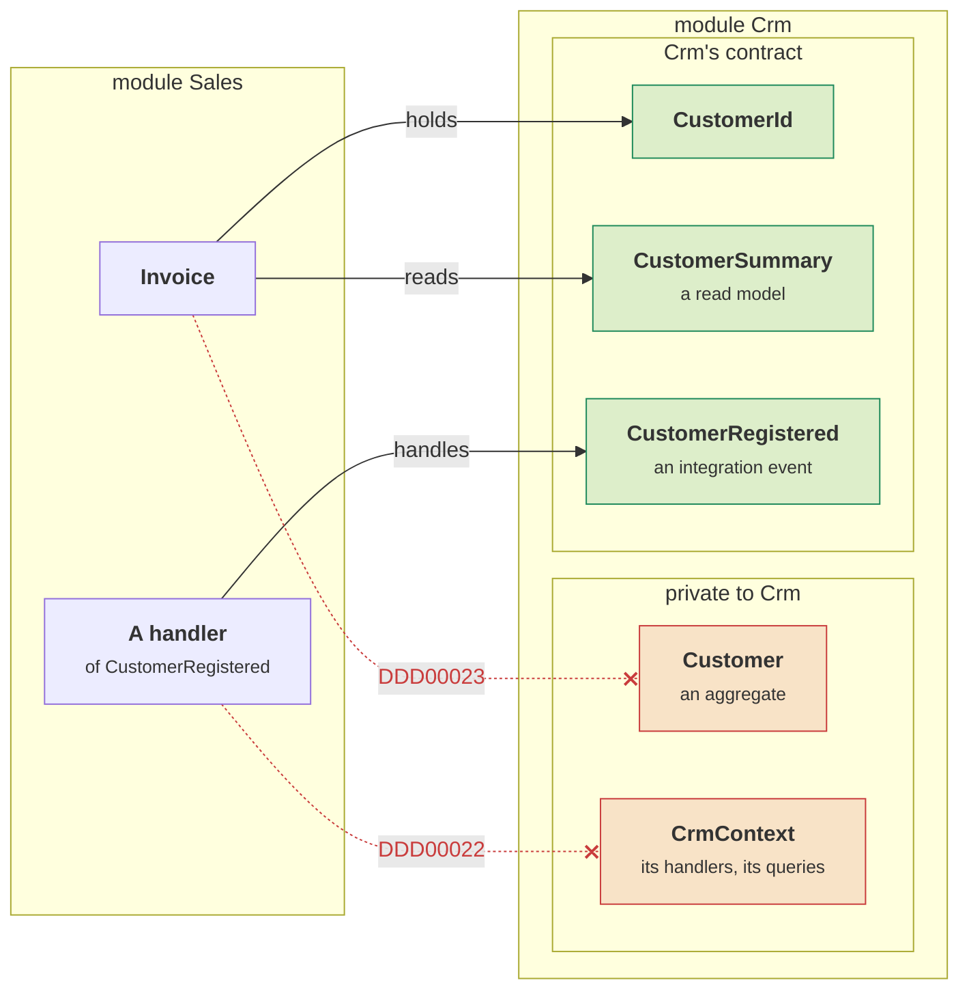
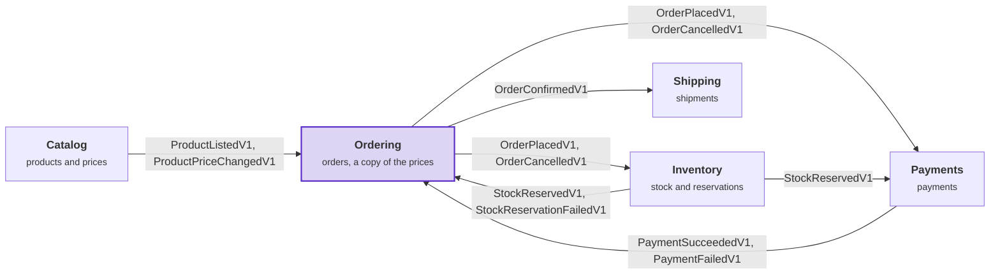
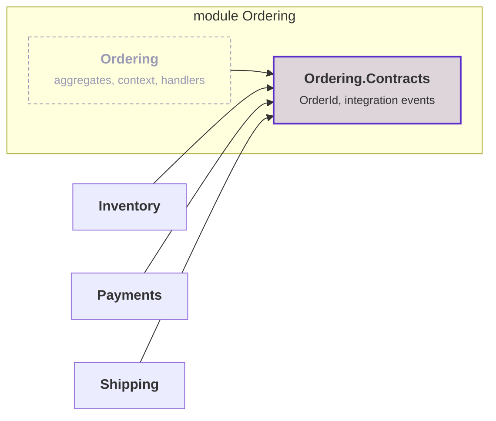

# Module contracts

A [module](modules.md) is a boundary only if some types stay inside it. This page covers the types a module lets out:
why that list should be short and explicit, and where to keep it.

You need none of it while your application has one module. It matters when a second module needs to know something
about the first.

## Two modules without a contract

Take two modules in one solution, `Crm` and `Sales`. Sales needs a customer's name on an invoice. So it references the
Crm project and uses what it finds there:

```csharp
// in Sales
public string InvoiceHeader(Customer customer) => $"Invoice for {customer.Name}";
```

This code is reasonable, and so are the next steps. An invoice holds its `Customer`. A Sales query joins Crm's table.
A Sales handler calls Crm's repository. Each change is small, and each one works.

A year later, Crm wants to split `Name` into first and last name, move its tables to a schema of their own, or run as a
separate service. It cannot, because Sales depends on all of it. Nobody decided to remove the boundary between the two
modules. Each convenient reference removed a part of it.

C#'s `public` does not prevent this. `public` means "every assembly that references me". Crm's types must be public
anyway, for Crm's host, its tests and its other projects. C# has no keyword for *public, but not for other modules*.

## What a contract is

A module lists the few types that other modules may use. It can change every other type freely. That short list is
the module's **contract**. It is the same idea as the public API of a library or the HTTP API of a service, inside one
process, and the compiler checks it.

A contract gives you three things:

- **The owner knows what it may change.** The owning module can rename, reshape or delete any type outside the
  contract without asking anyone. A type in the contract is a promise, and changing it is a decision.
- **A consumer knows what it may rely on.** It cannot start to rely on anything else by accident.
- **The module can move to another process.** When a module becomes a service, the contract is what the other modules
  used, so the contract is what crosses the network. Nothing else has to be untangled. The
  [microservices samples](../Examples/README.md) run the same five modules as three services for this reason.

Between two modules, this looks as follows. Sales may hold Crm's id, read Crm's summary and handle Crm's event. The
analyzer reports Sales when it holds Crm's entity or names Crm's `DbContext`. In the diagram, green marks Crm's
contract, which Sales may use. Red marks what the analyzer reports:



<details>
<summary>Show the code: publishing, and what the analyzer reports</summary>

Crm declares that it is a module, and publishes three types. Every other type it declares stays private to Crm,
`public` or not:

```csharp
[assembly: Module("Crm")]

[ModuleContract]
[EntityId<Guid>("CUS")]
public readonly partial record struct CustomerId;

[ModuleContract]
public sealed record CustomerSummary(CustomerId Id, string Name);

[IntegrationEvent("crm.customer-registered")]
public sealed record CustomerRegistered(Guid CustomerId, string Name);
```

In Sales, using what Crm publishes is fine. The analyzer reports the rest:

```csharp
[assembly: Module("Sales")]

[AggregateRoot<Guid>("INV")]
public partial class Invoice
{
    public CustomerId Customer { get; private set; }      // fine: published
    public Customer Buyer { get; private set; }           // DDD00023: another module's entity, stored
}

public sealed class InvoiceReport
{
    public string Describe(CrmContext crm) => "...";      // DDD00022: named, and not published
}
```

See [What the analyzer catches](modules.md#what-the-analyzer-catches).

</details>

## What goes in a contract

From the most common to the least common:

| Publish | Why |
|---|---|
| Integration events | The supported way for another module to learn that something happened ([Integration events](integration-events.md)). |
| Ids | Another module must be able to refer to your things. An `OrderId` is safer to pass around than a `Guid`. |
| Read models and value objects | A copy of data that another module can read, with no behaviour and no navigation. |
| Interfaces your module implements | A typed entry point, for the rare question that cannot wait for an event. |
| Entities and aggregate roots | Almost never ([below](#rules-for-a-contract)). |

Keep a contract small. The example shop's Ordering module publishes one id and three integration events. The modules
that react to orders need nothing else from it.

The diagram shows the whole shop. Each arrow is a contract that one module publishes and another module handles. No
arrow is a method call, and no module holds another module's objects. An order travels only as an `OrderId`. Purple
marks Ordering, whose contracts the code below shows:



<details>
<summary>Show the code: one module's contracts, and another module that reads them</summary>

What Ordering publishes, in its contracts project:

**[`Ordering.Contracts/OrderingContracts.cs`](../Examples/Modules/Ordering/Examples.Webshop.Ordering.Contracts/OrderingContracts.cs)**

```csharp
[ModuleContract]
[EntityId<Guid>("ORD")]
public readonly partial record struct OrderId;

[IntegrationEvent("ordering.order-placed", Version = 1)]
public sealed record OrderPlacedV1(
    OrderId OrderId, string City, string PostalCode, IReadOnlyList<OrderedLineV1> Lines, decimal Total, string Currency);

[IntegrationEvent("ordering.order-confirmed", Version = 1)]
public sealed record OrderConfirmedV1(OrderId OrderId, string City, string PostalCode);

[IntegrationEvent("ordering.order-cancelled", Version = 1)]
public sealed record OrderCancelledV1(OrderId OrderId, string Reason);
```

Shipping handles one of them, and stores the `OrderId` it carries:

**[`Shipping/Application/Shipments/IntegrationEvents/Inbound/BookShipment.cs`](../Examples/Modules/Shipping/Examples.Webshop.Shipping/Application/Shipments/IntegrationEvents/Inbound/BookShipment.cs)**

```csharp
[IntegrationEventConsumer("shipping.booker")]
public sealed class BookShipment(ShippingContext context) : IIntegrationEventHandler<OrderConfirmedV1>
{
    public Task HandleAsync(OrderConfirmedV1 contract, IntegrationEventMessage message, CancellationToken cancellationToken)
    {
        context.Shipments.Add(new Shipment(
            ShipmentId.Create(), contract.OrderId, $"{contract.PostalCode}, {contract.City}", message.OccurredAt));

        return Task.CompletedTask;
    }
}
```

</details>

## Declaring a contract

A module marks what it publishes, type by type:

```csharp
using DDDToolkit.Abstractions.Attributes;

[ModuleContract]
[EntityId<Guid>("CUS")]
public readonly partial record struct CustomerId;

[ModuleContract]
public sealed record CustomerSummary(CustomerId Id, string Name);

[IntegrationEvent]                  // in module Crm, published as crm.customer-registered
public sealed record CustomerRegistered(Guid CustomerId, string Name);
```

This code publishes three types:

- `[ModuleContract]` publishes a type.
- An integration event is published without a second attribute. Other modules are meant to read it, so it is part of
  the contract already.
- A type nested in a published type is published with it.

Every other type in the assembly is private to the module, `public` or not. When both sides are
[modules](modules.md#what-a-module-is), Sales gets a warning when it names any other Crm type
([DDD00022](diagnostics.md#ddd00022)), and when one of its entities stores a Crm entity
([DDD00023](diagnostics.md#ddd00023)). The invoice method from
[the first example](#two-modules-without-a-contract) becomes:

```csharp
// in Sales
public string InvoiceHeader(CustomerSummary customer) => $"Invoice for {customer.Name}";
```

`[ModuleContract]` has no effect until the assemblies declare their module. So you can add it early at no cost, and it
takes effect when the second module arrives.

A project that holds only the contract, like the one in the next section, declares this once instead of on each
type: `<DDD_ModuleContracts>true</DDD_ModuleContracts>` in its project file, or `[assembly: ModuleContracts]` in any
file of the project. Every public type it declares is then published. Only the property or the attribute does this.
The project's name never does ([A contracts project](modules.md#a-contracts-project)).

## A separate contracts project

The attribute is enough to mark the boundary. The example shop also gives each module's contract a project of its
own:

```
Ordering/
    Examples.Webshop.Ordering/              the module: aggregates, persistence, handlers, endpoints
    Examples.Webshop.Ordering.Contracts/    what it publishes: OrderId and three integration events
Shipping/
    Examples.Webshop.Shipping/              references Ordering.Contracts, never Ordering
```

The contracts are in
[`Ordering.Contracts/OrderingContracts.cs`](../Examples/Modules/Ordering/Examples.Webshop.Ordering.Contracts/OrderingContracts.cs).

In the diagram, each arrow is a project reference. The modules that react to orders reference Ordering's contracts
(purple). No other module references the Ordering project itself (grey):



<details>
<summary>Show the code: two projects, one module</summary>

Both projects declare that they are Ordering:

```csharp
// Ordering/Module.cs, and the first lines of Ordering.Contracts/OrderingContracts.cs
[assembly: Module("Ordering")]
```

The contracts project publishes the id. Its integration events are published because they are integration events:

```csharp
[ModuleContract]
[EntityId<Guid>("ORD")]
public readonly partial record struct OrderId;

[IntegrationEvent("ordering.order-confirmed", Version = 1)]
public sealed record OrderConfirmedV1(OrderId OrderId, string City, string PostalCode);
```

Shipping references the contracts and no other Ordering project, and makes the analyzer's rules errors:

**[`Examples.Webshop.Shipping.csproj`](../Examples/Modules/Shipping/Examples.Webshop.Shipping/Examples.Webshop.Shipping.csproj)**

```xml
<PropertyGroup>
  <WarningsAsErrors>$(WarningsAsErrors);DDD00022;DDD00023</WarningsAsErrors>
</PropertyGroup>

<ItemGroup>
  <ProjectReference Include="..\..\Ordering\Examples.Webshop.Ordering.Contracts\Examples.Webshop.Ordering.Contracts.csproj" />
</ItemGroup>
```

</details>

Both projects carry `[assembly: Module("Ordering")]`, so they are one module in two assemblies. Reasons to split them:

- **The compiler does most of the work.** Shipping references only the contracts project. So Ordering's aggregates,
  its `DbContext` and its handlers are not in Shipping's references at all. No analyzer has to stop a navigation to
  `Order`, because Shipping cannot name `Order`.
- **One project shows what the module promises.** A review of a contract change is a review of one small project, and
  a pull request that touches it is visibly a change to the contract. With `DDD_ModuleContracts`, the project is the
  list itself. Every public type in it is published, so a type added there is part of the contract without a second
  step. A type the project keeps to itself is `internal`.
- **Consumers get few dependencies.** A reference to the contracts brings the contracts, without Ordering's Entity
  Framework model or its packages. The example's contracts project does reference `DDDToolkit.EntityFramework`, for
  one reason. It declares the published `OrderId`, and with the reference the generator writes the id's value
  converter into the contracts project, for the modules that store an `OrderId` in a column.

A contracts project does not need Entity Framework. Without it, the id gets no converter of its own, and each module
that stores the id registers one. The generated `Add{Module}Converters()` of a module project that references Entity
Framework also registers the published ids of the other modules it references. It uses
`SingleValueConverter<T, TValue>`, or the id's own converter where the id's project references Entity Framework. So
one call per module covers every id the module stores
([Identifiers](identifiers.md#an-identifier-stored-by-another-project)).

The Tenancy sample's contracts projects, of Tenants and of Projects, work this way:

- Neither references Entity Framework or a Tenancy package. The Projects contracts project also references the
  sample's shared domain project, for the planned `DateRange` that `IProjectGate` returns.
- Neither marks a type `[ModuleContract]`. The props file of the modules' folder makes every project whose name ends
  in `.Contracts` its module's contracts. That condition on the name is the sample's own. The toolkit reads no project
  names.

A small codebase can skip the split. `[ModuleContract]` in the module's own project, with the analyzer checking the
other modules, marks the same boundary with one project fewer.

## Rules for a contract

- **Publish ids and primitives.** Ordering's `OrderPlacedV1` carries `City` and `PostalCode` instead of Ordering's
  `Address`, and the total as an amount and a currency instead of `Money`. A consumer that deserialized `Address` would
  depend on a type that Ordering expects to change freely.
- **A published type must not expose an unpublished type.** If `CustomerSummary` had a `Customer` property, the
  contract would expose the entity it should hide. The analyzer cannot detect this
  ([What the analyzer cannot catch](modules.md#what-the-analyzer-cannot-catch)). A record of primitives and published
  ids cannot expose anything else.
- **A change to a published type is a breaking change.** Other code has been deployed against it. Add a new version of
  an integration event instead of changing the old one
  ([Versioning and upcasting](integration-events.md#versioning-and-upcasting)).
- **Keep entities in their module.** Publishing an entity lets another module name it, and
  [DDD00023](diagnostics.md#ddd00023) still reports a module that stores it. `[ModuleContract]` means "you may name
  this type". Storing the entity would make it part of another module's transaction, and a mark on the type cannot
  allow that. Publish the id and a read model instead.

## Related

- [Modules](modules.md): what a module is, and the analyzer that checks the boundary.
- [Integration events](integration-events.md): the contract that carries news from one module to another, and how it
  is delivered and handled once.
- [Entities and aggregates](entities-and-aggregates.md#reference-other-aggregates-by-id): the same rule one level down,
  between two aggregates of one module.
