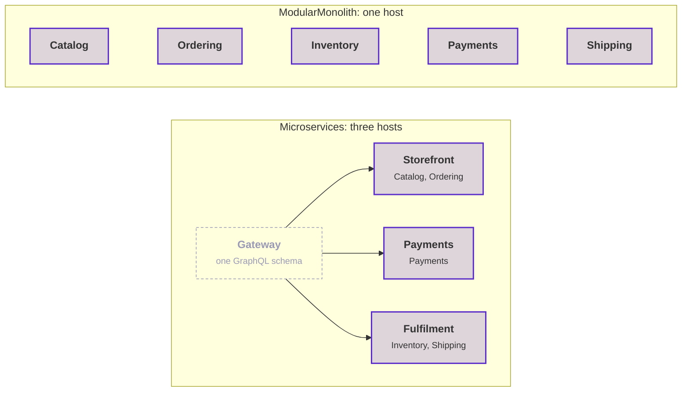
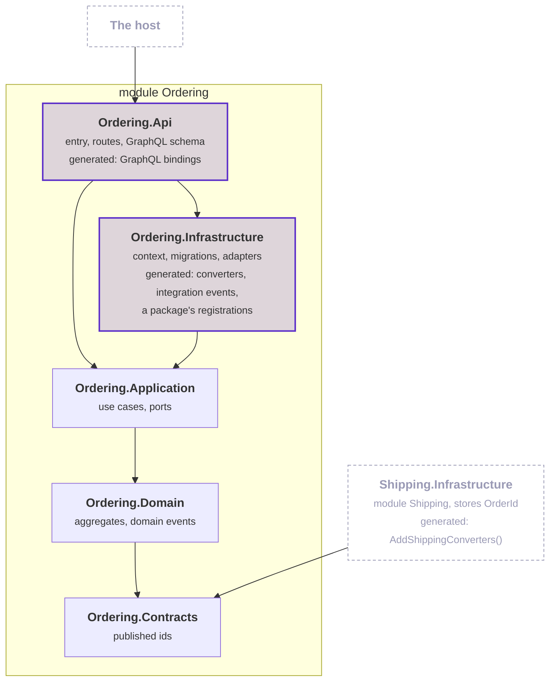
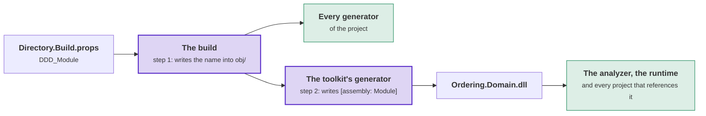
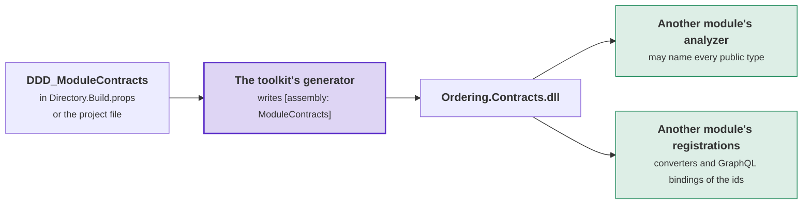
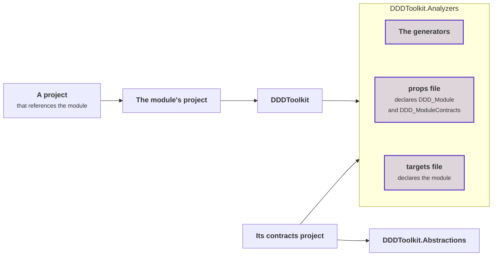

# Modules

The other parts of this toolkit work inside one module: an id that cannot be mixed up, a value object that cannot be
invalid, an aggregate that saves as one unit. Those parts do not stop one module from using the types of another
module. This page covers the rule that does, and the compiler checks it. A module is a boundary. Another module may
use only the types that the module publishes.

## What a module is

**A module is an assembly.** Set the module's name in the project file:

```xml
<!-- Ordering.csproj, or the Directory.Build.props of a folder of projects -->
<DDD_Module>Ordering</DDD_Module>
```

- Every type the assembly declares belongs to the module. Every type is internal to the module unless the module
  publishes it.
- The build turns the property into `[assembly: Module("Ordering")]` in the compiled assembly. Every project that
  references the assembly reads the module from that attribute.
- You can also write `[assembly: Module("Ordering")]` in any file of the project. An attribute in the source wins
  over the property.
- A `Directory.Build.props` that sets the property declares every project in its folder at once
  ([A module named by its folder](#a-module-named-by-its-folder)).

Two assemblies with the same module name are one module. So you can split a module into `Ordering.Domain` and
`Ordering.Infrastructure` without a boundary between them ([A module in layers](#a-module-in-layers)).

The rules never report anything in an assembly without a module, or about one. The framework, your NuGet packages, a
shared kernel and the projects you have not converted yet are left alone. Nothing changes in a codebase until a
project sets `DDD_Module` or adds the attribute.

## What a module publishes

When there are two modules, each one decides what the other may use. It marks those types `[ModuleContract]`. An
integration event is published without the mark:

```csharp
[ModuleContract]
[EntityId<Guid>("CUS")]
public readonly partial record struct CustomerId;

[ModuleContract]
public sealed record CustomerSummary(CustomerId Id, string Name);
```

Every other type in the assembly is private to the module, `public` or not. [Module contracts](module-contracts.md)
explains why a module publishes types, what belongs in a contract and where to keep it.

A **contracts project** holds only what its module publishes. It declares this once, instead of on every type:
`<DDD_ModuleContracts>true</DDD_ModuleContracts>` in its project file, or `[assembly: ModuleContracts]` in any file of
the project. Every public type of the project is then published ([A contracts project](#a-contracts-project)).

## What the analyzer catches

### DDD00022: using an unpublished type

```csharp
// in module Sales
public sealed class OrderReport
{
    public string Describe(Customer customer) => customer.Name;   // DDD00022
}
```

`Customer` belongs to module `Crm`, and `Crm` does not publish it. The rule reports each place where your code
*names* an unpublished type of another module: a parameter, a field, a base type, a generic argument, an attribute,
a `typeof`, a `new`, a static call, a `using` alias. Each name gets one warning.

There are two fixes:

- If the type belongs in the contract, mark it `[ModuleContract]` in the module that owns it. The team that owns that
  module makes this decision.
- If it does not, use something the module publishes: a read model, an interface or an integration event.

### DDD00023: storing another module's entity

```csharp
// in module Sales
[AggregateRoot<Guid>("ORD")]
public partial class Order
{
    public Customer Buyer { get; private set; }   // DDD00023
}
```

A property typed as another module's entity is a navigation. Entity Framework maps it. A query in `Sales` then loads
rows of `Crm`, and one `SaveChanges` writes into both modules in one transaction. After that you cannot test, migrate
or extract the two modules separately without changing every query that crosses the boundary. The code shows only
one property, so the problem is easy to miss. That is why this case has a rule of its own.

Store the id instead. An integration event tells `Sales` when the customer changes:

```csharp
[AggregateRoot<Guid>("ORD")]
public partial class Order
{
    public CustomerId Buyer { get; private set; }

    public void PlaceFor(CustomerId customer) => Buyer = customer;
}
```

**Publishing the entity does not help.** The rule reports a stored entity of another module whether or not the entity
is published. `[ModuleContract]` means "other modules may name this type". Storing the entity would also make it part
of another module's transaction, and a mark on the type cannot allow that.

Like [DDD00021](diagnostics.md#ddd00021), this rule reads stored state only: fields and properties. A method that
takes another module's entity as a parameter and reads it is not reported. Nothing is stored, and Entity Framework
builds nothing from it. Such a method often belongs in the other module, but this rule does not check that.

### Severity and suppression

Both rules are warnings. A module boundary is a design decision. The code compiles either way, and the generators
still write everything. A codebase that adopts modules needs to see the list of findings before it must fix them. If
one new `[assembly: Module]` caused forty errors, the team would remove the attribute again.

When the list is empty, make the rules errors:

```xml
<PropertyGroup>
  <WarningsAsErrors>$(WarningsAsErrors);DDD00022;DDD00023</WarningsAsErrors>
</PropertyGroup>
```

Or turn a rule off for one project:

```xml
<PropertyGroup>
  <NoWarn>$(NoWarn);DDD00023</NoWarn>
</PropertyGroup>
```

These two rules come from an analyzer, unlike the generator diagnostics. So `#pragma warning disable DDD00022` and
`[SuppressMessage]` work on a single line or member. Write the reason next to each suppression.

## What the analyzer cannot catch

The rules have these gaps:

| Not caught | Why |
|---|---|
| Several modules in one project | A module is an assembly ([Why a module is an assembly](#why-a-module-is-an-assembly)). |
| A type you never name, such as `var buyer = summary.Owner;` | The rule reports names in your source. That line names no type. |
| An extension method called on an instance, `customer.Deactivate()` | The line names the method. It does not name the class that declares the method. |
| A member inherited from an unpublished base type | The rule would report types the author never saw. |
| Reflection, DI by string, `dynamic`, serialization | The compiler cannot see them. |
| Generated code | The rule skips it, because you cannot fix a file you do not write. |
| A published type that exposes an unpublished type | This is a bug in the publishing module, and the rule does not detect it. |

Design against the last gap. A published type that exposes an unpublished type breaks the contract. A published
record of primitives and published ids cannot expose anything else.

## Modules and integration events

[Integration events](integration-events.md) explains how a message travels from one module to another, and how a
consumer handles it once. Modules use integration events instead of a project reference and a navigation property,
so that only contracts cross the boundary.

A module usually publishes:

- its ids, so other modules can refer to its things;
- its integration events, so other modules can react to its changes;
- a read model or an interface, where another module needs to ask it a question.

It keeps its entities, aggregates, repositories and `DbContext` to itself. Two modules that share only these things
can run in one process, and they can become two services later. Two modules that share a navigation property cannot
be separated.

A consuming module also sets the user its handlers run as, where it registers them:
`module.Around((services, message, contract) => services.GetRequiredService<AccessManager>().BeginSystem("shipping"))`.
Under row level security, the policies see this user, for the handler's work and for its inbox row
([Who the handlers run as](integration-events.md#who-the-handlers-run-as)).

## The same modules in different hosts

A module registers everything it needs itself. The host chooses which modules it runs and how their messages travel.
The example shop runs the same five modules as one process and as three services:

- **ModularMonolith**: one host. Messages go in process, or through one queue.
- **Microservices**: three hosts. Messages go over pgmq, Wolverine or MassTransit. A gateway serves one GraphQL schema
  over the three services.

In the diagram, purple marks where the modules run. The gateway (grey) runs no module:



<details>
<summary>Show the code: two hosts over the same modules</summary>

The monolith runs all five modules, and hands each module's messages to the others in process:

**[`ModularMonolith.Supabase/Examples.Webshop.Host/Program.cs`](../Examples/ModularMonolith.Supabase/Examples.Webshop.Host/Program.cs)**

```csharp
var host = ModuleHost.InProcess(database);

builder.Services.AddCatalogModule(host);
builder.Services.AddOrderingModule(host);
builder.Services.AddInventoryModule(host);
builder.Services.AddPaymentsModule(host);
builder.Services.AddShippingModule(host);
```

The storefront service runs two modules, and sends the messages the other services handle through pgmq:

**[`Microservices.Pgmq/Examples.Webshop.Pgmq.Storefront/Program.cs`](../Examples/Microservices.Pgmq/Examples.Webshop.Pgmq.Storefront/Program.cs)**

```csharp
var host = new ModuleHost(
    ModuleDatabase.Postgres(connectionString),
    outbox =>
    {
        outbox.SendToModules();   // Catalog to Ordering, in the same process
        outbox.SendToPgmq();      // everything the other services handle
    });

builder.Services.AddCatalogModule(host);
builder.Services.AddOrderingModule(host);
```

</details>

A module does not know which host it runs in. Only the host's `Program.cs` changes. This works because only contracts
cross between modules, and a contract travels over a queue as well as through a method call.

## A module in layers

A module can have one project per layer:

- a contracts project with what the module publishes;
- a domain project with its aggregates and events;
- an application project with its use cases;
- an infrastructure project with its context and migrations;
- an API project with its routes and the module's entry.

All of them declare the same module, Ordering, so the analyzer treats them as one module. The domain, application
and contracts projects reference neither Entity Framework nor ASP.NET Core. Declare the module once, with
`DDD_Module` in the `Directory.Build.props` of the module's folder
([A module named by its folder](#a-module-named-by-its-folder)), or in each project with
`[assembly: Module("Ordering")]`.

The generators also treat the projects of one module as one module. They write what Entity Framework needs into the
infrastructure project, which references Entity Framework, from what the other projects declare.

In the diagram, the arrows are project references. Purple marks the two projects that the generators write the
module's registrations into. Grey marks projects outside the module:



<details>
<summary>Show the code: the module's entry and what it calls</summary>

```csharp
// Ordering.Api: the module's entry. It is the only type in this project that names the infrastructure project.
public static class OrderingModule
{
    public static IServiceCollection AddOrderingModule(this IServiceCollection services, ModuleHost host)
        => services.AddOrderingInfrastructure(host).AddOrderingApplication();

    public static IEndpointRouteBuilder MapOrderingModule(this IEndpointRouteBuilder routes)
        => routes.MapOrderingEndpoints();
}

// Ordering.Infrastructure: the context, the adapters of the ports, and the generated registrations
public static IServiceCollection AddOrderingInfrastructure(this IServiceCollection services, ModuleHost host)
{
    host.Database.AddContext<OrderingContext>(services, OrderingContext.Schema);
    services.AddScoped<IOrderStore, EfOrderStore>();
    services.AddDDDToolkitEntityFramework(options => options.UseOutbox<OrderingContext>(outbox =>
    {
        outbox.AddOrderingIntegrationEvents();
        host.Publish(outbox);
    }));
    return services;
}

// The host: one reference and one call per module
builder.Services.AddOrderingModule(host);
```

</details>

The generators write these registrations:

- **Converters.** Every id and single value object implements `ISingleValue<TSelf, TValue>`. The infrastructure
  project's `Add{Module}Converters()` registers `SingleValueConverter<T, TValue>` for the ids of the module's other
  projects that have no converter of their own. It also registers the published ids of the other modules that the
  project references. Such an id gets its own converter where its project references Entity Framework. The method is
  generated even when the project declares no id
  ([Identifiers](identifiers.md#an-identifier-stored-by-another-project)).
- **Domain events.** The infrastructure project's `Add{Module}IntegrationEvents()` names the domain events of the
  module's projects that do not reference Entity Framework. It uses the names the events would have in their own
  project's registration. These events must be `public`. An event that the infrastructure project cannot see is
  [DDD00033](diagnostics.md#ddd00033).
- **A package's registrations.** A package can ship a registration that is closed over the classes a module declares
  with the package's templates, such as `modelBuilder.AddTenancy()`. The generator writes it into the infrastructure
  project, which references the package's Entity Framework registrations, closed over the domain project's classes. A
  project of the module above it, such as the API project, gets none. That project calls the infrastructure project's
  public registration
  ([Writing your own supporting domain](writing-a-supporting-domain.md#a-registration-closed-over-your-classes)).
- **GraphQL bindings.** An API project that references `DDDToolkit.HotChocolate` holds the module's GraphQL source
  schema. It gets `Add{Module}GraphQlRuntimeBindings()`, which binds the ids of the module's other projects, and the
  published ids of the modules it names, as scalars and node ids
  ([Bound by a project that does not declare it](graphql.md#binding-ids-from-other-projects)).

The generators combine only projects that declare the same module:

- A project of another module gets only the converters for the ids this module publishes. In the diagram,
  `Shipping.Infrastructure` stores `OrderId`.
- A project without a module, such as the host, registers only what it declares itself.
- A package without a module is never treated as one of your projects.

The module's entry is in the API project, because a host serves the API project. `AddOrderingModule(host)` calls the
infrastructure project's registration, `AddOrderingInfrastructure(host)`, for the context, the adapters of the ports
and the generated registrations. Then it calls the application project's registration. `MapOrderingModule` maps the
routes. So the host references only the API project of the module, and makes one call per module.

The API project references the infrastructure project only for that call. The entry is the only type in the API
project that names the infrastructure project. No route names the infrastructure project, Entity Framework or a port.

The [Tenancy sample](../Examples/README.md#the-tenancy-sample) uses this layout, and its tests check each project
against it. Each read in its modules uses a context of its own. So its infrastructure registrations take their
contexts from a pool, with `AddScopedFromPool` for the request's context
([Contexts from a pool](entity-framework.md#contexts-from-a-pool)). Each context has two pools: one on the host's
connections for requests, and one on the connections for background work.

### A module named by its folder

In a module with layers, every project declares the same module. Instead of a `Module.cs` in each project, set the
module once in the `Directory.Build.props` of the module's folder. The setting applies to every project below that
folder:

```xml
<DDD_Module>Ordering</DDD_Module>
```

The name is used in the module's code, its stored event names and its function names. So it cannot contain `"` or
`\`. The build stops with an error that gives the reason.

A project below that folder belongs to the module, as if it declared `[assembly: Module("Ordering")]`:

- the analyzer checks it against the module boundary;
- the generators combine it with the module's other projects;
- the runtime stores its events as `ordering.order-placed`;
- a project that references it sees the module, because the compiled assembly carries the attribute.

A project added to the folder belongs to the module from its first build. The
[Tenancy sample](../Examples/README.md#the-tenancy-sample) declares its three modules this way, and names each module
after its folder: [`Examples/Tenancy/Modules/Directory.Build.props`](../Examples/Tenancy/Modules/Directory.Build.props).

The build declares the module in two steps, because a source generator never sees what another generator writes:

1. The build writes the property into a file of the project, as assembly metadata. Every generator of the project
   reads the module from there.
2. The toolkit's generator writes `[assembly: Module("Ordering")]` from it. The analyzer, the runtime and every
   project that references the assembly read this attribute from the compiled assembly.

In the diagram, purple marks the two steps, and green marks what reads the module's name:



<details>
<summary>Show the code: a folder that names its modules, and what the build and the generator write</summary>

```xml
<!-- Modules/Directory.Build.props: Modules/Ordering/Ordering.Domain is a project of module Ordering -->
<Project>
  <!-- MSBuild reads the nearest Directory.Build.props only, so import the one above. -->
  <Import Project="$([MSBuild]::GetPathOfFileAbove('Directory.Build.props', '$(MSBuildThisFileDirectory)../'))" />

  <PropertyGroup>
    <!-- The name of the folder the project's folder is in. -->
    <DDD_Module>$([System.IO.Path]::GetFileName($([System.IO.Path]::GetDirectoryName($(MSBuildProjectDirectory)))))</DDD_Module>
  </PropertyGroup>
</Project>
```

```csharp
// obj/Debug/net10.0/Ordering.Domain.DDDToolkitModule.g.cs, written by the build
[assembly: global::System.Reflection.AssemblyMetadata("DDD_Module", "Ordering")]

// Module.g.cs, written by the toolkit's generator, in a project that declares no module itself
[assembly: global::DDDToolkit.Abstractions.Attributes.ModuleAttribute("Ordering")]
```

The build step is in the `DDDToolkit.Analyzers` package, as `build/` and `buildTransitive/` targets next to its props
file. So it arrives wherever the generators arrive. A project that references the generators as a bare analyzer
assembly, or as a project with `OutputItemType="Analyzer"`, gets no build step. Import the targets file the way you
import the props file, or declare the module with the attribute. [DDD00064](diagnostics.md#ddd00064) reports a
project where `DDD_Module` reaches the generators and nothing declared the module.

</details>

The generator writes the attribute only where the project declares no module itself. Only a generator can check
this. The compiler hands the generator every file it compiles: the project's own files, and the `AssemblyInfo.cs`
that the build writes into `obj/`. The build cannot see what the source says. So the attribute is never declared
twice, and you never get CS0579:

| The project | What is written | Its module |
|---|---|---|
| has a `Module.cs` with `[assembly: Module("Sales")]` | nothing | Sales. The attribute always wins. |
| has an `<AssemblyAttribute>` item that writes the attribute | nothing | the module of the item |
| declares no module | `[assembly: Module("Ordering")]` | Ordering, from `DDD_Module` |

A project that kept its `Module.cs` after its folder got a `Directory.Build.props` builds as before. You can delete
the file later. The same holds for a folder that declares its modules with an `<AssemblyAttribute>` item that writes
`[assembly: Module]` from `DDD_Module`. You can delete that item too, because the property declares the same module.

**A project that is no module.** Two kinds of project set `DDD_Module`, and the build does not declare them a module.
For them the property only names their generated code:

- **A test project.** It tests the modules from outside, and names types they do not publish. The build recognizes a
  test project by the property its test SDK sets: `IsTestProject` or `IsTestingPlatformApplication`.
- **A project that sets `DDD_DeclareModule` to false.** This is rare. It is a project whose generated code needs a
  name of its own (`Add{Name}Converters` and the others), and that is not a module. Examples are a shared kernel that
  every module uses without publishing anything, and a package of templates that becomes part of whichever module
  declares a class with them. Set the property next to `DDD_Module`:

```xml
<!-- SharedKernel.csproj: names its generated code, and is no module -->
<DDD_Module>SharedKernel</DDD_Module>
<DDD_DeclareModule>false</DDD_DeclareModule>
```

If such a project were a module, every module that names one of its unpublished types would get
[DDD00022](diagnostics.md#ddd00022), and its domain events would be stored under its name.
[`DDDToolkit.ExampleLibrary`](../Examples/DDDToolkit.ExampleLibrary/DDDToolkit.ExampleLibrary.csproj), whose
`AddCommonConverters` the example API calls, is such a project. So are Tenancy's and Membership's packages.

Three related cases:

- A project that wants neither the module nor the name sets no `DDD_Module`. Its generated code is named after its
  assembly, as in the
  [webshop's shared kernel](../Examples/Modules/SharedKernel/Examples.Webshop.SharedKernel/Examples.Webshop.SharedKernel.csproj).
- A project that inherits the property from a folder's `Directory.Build.props` clears it with `<DDD_Module />`.
- A host that sets `DDD_Module` to name its generated code is that module too, and its domain events carry the
  module's name. The samples' hosts set none, because the composition root is not a module.

**Diagnostics at the project file.** Some diagnostics about a module have no line of code to point at, such as
[DDD00049](diagnostics.md#ddd00049) on a module whose projects declare no class for a template. They point at the
project file. A severity in an `.editorconfig` section for `*.cs` files does not apply there. Set the severity with
`<NoWarn>` or `<WarningsAsErrors>`, as the sample does for DDD00022 and DDD00023, or in a global analyzer config: a
`.globalconfig` file with `is_global = true`. This includes DDD00033, DDD00045, DDD00049 and DDD00050 in a project
whose module an `<AssemblyAttribute>` item declares. These diagnostics point at the project file. They do not point at
the `AssemblyInfo.cs` that the item writes into `obj/`, where a `[*.cs]` section would apply.

### A contracts project

A module's contracts project exists so that other modules can name its types: its ids, its read models, its
permissions, and the interfaces they use to ask the module questions. You could mark each type `[ModuleContract]`.
Then you repeat the mark on every type, and a new type without the mark causes [DDD00022](diagnostics.md#ddd00022) in
every module that names it. Instead, declare it once in the project file:

```xml
<!-- Ordering.Contracts.csproj -->
<DDD_ModuleContracts>true</DDD_ModuleContracts>
```

You can also write `[assembly: ModuleContracts]` in any file of the project. Then:

- Every public type of the project is part of the module's contract.
- A type the project keeps to itself is `internal`. C# already keeps `internal` types from every other project.
- `[ModuleContract]` on a type keeps its meaning, in this project and in any other project of the module.
- An entity published this way still cannot be stored by another module. [DDD00023](diagnostics.md#ddd00023) still
  reports a module that stores it.

**Only the property or the attribute makes a contracts project.** The toolkit never decides from the project's name.
A module may be about contracts of another kind, legal contracts for example, and its `Legal.Contracts` project may be
its domain project. If the toolkit published everything in a project because of its name, it would open that module
without anybody deciding to.

**Tip: one line for a folder of modules.** If every contracts project in a codebase ends in `.Contracts`, set the
property once in the `Directory.Build.props` of the modules' folder. The condition on the name is the codebase's own
convention, written in its own props file. The toolkit does not read project names:

```xml
<!-- Directory.Build.props: every project whose name ends in .Contracts is its module's contracts -->
<PropertyGroup Condition="$(MSBuildProjectName.EndsWith('.Contracts'))">
  <DDD_ModuleContracts>true</DDD_ModuleContracts>
</PropertyGroup>
```

The [Tenancy sample](../Examples/README.md#the-tenancy-sample) does this in
[`Examples/Tenancy/Modules/Directory.Build.props`](../Examples/Tenancy/Modules/Directory.Build.props), next to the
`DDD_Module` that names each module. None of its contracts types carries `[ModuleContract]`. A project that matches the
condition and should not publish everything sets `<DDD_ModuleContracts>false</DDD_ModuleContracts>` in its own
project file. MSBuild reads the project file after the props file.

From the property, the toolkit's generator writes `[assembly: ModuleContracts]` into the project. The other modules
read the attribute from the compiled assembly:

- the module boundary analyzer of a module that names one of the project's types;
- the converters and GraphQL bindings that a module generates for the published ids of the modules it references.

In the diagram, purple marks the generator's step, and green marks what the other modules read from the assembly:



`DDD_ModuleContracts` needs no build step, unlike `DDD_Module`. `DDD_Module` needs the step because every generator of
a project asks which module the project is in, and a generator never sees what another generator writes. Whether a
type is published matters to the other modules, and they read it from the compiled assembly, where the attribute is.

The generator that writes `{Module}EventNames` also asks whether the project's types are published. It marks that
class `[ModuleContract]` when every event the class names is published. This generator reads the property as well,
so the property and an attribute in the source produce the same class. The toolkit's generator writes the attribute
only where the project does not declare it, in a file or through an `<AssemblyAttribute>` item. So the attribute is
never declared twice.

<details>
<summary>Show the code: a contracts project that declares it, and what the generator writes</summary>

```xml
<!-- Ordering.Contracts.csproj, or a Directory.Build.props above it -->
<PropertyGroup>
  <DDD_ModuleContracts>true</DDD_ModuleContracts>
</PropertyGroup>
```

```csharp
// Ordering.Contracts: published, without an attribute on the types
[EntityId<Guid>("ORD")]
public readonly partial record struct OrderId;

public sealed record OrderSummary(OrderId Id, decimal Total);

public interface IOrderLookup
{
    Task<OrderSummary?> FindAsync(OrderId id, CancellationToken cancellationToken);
}

// ModuleContracts.g.cs, written by the toolkit's generator, in a project that declares no [assembly: ModuleContracts]
[assembly: global::DDDToolkit.Abstractions.Attributes.ModuleContractsAttribute]
```

Only `true` counts, in any letter case and with or without spaces around it, as MSBuild compares it. `false`, an empty
value and any other value make no contracts project. The property reaches the generator through the props file of the
`DDDToolkit.Analyzers` package, as `DDD_Module` does
([How the property reaches the generators](#how-the-property-reaches-the-generators)). A project whose generators
arrive without that file, as a bare analyzer assembly, gets nothing from the property. Such a project declares the
attribute in its source instead.

A project that sets the property and references no `DDDToolkit.Abstractions`, or a version older than the attribute,
cannot write the attribute. It gets [DDD00068](diagnostics.md#ddd00068) at its project file. Without that warning, the
problem would show up only as DDD00022 in the other modules.

</details>

### Folders inside the layers

Inside a layer project, name folders by subject first and by kind second. A folder is named for what its classes are
about: an aggregate in the domain project, a feature in the application and API projects, an adapter in the
infrastructure project. Folders such as `Events`, `Commands` or `Rest` appear only inside those folders, and say what
kind of class a file holds. A `Commands` folder at a project's root would put every command of the module together,
and spread the files about a crew over five folders. A `Crew` folder keeps them together.

The Projects module of the [Tenancy sample](../Examples/README.md#the-tenancy-sample):

```
Directory.Build.props             declares the module of every project below it, and makes each *.Contracts
                                  project its module's contracts (see above)
Projects/
  Examples.Tenancy.Projects.Contracts/
    ValueObjects/                 ProjectId.cs
    Permissions/                  ProjectPermissionNames.cs
    Gate/                         IProjectGate.cs, ProjectAnswer.cs
  Examples.Tenancy.Projects.Domain/
    GlobalUsings.cs
    Aggregates/
      Projects/
        Project.cs                the aggregate root
        ProjectRefusals.cs        its refusals, next to it
        ProjectFailures.cs        the marker class of ProjectFailures.resx and .nl.resx, the refusal texts in two languages
        Entities/                 CrewMember.cs, on the Membership package's member template
        Events/                   ProjectOpened.cs, CrewRoleGiven.cs and the others, one event per file
        Invariants/               NameIsValid.cs, OneMembershipPerSeat.cs and the others, one rule per file
        ValueObjects/             ProjectState.cs, CrewMemberId.cs
      ProjectRoles/
        ProjectRole.cs            a tenant's project role, on the Membership package's kept-role template
        Events/                   ProjectRoleMade.cs and the others
        ValueObjects/             ProjectRoleId.cs
  Examples.Tenancy.Projects.Application/
    GlobalUsings.cs, ProjectsApplicationServices.cs
    Access/                       the access check, the rules it asks, the permissions, and what it reads of a project
      Queries/                    PermissionOnProject.cs, PermissionsOnProjects.cs, PermissionsHeldAtRoot.cs
    Crew/
      Commands/                   AddCrewMember.cs, GiveCrewRole.cs, TakeCrewRole.cs, RemoveCrewMember.cs
      Queries/                    AllCrewMembers.cs
      CrewOverview.cs             the result type that more than one use case returns, next to them
    Lifecycle/
      Commands/                   OpenProject.cs, ChangeProjectName.cs, PlanProject.cs, MoveProjectToUnit.cs, CloseProject.cs, ReopenProject.cs
    Operators/
      Queries/                    TenantProjects.cs: what the application's own staff read
      TenantProject.cs            its result type
    Overview/
      Queries/                    VisibleProjects.cs, ProjectDetail.cs, and three queries about a page of projects
      ProjectOverview.cs, ProjectListFilter.cs
    Ownership/
      Commands/                   ChangeProjectOwner.cs
    ProjectRoles/
      Commands/                   MakeProjectRole.cs, RenameProjectRole.cs, SetProjectRolePermissions.cs, ArchiveProjectRole.cs, SetUpProjectRoles.cs
      Queries/                    TenantProjectRoles.cs, ProjectRolesById.cs
      ProjectRoleListing.cs       the result type of both
    StoredProjects/               IProjectStore.cs, IProjectReads.cs, IProjectReading.cs: the ports several features share
  Examples.Tenancy.Projects.Infrastructure/
    GlobalUsings.cs, ProjectsInfrastructure.cs
    Persistence/                  ProjectsContext.cs, marked [SupabaseMigrations]; next to it the build
                                  writes the factory that dotnet ef and the export use;
                                  EfProjectStore.cs, EfProjectReads.cs; Migrations/
    Access/                       the row rules, one class per file, column rules included;
                                  UnitChangesWithItsPermissions.cs, a rule that Postgres checks
                                  with a trigger of the module, in addition to the policies
  Examples.Tenancy.Projects.Api/
    Module.cs, GlobalUsings.cs, ProjectsModule.cs
    Access/Rest/                  AccessEndpoints.cs
    Access/GraphQL/               AccessQueries.cs, ProjectPermissionSetType.cs; AccessDataLoaders.cs, which a rule
                                  on a field uses
    Crew/Rest/                    CrewEndpoints.cs
    Crew/GraphQL/                 CrewMutations.cs; CrewMemberType.cs and CrewRoleHoldType.cs, types over the
                                  application's records; CrewFieldPermissions.cs, which checks the permission
                                  that a field of a crew member names
    Lifecycle/Rest/               LifecycleEndpoints.cs
    Lifecycle/GraphQL/            LifecycleMutations.cs
    Operators/Rest/               OperatorsEndpoints.cs
    Operators/GraphQL/            OperatorsQueries.cs, TenantProjectType.cs
    Overview/Rest/                OverviewEndpoints.cs
    Overview/GraphQL/             OverviewQueries.cs, OverviewPagedQueries.cs, ProjectType.cs, OverviewDataLoaders.cs, ChangedProject.cs
    Ownership/Rest/               OwnershipEndpoints.cs
    Ownership/GraphQL/            OwnershipMutations.cs
    ProjectRoles/Rest/            ProjectRolesEndpoints.cs
    ProjectRoles/GraphQL/         ProjectRolesQueries.cs, ProjectRolesMutations.cs, ProjectRoleType.cs,
                                  ProjectRolesDataLoaders.cs, ProjectRoleFieldPermissions.cs
    Rest/                         ProjectVersions.cs: what the routes of several features share, here If-Match and ETag
    GraphQL/                      ProjectsGraphQL.cs, which registers the module's schema; ReferencedSeat.cs and
                                  the other Tenancy entities as this module names them; schema.graphql
```

- **A project's root** holds only its entry points: `GlobalUsings.cs`, and the class that registers the project. In
  the API project, that class is the module's entry, next to a `Module.cs` with HotChocolate's assembly attributes. No
  project declares the toolkit's module in a file. The folder declares it
  ([A module named by its folder](#a-module-named-by-its-folder)).
- **A file declares one type**, and is named after it. An event, an invariant, an entity and a value object each have
  their own file. A use case is the exception. Its request, its handler and the types that only it returns are in one
  file, because they change together.
- **The namespace of a type is its folder**, in every project. The namespace is the project's name followed by the
  folders of the file, for example `Projects.Domain.Aggregates.Projects.Events.ProjectOpened` and
  `Projects.Application.Crew.Queries.AllCrewMembers`. So you find a type from its name, and a `using` shows which part
  of a project a file depends on. `GlobalUsings.cs` holds the namespaces that most files of a project need, so a file
  lists only the namespaces specific to it.
- **The domain project** has one folder per aggregate under `Aggregates`, named in the plural. The folder holds the
  aggregate root and its refusals, with `Entities`, `Events`, `Invariants` and `ValueObjects` next to them. An
  invariant is nested in the class it checks. So its file declares a partial of that class around the one rule. This
  is the one file whose namespace is not its folder, because a partial has the namespace of its class. Types that
  several aggregates share go in `ValueObjects` and `Services` at the project's root.
- **Types that several modules share** and no module owns are in a separate project next to the modules,
  `Shared/Examples.Tenancy.Shared.Domain`, with the same folders by kind. It declares no module and references no
  module. Only a module's domain and contracts projects reference it. The sample's example is
  `ValueObjects/DateRange.cs`, a range of calendar days. Projects plans a project with a `DateRange`. Inspections uses
  one for the days an inspection covers. Inspections checks the rule between the two, that those days lie within the
  project's planned range, with the answer from `IProjectGate`. A type that one module owns is not shared. It stays
  in that module's contracts, as `ProjectId` does. Two more shared projects work the same way:
  - `Shared/Examples.Tenancy.Shared.Infrastructure`, referenced only by the modules' infrastructure projects. It holds
    `Paging/ListCursors.cs`, which refuses a cursor that the list could not have given, before any statement runs.
  - `Shared/Examples.Tenancy.Shared.Application`, referenced only by the modules' application projects. It holds
    `Paging/PageSizes.cs`, which checks the requested page against what the list allows, before anything is read.
- **The application project** has one folder per feature, named by a noun of the domain, with `Commands` and `Queries`
  folders inside. A feature with only commands has no `Queries` folder. A feature may be named for the people it
  serves: the queries for the application's own staff are in `Operators`. A port that one feature uses is in that
  feature's folder, as the two ports of Inspections are. Ports that several features share are in a root folder named
  for what they hold: `StoredProjects` holds the ports the use cases read and save projects through. That folder holds
  only ports, because the type a port returns belongs to a feature and is in that feature's folder. No folder in this
  project has the name of a layer, or `Persistence`, which is the infrastructure project's name for storage. A layer
  is a project. The access check is a feature of its own, `Access`.
- **The API project** uses the feature names of the application project. A feature's routes are in `Rest`, in one
  class named after the feature, and they send that feature's requests. The feature's GraphQL is in `GraphQL` next to
  it: the fields in `{Feature}Queries` and `{Feature}Mutations`, which also send that feature's requests, and the types
  they return. A field is a method marked `[Query]` or `[Mutation]`. The exception is a field that pages. HotChocolate
  writes the connection type only for a class whose type it generates. So the paged fields of a feature are in a class
  marked `[QueryType]`, `{Feature}PagedQueries`, which holds nothing else. What the features share is at the project's
  root:
  - in `GraphQL`: the registration of the module's source schema, the other modules' entities as this module names
    them, and the committed schema;
  - in `Rest`: what the routes of several features read or write the same way.

  The entry maps the routes feature by feature, and registers the schema.
- **The infrastructure project** is grouped by adapter, because one adapter serves many features. `Persistence` holds
  the context, its migrations and the adapters of the ports. The project knows how the module is stored, and nothing
  about how it is served:
  - its project file names no HotChocolate package, and its code uses none;
  - a list is paged by the paging library alone (`GreenDonut.Data.EntityFramework`);
  - no context is registered with a schema, because a field only sends a query, and each query that reads uses a
    context of its own.
- **The tests** follow the same layout: a folder per module, with a folder per feature in it. Next to them are
  `Architecture`, for the tests that check the layout, and `Infrastructure`, for the fixtures.

Only convention keeps a folder in step with its content, so the sample's tests check it:

- `FeatureFolderTests` reads the requests from the host's container. It checks each request against its feature's
  `Commands` or `Queries` folder, and each route and each GraphQL field against the feature whose requests it sends.
  It also checks that no project's root has a folder named after a kind of class or after a layer.
- `LayerReferenceTests` checks that a project that knows storage references no HotChocolate.
- `SourceTreeTests` reads the source tree. It checks that every aggregate, entity, event and invariant is in its
  folder, that every file declares one type, and that every namespace matches its folder.

The tests are in [`Tests/Examples.Tenancy.Tests/Architecture`](../Tests/Examples.Tenancy.Tests/Architecture).

Moving a class to another namespace changes its full name. Two things store a class name as text:

- An Entity Framework snapshot and each migration's designer file name every entity by its class. The model differ
  compares tables, so it sees no change and asks for no migration. Replace the old names in those files by hand.
- A name that is stored or sent must not change with the namespace. The outbox stores a domain event under its
  module's name and its class name (`projects.project-opened`), without the namespace. The sample's models have no
  discriminator column.

`MigrationTests` and `StoredNameTests` check both.

The shop under [`Examples/Modules`](../Examples/Modules) keeps each module in one project. It has the same folders
inside that project, with the layers as top folders: `Domain/Aggregates/Orders/Events`,
`Application/Orders/IntegrationEvents`.

## One GraphQL schema over the modules

The module boundary also applies to the API. Instead of one GraphQL schema that knows every module, each module can
serve its own schema. A module's schema holds its types, its queries, and its part of types that other modules own.
The modules join those types on a name and a key they agree on:

- Catalog declares `Product` with its name and price.
- Inventory declares its own `Product`, keyed on the same SKU, with the stock.
- Ordering declares that a line's product is the `Product` with that SKU.

No module references the classes of another module, and a client sees one `Product`.

`DDDToolkit.HotChocolate.Fusion.InMemory` composes these schemas inside the monolith with HotChocolate Fusion, and
calls the modules in memory. The same schemas compose across processes when a module becomes a service, so the
module's GraphQL does not change at that point either. See
[One schema over a modular monolith](graphql.md#one-schema-over-a-modular-monolith), and `Examples/ModularMonolith.*`
for five modules that do this.

## The module name in generated code

The module's name is part of the names of the generated code: `{Module}EventNames`, `Add{Module}Converters`,
`Add{Module}IntegrationEvents` and `Add{Module}GraphQlRuntimeBindings`. The generators take the name from the first
row of this table that applies:

| Where | For |
|---|---|
| `[assembly: Module("Ordering")]` | A module that declares itself in its source. The attribute always wins. |
| `<DDD_Module>Ordering</DDD_Module>` | A module. The build writes the attribute above from it. |
| `<DDD_Module>Tests</DDD_Module>` in a test project, or next to `<DDD_DeclareModule>false</DDD_DeclareModule>` | A project that is no module and names its generated code, such as a test project or a shared kernel. |
| The assembly name, without the dots | A project with neither. |

`DDD_Module` is an MSBuild property, so a `Directory.Build.props` can set it for every project in a folder. The
property also declares the project's module, and the build writes `[assembly: Module]` for it. So a
`Directory.Build.props` that sets it makes every project below it part of that module. Put it in the folder of one
module's projects, and not above a host or a shared project. In a test project, and in a project that sets
`DDD_DeclareModule` to false, the property only names the generated code.

```xml
<!-- Modules/Ordering/Directory.Build.props: every project below is module Ordering -->
<PropertyGroup>
  <DDD_Module>Ordering</DDD_Module>
</PropertyGroup>
```

The attribute is what an assembly declares about itself, so it wins. A project below that folder that declares
`[assembly: Module("Sales")]` is module Sales. To declare several modules from one folder, name each module after its
own folder ([A module named by its folder](#a-module-named-by-its-folder)).

### Two assemblies, one module

Ordering and its contracts project both declare `[assembly: Module("Ordering")]`, so both generate
`AddOrderingConverters` and `AddOrderingGraphQlRuntimeBindings`. The methods do not collide. An assembly's method
calls the methods of the module's other assemblies that it references, so one call registers the module. The method
does not register again what those methods register. A project of the module without Entity Framework or
HotChocolate has no such method. The project that references it registers its ids
([A module in layers](#a-module-in-layers)).

```csharp
// in Ordering's context: OrderLineId from Ordering, and OrderId from Ordering.Contracts with it
configurationBuilder.AddOrderingConverters();

// in Shipping's context, which references only Ordering.Contracts and stores an OrderId: Shipping's
// registration covers the OrderId it stores, so it is the one call
configurationBuilder.AddShippingConverters();
```

Import the generated namespace of the assembly you are in, or of the one assembly of another module that you
reference, and the name is never ambiguous. `Add{Module}IntegrationEvents` is the one method that does not call the
others. A contracts project has none to call. If two assemblies of one module both generate it, call the second one
as an ordinary static method.

### How the property reaches the generators

A generator can read an MSBuild property only when the project declares the property visible to the compiler. **The
`DDDToolkit.Analyzers` package declares `DDD_Module`**, and `DDD_ModuleContracts` next to it
([A contracts project](#a-contracts-project)). The package holds the generators and a props file that declares the
properties they read. NuGet imports that file into each project the generators run in:

- a project that references the package itself;
- a project that gets the package as a dependency of `DDDToolkit`;
- a project that gets it through a project reference.

You add nothing to a project file. The build step that declares the module from the property comes with the props
file, as a targets file in the same package.

So there are two supported ways to reference the toolkit. A module with a
[contracts project](module-contracts.md#a-separate-contracts-project) uses both:

| Project | References | Gets |
|---|---|---|
| The module | `DDDToolkit`, and the integrations it uses | The base types, and through them the attributes and the generators |
| Its contracts | `DDDToolkit.Abstractions` and `DDDToolkit.Analyzers`, without `DDDToolkit` | The attributes and the generators, and no runtime code |

The second row is for a project without runtime code. A record struct id, a read model and an integration event
compile against the attributes alone. Entities, aggregate roots, value objects and domain events derive from base
types in `DDDToolkit`, so the project that declares them references `DDDToolkit`.

In the diagram, purple marks what the `DDDToolkit.Analyzers` package brings:



<details>
<summary>Show the code: a contracts project without the runtime</summary>

```xml
<Project Sdk="Microsoft.NET.Sdk">

  <PropertyGroup>
    <TargetFramework>net10.0</TargetFramework>
  </PropertyGroup>

  <ItemGroup>
    <!-- the version of every other Temp.DDDToolkit.* package: the attribute, the property and the step are 3.2.0's -->
    <PackageReference Include="Temp.DDDToolkit.Abstractions" Version="3.2.0-preview.8" />
    <PackageReference Include="Temp.DDDToolkit.Analyzers" Version="3.2.0-preview.8" PrivateAssets="all" />
  </ItemGroup>

</Project>
```

```csharp
[assembly: Module("Billing")]
[assembly: ModuleContracts]

[EntityId<Guid>("INV")]
public readonly partial record struct InvoiceId;

public sealed record InvoiceSummary(InvoiceId Id, decimal Total);

[IntegrationEvent]
public sealed record InvoiceSent(InvoiceId InvoiceId);
```

The generators write `InvoiceId` and `BillingEventNames.InvoiceSent` here, as they would in the module, and every
public type is published ([A contracts project](#a-contracts-project)). `<DDD_Module>Billing</DDD_Module>` in the
project file declares the same module as the first attribute, through the build step in the package.
`<DDD_ModuleContracts>true</DDD_ModuleContracts>` does the same as the second attribute.
[`build/package-consumers/ContractsOnly`](../build/package-consumers/ContractsOnly/Acme.Billing.Contracts.csproj) uses
the two properties, to prove that the properties and the build step arrive.

</details>

On every pull request, both rows are built against the packed packages, together with a project that gets the toolkit
only through a project reference. The build fails if `DDD_Module` did not name the generated class, or did not declare
the module, in any of them.

Two files can be missing:

- **The props file.** A reference that excludes the package's build assets brings the generators without the props
  file. Then `DDD_Module` is ignored, and the build step, which is excluded too, declares nothing. The build reports
  this with [DDD00014](diagnostics.md#ddd00014), instead of naming everything after the assembly without a warning. A
  module that declares itself with `[assembly: Module]` is not affected. Its name comes from the attribute, and the
  property is not read.
- **The targets file.** The property arrives and the build step does not when the props file is imported without the
  targets file, or when the property is listed by hand as DDD00014 suggests. Then `DDD_Module` names the code and
  declares no module. The build reports this with [DDD00064](diagnostics.md#ddd00064).

## Adopting modules in an existing codebase

1. Pick the module that the fewest projects depend on. Set `DDD_Module` in its project file, or add
   `[assembly: Module]`. Nothing is reported yet, because no other project is a module.
2. Do the same for one project that uses it. Now you get a list of warnings.
3. Work through the list. Most entries are a published id that was never marked, or a query that should be a
   published read model.
4. When the list for `DDD00023` is empty, make it an error for those two projects. Then do the same for `DDD00022`.
5. Repeat with the next module. The rules report nothing about projects you have not reached yet.

## Design choices

### Why a module is an assembly

Several modules in one project is another common layout. This analyzer does not support it.

The reason is what an analyzer can see: the current compilation, and the *metadata* of everything it references. When
code in `Ordering` names a type from `Billing`, the analyzer must find out which module that type belongs to. The only
source is what is in `Billing.dll`. An assembly attribute is stored in the metadata. A namespace cannot carry an
attribute. So a layout by namespace would depend on a convention that the analyzer cannot confirm from the other
assembly, and the analyzer could not check the boundary.

A project per module has a second advantage. The compiler already enforces `internal` at the assembly boundary, so C#
does half the work. The analyzer adds the other half, which C# has no keyword for: *public, but not for other
modules*.

### Why the property becomes an attribute

`DDD_Module` is an MSBuild property. It reaches the compiler of the project that sets it, and no other project. The
compiler that builds `Ordering` cannot read what `Billing.csproj` sets. So a property alone could name generated code,
but could not mark a boundary. That is why the build writes the attribute from the property. The attribute is stored
in the compiled assembly, and the other projects read the boundary from it. The property is a way to write the
attribute once, for a project or for a folder ([A module named by its folder](#a-module-named-by-its-folder)). An
attribute in a project's source wins over the property.
[The module name in generated code](#the-module-name-in-generated-code) shows what each one names, and how the
property reaches the generators.

Naming the generated code and declaring the module use one property, because they are one fact. A project whose
events, converters and registrations carry a module's name belongs to that module. A separate switch for the
declaration would let a project carry a module's name and stay outside the module, and the build would then have to
warn about it. The rare project that wants the name without the module, a shared kernel or a package, sets
`DDD_DeclareModule` to false. The build recognizes a test project by its own properties. The one remaining way to get
the name without the module by accident is to leave out the package's build step, and
[DDD00064](diagnostics.md#ddd00064) warns about that.

## Related

- [Module contracts](module-contracts.md): what a module publishes, and why.
- [Integration events](integration-events.md): the supported way to cross a module boundary.
- [One schema over a modular monolith](graphql.md#one-schema-over-a-modular-monolith): the modules' GraphQL, composed
  without one module knowing another.
- [Entities and aggregates](entities-and-aggregates.md#reference-other-aggregates-by-id): the same rule inside one
  module, between two aggregates.
- [Diagnostics](diagnostics.md#ddd00022): the reference entries for both rules.
