# Row level security

Postgres row level security (RLS) filters every query through policies on the tables. The policies decide which rows
a caller may read and change. Postgres does not apply a table's policies to the table's owner. An application usually
connects as the owner. So by default the policies hold back other clients, and never the application's queries.

`DDDToolkit.EntityFramework.Postgres` changes this. Every connection that a context opens runs as the current caller,
so the policies also apply to the application's queries. You can write the policies in C#, as rules next to the
aggregate they guard. The generator turns each rule into SQL when the code compiles.

The policies are the last of three checks between a caller and a row. [How a request is
checked](how-a-request-is-checked.md) shows all three in the order a request meets them: the requirement that a
request states, the checks that hold the caller to it, and the policies.

This page covers any Postgres database. [Supabase](supabase.md#row-level-security-for-your-own-queries) works the
same way with Supabase's roles and `auth` functions, and its build writes the policies into `supabase/migrations`.

## Install

```bash
dotnet add package Temp.DDDToolkit.EntityFramework.Postgres --prerelease
dotnet add package Temp.DDDToolkit.EntityFramework --prerelease            # contains UseDDDToolkit
```

The package works alone, for any context, and with the rest of the toolkit. The examples on this page use the
toolkit's `DDDToolkit.EntityFramework`, as an application built on the toolkit does.

## Running queries as the caller

```csharp
builder.Services.AddDDDToolkitEntityFramework(options => options.DispatchWithMediator());
builder.Services.AddPostgresRowLevelSecurity();

builder.Services.AddDbContext<OrderingContext>((provider, options) => options
    .UseNpgsql(connectionString)
    .UseDDDToolkit(provider));
```

The `AddPostgresRowLevelSecurity()` registration is the only switch. `UseDDDToolkit` configures a context for the
toolkit ([`UseDDDToolkit`](entity-framework.md#usedddtoolkit)). Once RLS is registered, `UseDDDToolkit` adds the
RLS interceptor to every context on Postgres, after the toolkit's interceptors. So no context needs a call of its
own, and a module that you add later also runs as its caller. A context whose provider is set later, further down the
callback or in `OnConfiguring`, also gets the interceptor. At each use, the interceptor skips a context that turns out
not to be on Postgres.

Each time the context opens a connection, the interceptor sets a role and the caller's token claims on the
connection, in one statement. PostgREST does the same for each request:

```sql
SELECT set_config('role', 'authenticated', false), set_config('request.jwt.claims', '{"sub":"…"}', false), …
```

A pooler that hands each transaction a different server connection needs the settings per transaction instead
([Settings per connection or per transaction](#settings-per-connection-or-per-transaction)).

Some contexts need a different call:

- **A context without the toolkit** uses this package alone:
  `options.UseNpgsql(connectionString).UsePostgresRowLevelSecurity(provider)`.
- **A context that runs as the login role**, while the other contexts run as their caller, uses
  `UseDDDToolkitCore(provider)` with the `Use...` calls of the other parts it needs. `UseDDDToolkitCore` adds only the
  toolkit's base. The [start-up check](#a-login-that-owns-nothing) accepts this call as intended. The context can do
  what the login role may do:
  - Where the login role owns and holds nothing, as the start-up check `postgres.login-role-owns-nothing` requires,
    the database refuses the context's first command.
  - The context reads past the policies only where the login role owns the tables. That happens only in a host that
    turns off that check with a reason.
- **The older chain** `UseDDDToolkit(provider).UsePostgresRowLevelSecurity(provider)` still works, and adds the
  interceptor once.

| The caller | Runs as | `ddd.caller_id()` |
|---|---|---|
| A signed-in user | `authenticated`, with the token's claims. When the token carries a role of its own, the role that its [token role](#token-roles) maps to. | the user's id |
| A request without a user | `anon`, with the claims `{"role":"anon"}` | `null` |
| System work inside a scope, `Caller.SystemIn("projects")` | [`ddd_system_in`](#the-scoped-system-role), with the claims `{"role":"ddd_system_in","scope":"projects"}` | `null` |
| No request, such as a hosted service of yours | `SystemRole`, or else the role the application logged in as. Where the host [requires explicit callers](#requiring-explicit-callers), there is no caller and the work fails. The toolkit's pollers start the system caller for their bookkeeping only. | `null` |
| Code inside `using (Callers.Begin(caller))` | that caller, whatever the request says | the caller's id |

The roles are PostgREST's by default. Change them with `AddPostgresRowLevelSecurity(options => ...)`.

**The current caller** is a toolkit `Caller`. An `ICallerAccessor` returns the current caller. A host registers the
accessor that knows its callers:

- `AddSupabaseJwtBearer` from `DDDToolkit.Auth.Supabase.AspNetCore` reads the caller from the request.
- `DDDToolkit.Auth.Supabase.AzureFunctions` reads the caller from the function invocation.
- Without an accessor, the caller is the one that `Callers.Begin` made current, or else the system. A worker
  service or a test needs this.

A caller comes from the claims of a validated token, with `Callers.FromClaims(claims)`, or you make it in code, with
`Caller.User(id)`. For a caller made in code, the database sees its id and role and no other claims.

```csharp
// a job queued on a user's behalf, with the claims of the token that queued it
using (Callers.Begin(Callers.FromClaims(job.Claims)))
{
    await handler.HandleAsync(job, cancellationToken);
}
```

`Callers.Begin` flows across `await` and `Task.Run`, as an `AsyncLocal` does. A caller started in code wins over the
request's caller. This also works the other way. A step that a request takes on the application's behalf starts
`Callers.Begin(Caller.System)`.

**Background work** runs as `SystemRole`. When `SystemRole` is not set, background work runs as the role the
application logged in as. That role is usually the owner, and the owner sees every row. To keep the application from
seeing every row by accident:

1. Log in as a separate role that may only switch roles.
2. Set `SystemRole` to a role with `BYPASSRLS`.

Then a query outside a request that was not meant to run as the system fails, and does not see every row. Stricter
still is a `SystemRole` that holds only the toolkit's tables ([A login that owns nothing](#a-login-that-owns-nothing)).
On Supabase this is the default. `AddSupabaseRowLevelSecurity` runs background work as `ddd_system`, a role that the
exported access files make, unless the project's `SupabaseRowAccessRoles` names another role
([Supabase](supabase.md#privileges-forced-policies-and-the-bookkeeping-role)).

### Settings per connection or per transaction

The role, the claims and the [custom settings](#custom-connection-settings) stay on the server for as long as
`PostgresRowLevelSecurityOptions.Scope` says. The interceptor does not guess the scope from the connection string.

| Scope | The settings last | Use it for |
|---|---|---|
| `Connection`, the default | as long as the connection is open | a direct connection, or a pooler that keeps one server connection per client connection, such as Supabase's session pooler |
| `Transaction` | one transaction | a pooler that hands each transaction any free server connection, such as PgBouncer in transaction mode or Supabase's transaction pooler |

#### Connection scope

- The interceptor sets the settings when a context opens the connection. Entity Framework opens a connection for
  each query outside a transaction, so each opened connection costs one round trip.
- Npgsql clears the settings with `DISCARD ALL` before a pooled connection is used again.
- Three connection options would let the settings reach another caller. The interceptor refuses them before it
  connects:
  - `No Reset On Close`, which skips the reset.
  - `Multiplexing`, which shares one connection between several callers at the same time.
  - Supabase's transaction pooler, a `*.pooler.supabase.com` host on port 6543. It hands each transaction any free
    server connection.
- When the statement fails, for example because the login role may not switch to the role, the interceptor closes
  the connection. The next query opens the connection and tries again. The query never runs as the login role.

In the diagram, the purple band is the one statement that sets the caller:

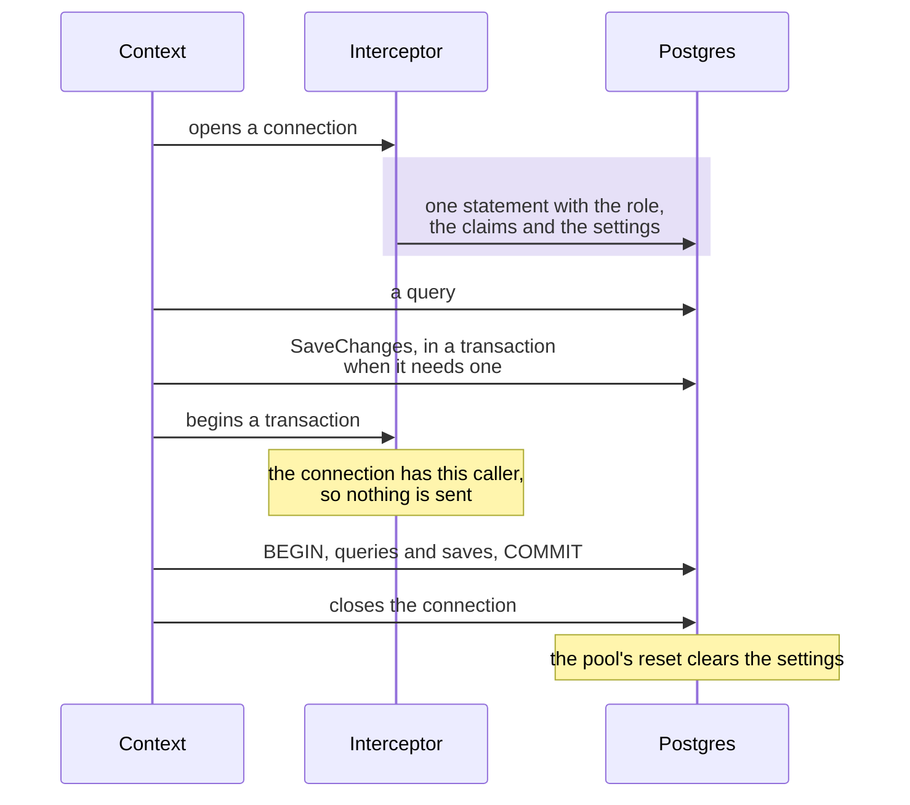

<details>
<summary>Show the code: the default, and what it refuses</summary>

```csharp
builder.Services.AddPostgresRowLevelSecurity();   // Scope is RowLevelSecurityScope.Connection

// Refused when a context opens a connection, before anything connects:
//   Host=db;...;No Reset On Close=true
//   Host=db;...;Multiplexing=true
//   Host=aws-0-eu-west-1.pooler.supabase.com;Port=6543;...
```

</details>

#### Transaction scope

A transaction pooler gives a client a server connection for one transaction. Then it hands that server connection
to the next client unchanged. So a setting made for a session would reach the next client. In `Transaction` scope
the interceptor never sets anything for a session:

- **A command outside a transaction** gets
  `RESET ROLE; CALL "ddd".use_caller(@__ddd_role, @__ddd_claims, @__ddd_names, @__ddd_values);` in front of its text.
  Npgsql sends both together, and Postgres runs them as one transaction. So the settings apply to that command and
  end with it, with no extra round trip. `RESET ROLE` removes any role that another client left on the server
  connection. So the role the application logged in as always makes the call.
- **A transaction** that a context begins, or receives with `UseTransaction`, gets the settings once, as its first
  statement: `SELECT set_config('role', $1, true), …`. A `TransactionScope` that the connection is enlisted in gets
  the same. The transaction then runs as that caller until it ends.
- **A save always runs in a transaction.** The commands of a save cannot carry the call in front. Entity Framework
  reads how many rows each statement changed, in order. With the call in front, it would read a save that was
  written as a concurrency conflict. So before every save, the interceptor sets the context's
  `AutoTransactionBehavior` to `Always`, whatever the value was, and leaves it there.
- **Opening a connection** sends nothing.

In the diagram, the purple bands are the statements that set the caller:

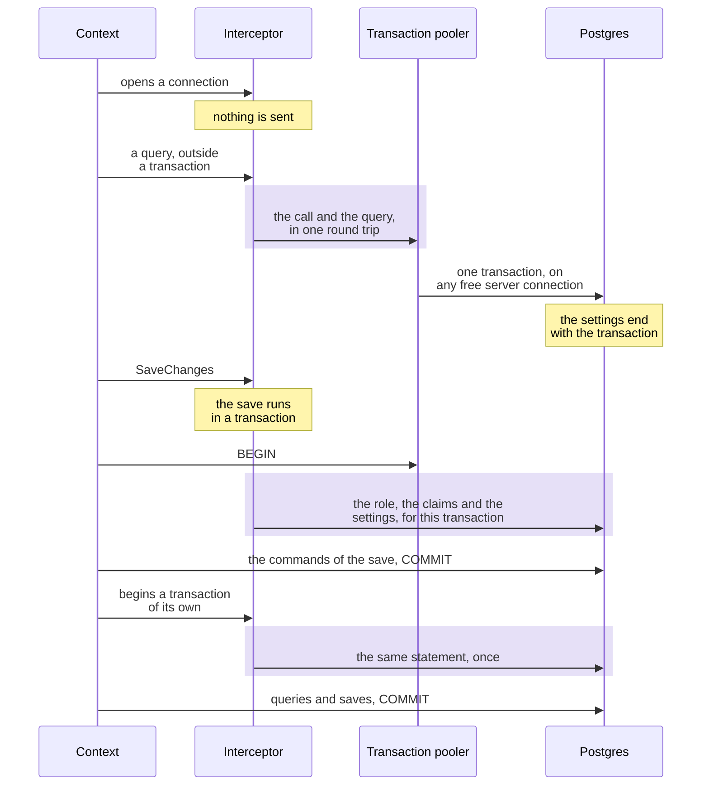

<details>
<summary>Show the code: the scope, the connection string and the login role's grants</summary>

```csharp
builder.Services.AddPostgresRowLevelSecurity(options => options.Scope = RowLevelSecurityScope.Transaction);

builder.Services.AddDbContext<OrderingContext>((provider, options) => options
    .UseNpgsql("Host=pooler;Port=6432;Database=shop;Username=app;Password=...;No Reset On Close=true;Max Auto Prepare=0")
    .UseDDDToolkit(provider));
```

```sql
-- for a login role that did not run the script that made the procedure
grant usage on schema ddd to app;
grant execute on procedure ddd.use_caller(text, text, text[], text[]) to app;
```

</details>

What `Transaction` scope needs from an application:

- **The procedure `ddd.use_caller`.** `PostgresRowAccess.SetupScript()` makes it. Every script of policies and every
  exported access file also makes it, so a database with the policies has the procedure. The procedure runs as its
  caller, and its `EXECUTE` privilege is revoked from `PUBLIC`. Only the role the application logs in as may call it,
  because anyone who can call it can say who they are. A login role that did not run the script needs the two grants
  above.
- **Named parameters.** Entity Framework names every parameter. Outside a transaction, the interceptor refuses a
  command that has a parameter without a name, such as a command built by hand with `$1`. Such a parameter cannot be
  mixed with the caller's parameters.
- **No transaction control and no role changes in your SQL.** The interceptor refuses a command when one of its
  statements begins with `BEGIN`, `START TRANSACTION`, `COMMIT`, `END`, `ROLLBACK`, `ABORT`, `PREPARE TRANSACTION`,
  `SET ROLE`, `RESET ROLE`, `SET SESSION AUTHORIZATION`, `RESET SESSION AUTHORIZATION`, `RESET ALL` or `DISCARD`.
  Such a statement would end the transaction that holds the settings, or change the role. Every later statement
  would then run as the login role.
  - Only the first words of a statement count. So `CASE … END` passes, and so do savepoints, including
    `ROLLBACK TO`.
  - Begin, commit and roll back through the context.
  - This check catches mistakes. It does not stop an attack, because a statement can do the same inside a function
    it calls.
- **Two connection string options for the pooler.**
  - Set `No Reset On Close=true`. Npgsql's reset before reusing a connection is for a session, and a transaction
    pooler would run it on any free server connection.
  - Set `Max Auto Prepare=0`. A prepared statement lives on one server connection.
  - This scope allows both options. `Multiplexing` is still refused.
  - Run migrations, and statements that cannot run inside a transaction, through a session pooler or a direct
    connection.
- **Transactions that the context knows about.** Neither Entity Framework nor the interceptor sees a transaction that
  was begun on the connection and never handed to the context. A command that the context sends inside such a
  transaction carries the call. The rest of that transaction then runs as that caller.

When a statement that sets the caller fails in this scope, no setting is left half done:

- A command outside a transaction fails together with its call, in the same round trip.
- A transaction whose first statement failed is rolled back, and is never handed to the context.

In both scopes, the statement empties `request.jwt.claim.sub`, `request.jwt.claim.role`, `request.jwt.claim.email`
and `request.jwt.claim`. Supabase's `auth.uid()`, `auth.role()`, `auth.email()` and `auth.jwt()` read those
settings before the claims. Without this step, a value that something else left on the server connection, such as a
pooler that does not reset it, would decide who the statement runs as.

### Requiring explicit callers

Outside a request and outside any caller, the current caller is the system. On most databases the system runs as
the tables' owner, which passes every policy. A 3.x host gets this by default. So work that never states a caller
runs as system work, and passes every policy. On Supabase the system runs as `ddd_system`, unless the project names
another role. `ddd_system` reaches only the toolkit's bookkeeping tables, so on Supabase the database refuses such
work on a module's tables. A host that wants such work to fail everywhere, before it reaches the database, adds one
line:

```csharp
builder.Services.RequireExplicitCallers();
```

With this line:

- An accessor that knows no caller throws `NoCallerException` and does not return the system. So the first query of
  work that never stated its caller fails before it connects. `AmbientCallerAccessor`, the Supabase accessor for
  ASP.NET Core outside a request, and `GetSupabaseCaller()` in Azure Functions outside an HTTP trigger all throw.
- The interceptor refuses the system caller when your own accessor returns it by itself. The system is the caller
  only inside `Callers.Begin(Caller.System)`.
- A request still has its caller: its user, or `anon`.

The toolkit's own work states its caller. Reading, marking and deleting outbox rows, receiving from a transport,
checking the migrations and preparing a sample's database are bookkeeping. They run as `Caller.System`. The handlers
that this work calls run with no caller, inside `Callers.BeginNone()`, until something starts a caller for them.

| Work | Without `RequireExplicitCallers` | With it |
|---|---|---|
| The bookkeeping of the outbox processor, of retention and of a transport | the current caller, or the system outside any caller | `Caller.System` |
| Turning an event into the contract it is published as, and a sink of yours | the current caller | `Caller.System`, with the bookkeeping. It reads only what the event's module publishes. |
| A module's integration event handlers, with their inbox read and save | the caller that the module's [scopes](integration-events.md#who-the-handlers-run-as) start, or the current caller when the module has no scopes | the caller that the module's scopes start. A module without scopes does not run its handlers. |
| A domain event handler that the outbox dispatches in process | the current caller | no caller. The handler starts its own caller, or its first query throws. |
| The start-up migrations check | `Caller.System` | `Caller.System` |

A domain event handler that the outbox dispatches in process saves its own work:

- The handler may leave a change unsaved on the outbox processor's context. That change would be saved with the
  processed mark, as the system. With `RequireExplicitCallers`, the message fails instead, and the change is dropped.
- With `DeliverInTransaction`, the processor's context holds a transaction begun as the system. So such a handler
  works on a separate context.
- A transaction that you begin on the processor's context yourself is joined. Begin it as the system too.

A module states what its handlers run as where it registers them, with a scope around each delivery. The scope is a
scoped system caller that the module's policies hold, or, chosen on purpose, the system itself:

```csharp
services.AddModuleIntegrationEvents<ShippingContext>(module => module
    .Around((services, message, contract) => Callers.Begin(Caller.SystemIn("shipping")))
    .Handle<OrderPlacedV1, BookShipment>());

// or, where the handlers may see every row:
services.AddModuleIntegrationEvents<ShippingContext>(module => module
    .Around(IntegrationEventScopes.System)
    .Handle<OrderPlacedV1, BookShipment>());
```

Middleware that starts a caller and forgets to end it leaks that caller into the next request, and the leaked caller
wins over the request's caller. `context.GetSupabaseCaller()` returns the request's caller, whatever the ambient
caller is. So a host can make that caller current at the start of every request:
`using (Callers.Begin(context.GetSupabaseCaller()))`.

### Token roles

A token names its role in its `role` claim. PostgREST switches to whatever role that claim names. The interceptor
maps the claim to a database role only through a list that the host writes. So a token that names the system's role,
the login role, or any other role in the database never runs as that role.

The interceptor checks the rows of this table from top to bottom:

| The token's `role` claim | Runs as |
|---|---|
| an entry in `TokenRoles` | the role that the entry maps to, with the token's claims |
| `authenticated`, `UserRole` by its name, or no claim | `UserRole`, with the token's claims |
| `anon`, or `AnonymousRole` by its name | `AnonymousRole`, with the token's claims |
| anything else | no role. The caller is refused with `access.role-not-allowed`. |

`TokenRoles` comes first, so a map entry for `authenticated` or `anon` wins over the rows below it.

The refusal for a role on no list:

- It is a `RefusalException` of the kind "not permitted", `ToolkitRefusals.RoleNotAllowed`. Its argument `Role` is
  the role in the token.
- The interceptor throws it before the context connects. When the caller changes on an open connection, it throws
  before the next command. So no statement runs for that caller, as any role.
- An edge answers it like any other refusal, usually with a 403.
- The interceptor matches a role as the token spells it.
- A `role` claim that is JSON `null` counts as no claim. A `role` claim of another type that is not text, such as a
  list of roles, counts as a role on no list.

Some identity providers give some users a role of their own, for example analysts who read every customer's tickets.
The host maps that role to a database role:

```csharp
builder.Services.AddPostgresRowLevelSecurity(options =>
{
    options.TokenRoles["analyst"] = "desk_analyst";
});
```

A user whose token carries `analyst` then runs as `desk_analyst`. The claims stay the token's claims, so
`ddd.caller_role()` returns `analyst` and `ddd.caller_id()` returns the user's id. A rule names the token role, never
the database role, so no database role name is compiled into a module:

```csharp
public static class DeskRoles
{
    public const string Analyst = RowAccessRoles.TokenPrefix + "analyst";   // "@token:analyst"
}

[RowAccess<Ticket>(RowOperations.Read, To = [DeskRoles.Analyst])]
public static partial class AnalystsReadEveryTicket
{
    public static bool Allows(Ticket ticket, Caller caller) => caller.IsSignedIn;
}
```

- An attribute takes only constants, so use `RowAccessRoles.TokenPrefix` there. Where a method call works, such as in
  a contribution, `RowAccessRoles.Token("analyst")` returns the same name.
- A script resolves the name through the roles it is written with, `RowAccessExport.Roles`.
  `RowAccessRoleNames.From(options)` carries the map.
- When those roles do not map the token role, the script refuses the rule when it is written, and names the rule. The
  rule's policy would be for a role that no query runs as.
- The Supabase export takes the map from a [build property](supabase.md#custom-roles-and-caller-functions).

#### Checks on a mapped role

The mapped role is held to its policies, like the [scoped system role](#the-scoped-system-role).
`SetupScript(options)` makes it `NOLOGIN NOINHERIT` and grants it to the login role. A script whose policies name the
role creates it where the database does not have it. Both fail when a role of that name exists and one of these
holds:

- It can log in, it can bypass RLS, or it is a superuser.
- It has the privileges of a role that owns tables.
- The user's role or the anonymous caller's role has its privileges.

The scoped system role's check includes the mapped roles. No mapped role may have the scoped system role's
privileges, or the holder of a token would do system work. The options refuse a map to `SystemRole`, to
the scoped system role or to `AnonymousRole`, where those roles are registered.

Like the other roles, a mapped role needs privileges on your tables before its policies let it reach a row:

```sql
grant usage on schema desk to desk_analyst;
grant select on all tables in schema desk to desk_analyst;
```

**A mapped role is kept apart from the other callers in both directions.** The user's role and the anonymous
caller's role may not have its privileges, and the mapped role may not have theirs. Both scripts fail for a mapped
role that has the privileges of `UserRole` or `AnonymousRole`. Otherwise the holder of an analyst's token would also
be a signed-in user, or an anonymous caller with an identity. That holder would get every policy and every
privilege written for those callers.

```sql
grant authenticated to desk_analyst with inherit true;   -- Postgres 16 and later
-- The next setup script fails, and so does the next script that has a policy for desk_analyst
-- or writes privileges:
--   The role desk_analyst has the privileges of authenticated or anon, so the holder of a token mapped
--   to it would get every policy and every privilege written for those callers. ...
revoke authenticated from desk_analyst;
```

To give analysts what signed-in users get, write it in the rules. A rule for both names both roles,
`To = [RowAccessRoles.User, DeskRoles.Analyst]`, and each role gets its own privileges.

The check looks at whether a role has the privileges, which `pg_has_role(..., 'USAGE')` returns. A role grant that
passes nothing on, `with inherit false`, is not refused. Before Postgres 16 a role grant has no such option, and the
role's `INHERIT` attribute decides for all the roles granted to it. So before Postgres 16 the check fails for a
mapped role that someone made `INHERIT` and granted one of the two roles. It passes for the `NOINHERIT` role that the
scripts make.

A token role may also map to `UserRole` itself, for a provider that calls its signed-in users `member`. Such a token
then runs as `UserRole`, and nothing is made or checked for the mapping.

#### A role on no list

`UnknownTokenRole.Refuse` is the default. With `UnknownTokenRole.Anonymous`, a caller whose role is on no list runs
as an anonymous caller: `AnonymousRole`, with the claims `{"role":"anon"}`. The database sees no user, and
`ddd.caller_id()` is `null`. The interceptor asks a module's [custom settings](#custom-connection-settings) for
`Caller.Anonymous` too. So a setting derived from the user's id or claims gets the value for a request without a
user. In C# the caller is still the user that the token names. So a rule checked in C# may allow what the policies
then refuse. Choose this option for a host that prefers to show such a caller what everybody may see, instead of
refusing the caller.

The interceptor reads the roles once, when it is built. A later change to the options reaches no connection.

> [!IMPORTANT]
> A token whose role was neither `authenticated` nor a role that the host listed used to run as `UserRole`. Such a
> token is now refused. A host whose tokens carry a role of their own maps that role in `TokenRoles`, to `UserRole`
> where those users are ordinary signed-in users.

### A caller that changes on an open connection

A connection can stay open across several callers, for example a connection opened with `OpenConnection()`, or the
connection of a transaction. Before every command, and before a transaction begins, the interceptor computes the
role, the claims and the settings again. It compares them with what it set on the connection:

- Outside a transaction, the interceptor sets a change first, with the same statement. This costs one round trip
  when the caller changed, and none when it did not.
- Inside a transaction, the interceptor does not set a change. A transaction runs as one caller, and a rollback
  would undo a setting made inside it. With `RequireExplicitCallers`, the command is refused with an
  `InvalidOperationException` that names both callers. Without it, a warning is logged once per connection, and the
  transaction continues as the caller it began with.

Start the caller before the transaction, or run the other caller's work on a separate context.

A connection opened inside a `TransactionScope` sets the caller inside that transaction. When the scope rolls back,
the setting is rolled back too. The interceptor then sets the caller again before the connection's next command.
The interceptor does not see a transaction that your SQL begins with `BEGIN`. It also does not see a transaction
that was begun on the connection and never handed to the context.

In `Transaction` scope the same holds inside a transaction. The transaction runs as the caller it began with, and a
change is refused or logged. Outside a transaction there is nothing to compare, because every command carries the
caller of the moment it is sent.

### A connection you pass in

A context can receive a connection it did not open, with `UseNpgsql(connection)`, and a transaction it did not
begin, with `Database.UseTransaction(transaction)`. The interceptor records what a connection carries once per
process, shared by every interceptor. So it does not matter which context, or which instance of the interceptor, set the
caller:

- **A connection that another context opened** brings that context's caller. The next context compares that caller
  with the current caller, as on a connection it opened itself, and sends nothing when they match.
- **A connection without a caller**, such as a connection opened by hand, gets the caller before the context's first
  command on it. This costs one round trip, once. When the code that owns the connection closes and reopens it, the
  connection carries no caller and gets the caller again.
- **A connection without a caller that already has an open transaction** cannot get a caller safely. Such a
  connection is one handed over with `UseTransaction`, or one opened inside a `TransactionScope`. A rollback undoes a
  session setting made inside a transaction, and everything that ran in the transaction before ran as the login role.
  With `RequireExplicitCallers`, the command is refused with an `InvalidOperationException` that says what to change.
  Without it, a warning is logged once per connection, and the command runs as the role that the connection carries.
- **In `Transaction` scope**, a command outside a transaction carries its call, whoever opened the connection. A
  transaction handed over with `UseTransaction` gets the settings at that moment, for the rest of the transaction.

Two contexts that work in one transaction must both know of the transaction. Begin it on one context and hand it to
the other with `UseTransaction`. The second context then finds the caller that the transaction began with, and runs
as that caller. A different caller at that point is refused, as inside any transaction. The interceptor marks on the
server what it set for a transaction. So a context asks the server, and does not trust what it remembers of a
transaction object. It asks once when it receives the transaction. It asks before every command when it uses the
connection without having received the transaction.

> [!NOTE]
> Where the login role [owns nothing](#a-login-that-owns-nothing), a command on a connection without a caller fails
> with Postgres's `42501` (`permission denied`) and gives no reason. The interceptor either gives such a connection its
> caller, or refuses the command with a message that names three fixes: open the connection through a context, begin
> the transaction after a context opened the connection, or take the connection from
> [`CallerConnections`](#raw-sql).

### Custom connection settings

A module's policies may need more than the caller, for example the team that a request chose. The module puts such a
value on the connection next to the role and the claims. The value goes in the same statement, so it costs no extra
round trip. The module names its settings, and returns their values for each caller:

```csharp
public sealed class TeamSetting : IRowLevelSecuritySettings
{
    public IReadOnlyCollection<string> Names { get; } = ["teams.current"];

    public IEnumerable<KeyValuePair<string, string>> For(Caller caller)
        => TeamScope.Current is { } team ? [new("teams.current", team.ToString())] : [];
}

services.AddPostgresRowLevelSecurity();
services.AddRowLevelSecuritySettings<TeamSetting>();
```

- A policy reads the setting with `current_setting('teams.current', true)`.
- The interceptor sets every declared name each time, to its value, or to `''` when `For` leaves the name out. So a
  pooled connection never keeps an earlier caller's value.
- A name that the class did not declare fails the connection.
- The interceptor checks the names when it is built. A name is `prefix.name` in lower case. It is not one of
  PostgREST's `request.*` names. Only one class may declare it.

In the diagram, purple is the custom setting and green is the result:

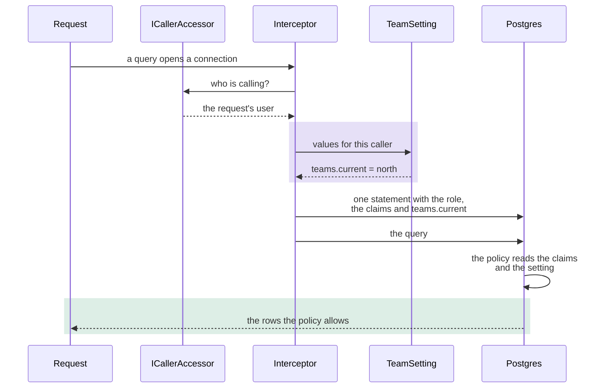

<details>
<summary>Show the code: the policy that reads both</summary>

```sql
CREATE POLICY "A team sees its notebooks" ON "teams"."Notebooks" FOR SELECT TO authenticated
    USING ("Team" = current_setting('teams.current', true)
           AND "Members" @> ARRAY[(SELECT "ddd".caller_id())]);
```

</details>

The application sets a custom setting, and the caller does not. Any statement on the application's connection can
set the setting to any value, as it can set the role. So write the policy to derive what it needs from the verified
claims, and to use the setting only to choose among what the claims allow. Then the policy stays correct when the
application's code sets a wrong value.

### A statement timeout per caller

Postgres applies the settings stored on a role, such as `alter role authenticated set statement_timeout = '8s'`,
when that role logs in. Postgres does not apply them when a session switches to the role. So a caller's statements
run under the timeout of the role the application logged in as, whatever the caller's role says. Set the timeout per
kind of caller instead:

```csharp
builder.Services.AddPostgresRowLevelSecurity(options =>
{
    options.StatementTimeouts[CallerKind.User] = TimeSpan.FromSeconds(8);
    options.StatementTimeouts[CallerKind.Anonymous] = TimeSpan.FromSeconds(3);
});
```

- The timeout goes in the statement that sets the caller, so it costs no round trip.
- Postgres cancels a statement that runs longer, with `57014`, `query_canceled`.
- A kind without a timeout gets the login role's timeout again, its reset value, which the same statement reads. So
  a timeout never outlives the caller it was set for. This holds on a connection that stays open across several
  callers, and on a pooled connection.
- In `Transaction` scope the timeout lasts one transaction, and a kind without a timeout sets nothing.
- A user whose [token role](#token-roles) is on no list, and who runs as an anonymous caller, gets the anonymous
  caller's timeout.
- A timeout is at least one millisecond.
- With no timeout configured, the statement is unchanged.

### Raw SQL

SQL sent through a context, with `context.Database.SqlQuery`, `ExecuteSql` and `FromSql`, goes through the
interceptor like any query, in both scopes. SQL sent past Entity Framework, as a command on
`context.Database.GetDbConnection()`, does not go through the interceptor. The role it runs as depends on the scope:

| Scope | A command on `GetDbConnection()` runs as |
|---|---|
| `Connection` | the caller that the connection carries, for as long as the context keeps the connection open |
| `Transaction` | the login role, because nothing is set on the session. Inside a transaction that the context began or received, the command runs as that transaction's caller. |

A module may send SQL without a context, such as a report read with a data reader, or a bulk copy. For that SQL,
take the connection from `CallerConnections`. `CallerConnections` sets the caller with the interceptor's statement,
and refuses what the interceptor refuses. It also sets the [statement timeout](#a-statement-timeout-per-caller) and
the [custom settings](#custom-connection-settings):

```csharp
builder.Services.AddCallerConnections(provider => provider.GetRequiredService<NpgsqlDataSource>());

public sealed class OrderExport(CallerConnections connections)
{
    public async Task WriteAsync(Stream output, CancellationToken cancellationToken)
    {
        await using var transaction = await connections.BeginTransactionAsync(cancellationToken);
        await using var connection = transaction.Connection!;

        await using var command = connection.CreateCommand();
        command.Transaction = transaction;
        command.CommandText = """SELECT "Id", "Total" FROM ordering."Orders" """;   // the policies return only the caller's orders
        await using var reader = await command.ExecuteReaderAsync(cancellationToken);
        // ...
    }
}
```

- `BeginTransactionAsync` works in both scopes. It returns a transaction on an open connection, with the caller set
  for that transaction only. The connection belongs to the transaction. Dispose the connection with the transaction.
- `OpenAsync` returns an open connection with the caller set for its session. It is refused in `Transaction` scope,
  where a session must carry nothing.
- **One caller per connection.** The caller is the one that is current when the connection opens. Dispose the
  connection before the caller changes.
- A context that receives such a connection, or such a transaction, [finds the caller
  there](#a-connection-you-pass-in) and sends no statement of its own.

### With a context pool

A context pool, `AddPooledDbContextFactory` or `AddDbContextPool`, builds a context's options once. It hands one
instance to one caller after another. RLS keeps nothing on a context, and reads nothing while the
options are built. So the call is the same as above, with the provider that the pool's callback receives:

```csharp
builder.Services.AddPooledDbContextFactory<OrderingContext>((provider, options) => options
    .UseNpgsql(connectionString)
    .UseDDDToolkit(provider));
builder.Services.AddScopedFromPool<OrderingContext>();
```

- **Read at every use:** the current caller, the role and the claims that follow from it, and the values of every
  `IRowLevelSecuritySettings`. The interceptor reads them when a connection opens, before every command, and before
  a transaction begins. So each rental runs as its own caller, whoever used the instance before. A settings class of
  yours follows the same rule. `For(caller)` computes its values each time, and keeps nothing per connection or per
  context.
- **Reset between renters:** a context that returns to the pool closes its connection and keeps the connection
  object. Npgsql clears the server connection's settings before the connection is used again. The interceptor sets
  the role, the claims and the settings again on the next open, whatever it remembered of the last one. In
  `Transaction` scope there is nothing to reset. A transaction that a context left open is rolled back when the
  context returns to the pool, and the settings end with it.

A context pool does not limit connections. A context holds a connection only while a command runs, while it has a
transaction, or between `OpenConnection()` and `CloseConnection()`. A context that waits in the pool holds no
connection. The data source sets the limit, so plan the connections there:

- **Set the limits.** Give every data source its `Maximum Pool Size`, `Minimum Pool Size`,
  `Connection Idle Lifetime`, `Connection Lifetime`, `Timeout` and `Application Name` in its connection string. Do
  not rely on Npgsql's defaults.
- **Extra readers wait.** A read that needs a connection when none is free waits up to `Timeout` seconds. Then it
  fails with Npgsql's exception for an exhausted pool. It does not hang.
- **Do not wait for a second connection while you hold one.** Code that has an open transaction, or a connection it
  opened by hand, and then runs a query on another context needs two connections at once. With a small pool, two
  requests that do this each hold one connection and wait for the other until `Timeout`. Without such nesting, a data
  source of one connection still completes all work, one piece at a time.
- **Size for the widest request.** `Maximum Pool Size` is at least the number of reads that one request runs in
  parallel, so a request never waits for itself. All instances of the application, with their pollers and
  listeners, stay within what the database, or the pooler in front of it, allows.

[Contexts from a pool](entity-framework.md#contexts-from-a-pool) has the registration, and what Entity Framework
resets when a context returns to the pool.

## Setup on Postgres without Supabase

A Supabase project has the roles and the functions that a policy uses to read the caller. A Postgres database
without Supabase has neither until `PostgresRowAccess.SetupScript()` makes them:

- The roles `anon`, `authenticated` and `ddd_system_in`, the [scoped system role](#the-scoped-system-role). The script
  grants all three to the role the application logs in as, so that role may switch to them. The script also makes
  the role of every [token role](#token-roles) that the given options map.
- `ddd.caller_id()`, `ddd.caller_role()` and `ddd.caller_claims()`, which read the claims that the interceptor set.
- `ddd.written_in_this_transaction(xmin)`, which the policies of an aggregate's entities call.
- The procedure `ddd.use_caller`, which sets a caller for one transaction in
  [`Transaction` scope](#settings-per-connection-or-per-transaction). Only the login role may call it.

The script can run more than once, so put it in an early migration:

```csharp
public partial class RowLevelSecurity : Migration
{
    protected override void Up(MigrationBuilder migrationBuilder)
    {
        migrationBuilder.Sql(PostgresRowAccess.SetupScript());
        migrationBuilder.Sql("""
            grant usage on schema ordering to anon, authenticated;
            grant select, insert, update, delete on all tables in schema ordering to anon, authenticated;
            alter default privileges in schema ordering grant select, insert, update, delete on tables to anon, authenticated;
            """);
    }
}
```

The grants give the two roles the tables. The policies then decide which rows. A script of policies can write the
grants instead, per table and per command, from the policies it holds
([Privileges from the policies](#privileges-from-the-policies)).

`ddd.caller_id()` is `null` for a token whose `sub` is not a `uuid`. So a rule about a user matches nobody, and does
not fail every query. `Caller.UserId` is `null` for such a token too.

The grants above also cover the module's outbox and inbox tables. Those tables have no policies, so a caller could
read every pending message. A caller's save only adds outbox rows, and the toolkit reads, marks and deletes them as
the system. An inbox is read and written by the caller that a module's handlers run as, and never by a request.
Revoke the rest:

```sql
revoke select, update, delete on ordering."OutboxMessages" from anon, authenticated;
revoke all on ordering."InboxMessages" from anon, authenticated;
```

The role that runs `SetupScript()` owns the `ddd` schema, its functions and its procedure. Another role can run the
script with `SetupScript(loginRole: "app")`, while the application's migrations run as `app`. The policy scripts
then leave those objects alone, as long as the objects are as the policies need them. A toolkit upgrade may change
`ddd.written_in_this_transaction` or `ddd.use_caller`, or add a role that the setup makes, such as `ddd_system_in`.
`app` cannot replace objects it does not own, and may not be allowed to create a role. So first run the new
version's `SetupScript()`, as the role that ran it before. That run makes and grants what is missing, and the
policy scripts then leave it as it is.

## Row access rules written in C#

A rule is a static method on a class of its own. An attribute on the class names the aggregate that the rule guards,
and what the rule allows:

```csharp
[RowAccess<Order>(RowOperations.Read | RowOperations.Change)]
public static partial class ACustomerSeesTheirOrders
{
    public static bool Allows(Order order, Caller caller)
        => order.PlacedBy == null || order.PlacedBy?.Value == caller.UserId;
}
```

When the class compiles, the generator translates `Allows` into SQL and writes the SQL into the class as
`RowAccessSql`. The rule is still an ordinary method. So a handler, a test or a screen calls the same rule in C#:
`ACustomerSeesTheirOrders.Allows(order, caller)`.

In the diagram, purple is the rule and green is where the rule is used:

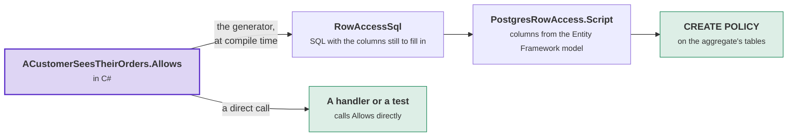

<details>
<summary>Show the code: what the generator writes into the rule, and what the script makes of it</summary>

**ACustomerSeesTheirOrders.RowAccess.g.cs** (shortened)

```csharp
partial class ACustomerSeesTheirOrders
{
    public const string RowAccessSql = "(({col:PlacedBy} IS NULL) OR ({col:PlacedBy} IS NOT DISTINCT FROM {caller:uid}))";
}
```

```csharp
// The script takes the columns from the context's model,
// and writes a policy per command and role
var sql = PostgresRowAccess.Script(context,
[
    RowAccessRule.For<Order>("A customer sees their orders", RowOperations.Read | RowOperations.Change, ACustomerSeesTheirOrders.RowAccessSql),
]);

// The same rule, called directly
var allowed = ACustomerSeesTheirOrders.Allows(order, caller);
```

```sql
CREATE POLICY "A customer sees their orders (select) for authenticated" ON "ordering"."Orders" FOR SELECT TO authenticated
    USING (("PlacedBy" IS NULL) OR ("PlacedBy" IS NOT DISTINCT FROM (SELECT "ddd".caller_id())));
-- and one for anon, and one per role for UPDATE

-- OrderLine belongs to the aggregate. A caller reads a line with its order, and writes a line as the rules let the caller write the order.
CREATE POLICY "OrderLine (select) for authenticated" ON "ordering"."OrderLine" FOR SELECT TO authenticated
    USING (EXISTS (SELECT 1 FROM "ordering"."Orders" parent WHERE parent."Id" = "ordering"."OrderLine"."OrderId"));
-- and one for anon, and one per role for INSERT, UPDATE and DELETE
```

</details>

More about rules:

- **Entities follow their aggregate.** A rule is on the root. The tables of the aggregate's entities, such as an
  order's lines, get policies of their own that check the root. A caller reads a line when it may read the order. A
  caller writes a line when the order's write rules allow it ([Policies on entity tables](#policies-on-entity-tables)).
- **Roles.** A rule is for signed-in users and for callers without a user, unless `To` says otherwise:
  `[RowAccess<Order>(RowOperations.Read, To = [RowAccessRoles.User])]`. Several rules on one aggregate add up. A row
  that one of them allows is allowed. Each policy is for one role
  ([One policy per command and role](#one-policy-per-command-and-role)).
- **A stricter permission for some columns.** A rule with `Columns = [nameof(Order.Status)]` checks a change of those
  columns only, next to the rules for the row. Use it for a column whose change needs more than a change of the row
  needs ([Column rules](#column-rules)).
- **Build errors.** [DDD00038](diagnostics.md#ddd00038) to [DDD00041](diagnostics.md#ddd00041),
  [DDD00051](diagnostics.md#ddd00051) and [DDD00052](diagnostics.md#ddd00052) are the rules that the generator
  enforces:
  - the class's shape, and the columns that a column rule names,
  - what the generator can translate,
  - that the type is an aggregate root,
  - that a rule reads the aggregate's entities through an access function,
  - that a rule asks for a set once per statement,
  - that a function's name has an owner.

### What the generator translates

| In `Allows` | In the policy |
|---|---|
| `order.PlacedBy == null \|\| order.PlacedBy?.Value == caller.UserId` | `("PlacedBy" IS NULL) OR ("PlacedBy" IS NOT DISTINCT FROM "ddd".caller_id())` |
| `order.Status != OrderStatus.Cancelled` | `"Status" <> 2`, or `'Cancelled'` when the column stores it as text |
| `order.Total.Amount <= 500` | `coalesce("Total_Amount" <= 500, FALSE)` |
| `caller.IsSignedIn && !order.IsPublic` | `("ddd".caller_id() IS NOT NULL) AND (NOT "IsPublic")` |
| `caller.Claim("app_metadata.team") == order.Team` | `"ddd".caller_claims() #>> '{app_metadata,team}' IS NOT DISTINCT FROM "Team"` |
| `caller.Role == "authenticated"` | `"ddd".caller_role() IS NOT DISTINCT FROM 'authenticated'` |
| `order.Due < DateTimeOffset.UtcNow` | `coalesce("Due" < now(), FALSE)` |

- `==` keeps its C# meaning. Between two values that C# says cannot be null (an enum, a number, a flag, a `Guid`, or
  an id that is a struct), `==` becomes SQL's `=`, which an index can answer. Where either side can be null, `==`
  becomes C#'s equality with nulls, `IS NOT DISTINCT FROM`, which no index answers.
- A comparison that SQL would leave unknown is false, as in C#. The exception is a comparison with a
  [scalar question](#database-only-questions), which has no C# answer.
- `DateTimeOffset.UtcNow` and `DateTime.UtcNow` become the database's `now()`, the time its transaction began.
  Compare `now()` with a column of type `timestamp with time zone`. Npgsql makes that type of a `DateTime` or a
  `DateTimeOffset` by default. Against a `timestamp without time zone`, Postgres converts `now()` to the time in the
  session's time zone, and a caller of the Data API can choose that time zone.
- The policy wraps the caller functions in `(SELECT ...)`. So Postgres calls them once per query, and not once per
  row.
- Column names come from the Entity Framework model when the policies are written. Renaming a property or its
  column changes the policy too.
- A value object stored inline is its columns. A typed id's `.Value` is the id's column.

An expression that the database cannot check is a compile error. Examples are a method call such as
`order.Team.StartsWith("n")`, a local variable, and anything about another aggregate. For a question that only the
database can answer, use an [access function](#access-functions) or a
[set-shaped access function](#set-shaped-access-functions). For the rest, `Sql.Call<T>` and `Sql.Raw<T>` write SQL
into the rule:

```csharp
public static bool Allows(Order order, Caller caller)
    => order.PlacedBy?.Value == caller.UserId
       || Sql.Call<bool>("support.is_agent", caller.UserId);
```

The generator translates the arguments like the rest of the rule. You create the function in a migration. A rule
that uses `Sql.Call` or `Sql.Raw` works only in the database. Called in C#, it throws, because C# cannot run the SQL.

### One policy per command and role

Every policy that a script writes is for one command and one role. A table gets at most one policy for each pair.
The rules that let a role run one command on a table are combined in one policy, with their conditions joined by
`OR`. Postgres joins a table's permissive policies with `OR` anyway, so the combined policy allows nothing that the
rules alone would not allow. The result is one place per table, command and role that says who may do what.
Supabase's performance advisor asks for the same.

| Rules that grant a role a command | The policy's name |
|---|---|
| one | the rule, the command and the role: `"A customer has their orders (select) for anon"` |
| several | the table: `"Orders (select) for authenticated"`, with a comment above the policy that names the rules |

So a policy's name changes when another rule starts or stops granting the same command to the same role. A test or a
script of yours that looks up a policy should look it up by table, command and role.

In the diagram, purple is the one policy that combines both rules:

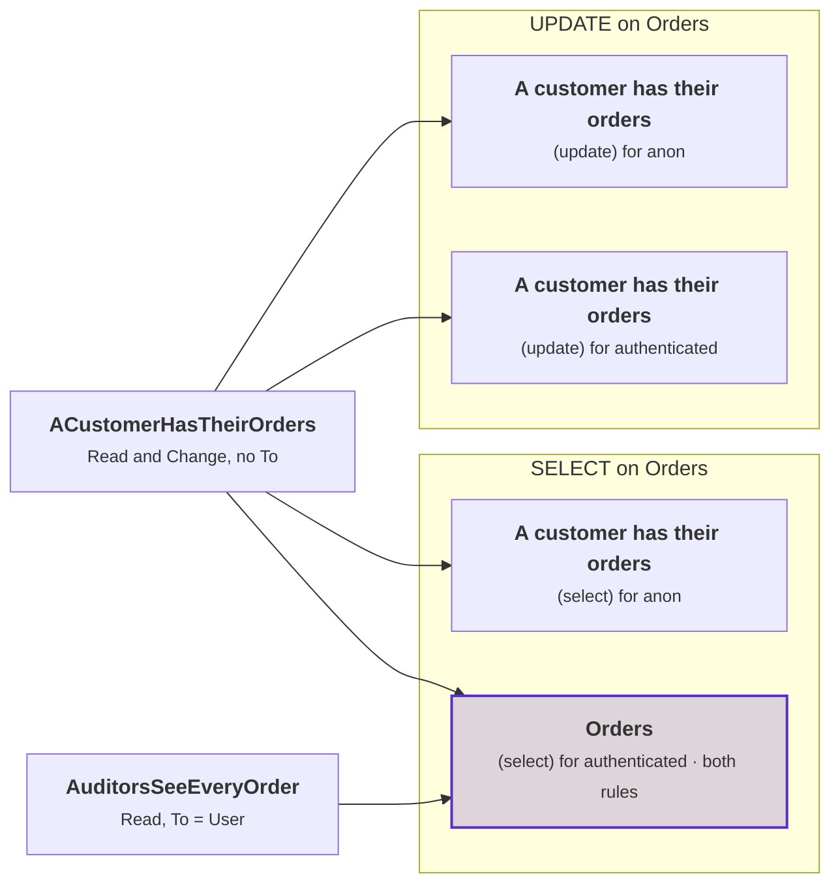

<details>
<summary>Show the code: the two rules, and the policy that combines both</summary>

```csharp
[RowAccess<Order>(RowOperations.Read | RowOperations.Change)]
public static partial class ACustomerHasTheirOrders
{
    public static bool Allows(Order order, Caller caller)
        => order.PlacedBy == null || order.PlacedBy?.Value == caller.UserId;
}

[RowAccess<Order>(RowOperations.Read, To = [RowAccessRoles.User])]
public static partial class AuditorsSeeEveryOrder
{
    public static bool Allows(Order order, Caller caller) => caller.Claim("app_metadata.auditor") == "true";
}
```

```sql
-- Orders (select) for authenticated asks the rules 'A customer has their orders' and 'Auditors see every order': a row one of them allows is allowed.
CREATE POLICY "Orders (select) for authenticated" ON "ordering"."Orders" FOR SELECT TO authenticated
    USING ((("PlacedBy" IS NULL) OR ("PlacedBy" IS NOT DISTINCT FROM (SELECT "ddd".caller_id())))
        OR ((SELECT "ddd".caller_claims() #>> '{app_metadata,auditor}') IS NOT DISTINCT FROM 'true'));
```

</details>

A script never merges a policy that you wrote by hand, permissive or restrictive, into these policies. A script
drops and makes only the policies it made, which it finds by their comment. A restrictive policy of yours on the same
table still holds every caller it names to its condition. So does a [restrictive rule](#restrictive-rules).

The types of a hierarchy that Entity Framework maps to one table share that table's policies in the same way, and the
policies of their entities' tables. A rule about a derived type holds only for that type's rows and for the rows of
the types derived from it. Its condition also checks the table's discriminator. So a rule about priority orders says
nothing about the other orders in the table.

**Roles by purpose.** `To` names roles through `RowAccessRoles`: `User` for a signed-in user, `Anonymous` for a
caller without a user, and `SystemIn` for the [scoped system role](#the-scoped-system-role). A rule compiles with
these symbols, and a script writes the roles that they stand for. So a module's rules fit every host, whatever the
host calls its roles. `RowAccessRoleNames.Default` is `authenticated`, `anon` and `ddd_system_in`.
`RowAccessRoleNames.From(options)` takes the roles that the interceptor switches to with those options:

```csharp
var sql = PostgresRowAccess.Script(context, rules, accessFunctions, new RowAccessExport
{
    Roles = RowAccessRoleNames.From(rowLevelSecurityOptions),
    CallerFunctions = PostgresCallerFunctions.Toolkit,
});
```

`To` also takes a role's database name. The script writes the name as it is spelled, in double quotes where Postgres
would otherwise fold it to lower case. The script refuses these names:

- `PUBLIC`, in any spelling. `PUBLIC` is every role, including the application's.
- A name with a `$`. A script cannot write such a name into the blocks that hold role names.
- A name longer than 63 bytes, the most that Postgres keeps of a name.

The Supabase build takes the roles and the caller functions from two project properties
([Supabase](supabase.md#custom-roles-and-caller-functions)).

### Restrictive rules

Postgres has two kinds of policy:

- A **permissive** policy adds rows. Postgres joins a table's permissive policies with `OR`, so a row passes when one
  of them allows it.
- A **restrictive** policy narrows. Postgres joins it with `AND` to every permissive policy, so a row passes only
  when the restrictive policy also allows it.

Every rule above is permissive. `Restrictive = true` makes a rule restrictive. A restrictive rule narrows what the
other policies allow, yours and a package's alike. It allows nothing by itself.

For example, a package's policy lets every seat of a tenant read the tenant's organization. An application lets only
its employees read the organization:

| Who reads | The package's policy, permissive | The rule, restrictive: an employee | Reads the organization |
|---|---|---|---|
| an employee of the tenant | yes | yes | yes |
| an external seat of the same tenant | yes | no | no |
| a seat of another tenant | no | yes | no. A restrictive rule allows nothing by itself. |

```csharp
[RowAccess<Organization>(RowOperations.Read, Restrictive = true)]
public static partial class OnlyEmployeesReadTheOrganization
{
    public static bool Allows(Organization organization, Caller caller)
        => TenancyRowAccess.CallerSeat<Seat>().Kind == SeatKind.Employee;
}
```

```sql
-- Only employees read the organization (select) for authenticated is the restrictive rule 'Only employees read the organization': a row passes only where it allows it as well as a permissive policy, so it never allows more.
CREATE POLICY "Only employees read the organization (select) for authenticated" ON "tenancy"."Organizations" AS RESTRICTIVE FOR SELECT TO authenticated
    USING ((SELECT q1."Kind" FROM "tenancy".caller_seat_row() q1) = 0);
-- and the same on the units, and on the closure of the tree, which follows the organization
```

- **A separate policy.** A script never merges a restrictive rule with your other rules. Each command and role gets
  a policy named after the restrictive rule, next to the permissive policy.
- **It covers the aggregate.** Its policy is on the aggregate's table and on the tables of the aggregate's entities.
  So narrowing who reads an organization also narrows who reads its units. A package can declare that a table
  follows an aggregate, as Tenancy declares for the closure of the tree. The rule then covers that table too. There
  the condition may check only the caller, because that table holds no row of the aggregate.
- **The roles it narrows.** A rule that names no role narrows the signed-in caller's role and the anonymous caller's
  role, where something lets them use the table. On Tenancy's organization, that is the signed-in user only. Where no
  role may use the table, there is nothing to narrow, and the script refuses the rule and names it.
- **Work past the policies is not narrowed.** Functions that run as their owner read what they read. The scoped
  system role is narrowed only where the rule names it in `To`. So a package's work keeps working.
  [Tenancy's](tenancy/postgres.md#restrictive-rules) use cases all keep working while a rule keeps a seat out of the
  organization.
- **Not with `Columns`.** A column rule is a trigger, and a restrictive rule is a policy. A rule with both is
  refused.

A rule without `Restrictive` only adds rows. Next to a package's policy that already lets a role read every row of a
table, such a rule changes nothing. So Tenancy refuses such a rule on its organization and on its roles, whose reads
are not defaults. The rule would look like a restriction and restrict nothing.

### The scoped system role

`RowAccessRoles.SystemIn` is the role that system work runs as when the work must stay inside the policies. That
work is a scoped system caller, `Caller.SystemIn(scope)`. The role is `ddd_system_in` unless you configure another
role.

- The role cannot log in, and cannot bypass RLS. So it reads and writes only the rows that its
  policies allow, as a user does.
- Its claims carry its scope: `{"role":"ddd_system_in","scope":"projects"}`. A policy tells one module's work from
  another's with `(SELECT ddd.caller_claims()) ->> 'scope'`.
- A scope is lower case letters, digits, `_` and `-`, such as the module's name.

A script whose policies are for this role checks the role in its prelude:

- The script creates the role, `NOLOGIN NOINHERIT`, where the database does not have it. This needs a role that may
  create roles. Where the migrations run as a role that may not, first run `SetupScript()` as a role that may. The
  scripts then find the role.
- The script fails when a role of that name exists that can log in, can bypass RLS or is a superuser. It also fails
  when that role has the privileges of a role that owns tables. Postgres does not apply RLS to an owner, so the
  policies would hold nothing back.
- The script fails when the user's role, the anonymous caller's role, or the role of a mapped
  [token role](#token-roles) has the scoped role's privileges. A policy for a role applies to every role that has the
  role's privileges. So every caller would get the policies meant for system work.
- The script grants the role to the role that runs the script, unless that role may already switch to it. Since
  Postgres 16, the role that creates a role may administer it, but may switch to it only after granting itself the
  role.

Like `anon` and `authenticated`, the role needs privileges on your tables before its policies let it read or write a
row:

```sql
grant usage on schema ordering to ddd_system_in;
grant select, insert, update, delete on all tables in schema ordering to ddd_system_in;
```

As for the other two roles, revoke what the role does not need on the module's outbox and inbox tables, which have no
policies. The role adds outbox rows. It reads and adds the inbox rows of the handlers that run as the role:

```sql
revoke select, update, delete on ordering."OutboxMessages" from ddd_system_in;
revoke update, delete on ordering."InboxMessages" from ddd_system_in;
```

- A login role other than the one that runs the migrations needs its own grant: `grant ddd_system_in to app;`.
- `SetupScript()` makes the role in the same way, refuses a role that the prelude would refuse, and grants the role
  to the login role.
- `PostgresRowLevelSecurityOptions.SystemInRole` names the role. `null` leaves the role out of the setup. A scoped
  system caller then fails before its query connects, and never runs as another role.
- A rule for `RowAccessRoles.SystemIn` still gets its policies when `SystemInRole` is `null`.
  `RowAccessRoleNames.From(options)` writes them for `ddd_system_in`, and the script creates that role where it is
  missing. Leave such rules out where the application has no scoped system role.

### Policies on entity tables

Each table of an aggregate's entities gets one policy per command and role that a rule of the root grants. The
policy is named after the table, the command and the role: `"OrderLine (insert) for anon"`. Each policy checks the
root's rules against the root row that the entity belongs to:

| On the entity's table | Allowed when |
|---|---|
| `SELECT` | the caller may read the root row. The root row's own policies decide that. |
| `INSERT` | a `Change` rule allows the root row, or a `Create` rule allows it and the current transaction wrote that row |
| `UPDATE` | a `Change` rule allows the root row |
| `DELETE` | a `Change` or a `Remove` rule allows the root row |

- A caller sees all of an aggregate or none of it. Entity Framework never loads half an aggregate.
- A caller whose rules only let it read an order cannot add, change or remove the order's lines. This holds through
  Entity Framework, through your SQL, and through the Data API.
- An entity of an entity, such as a line's parts, is read with its line and written under the order's rules. Its
  policies reach the order through the line.
- A command that no rule grants to a role gets no policy for that role, and Postgres refuses the command.

In the diagram, purple is the command, green is allowed and red is refused:

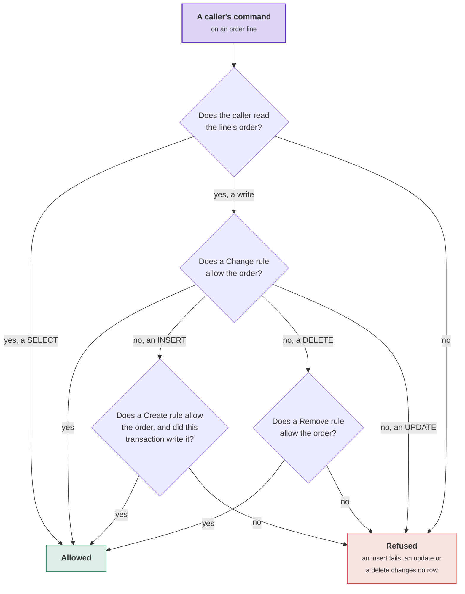

<details>
<summary>Show the code: the order's rules, and two of the policies they give its lines</summary>

The rules are on the order. No rule mentions the lines:

```csharp
[RowAccess<Order>(RowOperations.Read | RowOperations.Change)]
public static partial class ACustomerHasTheirOrders
{
    public static bool Allows(Order order, Caller caller)
        => order.PlacedBy == null || order.PlacedBy?.Value == caller.UserId;
}

[RowAccess<Order>(RowOperations.Create)]
public static partial class NobodyOrdersForSomebodyElse
{
    public static bool Allows(Order order, Caller caller) => order.PlacedBy?.Value == caller.UserId;
}
```

The policy for reading a line checks whether the caller reads the line's order. The policy for adding a line checks
the order's rules against the order:

```sql
CREATE POLICY "OrderLine (select) for authenticated" ON "ordering"."OrderLine" FOR SELECT TO authenticated
    USING (EXISTS (SELECT 1 FROM "ordering"."Orders" parent WHERE parent."Id" = "ordering"."OrderLine"."OrderId"));

CREATE POLICY "OrderLine (insert) for authenticated" ON "ordering"."OrderLine" FOR INSERT TO authenticated
    WITH CHECK (EXISTS (SELECT 1 FROM "ordering"."Orders" r WHERE r."Id" = "ordering"."OrderLine"."OrderId"
        AND (((r."PlacedBy" IS NULL) OR (r."PlacedBy" IS NOT DISTINCT FROM (SELECT "ddd".caller_id())))
          OR ((r."PlacedBy" IS NOT DISTINCT FROM (SELECT "ddd".caller_id())) AND "ddd".written_in_this_transaction(r.xmin)))));
```

</details>

The `Create` case lets a caller who may place an order, but may not change one, add the order's lines in the same
save. Later in the same transaction, only your own SQL can add more lines. When a save adds a line to an order, the
toolkit increments the order's version. That is an update, which needs `Change`.

The policy calls `ddd.written_in_this_transaction(xmin)` for the order's row. The function returns true when the
current transaction wrote the row's current version, inside a savepoint or not. Right after its drop step, every
script creates this function, and the `ddd` schema it lives in, when they are missing or differ.

> [!NOTE]
> The function returns true for a root row that the transaction wrote, whether the transaction inserted or updated
> the row. Any update counts, whatever made it:
>
> - an `UPDATE` policy that you wrote by hand,
> - a trigger, or a `SECURITY DEFINER` function,
> - a foreign key's `ON UPDATE CASCADE` or `ON DELETE SET NULL`, which run as the table's owner,
> - work that the application did earlier in that transaction as another caller.
>
> The rules' policies cannot cause such an update. A caller with only a `Create` rule cannot make an existing order
> count by updating it, because the update needs a `Change` rule, and so the update changes no row. An `UPDATE` policy
> of yours on the root therefore also lets its callers add entities wherever a `Create` rule holds.
>
> The policy also reads the root row as the caller. So a caller who may create a root but may not read it cannot add
> its entities. Whoever may create an aggregate should also be allowed to read it.

Postgres freezes a row that was written more than two billion transactions earlier. A frozen root row keeps the id of
the transaction that wrote it, and that id can look like the id of a recent transaction. Adding an entity to such a
row with only a `Create` rule then fails with an error, instead of the usual refusal. When the old id matches a
transaction that is running at that moment, the insert is allowed.

### Access functions

Whether the caller is one of a project's members is a question about the project's entities. A rule cannot ask it
directly. The entity tables have policies that check the aggregate's table to see whether their row is visible. A
policy on the aggregate's table that read the entity tables would call itself, and Postgres stops the query with
infinite recursion ([DDD00041](diagnostics.md#ddd00041)). Put the question in an access function, written like a
rule, and call the access function from the rules:

```csharp
[AccessFunction<Project>("projects.is_member")]
public static partial class ProjectMembership
{
    public static bool Allows(Project project, Caller caller)
        => project.Members.Any(member => member.UserId == caller.UserId);
}

[RowAccess<Project>(RowOperations.Read | RowOperations.Change)]
public static partial class MembersWorkOnTheirProjects
{
    public static bool Allows(Project project, Caller caller) => ProjectMembership.Allows(project, caller);
}
```

The access function becomes one SQL function:

- It runs as its owner, `SECURITY DEFINER`, so it reads the members without their policies.
- It runs with an empty search path, so nothing in the caller's session changes what it reads.

The rule calls the function for the row:

```sql
CREATE OR REPLACE FUNCTION projects.is_member(uuid) RETURNS boolean
    LANGUAGE sql STABLE SECURITY DEFINER SET search_path = '' AS $function$
    SELECT EXISTS (SELECT 1 FROM "projects"."Projects" root
                   WHERE root."Id" = $1 AND (EXISTS (SELECT 1 FROM "projects"."ProjectMember" e1
                                                     WHERE e1."ProjectId" = root."Id" AND ((e1."UserId" IS NOT DISTINCT FROM (SELECT "ddd".caller_id()))))))
$function$;

CREATE POLICY "Members work on their projects (select) for authenticated" ON "projects"."Projects" FOR SELECT TO authenticated
    USING (projects.is_member("Id"));
-- and the same for anon, and for UPDATE
```

**One context writes the function.** Only the context that maps `Project` writes the function, however many modules
see the class that declares it. That context writes the function before the policies that call it.

- A later script replaces the function in place, so other modules' policies that call it keep working.
- The script drops the functions that the context no longer declares, once nothing calls them.
- Two functions with the same `schema.name` in the database are refused, whether one context writes both or two
  contexts write one each.

**Only the roles that call the function may run it.** The script:

- revokes the function from `PUBLIC`,
- takes back every other grant on it except its owner's, including grants from a schema's default privileges and
  grants from an earlier script,
- grants it to the roles of the policies that call it, `anon` and `authenticated` above.

Only its owner, a superuser and functions that run as their owner can run a function that no policy calls. A script
for one context knows only that context's policies. When another module's policy calls the function for a different
role, write the contexts together with `PostgresRowAccess.Scripts`, as the Supabase build does. Or grant the function
yourself after the script.

**Its parameters and its return type are fixed.** Postgres cannot change either with `CREATE OR REPLACE`. Postgres
also cannot drop a function that other modules' policies call without dropping those policies. To change the
parameters or the return type, give the function a new name. The old function stays while another module's policy
still calls it. The context's next script drops it once no policy does. The Supabase export compares the change with
the module's newest access file, refuses the change and says why. A script of yours has no history to compare with.

**Called with an id.** A rule may hold a project's id and not the project. For such a rule, the generator adds `Name`
and an `Allows` overload that takes the aggregate's id. `ProjectMembership.Allows(task.ProjectId)` becomes
`projects.is_member("ProjectId")`. Only the database can answer this overload. Called in C#, it throws
`DatabaseOnlyException`. Where C# holds the project, `ProjectMembership.Allows(project, caller)` answers in memory,
because the members are loaded with the project.

**Other modules** see only the Projects module's contracts. The contracts cannot hold the definition, because the
definition reads the module's aggregate. So the contracts publish the function for the aggregate's id type, and the
definition takes its name from the contract:

```csharp
// Projects.Contracts
[AccessFunctionContract<ProjectId>("projects.is_member")]
public static partial class ProjectMembers;

// Projects
[AccessFunction<Project>(ProjectMembers.Name)]
public static partial class ProjectMembership
{
    public static bool Allows(Project project, Caller caller)
        => project.Members.Any(member => member.UserId == caller.UserId);
}

// Tasks
[RowAccess<ProjectTask>(RowOperations.All)]
public static partial class ProjectMembersWorkOnItsTasks
{
    public static bool Allows(ProjectTask task, Caller caller) => ProjectMembers.Allows(task.ProjectId);
}
```

The function's name is written once, and the id is typed. A rule cannot pass a task's id where a project's id is
expected. The Supabase build writes the access file of the module that owns a function before the files of the
modules that call it. It refuses a rule that calls a function that no module defines.

`Sql.Call` stays for functions defined outside C#, in a migration of yours, such as an existing
`extras.can_export("Id")`. The build does not look for those among the access functions. It writes the name as you
give it, without quotes, and Postgres reads such a name in lower case. So `Sql.Call<bool>("Tenancy.my_check", ...)`
calls `tenancy.my_check`. To call a function of yours in a schema with capitals, do one of these:

- Use `Sql.Raw<bool>`, whose SQL names the schema in double quotes: `Sql.Raw<bool>("\"Tenancy\".my_check(\"Id\")")`.
- Write the function as an access function with a name [relative to its module](#function-names-relative-to-the-module).
  The export writes that schema in double quotes, as it writes [every schema it names](#schema-names).

`Any` runs over the aggregate's own collections, with or without a condition. Inside an `Any`, the rule may check the
entity's own entities in the same way, as deep as the model goes:

```csharp
[AccessFunction<Ticket>("desk.reacted_to_comment")]
public static partial class ReactedToComment
{
    public static bool Allows(Ticket ticket, Caller caller, string text)
        => ticket.IsPublic || ticket.Comments.Any(comment => comment.Text == text
            && comment.Reactions.Any(reaction => reaction.User == caller.UserId));
}
```

- The inner `Any` becomes an `EXISTS` inside the outer one, joined to the comment it checks.
- The inner `Any` may read that comment, its own reaction, the caller and the function's parameters.
- The inner `Any` may not read another of the aggregate's collections, such as `ticket.Watchers.Any(...)` inside
  `ticket.Comments.Any(...)`. That is DDD00039. Put the two side by side instead, joined with `&&` or `||`.
- A row rule reads no collection at all, including an entity's entities. It calls an access function (DDD00041).

**More parameters.** `Allows` may take more parameters after the caller: a `string`, `bool`, `int`, `long`, `Guid`
or an id. Each one becomes a parameter of the SQL function, after the aggregate's id. The generator also adds them to
the `Allows` overload that takes the id, and a rule passes them along:

```csharp
[AccessFunction<Project>("projects.has_role")]
public static partial class ProjectRoles
{
    public static bool Allows(Project project, Caller caller, string role)
        => project.Members.Any(member => member.UserId == caller.UserId && member.Role == role);
}

// ProjectRoles.Allows(project, caller, "lead") and ProjectRoles.Allows(task.ProjectId, "lead") both become
// projects.has_role("Id", 'lead') and projects.has_role("ProjectId", 'lead') in their policies
```

The function is `projects.has_role(uuid, text)`. A contract publishes a function like it by declaring the method,
`static partial bool Allows(ProjectId key, string role);`, and the generator writes its body.

### Set-shaped access functions

An access function that checks one row runs once for every row that a query looks at. For the question "which of
these may the caller see", the other direction is cheaper. The function runs once per statement and returns the set
of ids it allows. Postgres then finds those rows through the index on the id. A set-shaped access function returns an
`AccessSet<T>`, and a rule checks the set with `Contains`:

```csharp
[AccessFunction<Ticket>("tickets_i_watch", Shape = AccessFunctionShape.Set)]
public static partial class TicketsIWatch
{
    public static bool Allows(Ticket ticket, Caller caller)
        => ticket.Watchers.Any(watcher => watcher.User == caller.UserId);
}

[RowAccess<Ticket>(RowOperations.Read)]
public static partial class WatchersReadTheTicketsTheyWatch
{
    public static bool Allows(Ticket ticket, Caller caller) => TicketsIWatch.Ids().Contains(ticket.Id);
}
```

With `Shape = AccessFunctionShape.Set`, the generator adds `Ids(...)` in place of the `Allows` overload that takes an
id. `Ids(...)` takes the function's own parameters. The policy calls the set once.

In the diagram, purple is the rule and green is the index scan that it leads to:

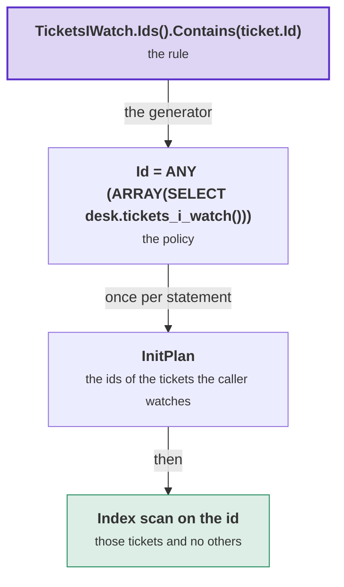

<details>
<summary>Show the code: the function that the export writes, and the policy that calls it</summary>

```sql
CREATE OR REPLACE FUNCTION "desk".tickets_i_watch() RETURNS SETOF uuid
    LANGUAGE sql STABLE SECURITY DEFINER SET search_path = '' AS $function$
    SELECT DISTINCT e1."TicketId" FROM "desk"."TicketWatcher" e1
    WHERE (e1."User" IS NOT DISTINCT FROM (SELECT "ddd".caller_id()))
$function$;

CREATE POLICY "Watchers read the tickets they watch (select) for authenticated" ON "desk"."Tickets" FOR SELECT TO authenticated
    USING ("Id" = ANY (ARRAY(SELECT "desk".tickets_i_watch())));
-- and the same for anon, since the rule names no roles
```

</details>

The policy uses the form `= ANY (ARRAY(SELECT ...))` on purpose:

- Postgres runs `ARRAY(SELECT ...)` as an InitPlan, before it reads the table. It then looks the ids up in the index
  on the id.
- The same question written as `"Id" IN (SELECT ...)` stays a filter in a policy. It becomes a hashed SubPlan that is
  checked against every row the scan reads, with no index condition to narrow the scan.
- The toolkit's tests read both plans from `EXPLAIN`.

A function whose only question is about one of the aggregate's entities, as above, reads only the entities' table:
`SELECT DISTINCT e1."TicketId" FROM ... e1`. So its work grows with what the caller holds, and not with the number of
tickets. In the tests, on 5,000 tickets, it reads about half the buffers of the same question asked from the tickets'
table. A question about the entities of those entities starts from the same table and checks their tables inside it.
So the tickets' table is still never read:

```csharp
[AccessFunction<Ticket>("desk.tickets_i_reacted_in", Shape = AccessFunctionShape.Set)]
public static partial class TicketsIReactedIn
{
    public static bool Allows(Ticket ticket, Caller caller)
        => ticket.Comments.Any(comment => comment.Reactions.Any(reaction => reaction.User == caller.UserId));
}
```

```sql
CREATE OR REPLACE FUNCTION desk.tickets_i_reacted_in() RETURNS SETOF uuid
    LANGUAGE sql STABLE SECURITY DEFINER SET search_path = '' AS $function$
    SELECT DISTINCT e1."TicketId" FROM "desk"."TicketComment" e1
    WHERE (EXISTS (SELECT 1 FROM "desk"."CommentReaction" e2 WHERE e2."TicketCommentTicketId" = e1."TicketId" AND e2."TicketCommentId" = e1."Id" AND ((e2."User" IS NOT DISTINCT FROM (SELECT "ddd".caller_id())))))
$function$;
```

A set-shaped function needs an aggregate whose id is one column.

#### Database-only questions

Some questions that the database answers are not about one aggregate, such as the ids of what the caller follows.
Declare such a question in an `[AccessFunctions]` class, as a method without a body. The generator writes the body:

```csharp
[AccessFunctions]
public static partial class Questions
{
    [AccessSet("ids_i_follow")]
    public static partial AccessSet<TId> IdsIFollow<TId>(string kind) where TId : IEntityId;

    [AccessScalar("caller_team")]
    public static partial string CallerTeam();
}

// Questions.IdsIFollow<ProjectId>("projects").Contains(project.Id)
//   "Id" = ANY (ARRAY(SELECT "projects".ids_i_follow('projects')))
// project.Team == Questions.CallerTeam()
//   "Team" = (SELECT "projects".caller_team())
```

- An `[AccessSet]` question returns a set. An `[AccessScalar]` question returns a value. Called in C#, either one
  throws `DatabaseOnlyException`.
- The parameters are strings, numbers, flags, `Guid`s, ids, or a type parameter constrained to `IEntityId`, for a
  question over ids that a package does not know.
- The SQL function is the function of that name. It is an access function, or a function that a package writes into
  your migrations.
- A question named with its schema, such as `extras.caller_team`, is a function of yours. The policy calls it as
  written, as `Sql.Call` does.

**The arguments of a set do not read the row.** The database asks for a set once per statement. Only the value
compared with the set, the argument of `Contains`, may be a column. The question's own arguments are constants, the
caller, or the parameters of the enclosing access function. An argument that read the row would make the set
different for every row, and the database would ask for the set once per row after all
([DDD00051](diagnostics.md#ddd00051)). A scalar question may take a column, and is then asked once per row.

**A scalar question and null.** A question such as `CallerTeam()` returns `NULL` for a caller it does not know. Such
a caller must pass no condition built on that question. So a comparison with a scalar question uses SQL's operators,
`a = b`, `a <> b` and `a < b`, whatever C# says about the nullability of the two sides. For such a caller the
comparison is unknown, and a policy counts unknown as no:

- A ticket without a team is not in the team of a caller without one.
- A team is not "another team" than a team nobody knows.
- The comparison stays unknown under `!`. So `!(ticket.Team == Questions.CallerTeam())` lets such a caller through no
  more than `==` does.

There is no C# behavior to match here, because the question throws in C#.

**A row of the caller.** An `[AccessRow]` question returns one row of a table, the caller's row. A rule reads a field
of that row as it reads a column. The method takes no parameters, and returns the class that the table is mapped to,
or a type parameter constrained to `class`. The function of that name returns `SETOF` that table. The database asks
the question once per statement, for the field that the rule reads:

```csharp
[AccessFunctions]
public static partial class Questions
{
    [AccessRow("caller_profile")]
    public static partial Profile CallerProfile();
}

// project.Region == Questions.CallerProfile().Region
//   "Region" = (SELECT q1."Region" FROM "projects".caller_profile() q1)
```

- The model of the context that the policy is written for must map the class to a table. The column names come from
  that model. A rule of another context is refused when its script is written.
- When the function returns no row, every field is null, and the caller passes no condition built on a field.
- Tenancy offers one such question, the calling seat's row:
  `TenancyRowAccess.CallerSeat<Seat>().Kind == SeatKind.Employee`.

### Function names relative to the module

The host chooses a module's schema, so a module does not have to write the schema into its function names. A name
without a schema is relative to its owner. `tickets_i_watch` in the Desk module is `desk/tickets_i_watch`. The export
creates the function in the schema of the context that maps the aggregate: that context's default schema, or else the
schema of the aggregate's table, whatever the host called it. The owner is one of these:

- the module that the declaring assembly names with `[assembly: Module("Desk")]`, written as a module's name is
  written in a migration's file name,
- the `Owner` of the class's `[AccessFunctions]`, which a package that declares no module uses.

```csharp
[AccessFunction<Ticket>("tickets_i_watch", Shape = AccessFunctionShape.Set)]
[AccessFunctions(Owner = "desk")]
public static partial class TicketsIWatch { ... }
```

- A name with neither a schema nor an owner is [DDD00052](diagnostics.md#ddd00052).
- `schema.name` keeps working as before.
- A name with a slash, such as `projects/is_member`, is taken as written. A definition in one module matches a
  contract that another module publishes this way.
- A contract's generated `Name` is the name it was declared with, with a relative name made logical.
  `[AccessFunctionContract<ProjectId>("is_member")]` in Projects' contracts has the `Name` `projects/is_member`.
  `ProjectMembers` above has `projects.is_member`. Either way, `[AccessFunction<Project>(ProjectMembers.Name)]`
  defines the function wherever it lives.

A rule calls the function by its logical name, `{fn:desk/tickets_i_watch}` in its SQL. A script writes the name that
the function has in the database:

- A script knows the functions of its own context. `PostgresRowAccess.Scripts` and the Supabase build know the
  functions of every context. So a rule of one module may call a function that another module defines.
- A script of one context whose rules call another context's functions needs their names. Pass them in
  `RowAccessExport.FunctionNames`, from `PostgresRowAccess.FunctionNamesOf(contexts, functions)`.
- A rule that calls a logical name that nothing defines is refused when its script is written. The refusal names the
  rule.

A relative name lands in the context's default schema, or else in the schema of its aggregate's table. The script
writes the schema in double quotes, as it writes [every schema](#schema-names): `"desk".tickets_i_watch()`. The
function's own name is the module's choice, and the script writes it as given. A name with its schema is SQL as you
write it, and Postgres reads it in lower case. So `Desk.tickets_i_watch` is `desk.tickets_i_watch`, a function in a
different schema than `"Desk"`. Name a function in a schema with capitals relative to its module instead.

### Schema names

The toolkit writes every schema that it names in double quotes:

- a module's schema, Tenancy's and Membership's, the schema of the migration history, and the toolkit's `ddd`,
- in the access files, the setup script, and the statement that the interceptor sends,
- for a function, a table, a grant, a trigger and a comment,
- in the messages of the start-up checks, so a fix that a check names runs as written.

Postgres keeps a name in double quotes as written. So the SQL names the schema that Entity Framework made,
whatever the model calls it. No code has to decide whether a name needs the quotes, and any name that Entity
Framework accepts works.

In the diagram, purple is the model's schema and green is the schema that the SQL reaches:

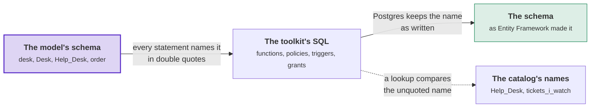

| The context says | The script writes |
|---|---|
| `HasDefaultSchema("desk")` | `"desk".tickets_i_watch()`, `"desk"."Tickets"` |
| `HasDefaultSchema("Desk")` | `"Desk".tickets_i_watch()`, `"Desk"."Tickets"` |
| `HasDefaultSchema("Help_Desk")` | `"Help_Desk".tickets_i_watch()`, `"Help_Desk"."Tickets"` |
| `HasDefaultSchema("order")` | `"order".tickets_i_watch()`, `"order"."Tickets"` |

- The names inside the schema are written as before. A table is written as Entity Framework names it, `"Tickets"`. A
  function is written by its own name, `tickets_i_watch`.
- To find what an earlier script made, for dropping it, keeping it or taking its grants back, a script compares the
  schema and the name that the catalog keeps, as strings: `('Help_Desk', 'tickets_i_watch')`.
- A schema longer than the 63 bytes that Postgres keeps of a name is refused. Postgres would cut the name, and the
  script would no longer find what it made there.
- A statement of a contribution names a function of its own in the same way, with
  `RowAccessModel.Schema(context.Model)`.

The toolkit writes the names that it does not choose as they were given:

- A function that you name with its schema is SQL of yours. This covers an access function declared `schema.name`,
  a `Sql.Call`, a caller function, and a `RowAccessExport.FunctionNames` entry written by hand.
- Postgres's `pg_catalog` and the functions of Supabase and pgmq, such as `auth.uid()` and `pgmq.send(...)`, are
  written as their makers document them.
- The SQL that Entity Framework writes, the migrations and a context's queries, names a schema as Entity Framework
  does, in double quotes only where Postgres needs them.
- The Supabase export writes one line into a migration's file, the `ENABLE ROW LEVEL SECURITY` of a table that the
  migration creates. That line is the toolkit's, and quotes the schema like every other statement of the toolkit:
  `ALTER TABLE "desk"."Tickets" ENABLE ROW LEVEL SECURITY;`.
- The prose of these pages names a function without the quotes, such as `ddd.caller_id()`. It is the same function.

<details>
<summary>Show the code: a module in "Help_Desk"</summary>

```csharp
modelBuilder.HasDefaultSchema("Help_Desk");
```

```sql
CREATE OR REPLACE FUNCTION "Help_Desk".tickets_i_watch() RETURNS SETOF uuid
    LANGUAGE sql STABLE SECURITY DEFINER SET search_path = '' AS $function$
    SELECT DISTINCT e1."TicketId" FROM "Help_Desk"."TicketWatcher" e1
    WHERE (e1."User" IS NOT DISTINCT FROM (SELECT "ddd".caller_id()))
$function$;

CREATE POLICY "Watchers read the tickets they watch (select) for authenticated" ON "Help_Desk"."Tickets" FOR SELECT TO authenticated
    USING ("Id" = ANY (ARRAY(SELECT "Help_Desk".tickets_i_watch())));

-- The next file finds the functions this one made by the names the catalog keeps:
--   AND (n.nspname, p.proname) NOT IN (('Help_Desk', 'tickets_i_watch'))
```

</details>

### Resource access contracts

A package that keeps a resource's access writes the functions that answer it, and names those functions itself. For
each resource with members, the [Membership package](membership/postgres.md#the-five-functions) writes functions that
return the resources the caller sees and the resources the caller holds a permission on. It takes their names from
the resource's rules. A rule should not repeat those names, and a module that checks another module's resource should
not need to know them. So the rule asks by the resource's id. An `[AccessFunctionContract]`, above, is for a function
that your module defines and names. A `[ResourceAccessContract]` is for a set that a package returns.

In the diagram, purple is the contract and green is the policy that the export writes:

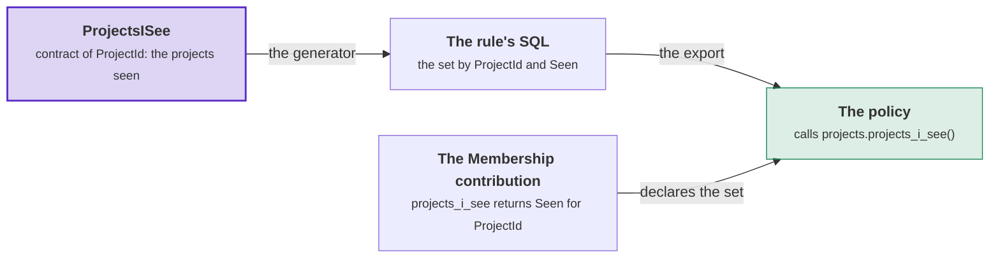

The contract is one line, in the contracts of the module that owns the resource. It names the resource's id and the
set, and no function:

| Set | The contract publishes | Returns |
|---|---|---|
| `ResourceAccessSet.Seen` | `Ids()` | the resources the caller sees |
| `ResourceAccessSet.HeldOn` | `Ids(string permission)` | the resources the caller holds the permission on |
| `ResourceAccessSet.FellowMembers` | `Ids()`, which the contract declares itself with the id that its members are known by: `public static partial AccessSet<SeatId> Ids();` | the members of the resources the caller is a member of, the people the caller works with. Their ids are not a resource's ids. |

A rule checks the set as it checks any set, with `Contains`, once per statement. The generator writes the set into
the rule's SQL by the id's full name and the set. The export writes the policy with the function that a contribution
declares for that set and that id. The Membership package declares this for the two functions it writes for each
resource, so a host only lists its contribution.

- **The function's name is set in one place, or nowhere.** The functions take their names from the resource's
  rules. A database that already has its own names keeps them in the rules, under `functions:`, and nothing else
  changes. A rule names no function.
- **Another module calls the owning module's contract.** The contract references only the id. So the calling
  module knows neither the resource's aggregate nor the package that returns the set. The owning module's rules call
  the same contract, so a question has one name in every module.
- **Only the owning module declares a contract.** A contract of an id whose assembly declares another module is
  [DDD00038](diagnostics.md#ddd00038). So only the owning module publishes what it shares of its resources. Any
  project of that module may declare the contract. Its contracts project is the place where other modules can see
  it.
- **Refused when no function returns the set.** A rule that asks for a set that no contribution of the export
  returns is refused when its access file is written. That happens, for example, when the host does not list the
  Membership contribution for the resource. The refusal names the rule and the resource. A rule written without the
  context that keeps the resource is refused too, such as in a script of one context or an export of one module. The
  message says to write them together, or to give the script the other context's names. One function returns a set
  for a resource.
  Two functions that declare the same set, in one context or in two, are refused, and the refusal names both.
- **SQL of yours calls a set the same way.** A contract's generated `Name` is the set's name. So a contribution of
  yours writes `{fn:...}` with `ProjectsWhereIHold.Name` in it, as the sample's `UnitChangesWithItsPermissions` does.
- **A package of yours** declares which set a function returns with `Answers` on its `ContributedFunction`:
  `new ResourceAccessAnswer(typeof(TId), ResourceAccessSet.Seen)`. Such a function returns `SETOF` the id's type,
  or `SETOF` the members' id type for `FellowMembers`. It takes no parameters for the resources seen and for the
  members. It takes the permission as `text` for the resources that a permission is held on. Any other shape is
  refused when the script is written.
- **Two modules that call each other.** A read rule on Tenancy's seats may check who works on the same projects. That
  rule calls a function of the projects' module, whose functions call Tenancy's functions to find the calling seat.
  Postgres refuses a policy that calls a function that does not exist yet, so neither file could run first. The
  export still writes Tenancy's file first. It writes a Tenancy function with the same name that calls the projects'
  function by name at run time. Postgres's check of a function's body is turned off for that function only, and the
  policy calls it. So you write the rule like any other, and you arrange nothing. Only a function that a package
  writes is called this way. Two modules whose own access functions call each other are still refused, and the
  refusal names the cycle.

A contract that declares its `Ids` itself, for documentation, gets that declaration implemented. The contract's id is
the id of the resource's aggregate. That id is one of these:

- an id declared with `[EntityId<Guid>]`, as a module's contracts declare it,
- in the project that declares the aggregate, the id that the generator writes next to an aggregate root declared
  with a value: `BoardId` for `[AggregateRoot<Guid>] public partial class Board`,
- an id that a package's switch writes into the project: `OrganizationUnitId` next to
  `[assembly: GenerateTenancyIds]` in a contracts project
  ([Modules split by layer](tenancy/your-module.md#modules-split-by-layer)).

A contract of another shape is [DDD00038](diagnostics.md#ddd00038).

<details>
<summary>Show the code: Projects' contracts, a rule of each module that calls them, and the policy that the export writes</summary>

```csharp
// Projects.Contracts, the module's contracts project: what other modules may ask, a line each
[ResourceAccessContract<ProjectId>(ResourceAccessSet.Seen)]
public static partial class ProjectsISee;

[ResourceAccessContract<ProjectId>(ResourceAccessSet.HeldOn)]
public static partial class ProjectsWhereIHold;

// Projects.Infrastructure: the module's own rule calls its contract
[RowAccess<Project>(RowOperations.Read, To = [RowAccessRoles.User])]
public static partial class SeatsSeeTheProjectsTheyReach
{
    public static bool Allows(Project project, Caller caller) => ProjectsISee.Ids().Contains(project.Id);
}

// Inspections.Infrastructure: another module's rule calls the same contract, with the project id it stores
[RowAccess<Inspection>(RowOperations.Create, To = [RowAccessRoles.User])]
public static partial class SeatsRecordWhereTheyMay
{
    public static bool Allows(Inspection inspection, Caller caller)
        => ProjectsWhereIHold.Ids(InspectionPermissionNames.Record).Contains(inspection.ProjectId)
            && inspection.RecordedBy == TenancyRowAccess.CallerSeatId<SeatId>();
}
```

The rule's SQL as the generator writes it, and its policy as the export writes it, with the name that the projects'
rules give the function:

```sql
-- SeatsRecordWhereTheyMay.RowAccessSql
(({col:ProjectId} = ANY (ARRAY(SELECT {fn:@Examples.Tenancy.Projects.Contracts.ValueObjects.ProjectId/held_on}('inspections.record'))))
  AND ({col:RecordedBy} = (SELECT {fn:tenancy/caller_seat}())))

-- Inspections' access file
CREATE POLICY "Seats record where they may (insert) for authenticated" ON "inspections"."Inspections" FOR INSERT TO authenticated
    WITH CHECK (("ProjectId" = ANY (ARRAY(SELECT "projects".projects_where_i_hold('inspections.record')))) AND ("RecordedBy" = (SELECT "tenancy".caller_seat())));
```

</details>

### Column rules

Postgres checks a policy per row and per command, and never per column. Postgres cannot tell a policy which columns a
statement changes. Where every change to a row needs the same permission, a rule needs nothing more. Where one column
needs a stricter permission than the rest of the row, the policy for `UPDATE` must let through whoever holds any of
the permissions. A caller who holds one of them can then change every column.

A project shows the problem:

- Renaming a project needs the permission to edit it.
- Closing a project needs the permission to close it.
- Changing its crew needs the permission to manage the crew.
- Changing its owner needs the permission to name owners.
- A project that moves must pass at the unit it moves to, where the move needs the permission to open projects.

So the policy that lets a seat change a project accepts any of those permissions. A seat that only manages the crew,
or only opens projects at the unit, could rename the project with an SQL statement of its own. That statement would
bypass the access check before the handler.

`Columns` on a rule makes it a column rule. A column rule adds one more condition, for a change of those columns only:

```csharp
[RowAccess<Project>(RowOperations.Change, To = [RowAccessRoles.User], Columns = [nameof(Project.State)])]
public static partial class StateChangesWithTheClosePermission
{
    public static bool Allows(Project project, Caller caller) => ProjectsWhereIHold.Ids(ProjectPermissionNames.Close).Contains(project.Id);
}
```

You write a column rule next to the other rules, in your infrastructure. Nothing about it goes on the aggregate. The
script writes a column rule as a trigger. The trigger runs before an update of the columns that the rule holds,
checks the rule, and refuses the statement when the rule says no.

In the diagram, purple is the update, green is a change that goes ahead, grey is a row that stays unchanged, and red
is a refusal:

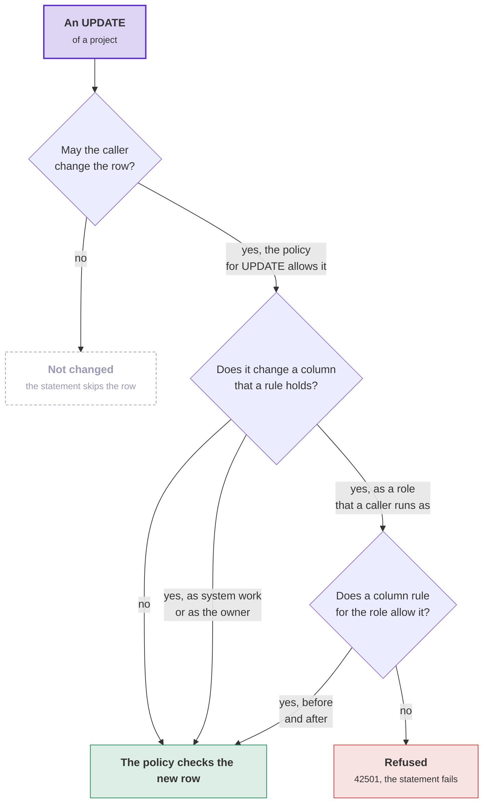

<details>
<summary>Show the code: two column rules of a project, and the trigger that one of them becomes</summary>

The project's change rule accepts any permission that changes a project. It checks each permission on the project,
and the permission to open projects at the project's unit. The two column rules hold the columns whose commands need
a stricter permission:

```csharp
[RowAccess<Project>(RowOperations.Change, To = [RowAccessRoles.User])]
public static partial class SeatsChangeTheProjectsTheyWorkOn
{
    public static bool Allows(Project project, Caller caller)
        => ProjectsWhereIHold.Ids(ProjectPermissionNames.Edit).Contains(project.Id)
            || ProjectsWhereIHold.Ids(ProjectPermissionNames.Close).Contains(project.Id)
            || ProjectsWhereIHold.Ids(ProjectPermissionNames.ManageCrew).Contains(project.Id)
            || ProjectsWhereIHold.Ids(ProjectPermissionNames.ChangeOwner).Contains(project.Id)
            || TenancyRowAccess.UnitsWhereIHold<OrganizationUnitId>(ProjectPermissionNames.Open).Contains(project.UnitId);
}

[RowAccess<Project>(RowOperations.Change, To = [RowAccessRoles.User], Columns = [nameof(Project.Name), nameof(Project.Planned)])]
public static partial class NameAndPlanChangeWithTheEditPermission
{
    public static bool Allows(Project project, Caller caller) => ProjectsWhereIHold.Ids(ProjectPermissionNames.Edit).Contains(project.Id);
}

[RowAccess<Project>(RowOperations.Change, To = [RowAccessRoles.User], Columns = [nameof(Project.State)])]
public static partial class StateChangesWithTheClosePermission
{
    public static bool Allows(Project project, Caller caller) => ProjectsWhereIHold.Ids(ProjectPermissionNames.Close).Contains(project.Id);
}
```

What the script writes for the state, shortened. The rule reads only the row's id. So the trigger checks the new row
only when the id changes:

```sql
CREATE OR REPLACE FUNCTION "projects".projects_state_column_rule() RETURNS trigger
    LANGUAGE plpgsql SET search_path = '' AS $body$
BEGIN
    IF CURRENT_USER = 'authenticated' THEN
        IF (OLD."Id" = ANY (ARRAY(SELECT "projects".projects_where_i_hold('projects.close')))) IS NOT TRUE
           OR (OLD."Id" IS DISTINCT FROM NEW."Id" AND (NEW."Id" = ANY (ARRAY(SELECT "projects".projects_where_i_hold('projects.close')))) IS NOT TRUE) THEN
            RAISE EXCEPTION USING ERRCODE = 'insufficient_privilege', CONSTRAINT = 'projects_state_column_rule', HINT = 'ddd:access.refused',
                MESSAGE = 'The column rule ''State changes with the close permission'' does not let this caller change "State" of "projects"."Projects".';
        END IF;
    ELSIF CURRENT_USER IN ('anon', 'tenancy_operator') THEN
        RAISE EXCEPTION USING ERRCODE = 'insufficient_privilege', CONSTRAINT = 'projects_state_column_rule', HINT = 'ddd:access.refused',
            MESSAGE = 'No column rule is for this caller''s role, so it may not change "State" of "projects"."Projects".';
    END IF;
    RETURN NEW;
END
$body$;

CREATE TRIGGER projects_state_column_rule BEFORE UPDATE OF "State" ON "projects"."Projects"
    FOR EACH ROW WHEN (OLD."State" IS DISTINCT FROM NEW."State")
    EXECUTE FUNCTION "projects".projects_state_column_rule();
COMMENT ON TRIGGER projects_state_column_rule ON "projects"."Projects" IS 'DDDToolkit column rule';
```

A script of yours writes the same from `RowAccessRule.ForColumns<Project>("State changes with the close permission",
[nameof(Project.State)], StateChangesWithTheClosePermission.RowAccessSql, RowAccessRoles.User)`. A column rule's
`RowAccessSql` starts with `{columns}`. `ForColumns` accepts that placeholder, and `RowAccessRule.For` refuses it. As
a rule about whole rows, the column rule would let whoever it allows change every column. An export from a toolkit
version without column rules stops at the placeholder that it does not know. It asks for the same version of the
toolkit's packages everywhere, and does not write such a policy.

</details>

- **The row's rules still decide first.** The trigger fires only for a row that the policy for `UPDATE` lets the
  caller change. The policy still checks the new row after the trigger. A column rule never lets a caller change
  something that a rule for the row does not allow. It narrows that rule, for its columns.
- **It is checked as a rule for `UPDATE` is checked**, against the row before the change and the row after it. Both
  must pass. A rule that reads only the row's id, such as a set-shaped check of the row's id, gives the same answer
  for both while the id stays the same. Every change that Entity Framework makes keeps the id. So such a rule is
  checked once per changed row.
- **It is checked once per changed row.** A policy asks for a set once per statement. A trigger runs for each row
  whose held column changes, and asks for the set again for each of those rows. Entity Framework's saves change one
  row per statement, so for them a column rule costs one more query of the set. A statement that changes a held
  column of many rows, such as an `ExecuteUpdate` or a Data API `PATCH` with a filter, asks for the set once for each
  of those rows.
- **Its SQL runs in the trigger, with an empty search path.** Every name that the toolkit writes carries its schema.
  A function that the rule calls with `Sql.Call` must name its schema too, such as `"public.is_agent"`, or
  `"pg_catalog.lower"` for a Postgres function. [DDD00038](diagnostics.md#ddd00038) enforces this. In a policy,
  Postgres resolves a name when the policy is created. In a trigger, Postgres resolves a name only when the trigger
  runs. The SQL of a `Sql.Raw` must also name every table and function with its schema. That SQL cannot read the
  row's columns by name, because a trigger knows the row only as the row before and after the change. Read the row
  in C# instead.
- **Several column rules on one column add up.** A change that one of them allows is allowed, as with the rules of a
  row. The columns that the same rules hold share one trigger. So a statement that changes several of those columns
  checks the rules once.
- **The trigger holds the roles that callers' statements run as.** These are the roles that the column rules are
  for, the signed-in user's role and the anonymous caller's role, every [token role](#token-roles) that you map, and
  any other role that a policy lets change the table. A held role that none of the column's rules is for may not
  change the column. In the same way, a role that no rule grants a command may not run that command. System work is
  not held. The [scoped system role](#the-scoped-system-role) and the bookkeeping role pass, unless a column rule
  names the role in `To`. The tables' owner and a role that may bypass RLS also pass, because no policy holds them
  either.
- **A value object is every column it is stored in.** `Columns = [nameof(Project.Planned)]` holds both columns of the
  planned range, and `"Planned.From"` holds one of them. Name a property of a value object with a dot, which `nameof`
  does not write. A collection of values stored in the row, such as a list of strings kept as an array, is its one
  column.
- **A script finds the trigger the way it finds a policy.** The trigger carries a comment. The drop at the start of
  every script, and of every migration of a module with rules, removes the trigger with the policies. So a rule that
  you remove loses its trigger with the next script. A migration may also drop or change a column that a column rule
  holds, which the trigger would otherwise block.
- **The database refuses, and the caller gets the refusal code `access.refused`.** The trigger raises `42501`,
  `insufficient_privilege`, with a message that names the rule, the trigger's name as the constraint, and the
  toolkit's hint. Every access guard that the toolkit writes refuses this way. Through Entity Framework, the save is
  refused like a save that a policy refuses: a `RefusalException` with the refusal code `access.refused`, and a
  warning that names the trigger ([When the database refuses](#when-the-database-refuses)).
- **It also holds a field of yours on a package's class.** A package can ship a class that you derive from, such as
  Tenancy's seat. Such a package writes the policies of its table itself. It guards its own columns there, and
  nothing that you add. Its table is one that the package [keeps to itself](#policies-a-package-ships), where a rule
  that would add a policy is refused. A column rule adds no policy, so the script accepts it there like anywhere else.
  A read rule is also accepted there, where the package made the read a [default](#policies-a-package-ships). Tenancy
  did this for reading the seats ([Who reads the seats](tenancy/postgres.md#default-read-policies-for-seats-and-invitations)).

The policy on Tenancy's seats lets a seat change its own row. It also lets a seat that manages seats or grants
anywhere in the tenant change any seat's row, because every save of a seat writes the seat's version. So a job title
that you add to your seat class is as writable as the row, because the package knows nothing about the job title. You
decide whether to hold it. Hold it to the permission that your command for changing it requires:

```csharp
[RowAccess<Seat>(RowOperations.Change, To = [RowAccessRoles.User], Columns = [nameof(Seat.JobTitle)])]
public static partial class JobTitlesChangeWithTheSeatsPermission
{
    public static bool Allows(Seat seat, Caller caller) => TenancyRowAccess.HoldsAtTenant(TenancyPermissions.SeatsManage);
}
```

A seat that gives roles at one unit can then still write every seat's row, and none of the job titles. The sample
holds a seat's name in the same way, with the rule of its rename command: the seat itself, or a seat that manages
seats for the whole tenant. The sample leaves the job title as writable as the row
([What the database guards on a seat](tenancy/postgres.md#who-may-change-a-seats-columns)).

[DDD00038](diagnostics.md#ddd00038) reports:

- a column rule for an operation other than `Change`, because the other operations are about whole rows,
- a name in `Columns` that is not a property of the aggregate or of a value object that the aggregate holds,
- a name in `Columns` that is a collection of the aggregate's entities, whose rows follow the rules for the
  aggregate's row,
- a `Sql.Call` without a schema.

A property that the model stores in no column of the aggregate's table, such as an ignored property, is refused when
the script is written. The refusal names the rule.

A column rule asks one question of the row before the change and of the row after it. Some changes need a different
question for each. Moving a project needs the permission to edit it where it was, and the permission to open projects
where it goes. Write such a check as a trigger of yours, in a [contribution](#policies-a-package-ships), as the
sample's `UnitChangesWithItsPermissions` does. For a resource whose members the
[Membership package](membership/postgres.md#who-writes-the-member-rows) keeps, the package holds the owner column with
a lock of its own. The package writes that lock from the permission that the resource's rules name for naming an
owner.

### Policies a package ships

A package, or a module of yours, can have tables that are not your aggregates. It can also have SQL whose names
depend on your model, such as the schema you gave its tables, or the column types of your ids. `[RowAccess]` rules
cannot cover those. So such a package writes its RLS itself, as a row access contribution. A row access contribution
is a class that the script calls for every context, to get the SQL to write there.

A package declares itself a contributor with `[assembly: RowAccessContribution]`. From then on, referencing the
package is your consent. Its SQL goes into the migrations of every application that references the package, directly
or through a module. You write no line and no class for it. A package such as [Tenancy on Postgres](tenancy/postgres.md)
does not work without its policies in the database, so there is nothing to choose.

```csharp
// In the package: an audit trail, whose entries are read by who wrote them. Every application that
// references the package writes this into its migrations.
[assembly: RowAccessContribution(typeof(AuditRowAccess))]

public sealed class AuditRowAccess : IRowAccessContribution
{
    public string Owner => "audit";

    public RowAccessContributionResult? Contribute(DbContext context, RowAccessExport export)
    {
        if (context.Model.FindEntityType(typeof(AuditEntry)) is not { } entries)
        {
            return null;   // this context does not map the package's table
        }

        var id = RowAccessModel.Column(entries, nameof(AuditEntry.Id));
        var writtenBy = RowAccessModel.Column(entries, nameof(AuditEntry.WrittenBy));
        return new(
            Functions:
            [
                new ContributedFunction("entries_i_wrote", "", "SETOF " + RowAccessModel.ColumnType(entries, nameof(AuditEntry.Id)),
                    $"SELECT e.{id} FROM {RowAccessModel.Table(entries)} e WHERE e.{writtenBy} = {{caller:uid}}",
                    SecurityDefiner: true, GrantTo: [RowAccessRoles.User]),
            ],
            Policies:
            [
                new ContributedPolicy(entries, "Entries are read by who wrote them", "SELECT", RowAccessRoles.User,
                    $"{id} = ANY (ARRAY(SELECT {{fn:audit/entries_i_wrote}}()))", null),
            ],
            Statements: [],
            ExclusiveTables: [entries]);
    }
}
```

SQL that belongs to your application, such as a trigger that one of your modules writes, is a contribution too. List
it in the project that runs the export: `[assembly: UseRowAccessContribution(typeof(UnitChangesWithItsPermissions))]`.
That line is for your own classes only.

- A module declares its class with `[assembly: RowAccessContribution]`, as a package does. The module's assembly
  declares a module, so this declaration is only an offer. Nothing is written until the exporting project lists the
  class.
- The build warns until the exporting project lists the class ([DDD00069](diagnostics.md#ddd00069)). So a forgotten
  line shows up, and your database gets only the SQL of yours that you chose.
- On a Postgres database without Supabase, pass every contribution to the script in `RowAccessExport.Contributions`.

#### Values a package takes from your application

The build makes a package's contribution in the project that runs the export, before your application starts. So the
contribution has none of your services. Some values that the SQL depends on are known only to your application, such
as your catalogue or a resource's rules. The package takes those values in its class's constructor. Each parameter
says with `[FromApplication]` which attribute you mark the value with. You mark a static property or field, where you
declare the value anyway. The build finds the marked member in the exporting project and in every project that the
exporting project references.

In the diagram, purple is the member that you mark and green is the class that the export calls:

```mermaid
flowchart TB
    reference["<b>The exporting project</b><br/><small>references the package</small>"]
    declared["<b>[assembly: RowAccessContribution]</b><br/><small>in the package</small>"]
    constructor["<b>The constructor</b><br/><small>[FromApplication(typeof(PlansAttribute))]</small>"]
    marked["<b>Your member</b><br/><small>marked [Plans]</small>"]
    written["<b>A generated class</b><br/><small>in DDDToolkit.RowAccessContributionsOfPackages.g.cs</small>"]
    export["<b>The export</b><br/><small>calls the class for every context</small>"]
    reference --> declared
    declared --> constructor
    constructor --> marked
    marked --> written
    written --> export
    classDef strong fill:#5b2ec933,stroke:#5b2ec9,stroke-width:2px
    classDef good fill:#1f8a5b26,stroke:#1f8a5b
    class marked strong
    class written good
```

The build fills a parameter in one of three ways:

- **One marked member.** This is the usual case.
  - Two marked members are an error, [DDD00071](diagnostics.md#ddd00071). The build does not guess which one your
    application runs with.
  - With no marked member, the parameter gets its default value, where it has one. Otherwise the build reports the
    warning [DDD00054](diagnostics.md#ddd00054), and does not write the package's SQL.
- **Every marked member**, for a parameter with `Every = true`. The parameter gets an array of all of them, in the
  order of their names. With no marked member, the array is empty.
- **Once for each member marked with a generic attribute**, for a generic contribution. The build makes the
  contribution once for every such member, closed over the type that the mark is written with.

More rules for marked members:

- A member of a type other than the parameter's type, or a member that is not static, is
  [DDD00071](diagnostics.md#ddd00071).
- The exporting project sees only the public parts of a library. So it does not find a member that a library marks
  when the member is internal, or is declared in an internal class. The export would then continue as if nothing were
  marked. So the library's own build reports such a mark where it is declared, as
  [DDD00070](diagnostics.md#ddd00070). It does this for every mark whose attribute is marked `[ApplicationMark]`, as
  Tenancy's and Membership's attributes are.
- A member marked in a project that the exporting project does not reference is not found either. Mark the member
  where the exporting project sees it.

<details>
<summary>Show the code: a package that takes your plans, and what the build writes for it</summary>

```csharp
// In the package
[assembly: RowAccessContribution(typeof(PlanRowAccess))]

[ApplicationMark]
[AttributeUsage(AttributeTargets.Property | AttributeTargets.Field)]
public sealed class PlansAttribute : Attribute;

public class PlanRowAccess([FromApplication(typeof(PlansAttribute))] IReadOnlyList<string> plans) : IRowAccessContribution { ... }

// In your application, where the plans are declared anyway
public static class ShopPlans
{
    [Plans]
    public static IReadOnlyList<string> All { get; } = ["free", "pro"];
}
```

**DDDToolkit.RowAccessContributionsOfPackages.g.cs**, in the project that runs the export

```csharp
namespace DDDToolkit.EntityFramework.Supabase.Generated
{
    /// The row access contribution Shop.Plans.PlanRowAccess, which Shop.Plans writes into the migrations of
    /// every application that references it, made with what this application marks:
    /// plans: Shop.ShopPlans.All, marked [Plans].
    internal sealed class PlanRowAccess : IPackageRowAccessContribution
    {
        private readonly IRowAccessContribution _contribution = new global::Shop.Plans.PlanRowAccess(
            plans: global::Shop.ShopPlans.All);

        public IRowAccessContribution Contribution => _contribution;

        public string Owner => _contribution.Owner;

        public RowAccessContributionResult? Contribute(DbContext context, RowAccessExport export)
            => _contribution.Contribute(context, export);
    }
}
```

</details>

The build writes the class into a file of its own, `DDDToolkit.RowAccessContributionsOfPackages.g.cs`, among the
exporting project's generated files. A comment in the file names every member that the class was made from. The class
passes the package's class to the export through `IPackageRowAccessContribution`. So the comment above the SQL in the
access file names the package's class and the package's assembly, without a version:
`-- Written by the row access contribution Shop.Plans.PlanRowAccess in Shop.Plans.` A new release of your
application, or of the package, that writes the same SQL makes no access file stale. A package whose SQL changed
writes a new access file, because the SQL differs.

#### Leaving a package's SQL out

A rare application must not write a package's SQL, because it writes those policies itself, or because a context's
database is not the package's to write. Declare this in the project that runs the export:

```csharp
// None of it: the application writes the package's policies itself.
[assembly: LeaveOutRowAccessContribution(typeof(AuditRowAccess))]

// Not in one context's access file; every other context still gets it.
[assembly: LeaveOutRowAccessContribution(typeof(AuditRowAccess), Context = typeof(ArchiveContext))]
```

- Leave out a generic contribution with its open type, for every closing of it, or with one closed type.
- To write a package's SQL with a class of yours instead, leave the package's contribution out, and list yours with
  `[assembly: UseRowAccessContribution]`. Listing yours without leaving the package's out would write the SQL twice.
  [DDD00072](diagnostics.md#ddd00072) stops that at build time. An application has this pair when it once passed
  data to a package through a class of its own. Remove the line and the class, and mark the values that the class
  passed.
- Nothing else checks what you leave out. A package's start-up checks still expect its SQL wherever the application
  uses the package.
- A line that leaves nothing out is a warning, [DDD00073](diagnostics.md#ddd00073). That happens when the line names
  no contribution that a package writes, or when its `Context` is not a class derived from `DbContext`.

An export may call a contribution for the same context several times. So a contribution returns the same answer each
time, from the model and from the values it was made with.

#### What a contribution writes

What a contribution returns for a context goes into that context's script. A comment above each part names the
contribution, its assembly and the assembly's version.

In the diagram, the script's parts are in the order they run, and purple marks the parts where a contribution's SQL
goes:

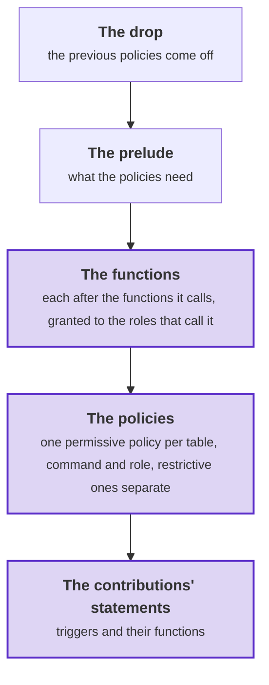

<details>
<summary>Show the code: what the audit contribution above adds to a script</summary>

```sql
-- Written by the row access contribution Audit.AuditRowAccess in Audit 1.2.0.
CREATE OR REPLACE FUNCTION "audit".entries_i_wrote() RETURNS SETOF uuid
    LANGUAGE sql STABLE SECURITY DEFINER SET search_path = '' AS $function$
SELECT e."Id" FROM "audit"."AuditEntries" e WHERE e."WrittenBy" = (SELECT auth.uid())
$function$;
COMMENT ON FUNCTION "audit".entries_i_wrote() IS 'DDDToolkit access function of AuditContext';
REVOKE ALL ON FUNCTION "audit".entries_i_wrote() FROM PUBLIC;

-- Who may execute the functions above: the roles granted it below, and nobody else. Every other grant
-- on them is taken back first, what an earlier file gave and what a schema's default privileges gave alike.
DO $ddd$ ... $ddd$;
GRANT EXECUTE ON FUNCTION "audit".entries_i_wrote() TO authenticated;

ALTER TABLE "audit"."AuditEntries" ENABLE ROW LEVEL SECURITY;

-- Entries are read by who wrote them (select) for authenticated asks the policy 'Entries are read by who wrote them' of the row access contribution Audit.AuditRowAccess in Audit 1.2.0.
CREATE POLICY "Entries are read by who wrote them (select) for authenticated" ON "audit"."AuditEntries" FOR SELECT TO authenticated
    USING ("Id" = ANY (ARRAY(SELECT "audit".entries_i_wrote())));
COMMENT ON POLICY "Entries are read by who wrote them (select) for authenticated" ON "audit"."AuditEntries" IS 'DDDToolkit row access rule';
```

</details>

**Functions**

- The script creates them in the default schema of the context that the contribution answered for, or in `public`
  when the context has none. An access function's schema is a table's schema. A contribution's function has the
  context's schema, because a contribution may write for several tables. The schema is any schema that Entity
  Framework accepts, written in double quotes like [every schema](#schema-names): `"tenancy".caller_seat()`,
  `"Tenancy".caller_seat()`.
- They are `LANGUAGE sql` with `SET search_path = ''`, so their bodies name everything with its schema.
- `SecurityDefiner` is false unless the contribution sets it.
- Rules and other contributions call a function by its logical name, `{fn:audit/entries_i_wrote}`, with the
  contribution's `Owner`. A script writes a function after the functions it calls.
- A function carries the context's function comment. So the next script keeps the function while the contribution
  still writes it, and replaces it in place. The script drops the function once the contribution stops writing it.
- A function that returns a resource's access declares its set with `Answers`. Rules then call it by the resource's
  id ([Resource access contracts](#resource-access-contracts)).
- A function returns a type, `SETOF` a type, or rows of named columns, such as
  `TABLE ("TicketId" uuid, "DueAt" timestamp with time zone)`. Those column names belong to the function. They are
  the same in every application, whatever its tables call their columns. So a package can map a function's rows for
  the modules that read them.

**Inlining a function into the query that calls it**

- A function that returns rows for other queries to read, as a view would, can set `Inlinable: true`.
- Postgres folds a set-returning SQL function into the calling query only when the function runs as its caller, is
  `STABLE` or `IMMUTABLE`, is not `STRICT`, is one `SELECT`, and has no `SET` clause. So the script writes such a
  function without `SET search_path = ''`. It refuses one that runs as its owner, is `VOLATILE`, or is not one
  `SELECT`.
- The plan then reads the tables that the function reads, with their indexes and with the caller's policies on them.
  A function that is not folded returns every row it may before the query narrows the rows.
- An inlined function has no pinned search path. That is safe for a function that runs as its caller. It has only
  the caller's privileges, and its body names every table, function and type with its schema, as every contributed
  function's body must. So nothing in it is looked up along the caller's search path.
- A function that runs as its owner always keeps the empty search path.

**Who may run a function**

- Its `GrantTo` roles and its owner may run it. The script takes back every other grant on it, including grants from
  a schema's default privileges.
- A policy for any other role that calls the function is refused, and the refusal names the rule and the function. A
  rule without `To` is also for `anon`. So for a function granted to signed-in users only, such a rule says
  `To = [RowAccessRoles.User]`.
- The same holds for a policy that calls the function through an access function. The access function runs as its
  owner, and so calls the function for whoever the policy is for.
- A function granted to no role is a helper for the functions that run as their owner, including access functions.
- A contributed function that runs as its caller may call only functions that are granted to every role it is granted
  to.

**Policies**

- A contributed policy is named like a rule's policy, `"<name> (select) for authenticated"`, and carries the rules'
  comment. So the next script drops it.
- A permissive contributed policy is merged with the permissive policies of the rules and of other contributions for
  the same table, command and role. Postgres would join them with `OR` anyway.
- A restrictive contributed policy is a separate policy, and narrows whatever the others allow.
- Two policies with the same name on one table are refused, and the refusal names both.
- Every table that a contributed policy names gets RLS.

**Tables a contribution keeps to itself**, its `ExclusiveTables`

- Such a table gets RLS and policies from that contribution only. A rule or another contribution that would add a
  policy is refused, and the refusal names both. The exception is a rule that replaces a default read, below.
- A [column rule](#column-rules) adds no policy. It holds a column of such a table anyway, such as a field that the
  application added to the package's class.
- A [restrictive rule](#restrictive-rules) takes nothing from such a table either, because it only narrows.

**Tables that follow an aggregate**, its `Following`

- `Following` maps a table to the aggregate that it belongs with, though the table is not an entity of that
  aggregate.
- A restrictive rule on the aggregate narrows that table too, with a condition about the caller only.
- Tenancy declares this for the closure of the tree, which follows the organization.

**A default read**

Often your application decides who sees which rows, and the package does not. So a contribution may mark what a role
reads as a default: a permissive policy for `SELECT` with `Default = new ContributedDefault(Kept, Within)`.

- Without a rule of yours about it, the script writes the default as it is.
- A `[RowAccess]` rule of yours about the aggregate on that table, which allows `Read` to the same role, replaces the
  default. The script limits your rule to `Within`, which the package keeps every caller to, such as the tenant. It
  adds `Kept` next to your rule, the rows that the package's own work reads whatever your rule says. The comment above
  the policy names the rule, the default that it replaced, and the contribution.
- On a table that the contribution keeps to itself, such a rule is the only rule accepted. A rule that allows
  anything other than `Read`, or whose `To` names a role that the default is not for, is refused. The refusal says
  what the contribution lets a rule replace.
- On such a table, a rule without `To` is for the roles of the default, and not for signed-in users and anonymous
  callers as elsewhere. So you write the rule in its usual form, and a role that the table is closed to stays closed.
- The rule replaces the read of the aggregate's table only. The tables of its entities keep the policies of the
  contribution that keeps them. A rule whose aggregate has an entity table that no contribution keeps is refused, and
  the refusal names the table.
- Tenancy's seats are the example ([Who reads the seats](tenancy/postgres.md#default-read-policies-for-seats-and-invitations)).

**Statements**

- Statements come last, one statement each, and must be able to run again. They are triggers and the functions that
  the triggers run.
- The script gives a statement's function no grants. So only a trigger's function may be `SECURITY DEFINER`, because
  nobody can call a trigger function directly.
- Such a function says `SET search_path = ''`. Otherwise the schemas of a caller's session would decide what the
  function runs with its owner's privileges.
- Any other function that runs as its owner is a `ContributedFunction`.

**Placeholders and model names**

- In all of these, `{fn:owner/name}`, `{caller:uid}`, `{caller:role}`, `{caller:claims}`, `{caller:signedin}` and
  `{caller:claim:path}` are filled in as in a rule, with the export's caller functions. Write a literal brace as `{{`
  or `}}`.
- `RowAccessModel` writes names from the model, each in double quotes, so it means them as the model spells them:
  - `Table`, `Column` and `ColumnType`,
  - `Stored`, for a value as its column stores it,
  - `EntityTablesOf`, for the tables of an aggregate's entities and the path up to the aggregate's table,
  - `Schema`, for the schema that a statement creates a trigger's function in,
    `$"{RowAccessModel.Schema(context.Model)}.entry_is_kept()"`, or for any other schema by its name,
    `RowAccessModel.Schema("audit")`. Both are in double quotes, as the script writes [every schema](#schema-names).
  - `Literal`,
  - `Refusal`, for the statement that a trigger refuses with. A save that such a trigger refuses is then answered like
    a save that a policy refuses ([When the database refuses](#when-the-database-refuses)).

A context whose only row access is a contribution still gets a script, and a Supabase access file.

### When the database refuses

The access check before a handler refuses first, with your refusal code and the missing permission. The database
refuses only what that check let through:

- a caller that lost a permission between the check and the save,
- a handler that skipped its check,
- a rule that the database holds more strictly than C# checks it.

`UseDDDToolkit` answers each case the same way. The save throws a `RefusalException` with the refusal code
`access.refused`, a refusal of the kind "not permitted". A route answers it with 403, and a GraphQL mutation with a
`RefusalError`. A line is also logged:

- information, where the caller's permissions changed between the check and the save. The toolkit detects this by
  running the request's access check again.
- a warning, where C# and the database disagree
  ([When the policies refuse what C# allowed](#when-the-policies-refuse-what-c-allowed)).

An update or a delete whose row a policy hides fails with no error at all. The statement finds no row, as when
somebody else changed the row first. [`AggregateVersionInterceptor`](entity-framework.md) reads the row again to tell
the two cases apart, and answers a hidden row with the same refusal.

- **The toolkit recognizes a policy's refusal by where Postgres raised it.** With every error, Postgres sends the
  name of the function in its source code that raised the error. That name is never translated. A new row that a
  policy refuses is refused by `ExecWithCheckOptions`, which raises nothing else as `42501`. So a server set to answer
  in Dutch with `lc_messages` is read the same as a server that answers in English. Only the table that the warning
  names comes from the message: the table that the message quotes, or, where the message cannot be read, the one
  table that the save wrote.
- **An access guard marks its refusal.** An access guard is a trigger that controls who may change what, as a policy
  controls who may write a row. Every PL/pgSQL `RAISE` comes from the same Postgres function, whatever it is about,
  and a missing privilege is `42501` too. So an access guard marks itself with SQLSTATE `42501`, its own name as the
  constraint, and the hint `ddd:access.refused`. Every access guard that the toolkit writes does this:
  - the trigger of a [column rule](#column-rules),
  - the Membership package's lock on an owner column,
  - Tenancy's triggers on what a seat is, on a seat's status, on the permissions that a role got from its starter
    role, and on who changed a row.
- **The guard keeps `42501` with a hint, and gets no code of the toolkit's own.** Every tool already reads `42501` as
  "not allowed". The Data API answers it with 403, and a pgTAP test that expects a refusal expects `42501`. To those
  tools, a toolkit-specific code would look like a different kind of failure. The hint of a `RAISE` is the trigger's
  own text. Postgres passes it on as written, and never translates it. Postgres gives some of its own errors a hint,
  in the server's language, but never this hint, and only this exact hint counts. So the mark means the same thing in
  any server language.
- **Any other error is reported as the failure it is.** Examples are a missing privilege, a role held to the policies
  that reads with `row_security` off, a trigger that raises without the hint, and a failed check. Each one is a fault
  in the application's setup, or a rule that holds every writer. Each one ends the request as a server failure, where
  somebody will see it. The message for a role that reads with `row_security` off names RLS explicitly. That is why
  the message text decides nothing. The toolkit's triggers that enforce what may never happen, whoever writes, are
  not access guards, and raise their own codes:
  - Tenancy's checks of a tenant's last administrator, of the rights rows (`SeatRights`) and the paths, and of the
    rows that stay fixed raise `check_violation`.
  - An [event log](entity-framework.md#an-event-log)'s guard raises `55000`.
  - Tenancy's store answers the last-administrator check with a refusal of its own.
- **Only a save is answered.** `DatabaseRefusalInterceptor` sees what a `SaveChanges` threw. A statement of yours,
  such as an `ExecuteUpdate`, an `ExecuteDelete` or SQL, is not a save. An access guard's refusal of such a statement
  reaches you as the `PostgresException` itself. To answer it with `access.refused` too, read it with
  `DatabaseRefusal.From(exception)`, as for a save.
- **The caller gets `access.refused`, and nothing more.** The caller does not learn which guard refused, or the
  guard's message. The access check in C# is where a refusal is specific, with the missing permission, in the
  reader's language. When the database refuses what that check let through, the two disagree. The fix is in the check
  or in the rule, unless the caller's permissions changed in between. The toolkit detects that case by running the
  request's access check again
  ([When the policies refuse what C# allowed](#when-the-policies-refuse-what-c-allowed)). The log line names the
  guard for whoever runs the application. The refusal keeps the database's error as its inner exception. A guard's
  name belongs to the schema. It changes when a table or a rule changes, and it has no text in any language. So it
  would be a poor code for a client to branch on.
- **A trigger of yours refuses the same way.** From C#, in a [contribution](#policies-a-package-ships),
  `RowAccessModel.Refusal(guard, message)` writes the statement. By hand, the statement is one line. A trigger that
  should not be answered as a refusal leaves the hint out. For your own translation, `DatabaseRefusal.From(exception)`
  reads what refused: `GuardRefused`, with the guard's name as `Constraint`.

In the diagram, purple is the failed save, red is a refusal, and grey is a failure that is not a refusal:

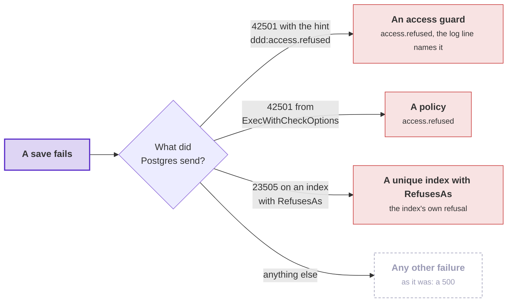

<details>
<summary>Show the code: a trigger of yours that refuses as the toolkit's access guards do</summary>

By hand, in a migration of yours. The trigger keeps a signed-in user from changing a pallet's number:

```sql
CREATE OR REPLACE FUNCTION depot.pallets_number_stays() RETURNS trigger
    LANGUAGE plpgsql SET search_path = '' AS $body$
BEGIN
    IF CURRENT_USER = 'authenticated' THEN
        RAISE EXCEPTION USING ERRCODE = 'insufficient_privilege', CONSTRAINT = 'pallets_number_stays',
            HINT = 'ddd:access.refused', MESSAGE = 'A pallet keeps its number.';
    END IF;
    RETURN NEW;
END
$body$;

CREATE TRIGGER pallets_number_stays BEFORE UPDATE OF "Number" ON depot."Pallets"
    FOR EACH ROW WHEN (OLD."Number" IS DISTINCT FROM NEW."Number")
    EXECUTE FUNCTION depot.pallets_number_stays();
```

From C#, in a contribution's statements, as the sample's `UnitChangesWithItsPermissions` writes its trigger:

```csharp
string Refusal(string message) => RowAccessModel.Refusal(Trigger, message);

// ...
$"    IF NOT ({HeldOn(ProjectPermissionNames.Edit, $"OLD.{id}")}) OR NOT ({HeldAt(ProjectPermissionNames.Open, $"NEW.{unit}")}) THEN\n" +
$"        {Refusal(MovedWithoutThePermissions)}\n" +
"    END IF;\n" +
```

What a save that a guard refuses throws, and what is logged:

```csharp
catch (RefusalException refused) when (refused.Code == ToolkitRefusals.Refused)
{
    // refused.Kind is RefusalKind.NotPermitted, and refused.InnerException the DbUpdateException:
    // DatabaseRefusal.From(refused.InnerException!) is GuardRefused, with Constraint "pallets_number_stays".
}
```

```text
warn: The database refused a save the application allowed: the guard pallets_number_stays on depot.Pallets.
      C# and the guards disagree.
```

A statement of yours is not a save. Its refusal reaches you as the database's exception, which you read the same way:

```csharp
try
{
    await context.Pallets.Where(pallet => pallet.Id == id)
        .ExecuteUpdateAsync(set => set.SetProperty(pallet => pallet.Number, number), cancellationToken);
}
catch (PostgresException failure) when (DatabaseRefusal.From(failure)?.Kind == DatabaseRefusalKind.GuardRefused)
{
    throw ToolkitRefusals.Refuse(ToolkitRefusals.Refused, failure);
}
```

</details>

### Writing the policies

`PostgresRowAccess.Script(context, rules, accessFunctions)` returns the SQL for one context. The script runs these
steps in order:

1. It drops every policy that an earlier script made on the context's tables, and every trigger of a
   [column rule](#column-rules). It finds them by the comment that each one carries.
2. It makes what its policies need, wherever the database does not have it as it should be: the `ddd` schema and
   `ddd.written_in_this_transaction` with their grants, and the scoped system role when a policy is for that role.
3. It drops the functions that the context no longer writes.
4. It makes its functions, each after the functions it calls, and grants each function to the roles that call it.
5. It makes the policies again, and the column rules' triggers.

So the latest script states the current rules. A rule that you remove disappears with the next script, and a policy
that you wrote by hand stays.

```csharp
var sql = PostgresRowAccess.Script(context,
[
    RowAccessRule.For<Order>("A customer sees their orders", RowOperations.Read | RowOperations.Change, ACustomerSeesTheirOrders.RowAccessSql),
]);
```

With a `RowAccessExport` as well, the script writes the roles and the caller functions that the export names. The
roles are what the rules' symbolic roles become. The caller functions are how a policy reads the caller. Without an
export, the script uses `RowAccessRoleNames.Default` and the toolkit's `ddd` functions. The export's `Contributions`
are the [policies that packages ship](#policies-a-package-ships).

A script of one context grants its access functions to the roles of that context's policies only. Another module's
policy may call one of these functions, through a contract, for a role that this context's policies are not for. Then
write the contexts with `Scripts`, below, or add a `GRANT EXECUTE` of yours after the script. The next script takes
that grant back.

For several modules, `PostgresRowAccess.Scripts(contexts, rules, accessFunctions, export)` returns each context with
its script, in the order to run them:

- A context comes before every context whose rules, access functions or contributions call a function that it
  defines. Postgres refuses a policy or a function that calls a function that does not exist yet.
- Otherwise the contexts keep the order given.
- Contexts that call each other's functions are refused, and the refusal names them.
- Each script knows where the functions of every context live. So a rule may call another module's function by its
  [logical name](#function-names-relative-to-the-module).
- Each script grants each of its access functions to the roles of every context's policies that call it.

Put the returned SQL into a migration when the rules change, and when a toolkit upgrade changes what the script
writes. Put it in as text, and do not call the script from the migration. A migration that runs later, on a database
that is only as far as that migration, must run the SQL of its own time. The Supabase build does this by itself, into
`supabase/migrations`, from every rule of every module that the host references
([Supabase](supabase.md#row-access-rules-in-the-build)).

### Privileges from the policies

A policy decides which rows a command touches. A privilege decides whether the command runs at all. When you grant
privileges by hand, the two drift apart:

- A privilege beyond the policies turns a refusal into an empty result.
- A missing privilege turns a rule that allows into `permission denied`.

`RowAccessExport.WriteGrants` makes the script write the privileges from the policies it holds:

```csharp
var sql = PostgresRowAccess.Script(context, rules, accessFunctions, new RowAccessExport
{
    Roles = RowAccessRoleNames.From(options),
    WriteGrants = true,
});
```

After the policies, the script takes back every privilege on each table that it wrote policies for. It then gives each
role the commands that a permissive policy for that role allows, and `USAGE` on the tables' schemas:

```sql
GRANT USAGE ON SCHEMA "ordering" TO authenticated;

REVOKE ALL ON TABLE "ordering"."Orders" FROM PUBLIC, anon, authenticated, ddd_system_in;
GRANT SELECT, INSERT, DELETE ON TABLE "ordering"."Orders" TO authenticated;
GRANT UPDATE ("Status", "Total_Amount", "Version") ON TABLE "ordering"."Orders" TO authenticated;
```

- **What the script takes back** is what any of the script's roles could hold: the user's role, the anonymous
  caller's role, the scoped system role, the role of every mapped [token role](#token-roles), the bookkeeping role of
  [a login that owns nothing](#a-login-that-owns-nothing), and `PUBLIC`.
  - A grant of yours to one of these roles on such a table is gone after the next script.
  - A grant to any other role stays. Every privilege on a table without a rule also stays, because that table is not
    the script's to manage.
  - A role that a rule names by its database name, such as `To = ["reporting"]`, is such another role. The script
    gives it what its policies allow, and the role keeps what it held before. So when you narrow such a rule, take
    back the old privilege yourself.
- **A restrictive policy gives no privilege.** It only narrows what a permissive policy allows.
- **`UPDATE` is granted per column.** The grant covers every column except key columns, columns that Entity
  Framework refuses or ignores a change of once the row is saved, and columns that the database computes. So the
  database refuses a change that C# would not make. A JSON column is granted as a whole.
- **A role that may add rows** gets `USAGE` on the sequences that the table's columns own.
- **A role that the policies let change or remove rows of a table, but not read them,** is refused when the script is
  written. The refusal names the role and the table. Entity Framework finds the row it changes by reading it, and
  Postgres requires the read privilege for that. So such a rule could never run.

A column that never changes after its row is saved says so in the model:

```csharp
builder.Property(order => order.CustomerId).IsFixedAfterInsert();
```

Entity Framework then throws when a save would change the column. The script leaves the column out of the `UPDATE`
grant, so a statement that bypasses Entity Framework is refused too, with SQLSTATE `42501`. `IsFixedAfterInsert()` is
in `DDDToolkit.EntityFramework`, and means the same on every provider. Only Postgres has the matching privilege.

The toolkit's tables have no policies, and get the privileges that their use needs:

- An outbox table gets `INSERT` from the user's role, from the scoped system role, and from every role that the
  policies let write a table of the context. A save writes the event's row in the same transaction. An
  [event log](entity-framework.md#an-event-log) gets the same.
- An inbox table gives `SELECT` and `INSERT` to the scoped system role, which the handlers of integration events run
  as.

Nobody else reads a pending message. So with `WriteGrants` you do not need the `revoke` statements written by hand in
[Setup on Postgres without Supabase](#setup-on-postgres-without-supabase) and in
[The scoped system role](#the-scoped-system-role).

A privilege is the only protection on those tables. So on those tables, a script takes back more than its own roles
hold. Where the script runs, it finds every role that holds a privilege on them. It takes the privilege back from each
such role that cannot log in and is held to RLS. Examples are the bookkeeping role of an earlier script after
`SystemRole` changed, and the role of a token role that is no longer mapped, which the login role may still switch to.
The script leaves alone the tables' owner, and a role that can log in, bypasses RLS or is a superuser. A script
refuses a bookkeeping role, a scoped system role or the role of a token role with one of those attributes. So you gave
such a role what it holds on those tables, for example the role that your own background work runs as.

`WriteGrants` is off by default. A script without it is byte for byte the same as before. The Supabase build writes
the privileges unless the project sets `SupabaseRowAccessGrants` to `None`
([Supabase](supabase.md#privileges-forced-policies-and-the-bookkeeping-role)). `anon` and `authenticated` must exist
where the script runs, as they do on Supabase and after `SetupScript()`. The script makes the other roles that it
names.

### A login that owns nothing

A statement that reaches the application's connection can always switch back to the role that logged in. Postgres
checks a role change against the session's user, and not against the current role. So whatever the login role owns
or holds is outside every policy, for anyone who manages to send a statement. A login role that holds nothing leaves
such a statement only the roles it may switch to. Each of those roles is held to its policies and its privileges.

This takes three things:

1. The migrations run as another role, which owns the tables.
2. The application logs in as a role that owns nothing, holds no privilege on a table, and gets the roles it switches
   to without inheriting them.
3. A migration creates that role without a login and without a password, because a migration is kept in a
   repository and a password must not be. Whoever deploys turns on the login once, as the database's owner, with a
   secret of that deployment.

On Supabase the build writes that migration from the role's name. You set the name in the exporting project, next to
the roles that the policies are written for. The build writes the migration after every other file, and writes a new
one whenever those roles change
([The role the application logs in as](supabase.md#the-role-the-application-logs-in-as)).

```xml
<SupabaseLoginRole>app</SupabaseLoginRole>
```

Without that build, you write the migration. The deployment's one statement is yours either way:

```sql
-- In a migration, or written by the Supabase build
create role app nologin noinherit;
grant anon, authenticated, ddd_system_in to app;

-- Once per deployment, as the owner, never in a file of the repository
alter role app with login password '...';
```

The system caller used to run as the login role. It now gets a separate role for the one thing it still does, the
toolkit's bookkeeping. The bookkeeping reads, marks and deletes outbox rows, cleans the inbox, and reads which
migrations ran:

```csharp
builder.Services.AddPostgresRowLevelSecurity(options => options.SystemRole = "ddd_system");
```

On Supabase no line is needed. `ddd_system` is the bookkeeping role that `AddSupabaseRowLevelSecurity` and the export
both use, unless `SupabaseRowAccessRoles` names another role
([Roles and caller functions of your own](supabase.md#custom-roles-and-caller-functions)).

`RowAccessRoleNames.From(options)` carries that role as `System`. A script written with it and with `WriteGrants`
checks the role in its prelude and in its privileges:

- The script creates the role, `NOLOGIN NOINHERIT` and without `BYPASSRLS`, where the database does not have it. It
  grants the role to the role that runs the script.
- The script fails when a role of that name can log in, bypass RLS or is a superuser, has the privileges of a role
  that owns tables, or is granted to a role that callers run as.
- The script is refused when it is written if the bookkeeping role is the user's role, the anonymous caller's role,
  the scoped system role or the role of a token role. The bookkeeping role must be a separate role.
- The script gives the role:
  - `SELECT` and `DELETE` on the outbox table, and `UPDATE` on the four columns that record a delivery: `Attempts`,
    `LastError`, `NextAttemptAt` and `ProcessedAt`. So the bookkeeping cannot rewrite an event that is still to be
    delivered.
  - every command on the inbox table,
  - `SELECT` on the migration history, where the database keeps one,
  - on an event log that deletes old rows, `DELETE`, and `SELECT` on the columns that find those rows.

The login role needs the grant too, in a migration after the script: `grant ddd_system to app;`. The Supabase build
writes that grant into the login role's file, with the bookkeeping role that the project maps, `ddd_system` unless it
names another. In [`Transaction` scope](#settings-per-connection-or-per-transaction), the login role also needs the
procedure that sets the settings: `grant usage on schema ddd to app;` and
`grant execute on procedure ddd.use_caller(text, text, text[], text[]) to app;`. No file of the build writes these
two grants.

System work that reads a module's tables now fails with `permission denied`. This is intended. Such work runs as a
[scoped system caller](#the-scoped-system-role) instead, inside the policies. Where the bookkeeping role itself must
reach a table, write the rule for `RowAccessRoles.System`, which is `@system`. The role then gets the policy, and with
`WriteGrants` the privilege. A script that names `@system` while no bookkeeping role is configured is refused. The
message names `@system` and says how to configure the role.

> [!NOTE]
> A host whose system caller runs as a role that bypasses RLS, such as Supabase's `service_role`, has no bookkeeping
> role. Its scripts stay the same as long as they write no privileges and no rule is for `RowAccessRoles.System`. This
> also holds where a rule or a grant spells that role's name out. With `WriteGrants`, write the scripts with
> `RowAccessRoleNames.From(options) with { System = null }`, because a role that bypasses the policies is refused as
> a bookkeeping role when the script runs. On Supabase, `system=service_role` in `SupabaseRowAccessRoles` sets this
> once, for the export and for the host.

#### Start-up checks

Three checks verify at start-up, before the first request, that the database and the context are set up as this
page describes. A fourth check covers the functions ([Forcing row level security](#forcing-row-level-security)).
`AddPostgresRowLevelSecurity`, and so `AddSupabaseRowLevelSecurity`, registers the checks as
[start-up checks](startup-checks.md) over every context that the host registers on Postgres. The host runs them with
one call, before the server binds its port:

```csharp
builder.Services.AddPostgresRowLevelSecurity();
builder.Services.RunStartupChecks();
```

| Start-up check | Method, to run it by hand | What it checks |
|---|---|---|
| `postgres.login-role-may-switch-to-callers` | `EnsureLoginRoleMaySwitchToCallersAsync` | The login role may switch to every role that the interceptor switches to. |
| `postgres.login-role-owns-nothing` | `EnsureLoginRoleOwnsNothingAsync` | The login role owns and holds nothing. |
| `postgres.row-level-security-wired` | `EnsureRowLevelSecurityWired` | The context runs its commands through the RLS interceptor. |
| `postgres.definer-owners-bypass` | `EnsureDefinerOwnersBypassAsync` | Every function that runs as its owner is owned by a role that bypasses RLS ([Forcing row level security](#forcing-row-level-security)). |

- Each check name is a constant on `PostgresRowAccessChecks`.
- On Supabase, `AddSupabaseRowLevelSecurity` adds one more check that runs before the switch check:
  `supabase.roles-match-access-files`. It compares the roles that the host switches to with the roles that the
  exported access files record they were written for
  ([Roles and caller functions of your own](supabase.md#custom-roles-and-caller-functions)).
- A host turns a check off only by name, and with a reason in its code
  ([Turning a check off](startup-checks.md#turning-a-check-off)). The login role's checks are the last that a host
  should turn off.

A host that runs the checks by hand, from a class of its own, calls the methods behind them, the switch check first:

```csharp
await PostgresRowAccessChecks.EnsureLoginRoleMaySwitchToCallersAsync(context, cancellationToken);
await PostgresRowAccessChecks.EnsureLoginRoleOwnsNothingAsync(context, cancellationToken);
PostgresRowAccessChecks.EnsureRowLevelSecurityWired(context);
```

**The switch check**, `postgres.login-role-may-switch-to-callers`:

- It checks that the login role may switch to every role that the context's interceptor switches to: the user's role,
  the anonymous caller's role, the scoped system role, `SystemRole`, and the role of every mapped token role.
- The interceptor switches to a role when a caller of that kind connects, and not when the application starts. So a
  missing grant passes the start, and fails the first request of that caller. Examples are a token role that nobody
  holds while testing, and the background work.
- It checks the scoped system role only where the role exists. Supabase's access files make that role only where a
  rule is for it, or where the grants are written, as they are unless the project turns that off. No policy can be
  for a role that does not exist. So an application without the role does no scoped system work, and starts.
- In `Transaction` scope, it also checks that the login role may call `ddd.use_caller`.
- It runs as the login role itself, on the context's connection opened past the interceptor, because the system
  caller's role is one of the roles it checks. So it must run before every check that runs as the system caller,
  including `EnsureSupabaseMigrationsAppliedAsync`. The runner runs it in a separate stage, before those checks.
- It throws with a message that names the login role, and each role that the login role may not switch to or that
  does not exist, with the `GRANT` that fixes it. The message also names the `SupabaseRowAccessRoles` pair that maps
  the role. That is the fix for a host whose Supabase build writes the login role's migration. That file grants what
  the property maps, so there a missing role means a missing pair.

**The ownership check**, `postgres.login-role-owns-nothing`, reads the catalogs on the context's connection. It throws
unless all of these hold for the login role:

- It owns no table, view, sequence, function or schema in the schemas of the context's model and in `ddd`.
- It holds no privilege on their tables, and may create nothing in those schemas, by itself or through `PUBLIC`.
- It does not have the privileges of a role that it is a member of without switching to that role.
- It is not a superuser, and does not bypass RLS.
- It may not create roles, and may not replicate. Each of these is a way past the policies that a statement takes as
  the login role itself. Before Postgres 16, a role that may create roles can grant itself any role that is not a
  superuser. A role that may replicate reads every change to every table from a replication slot.

More about the ownership check:

- A role that the login role may switch to is one statement away. So the check also names each such role that is a
  superuser, bypasses RLS, or owns a table, a function or a schema in those schemas. A login role that is granted the
  role that owns the tables holds nothing itself, and still reaches everything.
- A login role that owns the database is `pg_database_owner`, which owns the schema `public`. Where the context's
  tables are in `public`, the check names this in the same way. The fix is another owner for the database.
- The check does not ask whether the system caller's role bypasses RLS. A host that names a bypassing `SystemRole`,
  such as Supabase's `service_role`, chose that.
- The exception names the login role and every finding, each with the statement that fixes it.
- A login role that owns a schema there created that schema, so it is the role that the migrations run as. The check
  then reports only that finding. The fix is to log in as a separate role, and to keep this role for the migrations.

**The wiring check**, `postgres.row-level-security-wired`, opens no connection. It throws unless the context runs its
commands through the RLS interceptor. Without the interceptor, every command runs as the login role, and is refused
outright where that role holds nothing.

- `UseDDDToolkit` gives every context on Postgres the interceptor. So the check finds contexts that are wired another
  way: without the toolkit, or with the toolkit's interceptors added by hand.
- A context configured with only the toolkit's base, `UseDDDToolkitCore`, passes. That call is how an application
  says that a context runs as the login role, and the context's options record that call.
- As a start-up check, the wiring check runs first, with the checks that read the services. A context without the
  interceptor would fail the other two checks without saying why.

### Forcing row level security

Postgres exempts a table's owner from the table's policies. So whoever reaches the owning role reads and writes every
row. `RowAccessExport.ForceRowLevelSecurity` writes `FORCE ROW LEVEL SECURITY` after every `ENABLE` in a script, on
the tables of the rules, of the aggregates' entities and of the contributions:

```sql
ALTER TABLE "ordering"."Orders" ENABLE ROW LEVEL SECURITY;
ALTER TABLE "ordering"."Orders" FORCE ROW LEVEL SECURITY;
```

The owner is then held to the policies like any other role. No policy is for the owner, so the owner reads no row and
writes none. The only ways past the policies are a role with `BYPASSRLS` and a superuser. A migration that moves data
runs as one of these.

> [!IMPORTANT]
> The [access functions](#access-functions) run as their owner, so they answer without the policies of the tables
> they read. On a forced table, this works only while the owner may bypass RLS. A function owned by any other role
> reads the tables under that role's policies, and finds no row. It then answers that nobody may do anything, and
> raises no error.

The start-up check `postgres.definer-owners-bypass` checks this. `AddPostgresRowLevelSecurity` registers it with the
three checks above. `PostgresRowAccessChecks.EnsureDefinerOwnersBypassAsync(context, cancellationToken)` runs the same
check by hand.

- The check throws unless every function that runs as its owner, in the schemas of the context's model and in `ddd`,
  is owned by a role that bypasses RLS or is a superuser.
- It names each such function, its owner and the fix.
- While no table in those schemas is forced, the check passes, whoever owns the functions. So it can run next to the
  three other checks in a host that forces nothing yet.
- On Supabase the migrations run as `postgres`, which may bypass RLS.

`ForceRowLevelSecurity` is off by default. A script without it is byte for byte the same as before. On a Postgres
database without Supabase, the application often logs in as the tables' owner, which may not bypass RLS. The system
work of such an application runs as that owner, and no policy is written for the owner. The Supabase build forces RLS
unless the project sets `SupabaseForceRowLevelSecurity` to `false`. There the owner is `postgres`, which may bypass
RLS ([Supabase](supabase.md#privileges-forced-policies-and-the-bookkeeping-role)).

- Turning the option off again does not remove the force from a table. Run
  `ALTER TABLE … NO FORCE ROW LEVEL SECURITY` in a migration of yours for that.
- A [contribution](#policies-a-package-ships) that turns on RLS in a statement of its own reads the flag from the
  export that it receives.

## When the policies refuse what C# allowed

With RLS, a command is checked twice: by the access check, before its handler runs, and by the policies, when its
statements reach the database. When the policies refuse what the access check let through, `UseDDDToolkit` refuses
the save with the refusal code `access.refused` (`ToolkitRefusals.Refused`). It is a refusal of the kind "not
permitted", which the Tenancy sample answers with 403. The refusal carries what the save threw as its inner
exception. The refusal shows up in two ways:

- An insert, or an update whose new row a policy rejects, fails with Postgres's `42501`.
- An update or a delete of a row that a policy hides from the statement finds no row. A save that lost a race to
  another save looks the same. So `AggregateVersionInterceptor` reads the row again first. A row that somebody
  changed or removed gives the usual `ConcurrencyConflictException`. Only a row that is still as the save left it is
  a refusal.

The caller learns only that the database refused the change.

Other people may need more detail, and that detail depends on why the policies refused. There are two reasons:

- **The caller's permissions changed between the access check and the save.** For example, a permission was removed
  from a role that the caller holds, a grant was revoked, or the caller's seat was suspended. This can happen in the
  milliseconds between the request's access check and its save, or in the seconds that a slow handler takes. The
  access check and the policies agreed, each at the moment it ran, and nothing needs fixing. An information line says
  what happened, with no stack trace.
  - A change of permissions that also changes the row the save is about ends the same way. In the Tenancy sample,
    taking a crew role off a project increments the project's version. But the handler loads the project as it is
    when the handler runs, so the save goes ahead, and the policies refuse it.
  - Only a request that names the version it read (`ExpectVersion`) loses the race instead. It gets a
    `ConcurrencyConflictException`, which the sample answers with 409, and the policies are not reached.
- **The policies refuse what C# allows.** A rule is held in two places that do not hold it the same way, or a
  handler changes something that its request's access check never checked. A retry gets the same answer, and a
  developer should look. A warning says so.

To tell the two apart, the toolkit runs the request's access check again, as the same caller, at that moment. The
request is in hand for the flow of work that handles it, with the access check it passed
([`RequestInHand`](access-requirements.md#asking-the-check-again)). A save that the request's handler makes runs in
that flow.

- When the access check now refuses, the caller's permissions changed.
- When the access check still lets the caller through, the policies and C# disagree.
- Where no access check passed in that flow, there is nothing to run again. Examples are a handler called directly,
  work outside any request, and a request that anyone may send (`AccessRequirement.AllowAnonymous()`). The
  application then let through what the policies refuse without checking anything. That is a warning too.

A [guard](#when-the-database-refuses) that refuses a statement, a trigger that raises `42501` with the toolkit's hint,
is told apart in the same way. Each line names the guard: `The guard projects_owner_stays refused a save after the
access check of ChangeProjectOwner (MemberAccess<ProjectId>.On) let the caller through.`, or, as a warning,
`... the guard projects_owner_stays on projects.Projects. C# and the guards disagree.` The line also names the table,
where the database named one or the save wrote one.

You write nothing for this. `AccessChecks<TRequests>.RequireAsync` puts every request that it lets through in hand,
with its access check, in the flow of the method that awaited it. That method is the behavior that the generator
writes, or a dispatcher of yours written with `async` and `await`
([asking the checks without Mediator](access-requirements.md#asking-the-checks-without-mediator)).

- The lines are written through the context's logger factory, under the category of `DatabaseRefusalInterceptor`.
- They name the request and its requirement by their types, never by their values.
- A warning includes what the save threw.
- The access check runs again only for a save that the policies refused, and only when a logger listens. That is one
  extra access check, and every other save skips it.
- An access check that runs again keeps nothing for a handler (`Checked<T>`). So nothing of the second run stays
  behind.

What runs again is the requirement that the request declared:

- A rule that a handler checks itself, beyond what its request declared, is not part of the requirement.
- What a package's use case checks beyond the requirement is not part of it either. A request handed to one of
  Tenancy's use cases declares what the use case checks first, such as `TenancyAccess.InTenant()`, and the use case
  checks the rest itself.
- A change of permissions against either one still gives a warning. The warning names the requirement that ran
  again, so it shows how little that requirement checked.
- A save made after the handler returned, by a pipeline behavior around the access behavior, runs outside the
  handler's flow, and finds no access check to run. It gives the warning without a request.
- An access check that gives no answer the second time also gives the warning, and the warning says why. For
  example, the check's connection is gone. Or the check throws a `ConcurrencyConflictException` because the subject
  of the request moved on from the version that the request named, which says nothing about the caller's
  permissions.

In the diagram, purple is the refusal, green is the information line and red is the warning:

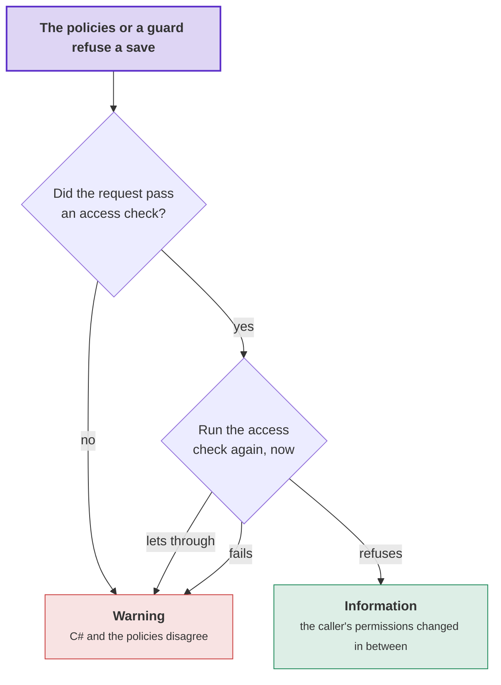

<details>
<summary>Show the code: the three log lines, and a rename in the Tenancy sample that loses its permission before the save</summary>

```text
info: DDDToolkit.EntityFramework.Interceptors.DatabaseRefusalInterceptor
      The database refused a save to projects.Projects after the access check of ChangeProjectName
      (MemberAccess<ProjectId>.On) let the caller through. Asked again, the check refuses as well: the caller's
      rights changed between the check and the save, and the caller is refused.

warn: DDDToolkit.EntityFramework.Interceptors.DatabaseRefusalInterceptor
      The database refused a save the application allowed: projects.Projects. C# and the policies disagree: asked
      again, the access check of ChangeProjectName (MemberAccess<ProjectId>.On) still lets the caller through.

warn: DDDToolkit.EntityFramework.Interceptors.DatabaseRefusalInterceptor
      The database refused a save the application allowed: projects.Projects. C# and the policies disagree.
```

In the [Tenancy sample](../Examples/README.md#the-tenancy-sample), Vic renames a project as its crew lead. Between his
request's access check and its save, the tenant's roles manager changes the crew lead's role to give only
`projects.view`. The project's row did not change. So the handler loads what was checked, renames it, and saves. The
policy on `projects.Projects` reads the role's permissions as they are now. It finds no permission of Vic's that
writes the row, and leaves the statement no row to change. The request gets 403 with the refusal code
`access.refused`, and the first line above is logged:

```csharp
// RequestPipelineTests.A_permission_taken_from_a_crew_role_since_the_check_is_refused_by_the_database_and_logged_as_a_change_of_rights
using var renamed = await vic.PutAsJsonAsync($"/projects/{pier.Id.Value}/name", new { name = "Pier 7, east" });

await renamed.ShouldBeRefusedAsync(HttpStatusCode.Forbidden, ToolkitRefusals.Refused);
logs.Entries.Single(entry => entry.Category == typeof(DatabaseRefusalInterceptor).FullName).Level.Should().Be(LogLevel.Information);
```

Code of yours that writes past Entity Framework, and meets a refusal of the policies itself, checks the same way:

```csharp
if (RequestInHand.Current is { } inHand && !await inHand.StillPassesAsync(cancellationToken))
{
    logger.LogInformation("The caller's rights changed between the access check of {Request} and the save.", inHand);
}
```

</details>

## Where to look next

- [How a request is checked](how-a-request-is-checked.md) follows one request from its attribute through the access
  check to the policies of the rows it touches, with the caller on the connection in between.
- [Supabase](supabase.md#row-level-security-for-your-own-queries) covers Supabase Auth's tokens, and the build that
  writes the policies.
- [Designing aggregates](aggregate-design.md) explains why a policy covers a whole aggregate.
- [Diagnostics](diagnostics.md#ddd00038) lists the build errors about a rule.
