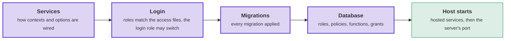

# Start-up checks

A host on Postgres depends on the state of its database:

- the host's login role owns and holds nothing;
- every migration is applied;
- the policies and functions in the database are the ones the code writes.

A request shows none of this until something fails. So the packages check it when the host starts. A
registration that brings something to check also registers the check. `RunStartupChecks()` runs every registered
check, before the server binds its port:

```csharp
builder.Services.AddSupabaseRowLevelSecurity();   // checks the login role and the contexts
builder.Services.AddTenancyPostgres();            // checks Tenancy's part of the database
// the modules, each with its context and its migrations

builder.Services.RunStartupChecks();
```

The first check that finds a problem stops the start. It throws its own exception, which names the problem and
the statement that fixes it. The log names the check, and the exception carries the name in `Exception.Data`,
under the key `StartupChecks.FailedCheckKey`. The host lists no checks. A module added later registers its own
checks, and `RunStartupChecks()` runs those too.

## Stages and order

Every check runs in one of four stages. In the diagram, purple marks the four stages in the order they run, and
green marks the start of the host after every check passed:



<details>
<summary>Show the code: a registration for each stage, and RunStartupChecks()</summary>

```csharp
builder.Services.AddDDDToolkitEntityFramework(options => options.DispatchWithMediator());
//   Services:   entity-framework.toolkit-wired, entity-framework.owners-mapped

builder.Services.AddSupabaseRowLevelSecurity();
//   Services:   postgres.row-level-security-wired
//   Login:      supabase.roles-match-access-files, postgres.login-role-may-switch-to-callers
//   Database:   postgres.login-role-owns-nothing, postgres.definer-owners-bypass

// in a module: its context, marked [SupabaseMigrations]
services.AddDbContext<OrderingContext>((serviceProvider, options) => options
    .UseNpgsql(connectionString)
    .UseDDDToolkit(serviceProvider));

// in the host: one call for every marked context. The build writes AddSupabaseMigrations() into the host, in the
// namespace named after the host's assembly (using Shop.Host; in a top-level Program.cs)
builder.Services.AddSupabaseMigrations();
//   Migrations: supabase.migrations-applied

builder.Services.RunStartupChecks();
//   every check above, stage by stage, before the server binds its port
```

</details>

The stage of a check is a value of `StartupCheckStage`. All checks of one stage run before any check of the next
stage. The stages follow the order in which one failure hides another. So the host reports the cause of a problem
before its effects:

- **Services** reads the application's services and opens no connection. It checks which options are registered,
  how each context is configured, and whether the pipeline has the behaviors that ask a module's access checks. A
  context that is wired wrong fails every query to the database without saying why, so these checks come first.
- **Login** connects as the host's login role. It checks that the roles of the callers are the roles that
  the database's access files were written for, and that the login role may switch to each of them. Every later
  stage runs as system work, and so switches to the system role first.
- **Migrations** checks that every migration is applied. A missing migration also means missing policies and
  functions. This stage names the migration.
- **Database** checks that the database is set up as the application expects. The login role holds nothing, and
  the policies, functions, triggers, grants and extensions are the ones the code writes.

Within a stage, the checks run in the order they were registered. A check that must run before another check of
its stage names that check in `RunsBefore`. For example, Tenancy's three checks of the database run before
`tenancy.unknown-stored-permissions`, whatever order `AddTenancy` and `AddTenancyPostgres` were called in.

- A name in `RunsBefore` that no registration brought is skipped.
- A check that names a check of an earlier stage in `RunsBefore` stops the start. Checks that name each other in a
  circle stop the start too.

Each check runs as system work, `CurrentUserSnapshot.System`, like the toolkit's own bookkeeping. The runner begins
that work for each check separately. Without it, a host that
[requires an explicit current user](row-level-security.md#requiring-an-explicit-current-user) would refuse the first connection of a
check. The checks read the catalogs of the database and change nothing.

## Checks in the packages

Each entry gives the name of the check, its public constant, the registration that brings it, and what it
confirms. The entries are grouped by stage.

### Services stage

- **`access.behaviors-registered`** (`AccessBehaviorChecks.BehaviorsRegisteredCheck`), from `AddAccessChecks`.
  `AddAccessCheck`, a package's registration of its check and the generated `Add{Module}AccessBehavior` call
  `AddAccessChecks`. They bring the check only for an interface that the toolkit wrote a behavior for. Every
  command and query that the host handles has the toolkit's behavior for its interface in its pipeline, in every
  module. A stream query has the behavior for streams
  ([When nothing asks the checks](access-requirements.md#handlers-reached-without-the-access-check)).
- **`entity-framework.toolkit-wired`** (`EntityFrameworkChecks.ToolkitWiredCheck`), from
  `AddDDDToolkitEntityFramework`. Every context that maps the toolkit's classes is built with `UseDDDToolkit` or
  `UseDDDToolkitCore` ([Checking the wiring](entity-framework.md#checking-the-wiring)). Every context has the parts
  its model requires, such as Tenancy's save check for rows that belong to a tenant
  ([Parts a model requires](entity-framework.md#parts-a-model-requires)).
- **`entity-framework.owners-mapped`** (`EntityFrameworkChecks.OwnersMappedCheck`), from
  `AddDDDToolkitEntityFramework`. The host can read the owner of every aggregate that its requests ask about. One
  registered context maps the aggregate. The aggregate marks one property `[Owner]`, and the context maps that
  property. The type of the property is one that the toolkit can compare with the caller's own value. The
  generator lists the ids that the assemblies of the request interfaces ask about. The check keeps what it finds
  for the requests ([The owner of an aggregate](access-requirements.md#the-owner-of-an-aggregate)).
- **`postgres.row-level-security-wired`** (`PostgresRowAccessChecks.RowLevelSecurityWiredCheck`), from
  `AddPostgresRowLevelSecurity` and `AddSupabaseRowLevelSecurity`. Every context on Postgres runs its commands as
  the caller. A context built with `UseDDDToolkitCore` alone is the exception. It runs as the login role on
  purpose ([Running queries as the caller](row-level-security.md#running-queries-as-the-caller)).
- **`tenancy.catalogue-builds`** (`TenancyChecks.CatalogueBuildsCheck`), from `AddTenancy`. Tenancy's catalogue of
  permissions builds. Two modules that declare the same permission, for example, stop the start here.
- **`tenancy.contexts-wired`** (`TenancyChecks.ContextsWiredCheck`), from `AddTenancy`. Every context with rows
  that belong to a tenant has the save check, after the toolkit's interceptors. A context without the save check
  gets the message of `entity-framework.toolkit-wired`. A context that keeps the access history uses Tenancy's
  accessor for who acted ([Keeping tenants apart](tenancy/keeping-tenants-apart.md)).
- **`tenancy.explicit-current-user`** (`TenancyPostgresChecks.ExplicitCurrentUserCheck`), from `AddTenancyPostgres`. The
  host requires an explicit current user.
- **`tenancy.seated-token-roles`** (`TenancyPostgresChecks.SeatedTokenRolesCheck`), from `AddTenancyPostgres`.
  Every token role that Tenancy gives a seat reaches the database as the role of a signed-in user.

### Login stage

- **`supabase.roles-match-access-files`** (`SupabaseRowAccessChecks.RolesMatchAccessFilesCheck`), from
  `AddSupabaseRowLevelSecurity`. The roles that each context on Postgres switches to for its callers are the roles
  that the newest applied access file was written for. Runs before `postgres.login-role-may-switch-to-callers`
  ([Custom roles and caller functions](supabase.md#custom-roles-and-caller-functions)).
- **`postgres.login-role-may-switch-to-callers`** (`PostgresRowAccessChecks.LoginRoleMaySwitchToCallersCheck`),
  from `AddPostgresRowLevelSecurity` and `AddSupabaseRowLevelSecurity`. The login role may switch to every caller
  role of every context on Postgres, including the scoped system role where it exists
  ([A login that owns nothing](row-level-security.md#a-login-that-owns-nothing)).

### Migrations stage

- **`supabase.migrations-applied`** (`SupabaseMigrations.AppliedCheck`), from `AddSupabaseMigrations`. Every
  registered context has every migration applied ([Checking at start-up](supabase.md#checking-at-start-up)).

### Database stage

- **`postgres.login-role-owns-nothing`** (`PostgresRowAccessChecks.LoginRoleOwnsNothingCheck`), from
  `AddPostgresRowLevelSecurity` and `AddSupabaseRowLevelSecurity`. The login role owns and holds nothing in the
  schemas of the contexts, and is not a member of a role that does.
- **`postgres.definer-owners-bypass`** (`PostgresRowAccessChecks.DefinerOwnersBypassCheck`), from
  `AddPostgresRowLevelSecurity` and `AddSupabaseRowLevelSecurity`. Every function that runs as its owner is owned
  by a role that the forced policies let through.
- **`tenancy.system-in-role-confined`** (`TenancyPostgresChecks.SystemInRoleConfinedCheck`), from
  `AddTenancyPostgres`. The scoped system role cannot leave the tenant of its work.
- **`tenancy.system-reads-across-tenants`** (`TenancyPostgresChecks.SystemReadsAcrossTenantsCheck`), from
  `AddTenancyPostgres`. Tenancy's reads across tenants work, and nothing in them runs past the policies.
- **`tenancy.policies-in-place`** (`TenancyPostgresChecks.PoliciesInPlaceCheck`), from `AddTenancyPostgres`.
  Tenancy's policies, functions, triggers and the unique index on a tenant's root are in the database, as the
  catalogue writes them ([The start-up checks](tenancy/postgres.md#the-start-up-checks)).
- **`tenancy.unknown-stored-permissions`** (`TenancyChecks.UnknownStoredPermissionsCheck`), from `AddTenancy`.
  Logs a warning for each permission that a role holds and the catalogue no longer knows. Refuses nothing.
- **`membership.functions-in-place`** (`MembershipPostgresChecks.FunctionsInPlaceCheck`), from
  `AddMembershipPostgres`. The functions and the lock of each resource's membership are the ones its rules write
  ([The start-up check](membership/postgres.md#the-start-up-check)).
- **`pgmq.extension-installed`** (`PgmqQueue.ExtensionInstalledCheck`), from `AddPgmqSink` and `AddPgmqConsumer`.
  Every database that a sink or a consumer uses has the pgmq extension, and has topics where the host uses topics
  ([Transports](transports.md#queues-creation-and-the-extension-check)).

### Names and the log

Turn a check off by its constant, so a typo is a compile error. The method behind each check, such as
`PostgresRowAccessChecks.EnsureLoginRoleOwnsNothingAsync`, stays public for a host that calls it itself. The log
lists the checks that passed, in the order they ran:

```text
info: DDDToolkit.Startup.StartupCheckRunner
      The start-up checks passed in 412 ms: postgres.row-level-security-wired, ...
```

## Turning a check off

A host that checks the same thing in another way turns the check off by name, with a reason in its code. The log
repeats the reason every time the host starts:

```csharp
builder.Services.SkipStartupCheck(
    SupabaseMigrations.AppliedCheck,
    reason: "the deployment checks the migrations before it starts the host");
```

Turn a check off rarely, and let the reason say what checks the same thing instead. One common case is a host on
Supabase that still uses `postgres`, the owner of its tables, as its login role, while it runs its own queries
[under row level security (RLS)](supabase.md#checking-at-start-up). `postgres.login-role-owns-nothing` stops that host,
because a login that owns the tables is the problem that check looks for. The host turns off that one check, with
that reason, until it has a login role of its own.

- `SkipStartupChecks(reason: ...)` turns every check off. Use it for a host that is built for something other
  than serving, such as a test that reads what the host registers, with no database behind it.
- A name that no registration brings is logged as a warning when the host starts, because a misspelled name turns
  nothing off.
- Turning the same check off a second time replaces the reason.

## Turning the checks on

The checks run only when the host calls `RunStartupChecks()`. This includes the pgmq check.

- A registration adds its checks and runs none of them. A check opens connections and can stop the start, so the
  host decides in one line of its own `Program.cs` whether the checks run.
- A host built for something other than serving, such as a tool that reads the host's services or a test that
  builds them, does not call `RunStartupChecks()` and runs no checks.
- `RunStartupChecks()` also runs the checks registered after the call. Calling it more than once is harmless.

## Before the server binds its port

The runner does its work in `IHostedLifecycleService.StartingAsync`. The host calls `StartingAsync` of every
lifecycle service before it calls `StartAsync` of any hosted service. So the checks run before the server binds
its port, before a queue is read, and before any seeding. This holds in a `WebApplication` and in a generic host,
whatever order the services were registered in.

So the checks also run before a hosted service of your own changes the database. A host that applies its
migrations when it starts, for example in development, has three options:

- apply them before `app.Run()`;
- apply them in the `StartingAsync` of a lifecycle service registered before `RunStartupChecks()`;
- turn `supabase.migrations-applied` off, with that reason.

The order of the lifecycle services:

- The host calls `StartingAsync` of the lifecycle services in the order they were registered. The runner has the
  place of the `RunStartupChecks()` call. After a second call, the runner has the place of the last call.
- With `HostOptions.ServicesStartConcurrently`, the host calls every `StartingAsync` at the same time, so the
  order of registration does not matter. Such a host does the work that must come first before `app.Run()`. The
  checks still run before any `StartAsync`, including the server's.

## Replacing your own start-up class

A host that keeps its own start-up class and also calls `RunStartupChecks()` runs those checks twice. The runner
runs them first, and the class runs them again after. Each check of the toolkit reads the catalogs and changes
nothing, so the second run costs a few queries at start-up. The runner does not try to detect which checks the
host already calls, because a check skipped by a wrong guess is worse than a check run twice. Delete the class
when you can.

<details>
<summary>Show the code: a host before and after</summary>

Before, every host on Postgres wrote a class like this, and kept it up to date with every package it used:

```csharp
public sealed class PostgresStartupCheck(IServiceProvider services) : IHostedService
{
    public async Task StartAsync(CancellationToken cancellationToken)
    {
        using var system = services.GetRequiredService<ICurrentUser>().BeginSystem();

        await using (var scope = services.CreateAsyncScope())
        {
            foreach (var contextType in EntityFrameworkChecks.RegisteredContexts(scope.ServiceProvider))
            {
                var context = (DbContext)scope.ServiceProvider.GetRequiredService(contextType);
                await PostgresRowAccessChecks.EnsureLoginRoleMaySwitchToCallersAsync(context, cancellationToken);
            }
        }

        await services.EnsureSupabaseMigrationsAppliedAsync(cancellationToken);
        TenancyPostgresChecks.EnsureExplicitCurrentUser(services);
        // ... and seven more, in an order of its own
        await TenancyPostgresChecks.EnsurePoliciesAreInPlaceAsync(services, cancellationToken);
        await MembershipPostgresChecks.EnsureFunctionsAreInPlaceAsync(services, cancellationToken);
    }

    public Task StopAsync(CancellationToken cancellationToken) => Task.CompletedTask;
}

services.AddHostedService<PostgresStartupCheck>();
```

After, the registrations that the host already makes bring the checks, and the host runs them with one call:

```csharp
using Shop.Host; // the namespace named after the host's assembly, where the build writes AddSupabaseMigrations()

builder.Services.AddSupabaseRowLevelSecurity();
builder.Services.AddTenancyPostgres();
builder.Services.AddMembershipPostgres();
// the modules: Tenancy with AddTenancy, the membership
builder.Services.AddSupabaseMigrations();   // every context marked [SupabaseMigrations]

builder.Services.RunStartupChecks();
```

</details>

## A check of your own

A package or a module registers its own check in the same method that registers what the check is about. Every
host that uses the package then gets the check:

```csharp
public static IServiceCollection AddLedger(this IServiceCollection services)
{
    // ...
    return services.AddStartupCheck(new StartupCheck(
        "ledger.refunds-table",
        StartupCheckStage.Database,
        LedgerChecks.EnsureRefundsTableAsync));
}
```

- The check receives the application's root services and the start-up cancellation token. For anything scoped,
  such as a context, the check creates its own scope.
- The check throws to stop the start. The host's operator reads that exception, so its message names the problem
  and the fix.
- A check with a name that is already registered is not added. So a registration that runs twice adds its check
  once.
- Name the check with your own prefix, a dot, and what the check confirms, as in `ledger.refunds-table`. A name
  holds no white space.
- The check runs when the host calls `RunStartupChecks()`, like every other check.
- A host that also calls the method behind a check by hand runs it twice. So a check leaves nothing behind that a
  second run would fail on.

A check reads and changes nothing. Work that changes data at start-up has its own call next to
`RunStartupChecks()`. For example, Tenancy's `SyncStarterRoles()` updates every tenant's roles to the starter roles
they were copied from, once the host has started
([Starter roles after provisioning](tenancy/roles-and-permissions.md#starter-roles-after-provisioning)).

## Where to look next

- [Access requirements](access-requirements.md#handlers-reached-without-the-access-check), for the check of the access
  behaviors.
- [Row level security](row-level-security.md#a-login-that-owns-nothing), for what the checks of the login role
  ask.
- [Supabase](supabase.md#checking-at-start-up), for the check of the migrations and the login role the build
  writes.
- [Tenancy](tenancy/postgres.md#the-start-up-checks) and [Membership](membership/postgres.md#the-start-up-check),
  for what their checks of the database require.
