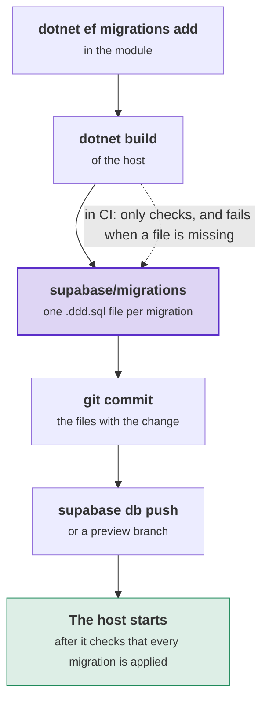
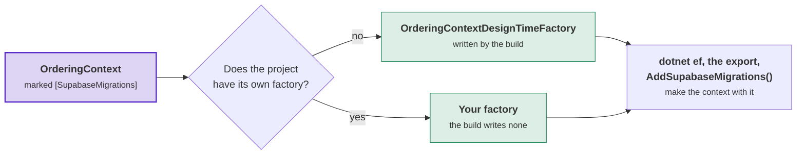
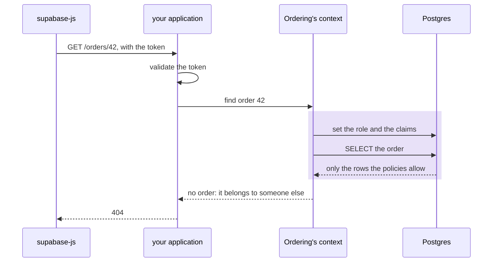
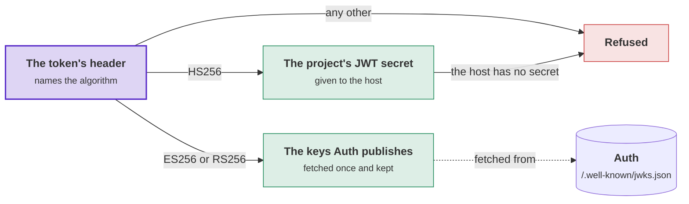
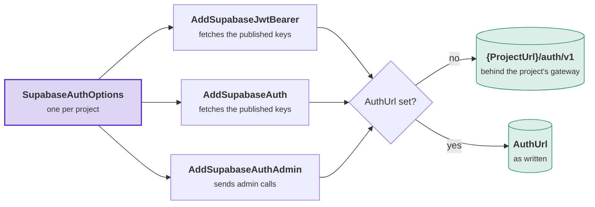
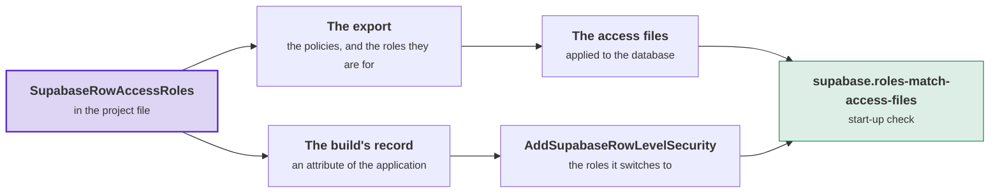
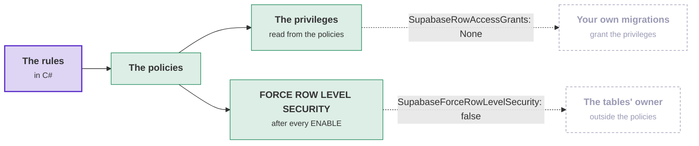
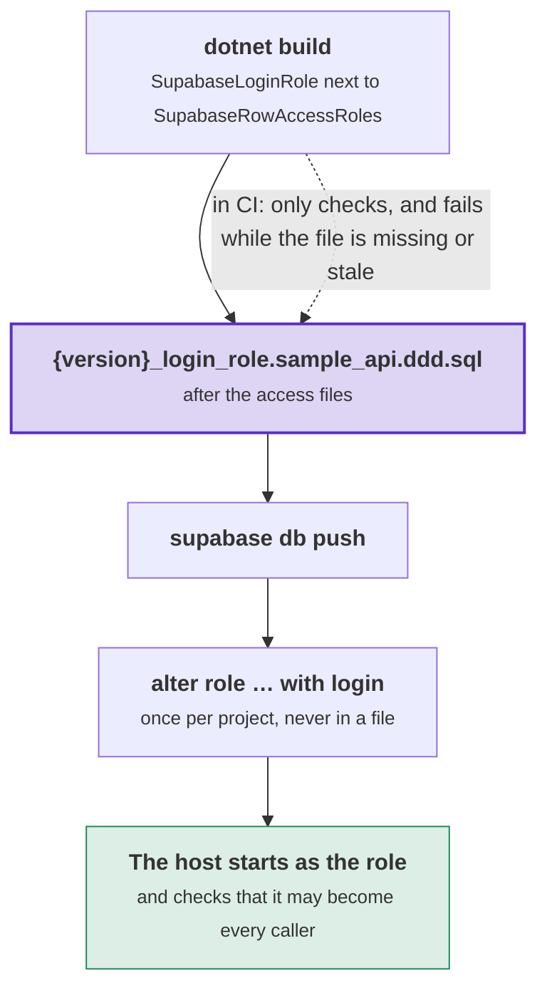
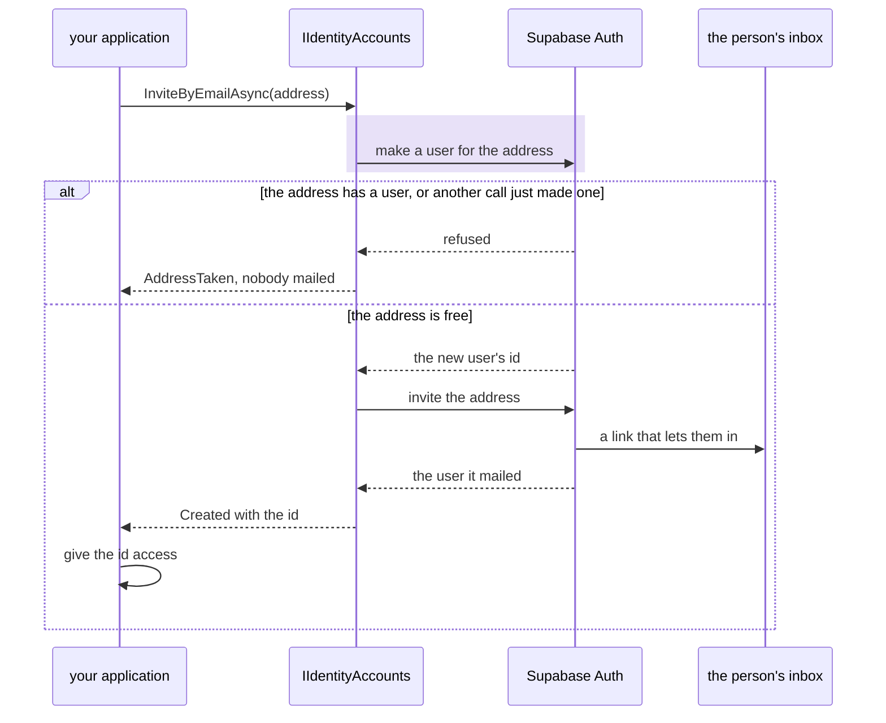

# Supabase

The Supabase CLI runs the SQL files in `supabase/migrations`, and so do `supabase db reset` and Supabase branching.
The CLI does not run Entity Framework migrations. `DDDToolkit.EntityFramework.Supabase` writes one SQL file into
`supabase/migrations` for each Entity Framework migration. You keep writing migrations with
`dotnet ef migrations add`, and Supabase applies them.

## Install

```bash
dotnet add package Temp.DDDToolkit.EntityFramework.Supabase --prerelease
```

Reference the package from the module that holds the context. The package depends on Entity Framework's relational
layer, the dependency injection abstractions and `DDDToolkit.EntityFramework.Postgres`, which brings the core
`DDDToolkit` package. It also brings its own source generator. It does not depend on Npgsql, which your application
already brings, or on `DDDToolkit.EntityFramework`. So it works for any context that has migrations.

The diagram shows the steps from a changed model to a database that has the change. Purple: the files the build
writes. Green: the host starts.



<details>
<summary>Show the code: the three places that turn the export on</summary>

Mark each module's context:

```csharp
[SupabaseMigrations]
public sealed class OrderingContext(DbContextOptions<OrderingContext> options) : DbContext(options)
{
    // ...
}
```

The host's project file turns the export on. It writes the files locally and only checks them in CI:

```xml
<PropertyGroup>
  <SupabaseMigrationsExport>Write</SupabaseMigrationsExport>
  <SupabaseMigrationsExport Condition="'$(ContinuousIntegrationBuild)' == 'true'">Check</SupabaseMigrationsExport>
</PropertyGroup>
```

The host refuses to start against a database that misses a migration. One call covers every marked context:

```csharp
// in the host
using Shop.Host; // the build writes AddSupabaseMigrations() into the namespace named after the host's assembly

builder.Services.AddSupabaseMigrations();
builder.Services.RunStartupChecks();
```

</details>

## Exporting as part of the build

The export needs the context on Npgsql. It never connects, so a connection string that points nowhere is enough.
`dotnet ef` also needs to make the context without the host, through a design-time factory. You write neither. Mark
the context `[SupabaseMigrations]`. The package's generator then writes the factory beside the context, in the
context's project, in a file named after the factory.

The diagram shows how a marked context gets its factory. Purple: the marked context. Green: the factory that
`dotnet ef`, the export and `AddSupabaseMigrations()` use.



The export always runs on Postgres, so the generated factory is always the same. It uses Npgsql with a connection
string that points nowhere, and it calls `UseDDDToolkitDesignTime()` from `DDDToolkit.EntityFramework`. That call
puts the migration history in the context's default schema, where a host that wires the context with
`UseDDDToolkit` also keeps it. So the exported files record each migration in the table the application reads
([The migration history](entity-framework.md#the-migration-history)). In a project that does not reference
`DDDToolkit.EntityFramework`, the toolkit does not wire the context, and the factory leaves the call out. The history
then stays where Entity Framework keeps it.

`dotnet ef` finds the generated factory the same way it finds one written by hand. It looks in the startup project
first, and then in the context's assembly, where the generated factory is. So `dotnet ef migrations add` works with
the module or with the host as the startup project. A startup project that has its own factory, for example a
project with SQL Server migrations, keeps using that factory. Entity Framework finds the migrations where it looks by
default, in the context's assembly.

A factory you write for the context, in the context's project, wins. The build then writes no factory, reports
nothing, and uses yours. If the export or the start-up check runs in another project, such as the host, make your
factory public, with a public parameterless constructor. The list the build writes there creates the factory with
`new()`. For a factory it cannot create, the exporting project reports [DDD00031](diagnostics.md#ddd00031).

Write your own factory when:

- the build cannot make the context, for example because its constructor needs more than its options;
- the context needs more at design time than Npgsql and the toolkit's call, such as provider options (`MapEnum`,
  `UseNodaTime`) or its own history table.

The build reports DDD00031 at a marked context when it cannot write a factory and the project has none. That
happens when the context:

- is abstract or generic;
- is private inside another type, where the generated factory cannot reach it;
- has no constructor that takes only its options;
- has `required` members, and no constructor that takes only its options is marked `[SetsRequiredMembers]`;
- is in a project that does not reference `Npgsql.EntityFrameworkCore.PostgreSQL`.

A factory in the host for a module's context wins in the host. With the host as the startup project, `dotnet ef`
takes the host's factory first, and the export and the start-up check in the host use it too. With the module as the
startup project, `dotnet ef` takes the factory beside the context.

The marker can also go on a factory instead of the context, as it did up to 3.1. Use this for a context whose
migrations are in a separate project, with a factory that says where they are. A marked factory wins over every other
factory of its context.

<details>
<summary>Show the code: a marked context and the factory the build writes beside it</summary>

```csharp
[SupabaseMigrations]
public sealed class OrderingContext(DbContextOptions<OrderingContext> options) : DbContext(options)
{
    protected override void OnModelCreating(ModelBuilder modelBuilder)
        => modelBuilder.HasDefaultSchema("ordering");
}
```

The factory, shortened:

**`OrderingContextDesignTimeFactory.g.cs`**

```csharp
public sealed class OrderingContextDesignTimeFactory : IDesignTimeDbContextFactory<OrderingContext>
{
    public OrderingContext CreateDbContext(string[] args)
        => new OrderingContext(new DbContextOptionsBuilder<OrderingContext>().UseNpgsql("Host=unused").UseDDDToolkitDesignTime().Options);
}
```

```bash
dotnet ef migrations add AddOrders --project src/Ordering --startup-project src/Ordering
dotnet ef migrations has-pending-model-changes --project src/Ordering --startup-project src/Host
```

With `--verbose`, both commands print `Using DbContext factory 'OrderingContextDesignTimeFactory'.`

</details>

Then turn the export on in the project that references every module: the host of a modular monolith, or the
presentation layer of a service.

```xml
<PropertyGroup>
  <SupabaseMigrationsExport>Write</SupabaseMigrationsExport>
  <SupabaseMigrationsExport Condition="'$(ContinuousIntegrationBuild)' == 'true'">Check</SupabaseMigrationsExport>
</PropertyGroup>
```

The export needs no code in `Program.cs`, no extra command and no list of modules. The property has three values:

- **`Write`** writes a file for every migration that has none, after every build. On your machine the files then
  exist before you commit, and `supabase start` and `supabase db reset` find them.
- **`Check`** only compares. It fails the build when a file is missing, changed or orphaned, and names each file. In
  CI it catches a migration that somebody added without building locally.
- **Unset** does nothing. Every project leaves it unset, except the one that turns the export on.

The files go to the `supabase/migrations` folder next to the nearest `supabase/config.toml` above the project. The
Supabase CLI finds its project the same way. `SupabaseMigrationsDirectory` sets another folder.

You can also set the property for a whole build: as `-p:SupabaseMigrationsExport=Check` on the command line, in a
`Directory.Build.props`, or in CI. Only an application that is not a test project runs the export. So the host gets
the value, and every module and test project ignores it. But every application in that build runs the export. If
more than one application references the modules, for example an API and a separate program that only exports, keep
the property in the exporting project's file. Or set it for a build of that project alone:
`dotnet build src/Exporter -p:SupabaseMigrationsExport=Check`.

You keep no list of modules, because the generator writes it. In the project that turns the export on, the
package's generator finds every marked context in the referenced assemblies, each with its factory, and writes them
as ordinary code:

**`DDDToolkit.SupabaseMigrationSources.g.cs`**

```csharp
namespace DDDToolkit.EntityFramework.Supabase.Generated
{
    internal static class SupabaseMigrationSources
    {
        public static IReadOnlyList<SupabaseMigrationSource> All()
            => new SupabaseMigrationSource[]
            {
            SupabaseMigrationSource.For<OrderingContext, OrderingContextDesignTimeFactory>("Ordering"),
            };

        [ModuleInitializer]
        internal static void ExportWhenTheBuildAsks()
            => SupabaseMigrationBuild.RunIfRequested(All);
    }
}
```

Add a module with a marked context, and the next build exports its migrations too. `"Ordering"` is the module name
in the file names. It is the module the project declares, with `<DDD_Module>Ordering</DDD_Module>` or
`[assembly: Module("Ordering")]`. [How the build step works](#how-the-build-step-works) explains the module
initializer.

Commit the files. Supabase branching and the GitHub integration read `supabase/migrations` from the repository, so
the files must be there. `Check` makes sure they are. If you do not use branching, you can generate the files in the
pipeline instead: run `Write` in a release build, then `supabase db push`, and leave the files out of the
repository.

## What the build writes

Each file is named after its migration and its module, in lower case. In a project of module Ordering, the
migration `20260922120000_AddOrders` becomes `20260922120000_AddOrders.ordering.ddd.sql`. Without a module, the file
uses the context's name without `Context`, and the build warns with [DDD00055](diagnostics.md#ddd00055). Renaming the
class would then change the name of every file the export looks for.

Entity Framework migration ids and Supabase versions are both `yyyyMMddHHmmss` timestamps. So the two histories sort
the same way, and a file you write with `supabase migration new` sorts between them by date. The Supabase CLI reads
everything between the first underscore and `.sql` as the migration's name, so `.ordering.ddd` is only for people.
Next to the policies and triggers you write by hand, it shows which files the build writes, and which module each
file belongs to.

Each file holds what `dotnet ef migrations script` writes for that one migration, with three differences:

- **No `START TRANSACTION` and `COMMIT`.** The CLI already runs a file, and the row it records in
  `supabase_migrations.schema_migrations`, in one transaction. The CLI runs statements that cannot be in a
  transaction, such as `CREATE INDEX CONCURRENTLY`, on their own.
- **Row level security (RLS) on new tables in `public`.** Supabase serves `public` through its Data API and grants the
  `anon` and `authenticated` roles access to it. Without RLS, anyone with the publishable key can read
  and write a table that Entity Framework creates there. With RLS on and no policy, those roles see
  no rows. Your application still works, because it connects as the table's owner, and RLS does not
  apply to the owner, unless you [run its queries as the caller](#row-level-security-for-your-own-queries).
  - Change `SupabaseMigrationOptions.RowLevelSecuritySchemas` to cover other schemas, or clear it to turn this off.
  - A simpler way is to put your tables in a schema the Data API does not expose, with
    `modelBuilder.HasDefaultSchema("app")`. The toolkit's `ddd` schema is not exposed.
- **A header comment that names the migration and its context.** The export uses this comment to recognise a file
  whose migration was removed.

One of the example's files, with most of its statements left out:

**`supabase/migrations/20260923093256_TrackCheckout.ordering.ddd.sql`**

```sql
-- Exported by DDDToolkit from the Entity Framework migration 20260923093256_TrackCheckout of OrderingContext.
-- Written from that migration; change the migration, not this file.

ALTER TABLE ordering."Orders" ADD "CancellationReason" text;

-- ...

INSERT INTO ordering."__EFMigrationsHistory" ("MigrationId", "ProductVersion")
VALUES ('20260923093256_TrackCheckout', '10.0.12');
```

The insert into `__EFMigrationsHistory` stays in the file. After Supabase applies a file, `GetPendingMigrations()`
and `dotnet ef migrations list` both report the migration as applied. Let only one of the two tools apply
migrations. Supabase does not read Entity Framework's history. If the application calls `Database.Migrate()` first,
the CLI applies that migration a second time and fails.

`Export` never overwrites or deletes a file. Supabase applies each version once. A rewritten file that was already
applied changes nothing on that database, and a database that has not applied it yet would get a different schema.
So the report, and `EnsureInSync`, lists each problem:

| Status | Meaning |
|---|---|
| `Missing` / `Created` | The migration has no file. `Check` reports it as `Missing`. `Export` writes it and reports `Created`. |
| `Changed` | The file differs from what the migration generates now. If the file was never applied anywhere, delete it and export again. Otherwise make the change in a new migration. |
| `VersionTaken` | Another file already has this timestamp. |
| `Orphaned` | An exported file whose migration is gone, usually after `dotnet ef migrations remove`. |

The comparison ignores line endings and the Entity Framework version in the history insert. So a checkout with
`\r\n` line endings, or an Entity Framework update, does not mark every file as changed. Files you wrote yourself,
such as policies, triggers and storage buckets, stay as they are.

If a database already has these migrations from `dotnet ef database update`, tell Supabase once: run
`supabase migration repair --status applied <version>` for each exported version.

## Checking at start-up

On Supabase, the CLI applies the migrations, so the application must not call `Database.Migrate()`. The application
can still refuse to run against an older schema. The host registers every marked context with one call. That call
brings the [start-up check](startup-checks.md) `supabase.migrations-applied`, which runs with the host's other checks,
before the server binds its port.

The diagram shows where that call comes from. Purple: the one call in the host. Green: the check.

```mermaid
flowchart LR
    contexts["<b>The marked contexts</b><br/><small>[SupabaseMigrations]</small>"]
    generator["<b>The package's generator</b><br/><small>in the host's build</small>"]
    call["<b>AddSupabaseMigrations()</b><br/><small>in the host</small>"]
    check["<b>supabase.migrations-applied</b><br/><small>before the port is bound</small>"]
    contexts --> generator
    generator --> call
    call --> check
    classDef strong fill:#5b2ec933,stroke:#5b2ec9,stroke-width:2px
    classDef good fill:#1f8a5b26,stroke:#1f8a5b
    class call strong
    class check good
```

`AddSupabaseMigrations()` takes no type arguments and names no module:

- The package's generator writes the method into every application that is not a test project. It lists every
  marked context the application references, each with the factory that `dotnet ef` uses from the host.
- The method is in the namespace named after the application's assembly. A top-level `Program.cs` has no namespace,
  so it needs `using Shop.Host;`. Without that line, the compiler finds only the package's
  `AddSupabaseMigrations<TContext, TFactory>()` and asks for its type arguments.
- A new module is checked without a change in the host, and the host's code names no context.
- The export property plays no part here. A host whose files another program exports, as in the Tenancy sample, also
  gets the method.

The list is built from the project references, and the host's registrations do not change it. It holds every marked context of every project the
host references, whether the host registers that context or not, and the check asks each one for its history. So a
host that shares a project with a marked context it does not use, for example a worker next to an API, fails the
check with a message that names the context. Such a host registers the contexts it uses one by one, with the factory
`dotnet ef` uses: `services.AddSupabaseMigrations<OrderingContext, OrderingContextDesignTimeFactory>()`.

A host that had its own `AddSupabaseMigrations()` before the build wrote one keeps it. The build then writes only the
list, `SupabaseMigrationsOfModules.All()`, and the host's method stays the one that is called.

<details>
<summary>Show the code: the host's one call, and what the build writes for it</summary>

```csharp
// in the host
using Shop.Host; // the build writes AddSupabaseMigrations() into the namespace named after the host's assembly

builder.Services.AddSupabaseMigrations();
builder.Services.RunStartupChecks();
```

What the build writes, shortened:

**`SupabaseMigrationsOfModules.g.cs`**

```csharp
namespace Shop.Host
{
    internal static class SupabaseMigrationsOfModules
    {
        public static IReadOnlyList<SupabaseMigrationSource> All()
            => new SupabaseMigrationSource[]
            {
            SupabaseMigrationSource.For<OrderingContext, OrderingContextDesignTimeFactory>("Ordering"),
            SupabaseMigrationSource.For<ShippingContext, ShippingContextDesignTimeFactory>("Shipping"),
            };

        public static IServiceCollection AddSupabaseMigrations(this IServiceCollection services)
        {
            foreach (var source in All())
            {
                DependencyInjection.AddSupabaseMigrations(services, source);
            }

            return services;
        }
    }
}
```

A host that checks some contexts and not others registers each one itself, with the factory the build wrote:
`services.AddSupabaseMigrations<OrderingContext, OrderingContextDesignTimeFactory>()`.

</details>

The check reads each context's migration history. It throws a `SupabaseMigrationsPendingException` that names every
context with missing migrations, and each missing migration.

The exported files record each migration in the history table of the design-time factory's context. The running
context can read its history from a different table. The migrations may then be applied, but recorded in a table the
application does not read. In that case the message names both tables and says what to do:

- **The files were already applied to a database.** Make the application read the table the files record in, with
  the `MigrationsHistoryTable` call the message shows. An applied file keeps the table it was exported with.
- **No file was applied anywhere yet.** Give the factory the application's history table instead:
  `UseDDDToolkitDesignTime()` where the application calls `UseDDDToolkit`. Then export the files again and reset the
  local database. For a marked context the build writes the factory, so write your own factory beside the context.
  The build then uses yours.

Registering the same context twice registers it once. The check is registered once, however many contexts there
are. With no contexts registered there is no check. A host on another database than Supabase does not call
`AddSupabaseMigrations()`, so it gets no check.

A host that runs its checks by hand calls the method behind the check after `Build()`:

```csharp
var app = builder.Build();
await app.Services.EnsureSupabaseMigrationsAppliedAsync();
```

A deployment that checks the migrations itself before it starts the host turns the check off, with a reason:
`builder.Services.SkipStartupCheck(SupabaseMigrations.AppliedCheck, reason: "...")`.

The check reads the history as system work. With
[RLS](#row-level-security-for-your-own-queries), the connection then switches to the system
role: `ddd_system`, unless the project names another role. The access files give that role the migration history.
An application that logs in as its own role first checks that this role may switch to the system role
([The role the application logs in as](#the-role-the-application-logs-in-as)). The runner runs that check in the
stage before the migrations' stage.

With [RLS for your own queries](#row-level-security-for-your-own-queries), `RunStartupChecks()` also
runs the checks that `AddSupabaseRowLevelSecurity` brings. One of them, `postgres.login-role-owns-nothing`, checks that
the role the host logs in as owns nothing. A host that logs in as `postgres`, as at the start of this page, owns its
tables, so this check stops it. The message says to log in as a separate role
([The role the application logs in as](#the-role-the-application-logs-in-as)). Until the host does, it turns that one
check off, with a reason:

```csharp
builder.Services.AddSupabaseRowLevelSecurity();
builder.Services.RunStartupChecks();
builder.Services.SkipStartupCheck(
    PostgresRowAccessChecks.LoginRoleOwnsNothingCheck,
    reason: "logs in as postgres, which owns the tables, until it has a login role of its own");
```

## Several modules in one Supabase project

A Supabase project is one database, so the modules of a modular monolith share it. Give each module its own schema,
and export all modules into the same `supabase/migrations`. The migration history table goes into the module's schema
with no extra code: `UseDDDToolkit` in the host and `UseDDDToolkitDesignTime()` in the design-time factory put it
there ([The migration history](entity-framework.md#the-migration-history)).

```csharp
public const string Schema = "ordering";

protected override void OnModelCreating(ModelBuilder modelBuilder)
{
    modelBuilder.HasDefaultSchema(Schema);
    modelBuilder.AddDomainEventOutbox(Database);
}
```

A context that the host does not wire with `DDDToolkit.EntityFramework` names the history table itself, in the
host's options and in the factory's options:
`UseNpgsql(connectionString, npgsql => npgsql.MigrationsHistoryTable(HistoryRepository.DefaultTableName, Schema))`.
The factory the build writes names no table. So when such a context is marked, write its factory yourself, and name
the table there.

Each module's migrations read only that module's history table, so no module reports another module's migrations as
pending. Supabase keeps one history, with the migrations of all modules in timestamp order. That works, because no
module's migration touches another module's schema. A context reports only its own exported files as orphaned. If two
modules scaffold migrations in the same second, the second one is reported as `VersionTaken` and not written.

The module schemas are not in the `schemas` list of the Data API in `supabase/config.toml`. So the Data API does not
serve them, and they need no RLS for the Data API.

`Examples/ModularMonolith.Supabase` does all of this for five modules:

- Each module's context is marked `[SupabaseMigrations]`, and the build writes its design-time factory beside it.
- Each module's migrations are in its `Infrastructure/Persistence/Migrations` folder.
- When the host runs on Supabase, its one `AddSupabaseMigrations()` registers the start-up check for every module.
- The host's project file turns the export on: `Write` locally and `Check` in CI.
- `supabase/migrations` holds the committed files.

[Its README](../Examples/README.md#on-supabase) shows how to run it against a local Supabase.

### Schema names with capitals or SQL keywords

A module's schema can have any name Entity Framework accepts: `tenancy`, `Tenancy` with a capital, `Help_Desk`, or
an SQL keyword such as `order`. Entity Framework creates the schema with the name as written:
`CREATE SCHEMA "Tenancy"`. An access file writes every schema name in double quotes, lower-case names included. Its
functions, policies, triggers and grants write `"tenancy"`, `"Tenancy"`, `"Help_Desk"` and `"order"` the same way
([Schema names](row-level-security.md#schema-names)).

A migration's file is Entity Framework's SQL, and writes the schema name as Entity Framework does. The export adds one
line to it, and that line quotes the name as an access file does. It is the `ENABLE ROW LEVEL SECURITY` for a new
table in a schema the Data API serves: `ALTER TABLE "tenancy"."Tenants" ENABLE ROW LEVEL SECURITY;`.

If a project serves a module's schema through the Data API, list the schema as the model spells it, without quotes.
Do this in `config.toml` and in `SupabaseMigrationOptions.RowLevelSecuritySchemas`:

**`supabase/config.toml`**

```toml
[api]
schemas = ["public", "graphql_public", "Tenancy"]
```

PostgREST takes each name as written, capitals included, and quotes it itself, in its queries and in the search path
it sets. So `"\"Tenancy\""` would name a schema whose name contains the quotes. A client selects the schema the same
way: `supabase.schema("Tenancy")`, or the header `Accept-Profile: Tenancy`. No sample serves a module's schema
through the Data API, so this is the only example.

## Row level security for your own queries

An application that connects as `postgres` owns its tables, and RLS does not apply to a table's owner.
So the policies you wrote for the Data API apply only to the Data API. Every query of your application sees every
row, and your application's code decides who may see what. This design works, and it is the default. If you want
Supabase's policies to apply to the application as well as to supabase-js, run each request's queries as the user who
sent the request, as PostgREST does.

RLS is a Postgres feature. The package that runs queries as the caller is
`DDDToolkit.EntityFramework.Postgres`, which this package brings. [Row level security](row-level-security.md)
describes it in full. This section covers the parts that belong to Supabase: the token, the roles and `auth.uid()`.

```bash
dotnet add package Temp.DDDToolkit.Auth.Supabase.AspNetCore --prerelease       # an ASP.NET Core application
dotnet add package Temp.DDDToolkit.Auth.Supabase.AzureFunctions --prerelease   # Azure Functions on the isolated worker
```

Both packages bring `DDDToolkit.Auth.Supabase`, which validates Supabase Auth's tokens without a web framework.

The diagram follows one request, from the token that supabase-js sends to the rows a module's query returns. The
purple band is where the context sets the caller's role and claims on the connection, and Postgres applies the
policies.



<details>
<summary>Show the code: turned on in the host, once for every context</summary>

```csharp
builder.Services.AddAuthentication().AddSupabaseJwtBearer("https://<ref>.supabase.co");
builder.Services.AddDDDToolkitEntityFramework(options => options.DispatchWithMediator());   // the toolkit, Temp.DDDToolkit.EntityFramework
builder.Services.AddSupabaseRowLevelSecurity();

builder.Services.AddDbContext<OrderingContext>((provider, options) => options
    .UseNpgsql(connectionString)
    .UseDDDToolkit(provider));                       // the toolkit, and the queries run as the caller

// after Build()
app.UseAuthentication();
```

</details>

`AddSupabaseJwtBearer` validates the access tokens that Supabase Auth issues: the tokens supabase-js holds for a
signed-in user. A token must:

- be issued by `https://<ref>.supabase.co/auth/v1`;
- be for the audience `authenticated`;
- be signed with a key the project publishes.

A hosted project with signing keys needs nothing more, and neither does the local stack the Supabase CLI starts. A
project still on the legacy JWT secret publishes no key. For that project, and for tokens an application signs
itself, also pass the secret ([Signing keys and the JWT secret](#signing-keys-and-the-jwt-secret)).

`AddSupabaseRowLevelSecurity` registers Postgres's RLS with the roles every Supabase project has. Once
it is registered, `UseDDDToolkit` (the toolkit's call on a context's options, from `Temp.DDDToolkit.EntityFramework`)
adds it to every context on Postgres. A context needs no extra call.

- A context without the toolkit calls `UseSupabaseRowLevelSecurity` instead. This package also works without the
  toolkit.
- A context that should run as the role the application logged in as is configured with `UseDDDToolkitCore`
  ([`UseDDDToolkitCore`](entity-framework.md#usedddtoolkitcore)). It can then do what that role may do. If the
  application logs in as a role that owns and holds nothing, that context can do nothing.

Each time a context opens a connection, it sets the caller's role and the token's claims on the connection, as
PostgREST does for each request:

| The current user | Runs as | `auth.uid()` |
|---|---|---|
| A request with a valid Supabase access token | `authenticated`, with the token's claims as they were signed | the user's id |
| A request without a valid token, or signed in another way | `anon`, with the claims `{"role":"anon"}` | `null` |
| System work inside a scope, `access.BeginSystem("projects")` | `ddd_system_in`, with the claims `{"role":"ddd_system_in","scope":"projects"}` | `null` |
| System work outside any request, such as a hosted service of yours, or inside `access.BeginSystemBypassingRowAccess()` | `ddd_system`, the toolkit's bookkeeping role. `system=<role>` in `SupabaseRowAccessRoles` names another role, and `system=none` names the role the application logged in as. Where the host requires an explicit current user, this work runs as nobody. The toolkit's pollers then begin system work for their bookkeeping only. | `null` |
| Code inside `using (access.BeginAs(userId))` | that user, whatever the request says | the user's |

So `auth.uid()`, `auth.jwt()` and every policy on every table the context touches apply to the context's queries. A
policy you already test with pgTAP also decides what the application may see. The statement that sets the claims also
empties `request.jwt.claim.sub`, `request.jwt.claim.role`, `request.jwt.claim.email` and `request.jwt.claim`.
`auth.uid()`, `auth.role()`, `auth.email()` and `auth.jwt()` read those settings before the claims, so no setting left
on a server connection decides who a query runs as. Who is calling, work that leaves a request, and how the settings
travel work the same on any Postgres ([Running queries as the caller](row-level-security.md#running-queries-as-the-caller)).

With `builder.Services.RequireExplicitCurrentUser()`, work outside a request fails when it does not say who it runs
as. It does not run as system work. The toolkit's own background work then says who it runs as
([Requiring an explicit current user](row-level-security.md#requiring-an-explicit-current-user)).
`context.GetSupabaseUser()` returns a request's own user, the token's user or `anon`, whatever user was begun.

Connect through the session pooler on port 5432, or directly. The transaction pooler on port 6543 gives each
transaction whichever server connection is free. The interceptor refuses it unless the settings travel per
transaction ([The transaction pooler](#the-transaction-pooler)).

**The database must grant privileges to the application's roles.** `anon` and `authenticated` have no privileges in
a schema of yours until something grants them. For the tables of an aggregate with rules written in C#, the access
files that the build writes grant them, read from the policies. The access files also give the module's outbox and
inbox what a caller needs there, and no more
([Privileges, forced policies and the bookkeeping role](#privileges-forced-policies-and-the-bookkeeping-role)). A
table without such a rule needs a migration you write by hand:

```sql
grant usage on schema ordering to anon, authenticated;
grant select, insert, update, delete on all tables in schema ordering to anon, authenticated;
alter default privileges in schema ordering grant select, insert, update, delete on tables to anon, authenticated;
```

These grants also cover the module's outbox and inbox tables, which have no policies. On those tables the module's
access file decides, because it also writes their privileges. The outbox accepts rows from the signed-in user, from
the scoped system role and from the roles the module's policies let write, and from no one else. So when a guest
writes a table without a rule under these grants, the save fails with `permission denied` on the outbox as soon as it
raises an event. Such a module needs one of two things:

- a rule for that table, whose policies then give the guest both the table and the outbox;
- the privileges left to the project, with `SupabaseRowAccessGrants` set to `None`
  ([Turning a switch off](#privileges-forced-policies-and-the-bookkeeping-role)). A project that writes the
  privileges itself takes back what a caller does not need, as
  [A Postgres of your own](row-level-security.md#setup-on-postgres-without-supabase) shows.

Keep such schemas out of the schemas the Data API exposes. A table in an exposed schema that is granted to `anon` is
open to anyone with the publishable key, as far as its policies allow. In a schema that is not exposed, only the
application reaches the table.

Write each policy for a whole aggregate. A policy that hides some of an order's lines gives Entity Framework half an
aggregate, and the aggregate's invariants then check half the data. Put the rule on the root, and let the child
tables follow it:

- For reading, `using (exists (select 1 from ordering."Orders" o where o."Id" = "OrderId"))` queries the orders
  table, which applies its own policy. So a caller sees an order with all its lines, or not at all.
- For writing, a child's policy checks the root's write rules for its order. So a caller who may only read an order
  cannot add, change or remove its lines.

Rules written in C# do both for you ([Row access rules in the build](#row-access-rules-in-the-build)).

**Background work** runs as `ddd_system`. The access files make this role for the application. They give it the
toolkit's bookkeeping and nothing else: reading, marking and deleting outbox rows, the inbox, and the record of which
migrations ran. A hosted service of yours that reads or writes a module's tables is refused as `ddd_system`. So begin
its work as [scoped system work](row-level-security.md#the-scoped-system-role):
`using (access.BeginSystem("projects"))`, on `AccessManager`. That work runs as `ddd_system_in`, under the policies the
module's rules write for `RowAccessRoles.SystemIn`.

A host that logs in as `postgres` can run its background work as that owner, outside the policies. It sets this once
in its project file. If the export runs in a separate project, set it in the exporter's project file too. The build
also passes the value to `AddSupabaseRowLevelSecurity`
([Custom roles and current user functions](#custom-roles-and-current-user-functions)):

```xml
<SupabaseRowAccessRoles>system=none</SupabaseRowAccessRoles>
```

To keep the application from seeing everything by accident, log in as a separate role that may do nothing but switch
roles, as PostgREST's `authenticator` does. When the exporting project names the role with
[`SupabaseLoginRole`](#the-role-the-application-logs-in-as), the build writes the migration that makes the role. The
role gets no login and no password, because the migration is kept in the repository:

```xml
<SupabaseLoginRole>shop_app</SupabaseLoginRole>
```

Turn on the login once per project, as `postgres`, with a secret of that project. Use the SQL editor or `psql`:

```sql
-- Once per project, never in a file of the repository
alter role shop_app with login password '...';
```

The role is granted `anon`, `authenticated`, the scoped system role and `ddd_system`: the roles the policies and the
privileges are written for. A host whose background work runs as `service_role` instead, as a secret key would, sets
`system=service_role` in `SupabaseRowAccessRoles`. The access files do not make `service_role`, and the login role's
file does not grant it. So grant it yourself, in a migration you write that comes after that file:
`grant service_role to shop_app;`.

`Examples/ModularMonolith.Supabase` turns this on with `Supabase:Url`. An order there belongs to its customer, and
records who placed it. Two rules written in C#, `ACustomerHasTheirOrders` and `NobodyOrdersForSomebodyElse`, become
its policies ([Row access rules in the build](#row-access-rules-in-the-build)). A signed-in customer sees their own
orders. A guest's order stays open to anyone who has its id.

### Signing keys and the JWT secret

Supabase Auth signs a user's access token in one of two ways, and the token's header says which. The bearer scheme,
and `SupabaseTokenValidator` outside ASP.NET Core, check each kind of token with its own kind of key.

The diagram shows which key checks a token. Purple: the token's header. Green: the keys that check it. Red: refused.



<details>
<summary>Show the code: a host that accepts both kinds</summary>

```csharp
builder.Services.AddAuthentication().AddSupabaseJwtBearer(new SupabaseAuthOptions
{
    ProjectUrl = builder.Configuration["Supabase:Url"]!,       // the issuer is {ProjectUrl}/auth/v1
    JwtSecret = builder.Configuration["Supabase:JwtSecret"],   // unset: published keys only
});
```

`AddSupabaseJwtBearer(url, jwt => jwt.UseSupabaseJwtSecret(secret))` does the same. `AddSupabaseAuth(...)` takes the
same settings for a function or a worker.

</details>

| Signed with | Algorithm | Checked with | Who signs this way |
|---|---|---|---|
| A signing key | ES256 or RS256 | The public half, which Auth publishes at `{project URL}/auth/v1/.well-known/jwks.json` | A hosted project with signing keys, and the local stack the Supabase CLI starts |
| The JWT secret | HS256 | The secret, which the host must be given | A project still on the legacy secret, and anything that signs tokens itself with that secret, such as a test |

A host given only the project's URL accepts the first kind. A host also given the secret accepts both. A developer's
machine needs both when the local stack's Auth signs with a key and the application's tooling signs with the stack's
secret. For a hosted project, Supabase advises signing keys, so the secret is not handed to another service.

- **Each kind of token is checked only with its own keys and algorithms.** A published key is public, so it is never
  used as a secret. A token whose header says HS256 is checked against the secret only, and a host without a secret
  refuses it. A token signed with another algorithm than these three is refused, and so is an unsigned token. The
  issuer, the audience and the lifetime are checked the same way for both kinds.
- **The published keys are fetched when the first token needs them, and kept.** They are fetched again the way
  ASP.NET Core's JWT bearer fetches a provider's keys: after `AutomaticRefreshInterval`, and when a token names a key
  that is not among them, but not more often than `RefreshInterval`. So rotating a project's signing keys needs no
  change in the host, and a stream of tokens with unknown keys does not cause a stream of requests to Auth. A key that
  Auth no longer publishes is refused from the next fetch on.
- **A token signed with the secret needs no fetch.** A host that cannot reach an Auth server still accepts these
  tokens.
- **The keys are fetched over https.** Whoever serves the keys decides who is signed in, so the keys travel
  unencrypted only when you allow it. Plain http is accepted for an Auth server on the same machine (`localhost` or a
  loopback address), which is what a local stack is. The host refuses any other plain-http address when it starts.
  For an Auth server on your own private network, set `AllowPlainHttp = true` on the `SupabaseAuthOptions`
  ([The address of Supabase Auth](#the-address-of-supabase-auth)).
- **A token waits for Auth for a limited time.** A request for the keys ends at the timeout of the client that
  fetches them: the scheme's `BackchannelTimeout` in ASP.NET Core. A token that waits behind another token's fetch
  stops waiting after the same time. In both cases the token is refused.

### The address of Supabase Auth

Every Supabase registration identifies the project by the URL its tokens name. It reaches Auth where the project's
gateway serves it, at `{ProjectUrl}/auth/v1`. The bearer scheme and `AddSupabaseAuth` fetch the published keys
there, and the [admin client](#users-before-their-first-sign-in) sends its calls there. A host that needs more
settings than the URL puts them in one `SupabaseAuthOptions` object and passes that object to each registration.

The diagram shows one options object used by every registration. Purple: the options. Green: the address each
registration calls.



- **The project's URL is enough for any project**, hosted or the local stack the Supabase CLI starts, because the
  project's gateway serves Auth under that URL. Every registration uses a URL that already ends in `/auth/v1` as it
  is.
- **`AuthUrl` is for an Auth server at another address.** It is used as written, with nothing added:
  - For an Auth server without a gateway in front of it, `AuthUrl` is the server's root, such as `http://auth:9999`.
  - For a project's gateway that is reached inside a network under another name than its tokens carry, as in a stack
    of containers, `AuthUrl` is that name with `/auth/v1`, such as `http://kong:8000/auth/v1`. The gateway's address
    alone reaches no Auth.

  The keys are fetched from `AuthUrl`, and the admin client calls it. The issuer a token must name stays
  `{ProjectUrl}/auth/v1`.
- **`AllowPlainHttp` says that the network to Auth is yours.** Auth is reached over https, or over plain http on the
  same machine. The host refuses any other plain-http address when it starts, because two things would travel
  unencrypted: the keys that check tokens, and the secret key that the admin client sends. One setting covers both,
  because both use one address.
- **Each registration reads the object when the registration is called.** Later changes to the object reach no
  registration. So fill in the object from the configuration before you pass it on, and describe the project in one
  place.

<details>
<summary>Show the code: one description of the project, for every registration</summary>

```csharp
var supabase = new SupabaseAuthOptions
{
    ProjectUrl = builder.Configuration["Supabase:Url"]!,       // the issuer is {ProjectUrl}/auth/v1
    JwtSecret = builder.Configuration["Supabase:JwtSecret"],   // unset: published keys only
    AuthUrl = builder.Configuration["Supabase:AuthUrl"],       // unset: Auth answers at {ProjectUrl}/auth/v1
};

builder.Services.AddAuthentication().AddSupabaseJwtBearer(supabase);
builder.Services.AddSupabaseAuthAdmin(supabase, builder.Configuration["Supabase:SecretKey"]!);
```

A function or a worker registers the validator with the same object: `AddSupabaseAuth(supabase)`. The admin client
checks no token, so it ignores the JWT secret. `Examples/Tenancy` describes its project in one place,
`SampleAuthentication.ProjectOf` in `Host/Auth/SampleAuthentication.cs`, which reads it from the configuration for
every registration. Its AppHost sets `Supabase:AuthUrl`, because it starts Auth without a gateway in front of it.

</details>

### The transaction pooler

Supabase's transaction pooler (port 6543 on the pooler's host) gives a client a server connection for one
transaction. It then hands that connection to the next client as it is. A setting made for a session there reaches
whoever comes next. So by default the interceptor refuses that host and port. To use the transaction pooler, make
the settings travel per transaction:

```csharp
builder.Services.AddSupabaseRowLevelSecurity(options => options.Scope = RowLevelSecurityScope.Transaction);

builder.Services.AddDbContext<OrderingContext>((provider, options) => options
    .UseNpgsql("Host=aws-0-eu-west-1.pooler.supabase.com;Port=6543;Database=postgres;Username=postgres.<ref>;Password=...;No Reset On Close=true;Max Auto Prepare=0")
    .UseDDDToolkit(provider));
```

No setting is then made for a session. A command outside a transaction carries a call that sets the role and the
claims for that command only. A transaction sets them in its first statement.
[How the settings travel](row-level-security.md#settings-per-connection-or-per-transaction) compares both scopes, and lists what the
transaction scope refuses. On Supabase, the transaction scope needs:

- **`No Reset On Close=true` and `Max Auto Prepare=0`** in the connection string. The pooler has no session that a
  reset or a prepared statement could belong to.
- **The procedure `ddd.use_current_user`.** Every exported access file makes it, so a project with its access files applied
  has it. An application that logs in as its own role, and not as the role that applied the migrations, needs these
  two grants in a migration you write by hand: `grant usage on schema ddd to shop_app;` and
  `grant execute on procedure ddd.use_current_user(text, text, text[], text[]) to shop_app;`. The file that
  [`SupabaseLoginRole`](#the-role-the-application-logs-in-as) writes grants roles and no privileges, so you write
  these two grants. `EnsureLoginRoleMaySwitchToUserRolesAsync` reports at start-up when they are missing.
- **Migrations through the session pooler, or directly.** The Supabase CLI applies the exported files over its own
  connection, which is neither the application's connection nor the transaction pooler's.

Postgres applies a project's timeouts per role (`alter role authenticated set statement_timeout`) when that role logs
in. The application switches to a role without logging in as it, so those timeouts do not apply. Give each kind of
caller its timeout with [`StatementTimeouts`](row-level-security.md#a-statement-timeout-per-caller). The pooler also
has a limit: the project's pool size. Keep the `Maximum Pool Size` of every data source, added up over every instance
of the application, within that limit.

### Row access rules in the build

[Row access rules written in C#](row-level-security.md#row-access-rules-written-in-c) go into `supabase/migrations`
with the migrations. The build finds every `[RowAccess]` rule in the modules the host references. It writes a
separate access file, `{version}_access.{module}.ddd.sql`, for:

- each module with rules. The file holds policies that use `auth.uid()` and `auth.jwt()`.
- each module with an outbox, an inbox or an event log. The file holds the privileges of those tables.

The [access functions](row-level-security.md#access-functions) that a module's rules
call go into the access file of the module that maps their aggregate, before its policies. That file comes before the
files of the modules that call the functions. An access file looks like this:

```sql
-- Written by DDDToolkit from the row access rules of OrderingContext.
DO $ddd$ ... $ddd$;   -- drops the policies the previous file made on the module's tables, and the triggers
                      -- of its column rules

DO $ddd$ ... $ddd$;   -- creates what the policies below use, where the database lacks it:
                      -- the ddd schema, "ddd".written_in_this_transaction(xid), the scoped system role,
                      -- and for every role a policy names GRANT USAGE ON SCHEMA "ddd" and
                      -- GRANT EXECUTE ON FUNCTION "ddd".written_in_this_transaction(xid)

ALTER TABLE "ordering"."Orders" ENABLE ROW LEVEL SECURITY;
ALTER TABLE "ordering"."Orders" FORCE ROW LEVEL SECURITY;

CREATE POLICY "A customer has their orders (select) for anon" ON "ordering"."Orders" FOR SELECT TO anon
    USING (("PlacedBy" IS NULL) OR ("PlacedBy" IS NOT DISTINCT FROM (SELECT auth.uid())));
COMMENT ON POLICY "A customer has their orders (select) for anon" ON "ordering"."Orders" IS 'DDDToolkit row access rule';
-- and one for authenticated, and one per role for every other command a rule grants

-- OrderLine belongs to the aggregate: it is read with its Orders, and written as the rules let a caller write its Orders.
ALTER TABLE "ordering"."OrderLine" ENABLE ROW LEVEL SECURITY;
ALTER TABLE "ordering"."OrderLine" FORCE ROW LEVEL SECURITY;
CREATE POLICY "OrderLine (select) for anon" ON "ordering"."OrderLine" FOR SELECT TO anon
    USING (EXISTS (SELECT 1 FROM "ordering"."Orders" parent WHERE parent."Id" = "ordering"."OrderLine"."OrderId"));
CREATE POLICY "OrderLine (insert) for anon" ON "ordering"."OrderLine" FOR INSERT TO anon
    WITH CHECK (EXISTS (SELECT 1 FROM "ordering"."Orders" r WHERE r."Id" = "ordering"."OrderLine"."OrderId"
        AND (((r."PlacedBy" IS NULL) OR (r."PlacedBy" IS NOT DISTINCT FROM (SELECT auth.uid())))
          OR ((r."PlacedBy" IS NOT DISTINCT FROM (SELECT auth.uid())) AND "ddd".written_in_this_transaction(r.xmin)))));
-- and the same for authenticated, and for UPDATE and DELETE, each from the rules that grant it

-- Privileges, from the policies above: what a table gave the roles of this file before is taken back, and a
-- role then gets the commands a permissive policy allows it, and no more. UPDATE is granted on the columns
-- that may change.
GRANT USAGE ON SCHEMA "ordering" TO anon, authenticated, ddd_system, ddd_system_in;
REVOKE ALL ON TABLE "ordering"."Orders" FROM PUBLIC, anon, authenticated, ddd_system, ddd_system_in;
GRANT SELECT, INSERT ON TABLE "ordering"."Orders" TO anon;
GRANT UPDATE ("ConfirmedAt", "Paid", "Status", ...) ON TABLE "ordering"."Orders" TO anon;
-- and the same for authenticated, and for OrderLine

-- The outbox takes a row from whoever saves, and nobody but the bookkeeping reads, marks or deletes one.
REVOKE ALL ON TABLE "ordering"."OutboxMessages" FROM PUBLIC, anon, authenticated, ddd_system, ddd_system_in;
GRANT INSERT ON TABLE "ordering"."OutboxMessages" TO anon, authenticated, ddd_system_in;
GRANT SELECT, DELETE ON TABLE "ordering"."OutboxMessages" TO ddd_system;
-- and UPDATE of the four columns that record a delivery, and the inbox, which the scoped system role
-- reads and adds to

-- The roles the policies and the privileges above are written for, as the project that exports says them in
-- SupabaseRowAccessRoles, recorded on the ddd schema: the application compares the roles it switches to with
-- them when it starts, in the start-up check supabase.roles-match-access-files.
DO $ddd$ ... COMMENT ON SCHEMA "ddd" IS 'DDDToolkit row access roles: {"user":"authenticated",...}' ... $ddd$;
```

The file writes the `FORCE` after each `ENABLE`, and the privileges at the end, unless the project turns them off
([Privileges, forced policies and the bookkeeping role](#privileges-forced-policies-and-the-bookkeeping-role)).

Each access file states the current rules. It drops every policy that an earlier access file made, found by the
comment on each policy, and then makes all policies again. So a rule you remove disappears, and a policy you wrote by
hand stays. A [column rule](row-level-security.md#column-rules) is a trigger, and the file handles it the same way,
after the policies. The build never rewrites a file it already wrote, because Supabase may have applied it. When a
rule changes, or a migration of the module comes after the module's last access file, the build writes a new access
file, numbered after every other file in the directory. `Check` in CI fails until that file exists.

Right after the drop, each file creates what its policies need, where the database lacks it or has it in another
form:

- the `ddd` schema;
- `ddd.written_in_this_transaction`, which the policies of an aggregate's entities use to ask about the root row;
- `USAGE` on the schema and `EXECUTE` on the function, for every role a policy names;
- the [scoped system role](row-level-security.md#the-scoped-system-role), `ddd_system_in`.

The file refuses an existing `ddd_system_in` that can log in, can bypass RLS, or has the privileges of
`anon` or `authenticated`. It grants `ddd_system_in` to the role that applies the file: `postgres` under
`supabase db push`. It then writes that role's privileges on the module's tables from its policies, as it does for
`anon` and `authenticated` ([below](#privileges-forced-policies-and-the-bookkeeping-role)).

If the application logs in as its own role, and that is not the role that applies the files, grant `ddd_system_in`
to that role in a migration you write. A project that names the login role with `SupabaseLoginRole` does not need
this. The build writes the migration with the grant
([The role the application logs in as](#the-role-the-application-logs-in-as)). The start-up check
`EnsureLoginRoleMaySwitchToUserRolesAsync` requires the grant wherever `ddd_system_in` exists:

```sql
grant ddd_system_in to app;   -- app: the role the application logs in as
```

A project that sets `SupabaseRowAccessGrants` to `None` writes the privileges itself, in its own migration. The
access file then makes `ddd_system_in` only where a policy is for that role. Where one is, the project's migration
gives the role what its policies need:

```sql
grant usage on schema ordering to ddd_system_in;
grant select, insert, update, delete on all tables in schema ordering to ddd_system_in;
revoke select, update, delete on ordering."OutboxMessages" from ddd_system_in;   -- it only adds outbox rows
revoke update, delete on ordering."InboxMessages" from ddd_system_in;
```

Each policy is for one role. The rules that grant a role the same command on a table share one policy
([One policy per command and role](row-level-security.md#one-policy-per-command-and-role)). An entity's table gets
one policy per command and role:

- A caller reads a line when it may read the line's order.
- A caller adds a line when a rule lets it change the order, or let it place the order in the same transaction
  (through Entity Framework, in the same save).
- A caller changes a line when it may change the order.
- A caller removes a line when it may change or remove the order.

See [The aggregate's entities](row-level-security.md#policies-on-entity-tables).

A policy prevents dropping a column that the policy reads. So every migration of a module with rules or contributions
starts by removing the module's generated policies, and the access file after the migration adds them again. Between
the two, the module's tables have only the policies you wrote by hand, including restrictive ones that a contribution
writes. So apply a migration and the access files after it together, as `supabase db push` does with every file it
has not applied yet.

**Functions in an access file.** Each access function, and each function a contribution writes, is created after
the functions of the same file that it calls. The Supabase CLI has Postgres check a function's body when it creates
the function, so this order matters. Each function:

- is revoked from `PUBLIC`;
- loses every other grant except its owner's;
- is granted to the roles of the policies, in any module, that call it. A contributed function is granted to the
  roles it names.

This takes back what the project's default privileges gave. On Supabase's `public` schema, the default privileges let
`anon`, `authenticated` and `service_role` execute every new function, and the Data API offers each one as an RPC.
It also takes back a `GRANT EXECUTE` of your own on such a function. So give a role of yours access to a function
through a policy that calls the function, or grant it in your own migration after the access file. The function's
owner, the role that ran the migrations, can always execute it.

A function that a new file still makes must keep the parameters and the return type that the module's newest file
gives it. Postgres cannot change either in place. It also cannot drop a function that other modules' policies use
without dropping those policies. So the export refuses such a change, with a message that says to give the function
a new name. A function that a new file no longer makes is dropped, unless a policy of a module whose file comes later
still calls it. The function then stays until that module's file calls the new name, and the next file of the
function's own module drops it.

**The order of the files.** When a build writes several access files, it numbers them so that a module's file comes
after the files of every module whose functions its rules, access functions or contributions call. Otherwise the
files follow the order of the modules. If two modules call each other's functions, the export fails with a message
that names both modules and the functions, because neither file could be applied first.

**Policies that a package ships.** A package or a module can write
[its own RLS](row-level-security.md#policies-a-package-ships), from your model, for tables that are
not your aggregates.

- A package that declares itself a contributor is written into your migrations when the project that runs the export
  references it. Tenancy and Membership on Postgres are such packages. The contribution is built from what your
  application marks for it: `[TenancyCatalogue]` or `[MembershipRules<TMember>]`. Leave a package's contribution out
  with `[assembly: LeaveOutRowAccessContribution(typeof(X))]`.
- A contribution that one of your modules offers must be listed by the project that runs the export. Until it is,
  the build warns with [DDD00069](diagnostics.md#ddd00069):

```csharp
[assembly: UseRowAccessContribution(typeof(UnitChangesWithItsPermissions))]
```

What a contribution writes for a module goes into that module's access file, with a comment that names the
contribution:

- A contribution of yours is named with its class, its assembly and the assembly's version. So a new version of the
  project that holds it writes a new access file. If a build sets every project's version, give that project its own
  version, as the sample's
  [Projects infrastructure](../Examples/Tenancy/Modules/Projects/Examples.Tenancy.Projects.Infrastructure/Examples.Tenancy.Projects.Infrastructure.csproj)
  does. Otherwise each release writes the access files again.
- A package's contribution is named with the package's class and assembly, without a version. So neither a release of
  your application nor a release of the package that writes the same SQL changes an access file.

A module whose only row access is a contribution also gets an access file, and its migrations start with the drop.

#### Custom roles and current user functions

The policies are written for one database role per kind of caller, and they use `auth.uid()`, `auth.role()` and
`auth.jwt()`. Each has a default, and most projects change none of them:

| Key | The caller | Default |
|---|---|---|
| `user` | a signed-in user | `authenticated` |
| `anonymous` | a caller without a token | `anon` |
| `system-in` | system work under the policies, `access.BeginSystem(scope)` | `ddd_system_in` |
| `system` | system work outside a request: the toolkit's bookkeeping, `access.BeginSystemBypassingRowAccess()` | `ddd_system` |
| `token:<role>` | a signed-in user whose token carries that role | none mapped |

A project with other roles or current user functions sets them once, in the project file that turns the export on. The
export runs before the application's `Main`, so the application's configuration never reaches the export. These two
properties do. Here they are with every default written out:

```xml
<PropertyGroup>
  <SupabaseRowAccessRoles>user=authenticated|anonymous=anon|system-in=ddd_system_in|system=ddd_system</SupabaseRowAccessRoles>
  <SupabaseCurrentUserFunctions>uid=auth.uid()|role=auth.role()|claims=auth.jwt()</SupabaseCurrentUserFunctions>
</PropertyGroup>
```

- Each property is a list of `key=value` pairs. Each pair is optional, and a key you leave out keeps its default.
- Separate the pairs with `|`. The build passes them to the export in a list that MSBuild splits at every `;`. So a
  `;` in either property fails the build with a message that says to use `|`, and no value can contain a `|`.
- Each current user function is a function called without arguments, with or without its schema, such as `auth.uid()`. A
  policy writes it into its condition as it is.

The export fails with an `error :` line that names the property for:

- an unknown or repeated key;
- a pair without a value;
- a role that no policy can be for, such as `PUBLIC`;
- a current user function that is not such a call.

When you export [by hand](#exporting-by-hand), the same two settings are `SupabaseMigrationOptions.Roles` and
`SupabaseMigrationOptions.CurrentUserFunctions`. The roles there start from `SupabaseRowLevelSecurity.DefaultRoles`, the
table above.

**The roles the policies are for are the roles the application switches to.** The project file is the one place
that names them. The build records `SupabaseRowAccessRoles` in the application as an attribute of its assembly, the
way `DDD_Module` declares a module. `AddSupabaseRowLevelSecurity` uses the recorded value as its defaults, and the
table's defaults where nothing is recorded. So `Program.cs` names no role, and what its own code sets still wins.
Each access file also records, on the `ddd` schema, the roles it was written for. Where the export runs in another
project than the host, the host's start-up check compares the two.

The diagram shows where the roles go. Purple: the one property. Green: the start-up check that compares both sides.



- The build records the value in an application whose project sets the property and that is not a test project.
- A value written over several lines is recorded on one line, and read as the export reads it.
- `AddSupabaseRowLevelSecurity` reads the record from the assembly whose code calls it: the host's assembly, when
  `Program.cs` calls it.
- When a library of the application calls it, for example from an `AddInfrastructure()`, it reads the record of the
  application that the host's environment names, `IHostEnvironment.ApplicationName`. `WebApplication.CreateBuilder`
  and `Host.CreateApplicationBuilder` add that name to the services before your code runs. In a test that runs the
  host through `WebApplicationFactory`, the name is also the host's assembly, so the test gets the host's roles.
- Without a host, it reads the record of the entry assembly.
- A recorded value that the export would refuse stops the registration with the same message.

<details>
<summary>Show the code: a host that exports itself, and maps a token role</summary>

```xml
<!-- the host's project file -->
<PropertyGroup>
  <SupabaseMigrationsExport>Write</SupabaseMigrationsExport>
  <SupabaseRowAccessRoles>token:analyst=desk_analyst</SupabaseRowAccessRoles>
</PropertyGroup>
```

```csharp
// Program.cs: the defaults, and analyst as desk_analyst, from the build's record
builder.Services.AddSupabaseRowLevelSecurity();
builder.Services.RunStartupChecks();
```

</details>

**When the export runs in a separate project**, for example a program that only writes `supabase/migrations`, the
host's build does not record the exporter's property. To still name the roles once, put the property in a
`Directory.Build.props` above both projects. The build records it in every application below that file, the exporter
and the host alike. It ignores libraries and test projects.

```xml
<!-- Directory.Build.props, above the exporter and the host -->
<Project>
  <PropertyGroup>
    <SupabaseRowAccessRoles>token:analyst=desk_analyst</SupabaseRowAccessRoles>
  </PropertyGroup>
</Project>
```

Otherwise the host repeats the same changes, in its own project file or in code. Either way, the start-up check
`supabase.roles-match-access-files`, which `AddSupabaseRowLevelSecurity` brings, reads the roles recorded by the
newest access file the database applied. If the host's roles differ, the check stops the host before its first
request. This also catches a database that lags behind the exporter. The message names each difference with the fix
on both sides: the pair or the line of code that makes the host match the files, and the pair that makes the
exporter's files match the host. The check runs as the role the host logs in as, in the login stage. It runs before
the check that this role may switch to the callers' roles, because a role the files were never written for would be
missing there too:

```text
The access files in the database of 'ProjectsContext' were written for other roles than the ones this host switches to:
- the token role 'operator': the policies are for desk_operator, and this host maps it to no role. Fix: token:operator=desk_operator in this host's SupabaseRowAccessRoles, or options.TokenRoles["operator"] = "desk_operator" in its code; or take token:operator=desk_operator out of SupabaseRowAccessRoles of the project that exports.
```

A database without a record passes, because there is nothing to compare. That is a database for which the export
wrote no access file, or one whose files were applied before the files recorded their roles. A host without a scoped
system role also passes for that role. The Tenancy sample uses this layout: `Examples.Tenancy.Exporter` maps the
operators' token role, and the host maps it in `SampleStorage`.

A [token role](row-level-security.md#token-roles) that the application maps to its own database role is one more pair
in `SupabaseRowAccessRoles`: `token:<role>=<database role>`. The host's options take it as an entry of `TokenRoles`:

```xml
<SupabaseRowAccessRoles>token:analyst=desk_analyst</SupabaseRowAccessRoles>
```

A rule for `RowAccessRoles.Token("analyst")` is then written for `desk_analyst`.

- The access file makes that role, `NOLOGIN NOINHERIT`, where the project does not have it.
- As for `ddd_system_in`, the file refuses an existing role that can log in, can bypass RLS, or has
  the privileges of `authenticated` or `anon`. So the role stays separate.
- Without the pair, the export refuses the rule and names it.
- Write the token role as the token spells it. `token:` itself may be in any case.
- A Supabase Auth token carries the role `authenticated` unless something gives it another role, such as a custom
  access token hook. A token whose role is on no list is [refused](row-level-security.md#token-roles). It does not
  run as a signed-in user.
- The access files write the role's privileges on the tables from its policies, as for the other roles (see below).
  A project that turns that off grants them in its own migration.

#### Privileges, forced policies and the bookkeeping role

An access file writes more than the policies. Unless the exporting project turns them off, it also writes the
privileges of its tables, read from the policies, and it forces the policies on the tables' owner.

The diagram shows what an access file writes from the rules. Purple: the rules. Green: what the file writes by
default. Grey: what a project gets when it turns a switch off.



**The privileges.** Each access file ends with the
[privileges of its tables](row-level-security.md#privileges-from-the-policies), read from the policies above them.
The file takes back every privilege its roles held on a table. Then each role gets:

- each command that a permissive policy allows it;
- `UPDATE` on the columns that may change;
- what the outbox, the inbox and an [event log](entity-framework.md#an-event-log) need.

A policy and the privilege it needs come from one rule, so they cannot drift apart. A privilege granted by hand
beyond the policies only turns a refusal into an empty result. A privilege short of the policies turns a rule that
allows into `permission denied`. A module without a rule gets an access file for its outbox, its inbox and its event
log only. You no longer need the migrations you wrote to grant and revoke the same privileges.

- On a table with policies, a role the file does not name keeps what you granted it. A grant of yours to one of the
  file's roles is narrowed to what the policies allow.
- The file leaves a table without a rule alone.
- On the outbox, the inbox and an event log, which have no policies, a file also takes back what a role named by an
  earlier file still holds. A role that can log in or bypass RLS keeps what you granted it there, for
  example `service_role`.

**The forced policies.** In an access file, each `ENABLE ROW LEVEL SECURITY` is followed by `FORCE ROW LEVEL
SECURITY`, so the policies also [apply to the table's owner](row-level-security.md#forcing-row-level-security). On
Supabase this takes nothing from the application:

- The tables are owned by `postgres`, the role the CLI runs migrations as, and `postgres` may bypass row level
  security. So a host that logs in as `postgres` works as before, and so do the access file's functions, which
  `postgres` owns.
- The force closes the owner's way past the policies for every other role that has the owner's privileges: a login
  role granted `postgres`, or a role that came to own a table.
- The exported migrations are not rewritten. The module's access file forces the table that an Entity Framework
  migration creates, once a rule or a contribution covers that table.

**Turning a switch off** is rare. Do it only for these reasons:

- `SupabaseRowAccessGrants` is `Write` (the default) or `None`. `None` is for a project that grants the privileges
  by hand and must keep doing so. It does that when a role needs more on a table with rules than its policies say, or
  when its callers write tables without rules under its own grants.
  - A module's outbox accepts rows from the signed-in user, the scoped system role and the roles its policies let
    write. So a guest who writes a table that no rule covers would get the save refused. The other fix is a rule for
    that table, because its policies then give the guest the table and the outbox.
  - `Examples/ModularMonolith.Supabase` is such a project. A guest reprices a product in Catalog, which has no
    rules.
  - With `None`, the access files write no privilege, a module without a rule gets no access file for its outbox and
    inbox, and the scoped system role is made only where a policy is for it.
  - Turning it off does not give back what an earlier access file took away. Grant that again in your own migration,
    numbered after that file.
- `SupabaseForceRowLevelSecurity` is `true` (the default) or `false`. `false` is for a project whose tables' owner
  cannot bypass RLS, while system work runs as that owner. With the force on, the
  policies would also restrict that work, and no policy is written for it.
  - On Supabase the owner is `postgres`, so this applies only to a project whose migrations are applied by a separate
    role.
  - Turning it off does not remove the force from a table that has it. Run `ALTER TABLE … NO FORCE ROW LEVEL SECURITY`
    in your own migration for that.

<details>
<summary>Show the code: both switches turned off, in the project that exports</summary>

```xml
<PropertyGroup>
  <SupabaseRowAccessGrants>None</SupabaseRowAccessGrants>
  <SupabaseForceRowLevelSecurity>false</SupabaseForceRowLevelSecurity>
</PropertyGroup>
```

</details>

A change to either switch, off or on again, changes what an access file says. So the next build writes a new access
file for each module whose file changes, and `Check` in CI fails until that file exists.

**The bookkeeping role.** An application that
[logs in as a role that holds nothing](row-level-security.md#a-login-that-owns-nothing) runs its work outside a
request, the toolkit's bookkeeping, as a separate role. That role is `ddd_system`, the default of the `system` pair.
System work switches to it unless the project names another role, so no code names it. Unless
`SupabaseRowAccessGrants` is `None`, the access file:

- makes that role, `NOLOGIN NOINHERIT` and without `BYPASSRLS`;
- grants it to the role that applies the file;
- gives it the outbox, the inbox, the migration history, and the event log rows that may be deleted, and nothing
  else.

Every module gets such a file, also a module without rules and without an outbox. System work checks at
start-up that every migration ran, and it reads each module's history as that role. A pair that names another role of
the application, such as `system=desk_books`, does the same for that role. That role must be separate. The export
fails for:

- a `system` pair that names the user's role, the anonymous caller's role, the scoped system role or a token role's
  role;
- a pair that gives one of those callers `ddd_system` while the `system` pair keeps that default.

Two values of the pair leave the files without a bookkeeping role, and put system work outside the policies:

- `system=none` runs it as the role the application logs in as: `postgres` for a host that logs in as the owner.
  `Examples/ModularMonolith.Supabase` does this on purpose.
- `system=service_role`, or another role that belongs to Postgres or Supabase, runs it as that role, as a secret key
  would. The files do not make that role or give it the toolkit's tables, and the login role's file does not grant
  it. Write that grant, and whatever `service_role` needs on the module's schemas, in your own migrations.

With `SupabaseRowAccessGrants` set to `None`, the files make no bookkeeping role either, unless a rule is for
`RowAccessRoles.System`. So the build warns when such a project leaves the `system` pair at its default. Set
`system=none`, or name a role that a migration of yours makes and grants.

When you export [by hand](#exporting-by-hand), the three settings are:

- `SupabaseMigrationOptions.WriteGrants`, `true` unless set;
- `SupabaseMigrationOptions.ForceRowLevelSecurity`, `true` unless set;
- `Roles.System`, `ddd_system` unless set. There it is only the bookkeeping role, so set it to `null` for a system
  caller that runs as the login role or as `service_role`. A role of the platform is refused before anything is
  written.

An unknown value of either property fails the export with an `error :` line that names it.

#### The role the application logs in as

An application that logs in as its own role makes that role in a migration. The role gets no login and no password,
because a migration is kept in a repository. It is a member of the roles its callers run as, and of no other role.
The only fact in that migration that differs per project is the role's name. The granted roles are the ones
`SupabaseRowAccessRoles` maps. So the build writes the migration, from one more property next to that one. The login
stays with the deployment, and the host checks at start-up that the role may become every caller.

The diagram shows the steps. Purple: the file the build writes. Green: the host starts as the role.



<details>
<summary>Show the code: the property, in the project that exports</summary>

```xml
<PropertyGroup>
  <!-- The roles callers run as are the defaults, so SupabaseRowAccessRoles is not set. -->
  <SupabaseLoginRole>sample_api</SupabaseLoginRole>
</PropertyGroup>
```

</details>

The file is `{version}_login_role.sample_api.ddd.sql`. The build writes it after every other file of that build,
including the access file that makes the roles it grants. It does what you would otherwise write by hand:

```sql
create role sample_api nologin noinherit;
grant anon, authenticated, ddd_system_in, ddd_system to sample_api;
```

The file can run again without harm, on a new database and on one that has every earlier file:

- It makes the role where there is none. It makes `ddd_system_in` and `ddd_system` where no access file has made them
  yet.
- It refuses an existing `sample_api` that is a superuser, can bypass RLS, can create roles, can
  replicate, or has the privileges of a granted role without switching to it (through its attribute, or through a
  grant made while it inherited). The error's hint is the `ALTER ROLE` or the `GRANT ... WITH INHERIT FALSE` that
  fixes it.
- It grants each role in a separate statement, unless the role may already switch to it. Roles belong to the server,
  so it also accepts a grant that the migration of another database on the same server made at the same moment.

What the file leaves out:

- **The login and its password.** The person who deploys turns the login on once per project, as `postgres`, with a
  secret of that project: `alter role sample_api with login password '...';`.
- **All privileges.** The role gets no table, schema or function. It reaches a table only by switching to a role
  whose policies allow it. The procedure that the [transaction pooler](#the-transaction-pooler) needs is the one such
  grant an application may want, and you write it yourself.
- **Every other role.** The policies are not written for `service_role`, so a host whose system work runs as
  `service_role` grants it in its own migration.

**The file follows the roles.** Like an access file, a written file is never rewritten, because Supabase may have
applied it. When the roles change, for example when a token role is mapped, the next build writes a new file,
numbered after every other file. The new file grants the current roles, and takes back each role that the previous
file granted and no caller runs as any more. `Check` in CI fails until the file exists, with
`sample_api login role: has no file that says what it is now`. A new name gets its own file. Dropping the old role is
up to the deployment.

**The build refuses a name**, with an `error :` line that suggests another name, when the name:

- is not a plain lowercase identifier (a lowercase letter or `_`, then lowercase letters, digits and `_`);
- is longer than 63 bytes, the length of a name Postgres keeps;
- is an SQL keyword;
- is one of the roles of Postgres or Supabase (`postgres`, `authenticated`, `anon`, `service_role`, `authenticator`,
  names that start with `pg_` or `supabase_`, and a few more);
- is one of the roles `SupabaseRowAccessRoles` maps. The login role only switches to those roles.

A `;` fails the build, as in the other properties. When the property is unset, nothing is written and every other
file stays as it was. By hand, the setting is `SupabaseMigrationOptions.LoginRole`. `Export` and `Compare` of the
sources write and compare its file after every module's files.

**At start-up**, `PostgresRowAccessChecks.EnsureLoginRoleMaySwitchToUserRolesAsync` checks that the role the
application logged in as may switch to every role its options name. That is what the file grants.

- It checks the scoped system role, `ddd_system_in`, only where that role exists. The access files make it, but where
  the project writes the privileges itself, they make it only where a rule is for `RowAccessRoles.SystemIn`. An
  application whose rules never name that role does no scoped system work, so it starts without the role.
- It runs before [the migrations' check](#checking-at-start-up). The migrations' check runs as system work, so
  it switches to the system role. A login role that may not switch would fail there, on the switch, without
  saying why.

The [start-up checks](startup-checks.md) run these checks once per registered context, in that order, with one call.
`AddSupabaseRowLevelSecurity` brings `supabase.roles-match-access-files` and
`postgres.login-role-may-switch-to-user-roles`. They run in that order, in the stage before the migrations' stage.

```csharp
builder.Services.AddSupabaseRowLevelSecurity();
builder.Services.RunStartupChecks();
```

<details>
<summary>Show the code: the same three checks, by hand</summary>

```csharp
var app = builder.Build();

await using (var scope = app.Services.CreateAsyncScope())
{
    foreach (var contextType in EntityFrameworkChecks.RegisteredContexts(scope.ServiceProvider))
    {
        var context = (DbContext)scope.ServiceProvider.GetRequiredService(contextType);
        await SupabaseRowAccessChecks.EnsureRolesMatchAccessFilesAsync(context, CancellationToken.None);
        await PostgresRowAccessChecks.EnsureLoginRoleMaySwitchToUserRolesAsync(context, CancellationToken.None);
    }
}

await app.Services.EnsureSupabaseMigrationsAppliedAsync();
```

</details>

When the build writes this file, a role that the switch check reports is one of two things:

- a role the host's options switch to and `SupabaseRowAccessRoles` leaves out;
- a role whose file the database has not received yet.

Where the export runs in a separate project, the check before it has already said which, by comparing the host's
roles with the roles the access files record. So the switch check names the `GRANT`, the pair to add and the file to
apply. Fix it with the pair and the file. A role granted by hand passes the check, but the access files still write
nothing for it, and the bookkeeping role then fails on the outbox when the first event is sent
([A login that owns nothing](row-level-security.md#a-login-that-owns-nothing)).

### In Azure Functions

The isolated worker runs no ASP.NET Core pipeline, also not with its ASP.NET Core integration. So there is no
`UseAuthentication()` for a bearer scheme. `DDDToolkit.Auth.Supabase.AzureFunctions` is a worker middleware instead.
For each HTTP-triggered invocation, it validates the token in the request's `Authorization` header and runs the
function inside `AccessManager.BeginAs`: as that user, or as `anon` without a valid token.

```csharp
var builder = FunctionsApplication.CreateBuilder(args);
builder.UseSupabaseAuth();

builder.Services.AddSupabaseAuth("https://<ref>.supabase.co");
builder.Services.AddDDDToolkitEntityFramework(options => options.DispatchWithMediator());
builder.Services.AddSupabaseRowLevelSecurity();
builder.Services.AddDbContext<OrderingContext>((provider, options) => options
    .UseNpgsql(connectionString)
    .UseDDDToolkit(provider));
```

- A queue, timer or Service Bus trigger has no request, so it runs as system work. The function can begin a user
  itself with `AccessManager`, for example from the claims its message carries:
  `access.BeginAs(CurrentUserSnapshot.FromClaims(message.Claims))`.
- `context.GetSupabaseUser()` returns the user an invocation runs as. Use it in a function that answers a caller
  without a user with a 401.
- Where the host requires an explicit current user, an invocation without a request runs as nobody until the function
  begins a user. `GetSupabaseUser()` then throws `NoCurrentUserException`.

### Worker services and tools

A worker service or a tool of yours needs no host package:

- `SupabaseTokenValidator`, from `DDDToolkit.Auth.Supabase`, checks a token against the keys the project publishes,
  or against its secret when it was given one ([Signing keys and the JWT secret](#signing-keys-and-the-jwt-secret)).
  `UserOfAsync(authorization)` returns the token's user, a `CurrentUserSnapshot`.
- `access.BeginAs(snapshot)`, on the `AccessManager` your code takes, makes that user current.
- `AddSupabaseRowLevelSecurity()` alone then runs the queries as that user. Where nothing was begun, the queries run
  as system work, or as nobody where the host requires an explicit current user.

Pass `CurrentUserSnapshot.FromClaims(claims)` only the claims of a token that was already checked.

## Users before their first sign-in

An application that gives access by a Supabase user's id sometimes needs that id before the person has ever signed
in. For example, an administrator adds a colleague, an import brings in people, or a seeding makes the demo users.
`SupabaseAuthAdmin`, in `DDDToolkit.Auth.Supabase`, is a client for the admin API of Supabase Auth that does these
few tasks. It is for server code only, because every call sends the project's secret key.

```csharp
builder.Services.AddSupabaseAuthAdmin(
    "https://<ref>.supabase.co",                       // the project's URL, as the bearer is given it
    builder.Configuration["Supabase:SecretKey"]!);     // sb_secret_..., from the host's secret store
```

The client takes the project the same way the bearer does. It calls Auth where the bearer finds the project's keys:
`https://<ref>.supabase.co/auth/v1`. A host whose Auth runs at another address passes the client the same
`SupabaseAuthOptions` it passes the bearer: `AddSupabaseAuthAdmin(supabase, secretKey)`
([The address of Supabase Auth](#the-address-of-supabase-auth)).

| Call | What Auth does | The result |
|---|---|---|
| `CreateUserAsync(new SupabaseNewUser(email, Id: id), ct)` | Makes the user, with your id when you give one. Mails nobody. | The user. A taken address throws an exception whose `AddressAlreadyRegistered` is true. A taken id throws one whose `DuplicateKey` is true, and so does an address that another call registered at the same moment. |
| `InviteUserAsync(id, options, ct)` | Mails the user with that id an invitation: a link that lets the person in. | `Sent` with the id, `AlreadyRegistered` when the user has proven the address, or `null` when there is no such user. |
| `InviteByEmailAsync(email, options, ct)` | Auth's own invitation of an address. Makes a user when the address has none, and mails the user there if that user has not proven the address. Works in a project with sign-ups turned off. | `Sent` with the user's id, or `AlreadyRegistered`. |
| `FindUserAsync(id, ct)` | Reads the user. | The user, with `HasSignedIn`, or `null` when there is none. |
| `UpdateUserAsync(id, change, ct)` | Sets a password, merges entries into `app_metadata`, or both. | Nothing. |
| `DeleteUserAsync(id, ct)` | Deletes the user permanently. Erasing a person ends with this call. | `false` when the user was already gone, so an erasure can run again. |

The client knows a user by id only. No call looks a user up by address, and the returned user carries no address.
Access belongs to the account a person signed in with, and an address proves nothing about who is asking.

Each call is one request, except `InviteUserAsync`. Auth invites by address, so `InviteUserAsync` reads the user, has
Auth invite that user's address, and checks that the user Auth mailed is the one you asked for.

- **No retries.** An invitation sent twice is two mails. For the same reason, the client does not come from
  `IHttpClientFactory`, where a host's retry handler for every client would wrap it.
- **No logging.** The client logs nothing.
- **No address in an exception.** A refusal is a `SupabaseAuthAdminException` with the HTTP status and Auth's code
  for the refusal (`AuthErrorCode`), such as `over_email_send_rate_limit`. It holds none of Auth's own text, which can quote the address.
- **Nothing in the URL.** The address travels in the request body and the key in the headers. Request logs and traces
  keep the URL.
- **No redirects.** The client follows no redirect, so the key goes to Auth's address only. A handler you pass, for a
  proxy for example, is refused while it follows redirects (`AllowAutoRedirect = false`).
- **https.** Plain http is accepted for an Auth server on the same machine, `localhost` or a loopback address. For an
  Auth server on your own private network, set `AllowPlainHttp` on the `SupabaseAuthOptions`, the same setting the
  bearer uses for the keys. Without that setting, the key would travel unencrypted, so the client refuses the address.

> [!IMPORTANT]
> `AlreadyRegistered` is for your server code. Do not pass it on to the person who asked for the invitation. Tell
> that person the same thing for an address with an account as for an address without one. Otherwise anyone who may
> invite can find out which addresses have accounts, one guess at a time.

> [!WARNING]
> `Sent` from `InviteByEmailAsync` does not always mean a new user. Auth also invites a user who was made earlier and
> never proved the address, and returns that user's existing id. In a project where anyone can sign up, another
> person may have signed up with the address first and chosen a password. That password still works once the invited
> person proves the address, so access you gave to that id belongs to the other person too. So make the user yourself
> with `CreateUserAsync`, which refuses an address that has a user, proven or not. Then have the user mailed by id
> with `InviteUserAsync`. A later sign-up by someone else does not change a user you made. The port below does this
> for you. In a project with sign-ups turned off, `InviteByEmailAsync` alone is enough.

### Inviting through IIdentityAccounts

Application code does not need to know about Supabase. `IIdentityAccounts`, in the core's `DDDToolkit.Identity`, is
the port for these tasks, and `AddSupabaseAuthAdmin` registers `SupabaseIdentityAccounts` for it. A host on another
identity provider, or a development host without one, registers its own adapter. It does that after
`AddSupabaseAuthAdmin`, if it calls that at all.

| Call | What it does | The result |
|---|---|---|
| `InviteByEmailAsync(address, signInRedirect, ct)` | Makes an account with an id the provider chooses, then has the account mailed its invitation | `Created` with the id, or `AddressTaken` |
| `CreateAsync(identity, address, ct)` | Makes an account with your id. Mails nobody | `Created` with that id, or `AddressTaken` |
| `InviteAccountAsync(identity, signInRedirect, ct)` | Has the account with that id mailed its invitation | `IdentityInvitation.Sent`, `AlreadyProven` when the address is proven and nobody was mailed, or `NoSuchAccount` |
| `FindAsync(identity, ct)` | Reads the account | An `IdentityAccount` with `HasSignedIn`, or `null` |
| `DeleteAsync(identity, ct)` | Deletes the account permanently | `false` when it was already gone |

**`Created` means that this call made the account just now.** It is never returned for an account that already
existed, because nothing tells who made that account. An address someone registered first returns `AddressTaken` and
is not mailed. That someone can be a stranger who signed up with the address, or your own application an hour ago. So
every id your application holds belongs to an account it made itself, and access given to that id goes to whoever
proves that the address is theirs. The adapter does this by making the user before it invites. It also works when two
invitations for one address arrive together: Auth lets one of them make the user, the database refuses the other, and
that one returns `AddressTaken` without mailing anyone.

The diagram shows the adapter's requests to Auth. The purple band is the first request, which makes the user before
anything is mailed.



<details>
<summary>Show the code: inviting a person, and what to do with each result</summary>

```csharp
public sealed class InviteColleague(IIdentityAccounts accounts)
{
    public async Task HandleAsync(string address, Uri welcomePage, CancellationToken ct)
    {
        switch (await accounts.InviteByEmailAsync(address, welcomePage, ct))
        {
            case IdentityAccountOutcome.Created created:
                // This call made the account. Keep the id: you give access to it,
                // and you use it to mail the account again.
                await GiveAccessAsync(created.Identity, ct);
                break;

            case IdentityAccountOutcome.AddressTaken:
                // An account exists already, and nothing tells whose it is. Give it nothing.
                // Continue another way, for example with an invitation of your own that the
                // person accepts after signing in.
                break;
        }

        // In both cases, tell the person who asked the same thing: "an invitation is on its way".
    }
}
```

</details>

Which call to use:

| You want | Use |
|---|---|
| To invite someone, and the id may be one that Auth chooses | `InviteByEmailAsync(address, ...)`, and keep the id of `Created` |
| An account with an id your application already uses for the person, from an import or a seeding | `CreateAsync(id, address, ...)`. It mails nobody. Call `InviteAccountAsync(id, ...)` when the person should hear about it |
| The id stored before Auth is called, so that work that failed halfway can find the account again | Store the id, then call `CreateAsync(id, address, ...)` and `InviteAccountAsync(id, ...)`. `FindAsync(id, ...)` shows how far the work got |
| To mail an account again, because the person never followed the link or the link expired | `InviteAccountAsync(id, ...)` with the id you kept. A second `InviteByEmailAsync` returns `AddressTaken`, for your own account as for anyone else's |

`InviteByEmailAsync` makes two requests to Auth. When the second request fails, for example because Auth's mail limit
is used up or the connection is lost, the adapter deletes the user it just made and rethrows the failure unchanged.
The invitation can then be tried again. If the deletion also fails, the adapter throws an
`IdentityAccountLeftBehindException` with the account's id. The address stays taken while that account exists, and no
call looks an account up by address, so this id is the only way back to the account. Once Auth responds again, delete
the account by that id, or invite it by that id.

The first request has no such way back. If Auth made the user but its response never arrived, because the connection
broke or the caller stopped waiting, nobody knows the id. The user stays, and from then on the address returns
`AddressTaken`, like an address someone else registered. So your application handles this case the same way it
handles `AddressTaken`. Where that is not good enough, store the id yourself first, as in the third row of the table.
After the same failure, `FindAsync(id, ...)` finds the account and `InviteAccountAsync(id, ...)` mails it.

> [!NOTE]
> Auth has no invitation for a user who has proven the address. `InviteAccountAsync` returns `AlreadyProven` and
> mails nobody. That person signs in, or resets the password, the usual way.

## Exporting by hand

Everything the build does is also available as an API, for a test, a tool of yours, or a context without a factory:

```csharp
var ordering = SupabaseMigrationSource.For<OrderingContext, OrderingContextDesignTimeFactory>();

SupabaseMigrations.Export([ordering, shipping]);        // writes what is missing
SupabaseMigrations.EnsureInSync([ordering, shipping]);  // throws unless everything is there
```

- `SupabaseMigrationSource.For(() => ...)` takes a delegate instead of a factory.
- The rules, the access functions and the row access contributions go in `SupabaseMigrationOptions`:
  `RowAccessRules`, `RowAccessFunctions` and `RowAccessContributions`. The build fills these in for you. It also fills
  in `LoginRole`, the role the application logs in as. Only the overloads that take sources write the login role's
  file.
- `WriteGrants` and `ForceRowLevelSecurity` are `true` unless set, like the build's two properties. So a test that
  compares the directory with what a build wrote sets them only where the project file turns one off.
- Given sources and no directory, `Export`, `Compare` and `EnsureInSync` find the Supabase project the way the CLI
  does: from the current directory upwards, to the nearest `supabase/config.toml`.
  `SupabaseMigrations.FindDirectory(start)` does the same from a directory you choose.
- The three methods also take a single `DbContext`. That overload does not search. It uses `supabase/migrations`
  under the current directory, unless you pass a directory.

## How the build step works

The build step runs your code at build time. It works like this:

1. In the project that turns the export on, a source generator in the package finds every context marked
   `[SupabaseMigrations]`, and every marked factory, in the referenced assemblies. It writes the list as ordinary
   generic code, `SupabaseMigrationSource.For<OrderingContext, OrderingContextDesignTimeFactory>("Ordering")`, with a
   module initializer ([Exporting as part of the build](#exporting-as-part-of-the-build)). A marked context is made by
   the factory in its own assembly: the one the package's other generator wrote there, or the project's own factory,
   which wins.
2. After the build, a target in the package starts the application it just built, with one environment variable set.
3. The module initializer runs before `Main`, sees the variable, exports, and ends the process. None of the
   application's start-up runs: no host builder, no configuration providers, no Azure App Configuration, no hosted
   services. Without the variable, which is every other time the application starts, the initializer returns at once.

Nothing is found or created by reflection. The factory is `new TFactory()`. The step adds about a second to the build
of that one project.

The build reports [DDD00031](diagnostics.md#ddd00031), and does not skip the context, for:

- a marked context that no factory makes. The build could not write a factory and the project has none, or the
  project has more than one.
- a marked factory that the generated code cannot create. It is not public, has no public parameterless constructor,
  or does not implement `IDesignTimeDbContextFactory<TContext>`.

The generated code also passes the row access contributions to the export:

- First, those of every referenced package that declares itself a contributor with
  `[assembly: RowAccessContribution]`. The generator makes each one in a class that it writes into a separate file,
  `DDDToolkit.RowAccessContributionsOfPackages.g.cs`, from the members the application marks. A project leaves one out
  with `[assembly: LeaveOutRowAccessContribution]`.
- Then, the ones the project lists with `[assembly: UseRowAccessContribution(typeof(X))]`, each as `new X()`. An
  assembly that declares a module offers its contribution, and the project that runs the export lists it.

The build reports:

- [DDD00054](diagnostics.md#ddd00054) for a package's contribution whose data the application does not mark;
- [DDD00071](diagnostics.md#ddd00071) for a package's contribution whose marks cannot be used;
- [DDD00072](diagnostics.md#ddd00072) for a package's contribution that the project lists again;
- [DDD00073](diagnostics.md#ddd00073) for a `LeaveOutRowAccessContribution` line that leaves nothing out;
- [DDD00069](diagnostics.md#ddd00069) for a module's contribution that the project does not list.

The package brings the generators and the build step to the host through the module that references the package. So
the host does not reference the package itself, and `AddSupabaseMigrations()` reaches the host the same way.

### Upgrading from 3.1

A design-time factory marked `[SupabaseMigrations]` keeps working as before. To have the build write the factory, move
the marker to the context and delete the factory, in the same change. With both in the project, your factory wins and
the build writes none.

- The build names its factory `OrderingContextDesignTimeFactory`. Code that names your old factory, such as
  `services.AddSupabaseMigrations<OrderingContext, OrderingContextFactory>()`, must change. Replace those calls with
  the host's one `AddSupabaseMigrations()`, and add `using Shop.Host;` to a top-level `Program.cs`.
- A host that wrote its own parameterless `AddSupabaseMigrations()` keeps it, and the build writes no second one.
- The exported files stay the same, as long as the factory you delete did what the build's factory does: Npgsql, and
  `UseDDDToolkitDesignTime()` where the host calls `UseDDDToolkit`. Keep a factory that does more, such as its own
  history table or options for Npgsql. It can stay marked or unmarked.

## Where to look next

- [Entity Framework](entity-framework.md#migrations) for migrations on any other database.
- [Row level security](row-level-security.md) for callers, work outside a request, and rules written in C#.
- [Modules](modules.md) for `[assembly: Module("Ordering")]`, the name in the file names.
- [Diagnostics](diagnostics.md#ddd00031) for the build error about a context or factory the build cannot make.
  [DDD00054](diagnostics.md#ddd00054), [DDD00070](diagnostics.md#ddd00070), [DDD00071](diagnostics.md#ddd00071),
  [DDD00072](diagnostics.md#ddd00072) and [DDD00073](diagnostics.md#ddd00073) are about a package's row access
  contribution, and [DDD00069](diagnostics.md#ddd00069) about a module's.
