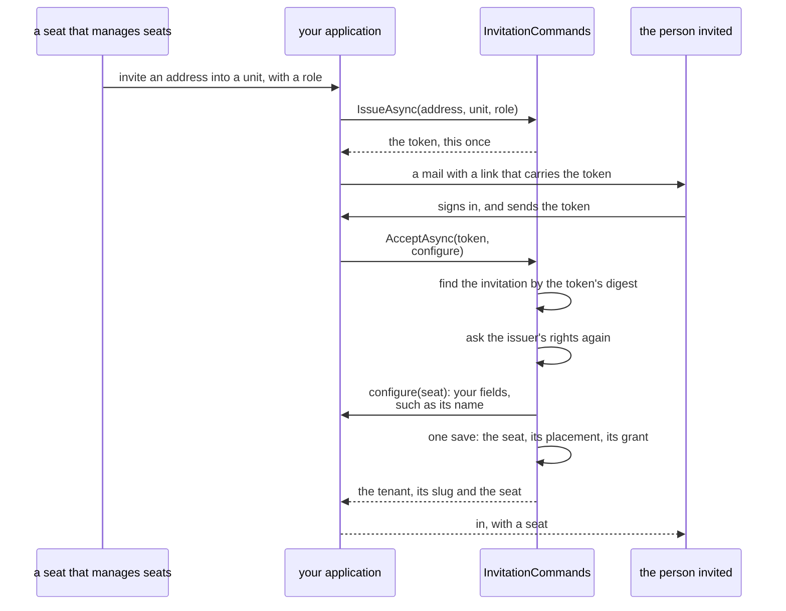

# Tenancy: invitations

How a person without an account yet is invited into a tenant, with a unit and a role waiting. Read it when you add
invitations; they are off until you do. The words are in the [overview](overview.md).

## What an invitation is

- A seat (one person's place in one tenant) belongs to a verified identity, so somebody without an account cannot
  be given one.
- An invitation holds their place until they have one: issued for an address, into a unit, with a role and,
  optionally, an end for that role's grant.
- Issuing makes only the invitation. Accepting makes the seat, its primary placement in the unit and the grant, in
  one save.

## Turning them on

Off by default: a host without them has no table for them. Turning them on is one class of your own, one call in
the context and one in the registration:

```csharp
// Shop.Tenants.Contracts
[EntityId<Guid>] public readonly partial record struct InvitationId;

// Shop.Tenants
[InvitationAggregate<InvitationId>] public sealed partial class ShopInvitation;

// In the context, after AddTenancy: two tables, the invitations and the digests of their tokens.
modelBuilder.AddTenancyInvitations<ShopInvitation, InvitationId>();

// In the registration, after AddTenancy. A new invitation's id is InvitationId.Create(), as every id's is.
services.AddTenancyInvitations<ShopInvitation, InvitationId, ShopTenancyContext>();

// In the outbox, next to AddTenancyDomainEvents.
outbox.AddTenancyInvitationEvents<InvitationId>();
```

- The generated calls take your invitation class and its id, or the id alone, and fill in your other classes.
- A context that names its tables passes the same `TenancyTableNames` to `AddTenancyInvitations` as to
  `AddTenancy`.
- On a database in use, adding them is a migration of your own for the two tables, plus, on Postgres, a new export
  of the access files.

## Issuing and accepting

An invitation from issue to acceptance: the token leaves Tenancy once, and accepting asks the issuer's rights again
and runs your `configure` before the one save.



<details>
<summary>Show the code: issuing an invitation and mailing it, and the route that accepts one</summary>

```csharp
public sealed class InviteColleague(TenancyUseCases.InvitationCommands<ShopInvitation, InvitationId> invitations, IShopMail mail)
{
    public async Task HandleAsync(string address, OrganizationUnitId unit, RoleId role, CancellationToken cancellationToken)
    {
        var issued = await invitations.IssueAsync(
            address, unit, role, grantUntil: null, lifetime: null, cancellationToken);

        // The token is returned this once. In the fragment of a link it reaches the page and no server's log.
        await mail.SendAsync(address, $"https://shop.example/join#{issued.Token}", cancellationToken);
    }
}

// What the page calls once the person has signed in. The request names no tenant: the token does. The name the
// person gives is a field of your seat class, set in the callback before anything is saved.
app.MapPost("/invitations/accept", async (
    AcceptInvitation request,
    TenancyUseCases.InvitationCommands<ShopInvitation, InvitationId> invitations,
    CancellationToken cancellationToken) =>
{
    var accepted = await invitations.AcceptAsync(request.Token, verifiedAddress: null, cancellationToken,
        configure: seat => seat.Rename(request.DisplayName));
    return Results.Ok(new { tenant = accepted.Slug });
});
```

</details>

`ListOpenAsync` answers the invitations that can still be accepted; `CancelAsync` ends one.

## Who may issue one

An invitation offers what adding a seat, placing it and giving it a role would, so issuing takes what those take:

- `tenancy.seats.manage` for the whole tenant, and `tenancy.grants.manage` at the unit;
- the rule of [who may give a role](roles-and-permissions.md#who-may-give-a-role): a role that manages no access is
  offered freely; one that manages access only by a seat holding each of its access-managing permissions at the
  unit, until at least the grant's end.
- System work in the tenant (work no person does, begun explicitly) issues one too, held to no seat.
- An invitation is listed for, and cancelled by, the seats holding `tenancy.seats.manage` at its unit, whoever
  issued it. Any other seat does not find it.

## It never gives more than its issuer could give when it is used

- Accepting asks the issuer's rights again, as they are then, with the role as it is then.
- An issuer since suspended, short of a permission, or unable to give what the role has become leaves it unusable:
  `tenancy.invitation-unbacked`, one answer that tells the person accepting nothing about the issuer's permissions.
- The unit, the role and the tenant must still be active.

## Who accepts

- A signed-in person: the toolkit's caller, with a verified identity, a token role that
  [holds seats](postgres.md#how-the-tenant-reaches-a-policy), and no anonymous sign-in. No seat needed, no tenant
  named.
- The use case reads the caller itself, finds the invitation by the token, and does the rest as system work in the
  invitation's tenant for the issuing seat: the grant keeps that seat as its giver, and the events name the system
  acting for it.
- The answer: the tenant, its slug for the next request, and the new seat.
- Nobody invites themself into a role: an identity with a seat in the tenant is refused, `tenancy.identity-has-seat`.

## What the seat is called is yours

- An invitation suggests no name; a seat has none in Tenancy.
- `configure` sets the fields your seat class adds, a display name among them. It gets the new seat once the
  invitation holds and the seat is placed with the role, before the invitation is marked accepted and anything is
  saved.
- A callback that throws (your rule refusing a blank name, say) accepts nothing: the invitation stays open.
- It does not run for an invitation the same person accepted before, which answers the seat made then.

## The address finds nobody

- The package sends nothing to it and looks nobody up by it. It is how seat managers recognize the invitation, and
  it is forgotten once the invitation is accepted or cancelled.
- If your application knows the address its identity provider verified for the caller, pass it as
  `verifiedAddress`: an invitation for another address is refused, `tenancy.address-mismatch`. It only narrows.
- Left `null`, whoever holds the token and is signed in accepts: what a link in a mail amounts to.

## It ends, and works once

- It stays open for `DefaultLifetime` or the `lifetime` you pass, between `MinLifetime` and `MaxLifetime`. Defaults:
  seven days, ten minutes, thirty days; change them in the `configure` of the invitations' registration
  (`TenancyInvitationOptions`), which refuses lifetimes out of order.
- A grant it offers must end later than the invitation.
- Whether it is open is decided from the clock when used; nothing marks it.
- The same person sending the token again gets the seat they have; anybody else is told it was used.
- Two simultaneous acceptances are kept apart by the save: one saves, the other fails with
  `ConcurrencyConflictException`, as any second save does, and is answered what the first made when sent again.

| Code | Kind | When |
|---|---|---|
| `tenancy.invitation-not-found` | Not found | No invitation has this token, or the text is no token; and for a seat that does not manage seats at its unit |
| `tenancy.invitation-lapsed` | Conflict | Its time ran out |
| `tenancy.invitation-used` | Conflict | Somebody else accepted it |
| `tenancy.invitation-cancelled` | Conflict | It was cancelled |
| `tenancy.invitation-state` | Conflict | Cancelling one that was accepted or cancelled already |
| `tenancy.invitation-unbacked` | Conflict | Its issuer may no longer give what it offers |
| `tenancy.address-mismatch` | Not permitted | It is for another address than the caller's verified one |
| `tenancy.address-invalid`, `tenancy.invitation-lifetime`, `tenancy.invitation-grant-ends-first` | Invalid | The address, the lifetime or the end of the grant, each with its [`Field`](names-and-languages.md#refusals-in-english-and-dutch) |

## The token

- `BearerTokens.New()`, in the toolkit's core, makes it: 32 random bytes as 43 link-safe characters, and their
  SHA-256 digest.
- Only the digest is stored, in its own table beside the invitations. An invitation is found by the digest of the
  token sent; text not written exactly as a token has no digest and is never looked up.
- 256 random bits cannot be guessed, so no rate limit of its own; a digest cannot be reversed, so no salt.
- The token is in no event, refusal or log of the package, and a record holding it does not print it.
- Keep it out of query strings, which servers and proxies log: send it in a request body or a link's fragment.
- The helper is yours for links of your own:

```csharp
var made = BearerTokens.New();                          // made.Token goes to the person, made.Digest into your table
bool theirs = BearerTokens.Matches(sent, storedDigest); // compared in constant time
```

## Events

- `tenancy.invitation-issued`, `tenancy.invitation-cancelled` and `tenancy.invitation-accepted`, each with
  [who acted](operators-and-history.md#access-history), ids only, never the address.
- Accepting also raises what making the seat raises, kept by the access history: `tenancy.seat-added`,
  `tenancy.seat-placed` and `tenancy.organization-role-granted`.

## On Postgres

[The second lock](postgres.md), row level security (RLS), holds the same lines for a query that forgets them:

- seats that manage seats at its unit read an invitation;
- a seat that could add the seat and make the grant itself adds one;
- a seat changes one to cancelled, and nothing else;
- a trigger fixes what it offers, for every role, the tables' owner included;
- no caller's role reads the digests, an operator's and the scoped system role's included; the issuer adds the
  digest row in the same transaction;
- one function, `invitation_of_digest`, answers which invitation a digest is for, as ids, to Tenancy's own system
  work alone: that is how accepting finds the tenant before any tenant is known;
- the start-up checks cover both tables and the function.
