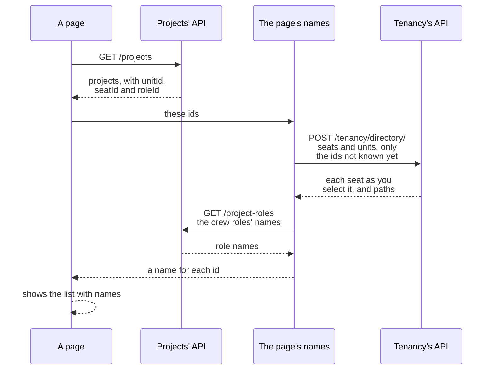

# Tenancy: names and languages

How a screen turns the ids a module answers into names, how a seat is shown, and how refusals and role names reach
a reader in their language. Read it when you build screens over Tenancy, or offer more than one language. The
words (tenant, unit, seat, role, grant) are in the [overview](overview.md).

## Names

- Tenancy answers what a unit is called and where it hangs, and what a role is called.
- It keeps **no name of a seat**: where one comes from is your application's choice
  ([How a seat is shown](#how-a-seat-is-shown)).
- **The directory**, `TenancyDirectory`, answers all three from Tenancy's own data, seats and units as your own
  classes:

| Question | Answers |
|---|---|
| `WhoAmIAsync()` | the calling seat's `SeatOverview`: your seat, whole, with placements and grants; beside it the tenant, the path of each unit it is placed at, the roles its grants name, and every permission it holds now with the units it reaches |
| `SeatOverviewAsync(seat)` | the same for any seat of the tenant, as the caller reads it; your request says who may ask ([Another seat's overview](#another-seats-overview)) |
| `ListSeatsAsync()` | every seat the caller reads, your class, whole, in id order: every seat of the tenant, unless on Postgres a [read rule of yours](postgres.md#who-reads-the-seats-a-default-you-may-replace) narrows it |
| `ListRolesAsync()` | every role of the tenant, active ones first, each with whether it manages access |
| `ListUnitsAsync()` | the units the caller is placed under, your class, whole, each with its path from the root and depth (`UnitInTree`) |
| `SeatsByIdAsync(ids)` | the seats among the ids, as `ListSeatsAsync` answers them |
| `RolesByIdAsync(ids)` | the roles among the ids, as `ListRolesAsync` answers them |
| `UnitsByIdAsync(ids)` | for the units among the ids that the caller is placed under: name, path and depth (`NamedUnit`), nothing more; also for a seat a [restrictive rule](postgres.md#rules-that-narrow-the-organization) keeps out of the organization |

**What comes back**

- Seats and listed units whole, with every field your class adds: a plain `Select` shows the name you keep, or your
  unit's kind. Beside them only what your class lacks: a unit's path and depth; in an overview, the tenant, paths,
  role names and permissions.
- A seat carries its identity, as your class has it; what leaves is what you select.
- The lists fill a picker. The questions by id serve a screen another module answered with ids: a project names its
  unit and crew seats by id. Crew roles are the projects module's own, named by it (`GET /project-roles` in the
  sample).

**Who may ask**

- Whoever works in the tenant: a seat of it, or system work in it (work no person does, begun explicitly). No
  permission is asked, for a list, a question by id or an overview.
- A caller that is nobody is refused first, with its own code, such as `tenancy.not-seated`.
- A question by id answers any seat, role or unit of the caller's tenant (of the seats, those the caller reads:
  every one, unless a [read rule of yours](postgres.md#who-reads-the-seats-a-default-you-may-replace) narrows it).
- That is wider than `ListUnitsAsync`: someone on a project's team works at a unit they are not placed under, and
  still reads its name.
- An id of another tenant, or of nothing, is silently left out, so the answer never says which it was.
- At most `TenancyDirectory.MostIds` ids, 200; more is `tenancy.too-many-ids`, a 400 whose `Max` argument says how
  many.

**What it costs**

- One statement for seats, one for roles, two for units (the organization with its units, and the closure that
  orders a path), however many ids.
- Seats are read with their placements and grants, as loading one does, and **tracked by nobody**: nothing you do
  to one is saved, by that question or by a later save in the same unit of work.

**Another seat's grants**

- Only Postgres policies narrow them: there, another seat's grants come only where the caller may read them
  ([Who reads which grants](postgres.md#who-reads-which-grants)); on another database, or a context without row
  level security (RLS), a listed seat comes with every placement and grant.
- So a request that shows another seat's grants says who may see them, as the sample's `SeatGrants` asks
  `tenancy.seats.manage` for the whole tenant or at the unit asked about
  ([Another seat's overview](#another-seats-overview)); a list's seats are selected into what every member may see.

How a page turns a module's ids into names: it asks each owner only for the ids it does not know yet.



<details>
<summary>Show the code: asking the directory, and a route for it</summary>

```csharp
// The directory is registered with Tenancy. It checks the caller itself, as every use case does. The seats are
// your own class, so the name is the one it keeps.
public sealed class ProjectScreen(TenancyUseCases.TenancyDirectory directory)
{
    public async Task<IReadOnlyDictionary<SeatId, string>> NamesOfAsync(IReadOnlyCollection<SeatId> seats, CancellationToken cancellationToken)
        => (await directory.SeatsByIdAsync(seats, cancellationToken)).ToDictionary(seat => seat.Id, seat => seat.DisplayName);
}
```

```csharp
// The sample's route: a POST that only asks, since 200 ids do not fit a request line. It sends a query,
// SeatsById, whose handler selects the module's SeatListing from the seats the directory answers.
group.MapPost("/tenancy/directory/seats", async (IdsAsked<SeatId> body, ISender sender, CancellationToken cancellationToken)
    => Results.Ok((await sender.Send(new SeatsById(Asked(body)), cancellationToken)).Select(Describe)));
```

```http
POST /tenancy/directory/seats
Authorization: Bearer <rhea's token>
Tenant: harbor
Content-Type: application/json

{ "ids": ["c0000000-0000-4000-8000-000000000103", "c0000000-0000-4000-8000-000000000104", "c0000000-0000-4000-8000-000000000207"] }
```

```json
[
  { "id": "c0000000-0000-4000-8000-000000000104", "displayName": "Juno", "status": "active" },
  { "id": "c0000000-0000-4000-8000-000000000103", "displayName": "Leo", "status": "active" }
]
```

The third id is a seat of another tenant, and is not in the answer.

</details>

- A screen keeps names only while it shows them. The sample's UI asks again on every page load, so a renamed seat
  shows at the next load, and nothing of one tenant shows in another.
- A module's own answers carry no name of Tenancy's.

### How a seat is shown

No access rule reads a seat's name, and Tenancy knows a person only by their token's verified identity. So what a
person is shown by, and its rule, are yours. Three ways, which mix:

1. **A name per tenant, on your seat class**, a field like a job title: the same person may be called differently
   per tenant.
   - Set it in the callback of the use case that makes the seat: `ConfigureFirstSeat` when a tenant is provisioned,
     `configure` of `AddSeatAsync`, `configure` of an invitation's `AcceptAsync` (where the person gives it).
   - Each runs before anything is saved: a name your rule refuses leaves nothing behind, and an invitation stays
     open.
   - Renaming is a use case of yours, under your rule. The sample does this.
2. **The person's own name, from the identity provider**: one name in every tenant, kept by the person.
   - Supabase Auth keeps it in `user_metadata`, which the access token carries: the caller's own name is a claim;
     another person's the provider answers by the seat's identity.
   - A user may edit their own `user_metadata`: fine for a name to show, never for something a rule decides.
3. **A profile of your own**, found by the seat's identity: one row per person, in every tenant, read once for the
   identities a page shows.

Whichever you choose, Tenancy answers your seat class, whole: in the directory's four seat questions, and in
`TenantSelection.SeatsOfAsync<TSeat>(caller)`, the person's own seats in every tenant, for a tenant picker.

- Each picks the seats the caller is answered and reads them in one statement: every screen is a plain `Select`, no
  read more.
- Beside a seat only what is not on it: in the overview (`SeatOverview`, from `WhoAmIAsync` and
  `SeatOverviewAsync(seat)`), the tenant, unit paths, role names and permissions; in the picker (`SeatInTenant`), the
  tenant.

What each seat question checks before it reads, so you know when a screen gets a refusal and when an empty list:


- The lists silently leave out a seat the caller does not read; `SeatOverviewAsync(seat)`, about one seat, refuses
  it with `tenancy.seat-not-found`.
- The picker reads across tenants, before one is picked: it answers your seat's own fields; placements and what the
  seat holds are its tenant's, which a database that keeps tenants apart leaves out there.
- An overview's record holds nothing of the caller's own but the question, so it fits any seat
  ([Another seat's overview](#another-seats-overview)).
- `UnitOf(id)` gives a placement unit's path, `RoleOf(id)` the role a grant names. `RoleOf` answers `null` for a role
  your own filter on the role class hides; the grant is the seat's all the same.

**The field is yours to guard too.**

- On Postgres, Tenancy's policies let every seat of the tenant, and the person a row is for, read seat rows, your
  columns included.
- A seat may change its own row; a seat that manages seats or grants anywhere in the tenant may change any seat's
  row, since every save of a seat writes its version.
- Tenancy guards its own columns, not yours: who may change a name is a column rule of yours, as the sample's is
  ([What the database guards on a seat](postgres.md#what-the-database-guards-on-a-seat)).
- A column rule holds a change, never a read: a field fewer than every member may see belongs in a table of your own,
  under a rule of your own.

<details>
<summary>Show the code: a name per tenant, the provider's name, and a profile of your own</summary>

```csharp
// 1. A name per tenant, on your seat class, with your own rule.
[SeatAggregate<SeatId>]
public sealed partial class Seat
{
    public string DisplayName { get; private set; } = string.Empty;

    public void Rename(string? displayName)
    {
        var name = displayName?.Trim() ?? string.Empty;
        DisplayName = name.Length is > 0 and <= 200 ? name : throw new RefusalException("shop.seat.name", RefusalKind.Invalid, "A seat's name is 1 to 200 characters.");
    }
}

// Named where it is made: provisioned, added, or accepted with the name the person gives.
new TenancyUseCases.TenantToProvision(slug, name, shape, name, identity, ConfigureFirstSeat: seat => seat.Rename("Ada"));
await seats.AddSeatAsync(identity, cancellationToken, configure: seat => seat.Rename("Bert"));
await invitations.AcceptAsync(command.Token, verifiedAddress, cancellationToken, configure: seat => seat.Rename(command.DisplayName));

// Shown with a plain select over your own seats: the lists, the questions by id, and a seat's overview.
public sealed record SeatListing(SeatId Id, string DisplayName, SeatStatus Status);

var listed = (await directory.ListSeatsAsync(cancellationToken)).Select(seat => new SeatListing(seat.Id, seat.DisplayName, seat.Status));

var me = await directory.WhoAmIAsync(cancellationToken);    // a SeatOverview: your seat, and only what is not on it
var shown = new
{
    Seat = new SeatListing(me.Seat.Id, me.Seat.DisplayName, me.Seat.Status),
    Placements = me.Seat.Placements.Select(placement => new
    {
        me.UnitOf(placement.UnitId).Path,
        Roles = placement.Grants.Where(grant => grant.AppliesAt(me.AsOf)).Select(grant => me.RoleOf(grant.RoleId)?.Name),
    }),
};

// And the tenant picker, before a tenant is picked: each of the caller's own seats with the name its tenant keeps.
var mine = (await selection.SeatsOfAsync<Seat>(callers.Current, cancellationToken))
    .Select(found => (found.Slug, found.OrganizationName, Seat: new SeatListing(found.Seat.Id, found.Seat.DisplayName, found.Seat.Status)));

// Renamed by a command of yours: a seat renames itself; another seat takes seats.manage for the whole tenant.
var seat = await store.FindSeatAsync(command.Seat, cancellationToken) ?? throw TenancyRefusals.Refuse(TenancyRefusals.SeatNotFound);
seat.Rename(command.DisplayName);
await store.SaveAsync(cancellationToken);
```

```csharp
// 2. The person's own name, from the identity provider: theirs in every tenant. The caller's own is a claim of
// their token; another person's your client of the provider answers, by the seat's identity.
var mine = callers.Current.Claim("user_metadata.full_name");
var listed = await directory.ListSeatsAsync(cancellationToken);
var names = await provider.NamesOfAsync([.. listed.Select(seat => seat.Identity)], cancellationToken);
```

```csharp
// 3. A profile of your own, by the identity: one read of yours for the page, beside the directory's.
var listed = await directory.ListSeatsAsync(cancellationToken);
var identities = listed.Select(seat => seat.Identity).ToArray();
var profiles = await shop.Profiles.Where(profile => identities.Contains(profile.Identity)).ToDictionaryAsync(profile => profile.Identity, cancellationToken);
```

The identity is a person's, as an address is: what you select is what leaves, and the sample's answers never
carry it.

</details>

**In the sample**, `Seat` keeps a name per tenant, under the rule `tenants.seat.display-name` (English and Dutch):

- the demo seeder names each seat in the callbacks; `POST /invitations/accept` takes the name the person gives;
- `PUT /tenancy/seats/{seatId}/name` and the mutation `seatRename` send its command `RenameSeat`: a seat for itself,
  or a seat with `tenancy.seats.manage` for the whole tenant for anybody (`[RequiresPermission]`, `[OrOwn]` on the
  seat);
- every answer about a seat shows `SeatListing`, selected from the seats the package answered: REST, GraphQL, the
  access history, the picker's `GET /me/seats` and `seatsOfMine`, the overview's `GET /me` and `overviewOfMine`;
- its column rule `NameChangesByTheSeatOrWithTheSeatsPermission` holds the database to `RenameSeat`'s rule.

### Another seat's overview

- `SeatOverviewAsync(seat)` answers, for any seat of the tenant, the record `WhoAmIAsync` answers for the caller: the
  seat, whole, with placements and grants; the tenant, each placement unit's path, the roles its grants name, every
  permission it holds now with the units it reaches, and the moment that holds for (`AsOf`).
- For a page about one person, such as the one an administration opens before changing someone's roles.
- Asked about the caller's own seat, it answers what `WhoAmIAsync` does.

Two rules decide what happens, neither the directory's own:

- **Your request decides who may ask.** The directory asks only what all its questions ask: a seat of the tenant, or
  system work in it. Who may see another person's access is your choice, stated by the request.
  - The sample: another person's roles in every unit for a seat that manages seats for the whole tenant,
    `TenancyAccess.AtTenant(TenancyPermissions.SeatsManage)`; the roles held at a unit for a seat that manages them
    there, `TenancyAccess.AtUnit(TenancyPermissions.SeatsManage, unit)`.
  - To let unit managers see the people of their units, ask `[InTenant]` and leave the rest to the read rules.
- **The read rules decide what comes back.** The seat is read through Tenancy's store, as the caller, like the lists.
  - On Postgres every member reads a seat and its placements (unless a
    [read rule of yours](postgres.md#who-reads-the-seats-a-default-you-may-replace) says otherwise), and its grants
    only where the caller [may read them](postgres.md#who-reads-which-grants): at and below the units where it
    manages grants, seats or units, or everywhere for a seat that manages roles for the whole tenant.
  - The roles and permissions are those of the grants read.

In the sample's harbor, Rhea manages seats, grants and units at North; Maud administers from the root, with every
Tenancy permission there:

- Rhea asking a person's roles in every unit is refused at the door (that takes the seats permission for the whole
  tenant). At North Inland, below North, it passes; at the root or South it is refused.
- Were the door open, Maud's overview would show Rhea where Maud is placed and none of her grants, so no role and no
  permission: her grant is above North.
- Vic's overview, at North Inland, holds his grant there.
- System work in harbor reads every grant of every seat.

What else holds:

- A seat the caller does not read is `tenancy.seat-not-found`, a 404: another tenant's, nonexistent, or left out by
  your seat read rule; the refusal does not say which.
- **Where no policy applies, your request is the only rule.** On another database (SQLite, SQL Server) or without
  RLS, whoever may ask sees every grant and permission: `[InTenant]` there shows every member everybody's access.
- Permissions are worked out from the grants read, by the rule the rights are written by (active seat, active role,
  a permission the catalogue, every permission the application knows, keeps live; a grant applying at `AsOf`), not read from the rights, which a database
  shows a seat for itself alone. So a permission shows where its grant is read; a suspended seat holds none; a role
  your role-class filter hides still gives its permissions, as to the access questions, while `RoleOf` answers `null`.
- The overview reads what `WhoAmIAsync` reads, in as many statements, and tracks nothing.

<details>
<summary>Show the code: the sample's request and handler, and a request that leaves it to the policies</summary>

```csharp
// The sample's choice: whoever manages seats for the whole tenant reads another person's roles, in every unit, and
// whoever manages them at a unit the roles held there. Which depends on the request, so it computes it.
public sealed record SeatGrants(SeatId Seat, OrganizationUnitId? At = null) : IQuery<IReadOnlyList<SeatGrant>>, ITenantsRequest
{
    AccessRequirement IRequireAccess.RequiredAccess => At is { } unit
        ? TenancyAccess.AtUnit(TenancyPermissions.SeatsManage, unit)
        : TenancyAccess.AtTenant(TenancyPermissions.SeatsManage);
}

public sealed class SeatGrantsHandler(ITenancyReads reads) : IQueryHandler<SeatGrants, IReadOnlyList<SeatGrant>>
{
    public async ValueTask<IReadOnlyList<SeatGrant>> Handle(SeatGrants query, CancellationToken cancellationToken)
    {
        // The directory, in a scope of this query's own; it refuses a seat the caller does not read.
        var overview = await reads.AskDirectoryAsync(directory => directory.SeatOverviewAsync(query.Seat, cancellationToken));

        return
        [
            .. overview.Seat.Placements.Where(placement => query.At is not { } unit || placement.UnitId == unit).SelectMany(placement => placement.Grants.Select(grant => new SeatGrant(
                placement.UnitId,
                overview.UnitOf(placement.UnitId).Path,
                grant.RoleId,
                overview.RoleOf(grant.RoleId)?.Name ?? string.Empty,
                grant.StartsAt,
                grant.EndsAt,
                grant.AppliesAt(overview.AsOf)))),
        ];
    }
}
```

```csharp
// Another application's choice: every member may ask, and on Postgres the policies decide what each one reads.
// Elsewhere this shows every member everybody's access.
[InTenant]
public sealed record PersonPage(SeatId Seat) : IQuery<PersonCard>, IShopRequest;
```

```http
GET /tenancy/seats/c0000000-0000-4000-8000-000000000102/grants
Authorization: Bearer <maud's token>
Tenant: harbor
```

The route sends `SeatGrants` and answers one row per grant of Rhea's: her Area manager role at North. With
`?unit=` it reads the grants at that unit, for a caller who manages seats there. The administration's GraphQL schema
has the first as `seatGrants(seatId:)`.

</details>

## Languages

- **Tenancy keeps no language.** A tenant's working language and a person's reading language are fields of your own
  tenant and seat classes: which languages you offer is yours to say.
- **The package ships English and Dutch**: its refusals, the name of a role it makes (the one text it makes that
  stays, so it takes a language there), and its own administrators' pack (a pack is a starter role, copied into every
  new tenant), added when your catalogue declares none.

### Refusals in English and Dutch

Every code of `TenancyRefusals` has an English text, the refusal's own message, and a Dutch one. Add the package's
resx to the localizer and a refusal reaches its reader in their language ([Localization](../localization.md)):

```csharp
services.AddLocalization();
services.AddDDDToolkitLocalization(options => options.AddResource<TenancyFailures>());
```

- **The Dutch texts never address the reader.** Dutch forces a choice between a familiar and a formal "you", which is
  the application's; so a text says what is the case or needed: "Hiervoor is het recht tenancy.seats.manage nodig."
- **Another tone**, or calling a tenant an organization: add your own resx with the keys you phrase differently,
  before `TenancyFailures`, in every language you support. The localizer asks sources in the order added, each
  falling back to its own neutral file first, so a key in your neutral resx alone would give Dutch readers your
  English.
- **A third language**: the same recipe, with every `tenancy.*` key of the resx.

A refusal of the kind "invalid" about one input names it in its `Field` argument, in the use cases' word for it, so a
form puts the text under it:

| Code | `Field` |
| --- | --- |
| `tenancy.name-invalid` | `name` for a tenant's, a unit's or a role's name, `description` for a role's, `reason` for a reason; `What` says which of the five. A seat has no name in Tenancy: your seat class refuses one under your own rule and code |
| `tenancy.invalid-slug` | `slug`. A slug is a value object, so this arrives as a validation failure with the same code and argument |
| `tenancy.invalid-period` | `until` |
| `tenancy.reason-required` | `reason` |
| `tenancy.unknown-permission`, `tenancy.permissions-not-normalized` | `permissions` |
| `tenancy.identity-required` | `identity` |
| `tenancy.too-many-ids` | `ids` |
| `tenancy.page-size-invalid` | `size` |
| `tenancy.cursor-invalid` | `after` |
| `tenancy.address-invalid` | `address` |
| `tenancy.invitation-lifetime` | `lifetime` |
| `tenancy.invitation-grant-ends-first` | `grantUntil` |

- An edge whose input has another name maps the word: a body that calls a grant's end something else puts the text of
  `until` under its own field.
- `tenancy.tenant-required` names no field: a request names its tenant beside the command (a header, or its address),
  and the text says only that it names none.

### Roles in the tenant's language

The catalogue declares each pack once, with one name and description, and a tenant's roles are copies. So a Dutch
tenant does not get English role names, implement `IRolePackTexts` over your resources and register it:

```csharp
public sealed class ShopPackTexts(IStringLocalizer<ShopPacks> texts) : IRolePackTexts
{
    public (string Name, string Description)? For(RolePack pack, CultureInfo culture)
    {
        using (CultureScope.Use(culture))
        {
            var name = texts[pack.Key + ".name"];
            return name.ResourceNotFound ? null : (name.Value, texts[pack.Key + ".description"].Value);
        }
    }
}

services.AddSingleton<IRolePackTexts, ShopPackTexts>();
```

The use cases ask it whenever they make a role from a pack, in the language you pass:

- `TenantToProvision.Language`, at provisioning. `ConfigureTenant` is where your tenant class keeps the same language
  as a field ([How your classes add behaviour](your-module.md#how-your-classes-add-behaviour)).
- The `language` of `ChangeShapeAsync`, when a change of shape copies the packs the tenant lacks. Its existing roles
  keep their names.

The rules:

- No language, no registered texts, or `For` answering `null`: the role gets the catalogue's texts.
- The texts are chosen once. The role is then the tenant's own, renamed like any; a tenant that changes language keeps
  its roles' names.
- A role that [follows its pack](roles-and-permissions.md#packs-after-provisioning) follows only its permissions; its
  name and description stay the tenant's.
- A translated name is checked like any: blank or too long is `tenancy.name-invalid`; one another role of the tenant
  has, ignoring case, is `tenancy.role-name-taken`.
- A tenant holds a copy of every pack seeded for its shape, and a flat tenant turning hierarchical gets the
  hierarchical packs beside them: give every pack its own name in every language.

[The default administrators' pack](roles-and-permissions.md#the-administrators-pack), added when you declare no
administrators' pack, is the package's own, with the package's texts:

- Administrator in English, Beheerder in Dutch.
- Your `IRolePackTexts` is asked first, by the key `administrator`. Where it answers `null`, or none is registered, the
  role gets the package's text in the language passed, English for a language the package does not ship, and
  Administrator, the catalogue's name, without a language.
- `TenancyCatalogue.Build` refuses a pack of yours named Administrator or Beheerder while it adds the default, so a
  tenant in either language never meets the clash.
- It cannot see your texts: a pack your `IRolePackTexts` calls Beheerder in Dutch collides with the default at
  provisioning, like any two packs named alike.
