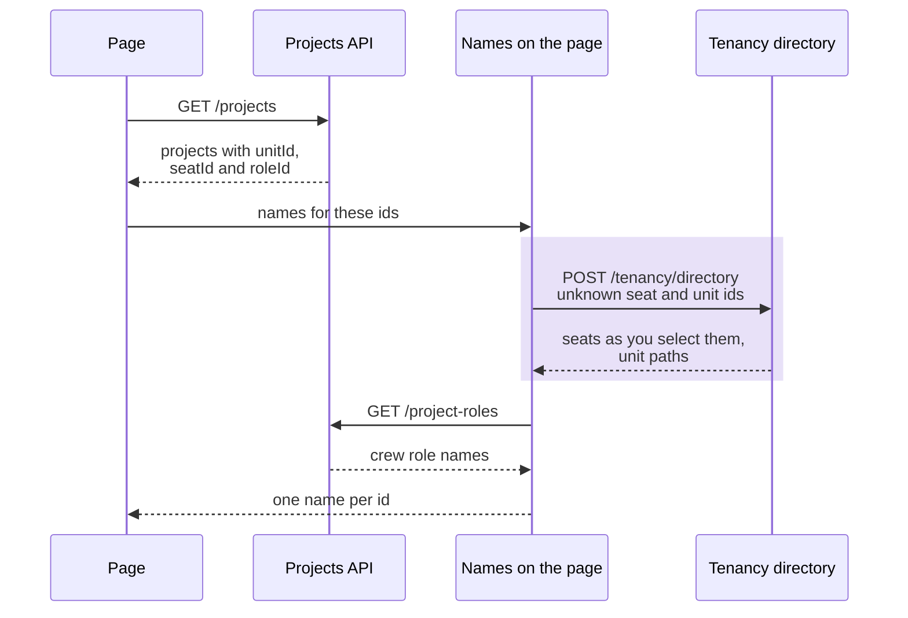
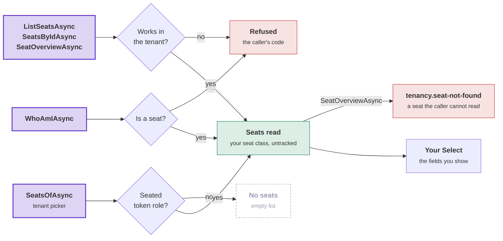

# Tenancy: names and languages

This page covers how a screen turns a module's ids into names, how a seat is shown, and how refusals and role names
reach a reader in the reader's language. Read it when you build screens over Tenancy, or offer more than one
language. The words are defined in the [overview](overview.md).

## Names

Tenancy stores the name of each unit and each role. It stores no name for a seat. You choose how a seat is shown
([How a seat is shown](#how-a-seat-is-shown)). A screen reads names from the **directory**, `TenancyDirectory`.
[TenancyDirectory](reference/managers.md) in the reference lists every member.

| Method | Returns |
|---|---|
| `WhoAmIAsync()` | The calling seat's `SeatOverview`. It holds your seat object with its placements and grants, the tenant, the path of each placement's unit, the roles the grants name, and every permission the seat holds now with the units it reaches. |
| `SeatOverviewAsync(seat)` | The same overview for any seat of the tenant ([Another seat's overview](#another-seats-overview)). |
| `ListSeatsAsync()` | The seats the caller can read, as objects of your seat class with every field, in id order. |
| `ListRolesAsync()` | The tenant's roles, active roles first. Each role says whether it manages access. |
| `ListUnitsAsync()` | The units the caller is placed at and every unit below them, as objects of your unit class with path and depth (`UnitInTree`). System work gets every unit. |
| `SeatsByIdAsync(ids)`, `RolesByIdAsync(ids)` | The seats or roles among the ids, in the same form as the lists. |
| `UnitsByIdAsync(ids)` | Each unit among the ids, with its name, path and depth (`NamedUnit`) and no other field. |

A path runs from the root down, joined with ` / `, for example `Harbor Works / North / North Coast`.

- **Who may call.** Every caller that works in the tenant may call the directory: a seat of the tenant, or system
  work in the tenant. The directory checks no permission. A caller that is nobody is refused with the code that
  says why, such as `tenancy.not-seated`. System work outside any tenant gets an `InvalidOperationException`.
- **Which seats.** The seat methods return the seats the caller can read. By default that is every seat of the
  tenant. On Postgres a [read rule of yours](postgres.md#default-read-policies-for-seats-and-invitations) can narrow
  this.
- **The by-id methods return more units than `ListUnitsAsync`.** They return any role or unit of the caller's tenant.
  `ListUnitsAsync` returns only the units the caller is placed under. In the sample, Vic is placed at North Inland
  and is on the crew of Pier 7 at North Coast. `ListUnitsAsync` leaves North Coast out for Vic, and
  `UnitsByIdAsync` still returns its name and path. A seat that a
  [restrictive rule](postgres.md#restrictive-rules) keeps out of the organization also reads unit
  names this way.
- **Unknown ids.** The by-id methods leave out an id of another tenant and an id that belongs to nothing. The result
  does not say which of the two an id was.
- **Limit.** One call takes at most `TenancyDirectory.MostIds` (200) different ids. More ids give
  `tenancy.too-many-ids`, a 400 with the argument `Max`. The directory checks the caller first, so nobody learns
  the limit before their own refusal.
- **Cost.** Each call runs a fixed number of statements, whatever the number of ids. Seats take one statement,
  roles one, and units two. On Postgres, `UnitsByIdAsync` for a seat is one function call.
- **Untracked seats.** The seats come with their placements and grants, and no context tracks them. A change you
  make to one of them is never saved, by that call or by a later save in the same unit of work.
- **Another seat's grants.** Only the Postgres policies narrow which grants of another seat come back
  ([Who reads which grants](postgres.md#who-reads-which-grants)). On another database, or without row level security
  (RLS), a listed seat comes with all its grants. Select a list's seats into a shape that every member may see.

A page turns a module's ids into names. The page asks each owner only for the ids that the page has no name for
yet. The purple band is the call to Tenancy's directory:



A screen keeps names only while it shows them. The sample's UI requests the names again at every page load. So a
renamed seat shows its new name at the next load, and no name of one tenant shows in another tenant.

The sample's route to the directory is a `POST`, because 200 ids do not fit in a request line. The code behind the
route calls the directory like this:

```csharp
public sealed class ProjectScreen(TenancyUseCases.TenancyDirectory directory)
{
    public async Task<IReadOnlyDictionary<SeatId, string>> NamesOfAsync(IReadOnlyCollection<SeatId> seats, CancellationToken cancellationToken)
        => (await directory.SeatsByIdAsync(seats, cancellationToken)).ToDictionary(seat => seat.Id, seat => seat.DisplayName);
}
```

### How a seat is shown

No access rule reads a seat's name. Tenancy identifies a person only by the verified identity in the person's
token. So you decide how a person is shown. There are three ways, and you can mix them:

| Way | Where the name is stored | When to choose it |
|---|---|---|
| A field on your seat class (the default) | Your seat class, one value per tenant. | The same person may have a different name in each tenant, like a job title. |
| The user's name | The identity provider, such as Supabase Auth's `user_metadata`. The caller's name is a claim in the caller's token. Another person's name comes from the provider, looked up by the seat's identity. | One name in every tenant, kept by the person. Use it for display only, because a user can edit their own `user_metadata`. |
| A profile table | A table of yours with one row per person, found by the seat's identity. | One name in every tenant, kept by your application. Read it once for the identities a page shows. |

The default way, shortened from the sample:

```csharp
[SeatAggregate<SeatId>]
public sealed partial class Seat
{
    public string DisplayName { get; private set; } = string.Empty;

    public void Rename(string? displayName)
    {
        var name = displayName?.Trim() ?? string.Empty;
        DisplayName = name.Length is > 0 and <= 200 ? name : throw new RefusalException("shop.seat.name", RefusalKind.Invalid, "A seat's name is 1 to 200 characters.");
    }
}

// Set the name where the seat is made: at provisioning, when a seat is added, and when an invitation is accepted.
new TenancyUseCases.TenantToProvision(slug, name, shape, name, identity, ConfigureFirstSeat: seat => seat.Rename("Ada"));
await seats.AddSeatAsync(identity, cancellationToken, configure: seat => seat.Rename("Leo"));
await invitations.AcceptAsync(command.Token, verifiedAddress, cancellationToken, configure: seat => seat.Rename(command.DisplayName));

// Show the name with a plain Select over the seats the directory returns.
var listed = (await directory.ListSeatsAsync(cancellationToken)).Select(seat => new SeatListing(seat.Id, seat.DisplayName, seat.Status));
```

- Each callback runs before anything is saved. When your rule refuses the name, nothing is saved, and an invitation
  stays open.
- Renaming is a command of yours, under your rule. In the sample's `RenameSeat`, a seat renames itself, and a seat
  with `tenancy.seats.manage` for the whole tenant renames any seat.
- Tenancy returns objects of your seat class with every field. The directory does this, and so does
  `TenantSelection.SeatsOfAsync<TSeat>(caller)`, which returns the person's seats in every tenant for a tenant
  picker. Each screen needs one `Select` and no extra query.
- The identity is personal data, like an e-mail address. Only the fields you select leave your API. The sample's
  responses never include the identity.

The next diagram shows what each seat method checks before it reads, so you know when a screen gets a refusal and
when it gets an empty list. Purple: the methods. Green: the seats are read. Red: a refusal. Grey: an empty list.



- The picker reads across tenants, before the person picks one. It returns the fields of your seat class.
  Placements and grants belong to their tenant, and a database that keeps tenants apart leaves them out of the
  picker's answer.
- In an overview, `UnitOf(id)` returns the path of a placement's unit, and `RoleOf(id)` returns the role a grant
  names. `RoleOf` returns `null` for a role that your filter on the role class hides. The grant still belongs to the
  seat.

**Who reads and changes your fields on the seat**

- On Postgres every seat of the tenant reads every seat row, your columns included. The person a row is for reads
  that row too. Put a field that fewer members may see in a table of yours, under a read rule of yours.
- A seat may change its own row. A seat that manages seats or grants anywhere in the tenant may change any seat's
  row. The database guards Tenancy's columns on a seat. Your columns need a column rule of yours, for example for
  who may change a name ([What the database guards on a seat](postgres.md#who-may-change-a-seats-columns)).
  The sample's rule is `NameChangesByTheSeatOrWithTheSeatsPermission`.

### Another seat's overview

`SeatOverviewAsync(seat)` returns, for any seat of the tenant, what `WhoAmIAsync` returns for the caller. The
overview is as of the moment `AsOf`. Use it for a page about one person, such as the page an administrator opens
before changing someone's roles.

- **Your request decides who may call.** The directory itself requires only a seat of the tenant or system work in
  it. The sample's `SeatGrants` requires `tenancy.seats.manage` for the whole tenant. With a unit, it requires
  `tenancy.seats.manage` at that unit, and returns the roles held there. To let unit managers see the people of
  their units, require `[InTenant]` and let the read rules decide the rest.
- **The read rules decide what comes back.** On Postgres every member reads a seat and its placements, unless your
  seat read rule says otherwise. A member reads the seat's grants only where the member
  [may read them](postgres.md#who-reads-which-grants). That is at and below the units where the member manages
  grants, seats or units, or everywhere for a member that manages roles for the whole tenant.
- **Without policies, your request is the only rule.** On another database, or without RLS, every caller who may
  call sees every grant. There, `[InTenant]` shows every member the access of every other member.
- A seat the caller does not read gives `tenancy.seat-not-found` (404). The seat may belong to another tenant, may
  not exist, or may be left out by your read rule. The refusal does not say which.
- The overview works out the permissions from the grants it read. A permission counts when the seat is active, the
  role is active, the permission is live, and the grant applies at `AsOf`. A suspended seat holds no permission. A
  role that your role-class filter hides still gives its permissions.
- The overview costs what `WhoAmIAsync` costs, and tracks nothing.

<details>
<summary>The sample's request and handler, shortened</summary>

```csharp
// Seat managers for the whole tenant read a person's roles at every unit. Seat managers at a unit read the roles held there.
public sealed record SeatGrants(SeatId Seat, OrganizationUnitId? At = null) : IQuery<IReadOnlyList<SeatGrant>>, ITenantsRequest
{
    AccessRequirement IRequireAccess.RequiredAccess => At is { } unit
        ? TenancyAccess.AtUnit(TenancyPermissions.SeatsManage, unit)
        : TenancyAccess.AtTenant(TenancyPermissions.SeatsManage);
}

public sealed class SeatGrantsHandler(ITenancyReads reads) : IQueryHandler<SeatGrants, IReadOnlyList<SeatGrant>>
{
    public async ValueTask<IReadOnlyList<SeatGrant>> Handle(SeatGrants query, CancellationToken cancellationToken)
    {
        // Calls the directory in a separate scope. The directory refuses a seat the caller does not read.
        var overview = await reads.AskDirectoryAsync(directory => directory.SeatOverviewAsync(query.Seat, cancellationToken));

        // One row per grant, at the unit asked about or at every unit. Row uses overview.UnitOf(unit).Path,
        // overview.RoleOf(role)?.Name and grant.AppliesAt(overview.AsOf).
        return [.. overview.Seat.Placements
            .Where(placement => query.At is not { } unit || placement.UnitId == unit)
            .SelectMany(placement => placement.Grants.Select(grant => Row(overview, placement, grant)))];
    }
}
```

The sample's routes are `GET /tenancy/seats/{seatId}/grants`, with `?unit=` for one unit, and the GraphQL field
`seatGrants(seatId:)`.

</details>

## Languages

- **Tenancy stores no language.** A tenant's working language and a person's reading language are fields on your
  tenant and seat classes.
- **The package ships English and Dutch texts** for its refusals and for the name of its default administrators'
  role.

### Refusals in English and Dutch

Every code in `TenancyRefusals` has an English text and a Dutch text. Add the package's resource, `TenancyFailures`,
to the localizer. Each refusal then reaches its reader in the reader's language ([Localization](../localization.md)):

```csharp
services.AddLocalization();
services.AddDDDToolkitLocalization(options => options.AddResource<TenancyFailures>());
```

- **The Dutch texts never address the reader.** Dutch has a familiar and a formal "you", and the application makes
  that choice. So each text states what is the case or what is needed: "Hiervoor is het recht tenancy.seats.manage
  nodig."
- **For another tone**, or to call a tenant an organization, add a resx of yours with the keys you phrase
  differently. Add it before `TenancyFailures`, in every language you support. Each source falls back to its own
  neutral file first. So a key that is only in your neutral resx gives Dutch readers your English text.
- **For a third language**, do the same with every `tenancy.*` key.
- **Form fields.** A refusal of the kind "invalid" about one input names that input in its `Field` argument, in the
  use cases' word (`name`, `until`, `ids` …). A form shows the text under that input. An API that uses another
  name for the input maps the word. [TenancyRefusals](reference/refusals.md#tenancyrefusals) in the reference lists
  each code's field. `tenancy.tenant-required` names no field, because the tenant is named next to the command, in
  a header or the address.

### Roles in the tenant's language

The catalogue declares each starter role once, with one name and one description. A tenant's roles are
copies of the packs. To give a Dutch tenant Dutch role names, implement `IStarterRoleTexts` over your resources and
register it:

```csharp
public sealed class ShopStarterRoleTexts(IStringLocalizer<ShopStarterRoles> texts) : IStarterRoleTexts
{
    public (string Name, string Description)? For(StarterRole starterRole, CultureInfo culture)
    {
        using (CultureScope.Use(culture))
        {
            var name = texts[starterRole.Key + ".name"];
            return name.ResourceNotFound ? null : (name.Value, texts[starterRole.Key + ".description"].Value);
        }
    }
}

services.AddSingleton<IStarterRoleTexts, ShopStarterRoleTexts>();
```

- The use cases call `For` each time they make a role from a pack, with the language you pass:
  - `TenantToProvision.Language` at provisioning. Keep the same language on your tenant class in `ConfigureTenant`
    ([How your classes add behaviour](your-module.md#how-your-classes-add-behaviour)).
  - The `language` argument of `ChangeShapeAsync`, when a change of shape copies the packs the tenant lacks.
- The role gets the catalogue's texts when no language is passed, when no `IStarterRoleTexts` is registered, or when
  `For` returns `null`.
- The texts are chosen once. After that the role belongs to the tenant and can be renamed like any role. A tenant
  that changes language keeps its role names. A role that
  [follows its pack](roles-and-permissions.md#packs-after-provisioning) follows only the pack's permissions.
- A translated name is checked like any role name. A blank or too long name gives `tenancy.name-invalid`. A name
  that another role of the tenant has, ignoring case, gives `tenancy.role-name-taken`. A flat tenant that turns
  hierarchical gets the hierarchical packs next to the packs it has. So give every pack a distinct name in every
  language.

**The default administrators' role** ([The administrators' pack](roles-and-permissions.md#the-administrators-pack))
uses the package's texts. Tenancy adds this role when you declare no administrators' pack.

- The role is named Administrator in English and Beheerder in Dutch. A language the package does not ship gets the
  English name. A tenant without a language gets Administrator.
- Your `IStarterRoleTexts` is asked first, with the pack key `administrator`.
- While `TenancyCatalogue.Build` adds the default role, it refuses a pack of yours named Administrator or
  Beheerder. `Build` does not see the names your `IStarterRoleTexts` returns. So Beheerder from your texts collides at
  provisioning, like any two packs with the same name.
