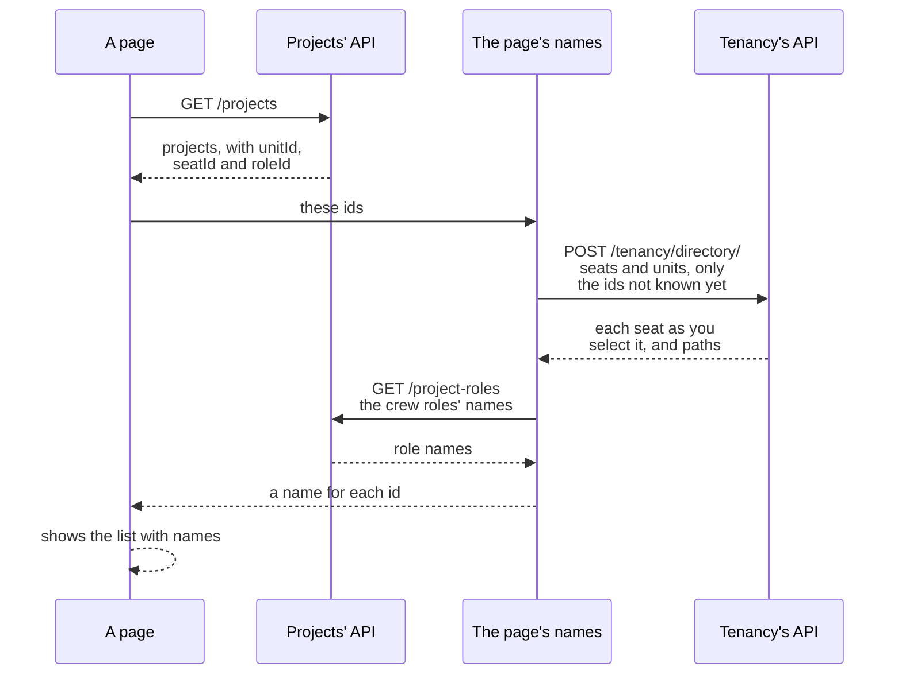
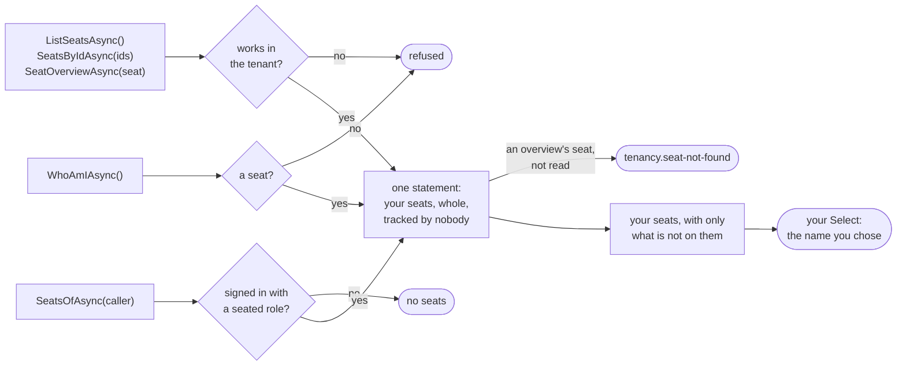

# Tenancy: names and languages

How a screen turns a module's ids into names, how a seat is shown, and how refusals and role names reach a reader in
their language. Read it when you build screens over Tenancy, or offer more than one language. The words are in the
[overview](overview.md).

## Names

Tenancy answers what a unit and a role are called. It keeps **no name of a seat**: that is your choice
([How a seat is shown](#how-a-seat-is-shown)). A screen asks **the directory**, `TenancyDirectory`; every member:
[TenancyDirectory](reference/use-cases.md#tenancyusecasestenancydirectory).

| Question | Answers |
|---|---|
| `WhoAmIAsync()` | the calling seat's `SeatOverview`: your seat, whole, with placements and grants; beside it the tenant, each placement unit's path, the roles its grants name, and every permission it holds now with the units it reaches |
| `SeatOverviewAsync(seat)` | the same for any seat of the tenant ([Another seat's overview](#another-seats-overview)) |
| `ListSeatsAsync()` | the seats the caller reads, your class, whole, in id order |
| `ListRolesAsync()` | the tenant's roles, active ones first, each with whether it manages access |
| `ListUnitsAsync()` | the units the caller is placed under, your class, whole, with path and depth (`UnitInTree`); every unit for system work |
| `SeatsByIdAsync(ids)`, `RolesByIdAsync(ids)` | those among the ids, as the lists answer them |
| `UnitsByIdAsync(ids)` | each unit among the ids: name, path and depth (`NamedUnit`), nothing more |

- **Who may ask**: whoever works in the tenant, a seat of it or system work in it. No permission is asked. A caller
  that is nobody is refused with its own code, such as `tenancy.not-seated`.
- **The seats** are those the caller reads: every seat of the tenant, unless on Postgres a
  [read rule of yours](postgres.md#who-reads-the-seats-a-default-you-may-replace) narrows it.
- **By id** answers any role or unit of the caller's tenant, wider than `ListUnitsAsync`: someone on a project's team
  works at a unit they are not placed under, and still reads its name. A seat a
  [restrictive rule](postgres.md#rules-that-narrow-the-organization) keeps out of the organization reads unit names too.
- An id of another tenant, or of nothing, is left out silently: the answer never says which.
- At most `TenancyDirectory.MostIds`, 200, ids; more is `tenancy.too-many-ids`, a 400 with the argument `Max`.
- **Cost**: one statement for seats, one for roles, two for units (one, a function, for a seat on Postgres),
  however many ids.
- Seats are read with placements and grants and **tracked by nobody**: nothing you do to one is saved, by that
  question or by a later save in the same unit of work.
- **Another seat's grants** are narrowed only by the Postgres policies
  ([Who reads which grants](postgres.md#who-reads-which-grants)); on another database, or without row level security
  (RLS), a listed seat comes with every grant. Select a list's seats into what every member may see.

A page turns a module's ids into names by asking each owner only for the ids it does not know yet:



- A screen keeps names only while it shows them. The sample's UI asks again on every page load, so a renamed seat
  shows at the next load, and nothing of one tenant shows in another.

Asking the directory (the sample's route is a `POST`: 200 ids do not fit a request line):

```csharp
public sealed class ProjectScreen(TenancyUseCases.TenancyDirectory directory)
{
    public async Task<IReadOnlyDictionary<SeatId, string>> NamesOfAsync(IReadOnlyCollection<SeatId> seats, CancellationToken cancellationToken)
        => (await directory.SeatsByIdAsync(seats, cancellationToken)).ToDictionary(seat => seat.Id, seat => seat.DisplayName);
}
```

### How a seat is shown

No access rule reads a seat's name, and Tenancy knows a person only by the verified identity of their token. So what
a person is shown by is yours. Three ways, which mix:

| Way | Where the name lives | When to choose it |
|---|---|---|
| A field on your seat (the default) | your seat class, per tenant | the same person may be called differently per tenant, like a job title |
| The user's own name | the identity provider: Supabase Auth's `user_metadata`; the caller's own is a claim of its token, another person's the provider answers by the seat's identity | one name in every tenant, kept by the person; for showing only, since a user may edit their own `user_metadata` |
| A profile table | a table of yours, one row per person, found by the seat's identity | one name in every tenant, kept by your application, read once for the identities a page shows |

The default way, shortened from the sample:

```csharp
[SeatAggregate<SeatId>]
public sealed partial class Seat
{
    public string DisplayName { get; private set; } = string.Empty;

    public void Rename(string? displayName)
    {
        var name = displayName?.Trim() ?? string.Empty;
        DisplayName = name.Length is > 0 and <= 200 ? name : throw new RefusalException("shop.seat.name", RefusalKind.Invalid, "A seat's name is 1 to 200 characters.");
    }
}

// Named where the seat is made: provisioned, added, or accepted with the name the person gives.
new TenancyUseCases.TenantToProvision(slug, name, shape, name, identity, ConfigureFirstSeat: seat => seat.Rename("Ada"));
await seats.AddSeatAsync(identity, cancellationToken, configure: seat => seat.Rename("Leo"));
await invitations.AcceptAsync(command.Token, verifiedAddress, cancellationToken, configure: seat => seat.Rename(command.DisplayName));

// Shown with a plain Select over the seats the directory answers.
var listed = (await directory.ListSeatsAsync(cancellationToken)).Select(seat => new SeatListing(seat.Id, seat.DisplayName, seat.Status));
```

- Each callback runs before anything is saved: a name your rule refuses leaves nothing behind, and an invitation
  stays open.
- Renaming is a command of yours, under your rule. The sample's `RenameSeat`: a seat renames itself, a seat with
  `tenancy.seats.manage` for the whole tenant renames any.
- Tenancy answers your seat class whole: in the directory, and in `TenantSelection.SeatsOfAsync<TSeat>(caller)`,
  the person's own seats in every tenant, for a tenant picker. Each screen is a plain `Select`, no read more.
- The identity is a person's, as an address is: what you select is what leaves. The sample's answers never carry it.

What each seat question checks before it reads, so you know when a screen gets a refusal and when an empty list:



- The picker reads across tenants, before one is picked: it answers your seat's own fields; placements and grants
  are its tenant's, which a database that keeps tenants apart leaves out there.
- In an overview, `UnitOf(id)` gives a placement unit's path and `RoleOf(id)` the role a grant names: `null` for a
  role your own filter on the role class hides, though the grant is the seat's all the same.

**The field is yours to guard too.**

- On Postgres every seat of the tenant, and the person a row is for, reads seat rows, your columns included. A field
  fewer than every member may see belongs in a table of your own, under a rule of your own.
- A seat may change its own row, and a seat that manages seats or grants anywhere in the tenant any seat's row.
  Tenancy guards its own columns, not yours: who may change a name is a column rule of yours
  ([What the database guards on a seat](postgres.md#what-the-database-guards-on-a-seat)), as the sample's
  `NameChangesByTheSeatOrWithTheSeatsPermission` is.

### Another seat's overview

`SeatOverviewAsync(seat)` answers, for any seat of the tenant, what `WhoAmIAsync` answers for the caller, as of the
moment `AsOf`: for a page about one person, such as the one an administration opens before changing someone's roles.

- **Your request decides who may ask**; the directory asks only for a seat of the tenant or system work in it. The
  sample's `SeatGrants` asks `tenancy.seats.manage` for the whole tenant, or at the unit asked about for the roles
  held there. To let unit managers see their units' people, ask `[InTenant]` and leave the rest to the read rules.
- **The read rules decide what comes back.** On Postgres every member reads a seat and its placements (unless your
  seat read rule says otherwise), and its grants only where it [may read them](postgres.md#who-reads-which-grants):
  at and below the units where it manages grants, seats or units, or everywhere for a seat that manages roles for
  the whole tenant.
- **Where no policy applies, your request is the only rule**: on another database or without RLS, whoever may ask
  sees every grant, so `[InTenant]` there shows every member everybody's access.
- A seat the caller does not read is `tenancy.seat-not-found` (404): another tenant's, nonexistent, or left out by
  your read rule. The refusal does not say which.
- Permissions are worked out from the grants read (active seat, active role, a live permission, a grant that
  applies at `AsOf`): a suspended seat holds none; a role your role-class filter hides still gives its permissions.
- It costs what `WhoAmIAsync` costs, and tracks nothing.

<details>
<summary>Show the code: the sample's request and handler, shortened</summary>

```csharp
// Whoever manages seats for the whole tenant reads a person's roles in every unit; at a unit, the roles held there.
public sealed record SeatGrants(SeatId Seat, OrganizationUnitId? At = null) : IQuery<IReadOnlyList<SeatGrant>>, ITenantsRequest
{
    AccessRequirement IRequireAccess.RequiredAccess => At is { } unit
        ? TenancyAccess.AtUnit(TenancyPermissions.SeatsManage, unit)
        : TenancyAccess.AtTenant(TenancyPermissions.SeatsManage);
}

public sealed class SeatGrantsHandler(ITenancyReads reads) : IQueryHandler<SeatGrants, IReadOnlyList<SeatGrant>>
{
    public async ValueTask<IReadOnlyList<SeatGrant>> Handle(SeatGrants query, CancellationToken cancellationToken)
    {
        // The directory, in a scope of this query's own; it refuses a seat the caller does not read.
        var overview = await reads.AskDirectoryAsync(directory => directory.SeatOverviewAsync(query.Seat, cancellationToken));

        // A row per grant, at the unit asked about or every unit: overview.UnitOf(unit).Path,
        // overview.RoleOf(role)?.Name and grant.AppliesAt(overview.AsOf)
        return [.. overview.Seat.Placements
            .Where(placement => query.At is not { } unit || placement.UnitId == unit)
            .SelectMany(placement => placement.Grants.Select(grant => Row(overview, placement, grant)))];
    }
}
```

The sample's routes: `GET /tenancy/seats/{seatId}/grants`, `?unit=` for one unit, and GraphQL `seatGrants(seatId:)`.

</details>

## Languages

- **Tenancy keeps no language.** A tenant's working language and a person's reading language are fields of your own
  tenant and seat classes.
- **The package ships English and Dutch**: its refusals, and the name of its default administrators' role.

### Refusals in English and Dutch

Every code of `TenancyRefusals` has an English text and a Dutch one. Add the package's resx to the localizer and a
refusal reaches its reader in their language ([Localization](../localization.md)):

```csharp
services.AddLocalization();
services.AddDDDToolkitLocalization(options => options.AddResource<TenancyFailures>());
```

- **The Dutch texts never address the reader.** The choice between a familiar and a formal "you" is the
  application's, so a text says what is the case or needed: "Hiervoor is het recht tenancy.seats.manage nodig."
- **Another tone**, or calling a tenant an organization: your own resx with the keys you phrase differently, added
  before `TenancyFailures`, in every language you support. Each source falls back to its own neutral file first, so
  a key in your neutral resx alone would give Dutch readers your English.
- **A third language**: the same, with every `tenancy.*` key.
- **A form field**: a refusal of the kind "invalid" about one input names it in its `Field` argument, in the use
  cases' word (`name`, `until`, `ids`…), so a form puts the text under it; an edge that calls the input otherwise
  maps the word. Each code's field: [TenancyRefusals](reference/refusals.md#tenancyrefusals).
  `tenancy.tenant-required` names none: the tenant is named beside the command, in a header or the address.

### Roles in the tenant's language

The catalogue declares each pack (starter role) once, with one name and description, and a tenant's roles are
copies. To give a Dutch tenant Dutch role names, implement `IRolePackTexts` over your resources and register it:

```csharp
public sealed class ShopPackTexts(IStringLocalizer<ShopPacks> texts) : IRolePackTexts
{
    public (string Name, string Description)? For(RolePack pack, CultureInfo culture)
    {
        using (CultureScope.Use(culture))
        {
            var name = texts[pack.Key + ".name"];
            return name.ResourceNotFound ? null : (name.Value, texts[pack.Key + ".description"].Value);
        }
    }
}

services.AddSingleton<IRolePackTexts, ShopPackTexts>();
```

- It is asked whenever a use case makes a role from a pack, in the language you pass: `TenantToProvision.Language`
  at provisioning (keep the same language on your tenant class in `ConfigureTenant`,
  [How your classes add behaviour](your-module.md#how-your-classes-add-behaviour)), and the `language` of
  `ChangeShapeAsync`, when a change of shape copies the packs the tenant lacks.
- No language, no registered texts, or `For` answering `null`: the catalogue's texts.
- The texts are chosen once. The role is then the tenant's own, renamed like any; a tenant that changes language
  keeps its roles' names, and a role that [follows its pack](roles-and-permissions.md#packs-after-provisioning)
  follows only its permissions.
- A translated name is checked like any: blank or too long is `tenancy.name-invalid`; one another role of the tenant
  has, ignoring case, is `tenancy.role-name-taken`. A flat tenant turning hierarchical gets the hierarchical packs
  beside its own, so give every pack its own name in every language.

**The default administrators' role** ([The administrators' pack](roles-and-permissions.md#the-administrators-pack)),
added when you declare no administrators' pack, has the package's texts:

- Administrator in English, Beheerder in Dutch; English for a language the package does not ship, and Administrator
  without a language.
- Your `IRolePackTexts` is asked first, by the key `administrator`.
- `TenancyCatalogue.Build` refuses a pack of yours named Administrator or Beheerder while it adds the default. A
  name your `IRolePackTexts` gives is not seen there: Beheerder from your texts collides at provisioning, like any
  two packs named alike.
