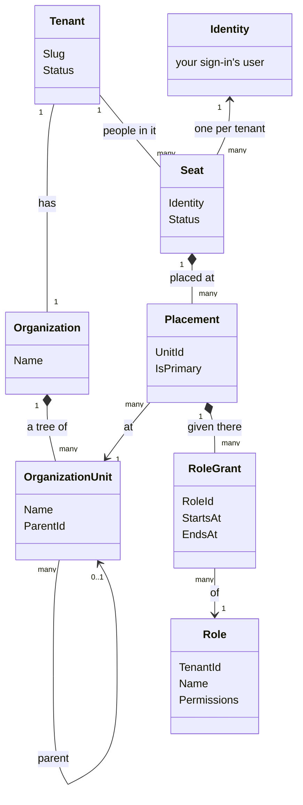
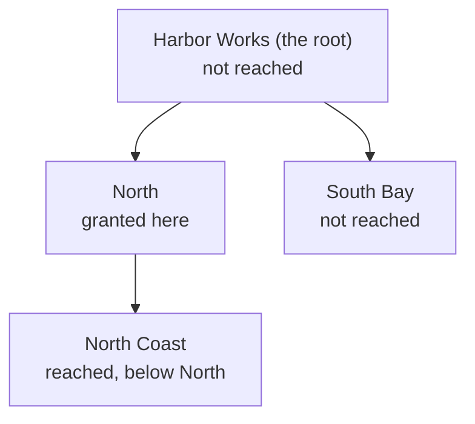

# Tenancy

Tenancy is a package for applications with **tenants**: customers who each have their own people, structure and
data inside one application. This page: what it is for, its scope, and its pieces. The [tutorial](tutorial.md) then
builds an application with it.

## What it is for

Every request of a multi-tenant application asks two questions:

1. **Who is calling, in which tenant?** Tove signs in once, works in Harbor Works and runs Meadow Gardens: two
   tenants, other rights in each.
2. **What may they do, and where?** In Harbor Works, Ada runs everything, Rhea only the North region, and Leo
   manages nothing.

Every such application needs these answers, and none is special because of them. So Tenancy answers them once;
your application adds what only it knows: its own fields, its modules' permissions, its starter roles.

## What it does

- **Tenants and their organization**: a tree of **units** (Harbor Works → North → North Coast).
- **Seats**: one per person per tenant, placed at units.
- **Roles**, and which seat holds which role at which unit.
- **The check before a handler**: does the caller hold this permission here? If not, the handler never runs.
- **Tenants kept apart**: queries read only the caller's tenant; a save into another tenant is refused.
- **Row level security (RLS) on Postgres**: the database applies the same rules, also to queries that skip your
  code.

## What it does not do

- **Sign-in**: yours (Supabase Auth, any JWT). A seat points at the identity.
- **Profiles**: name, e-mail, photo are yours.
- **Access to one thing** ("Leo may edit this board"): [Membership](../membership.md), built on Tenancy.
- **Your business data**: your modules'. They ask Tenancy who may do what.

## How the pieces connect

Every class Tenancy keeps, and how they point at each other. Read from the top: a tenant has an organization of
units; a person has a seat in the tenant; a seat is placed at units; at a placement it is granted roles.

| Piece | What it is | In Harbor Works |
|---|---|---|
| **Tenant** | One customer of your application. | Harbor Works |
| **Organization** | The tenant's structure. One per tenant, and it holds the units. | Harbor Works' organization |
| **Unit** (`OrganizationUnit`) | A place in that structure. Units form a tree; the one at the top is the **root**. | Harbor Works, North, North Coast, South Bay |
| **Identity** | Who somebody is, from your sign-in: the user's id. Not Tenancy's; a seat points at it. | Tove's user id |
| **Seat** | One person's place in one tenant. A person with two tenants has two seats. | Tove's seat in Harbor Works, and her seat in Meadow Gardens |
| **Placement** | Where a seat sits: a seat is placed at one or more units. | Rhea's seat, placed at North |
| **Permission** | One thing you may do, as a string. A request asks for one; a role gives some. | `projects.edit` |
| **Role** | A named set of permissions, kept per tenant. A tenant starts with copies of the starter roles you declare; whether it may also make and change roles itself is your application's choice ([below](#what-your-application-decides)). | Area manager |
| **Grant** (`RoleGrant`) | A role given to a seat at one of its placements, from a moment, and until a moment or for good. | Area manager, for Rhea, at North |

## Reach: a permission counts below where it is given

A permission held at a unit counts there **and at every unit below it**. So one grant at North covers the whole
North region, and nothing outside it. Rhea's grant at North:

Ada's role is granted at the root, so it reaches every unit: held **at the tenant**.

## Three more words you meet early

- **Catalogue**: every permission your application knows, Tenancy's (`tenancy.units.manage`) and your modules'. A
  role gives only these.
- **Starter role** (**pack** in the code: `RolePack`, `pack_permissions`): a role every new tenant gets a copy of,
  its own from then on. The tenant's first person gets the administrators' starter role at the root. Declare none,
  and Tenancy adds Administrator ([The administrators' pack](roles-and-permissions.md#the-administrators-pack)).
- **System work**: work no person does, such as creating a tenant. Said explicitly, for that one piece of work:
  `using (TenancyUseCases.BeginSystem())`.

## What your application decides

Each has a default, so the smallest application decides none of them.

| Choice | The default | What you can do instead |
|---|---|---|
| The roles a new tenant starts with | One, Administrator, holding every permission, given to the tenant's first person at the root. | Declare starter roles of your own, and an administrators' starter role of your own ([The administrators' pack](roles-and-permissions.md#the-administrators-pack)). |
| Whether a tenant makes and changes its own roles | Tenancy has the use cases (make a role, rename it, change its permissions, archive it), and offers none of them on its own. | Offer a request for those you want, as the tutorial does, and give `tenancy.roles.manage` to whoever may use them. Offer none, and nobody makes roles through your application: tenants keep their starter roles. |
| A starter role you change later | The copies tenants already have keep what they had. | `services.SyncRolePacks()`: the copies follow your change, and what a tenant changed itself stays ([Packs after provisioning](roles-and-permissions.md#packs-after-provisioning)). |
| Giving a permission that manages access | Only where you hold it yourself: a seat that manages grants at North cannot give itself the right to manage roles for the whole tenant. | Turn that rule off, `ContainAccessManagingPermissions: false` on your catalogue ([Containment, on or off](roles-and-permissions.md#containment-on-or-off)). |
| The shape of a tenant | Chosen per tenant when it is created: flat, the root alone, or hierarchical, a tree. | A flat tenant can become hierarchical later; the way back is closed, because its units would have to go. |
| Who reads whose seat | Tenancy's own read rule. | A read rule of your own on your `Seat` class ([Who reads the seats](postgres.md#who-reads-the-seats-a-default-you-may-replace)). |
| Invitations | Off. | Declare an invitation class ([Invitations](invitations.md)). |
| The database | Any database Entity Framework supports: every check runs in C#. | On Postgres, the database checks the same rules as well, with row level security ([On Postgres: the second lock](postgres.md)). |

## Where to go next

- **Build it:** the [tutorial](tutorial.md), step by step.
- **Look something up:** a page per topic, each with every detail of its part:
  - [Your tenancy module](your-module.md): the packages, the model, your classes and ids, the registration, calling
    a use case.
  - [Roles and permissions](roles-and-permissions.md): the catalogue, starter roles (packs), who may give a role,
    containment.
  - [Who may do what](who-may-do-what.md): the questions a module asks, and what a request requires of its caller.
  - [Keeping tenants apart](keeping-tenants-apart.md): the query filter, the save check, and system work.
  - [Names and languages](names-and-languages.md): what a seat, a unit or a role is called, and in which language.
  - [Invitations](invitations.md): inviting a person without an account yet, with a unit and a role waiting.
  - [Operators and history](operators-and-history.md): your staff who look across tenants, who changed a row, and
    the history of who changed access.
  - [On Postgres](postgres.md): row level security, the second lock.
  - [The sample](the-sample.md): an application built this way, its GraphQL, and how to try it.
  - [Design and limits](design.md): why it is shaped this way, what it does not do, and upgrading.
- **Every class and method:** the [API reference](reference/aggregates.md).
- **Access to one thing**, such as a board with its own members: [Membership](../membership.md).
