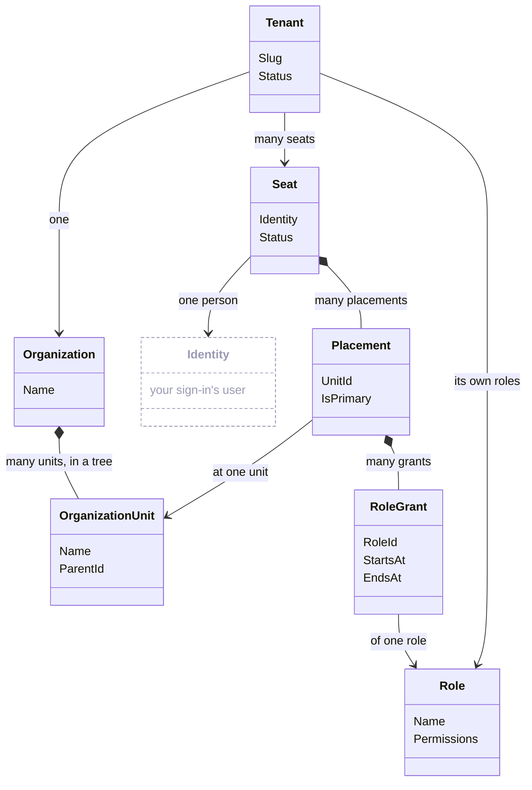
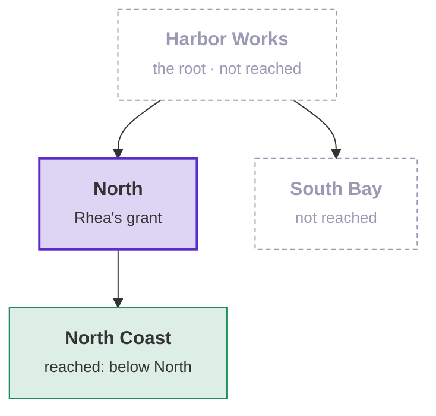

# Tenancy

Tenancy is a package for applications with **tenants**: customers who each have their own people, structure and
data inside one application. This page explains what Tenancy is for, what it covers, and its classes. The
[tutorial](tutorial.md) then builds an application with it.

## What it is for

Every request in a multi-tenant application needs two answers:

1. **Who is calling, and in which tenant?** Ada works in Harbor Works, and Tove in Meadow Gardens. Each request names
   its tenant. A person with seats in both tenants signs in once, and holds different rights in each.
2. **What may the caller do, and where?** In Harbor Works, Ada manages everything, Rhea manages only the North
   region, and Leo manages nothing.

Tenancy stores the tenants, their units, seats and roles, and checks each request against them before your handler
runs. Your application adds what is specific to it: extra fields on the classes, the permissions of its modules, and
the roles a new tenant starts with.

## What it does

- **Tenants and their organization**: a tree of **units** (Harbor Works → North → North Coast).
- **Seats**: one per person per tenant, placed at units.
- **Roles**, and which seat holds which role at which unit.
- **The check before a handler**: does the caller hold this permission here? If not, the handler does not run.
- **Tenants kept apart**: a query filter returns only rows of the caller's tenant. A save into another tenant is
  refused.
- **Row level security (RLS) on Postgres**: the database applies the same rules, also to queries that do not go
  through your code.

## What it does not do

- **Sign-in**: use your own (Supabase Auth, any JWT). A seat points at the signed-in user.
- **Profiles**: name, e-mail and photo belong to your application.
- **Access to one thing** ("Leo may edit this board"): that is [Membership](../membership/overview.md), a package
  beside Tenancy.
- **Your business data**: that belongs in your modules. They ask Tenancy who may do what.

## How the classes connect

The classes Tenancy keeps, and how they connect. Read it from the top:

- a tenant has one organization, a tree of units;
- a person has one seat per tenant;
- a seat is placed at one or more units;
- at each placement, the seat gets roles.

`Identity` (grey) is the user from your sign-in. Tenancy does not store it.

| Class | What it is | In Harbor Works |
|---|---|---|
| **Tenant** | One customer of your application. | Harbor Works |
| **Organization** | The tenant's structure. Each tenant has one, and it holds the units. | Harbor Works' organization |
| **Unit** (`OrganizationUnit`) | A place in that structure. Units form a tree. The unit at the top is the **root**. | Harbor Works, North, North Coast, South Bay |
| **Identity** | The user id from your sign-in. A seat points at it. | Tove's user id |
| **Seat** | One person in one tenant. A person in two tenants has two seats. | Ada's seat in Harbor Works, and Tove's seat in Meadow Gardens |
| **Placement** | A unit a seat is placed at. A seat has one or more placements. | Rhea's seat, placed at North |
| **Permission** | One thing a caller may do, as a string. A request requires one; a role contains several. | `projects.edit` |
| **Role** | A named set of permissions. Each tenant has its own roles. A new tenant starts with copies of your starter roles. Your application decides whether a tenant may also make its own ([below](#what-your-application-decides)). | Area manager |
| **Grant** (`RoleGrant`) | A role given to a seat at one of its placements. It starts at a set time, and ends at a set time or never. | Area manager, for Rhea, at North |

## Reach: a grant covers the units below it

A permission held at a unit also counts at every unit below it. Rhea's role is granted at North, so she holds its
permissions at North and at North Coast, but not at South Bay or at the root.

In the diagram, purple is the grant, green is reached, and grey is not reached:

> [!TIP]
> On the [docs site](https://dylansnel.github.io/DDDToolkit/docs/tenancy#reach-a-grant-covers-the-units-below-it)
> this diagram is an explorer. Pick Ada, Rhea or Tove from the [tutorial](tutorial.md#what-we-build) and a
> permission, and the units show where that person holds it. Pick a unit to see one request there and its answer.

Ada's role is granted at the root, so it covers every unit. The docs call this holding a permission **at the
tenant**.

## Catalogue, starter role and system work

- **Catalogue**: the list of every permission your application knows. It holds Tenancy's permissions (such as
  `tenancy.units.manage`) and your modules'. A role can only contain permissions from the catalogue.
- **Starter role**: a role every new tenant gets a copy of. The tenant can change its copy. The first person in a new
  tenant gets the administrators' starter role at the root. If you declare no starter roles, Tenancy adds one:
  Administrator ([Administrators](roles-and-permissions.md#the-administrators-pack)).
  In the code it is a `StarterRole`.
- **System work**: work that no person does, such as creating a tenant. Your code starts it with
  `using (TenancyUseCases.BeginSystem())`, and it ends with the `using` block.

## What your application decides

Every choice has a default. An application that changes none of them works.

| Choice | Default | What you can do instead |
|---|---|---|
| The roles a new tenant starts with | One role, Administrator, with every permission. The tenant's first person gets it at the root. | Declare your own starter roles, and your own administrators' role ([Administrators](roles-and-permissions.md#the-administrators-pack)). |
| Whether a tenant can make its own roles | Tenancy has the use cases (create, rename, change permissions, archive), but no request calls them. Tenants keep their starter roles. | Add a request for each use case you want, as the tutorial does, and give `tenancy.roles.manage` to the people who may use them. |
| A starter role you change later | Existing tenants keep their copy as it was. | Call `services.SyncStarterRoles()`. Existing copies then get your change, and changes a tenant made itself are kept ([Starter roles after provisioning](roles-and-permissions.md#packs-after-provisioning)). |
| Giving a permission that manages access | A seat can only give such a permission where it holds that permission itself. Rhea manages grants at North, so she cannot give herself the right to manage roles for the whole tenant. | Turn this off with `ContainAccessManagingPermissions: false` on your catalogue ([Containment](roles-and-permissions.md#containment-on-or-off)). |
| The shape of a tenant | Chosen when the tenant is created: flat (only the root) or hierarchical (a tree of units). | A flat tenant can become hierarchical later. A hierarchical tenant cannot become flat again, because its units would have to be deleted. |
| Who may read which seats | Tenancy's default read rule. | Your own read rule on your `Seat` class ([Who reads the seats](postgres.md#default-read-policies-for-seats-and-invitations)). |
| Invitations | Off. | Declare an invitation class ([Invitations](invitations.md)). |
| The database | Any database Entity Framework supports. Every check runs in C#. | On Postgres, the database also checks the same rules, with row level security ([Postgres](postgres.md)). |

## Where to go next

- **Build it:** the [tutorial](tutorial.md), step by step.
- **Look something up:** one page per topic, with every detail:
  - [Your tenancy module](your-module.md): the packages, the model, your classes and ids, the registration, calling
    a use case.
  - [Roles and permissions](roles-and-permissions.md): the catalogue, starter roles, who may give a role,
    containment.
  - [Who may do what](who-may-do-what.md): the queries a module runs, and what a request requires of its caller.
  - [Keeping tenants apart](keeping-tenants-apart.md): the query filter, the save check, and system work.
  - [Names and languages](names-and-languages.md): how a seat, a unit or a role is named, and in which language.
  - [Invitations](invitations.md): inviting a person who has no account yet, with a unit and a role ready for them.
  - [Operators and history](operators-and-history.md): your staff who work across tenants, who changed a row, and
    the history of access changes.
  - [Postgres](postgres.md): row level security.
  - [The sample](the-sample.md): an application built this way, its GraphQL, and how to try it.
  - [Design and limits](design.md): why Tenancy works this way, what it does not do, and upgrading.
- **Every class and method:** the [API reference](reference/aggregates.md).
- **Access to one thing**, such as a board with its own members: [Membership](../membership/overview.md), and its
  [tutorial](../membership/tutorial.md), which continues the Harbor application.
