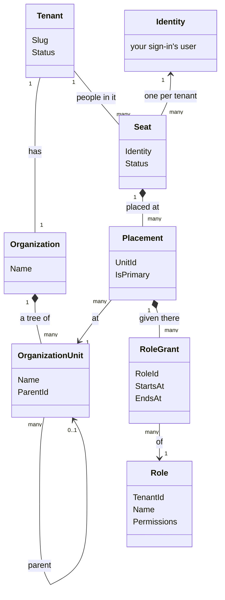
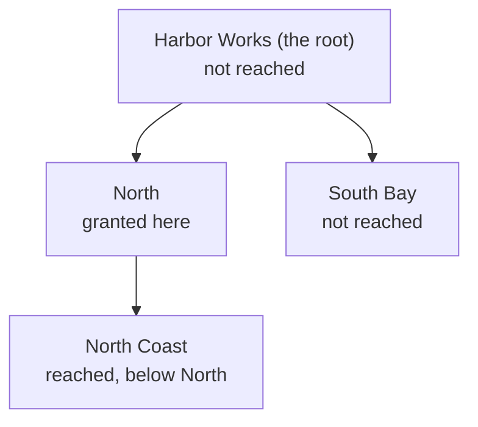

# Tenancy

Tenancy is a package for applications with **tenants**: customers who each have their own people, their own
structure and their own data inside one application. This page says what Tenancy is for, what it does and does not
do, and what its pieces are. The [tutorial](tutorial.md) then builds an application with it, one step at a time.

## What it is for

An application with tenants has to answer two questions on every request.

1. **Who is calling, and in which tenant?** Tove signs in once. She works in Harbor Works, and she runs Meadow
   Gardens. In each of the two she is somebody else, with other rights.
2. **What may they do, and where?** In Harbor Works, Ada runs everything. Rhea manages the North region and
   nothing outside it. Leo works at North Coast and manages nothing in the organization.

Every application with tenants needs these answers, and no application is special because of them. So Tenancy
answers them once, as a package, and your application adds what only it knows: the fields of its own, the
permissions of its own modules, the roles a new tenant starts with.

## What it does

- **It keeps your tenants**, and for each tenant its **organization**: a tree of **units**, such as Harbor Works
  with North below it and North Coast below that.
- **It keeps who works in a tenant**: one **seat** for each person in each tenant, placed at one or more units.
- **It keeps roles**, and which seat holds which role, at which unit.
- **It checks a request before its handler runs**: does this caller hold this permission here? If not, the request
  is refused and the handler never runs.
- **It keeps tenants apart in the database**: every query of a tenant's data reads that tenant's rows only, and a
  save that would write into another tenant is refused.
- **On Postgres it writes row level security**, so the database itself holds the same rules, also for a query that
  does not go through your code.

## What it does not do

- **Sign-in.** Who somebody is comes from your sign-in, such as Supabase Auth or any other issuer of a JWT. Tenancy
  links a seat to that identity.
- **Profiles.** A person's name, e-mail address and photo are your application's.
- **Access to one particular thing.** "Leo may edit this one board" is not about where Leo sits in the organization.
  That is [Membership](../membership.md), which builds on Tenancy.
- **Your business data.** Projects, orders and boards are your modules'. They ask Tenancy who may do what.

## How the pieces connect

This diagram shows every class Tenancy keeps and how they point at each other. Read it from the top: a tenant has an
organization of units; a person has a seat in the tenant; the seat is placed at units; at a placement the seat is
given roles. A role belongs to its tenant too, which its `TenantId` says. The table below the diagram says what
each piece is.

| Piece | What it is | In Harbor Works |
|---|---|---|
| **Tenant** | One customer of your application. | Harbor Works |
| **Organization** | The tenant's structure. One per tenant, and it holds the units. | Harbor Works' organization |
| **Unit** (`OrganizationUnit`) | A place in that structure. Units form a tree; the one at the top is the **root**. | Harbor Works, North, North Coast, South Bay |
| **Identity** | Who somebody is, from your sign-in: the user's id. Not Tenancy's; a seat points at it. | Tove's user id |
| **Seat** | One person's place in one tenant. A person with two tenants has two seats. | Tove's seat in Harbor Works, and her seat in Meadow Gardens |
| **Placement** | Where a seat sits: a seat is placed at one or more units. | Rhea's seat, placed at North |
| **Permission** | One thing you may do, as a string. A request asks for one; a role gives some. | `projects.edit` |
| **Role** | A named set of permissions, kept per tenant. A tenant starts with copies of the starter roles you declare; whether it may also make and change roles itself is your application's choice ([below](#what-your-application-decides)). | Area manager |
| **Grant** (`RoleGrant`) | A role given to a seat at one of its placements, from a moment, and until a moment or for good. | Area manager, for Rhea, at North |

## Reach: a permission counts below where it is given

A permission that a seat holds at a unit counts at that unit **and at every unit below it**. That is why roles are
given at units: one grant at North covers every place in the North region, and nothing outside it.

This diagram is Harbor Works' tree, with what Rhea's one grant at North reaches.

Ada holds her role at the root, so hers reaches every unit of Harbor Works. A role given at the root is said to be
held **at the tenant**.

## Three more words you meet early

- **Catalogue.** The list of every permission your application knows: Tenancy's own, such as
  `tenancy.units.manage`, and those your modules declare. A role can only give permissions from the catalogue.
- **Starter role** (a **pack** in the code). A role every new tenant gets a copy of when it is created. The copy is
  the tenant's own from then on. The first person of a new tenant gets the **administrators' starter role** at the
  root, so that somebody can give out the rest. In the code and the database a starter role is called a pack:
  `RolePack`, `TenancyPacks`, `pack_permissions`. You do not need to declare one: without one, Tenancy adds its own
  Administrator ([The administrators' pack](../tenancy.md#the-administrators-pack)).
- **System work.** Work that no person in the tenant does, such as creating the tenant itself. Your code says so
  explicitly, with `using (TenancyUseCases.BeginSystem())`, and only for that one piece of work.

## What your application decides

Tenancy has a default for each of these, so the smallest application decides none of them. Where you want
something else, this is where you say so.

| Choice | The default | What you can do instead |
|---|---|---|
| The roles a new tenant starts with | One, Administrator, holding every permission, given to the tenant's first person at the root. | Declare starter roles of your own, and an administrators' starter role of your own ([The administrators' pack](../tenancy.md#the-administrators-pack)). |
| Whether a tenant makes and changes its own roles | Tenancy has the use cases (make a role, rename it, change its permissions, archive it), and offers none of them on its own. | Offer a request for those you want, as the tutorial does, and give `tenancy.roles.manage` to whoever may use them. Offer none, and nobody makes roles through your application: tenants keep their starter roles. |
| A starter role you change later | The copies tenants already have keep what they had. | `services.SyncRolePacks()`: the copies follow your change, and what a tenant changed itself stays ([Packs after provisioning](../tenancy.md#packs-after-provisioning)). |
| Giving a permission that manages access | Only where you hold it yourself: a seat that manages grants at North cannot give itself the right to manage roles for the whole tenant. | Turn that rule off, `ContainAccessManagingPermissions: false` on your catalogue ([Containment, on or off](../tenancy.md#containment-on-or-off)). |
| The shape of a tenant | Chosen per tenant when it is created: flat, the root alone, or hierarchical, a tree. | A flat tenant can become hierarchical later; the way back is closed, because its units would have to go. |
| Who reads whose seat | Tenancy's own read rule. | A read rule of your own on your `Seat` class ([Who reads the seats](../tenancy.md#who-reads-the-seats-a-default-you-may-replace)). |
| Invitations | Off. | Declare an invitation class ([Invitations](../tenancy.md#invitations)). |
| The database | Any database Entity Framework supports: every check runs in C#. | On Postgres, the database checks the same rules as well, with row level security ([On Postgres: the second lock](../tenancy.md#on-postgres-the-second-lock)). |

## Where to go next

- **Build it:** the [tutorial](tutorial.md), step by step.
- **Look something up:** the [reference](../tenancy.md), with every detail of every part.
- **Access to one thing**, such as a board with its own members: [Membership](../membership.md).
