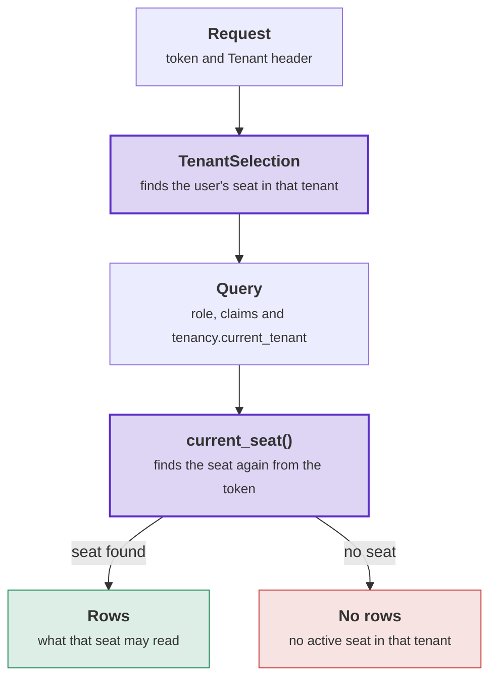

# Row level security on Postgres

`DDDToolkit.Supporting.Tenancy.Postgres` writes Tenancy's access rules into Postgres as row level security (RLS)
policies, SQL functions and triggers. Postgres then checks every row a query reads or writes against the caller's
seat, also when the query skips your C# checks. Use the package when Tenancy is stored on Postgres. On any other
database, every check runs in C# only. The [overview](overview.md) explains the words (tenant, unit, seat, grant,
role, permission).

## What the package writes

On Postgres, Tenancy checks access in two places:

1. **In C#**, with the check before a handler, the query filter and the save check
   ([Keeping tenants apart](keeping-tenants-apart.md)).
2. **In Postgres**, with the same rules as [RLS](../row-level-security.md) policies.

For the Postgres side, `DDDToolkit.Supporting.Tenancy.Postgres` writes three kinds of SQL into your access files:

- **Policies** on Tenancy's tables and on every table you keep to a tenant.
- **SQL functions** for Tenancy's queries, such as `units_where_i_hold_permission('projects.read')`. The policies
  and your modules' rules call them.
- **Triggers** for checks that no policy can make, such as "every tenant keeps one administrator".

RLS stops your queries that forget a condition, such as a `FromSql` without a tenant filter. RLS does not stop
SQL that an attacker runs on your connection ([What row level security covers](#what-row-level-security-covers)).

## Setup steps

1. **Reference the package** from the infrastructure project that stores Tenancy. The project that runs the
   [export](../supabase.md) then sees the package and writes Tenancy's SQL into your migrations.
2. **Pass the context's `Database` to `AddTenancy`**, and add a migration
   ([The index on a tenant's root](#the-index-on-a-tenants-root)).
3. **Register the package** next to RLS, and run the start-up checks.

   **The host's `Program.cs`**

   ```csharp
   services.AddSupabaseRowLevelSecurity();   // or AddPostgresRowLevelSecurity() on a Postgres of your own
   services.AddTenancyPostgres();
   services.RunStartupChecks();              // every registration's checks, before the host serves
   ```

4. **Mark your part of the catalogue** with `[TenancyCatalogue]`. This is the catalogue you pass to
   `TenancyOptions.Catalogue` ([The row access contribution](#the-row-access-contribution)). If your application
   has [operators](operators-and-history.md#operators), also mark their token roles with `[TenancyOperators]`.

   ```csharp
   public static class ShopCatalogue
   {
       [TenancyCatalogue]
       public static ApplicationCatalogue Application { get; } = new(StarterRoles: [...]);
   }
   ```

5. **Map each module's read model to Tenancy's functions** with `AddTenancyReadFunctions`
   ([Read functions for modules](#read-functions-for-modules)).
6. **Build, apply the access files, and start the host.** The [start-up checks](#the-start-up-checks) refuse a
   database that misses any of these steps.

With RLS registered, `UseDDDToolkit` runs every context as its caller (the caller's database role and claims), with
Tenancy's save check.

## Setup in detail

### The registration

`AddTenancyPostgres()` ([reference](reference/managers.md#addtenancypostgresiservicecollection)) does four things:

- Sets the caller's tenant on every connection ([Passing the tenant to Postgres](#passing-the-tenant-to-postgres)).
- Requires an explicit current user. Work that never says who it runs as fails. Without this rule, that work would
  run as system work, past every policy
  ([Requiring an explicit current user](../row-level-security.md#requiring-an-explicit-current-user)).
- Leaves [the rights](#how-rights-are-written) to the database, by turning on
  `TenancyStoreOptions.DatabaseKeepsRights`.
- Turns the refusal of the administrator trigger into `tenancy.last-admin`, and registers the
  [start-up checks](#the-start-up-checks).

Calling `AddTenancyPostgres()` more than once does no harm.

### The row access contribution

The package declares its SQL as a [row access contribution](../row-level-security.md#policies-a-package-ships)
([`TenancyRowAccessContribution`](reference/postgres.md#tenancyrowaccesscontribution)). Referencing the package is
enough for the export to write the SQL.

- **The export writes the SQL from your catalogue**, because your catalogue says which permissions manage access.
  The export builds the catalogue the way your registration does, from the projects that the exporting project
  references:
  - The static property or field of type `ApplicationCatalogue` that you mark `[TenancyCatalogue]`. If you mark
    none, the export uses `new ApplicationCatalogue()`, the same as when `TenancyOptions.Catalogue` is unset.
  - Every module's permissions, from its `[Permissions]` classes
    ([A module states its permissions once](roles-and-permissions.md#declaring-a-modules-permissions)).
- **The next build writes the access file again** when you mark a permission, change a starter role, change
  containment, or add a permission while the administrators' starter role lists none. That starter role then holds
  every permission. The new access file is the migration.
- **The build generates the contribution** in `DDDToolkit.RowAccessContributionsOfPackages.g.cs` of the exporting
  project.
  - The build reports [DDD00071](../diagnostics.md#ddd00071) for two members marked `[TenancyCatalogue]`, or for a
    marked member of another type.
  - The build reports [DDD00070](../diagnostics.md#ddd00070) for a marked member that a library keeps `internal`,
    because the export cannot see it.
- **On a Postgres of your own**, pass `new TenancyRowAccessContribution(catalogue)` to `PostgresRowAccess.Scripts`
  in `RowAccessExport.Contributions`.
- **To leave the contribution out**, add
  `[assembly: LeaveOutRowAccessContribution(typeof(TenancyRowAccessContribution))]`. The export then writes none of
  Tenancy's SQL. A table without RLS is open to every caller with privileges on it. The start-up checks still
  expect the SQL that the contribution writes.
- **The schema** is the default schema of the context that maps Tenancy's tables. The SQL always quotes it, for
  example `"tenancy".current_seat()` ([Schema names](../row-level-security.md#schema-names)).

### The start-up checks

`AddTenancyPostgres()` registers five [start-up checks](../startup-checks.md). The host runs them with its other
checks, before the server binds its port. A failing check throws an exception that names the problem and the
statement that fixes it.

| `TenancyPostgresChecks.` | What it proves |
|---|---|
| `EnsureExplicitCurrentUser` | The host still requires an explicit current user, in `CurrentUserOptions` and in the RLS interceptor. |
| `EnsureSeatedTokenRolesAreSignedInUsers` | Every token role that Tenancy seats reaches the database as a signed-in user ([Which signed-in users hold seats](#which-signed-in-users-hold-seats)). |
| `EnsureSystemInRoleIsConfinedAsync` | The scoped system role cannot log in, cannot bypass RLS, and cannot act as a table's owner. No caller's role has its privileges, and the Data API's login role (`authenticator`) cannot switch to it. No mapped token role acts as a signed-in user or may run Tenancy's functions. `anon` and `PUBLIC` may not run any function that runs as its owner. |
| `EnsureSystemReadsAcrossTenantsAsync` | The [reads across tenants](#reads-across-tenants) return their rows, and only the scoped system role may run them. |
| `EnsurePoliciesAreInPlaceAsync` | RLS is on for Tenancy's tables, and [the root index](#the-index-on-a-tenants-root) exists. The functions and the rights trigger match what the contribution writes from the catalogue the host runs with, containment included. `DatabaseKeepsRights` is on. Each operator's token role maps to a database role of its own. |

- The first two checks read the host's services. The other three ask the database. These three run before
  `TenancyChecks.UnknownStoredPermissionsCheck`.
- To run the checks by hand, call the methods of
  [`TenancyPostgresChecks`](reference/postgres.md#tenancypostgreschecks) in the order of the table. Call them after
  the checks of the login role and after the migrations. The methods that ask the database run as system work without
  a scope, on a context of Tenancy's own, outside any transaction of yours.

### What Postgres refuses

Some rules only the database can check, for example when two requests race for one slug. The manager cannot see
the other request. Postgres refuses the second save, and the caller gets the same refusal that the manager gives
for that rule ([`TenancyRefusals`](reference/refusals.md#tenancyrefusals)):

| Refused by | Refusal |
|---|---|
| The unique index on a tenant's slug | `tenancy.slug-taken` |
| The unique index on a seat's identity in a tenant | `tenancy.identity-has-seat` |
| The unique index on a role's name in a tenant | `tenancy.role-name-taken` |
| The unique index on a tenant's root | `tenancy.one-root` |
| The unique index on a seat's primary placement | `tenancy.second-primary` |
| The trigger that keeps an administrator | `tenancy.last-admin` |

- Each unique index names its refusal in the model mapping. So the same refusals come back on SQLite and SQL Server
  too. Any other database error is thrown unchanged, because it points to a bug.
- The administrator trigger checks at commit. In a transaction of your own, your commit gets the
  `PostgresException` with the constraint `tenancy_administrator_remains`.

## The index on a tenant's root

On Postgres, Tenancy requires a unique index that allows one root unit per tenant. `AddTenancy` maps the index when
you pass `Database`. `EnsurePoliciesAreInPlaceAsync` refuses a database without the index.

```csharp
modelBuilder.AddTenancy(database: Database);   // maps the index, and your migration creates it
```

- **Why the index is required.** A permission held at a unit without a parent counts for the whole tenant. With a
  second root, a seat that holds a permission at that root would hold the permission for the whole tenant. The
  policies stop a seat from making a second root. They do not stop Tenancy's system work, or the tables' owner in a
  migration. The index applies to every role.
- **What the check accepts.** The check finds the index by its shape, so any name works. The index is unique, has
  the units' tenant column as its only column, covers the units without a parent, and is valid. The check rejects
  an index that is not unique, has a second column, or has a narrower condition. It also rejects an index left
  invalid by a failed `CREATE INDEX CONCURRENTLY`.

| The model | The database | What to do |
|---|---|---|
| Maps the index | Has no index | Add a migration that creates it, and apply the migration. |
| Maps no index (`AddTenancy` without `database`) | Has no index | Pass `Database` to `AddTenancy`, add a migration, and apply it. |
| Either | Has the index, but it is not valid | Check that no tenant has two roots. Then run `REINDEX INDEX` on the index that the failure names. |
| Maps no index | Has the index | Nothing. The check reads the database. |

A tenant with two roots cannot get the index until one of the roots has a parent again.

## Passing the tenant to Postgres

- Tenancy passes the tenant in one setting, `tenancy.current_tenant`
  ([`TenantSetting`](reference/postgres.md#tenantsetting)). The value is the Tenancy user's tenant id, or empty.
  The interceptor sets it in the same statement as the role and the claims
  ([Settings of your own](../row-level-security.md#custom-connection-settings)). An anonymous caller gets an empty value.
- **For a signed-in user**, the setting names the tenant and never the seat. `current_seat()` finds the seat of the
  token's identity in that tenant, while the seat and the tenant are active. A wrong tenant finds no seat.
- **System work in a tenant** runs as the scoped system role, with that tenant in the setting.

The diagram follows one request from token to rows. The host finds the seat first. Postgres then finds the seat
again from the token, so the setting alone never makes anyone a seat. Purple: the two steps that find the seat.
Green: the rows the query returns. Red: no seat found.



`TenantSelection` reads the seat directory as the user, in no tenant. Postgres returns only the seats of the
token's identity. `TenantSelection` returns the seat when the seat and its tenant are active.

**The host's `Program.cs`**, after authentication:

```csharp
app.Use(async (context, next) =>
{
    var user = context.GetSupabaseUser();
    using (context.RequestServices.GetRequiredService<ICurrentUser>().BeginAs(user))
    {
        // ITenantSelection has no type parameters, so the middleware names no id types
        var seat = await context.RequestServices.GetRequiredService<ITenantSelection>()
            .ResolveAsync(user, context.Request.Headers["Tenant"], context.RequestAborted);
        using (TenancyUsers.Begin(seat))
        {
            await next(context);
        }
    }
});
```

The access file writes `current_seat()` like this:

**20261028202433_access.tenants.ddd.sql**

```sql
CREATE OR REPLACE FUNCTION "tenancy".current_seat() RETURNS uuid
    LANGUAGE sql STABLE SECURITY DEFINER SET search_path = '' AS $function$
SELECT s."Id" FROM "tenancy"."Seats" s
JOIN "tenancy"."Tenants" t ON t."Id" = s."TenantId"
WHERE s."Identity" = (SELECT auth.uid())
  AND s."TenantId" = (SELECT "tenancy".system_tenant())
  AND s."Status" = 'Active' AND t."Status" = 'Active'
$function$;
```

### Reading rows as a user in a SQL tool

A tool that acts as a user, such as the table editor of Supabase Studio, sets no tenant. Every table kept to a
tenant then looks empty. Set the tenant too, in a transaction that you roll back:

```sql
begin;
select set_config('request.jwt.claims', '{"sub":"<the user''s id>","role":"authenticated"}', true),
       set_config('tenancy.current_tenant', '<the tenant''s id>', true);
set local role authenticated;
select * from tenancy."OrganizationUnits"; -- the rows the policies let that user's seat read
rollback;
```

### Which signed-in users hold seats

- **Seated token roles.** `TenantSelection` looks up seats for a token with the role `authenticated` (the default)
  or with no role. Add other token roles to `options.TenantSelection.SeatedTokenRoles`
  ([`TenantSelectionOptions`](reference/access.md#tenantselectionoptions)). A token role mapped to the database
  role of a signed-in user counts as a signed-in user.
- **Any other [token role](../row-level-security.md#token-roles)**, for example a reporting job's, has no seat in
  any tenant. `TenantSelection` resolves it as nobody with `tenancy.not-seated`, and `SeatsOfAsync` returns no
  seats for it. Its database role cannot reach Tenancy's tables or any table kept to a tenant, the same as `anon`.
  The exception is an operator's token role. That role reads the rows of Tenancy's tables in every tenant and writes
  none ([Operators](operators-and-history.md#operators)). `TenantSelection` resolves an operator as nobody as well,
  and keeps the tenant the request names, for a command marked `[Operator(Tenant = OperatorTenant.FromRequest)]`.
- **The start-up check refuses:**
  - a seated token role that reaches the database as another database role;
  - a mapped role that has the privileges of the signed-in user's role, directly or through another role;
  - a mapped role that may run a function of Tenancy's, directly or through another role.

  The error names the `REVOKE` statement that fixes the problem.

The access files grant Tenancy's functions to signed-in users and to the scoped system role only, and revoke every
other grant. A grant that you add by hand later stays until the next access file is applied. A grant on a trigger
function stays until you revoke it yourself. The check reads every function in Tenancy's schema, so put the
functions that a mapped role runs in another schema:

```sql
-- Refused at start-up: analyst_role could now call the functions written for seats
GRANT EXECUTE ON ALL FUNCTIONS IN SCHEMA tenancy TO analyst_role;
```

## Who reads Tenancy's tables

Only Tenancy's context reads Tenancy's tables. Every other reader calls a function. A function that runs as its
owner reads past the policies. Most of these functions return only ids, permissions and dates. Three return more,
and only about the caller. `current_seat_row()` returns the row of the caller's seat. `identity_tenant_names()`
returns the names of the caller's tenants. `units_named(ids)` returns the names of units in the caller's tenant.

| Reader | Reads through |
|---|---|
| A seat, through Tenancy's managers | The tables, under the [policies](#what-the-policies-check). |
| A manager that needs other seats' rights | Three owner-run functions ([Functions about other seats' rights](#functions-about-other-seats-rights)). |
| A module | Six functions that run as the caller ([Read functions for modules](#read-functions-for-modules)). |
| System work in a tenant | The tables, with every row of its tenant. |
| System work in no tenant | Four owner-run functions ([Reads across tenants](#reads-across-tenants)). |
| A policy on a stored file or a channel | Five functions that [take the tenant as an argument](#functions-that-take-the-tenant-as-an-argument). |
| An operator's role | The tables, in every tenant, read only ([Operators](operators-and-history.md#operators)). |
| `anon` | Nothing. |

## Default read policies for seats and invitations

Who may see whom is your application's choice. So two read policies are defaults:

- who reads the seats;
- who reads an invitation, besides the seats managers at its unit.

Replace a default with a read rule on your class. Write it like any
[row access rule](../row-level-security.md#row-access-rules-written-in-c).

| Table | Default for a signed-in user | Replaced by a rule on | Stays, whatever your rule says |
|---|---|---|---|
| Seats | The tenant's seats, and the person's own seats in every tenant. | Your seat class. | The person's own seats, because the tenant picker and the history need them. A seat that manages seats, grants or units anywhere, or roles for the whole tenant, reads every seat of the tenant, because the managers and policies load them. |
| Invitations | The invitations at a unit where the seat manages seats. | Your invitation class. | The same invitations. Your rule can only add readers. |
| Tenants, Organizations, Roles and the rest | As [What the policies check](#what-the-policies-check) says. | None. The export refuses a read rule here. | The tenant picker reads the tenants. Tenancy's queries read the roles as their caller. The other tables hold an organization's rows, a seat's rows, or Tenancy's own rows. |

- The export writes a rule on your seat or invitation class as a policy that allows `Read`. That policy replaces the
  policy that Tenancy marked as a default ([Policies a package ships](../row-level-security.md#policies-a-package-ships)).
  A rule without `To` applies to the default's roles. The export limits your rule to the calling seat's tenant.
- Your rule breaks no manager method. The package's tests run every manager method under a rule that lets a member
  read only its own seat.
- The export refuses a rule on your seat class that allows anything but `Read`. It also refuses a rule whose `To`
  names a role that the default does not cover. To narrow the default, write a [restrictive rule](#restrictive-rules).

| Your rule changes | Your rule leaves unchanged |
|---|---|
| Your queries, the seats that `SeatManager` reads, `tenant_seats()` and `ITenancyQueries.Seats()`. | Tenancy's queries about the caller and about rights (`current_seat`, `seats_in_my_units`, `seats_holding_permission_at` …). These functions run as their owner. |
| Your entities on the seat class. | Placements and grants. Every member still reads every seat's id and units. Your rule hides the seat's row (the identity and your fields), and other members still see that the seat exists. |
| Checks that read the seats. [Membership](../membership/overview.md)'s member manager refuses a seat outside your rule with `member-not-active`, the same as a seat that does not exist. A module's rule on `tenant_seats()` does the same. | Writes, which stay Tenancy's. A [column rule](#who-may-change-a-seats-columns) still guards your fields. System work and operators. |

<details>
<summary>Show the code: two read rules, their building blocks, and the policy the export writes</summary>

A member reads the people placed at its units or below:

```csharp
[RowAccess<Seat>(RowOperations.Read)]
public static partial class MembersReadThePeopleOfTheirUnits
{
    public static bool Allows(Seat seat, ICurrentUser user) => TenancyRowAccess.SeatsInMyUnits<SeatId>().Contains(seat.Id);
}
```

A seat that gives roles at an invitation's unit also reads the invitation:

```csharp
[RowAccess<Invitation>(RowOperations.Read)]
public static partial class GrantsManagersReadTheInvitationsAtTheirUnits
{
    public static bool Allows(Invitation invitation, ICurrentUser user)
        => TenancyRowAccess.UnitsWhereIHold<OrganizationUnitId>(TenancyPermissions.GrantsManage).Contains(invitation.UnitId);
}
```

The building blocks are the methods of [`TenancyRowAccess`](reference/queries.md#tenancyrowaccess) and the columns
of your class. Each method runs once per statement.

| You mean | Your rule says |
|---|---|
| In the caller's tenant | `seat.TenantId == TenancyRowAccess.CurrentTenant<TenantId>()` |
| The caller itself | `seat.Id == TenancyRowAccess.CurrentSeatId<SeatId>()` |
| A field of the caller's own seat | `TenancyRowAccess.CurrentSeat<Seat>().Kind == SeatKind.Employee` |
| The people on the projects the caller is on | `PeopleOnMyProjects.Ids().Contains(seat.Id)` ([below](#restrictive-rules)) |
| The person's own seats, in every tenant | `seat.Identity == user.Id` |
| The seats placed at or below the caller's units (for a seat at the root, every placed seat) | `TenancyRowAccess.SeatsInMyUnits<SeatId>().Contains(seat.Id)` |
| Where the caller holds a permission | `TenancyRowAccess.UnitsWhereIHold<OrganizationUnitId>(permission).Contains(invitation.UnitId)` |
| A permission held anywhere, or for the whole tenant | `TenancyRowAccess.HoldsPermission(permission)`, `TenancyRowAccess.HoldsAtTenant(permission)` |

The export joins your rule, limited to the tenant, with OR to the reads Tenancy keeps. The seats' read policy with
`MembersReadThePeopleOfTheirUnits`, shortened:

**`*_access.tenants.ddd.sql`**

```sql
CREATE POLICY "Seats (select) for authenticated" ON "tenancy"."Seats" FOR SELECT TO authenticated
    USING (("Identity" = (SELECT auth.uid()) OR ( ... /* the seats, grants, units or roles managers */ ))
           OR (("TenantId" = (SELECT "tenancy".current_tenant())) AND ("Id" = ANY (ARRAY(SELECT "tenancy".seats_in_my_units())))));
```

</details>

The [sample](the-sample.md#who-may-do-what-in-the-sample) keeps both defaults. An application that shows members
only their own part of the tree writes the first rule above. Pin that rule with a test that reads the seats as a
member, as the package's `ReadRulesTests` do.

## Restrictive rules

A rule that allows can only add rows. To take rows away, set `Restrictive = true` on a rule about your organization,
seat or role class. The export joins its policy with Tenancy's policy by AND
([Rules that only narrow](../row-level-security.md#restrictive-rules)). A row passes only where both
policies allow it.

Example: a tenant has employees and external people. External people work on one project, and should not read the
rest of the organization. A field on your seat class says which kind a seat is. A restrictive rule lets
only employees read the organization:

| A signed-in user | Tenancy's policy | Your rule | Reads the units |
|---|---|---|---|
| An employee of the tenant | Yes | Yes | Yes |
| An external seat of the tenant | Yes | No | No |
| A seat of another tenant | No | Yes | No |

```csharp
public enum SeatKind { Employee, External }

[SeatAggregate<SeatId>]
public sealed partial class Seat
{
    public SeatKind Kind { get; private set; }

    public void MarkExternal() => Kind = SeatKind.External;
}

[RowAccess<Organization>(RowOperations.Read, Restrictive = true)]
public static partial class OnlyEmployeesReadTheOrganization
{
    public static bool Allows(Organization organization, ICurrentUser user)
        => TenancyRowAccess.CurrentSeat<Seat>().Kind == SeatKind.Employee;
}
```

The export writes `OnlyEmployeesReadTheOrganization` like this, shortened:

**`*_access.tenants.ddd.sql`**

```sql
CREATE POLICY "Only employees read the organization (select) for authenticated" ON "tenancy"."Organizations" AS RESTRICTIVE FOR SELECT TO authenticated
    USING ((SELECT q1."Kind" FROM "tenancy".current_seat_row() q1) = 0);
-- and the same on "tenancy"."OrganizationUnits" and on "tenancy"."OrganizationUnitPaths"
```

- **Where the rule goes.** On your organization class, the rule covers the organization, its units and its tree. On
  your seat class, it covers the seats with their placements and grants. On your role class, it covers the roles. On
  a tenant or an invitation, the build reports [DDD00100](../diagnostics.md#ddd00100). Without `Restrictive`, a rule
  on the organization or role class is refused, because it would change nothing.
- **The rule narrows Tenancy's own reads too.** On the seats, keep the person's own seats in the rule:
  `seat.Identity == user.Id || ...`. Tenancy finds the tenant picker's tenants and the request's seat from
  those seats.
- **A field of the caller's own seat.** `CurrentSeat<Seat>()` reads `current_seat_row()`, which runs as its owner,
  past your read rule. A caller without a seat gets null in every field, so no row passes. `CurrentSeat<T>()` with
  another class than your seat class gives [DDD00101](../diagnostics.md#ddd00101). In a module that does not map the
  seats, use `CurrentSeatId` for the id alone.
- **System work and owner-run functions are not narrowed.** The restrictive policy applies to signed-in users, and
  owner-run functions read past every policy. The package's tests run every manager method under the rule above.
- **A seat that the rule keeps out still reads:**
  - the name, path and depth of its own units and of the units it asks for (`units_named()`, which
    `UnitsByIdAsync` and `WhoAmIAsync` call). So an external seat can show the name of its project's unit;
  - the name of every tenant it has a seat in, in the tenant picker (`identity_tenant_names()`).

  `ListUnitsAsync` returns no units to that seat.

Add a [read rule on your seat class](#default-read-policies-for-seats-and-invitations) too, and an external seat
reads only the people on its projects. The projects' module publishes that set as a contract, from its
[Membership](../membership/postgres.md) members:

```csharp
// Projects.Contracts: the seats of the people on the caller's projects
[ResourceAccessContract<ProjectId>(ResourceAccessSet.FellowMembers)]
public static partial class PeopleOnMyProjects
{
    public static partial AccessSet<SeatId> Ids();
}

// Tenants.Infrastructure: a read rule on the seats that replaces the default
[RowAccess<Seat>(RowOperations.Read)]
public static partial class EmployeesReadEveryoneExternalsTheirProjects
{
    public static bool Allows(Seat seat, ICurrentUser user)
        => TenancyRowAccess.CurrentSeat<Seat>().Kind == SeatKind.Employee || PeopleOnMyProjects.Ids().Contains(seat.Id);
}
```

Tenancy's access file runs before the projects' access file, which creates the function the rule calls. So the
export writes the rule through a function of Tenancy's that calls the projects' function at run time
([A rule that asks a module that asks back](../row-level-security.md#resource-access-contracts)).

## Tenancy's SQL functions

The policies and your rules call these SQL functions:

- The export writes them with your table names and id column types, as `LANGUAGE sql` with an empty `search_path`.
- Signed-in users and the scoped system role may run them. `anon` may not. The table says where a function differs.
- **Live** means a period that holds at the database's `now()`. The application's clock stamps a grant's start, so
  keep the two clocks in step. While the database clock runs behind, the policies do not see a new grant as live
  yet.
- A function about the calling seat returns nothing to system work in a tenant, because system work has no seat.
  The policies keep system work to its tenant with `system_tenant()`.

| Function | Returns | Runs as | Used by |
|---|---|---|---|
| `current_seat()` | The seat of the caller's identity in the tenant that the setting names, while the seat and the tenant are active. Otherwise null. | Owner | The policies, to find again the seat that `TenantSelection` picked. Also `CurrentSeatId`. |
| `current_tenant()` | The tenant of that seat. Otherwise null. | Owner | `CurrentTenant` |
| `current_seat_row()` | The row of that seat, with every column your seat class maps. No row without a seat. | Owner | `CurrentSeat<Seat>()` |
| `system_tenant()` | The tenant that the setting names. For the scoped system role, this is the tenant of its work. For a signed-in user, it is the tenant where the access revision and the [access history](operators-and-history.md#access-history) are written. | Caller | `access.BeginSystemIn` |
| `units_where_i_hold_permission(permission)` | The units where the seat holds the permission live, and every unit below. | Owner | `UnitsWhereIHold` |
| `readable_units()` | The units where the seat is placed, and every unit below. | Owner | `ReadableUnits` |
| `seats_in_my_units()` | The seats placed at one of those units, whatever their status. | Owner | `SeatsInMyUnits` |
| `roles_with_permission(permission)` | The active roles of the seat's tenant that hold the permission. | Owner | `RolesWithPermission` |
| `holds_permission(permission)` | Whether the seat holds the permission live at any unit. | Owner | `HoldsPermission` |
| `holds_at_tenant(permission)` | Whether the seat holds the permission live at the root. | Owner | `HoldsAtTenant`, `HoldsAtTenantAsync` |
| `identity_tenants()` | Every tenant where the caller's identity has a seat, of any status. | Owner | The seat directory |
| `identity_tenant_names()` | The ids, slugs and organization names of those tenants. Only signed-in users may run it. | Owner | The tenant picker, a seat's overview |
| `unit_parent(unit)` | A unit's parent as it was before the statement. | Owner | The units' policies |
| `units_named(ids)` | The units of the seat's tenant among the ids, with name, path from the root and depth. Only signed-in users may run it. | Owner | `OrganizationManager.UnitsByIdAsync` |
| `permission_manages_access(permission)` | Whether your catalogue marks the permission as managing access. | Caller | `TenancyCatalogue.ManagesAccess` |
| `permission_is_contained(permission)` | Whether a seat hands the permission on only where it holds it. True for permissions that manage access, while [containment](roles-and-permissions.md#containment-on-or-off) is on. | Caller | `ContainAccessManagingPermissions` |
| `starter_role_permissions(starter_role)` | The permissions a copy of that starter role holds, implied ones included. Null for an unknown starter role. | Caller | `TenancyCatalogue.StarterRoles` |
| `permission_is_live(permission)` | Whether your catalogue has the permission live. No caller may run it. | Caller | The owner-run functions, the rights trigger |

[Who reads Tenancy's tables](#who-reads-tenancys-tables) lists the other functions with their readers.

A module's rule calls these functions through [`TenancyRowAccess`](reference/queries.md#tenancyrowaccess), in
`DDDToolkit.Supporting.Tenancy`. So the module needs no reference to the Postgres package. `anon` may not run the
functions, so write such a rule for signed-in users:

```csharp
[RowAccess<Project>(RowOperations.Read, To = [RowAccessRoles.User])]
public static partial class ProjectsAreReadWhereThePermissionIsHeld
{
    public static bool Allows(Project project, ICurrentUser user)
        => TenancyRowAccess.UnitsWhereIHold<OrganizationUnitId>(ProjectPermissionNames.Read).Contains(project.UnitId);
}
```

In SQL, the rule becomes `"UnitId" = ANY (ARRAY(SELECT "tenancy".units_where_i_hold_permission('projects.read')))`.
`EXPLAIN` shows an init plan. Postgres runs the function once per statement, and compares each row's `UnitId` with
the result, through an index when the table is large enough. The function never runs per row
([set-shaped questions](../row-level-security.md#set-shaped-access-functions)).

## Read functions for modules

On Postgres, a module reads no table of Tenancy's. The module's context maps the read model to six functions with
[`AddTenancyReadFunctions`](reference/entity-framework.md#addtenancyreadfunctionsmodelbuilder-string). On another database,
`AddTenancyReadModel` maps views over the tables instead. A module that sees only Tenancy's ids writes
`[assembly: TenancyIds<TenantId, SeatId, OrganizationUnitId, RoleId>]` once. The generator then writes
`AddTenancyReadFunctions(schema)` and `db.Tenancy()` for the module's context, with no type argument.

```csharp
// A module's context: its tables, plus Tenancy's read model mapped to Tenancy's functions.
// Project marks its tenant with [OfTenant], so the context needs no line to keep it to a tenant.
protected override void OnModelCreating(ModelBuilder modelBuilder)
{
    modelBuilder.HasDefaultSchema("projects");
    modelBuilder.AddTenancyReadFunctions("tenancy");
}

// A read: UnitsWhereIHold becomes a subquery of this statement, on the context that runs it
public async Task<List<string>> VisibleProjectsAsync(CancellationToken cancellationToken)
{
    await using var db = await contexts.CreateDbContextAsync(cancellationToken);   // IDbContextFactory<ProjectsContext>
    var held = db.Tenancy().UnitsWhereIHold(ProjectPermissionNames.Read);
    return await db.Projects.Where(project => held.Contains(project.UnitId)).Select(project => project.Name).ToListAsync(cancellationToken);
}
```

| Function | Returns | Columns |
|---|---|---|
| `current_permissions()` | The rights the caller may read. For a seat, its own rights. For system work in a tenant, the rights of that tenant. | `"TenantId"`, `"SeatId"`, `"UnitId"`, `"RoleId"`, `"Permission"`, `"StartsAt"`, `"EndsAt"` |
| `tenant_unit_paths()` | The closure of the tenant's tree. | `"TenantId"`, `"AncestorId"`, `"DescendantId"`, `"Distance"` |
| `tenant_units()` | The tenant's units. | `"Id"`, `"TenantId"`, `"ParentId"`, `"Status"` |
| `tenant_roles_with_starter_roles()` | The tenant's roles, with the permissions as an array of text. | `"Id"`, `"TenantId"`, `"FromStarterRole"`, `"Status"`, `"Permissions"` |
| `tenant_placements()` | Where the tenant's seats are placed. | `"SeatId"`, `"UnitId"`, `"IsPrimary"`, `"TenantId"` |
| `tenant_seats()` | The seats the caller may read. That is every seat, or only the seats that a [read rule of yours](#default-read-policies-for-seats-and-invitations) lets through. | `"Id"`, `"TenantId"`, `"Status"` |

- **They run as their caller.** The functions have no `SECURITY DEFINER` and no condition of their own, so the
  [policies](#what-the-policies-check) decide which rows come back. Signed-in users and the scoped system role may
  run them, and `anon` may not. Postgres inlines them into the calling query and plans them over Tenancy's tables
  and indexes, as it does for a view.
- **They return only these columns**, the columns of the
  [read model's rows](who-may-do-what.md#what-a-module-reads-of-tenancy). They return no name, no identity and no
  field you add. A status comes back as the name of its enum member, however you name and store Tenancy's tables
  ([Naming tables and columns](#naming-tables-and-columns)).
- **The start-up check compares them.** `EnsurePoliciesAreInPlaceAsync` names each function whose columns differ
  from the read model. Postgres cannot replace a function with one that returns other columns, so drop those
  functions first, then apply the access files. The check also refuses a read function that runs as its owner, has
  settings of its own, or is strict or volatile, because Postgres could not inline it.
- **The views are refused** under `AddTenancyPostgres()`, with an error that names `AddTenancyReadFunctions`. With
  views, a module would depend on what the policies happen to show it.
- **One model per context type.** A context that runs on SQLite in one host and on Postgres in another chooses its
  read model in `OnModelCreating`, as in [Who may do what](who-may-do-what.md). The choice applies to every instance,
  pooled ones included.
- **For reads side by side**, as GraphQL resolvers run them, use one context per read, from a factory or a pool, as
  in the code above. Saves go through their own context and are checked as their caller
  ([Keeping tenants apart](keeping-tenants-apart.md)).

## Functions that take the tenant as an argument

A file store or channel service with its own policies, such as Supabase Storage and Realtime, does not set
`tenancy.current_tenant`. For these services, five functions take the tenant as an argument. They run as their owner,
and only signed-in users may run them:

| Function | Returns | Used by |
|---|---|---|
| `seat_in_tenant(tenant)` | The caller's seat in that tenant, while the seat and the tenant are active. Otherwise null. | `SeatInTenant` |
| `seated_in_tenant(tenant)` | Whether the caller has such a seat. | `SeatedInTenant` |
| `holds_permission_in_tenant(tenant, permission)` | Whether that seat holds the permission live at any unit. | `HoldsPermissionInTenant` |
| `units_where_i_hold_permission_in_tenant(tenant, permission)` | The units where that seat holds the permission live, and every unit below. | `UnitsWhereIHoldInTenant` |
| `roles_with_permission_in_tenant(tenant, permission)` | The active roles of that tenant that hold the permission. | `RolesWithPermissionInTenant` |

Each function looks only at the caller's own seat in that tenant, so naming a tenant reveals nothing about it. Every
function returns nothing, roles included, when the caller has no seat there, has a suspended seat, or names a
suspended or closed tenant.

**In a policy of yours.** The example policy below is on files stored as `tenant/unit/name`. A reader with seats in
two tenants reads both in one statement:

```sql
CREATE POLICY "Read where the permission is held in the tenant of the path" ON files FOR SELECT TO authenticated
    USING (split_part(path, '/', 2)::uuid = ANY (ARRAY(
        SELECT tenancy.units_where_i_hold_permission_in_tenant(split_part(path, '/', 1)::bigint, 'projects.read'))));
```

A cast raises an error on a path of another shape, and an error in a policy fails the statement for every reader.
Keep such files in a table or bucket of their own, or test the shape in a `CASE` first.

**In a module's rule**, a scalar function may take the tenant from the row. A set-shaped function runs once per
statement, so it may not take the tenant from the row ([DDD00051](../diagnostics.md#ddd00051)). Pass the tenant as a
parameter of an [access function](../row-level-security.md#access-functions)
instead:

```csharp
// For the files of a project, stored as tenant/project/name
[AccessFunction<Project>("projects.readable_in_tenant")]
public static partial class ProjectIsReadableInTenant
{
    public static bool Allows(Project project, ICurrentUser user, TenantId tenant)
        => project.TenantId == tenant
           && TenancyRowAccess.UnitsWhereIHoldInTenant<OrganizationUnitId, TenantId>(tenant, ProjectPermissionNames.Read).Contains(project.UnitId);
}
```

The export writes this as `projects.readable_in_tenant(project, tenant)`, and grants it only to the roles whose rules
call it. So a policy you write by hand calls Tenancy's functions directly, unless a rule of the module also calls the
access function.

## What the policies check

Every command stays in the caller's tenant. Inside the tenant, a signed-in user reads what members read through the
managers. A signed-in user writes where the manager requires the permission:

| Table | Reads | Writes |
|---|---|---|
| Tenants, Organizations | The tenant. The tenants where the person has a seat. | The tenant, with `tenancy.settings.manage` for the whole tenant. A signed-in user never changes its status. The organization, with that permission or with `tenancy.units.manage` held. |
| OrganizationUnits | The tenant's units. | Add a unit: `tenancy.units.manage` at the parent. Rename or move a unit: the permission at the unit or its parent, and at the new parent. A unit with a parent never loses its parent. |
| OrganizationUnitPaths | The tenant's paths. | With `tenancy.units.manage` held. A trigger checks the rest. |
| Seats | The tenant's seats, and the person's own seats in every tenant. This is a [default](#default-read-policies-for-seats-and-invitations). | Add a seat: `tenancy.seats.manage` for the whole tenant. Change a seat: see [Who may change a seat's columns](#who-may-change-a-seats-columns). |
| SeatPlacements | The tenant's placements. | Place a seat: `tenancy.seats.manage` at the unit. Withdraw a placement: that permission there, or the seat itself, once the placement holds no grant. Make a placement primary: only where the permission is held at the unit, because this demotes the old primary placement. |
| SeatRoleGrants | The seat's own grants. Other seats' grants as [Who reads which grants](#who-reads-which-grants) says. | Give a grant: `tenancy.grants.manage` at the grant's unit, for an active role of the tenant, in the caller's own name. Take a grant away: that permission there, or the seat itself. |
| SeatRights | The seat's own rights. | No caller. The database writes them. |
| Roles | The tenant's roles. | `tenancy.roles.manage` for the whole tenant. A copy of a starter role, also with `tenancy.settings.manage`. |
| TenancyAccessRevisions | The tenant's revision. Any person with a seat in the tenant reads it, whatever the seat's status. | That person. Every change of access updates the revision. |
| The access history, where mapped | The tenant's rows, with `tenancy.history.view` for the whole tenant. | Add: rows about the person's own seat. Change or remove: nobody ([Access history](operators-and-history.md#access-history)). |
| Invitations, where mapped | With `tenancy.seats.manage` at the invitation's unit, or as your read rule adds. Nobody reads the digests of the tokens. | Add: a seat that could add the seat and make the grant itself. Change: only to cancelled ([Invitations](invitations.md)). |

- **No signed-in user deletes** a tenant, an organization, a unit, a seat or a role. Tenancy's system work may.
- **A seat takes away its own grants and placements** without the permissions the managers require. Taking away
  never gives access. The same save removes the seat's permissions before the rows that need them.

### Roles that manage access

- The export writes `permission_manages_access` from your catalogue. The function returns true for Tenancy's five
  access-managing permissions and for the permissions you mark.
- With [containment](roles-and-permissions.md#containment-on-or-off) on (`permission_is_contained`), a grant of a
  role that holds an access-managing permission has an extra rule. Only a seat that holds each of the role's
  access-managing permissions at the grant's unit gives, changes or takes away that grant. A seat never gives such a
  grant to itself. With containment off, every grant requires only `tenancy.grants.manage` at its unit.
- A placement can be withdrawn only after its grants are gone, because deleting the placement would delete its
  grants too.
- Every change of a role, its permissions and archiving included, requires `tenancy.roles.manage` for the whole
  tenant.
- A copy of a starter role names its starter role (`FromStarterRole`). It holds the permissions that
  `starter_role_permissions` returns for that starter role. The copy keeps that list for the next
  [sync of the starter roles](roles-and-permissions.md#starter-roles-after-provisioning). A settings manager adds only such
  copies. A role manager may also add a role made by hand, which names no starter role.

### How rights are written

- The trigger `tenancy_rights_follow_grants` on the grants, the seats and the roles writes the rights that each
  change reaches, in the same statement, whoever wrote the row. It writes one right per live permission of an active
  role granted to an active seat, and only the rows that differ. No policy lets any caller write a right.
- The trigger takes no lock. Two transactions that write past the managers at the same time do not see each other's
  rows. The managers avoid this, because each command of a tenant waits for the command before. Past the managers,
  a right written from a permission that another transaction removes at the same time is refused by trigger 2 when
  the second transaction commits. A right left out because its permission was being added at the same time is
  written the next time the tenant's rights are written again.
- `rewrite_tenant_rights()` writes a tenant's rights again from its grants, after rows were written past the trigger
  (for example by an import). Only Tenancy's system work in a tenant may run it. It returns the number of rows it
  added, changed or removed.

### Functions about other seats' rights

Three functions return what a seat may learn about other seats' rights, as ids, permissions and dates. They run as
their owner, and only signed-in users may run them. A seat that does not match the last column gets nothing back:

| Function | Returns | Returned to |
|---|---|---|
| `tenant_administrators()` | The seats that administer the tenant, each with the role that makes it an administrator. | A seat that may read the grants at the root. |
| `permissions_a_unit_move_changes(parent, new_parent)` | The rights that a move between the two parents changes: the caller's own rights, and anyone's access-managing right that reaches one parent and not the other. | A seat with `tenancy.units.manage` at both parents. |
| `seats_holding_permission_at(permission, unit)` | The active seats that hold the permission live at the unit or above. | Each holder whose grant there the caller may read. |

- The store calls the first two, for the last administrator and for a move. `ITenancyQueries.SeatsHoldingPermissionAt`
  calls the third, inside a query of yours.
- The application's clock checks a move, and the database's clock computes what the move changes. When a grant of
  the mover's starts or ends in between, the move fails with a `ConcurrencyConflictException`. Read again and retry.

### System work and your tables

- **System work** reads its tenant's rows in any scope, rights included. It writes Tenancy's tables only in
  Tenancy's scope, `"tenancy"`, and never writes rights.
- **Anonymous callers** read and write nothing.
- **Your tables kept to a tenant** (a class with `[OfTenant]` or `ScopeToTenant` in any context, plus the tables of
  the aggregate's entities) get
  RLS and restrictive policies that no permissive policy can widen:
  - A signed-in user stays in the calling seat's tenant. System work stays in its own tenant.
  - `anon` and a [mapped token role](#which-signed-in-users-hold-seats) get nothing. An operator's role reads what
    your rule admits.
  - Your rules never need to repeat the tenant. A table with no rule for signed-in users is closed to them.
  - A rule for a role of your own, named by its database name, is not limited to a tenant. Write the tenant into
    that rule.
- **Your entities on Tenancy's classes** (for example a note on a tenant) follow their row. Their tables and
  Tenancy's tables take no other policy, except a read rule on your seat or invitation class. A
  [column rule](../row-level-security.md#column-rules) adds no policy, so a column rule may guard a column you added.

### The triggers

Besides the rights trigger, seven triggers check every role, the tables' owner included. A manager trips trigger 1
only in a race, and trigger 6 only when the caller loses a permission between check and save. A manager never trips
the others.

| Trigger | Enforces | When |
|---|---|---|
| 1. An administrator remains (`tenancy_administrator_remains`) | An active or suspended tenant keeps an active seat with `tenancy.roles.manage` at the root, with no end date, through an active role. A closed tenant needs none. | At commit. One transaction per tenant runs the check at a time (at read committed, the default), so two transactions that each remove an administrator cannot both commit. |
| 2. Rights backed by grants (`tenancy_rights_backed_by_grants`) | Every right comes from a grant of an active role that holds the permission, for the grant's period. | At commit |
| 3. Paths follow the tree (`tenancy_paths_follow_the_tree`) | A unit's paths are the units above it plus the unit itself, in its tenant. | At commit |
| 4. Rows keep what they are about (`tenancy_placement_is_fixed`, `tenancy_grant_is_fixed`, `tenancy_role_starter_role_is_fixed`) | A placement keeps its seat, unit and tenant. A grant keeps its seat, unit, role and giver. A role keeps its starter role. A change would skip the checks that the policy makes on a new row. | As the row changes |
| 5. A seat's identity is fixed (`tenancy_seat_identity_is_fixed`) | Only Tenancy's system work in the seat's tenant changes the seat's id, identity and tenant. | As the row changes |
| 6. A seat's status is managed (`tenancy_seat_status_is_managed`) | Only a seat with `tenancy.seats.manage` for the whole tenant changes the status. With containment on, that seat also holds every access-managing permission of each unended grant's role, at the grant's unit. Its own grants count. The rights follow the status, so this matches the rule for giving and taking away those grants. | As the row changes |
| 7. A role follows its starter role (`tenancy_role_follows_its_starter_role`) | No seat changes what a role's starter role gave the role. Otherwise a sync could add what the starter role never gave. | As the row changes |

Triggers 6 and 7 check seats only. System work and the tables' owner pass, so a migration can fill the
`FromStarterRole` column of older rows.

- Triggers 1 to 4 enforce what may never happen, and raise `check_violation`. A manager that trips one of them has
  a bug. The store turns trigger 1 into the refusal `tenancy.last-admin`, because a race can trip it.
- Triggers 5 to 7 are access guards. They raise `42501` with the toolkit's hint, the same as a policy refusal.

Two more triggers are described on other pages. One keeps an invitation's terms fixed ([Invitations](invitations.md)).
The other checks who is recorded as having changed a row ([Who changed a row](operators-and-history.md#who-changed-a-row)).

### Refused saves

A save that a policy or an access guard denies fails with `access.refused` ("not permitted"). This happens for:

- an insert or update whose new row a policy refuses;
- a status change after the caller lost a permission between check and save;
- a seat's identity changed behind the aggregate's back;
- an update or delete of a row that a policy hides. Such a statement changes no row, the same as a lost race. So the
  toolkit reads the row again first. A row that somebody else changed stays a concurrency conflict
  ([When the database refuses](../row-level-security.md#when-the-database-refuses)).

Before the toolkit logs the refusal, it runs the request's access check again
([When the policies refuse what C# allowed](../row-level-security.md#when-the-policies-refuse-what-c-allowed)). A
request that requires `AtTenant` or `AtUnit` is then refused by that check too, and logged as information. A check
that a manager makes beyond its request's declaration (behind `InTenant()`) is logged as a warning.

## Who may change a seat's columns

A policy applies to a row and never to a single column. The row policy decides who may change a seat. Each column
has its own guard:

| Column | Who may change it | Guarded by |
|---|---|---|
| Id, identity, tenant | Only Tenancy's system work in the seat's tenant. Its policies keep that work to that tenant. No seat, no system work without a scope, and no tables' owner (in a migration or the SQL editor) may change them. | Trigger 5. Where the export [writes the privileges](../row-level-security.md#privileges-from-the-policies), the key columns and the tenant are not updatable at all. |
| Status | A seat with `tenancy.seats.manage` for the whole tenant and the access-managing permissions of the seat's grants. | Trigger 6 |
| Version | Whoever may change the row. | The row's policy |
| Your columns | Whoever may change the row, unless your column rule says more. | Your [column rule](../row-level-security.md#column-rules) |

- **The row.** The seat itself may change its row. So may a seat that manages seats or grants **anywhere** in the
  tenant, because every save of a seat writes its version. "Anywhere" is on purpose. The seats permission places any
  seat at the caller's unit. A policy limited to the seat's units would decide for you which of your fields a grants
  manager writes. The cost is that a grants manager may bump any seat's version.
- **The identity** links the seat to a person's account. Another identity would hand the seat and its permissions to
  that account. Another tenant or id would strand the seat's placements, grants and rights. The managers write these
  three columns only in the insert. To link a seat to the identity that another sign-in provider gives, run a one-off
  as Tenancy's system work (code below).
- **Your columns.** Where your command requires more, add a column rule. A column rule adds no policy, so a table that
  Tenancy keeps accepts it. A column rule checks the statements of callers. System work in a tenant passes. A column
  rule checks changes only, and does not limit reads. Put a field that fewer people may see than the row in a table of
  yours.
- **An entity your seat class holds** is not a column. Its table follows the seat's row, and no column rule applies
  to it ([DDD00038](../diagnostics.md#ddd00038)). Put narrower data in a table of yours, or behind a trigger in a
  [contribution](../row-level-security.md#policies-a-package-ships) of yours that refuses with the toolkit's hint.
  The sample's `UnitChangesWithItsPermissions` works this way.

<details>
<summary>Show the code: the sample's column rule, the identity trigger, and a one-off that relinks a seat</summary>

The sample's `RenameSeat` lets a seat rename itself, or another seat with `tenancy.seats.manage` for the whole
tenant. Its column rule states the same rule to the database. The job title has no rule.

**Examples.Tenancy.Tenants.Infrastructure/Access/NameChangesByTheSeatOrWithTheSeatsPermission.cs**

```csharp
[RowAccess<Seat>(RowOperations.Change, To = [RowAccessRoles.User], Columns = [nameof(Seat.DisplayName)])]
public static partial class NameChangesByTheSeatOrWithTheSeatsPermission
{
    public static bool Allows(Seat seat, ICurrentUser user)
        => seat.Id == TenancyRowAccess.CurrentSeatId<SeatId>() || TenancyRowAccess.HoldsAtTenant(RenameSeat.RequiredPermission);
}
```

The access file writes `seat_identity_is_fixed` like this, shortened:

**20261028202433_access.tenants.ddd.sql**

```sql
CREATE OR REPLACE FUNCTION "tenancy".seat_identity_is_fixed() RETURNS trigger
    LANGUAGE plpgsql SET search_path = '' AS $body$      -- runs as its caller, so CURRENT_USER is the statement's role
BEGIN
    IF CURRENT_USER IS DISTINCT FROM 'ddd_system_in' THEN
        RAISE EXCEPTION USING ERRCODE = 'insufficient_privilege', CONSTRAINT = 'tenancy_seat_identity_is_fixed', HINT = 'ddd:access.refused', ...;
    END IF;
    RETURN NEW;
END
$body$;
CREATE TRIGGER tenancy_seat_identity_is_fixed BEFORE UPDATE OF "Id", "TenantId", "Identity" ON "tenancy"."Seats" ...
```

A one-off that links a seat to another identity. `access` is your `TenancyAccessManager`:

```csharp
using (access.BeginSystemIn(tenant))
{
    await context.Set<Seat>()
        .Where(seat => seat.Id == seatId)
        .ExecuteUpdateAsync(set => set.SetProperty(seat => seat.Identity, newIdentity), cancellationToken);
}
```

</details>

In the sample's harbor (`SampleOnPostgresTests`), Hana and Rhea may write Leo's row but not his name. Leo and Maud
may change his name. Nobody, Ada included, links his seat to another account.

## Who reads which grants

Three permissions let a seat read other seats' grants where the seat acts, at its unit and below:
`tenancy.grants.manage`, `tenancy.seats.manage` and `tenancy.units.manage`. A seat with `tenancy.roles.manage` for
the whole tenant reads every grant, because a change of a role reaches every seat that holds the role.

| The calling seat holds | Grants it reads | In the sample's harbor |
|---|---|---|
| None of these (`tenancy.settings.manage` and your access-managing permissions add nothing) | Its own grants | Leo, Juno and Vic |
| One of the three at a unit | Its own grants, and every grant at that unit and below | Rhea, Area manager at North, reads the grants at North, North Coast and North Inland. She reads none at the root or at South Bay. |
| One of the three at the root | Every grant of the tenant | Hana, People office |
| `tenancy.roles.manage` for the whole tenant | Every grant of the tenant | Ada and Maud, Access admins |
| `tenancy.roles.manage` below the root | Its own grants, because it changes no role there | |

**The managers work within this limit.**

- The store loads a seat with the grants its caller may read, and every command acts on those grants. A command at
  a unit requires its permission there. A status change reaches every grant, so it requires `tenancy.seats.manage`
  for the whole tenant. `SeatManager.OverviewAsync` reads through this policy too
  ([Another seat's overview](names-and-languages.md#another-seats-overview)).
- The seats permission reads grants because withdrawing a placement removes its grants. `WithdrawAsync` then also
  requires `tenancy.grants.manage`, and the placements' policy keeps a placement that still has grants.

**The functions follow the same limit.**

- `tenant_administrators()` and `seats_holding_permission_at` return a right only where the caller may read its
  grant. Rhea gets no administrator back. For `projects.view` at North Coast, she gets only the holders at North and
  below. Every command that could remove an administrator requires a permission at the root, so that command reads
  every administrator.
- Only `permissions_a_unit_move_changes` returns rights beyond this limit. It returns a unit, a permission and an end
  date, and never whose right it is. The move check weighs what a move changes, wherever that right is held.

## Rules checked only in C#

The policies check each permission where its manager requires it. The managers alone check the rules below. The
rules marked *containment* go away when you turn [containment](roles-and-permissions.md#containment-on-or-off) off.

- *containment*: how long a grant of an access-managing role may run, compared with the giver's own hold;
- a seat's grant to itself, checked against its own `tenancy.grants.manage`;
- *containment*: changing an access-managing role requires an administrator with no end date (the policy only
  requires `tenancy.roles.manage` at the root, for any period);
- *containment*: how long the caller holds each access-managing permission, compared with the end of each grant of a
  seat it suspends, deactivates or reactivates (the trigger checks only the present moment);
- what a move gives the mover, and (*containment*) the access-managing permissions the move gives or takes from
  anyone;
- the units permission at a moving unit's old parent (the policy checks the permission at the unit);
- a change of state that a policy cannot tell apart from another change of the row, such as archiving a unit;
- what a seat needs to take away its own grants and placements, and which starter roles a tenant's shape requires.

**Your columns** are checked by neither the policies nor Tenancy's managers. Guard them with your command's rule in
C#, and with a column rule in the database ([Who may change a seat's columns](#who-may-change-a-seats-columns)).

**A retired permission** stops counting in C# at once. In SQL, it stops counting once the access file that rewrites
`permission_is_live` is applied. From then on, the trigger writes no new right for it, and no function returns
anything for it, including the functions that [take the tenant](#functions-that-take-the-tenant-as-an-argument).
Its written rights and its place in a role's list stay as rows until a seat, grant or role changes, or until
`rewrite_tenant_rights()` runs.

**A module's rule can allow more than its commands do.** Each Projects command in the sample requires its own
permission in C# (`projects.edit`, `projects.close`, `projects.crew.manage`, `projects.owner.change`, `projects.open`
at the unit). A row does not know which command writes it. So `SeatsChangeTheProjectsTheyWorkOn` lets a seat write a
project with any of these permissions, at the project's unit. For the three permissions a crew gives, the seat may
also write the project through its place on the crew.

Narrower guards protect who reaches a project. A trigger of the module guards the unit. The lock that Membership
writes guards the owner and the crew. Column rules guard the name, plan and state
([the sample's design choices](the-sample.md#design-choices-and-where-to-see-them)).

So a statement that goes around the application, as a seat with one of those permissions on a project, can still:

- bump the row's version and who changed it last, even with `projects.open` alone, which changes no project in C#;
- with `projects.crew.manage` or `projects.owner.change`, write the crew without the commands' rules, for example a
  seat twice, or an archived project role (which gives nothing);
- leave an owner on the crew without a role.

Such a statement never crosses a tenant and never touches Tenancy's tables. Without its command's permission, it
never changes the owner, the crew, the unit or a guarded column. It never changes a project's number or who wrote the
project first.

## What row level security covers

- **RLS stops your queries that forget a condition.** A query as a seat with `IgnoreQueryFilters()`, `FromSql`,
  `ExecuteUpdate` or a missing filter sees and changes only that seat's tenant. The query cannot:
  - give or take away a role at a unit the seat does not manage, or move a placement or a grant;
  - widen the set of units below a unit through the closure table, or make its unit a root;
  - read another seat's rights, or write a right;
  - change a seat's id, identity or tenant;
  - give a suspended seat its grants back, or take another seat's grants away through its status;
  - close its tenant, or remove the last administrator.
- **RLS does not stop SQL that an attacker controls on your connection.** Postgres checks `SET ROLE` against the
  login role. So such a statement can switch to any role the login role belongs to, the scoped system role included,
  and set the claims and the tenant. Parameterized queries, which Entity Framework sends, are the defense. How far
  such a statement gets depends on the login role:
  - **The tables' owner**, for example in a host that migrates its own database. No policy applies to the owner, and
    the owner can disable the triggers. Nothing is protected.
  - **A role that owns nothing**, with the tables forcing RLS on their owner and the privileges written from the
    policies ([A login that owns nothing](../row-level-security.md#a-login-that-owns-nothing),
    [Forcing row level security](../row-level-security.md#forcing-row-level-security)). Only the callers' roles are
    left, so the statement is limited to the policies of whichever seat it names. Tenancy works on such a login
    unchanged. The [sample](the-sample.md#who-may-do-what-in-the-sample) runs on Postgres only this way.
- **RLS does not check the [rules checked only in C#](#rules-checked-only-in-c).** So do not serve your module
  schemas through Supabase's Data API. The application's C# checks are the boundary.

## The scoped system role

The scoped system role, `ddd_system_in` unless you configure another, runs system work in a tenant. The role cannot
log in or bypass RLS, so its policies keep it in that tenant
([The scoped system role](../row-level-security.md#the-scoped-system-role)).

The role's claims carry the scope of the work. `access.BeginSystemIn` uses the scope `"tenancy"` unless you pass
another. A module's system work passes the module's name, so that work reads Tenancy's rows and writes none.
`[Operator]` on a command runs as this role too, in the scope its `Scope` names.

## Table privileges

Postgres checks a role's privileges on a table before it applies any policy.

- The Supabase build writes the privileges, unless the project sets `SupabaseRowAccessGrants` to `None`. A script of
  your own uses `RowAccessExport.WriteGrants`. Each table gets the commands its policies allow
  ([Privileges from the policies](../row-level-security.md#privileges-from-the-policies)).
- To grant by hand, give signed-in users and the scoped system role usage of Tenancy's schema and
  `select, insert, update, delete` on its tables. Give `anon` nothing.
- Tenancy's outbox and inbox have no policies. Callers add outbox rows. The scoped system role reads and adds inbox
  rows ([grants](../row-level-security.md#setup-on-postgres-without-supabase)).

## Reads across tenants

Some reads happen before a tenant is known. They run as the scoped system role in no tenant, where the policies show
the role no row. They use a context of Tenancy's own, outside the caller's transaction. Each read calls an owner-run
function that returns only ids or permissions. No signed-in user and no `anon` caller may run these functions:

| Function | Returns | Runs for | Used by |
|---|---|---|---|
| `role_permissions_in_use()` | The permissions stored on the roles of every tenant, each once. | Tenancy's system work | `TenancyChecks.UnknownStoredPermissionsAsync` |
| `seats_of_identity(identity)` | The tenant and seat of every seat a person has, of any status. | Tenancy's system work | No method of the package calls it. The start-up check proves it. |
| `tenants_to_sweep()` | The ids of the active and suspended tenants. | System work of any scope. Each round then works in each tenant under its own scope. | `access.TenantsToSweepAsync` ([Reads before any tenant is known](keeping-tenants-apart.md#reads-before-any-tenant-is-known)) |
| `invitation_of_digest(digest)`, where invitations are mapped | The tenant, the invitation and the issuing seat for a token's digest. | Tenancy's system work | Accepting an [invitation](invitations.md) |

The login role needs no access past the policies. Only the owner of these functions needs it. That owner is a
superuser, a `BYPASSRLS` role, or the table's owner while the table does not force RLS on its owner.
`EnsureSystemReadsAcrossTenantsAsync` proves this. It also proves the empty `search_path`, who may run each function,
and that the context says who is calling. A read sent as the login role would return nothing, without an error.

## Naming tables and columns

Tenancy writes no table name, column name or stored value of its own into SQL. The functions, policies and triggers
read each name from your model, and compare a status with the value your model stores. Only the names that other code
calls stay fixed: the functions' names and the names of the columns they return.

A database in snake_case needs three things. The third is optional:

```csharp
// 1. The naming convention of EFCore.NamingConventions, on the options of Tenancy's context
//    and of every module's context you want named the same way
options.UseNpgsql(connectionString).UseSnakeCaseNamingConvention();

// 2. In Tenancy's context, the names AddTenancy sets. A convention does not rename a name that is set explicitly.
protected override void OnModelCreating(ModelBuilder modelBuilder)
{
    modelBuilder.HasDefaultSchema("tenancy");
    modelBuilder.AddTenancy(TenancyTableNames.SnakeCase, Database);
    modelBuilder.AddDomainEventOutbox(Database, tableName: "outbox_messages", schema: "tenancy");

    // 3. The statuses in your spelling. Do this after AddTenancy, because the last configuration wins.
    var enums = modelBuilder.Model.GetEntityTypes()
        .SelectMany(entity => entity.GetProperties())
        .Where(property => property.ClrType.IsEnum);
    foreach (var stored in enums)
    {
        stored.SetValueConverter(SnakeCaseText.For(stored.ClrType));   // your converter, for example Active stored as active
    }
}
```

- **The convention** names everything that is left to it: every column, key and index, and your modules' tables, in
  every context, pooled or not. EFCore.NamingConventions 10 needs Entity Framework 10.0.1 or later.
- **[`TenancyTableNames.SnakeCase`](reference/entity-framework.md#tenancytablenames)** names Tenancy's ten tables, the two
  tables of the [invitations](invitations.md), and the two indexes that `AddTenancy` names. For another naming, pass
  your own `TenancyTableNames`. Set `RootIndex` and `PrimaryIndex` if the indexes should not follow the names of their
  tables. A module on views (not on Postgres) passes the same names to `AddTenancyReadModel`. A module on the
  functions passes nothing.
- **The statuses.** Convert every enum property in Tenancy's context, as the loop does, because the context also
  reads its tables through read-model rows. The policies then compare with `'active'`. The read functions still
  return `Active`, so no module needs your converter.
- **By hand**, without a convention, name `ParentId` and `IsPrimary` before you call `AddTenancy`. `AddTenancy` writes
  the SQL condition of the two filtered indexes as it maps them. Name the rest anywhere.
- **After a renaming**, the next build writes the access files again, and [the start-up checks](#the-start-up-checks)
  read the database by the new names. Renaming the tables of an existing database is a migration of your own. The
  package's tests run on Postgres under both namings.
