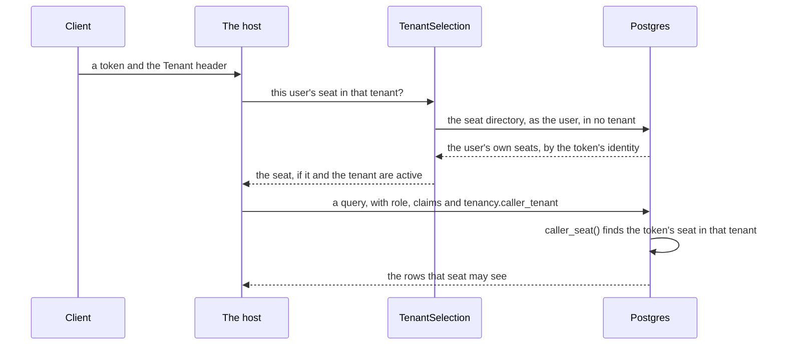

# Tenancy on Postgres: the second lock

How Tenancy's rules also run inside Postgres, as row level security (RLS), and how to set it up. You need it when
Tenancy is stored on Postgres; on any other database every check runs in C# alone. The words are in the
[overview](overview.md).

## What you get and what you do

The first lock is Tenancy's checks in C#: the check before a handler, the query filter and the save check
([Keeping tenants apart](keeping-tenants-apart.md)). The second lock is Postgres applying the same rules, as
[RLS](../row-level-security.md). `DDDToolkit.Supporting.Tenancy.Postgres` writes:

- **policies** on Tenancy's tables and on every table you keep to a tenant;
- **SQL functions** for Tenancy's questions, which the policies and your modules' rules ask;
- **triggers** for what no policy can see.

It stops your own queries that forget a condition; it is no boundary against SQL someone else runs on your
connection ([What the second lock stops](#what-the-second-lock-stops-and-what-it-does-not)).

What you do:

1. **Reference the package** from the infrastructure project that stores Tenancy: the project that runs the
   [export](../supabase.md) sees it and writes Tenancy's SQL into your migrations.
2. **Pass the context's `Database` to `AddTenancy`**, and add a migration
   ([The index on a tenant's root](#the-index-on-a-tenants-root)).
3. **Register it** next to RLS, and run the start-up checks.

   **The host's `Program.cs`**

   ```csharp
   services.AddSupabaseRowLevelSecurity();   // or AddPostgresRowLevelSecurity() on a Postgres of your own
   services.AddTenancyPostgres();
   services.RunStartupChecks();              // every registration's checks, before the host serves
   ```

4. **Mark your part of the catalogue**, the one you hand `TenancyOptions.Catalogue`
   ([The contribution](#the-contribution)). With [operators](operators-and-history.md#operators), mark their token
   roles `[TenancyOperators]` too.

   ```csharp
   public static class ShopCatalogue
   {
       [TenancyCatalogue]
       public static ApplicationCatalogue Application { get; } = new(Packs: [...]);
   }
   ```

5. **Map each module's read model to Tenancy's functions** with `AddTenancyReadFunctions`
   ([Modules read through functions](#modules-read-through-functions)).
6. **Build, apply the access files, start the host.** The [start-up checks](#the-start-up-checks) refuse a database
   that misses any of it.

With RLS registered, `UseDDDToolkit` runs your contexts as their caller, with Tenancy's save check.

## Setting it up

### The registration

`AddTenancyPostgres()` ([reference](reference/use-cases.md#addtenancypostgresiservicecollection)):

- carries the tenant to Postgres ([How the tenant reaches a policy](#how-the-tenant-reaches-a-policy));
- requires explicit callers: work that never said who it runs as fails, rather than run as the application past
  every policy ([Fail-closed callers](../row-level-security.md#fail-closed-callers));
- leaves [the rights](#the-rights) to the database (`TenancyStoreOptions.DatabaseKeepsRights`);
- turns the administrator trigger's refusal into `tenancy.last-admin`, and registers the
  [start-up checks](#the-start-up-checks).

### The contribution

The SQL is a [row access contribution](../row-level-security.md#policies-a-package-ships) the package declares, so
referencing the package writes it ([`TenancyRowAccessContribution`](reference/postgres.md#tenancyrowaccesscontribution)).

- **Written from your catalogue**, since which permissions manage access is yours to say, built as your registration
  builds it from the projects the exporting project references:
  - the static property or field of type `ApplicationCatalogue` you mark `[TenancyCatalogue]`; none marked:
    `new ApplicationCatalogue()`, as with `TenancyOptions.Catalogue` unset;
  - every module's permissions, from its `[Permissions]` classes
    ([A module states its permissions once](roles-and-permissions.md#a-module-states-its-permissions-once)).
- **Rewritten on change**: mark a permission, change a pack or containment, or add a permission while the
  administrators' pack lists none (it then holds them all), and the next build writes the access file again. That
  file is the migration.
- **Made by the build** in `DDDToolkit.RowAccessContributionsOfPackages.g.cs` of the exporting project. Two members
  marked `[TenancyCatalogue]`, or one of another type, is [DDD00071](../diagnostics.md#ddd00071); one a library keeps
  internal, which the export would not see, is [DDD00070](../diagnostics.md#ddd00070).
- **On a Postgres of your own**: pass `new TenancyRowAccessContribution(catalogue)` to `PostgresRowAccess.Scripts`
  in `RowAccessExport.Contributions`.
- **Left out** with `[assembly: LeaveOutRowAccessContribution(typeof(TenancyRowAccessContribution))]`: nothing is
  written, a table without RLS is open to every caller with privileges on it, and the start-up checks still expect
  what it writes.
- **Schema**: the default schema of the context that maps Tenancy's tables, always quoted: `"tenancy".caller_seat()`
  ([Schema names](../row-level-security.md#schema-names)).

### The start-up checks

`AddTenancyPostgres()` brings five [start-up checks](../startup-checks.md), run with the host's others before the
server binds its port. Each throws, naming what is wrong and the statement that puts it right.

| `TenancyPostgresChecks.` | Proves |
|---|---|
| `EnsureExplicitCallers` | the host still requires explicit callers |
| `EnsureSeatedTokenRolesAreSignedInUsers` | every token role Tenancy seats reaches the database as a signed-in user ([Which signed-in users hold seats](#which-signed-in-users-hold-seats)) |
| `EnsureSystemInRoleIsConfinedAsync` | the scoped system role cannot log in, bypass RLS or act as a table's owner, and no caller's role has its privileges; no mapped token role acts as a signed-in user or runs Tenancy's functions; `anon` and `PUBLIC` run no function that runs as its owner |
| `EnsureSystemReadsAcrossTenantsAsync` | the [reads across tenants](#the-scoped-system-role-grants-and-reads-across-tenants) answer, to the scoped system role alone |
| `EnsurePoliciesAreInPlaceAsync` | RLS, [the root index](#the-index-on-a-tenants-root), the functions and the rights trigger are as the contribution writes them from the catalogue the host runs with, containment included; `DatabaseKeepsRights` is on; each operator's token role has a database role of its own |

By hand: in this order, as the system caller, after the checks of the login role and the migrations
([`TenancyPostgresChecks`](reference/postgres.md#tenancypostgreschecks)).

### What Postgres refuses

Where the database sees what the use case could not check first, such as two requests racing for one slug, the
caller gets the use case's refusal for the same rule ([`TenancyRefusals`](reference/refusals.md#tenancyrefusals)):

| Refused by | The refusal |
|---|---|
| the unique index on a tenant's slug | `tenancy.slug-taken` |
| … on a seat's identity in a tenant | `tenancy.identity-has-seat` |
| … on a role's name in a tenant | `tenancy.role-name-taken` |
| … on a tenant's root | `tenancy.one-root` |
| … on a seat's primary placement | `tenancy.second-primary` |
| the trigger that keeps an administrator | `tenancy.last-admin` |

- The indexes name their refusal in the mapping, so they answer on SQLite and SQL Server too. Anything else is
  thrown as it was: a bug, not a refusal.
- The trigger checks at commit: in a transaction of your own, your commit gets the `PostgresException`, constraint
  `tenancy_administrator_remains`.

## The index on a tenant's root

Required on Postgres: the unique index that keeps a tenant's organization to one root. `AddTenancy` maps it when you
pass `Database`; `EnsurePoliciesAreInPlaceAsync` refuses a database without it.

```csharp
modelBuilder.AddTenancy(database: Database);   // maps the index; your migration makes it
```

- **Why**: a permission held at a unit without a parent is held for the whole tenant, so a second root would make
  whoever holds a permission there a holder for all of it. The policies keep seats from making one, but not Tenancy's
  system work, nor the tables' owner in a migration. The index holds every role.
- **What counts**: a valid unique index on the units' tenant alone, over the units without a parent, by any name.
  Not unique, a second column, a narrower condition, or invalid after a failed `CREATE INDEX CONCURRENTLY`: no.

| The model | The database | What to do |
|---|---|---|
| maps the index | has none | add a migration that makes it, and apply it |
| maps none (`AddTenancy` without `database`) | has none | pass `Database` to `AddTenancy`, add a migration, apply it |
| either | has it, not valid | see that no tenant has two roots, then `REINDEX INDEX` the one the failure names |
| maps none | has it | nothing: the check reads the database |

A tenant with two roots cannot get the index until one of them has a parent again.

## How the tenant reaches a policy

- One setting: `tenancy.caller_tenant` ([`TenantSetting`](reference/postgres.md#tenantsetting)), the Tenancy
  caller's tenant id, or empty. The interceptor sets it in the same statement as the role and the claims
  ([Settings of your own](../row-level-security.md#settings-of-your-own)).
- **A signed-in user**: the setting names the tenant, never the seat. `caller_seat()` finds the seat of the token's
  identity there, while seat and tenant are active, so a wrong tenant reaches no seat.
- **System work in a tenant** runs as the scoped system role, with that tenant in the setting.

One request, from token to rows: the host finds the seat, and Postgres finds it again from the token, so the setting
alone never makes anyone a seat.



**The host's `Program.cs`**, after authentication:

```csharp
app.Use(async (context, next) =>
{
    var caller = context.GetSupabaseCaller();
    using (Callers.Begin(caller))
    {
        // The selection without its id types: the middleware names no id
        var seat = await context.RequestServices.GetRequiredService<ITenantSelection>()
            .ResolveAsync(caller, context.Request.Headers["Tenant"], context.RequestAborted);
        using (TenancyCallers.Begin(seat))
        {
            await next(context);
        }
    }
});
```

```sql title="20261026210726_access.tenants.ddd.sql, caller_seat"
CREATE OR REPLACE FUNCTION "tenancy".caller_seat() RETURNS uuid
    LANGUAGE sql STABLE SECURITY DEFINER SET search_path = '' AS $function$
SELECT s."Id" FROM "tenancy"."Seats" s
JOIN "tenancy"."Tenants" t ON t."Id" = s."TenantId"
WHERE s."Identity" = (SELECT auth.uid())
  AND s."TenantId" = (SELECT "tenancy".system_tenant())
  AND s."Status" = 'Active' AND t."Status" = 'Active'
$function$;
```

### Looking at the rows as a user does

A tool that acts as a user, such as Supabase Studio's table editor, sets no tenant, so every table kept to a tenant
looks empty. Set it too, in a transaction you roll back:

```sql
begin;
select set_config('request.jwt.claims', '{"sub":"<the user''s id>","role":"authenticated"}', true),
       set_config('tenancy.caller_tenant', '<the tenant''s id>', true);
set local role authenticated;
select * from tenancy."OrganizationUnits"; -- what the policies let that user's seat read
rollback;
```

### Which signed-in users hold seats

- **Seated**: a token with the role `authenticated` (the default) or no role; add others to
  `options.TenantSelection.SeatedTokenRoles` ([`TenantSelectionOptions`](reference/callers.md#tenantselectionoptions)).
  A token role mapped to the signed-in user's database role is a signed-in user.
- **Any other [token role](../row-level-security.md#token-roles)** (a reporting job's, say) is nobody in every tenant:
  `tenancy.not-seated`, no seats in `SeatsOfAsync`. Its database role is closed out of Tenancy's tables and every
  table kept to a tenant, as `anon` is. An operator's token role reads every tenant's rows of Tenancy's, writes none
  ([Operators](operators-and-history.md#operators)).
- **Refused at start-up**: a seated token role that reaches the database as another role; a mapped role granted the
  signed-in user's role, or a function of Tenancy's, directly or through another role. The check names the `REVOKE`.

The access files give Tenancy's functions to signed-in users and the scoped system role alone, and take back every
other grant; one made by hand since stays until the next file, on the trigger functions for good. The check reads all
of Tenancy's schema, so keep what such a role runs elsewhere:

```sql
-- Next to the tables' privileges, and one line too many: the role may now ask what a seat asks
GRANT EXECUTE ON ALL FUNCTIONS IN SCHEMA tenancy TO analyst_role;
```

## Who reads what

Only Tenancy's own context reads Tenancy's tables; everything else asks a function. One that runs as its owner reads
past the policies, and answers ids, permissions and dates, never a name.

| Reader | Through |
|---|---|
| A seat, through Tenancy's use cases | the tables, under the [policies](#what-the-policies-check) |
| A use case, about other seats' rights | three owner-run functions ([Other seats' rights](#other-seats-rights)) |
| A module | six functions run as the caller ([Modules read through functions](#modules-read-through-functions)) |
| System work in a tenant | the tables: every row of its tenant |
| System work in no tenant | four owner-run functions ([Reads across tenants](#the-scoped-system-role-grants-and-reads-across-tenants)) |
| A policy on a stored file or a channel | five functions that [take the tenant](#where-the-connection-names-no-tenant) |
| An operator's role | the tables, every tenant, read only ([Operators](operators-and-history.md#operators)) |
| `anon` | nothing |

## Who reads the seats: a default you may replace

Who may see whom is your application's choice, so two reads are defaults: the seats, and who besides the seats
managers reads an invitation. Replace one with a read rule on your own class, written like any
[row access rule](../row-level-security.md#row-access-rules-written-in-c).

| Table | Default for a signed-in user | Replaced by a rule on | Stays, whatever your rule says |
|---|---|---|---|
| Seats | the tenant's seats, and the person's own in every tenant | your seat class | the person's own seats (the tenant picker and the history need them); every seat of the tenant to a seat that manages seats, grants or units anywhere, or roles for the whole tenant (the use cases and policies load them) |
| Invitations | those at a unit where the seat manages seats | your invitation class | the same, so your rule only adds readers |
| Tenants, Organizations, Roles, the rest | as [What the policies check](#what-the-policies-check) says | none: a read rule is refused | the tenant picker reads the tenants; Tenancy's questions read the roles as their caller; the rest are an organization's or a seat's rows, or Tenancy's own |

- The export writes a rule on your seat or invitation class that allows `Read` in place of the policy Tenancy marked
  a default ([Policies a package ships](../row-level-security.md#policies-a-package-ships)); without `To`, for the
  default's roles. It is held to the calling seat's tenant, and breaks no use case: the package's tests run every
  one under a rule that lets a member read itself alone.
- Refused when the policies are written: a rule on your seat class that allows anything but `Read`, or whose `To`
  names a role the default is not for. To narrow, write a [restrictive rule](#rules-that-narrow-the-organization).

| Your rule changes | It does not change |
|---|---|
| your queries, the directory's seats, `tenant_seats()` and `ITenancyQuestions.Seats()` | Tenancy's questions about the caller and rights (`caller_seat`, `seats_in_my_units`, `seats_holding_permission_at` …): they run as their owner |
| your own entities on the seat class | placements and grants: every member still reads every seat's id and units; your rule hides the row (identity, your fields), not that the seat is there |
| admission that asks there: [Membership](../membership.md) refuses a seat outside your rule with `member-not-active`, as one that does not exist, and so does a module's rule on `tenant_seats()` | writes, which stay Tenancy's (a [column rule](#what-the-database-guards-on-a-seat) still holds your fields); system work and operators |

<details>
<summary>Show the code: two read rules, their building blocks, and the policy the export writes</summary>

A member reads the people placed where it is placed, or below:

```csharp
[RowAccess<Seat>(RowOperations.Read)]
public static partial class MembersReadThePeopleOfTheirUnits
{
    public static bool Allows(Seat seat, Caller caller) => TenancyRowAccess.SeatsInMyUnits<SeatId>().Contains(seat.Id);
}
```

A seat that gives roles at an invitation's unit reads it too:

```csharp
[RowAccess<Invitation>(RowOperations.Read)]
public static partial class GrantsManagersReadTheInvitationsAtTheirUnits
{
    public static bool Allows(Invitation invitation, Caller caller)
        => TenancyRowAccess.UnitsWhereIHold<OrganizationUnitId>(TenancyPermissions.GrantsManage).Contains(invitation.UnitId);
}
```

The building blocks are [`TenancyRowAccess`](reference/questions.md#tenancyrowaccess)'s questions, each asked once
per statement, and your class's columns:

| You mean | Your rule says |
|---|---|
| in the caller's tenant | `seat.TenantId == TenancyRowAccess.CallerTenant<TenantId>()` |
| the caller itself | `seat.Id == TenancyRowAccess.CallerSeatId<SeatId>()` |
| a field of the caller's own seat | `TenancyRowAccess.CallerSeat<Seat>().Kind == SeatKind.Employee` |
| the people on the projects the caller is on | `PeopleOnMyProjects.Ids().Contains(seat.Id)` ([below](#rules-that-narrow-the-organization)) |
| the person's own seats, in every tenant | `seat.Identity == caller.UserId` |
| the seats placed at or below the caller's units (every placed seat, to a seat at the root) | `TenancyRowAccess.SeatsInMyUnits<SeatId>().Contains(seat.Id)` |
| where the caller holds a permission | `TenancyRowAccess.UnitsWhereIHold<OrganizationUnitId>(permission).Contains(invitation.UnitId)` |
| a permission held anywhere, or for the whole tenant | `TenancyRowAccess.HoldsPermission(permission)`, `TenancyRowAccess.HoldsAtTenant(permission)` |

The export ORs your rule, held to the tenant, with what Tenancy keeps, shortened:

```sql title="*_access.tenants.ddd.sql, the seats' read policy with MembersReadThePeopleOfTheirUnits, shortened"
CREATE POLICY "Seats (select) for authenticated" ON "tenancy"."Seats" FOR SELECT TO authenticated
    USING (("Identity" = (SELECT auth.uid()) OR ( ... /* the seats, grants, units or roles managers */ ))
           OR (("TenantId" = (SELECT "tenancy".caller_tenant())) AND ("Id" = ANY (ARRAY(SELECT "tenancy".seats_in_my_units())))));
```

</details>

The [sample](the-sample.md#who-may-do-what-in-the-sample) keeps both defaults. An application that shows members
only their own part of the tree writes the first rule above, and pins it with a test that reads the seats as a
member, as the package's `ReadRulesTests` do.

## Rules that narrow the organization

A rule that allows only adds. To take away, set `Restrictive = true` on a rule about your organization, seat or role
class: its policy is AND-ed with Tenancy's ([Rules that only narrow](../row-level-security.md#rules-that-only-narrow-restrictive)),
so a row passes only where both allow it.

Say a tenant has employees and external people, who work on one project and have no business in the rest of the
organization. A field of yours on the seat says which; a restrictive rule lets only employees read the organization:

| A signed-in user | Tenancy's policy | Your rule | Reads the units |
|---|---|---|---|
| an employee of the tenant | yes | yes | yes |
| an external seat of the tenant | yes | no | no |
| a seat of another tenant | no | yes | no |

```csharp
public enum SeatKind { Employee, External }

[SeatAggregate<SeatId>]
public sealed partial class Seat
{
    public SeatKind Kind { get; private set; }

    public void MarkExternal() => Kind = SeatKind.External;
}

[RowAccess<Organization>(RowOperations.Read, Restrictive = true)]
public static partial class OnlyEmployeesReadTheOrganization
{
    public static bool Allows(Organization organization, Caller caller)
        => TenancyRowAccess.CallerSeat<Seat>().Kind == SeatKind.Employee;
}
```

```sql title="*_access.tenants.ddd.sql, OnlyEmployeesReadTheOrganization, shortened"
CREATE POLICY "Only employees read the organization (select) for authenticated" ON "tenancy"."Organizations" AS RESTRICTIVE FOR SELECT TO authenticated
    USING ((SELECT q1."Kind" FROM "tenancy".caller_seat_row() q1) = 0);
-- and the same on "tenancy"."OrganizationUnits" and on "tenancy"."OrganizationUnitPaths"
```

- **Where it goes**: on your organization class it reaches the organization, its units and its tree; on your seat
  class, the seats with their placements and grants; on your role class, the roles. On a tenant or an invitation:
  [DDD00100](../diagnostics.md#ddd00100). Without `Restrictive`, a rule on the organization or role class is refused:
  it would change nothing.
- **It narrows Tenancy's own reads too.** On the seats, keep the person's own in the rule,
  `seat.Identity == caller.UserId || ...`: the tenant picker and the request's seat are found from them.
- **A field of the caller's own seat**: `CallerSeat<Seat>()` reads `caller_seat_row()`, which runs as its owner, past
  your read rule. No seat: every field is null, and nothing passes. Another class than your seat class:
  [DDD00101](../diagnostics.md#ddd00101). The id alone, in a module that does not map the seats: `CallerSeatId`.
- **Tenancy's work keeps working**: system work is not narrowed, owner-run functions read past every policy; the
  package's tests run every use case under the rule above.
- **A seat kept out still reads** the name, path and depth of its own and asked-for units (`units_named()`, for
  `UnitsByIdAsync` and `WhoAmIAsync`), so an external seat names its project's unit, and every tenant's name in the
  tenant picker (`identity_tenant_names()`); `ListUnitsAsync` answers it none.

Add a [read rule on your seat class](#who-reads-the-seats-a-default-you-may-replace), and an external seat reads only
the people on its projects, a contract the projects' module publishes from its
[Membership](../membership.md#on-postgres-the-second-lock) members:

```csharp
// Projects.Contracts: the people on the projects the caller is on, by the seats they are
[ResourceAccessContract<ProjectId>(ResourceAccessSet.FellowMembers)]
public static partial class PeopleOnMyProjects
{
    public static partial AccessSet<SeatId> Ids();
}

// Tenants.Infrastructure: a read rule on the seats, in the default's place
[RowAccess<Seat>(RowOperations.Read)]
public static partial class EmployeesReadEveryoneExternalsTheirProjects
{
    public static bool Allows(Seat seat, Caller caller)
        => TenancyRowAccess.CallerSeat<Seat>().Kind == SeatKind.Employee || PeopleOnMyProjects.Ids().Contains(seat.Id);
}
```

Tenancy's file runs before the projects' functions it is asked about; the export writes the rule through a function
of Tenancy's that asks the projects' one at run time
([A rule that asks a module that asks back](../row-level-security.md#a-resources-access-asked-by-its-id)).

## The functions

The SQL functions the policies and your rules ask:

- written with your table names and id column types; `LANGUAGE sql`, empty `search_path`;
- run by signed-in users and the scoped system role, never `anon`, unless the table says otherwise;
- **live** means a period that holds by the database's `now()`. A grant's start is stamped by the application's
  clock, so keep the clocks in step: while the database's runs behind, a new grant is not live to the policies yet;
- answering for a seat: system work in a tenant has none and is answered nothing; the policies keep it to its tenant
  with `system_tenant()`.

| Function | Answers | Runs as | Used by |
|---|---|---|---|
| `caller_seat()` | the seat of the caller's identity in the tenant the setting names, while both are active; else null | owner | the seat `TenantSelection` picks; `CallerSeatId` |
| `caller_tenant()` | that seat's tenant; else null | owner | `CallerTenant` |
| `caller_seat_row()` | that seat's row, every column your seat class maps; no row without a seat | owner | `CallerSeat<Seat>()` |
| `system_tenant()` | the tenant the setting names: the scoped system role's, and the one a signed-in user's access revision and [access history](operators-and-history.md#access-history) are written in | caller | `TenancyWork.BeginSystemIn` |
| `units_where_i_hold_permission(permission)` | the units where the seat holds the permission live, and every unit below | owner | `UnitsWhereIHold` |
| `readable_units()` | the units where the seat is placed, and every unit below | owner | `ReadableUnits` |
| `seats_in_my_units()` | the seats placed at one of those units, whatever their status | owner | `SeatsInMyUnits` |
| `roles_with_permission(permission)` | the active roles of the seat's tenant that hold the permission | owner | `RolesWithPermission` |
| `holds_permission(permission)` | whether the seat holds the permission live at any unit | owner | `HoldsPermission` |
| `holds_at_tenant(permission)` | whether it holds it live at the root | owner | `HoldsAtTenant`, `HoldsAtTenantAsync` |
| `identity_tenants()` | every tenant where the caller's identity has a seat, of any status | owner | the seat directory |
| `identity_tenant_names()` | those tenants' ids, slugs and organization names; signed-in users only | owner | the tenant picker, a seat's overview |
| `unit_parent(unit)` | a unit's parent as it was before the statement | owner | the units' policies |
| `units_named(ids)` | the seat's tenant's units among the ids: name, path from the root, depth; signed-in users only | owner | `TenancyDirectory.UnitsByIdAsync` |
| `permission_manages_access(permission)` | whether your catalogue marks the permission as managing access | caller | `TenancyCatalogue.ManagesAccess` |
| `permission_is_contained(permission)` | whether a seat hands it on only where it holds it: managing access, with [containment](roles-and-permissions.md#containment-on-or-off) on | caller | `ContainAccessManagingPermissions` |
| `pack_permissions(pack)` | the permissions a copy of that starter role holds, implied ones included; null for an unknown pack | caller | `TenancyCatalogue.Packs` |
| `permission_is_live(permission)` | whether your catalogue has the permission live; run by no caller | caller | the owner-run functions, the rights trigger |

The other functions are listed with their readers in [Who reads what](#who-reads-what).

A module's rule asks them through [`TenancyRowAccess`](reference/questions.md#tenancyrowaccess), in
`DDDToolkit.Supporting.Tenancy`, so it needs no reference to the Postgres package. Since `anon` may not run them,
such a rule is for signed-in users:

```csharp
[RowAccess<Project>(RowOperations.Read, To = [RowAccessRoles.User])]
public static partial class ProjectsAreReadWhereThePermissionIsHeld
{
    public static bool Allows(Project project, Caller caller)
        => TenancyRowAccess.UnitsWhereIHold<OrganizationUnitId>(ProjectPermissionNames.Read).Contains(project.UnitId);
}
```

In SQL: `"UnitId" = ANY (ARRAY(SELECT "tenancy".units_where_i_hold_permission('projects.read')))`. `EXPLAIN` shows
an init plan, asked once per statement, compared by an index where the table is large enough; a row never calls the
function ([set-shaped questions](../row-level-security.md#set-shaped-questions)).

## Modules read through functions

On Postgres a module reads no table of Tenancy's. Its context maps the read model to six functions with
[`AddTenancyReadFunctions`](reference/use-cases.md#addtenancyreadfunctionsmodelbuilder-string); on another database,
`AddTenancyReadModel` maps views over the tables.

```csharp
// A module's context: its own tables, and Tenancy's read model as Tenancy's functions
protected override void OnModelCreating(ModelBuilder modelBuilder)
{
    modelBuilder.HasDefaultSchema("projects");
    modelBuilder.AddTenancyReadFunctions<TenantId, SeatId, OrganizationUnitId, RoleId>("tenancy");
    modelBuilder.Entity<Project>().ScopeToTenant(project => project.TenantId);
}

// A read: the question is a subquery of the read's own statement, over the context that runs it
public async Task<List<string>> VisibleProjectsAsync(CancellationToken cancellationToken)
{
    await using var db = await contexts.CreateDbContextAsync(cancellationToken);   // IDbContextFactory<ProjectsContext>
    var held = answers.Over(db).UnitsWhereIHold(ProjectPermissionNames.Read);
    return await db.Projects.Where(project => held.Contains(project.UnitId)).Select(project => project.Name).ToListAsync(cancellationToken);
}
```

| Function | Answers | Its columns |
|---|---|---|
| `caller_permissions()` | the rights the caller may read: a seat's own; for system work in a tenant, that tenant's | `"TenantId"`, `"SeatId"`, `"UnitId"`, `"RoleId"`, `"Permission"`, `"StartsAt"`, `"EndsAt"` |
| `tenant_unit_paths()` | the closure of the tenant's tree | `"TenantId"`, `"AncestorId"`, `"DescendantId"`, `"Distance"` |
| `tenant_units()` | the tenant's units | `"Id"`, `"TenantId"`, `"ParentId"`, `"Status"` |
| `tenant_roles_with_permissions()` | the tenant's roles, permissions as an array of text | `"Id"`, `"TenantId"`, `"FromPack"`, `"Status"`, `"Permissions"` |
| `tenant_placements()` | where the tenant's seats are placed | `"SeatId"`, `"UnitId"`, `"IsPrimary"`, `"TenantId"` |
| `tenant_seats()` | the seats the caller reads: every seat, or those a [read rule of yours](#who-reads-the-seats-a-default-you-may-replace) lets through | `"Id"`, `"TenantId"`, `"Status"` |

- **They run as their caller** (no `SECURITY DEFINER`, no condition of their own), so the
  [policies](#what-the-policies-check) decide their rows; signed-in users and the scoped system role, never `anon`.
  Postgres folds them into the query that asks, planned over Tenancy's tables and indexes, as through a view.
- **Only these columns**, those of the [read model's rows](who-may-do-what.md#what-a-module-reads-of-tenancy): no
  name, no identity, no field you add; a status as its enum member's name, however you name and store Tenancy's
  tables ([Your own naming](#your-own-naming)).
- **Checked at start-up**: `EnsurePoliciesAreInPlaceAsync` names a function whose columns differ from the read
  model's. Postgres replaces no function by one with other columns: drop those, then apply the access files.
- **The views are refused** under `AddTenancyPostgres()`, naming `AddTenancyReadFunctions`: a module would depend on
  what the policies happen to show it.
- **One model per context type**: a context on SQLite in one host and Postgres in another chooses in
  `OnModelCreating`, as in [Who may do what](who-may-do-what.md), for every instance, pooled ones included.
- **Reads side by side**, as GraphQL resolvers run: one context per read, from a factory or a pool, asked over as
  above; saves through their own context, checked as their caller ([Keeping tenants apart](keeping-tenants-apart.md)).

## Where the connection names no tenant

A file store or channel service with policies of its own, as Supabase's Storage and Realtime have, sets no
`tenancy.caller_tenant`. Five questions take the tenant as an argument instead, owner-run, for signed-in users only:

| Function | Answers | Used by |
|---|---|---|
| `seat_in_tenant(tenant)` | the caller's seat in that tenant, while it and the tenant are active; else null | `SeatInTenant` |
| `seated_in_tenant(tenant)` | whether there is such a seat | `SeatedInTenant` |
| `holds_permission_in_tenant(tenant, permission)` | whether that seat holds the permission live at any unit | `HoldsPermissionInTenant` |
| `units_where_i_hold_permission_in_tenant(tenant, permission)` | the units where it holds it live, and every unit below | `UnitsWhereIHoldInTenant` |
| `roles_with_permission_in_tenant(tenant, permission)` | that tenant's active roles that hold the permission | `RolesWithPermissionInTenant` |

Each answers for the caller's own seat there, so naming a tenant tells nothing of it: no seat, a suspended seat or a
suspended or closed tenant is answered nothing, roles included.

**In a policy of yours**, on files kept as `tenant/unit/name`; a reader with seats in two tenants reads both in one
statement:

```sql
CREATE POLICY "Read where the permission is held in the tenant of the path" ON files FOR SELECT TO authenticated
    USING (split_part(path, '/', 2)::uuid = ANY (ARRAY(
        SELECT tenancy.units_where_i_hold_permission_in_tenant(split_part(path, '/', 1)::bigint, 'projects.read'))));
```

A cast raises on a path of another shape, and an error in a policy fails the statement for every reader: keep such
files in a table or bucket of their own, or test the shape in a `CASE` first.

**In a module's rule**, a scalar question may take the tenant from the row; a set-shaped one, worked out once per
statement, may not ([DDD00051](../diagnostics.md#ddd00051)), so its tenant is a parameter of the module's own
[access function](../row-level-security.md#asking-the-aggregates-entities-access-functions):

```csharp
// For the files of a project, kept as tenant/project/name
[AccessFunction<Project>("projects.readable_in_tenant")]
public static partial class ProjectIsReadableInTenant
{
    public static bool Allows(Project project, Caller caller, TenantId tenant)
        => project.TenantId == tenant
           && TenancyRowAccess.UnitsWhereIHoldInTenant<OrganizationUnitId, TenantId>(tenant, ProjectPermissionNames.Read).Contains(project.UnitId);
}
```

That is `projects.readable_in_tenant(project, tenant)`, granted only to the roles whose rules ask it: a policy
written by hand asks Tenancy's functions, unless a rule of the module asks the access function too.

## What the policies check

Every command stays in the caller's tenant. Beyond that, a signed-in user reads what members read through the use
cases, and writes where the use case asks the permission:

| Table | Reads | Writes |
|---|---|---|
| Tenants, Organizations | the tenant; the tenants where the person has a seat | the tenant with `tenancy.settings.manage` for the whole tenant, never its status; the organization with that, or `tenancy.units.manage` held |
| OrganizationUnits | the tenant's | `tenancy.units.manage` at the parent to add; at the unit or its parent to rename or move, and at the new parent; a unit with a parent never loses it |
| OrganizationUnitPaths | the tenant's | with `tenancy.units.manage` held; a trigger checks the rest |
| Seats | the tenant's, and the person's own anywhere: a [default](#who-reads-the-seats-a-default-you-may-replace) | added with `tenancy.seats.manage` for the whole tenant; changed as [What the database guards on a seat](#what-the-database-guards-on-a-seat) says |
| SeatPlacements | the tenant's | placed with `tenancy.seats.manage` at the unit; withdrawn with it there, or by the seat itself, once it holds no grant; made primary only where it is held at the unit, since that demotes the old one |
| SeatRoleGrants | the seat's own; others' as [Who reads which grants](#who-reads-which-grants) says | with `tenancy.grants.manage` at the grant's unit, an active role of the tenant, in the caller's own name; taken away there, or by the seat itself |
| SeatRights | the seat's own | by no caller: the database writes them |
| Roles | the tenant's | with `tenancy.roles.manage` for the whole tenant; a copy of a starter role, also with `tenancy.settings.manage` |
| TenancyAccessRevisions | the tenant's, to a person with a seat there of any status | by the same person: every change of access takes it |
| The access history, where mapped | the tenant's, with `tenancy.history.view` for the whole tenant | added about the person's own seat; changed and removed by nobody ([Access history](operators-and-history.md#access-history)) |
| Invitations, where mapped | with `tenancy.seats.manage` at its unit, or as your read rule adds; their tokens' digests by nobody | by a seat that could add the seat and make the grant itself; changed only to cancelled ([Invitations](invitations.md)) |

- **No signed-in user deletes** a tenant, an organization, a unit, a seat or a role; Tenancy's system work may.
- **A seat takes away its own grants and placements** without the permissions the use cases ask: that never gives
  access, and the same save removes its permissions before the rows that need them.

### Roles that manage access

- `permission_manages_access` is written from your catalogue: Tenancy's five such permissions and the ones you mark.
- With [containment](roles-and-permissions.md#containment-on-or-off) on (`permission_is_contained`), a grant of a
  role that holds one is given, changed and taken away only by a seat that holds each such permission at the grant's
  unit, and never given to itself. Off, every grant takes `tenancy.grants.manage` at its unit alone.
- A placement goes only once its grants are gone: the database would take them with it.
- Every change of a role, its permissions and archiving included, takes `tenancy.roles.manage` for the whole tenant.
- A copy of a starter role names its pack, holds exactly what `pack_permissions` says, and remembers that for the
  next [sync of the packs](roles-and-permissions.md#packs-after-provisioning). A settings manager adds only such
  copies; a role manager also adds a role made by hand, naming no pack.

### The rights

- A trigger on the grants, the seats and the roles writes the rights each change reaches, in the same statement,
  whoever wrote the row: one per live permission of an active role granted to an active seat, only the rows that
  differ. No policy lets any caller write one.
- Two transactions that write past the use cases at once do not see each other's rows. The use cases never get
  there: each command of a tenant waits for the one before.
- `rewrite_tenant_rights()`, for Tenancy's system work in a tenant, writes its rights again from the grants after rows
  were written past the trigger, and answers how many rows it wrote.

### Other seats' rights

Three functions answer what a seat may learn of other seats' rights, as ids, permissions and dates. They run as their
owner, for signed-in users only, and answer nothing to a seat outside the last column:

| Function | Answers | To |
|---|---|---|
| `tenant_administrators()` | the seats that administer the tenant, each with the role that makes it one | a seat that may read the grants at the root |
| `permissions_a_move_changes(parent, new_parent)` | the rights a move between the two parents changes: the caller's own, and anyone's access-managing right that reaches one parent and not the other | a seat with `tenancy.units.manage` at both |
| `seats_holding_permission_at(permission, unit)` | the active seats that hold the permission live at the unit or above | each holder whose grant there the caller may read |

- The store asks the first two, for the last administrator and for a move; `ITenancyQuestions.SeatsHoldingPermissionAt`
  asks the third, inside a query of yours.
- A move is checked by the application's clock and answered by the database's: a grant of the mover's that starts or
  ends in between makes it a `ConcurrencyConflictException`, to read again.

### System work and your own tables

- **System work** reads its tenant's rows in any scope, rights included; it writes Tenancy's tables only in Tenancy's
  scope, `"tenancy"`, and rights never. **Anonymous callers** read and write nothing.
- **Your tables kept to a tenant** (`ScopeToTenant` in any context, with the aggregate's entities' tables) get RLS and
  restrictive policies no permissive one widens:
  - a signed-in user stays in the calling seat's tenant, system work in its own; `anon` and a
    [mapped token role](#which-signed-in-users-hold-seats) get nothing; an operator's reads what your rule admits;
  - so your rules never repeat the tenant, and a table with no rule for signed-in users is closed to them;
  - a rule for a role of your own, by its database name, is not kept to a tenant: write the tenant into it.
- **Your entities on Tenancy's classes** (a note on a tenant) follow their row. These and Tenancy's tables take no
  other policy, except a read rule on your seat or invitation class; a
  [column rule](../row-level-security.md#column-rules) adds none, so it may hold a column you added.

### The triggers

Seven more triggers check, for every role, the tables' owner included. A use case trips the first only in a race,
the sixth only when the caller loses a permission between check and save, never the others.

| Trigger | Holds | When |
|---|---|---|
| 1. An administrator remains | an active or suspended tenant keeps an active seat with `tenancy.roles.manage` at the root, no end, through an active role; a closed one needs none | at commit, one transaction of a tenant at a time (at read committed, the default), so two that each remove one cannot both commit |
| 2. Rights backed by grants | every right comes from a grant of an active role that holds the permission, for the grant's period | at commit |
| 3. Paths follow the tree | a unit's paths are exactly the units above it and itself, in its tenant | at commit |
| 4. Rows keep what they are about | a placement its seat, unit and tenant; a grant its seat, unit, role and giver; a role its pack; a change would skip its policy's checks on a new row | as the row changes |
| 5. A seat's identity is fixed | id, identity and tenant change only by Tenancy's system work in the seat's tenant | as the row changes |
| 6. A seat's status is managed | changed only by a seat with `tenancy.seats.manage` for the whole tenant and, with containment on, each access-managing permission of every unended grant's role at its unit (its own grants count), since the rights follow the status | as the row changes |
| 7. A role follows its pack | what a role's pack gave it no seat changes, or a sync could add what the pack never gave | as the row changes |

Triggers 6 and 7 hold seats only: system work and the tables' owner pass, so a migration may fill the column.

- The first four hold what may never be, and raise `check_violation`: a use case that trips one has a bug, except
  the last administrator, which the store answers `tenancy.last-admin`.
- The last three are access guards: `42501` with the toolkit's hint, as a policy refuses.

### A refused save

A save a policy or an access guard denies is `access.refused`, "not permitted":

- an insert or update whose new row a policy refuses;
- a status the caller lost a permission for between check and save;
- a seat's identity changed behind the aggregate's back;
- an update or delete of a row a policy hides. That changes no row, as a lost race does, so the row is read again
  first; a row somebody else changed stays a concurrency conflict
  ([When the database refuses](../row-level-security.md#when-the-database-refuses)).

Before it is logged, the request's access check is asked again
([When the policies refuse what C# allowed](../row-level-security.md#when-the-policies-refuse-what-c-allowed)): a
request that requires `AtTenant` or `AtUnit` is then refused there too, logged as information; what a use case checks
past its request's declaration (behind `InTenant()`) stays a warning.

## What the database guards on a seat

A policy is asked of a row, never a column: the row policy decides who may change a seat, and each column has its
own guard:

| Column | Who changes it | Held by |
|---|---|---|
| id, identity, tenant | Tenancy's system work in the seat's tenant alone, which its policies keep to that tenant: no seat, not `Caller.System`, not the tables' owner in a migration or the SQL editor | trigger 5; where the export [writes the privileges](../row-level-security.md#privileges-from-the-policies), the key columns and the tenant are not updatable at all |
| status | a seat with `tenancy.seats.manage` for the whole tenant and the access-managing permissions of the seat's grants | trigger 6 |
| version | whoever may change the row | the row's policy |
| your columns | whoever may change the row, unless your column rule says more | your [column rule](../row-level-security.md#column-rules) |

- **The row** is changed by the seat itself, and by a seat that manages seats or grants **anywhere** in the tenant,
  since every save of a seat writes its version. Anywhere, on purpose: the seats permission places any seat at the
  caller's unit, and held to the seat's units the policy would decide for you which of your fields a grants manager
  writes. The cost: a grants manager may bump any seat's version.
- **The identity** links the seat to a person's account: another would hand the seat and its permissions to that
  account; another tenant or id would strand its placements, grants and rights. Use cases write them only in the
  insert. To link a seat to another sign-in provider's identity, run a one-off as Tenancy's system work (below).
- **Your columns**: where your command asks more, add a column rule. It adds no policy, so a table Tenancy keeps
  takes it; it holds callers' statements, not your own work in a tenant, and a change, not a read: a field to show
  to fewer people than the row belongs in a table of yours.
- **An entity your seat class holds** is no column: its table follows the seat's row, and no column rule holds it
  ([DDD00038](../diagnostics.md#ddd00038)). Narrower data goes in a table of yours, or behind a trigger in a
  [contribution](../row-level-security.md#policies-a-package-ships) of yours that refuses with the toolkit's hint, as
  the sample's `UnitChangesWithItsPermissions` does.

<details>
<summary>Show the code: the sample's column rule, the identity trigger, and a one-off that relinks a seat</summary>

The sample's `RenameSeat` lets a seat rename itself, or another seat with `tenancy.seats.manage` for the whole
tenant; its column rule says the same to the database. The job title has no rule.

**Examples.Tenancy.Tenants.Infrastructure/Access/NameChangesByTheSeatOrWithTheSeatsPermission.cs**

```csharp
[RowAccess<Seat>(RowOperations.Change, To = [RowAccessRoles.User], Columns = [nameof(Seat.DisplayName)])]
public static partial class NameChangesByTheSeatOrWithTheSeatsPermission
{
    public static bool Allows(Seat seat, Caller caller)
        => seat.Id == TenancyRowAccess.CallerSeatId<SeatId>() || TenancyRowAccess.HoldsAtTenant(RenameSeat.RequiredPermission);
}
```

```sql title="20261026210726_access.tenants.ddd.sql, seat_identity_is_fixed, shortened"
CREATE OR REPLACE FUNCTION "tenancy".seat_identity_is_fixed() RETURNS trigger
    LANGUAGE plpgsql SET search_path = '' AS $body$      -- as its caller: it asks the statement's role
BEGIN
    IF CURRENT_USER IS DISTINCT FROM 'ddd_system_in' THEN
        RAISE EXCEPTION USING ERRCODE = 'insufficient_privilege', CONSTRAINT = 'tenancy_seat_identity_is_fixed', HINT = 'ddd:access.refused', ...;
    END IF;
    RETURN NEW;
END
$body$;
CREATE TRIGGER tenancy_seat_identity_is_fixed BEFORE UPDATE OF "Id", "TenantId", "Identity" ON "tenancy"."Seats" ...
```

A one-off that links a seat to another identity:

```csharp
using (TenancyUseCases.BeginSystemIn(tenant))
{
    await context.Set<Seat>()
        .Where(seat => seat.Id == seatId)
        .ExecuteUpdateAsync(set => set.SetProperty(seat => seat.Identity, newIdentity), cancellationToken);
}
```

</details>

In the sample's harbor (`SampleOnPostgresTests`) hana and rhea may write leo's row but not his name, which leo and
maud may change; nobody, ada included, links his seat to another account.

## Who reads which grants

Three permissions read other seats' grants where they act, at their unit and below: `tenancy.grants.manage`,
`tenancy.seats.manage` and `tenancy.units.manage`. `tenancy.roles.manage` held for the whole tenant reads them all,
since a change of a role reaches every seat that holds it.

| The calling seat holds | It reads | In the sample's harbor |
|---|---|---|
| none of these (`tenancy.settings.manage` and your access-managing permissions read no more) | its own grants | leo, juno and vic |
| one of the three at a unit | its own, and every grant at that unit and below | rhea, Area manager at North: North, North Coast, North Inland; not the root or South Bay |
| one of the three at the root | every grant of the tenant | hana, People office |
| `tenancy.roles.manage` for the whole tenant | every grant of the tenant | ada and maud, Access admins |
| `tenancy.roles.manage` below the root | its own: there it changes no role | |

**The use cases need nothing more.**

- The store loads a seat with the grants its caller may read, and every command acts on those: one at a unit asks
  its permission there; a status change, which reaches every grant, asks `tenancy.seats.manage` for the whole tenant.
  `SeatOverviewAsync` reads through this policy too ([Another seat's overview](names-and-languages.md#another-seats-overview)).
- The seats permission reads grants because withdrawing a placement takes its grants with it: the use case then asks
  for `tenancy.grants.manage` too, and the placements' policy keeps a placement that has any.

**The functions keep to the same line.**

- `tenant_administrators()` and `seats_holding_permission_at` answer a right only where the caller may read its
  grant: rhea is answered no administrator, and of `projects.view` at North Coast learns only holders at North and
  below. Every command that could take an administrator away asks a permission at the root, so it reads them all.
- Only `permissions_a_move_changes` answers past this line, as a unit, a permission and an end, never whose: a move
  is weighed by what it changes wherever that is held.

## What stays in C#

The policies check each permission where its use case asks it; the use cases alone decide the rest. Those marked
*containment* go when you turn [containment](roles-and-permissions.md#containment-on-or-off) off.

- *containment*: how long a grant of an access-managing role may run, against the giver's own hold;
- a seat's grant to itself, against its own `tenancy.grants.manage`;
- *containment*: that changing an access-managing role takes an administrator with no end (the policy asks
  `tenancy.roles.manage` at the root, for any period);
- *containment*: how long the caller holds each access-managing permission, against the end of each grant of a seat
  it suspends, deactivates or reactivates (the trigger asks only now);
- what a move gives the mover, and, *containment*, the access-managing permissions it gives or takes from anyone;
- the units permission at a moving unit's old parent (the policy asks it at the unit);
- a change of state a policy cannot tell from another change of the row, such as archiving a unit;
- what a seat needs to take away its own grants and placements, and which packs a tenant's shape asks for.

**Your columns** are neither: hold them with your command's rule in C#, and a column rule in the database
([What the database guards on a seat](#what-the-database-guards-on-a-seat)).

**A retired permission** stops answering in C# at once, and in SQL once the access file that rewrites
`permission_is_live` is applied: no new right, and no question answers for it, those that
[take the tenant](#where-the-connection-names-no-tenant) included. Its written rights and its place in a role's list
stay as rows until a seat, grant or role changes, or `rewrite_tenant_rights()` runs.

**A module's own rule can be coarser still.** Each of the sample's Projects commands asks its own permission in C#
(`projects.edit`, `projects.close`, `projects.crew.manage`, `projects.owner.change`, `projects.open` at the unit). A
row knows no command, so `SeatsChangeTheProjectsTheyWorkOn` lets a seat write a project with any of them, at the
project's unit or, for the three a crew gives, on its crew.

Who reaches a project is held closer: the unit by a trigger of the module's own, the owner and the crew by the lock
Membership writes, the name, plan and state by column rules
([the sample's design choices](the-sample.md#design-choices-and-where-to-see-them)).

So a statement that goes round the application, as a seat with one of those permissions on a project, can still:

- bump the row's version and who changed it last, even with `projects.open` alone, which in C# changes no project;
- with `projects.crew.manage` or `projects.owner.change`, write the crew without the commands' rules: a seat twice,
  or an archived project role, which gives nothing;
- leave an owner on the crew without a role.

It never crosses a tenant, touches Tenancy, or changes the owner, the crew, the unit or a guarded column without its
command's permission, nor a project's number or who wrote it first.

## What the second lock stops, and what it does not

- **It stops your own queries that forget a condition.** A query as a seat with `IgnoreQueryFilters()`, `FromSql`,
  `ExecuteUpdate` or a filter left out sees and changes only that seat's tenant, and cannot:
  - give or take away a role at a unit the seat does not manage, or move a placement or a grant;
  - widen a subtree through the closure, or make its unit a root;
  - read another seat's rights, or write a right;
  - change a seat's id, identity or tenant;
  - give a suspended seat its grants back, or take another's away by its status;
  - close its tenant, or remove the last administrator.
- **It does not stop SQL an attacker controls on your connection.** Postgres checks `SET ROLE` against the login
  role, so such a statement can switch to any role the login role belongs to, the scoped system role included, and
  set the claims and the tenant. Parameterized queries, which Entity Framework sends, are the defense. How far it
  gets depends on the login role:
  - **the tables' owner**, as a host that migrates its own database: the owner, which no policy holds, can disable
    the triggers. Everything is escaped;
  - **a role that owns nothing**, with the tables forcing RLS on their owner and privileges written from the policies
    ([A login that owns nothing](../row-level-security.md#a-login-that-owns-nothing),
    [Forcing row level security](../row-level-security.md#forcing-row-level-security)): only the callers' roles are
    left, so the statement is held to the policies of whichever seat it names. Tenancy works on such a login
    unchanged; the [sample](the-sample.md#who-may-do-what-in-the-sample) runs on Postgres no other way.
- **It does not check [what stays in C#](#what-stays-in-c).** Your module schemas are not served through Supabase's
  Data API: the application is the first lock, and the boundary.

## The scoped system role, grants, and reads across tenants

**The scoped system role**, `ddd_system_in` unless you configure another, runs system work in a tenant. It cannot
log in or bypass RLS, so its policies keep it there ([The scoped system role](../row-level-security.md#the-scoped-system-role)).
Its claims carry its scope: `TenancyWork.BeginSystemIn` takes `"tenancy"` unless you pass another; a module's own
work passes the module's name, so it reads Tenancy's rows and writes none.

**Privileges** come before any policy lets a role near a row:

- The Supabase build writes them, unless the project sets `SupabaseRowAccessGrants` to `None`; a script of your own
  uses `RowAccessExport.WriteGrants`. Each table gets exactly the commands its policies allow
  ([Privileges from the policies](../row-level-security.md#privileges-from-the-policies)).
- By hand: usage of Tenancy's schema and `select, insert, update, delete` on its tables to signed-in users and the
  scoped system role; nothing to `anon`.
- Tenancy's outbox and inbox have no policies: callers add outbox rows, the scoped system role reads and adds inbox
  rows ([grants](../row-level-security.md#a-postgres-of-your-own)).

**Reads before a tenant is known** run as the scoped system role in no tenant, where the policies show it no row, on
a context of Tenancy's own, outside the caller's transaction. Each asks an owner-run function that answers ids or
permissions only; no signed-in user or `anon` may run them:

| Function | Answers | To | Used by |
|---|---|---|---|
| `role_permissions_in_use()` | the permissions stored on every tenant's roles, each once | Tenancy's system work | `TenancyChecks.UnknownStoredPermissionsAsync` |
| `seats_of_identity(identity)` | the tenant and seat of every seat a person has, of any status | Tenancy's system work | [`TenancySystemReads`](reference/entity-framework.md#tenancysystemreads) |
| `tenants_to_sweep()` | the ids of the active and suspended tenants | system work of any scope, whose rounds then work in each tenant under their own scope | `TenancySystemReads.TenantsToSweepAsync` |
| `invitation_of_digest(digest)`, where invitations are mapped | the tenant, invitation and issuing seat for a token's digest | Tenancy's system work | accepting an [invitation](invitations.md) |

**The login role needs no reach past the policies**; only the functions' owner does: the table's owner, while the
table does not force RLS on it, or a `BYPASSRLS` role. `EnsureSystemReadsAcrossTenantsAsync` proves that, the empty
`search_path`, who may run each function, and that the context says who is calling: a read sent as the login role
would be answered nothing, in silence.

## Your own naming

Tenancy writes no table, column or stored value of its own into SQL: the functions, policies and triggers read each
name from your model, and compare a status with the value your model stores. Only what Tenancy offers others stays
fixed: its functions' names and the columns they answer under.

A database in snake_case takes three things, the last only if you want it:

```csharp
// 1. The naming convention of EFCore.NamingConventions, on Tenancy's context's options
//    and on every module's context you want named the same way
options.UseNpgsql(connectionString).UseSnakeCaseNamingConvention();

// 2. In Tenancy's context, the names AddTenancy gives itself: a convention leaves a name that was given
protected override void OnModelCreating(ModelBuilder modelBuilder)
{
    modelBuilder.HasDefaultSchema("tenancy");
    modelBuilder.AddTenancy(TenancyTableNames.SnakeCase, Database);
    modelBuilder.AddDomainEventOutbox(Database, tableName: "outbox_messages", schema: "tenancy");

    // 3. The statuses in your spelling, after AddTenancy: what is configured last holds
    var enums = modelBuilder.Model.GetEntityTypes()
        .SelectMany(entity => entity.GetProperties())
        .Where(property => property.ClrType.IsEnum);
    foreach (var stored in enums)
    {
        stored.SetValueConverter(SnakeCaseText.For(stored.ClrType));   // a converter of yours: Active as active
    }
}
```

- **The convention** names what was left to it: every column, key and index, and your modules' tables, in every
  context, pooled or not. EFCore.NamingConventions 10 needs Entity Framework 10.0.1 or later.
- **[`TenancyTableNames.SnakeCase`](reference/use-cases.md#tenancytablenames)** names Tenancy's ten tables, the two
  of the [invitations](invitations.md), and the two indexes `AddTenancy` names. For another naming, pass your own,
  with `RootIndex` and `PrimaryIndex` if the indexes should not follow their tables. A module on views (not on
  Postgres) passes the same names to `AddTenancyReadModel`; one on the functions passes nothing.
- **The statuses**: convert every enum property in Tenancy's context, as the loop does, since the context also reads
  its tables through read-model rows. The policies then compare with `'active'`; the read functions still answer
  `Active`, so no module needs your converter.
- **By hand**, without a convention: name `ParentId` and `IsPrimary` before `AddTenancy`, which writes the two
  filtered indexes' SQL condition as it maps them; the rest anywhere.
- **After a renaming** the next build writes the access files again, and [the start-up checks](#setting-it-up) read
  the database by the new names. Renaming an existing database's tables is a migration of your own. The package's
  tests run on Postgres under both namings.
