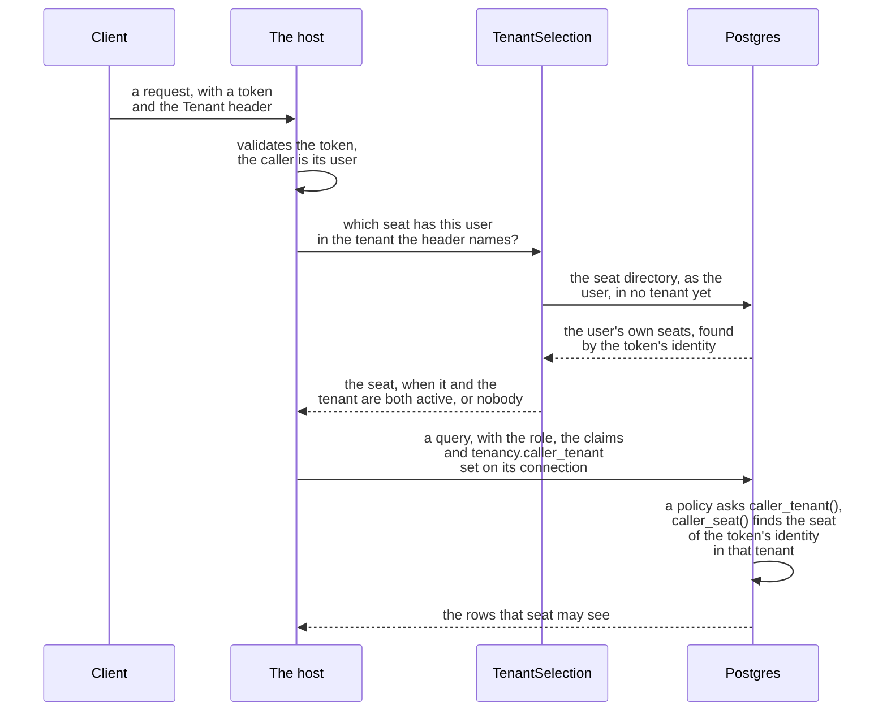
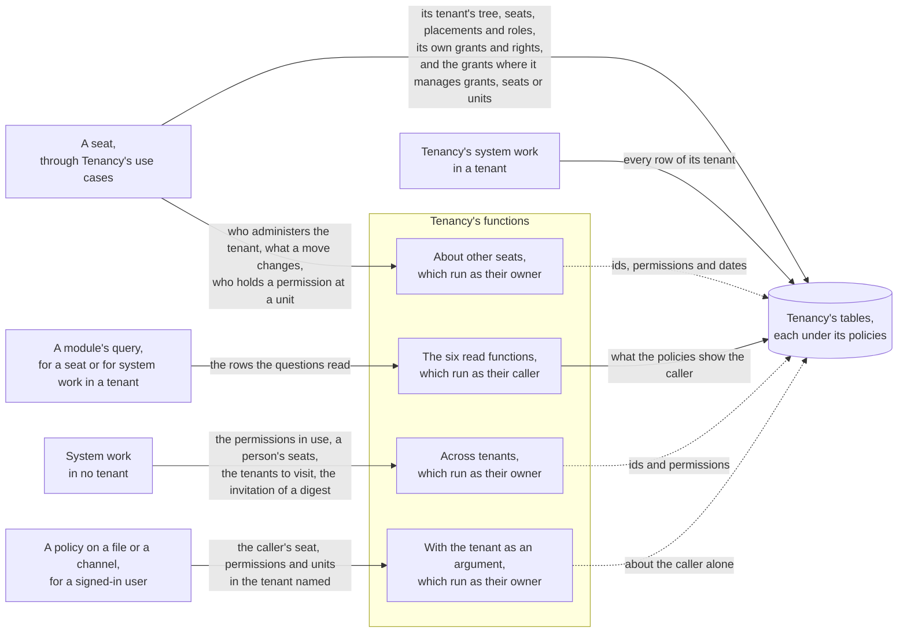
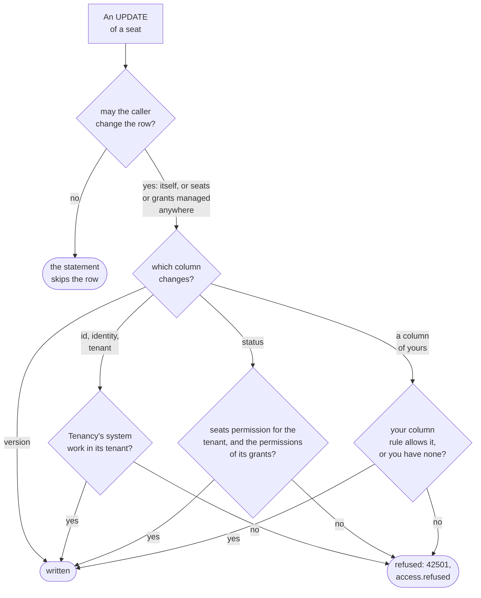

# Tenancy on Postgres: the second lock

How Tenancy's rules also run inside Postgres, as row level security (RLS), and how to set that up. Read it when
Tenancy is stored on Postgres; on another database every check runs in C# alone. The words are in the
[overview](overview.md).

The first lock is Tenancy's checks in C#: the check before a handler, the filter and the save check
([Keeping tenants apart](keeping-tenants-apart.md)). The second lock is the database applying the same rules:
`DDDToolkit.Supporting.Tenancy.Postgres` writes them as [RLS](../row-level-security.md), under the filter and the
save check:

- **policies** on Tenancy's tables and on every table you keep to a tenant;
- **SQL functions** for the questions, which the policies and your modules' rules ask;
- **triggers** for what no policy can see.

It stops your application's own queries that forget a condition. It is no boundary against SQL someone else runs on
your connection ([the threat model](#what-the-second-lock-stops-and-what-it-does-not)).

## Setting it up

Register it next to RLS, mark your part of the catalogue, and run the start-up checks both bring. Tenancy's
functions, policies and triggers reach your migrations because the project that runs the [export](../supabase.md)
references the package, directly or through the module that stores Tenancy.

```csharp
// The host
services.AddSupabaseRowLevelSecurity();   // or AddPostgresRowLevelSecurity() on a Postgres of your own
services.AddTenancyPostgres();

// Before the host serves anything: every check the registrations brought, Tenancy's among them
services.RunStartupChecks();

// Your part of the catalogue, the one you hand TenancyOptions.Catalogue: the export writes the policies from it,
// and from the permissions your modules declare in [Permissions] classes. Mark nothing, and they are written from
// new ApplicationCatalogue(), as a host that leaves TenancyOptions.Catalogue unset runs with.
public static class ShopCatalogue
{
    [TenancyCatalogue]
    public static ApplicationCatalogue Application { get; } = new(Packs: [...]);
}
```

### The registration

`AddTenancyPostgres()`:

- carries the tenant to Postgres ([How the tenant reaches a policy](#how-the-tenant-reaches-a-policy));
- turns the refusal of the trigger that keeps a tenant an administrator into `tenancy.last-admin`;
- requires explicit callers: work that never said who it runs as fails, instead of running as the application past
  every policy ([Fail-closed callers](../row-level-security.md#fail-closed-callers));
- leaves the rights to the database (`TenancyStoreOptions.DatabaseKeepsRights`), which writes them and answers what
  the use cases ask about other seats ([What the policies check](#what-the-policies-check)).

With RLS registered, `UseDDDToolkit` runs your contexts as their caller and gives them Tenancy's save check. Nothing
more to write.

### The contribution

- A [row access contribution](../row-level-security.md#policies-a-package-ships) the package declares: referencing
  the package writes it.
- Its SQL is written from your catalogue, since which permissions manage access is yours to say. The catalogue is
  built as your registration builds it, from the projects the exporting project references:
  - the part you mark `[TenancyCatalogue]`, a static property or field of type `ApplicationCatalogue`;
  - every module's list of permissions, which Tenancy's generator writes from its `[Permissions]` classes and marks
    `[TenancyPermissions]` ([A module states its permissions once](roles-and-permissions.md#a-module-states-its-permissions-once)).
- The build makes it in the exporting project, in a class written into
  `DDDToolkit.RowAccessContributionsOfPackages.g.cs`, whose comment names what it was made from.
- Two members marked `[TenancyCatalogue]`, or one of another type (the catalogue built already, say), stop the
  build: [DDD00071](../diagnostics.md#ddd00071).
- One a library keeps internal is reported where it is declared, [DDD00070](../diagnostics.md#ddd00070): the
  exporting project would not see it, and would write the policies from the default catalogue.
- With [operators](operators-and-history.md#operators), mark their token roles `[TenancyOperators]` too.
- On a Postgres of your own, pass `new TenancyRowAccessContribution(catalogue)` to `PostgresRowAccess.Scripts` in
  `RowAccessExport.Contributions`.
- Left out with `[assembly: LeaveOutRowAccessContribution]`, it writes nothing, and a table without RLS is open to
  every caller with privileges on it.
- The functions go into the default schema of the context that maps Tenancy's tables: `tenancy`, `Tenancy` or any
  name Entity Framework takes, in double quotes as the SQL names every schema: `"tenancy".caller_seat()`,
  `"Tenancy".caller_seat()` ([Schema names](../row-level-security.md#schema-names)).

### The start-up checks

`AddTenancyPostgres()` brings them as [start-up checks](../startup-checks.md). The host runs them with its other
checks, before the server binds its port, cause before effects. Each throws, naming what is wrong and the statement
that puts it right. A host that runs them by hand calls them in this order, as the system caller, after the checks
of the login role and of the migrations:

1. **`TenancyPostgresChecks.EnsureExplicitCallers`**: the host still requires explicit callers.
2. **`EnsureSeatedTokenRolesAreSignedInUsers`**: every token role Tenancy seats reaches the database as a signed-in
   user, the role the policies are written for ([Which signed-in users hold seats](#which-signed-in-users-hold-seats)).
3. **`EnsureSystemInRoleIsConfinedAsync`**:
   - the scoped system role cannot log in or bypass RLS, and has the privileges of no role that owns a table;
   - no role a caller signs in with has its privileges;
   - no mapped token role has the privileges of a signed-in user, or may run a function of Tenancy's, by a grant of
     its own or through another role it was given;
   - `anon` may run none of Tenancy's functions that run as their owner.
4. **`EnsureSystemReadsAcrossTenantsAsync`**: Tenancy's few reads across tenants answer through their functions, to
   the scoped system role and nobody else ([reads across tenants](#the-scoped-system-role-grants-and-reads-across-tenants)).
5. **`EnsurePoliciesAreInPlaceAsync`**:
   - RLS is on for Tenancy's tables;
   - the units' table has [the unique index on a tenant's root](#the-index-on-a-tenants-root);
   - `permission_manages_access`, `permission_is_contained`, `pack_permissions` and `permission_is_live` were
     written from the catalogue the host runs with, with [containment](roles-and-permissions.md#containment-on-or-off)
     the same way round;
   - the database keeps the rights as the store expects: the trigger that writes them is on the grants, the seats
     and the roles; the functions the store asks, those [modules read through](#modules-read-through-functions) and
     those that [take the tenant](#where-the-connection-names-no-tenant) are as the contribution writes them; and
     nothing turned `DatabaseKeepsRights` off.

### What Postgres refuses

Where the database sees what the use case could not ask about first, such as two requests racing for one slug, the
caller gets the use case's refusal for the same rule. Each unique index names its refusal in the mapping, so those
five answer on SQLite and SQL Server too; the trigger is Postgres's alone.

| Postgres refuses | The refusal |
|---|---|
| The unique index on a tenant's slug | `tenancy.slug-taken` |
| The unique index on a seat's identity in a tenant | `tenancy.identity-has-seat` |
| The unique index on a role's name in a tenant | `tenancy.role-name-taken` |
| The unique index on a tenant's root | the use case's refusal of a second root |
| The unique index on a seat's primary placement | `tenancy.second-primary` |
| The trigger that keeps an administrator | `tenancy.last-admin` |

- Anything else, the other triggers' failures included, is thrown as it was: a bug, not a refusal.
- The administrator's trigger checks at commit. Its refusal comes from the store's save when that save commits, as it
  does unless you run the use case in a transaction of your own; then it reaches your commit as the
  `PostgresException` it is, with the constraint name `tenancy_administrator_remains`.

## The index on a tenant's root

The unique index that keeps a tenant's organization to one root is required on Postgres. `AddTenancy` maps it when
you pass the context's `Database`; `EnsurePoliciesAreInPlaceAsync` refuses a database without it.

```csharp
modelBuilder.AddTenancy(database: Database);   // maps the index; your migration makes it
```

Why:

- A permission held at a unit without a parent is held for the whole tenant: `holds_at_tenant(permission)` counts
  every such unit. A second root would make whoever holds a permission there a holder for all of the tenant.
- The policies keep a seat from that: a seat adds a unit only below one it manages, and never leaves a unit that had
  a parent without one.
- They do not hold Tenancy's own system work in a tenant, which writes that tenant's units, nor the tables' owner,
  in a migration or a script of your own.
- The index refuses a second root to every role, those two included, so the rule does not rest on the policies
  alone.

The check looks for what the index does, not its name: a valid unique index on the units' tenant alone, over the
units without a parent. One of yours under another name counts. One that is not unique, has a second column or a
narrower condition, or was left invalid by a failed `CREATE INDEX CONCURRENTLY`, does not. The failure says what is
missing:

| The model | The database | What to do |
|---|---|---|
| maps the index | has none | add a migration, where none makes the index yet, and apply it |
| maps none, because `AddTenancy` was called without `database` | has none | pass the context's `Database` to `AddTenancy`, then add a migration and apply it |
| either | has the index, and it is not valid | see that no tenant has two roots, then `REINDEX INDEX` it; the failure names it |
| maps none | has it | nothing: the check reads the database |

A database with two roots in one tenant cannot get the index until one of them has a parent again.

## How the tenant reaches a policy

One setting carries it: `tenancy.caller_tenant` (`TenancyRowLevelSecurity.TenantSetting`), the id of the Tenancy
caller's tenant, or empty when there is none. The interceptor sets it in the same statement as the role and the
claims, whenever it sets the caller on a connection ([Settings of your own](../row-level-security.md#settings-of-your-own)).

The path of one request, from token to rows. It shows that the host finds the seat once, and Postgres finds it
again from the token, so the setting alone never makes anyone a seat.



<details>
<summary>Show the code: the request's callers, and the function that finds the seat</summary>

```csharp
// Each request, after authentication: the user of its token, and that user's seat in the tenant it names
app.Use(async (context, next) =>
{
    var caller = context.GetSupabaseCaller();
    using (Callers.Begin(caller))
    {
        // The selection without its id types: the middleware names no id, and reads the same in every application
        var seat = await context.RequestServices.GetRequiredService<ITenantSelection>()
            .ResolveAsync(caller, context.Request.Headers["Tenant"], context.RequestAborted);
        using (TenancyCallers.Begin(seat))
        {
            await next(context);
        }
    }
});
```

```sql
-- What the contribution writes, shortened: the seat is found from the verified identity, never taken from
-- the application
CREATE OR REPLACE FUNCTION "tenancy".caller_seat() RETURNS uuid
    LANGUAGE sql STABLE SECURITY DEFINER SET search_path = '' AS $function$
SELECT s."Id" FROM "tenancy"."Seats" s
JOIN "tenancy"."Tenants" t ON t."Id" = s."TenantId"
WHERE s."Identity" = (SELECT auth.uid())
  AND s."TenantId" = (SELECT "tenancy".system_tenant())
  AND ... -- the seat and its tenant both active
$function$;
```

</details>

- **A signed-in user**: the setting says which tenant, never which seat. `caller_seat()` finds the seat of the
  token's identity in that tenant, only while seat and tenant are active. A wrong tenant from your own code reaches
  no seat; a suspended seat or tenant reaches nothing.
- **System work in a tenant** runs as the scoped system role, and the setting is the tenant.

### Looking at the rows as a user does

A tool that acts as a user sets its role and claims, and no tenant: Supabase Studio's table editor, set to a
signed-in user, shows every table kept to a tenant empty, because the restrictive policy finds no tenant to keep
them to. Set the tenant too, as the interceptor does, in a transaction you roll back:

```sql
begin;
select set_config('request.jwt.claims', '{"sub":"<the user''s id>","role":"authenticated"}', true),
       set_config('tenancy.caller_tenant', '<the tenant''s id>', true);
set local role authenticated;
select * from tenancy."OrganizationUnits"; -- what the policies let that user's seat read of them
rollback;
```

### Which signed-in users hold seats

- `TenantSelection` seats a user whose token carries a seated role: by default `authenticated`, or no role at all.
  List others in `options.TenantSelection.SeatedTokenRoles` where you register Tenancy.
- A user with another [token role](../row-level-security.md#token-roles), a reporting job's say, is nobody in every
  tenant: answered as a person without a seat, `tenancy.not-seated`, with nothing looked up.
- `TenantSelection.SeatsOfAsync<TSeat>(caller)`, a person's own seats for a tenant picker, answers such a user no
  seats, as it answers a person who has none.
- On Postgres the contribution closes Tenancy's tables and every table kept to a tenant to the database role such
  a token role is mapped to, with a restrictive policy as for anonymous callers. A module's rule for that role lets
  nothing of a tenant through.
- Except a token role listed as an operator's: its role reads every tenant's rows of Tenancy's and writes none
  ([Operators](operators-and-history.md#operators)).
- A token role mapped to the role of a signed-in user is a signed-in user; listed in `SeatedTokenRoles`, it is
  seated like one.

Refused at start-up:

- a seated token role that reaches the database as another role: a seat to the application, nobody to the database
  (`EnsureSeatedTokenRolesAreSignedInUsers`);
- a mapped role granted the role of a signed-in user: every function a signed-in user may ask would answer it
  (`EnsureSystemInRoleIsConfinedAsync`);
- a mapped role given a function of Tenancy's to run (the same check).

The access files give Tenancy's functions to signed-in users and the scoped system role alone, and each takes back
every other grant on the functions it writes. A grant made by hand since stays until the next file is applied, and
on the trigger functions for good:

```sql
-- Next to the tables' privileges, and one line too many: the role may now ask what a seat asks
GRANT EXECUTE ON ALL FUNCTIONS IN SCHEMA tenancy TO analyst_role;
```

- The check names the role, the functions and the statement that takes the grant back.
- Where the role runs them through another role it was given, it names that role, and the `REVOKE` that takes the
  mapped role out of it.
- An operator's role is a mapped role too, and runs none of Tenancy's functions.
- The check reads Tenancy's schema, so a function of yours kept there counts too: put what such a role runs in
  another schema.

## Who reads what

Only Tenancy's own context reads Tenancy's tables, under the policies. Everything else asks a function.

- **A seat**, through Tenancy's use cases, reads:
  - its tenant, with its tree, seats, placements and roles;
  - its own grants and rights;
  - the other seats' grants at and below a unit where it manages grants, seats or units, and all of them when it
    manages roles for the whole tenant;
  - never another seat's rights ([Who reads which grants](#who-reads-which-grants)).
  Which other seats a member reads is a default, which a read rule on your seat class replaces
  ([Who reads the seats](#who-reads-the-seats-a-default-you-may-replace)).
- **What a use case must know of other seats' rights**: three functions answer it, as ids, permissions and dates:
  who administers the tenant, what a move of a unit changes, who holds a permission at a unit.
- **A module** reads none of the tables. Its context maps six functions that answer the rows the questions read.
  They run as their caller, so the same policies decide what its query sees
  ([Modules read through functions](#modules-read-through-functions)).
- **System work in a tenant** reads every row of that tenant.
- **System work in no tenant** reads no row. It asks three functions for ids and permissions, and a fourth where the
  context maps invitations ([reads across tenants](#the-scoped-system-role-grants-and-reads-across-tenants)).
- **A policy where your connection is not the one asking**, on a stored file or a channel, asks five functions that
  take the tenant as an argument ([Where the connection names no tenant](#where-the-connection-names-no-tenant)).
- **An operator's role** reads every row of Tenancy's tables and of the access history, in every tenant, writes none,
  and runs none of the functions ([Operators](operators-and-history.md#operators)).
- **An anonymous caller** reads no table and runs no function.

The same readers as a picture, to see which reads the policies narrow. A solid line is a read as the caller, which
the policies narrow. A dotted line is a function that runs as its owner, past them: its own SQL says whom it
answers, and it answers ids, permissions and dates, never a name.



<details>
<summary>Show the code: a module's context and a read of its own, and the two kinds of function</summary>

```csharp
// A module's context: its own tables, and Tenancy's read model as Tenancy's functions
protected override void OnModelCreating(ModelBuilder modelBuilder)
{
    modelBuilder.HasDefaultSchema("projects");
    modelBuilder.AddTenancyReadFunctions<TenantId, SeatId, OrganizationUnitId, RoleId>("tenancy");
    modelBuilder.Entity<Project>().ScopeToTenant(project => project.TenantId);
}

// A read of the module's. The question is a subquery of its own statement, asked over the context that
// runs it: here one taken for this read alone, as a host does that runs the reads of one request side by side
public async Task<List<string>> VisibleProjectsAsync(CancellationToken cancellationToken)
{
    await using var db = await contexts.CreateDbContextAsync(cancellationToken);   // IDbContextFactory<ProjectsContext>
    var held = answers.Over(db).UnitsWhereIHold(ProjectPermissionNames.Read);
    return await db.Projects.Where(project => held.Contains(project.UnitId)).Select(project => project.Name).ToListAsync(cancellationToken);   // the project's own name
}
```

```sql
-- A read function, as the contribution writes it: no condition and no setting of its own, so Postgres folds
-- it into the module's query, and the policies on the table decide the rows
CREATE OR REPLACE FUNCTION "tenancy".caller_permissions() RETURNS TABLE ("TenantId" bigint, "SeatId" uuid, "UnitId" uuid, "RoleId" uuid, "Permission" text, "StartsAt" timestamp with time zone, "EndsAt" timestamp with time zone)
    LANGUAGE sql STABLE AS $function$
SELECT t."TenantId", t."SeatId", t."UnitId", t."RoleId", t."Permission"::pg_catalog.text, t."StartsAt", t."EndsAt"
FROM "tenancy"."SeatRights" t
$function$;

-- A question about other seats, shortened: it runs as its owner, past the policies, answers ids, and
-- answers a right only where the caller may read the grant that gives it, as the policy on the grants does
CREATE OR REPLACE FUNCTION "tenancy".tenant_administrators() RETURNS TABLE ("SeatId" uuid, "RoleId" uuid)
    LANGUAGE sql STABLE SECURITY DEFINER SET search_path = '' AS $function$
SELECT r."SeatId", r."RoleId" FROM "tenancy"."SeatRights" r
JOIN "tenancy"."OrganizationUnits" u ON u."Id" = r."UnitId" AND u."TenantId" = r."TenantId"
WHERE r."TenantId" = (SELECT "tenancy".caller_tenant()) AND r."Permission" = 'tenancy.roles.manage'
  AND ... -- held at the root, with no end
  AND (r."SeatId" = (SELECT "tenancy".caller_seat())
       OR r."UnitId" = ANY (ARRAY(SELECT "tenancy".units_where_i_hold_permission('tenancy.grants.manage')))
       OR ...) -- or seats or units managed at the right's unit, or roles for the whole tenant
$function$;
```

</details>

## Who reads the seats: a default you may replace

Who may see whom is your application's choice: one shows every member of a tenant everyone, another shows a person
their own team. So two reads are defaults: what a signed-in user reads of the seats, and who besides the seats
managers reads an invitation. Replace one with a read rule on your own class, written like any
[row access rule](../row-level-security.md#row-access-rules-written-in-c); the export writes it where the default was.

| Table | A signed-in user reads, by default | Replaced by a read rule on | Stays, whatever your rule says |
|---|---|---|---|
| Seats | the tenant's seats, and the person's own in every tenant | your seat class | a person's own seats, in every tenant; and every seat of the tenant to a seat that manages seats, grants or units anywhere, or roles for the whole tenant |
| Invitations, where the context maps them | those at a unit where the seat manages seats | your invitation class | the same: listing and cancelling one load it, so your rule can only add readers |
| Tenants, Organizations | the tenant, and the tenants the person has a seat in | no default | what the tenant picker needs; within a tenant there is nothing wider to give and nothing narrower to keep |
| Roles | the tenant's | no default | Tenancy's questions read the roles as their caller, `RolesWithPermission` and which permissions of a grant's role manage access, so a narrower read would change their answers |
| Units, the tree, placements, grants, rights, the revision, the history | as [What the policies check](#what-the-policies-check) says | no default | a rule is about an aggregate's own table, and these are the rows of an organization or a seat, or rows Tenancy writes itself |

A rule of yours may also narrow what any of them allows, on the organization, the seats and the roles
([Rules that narrow the organization](#rules-that-narrow-the-organization)).

Without a rule, the export writes the default as always. With one, it writes your rule in the default's place and
keeps two things:

- **Your rule is held to the calling seat's tenant**, as any rule on a table kept to a tenant: it never repeats the
  tenant and never reaches another. A rule that lets every seat through lets the tenant's seats through. Reading
  across tenants is for [operators](operators-and-history.md#operators), under Tenancy's policies.
- **What Tenancy's own work reads stays.**
  - A person reads their own seats in every tenant: the tenant picker lists them, and the history's policy finds the
    person by them.
  - A seat that manages seats, grants or units anywhere, or roles for the whole tenant, reads every seat of the
    tenant: the use cases load the seats it acts on, and the policies on placements and grants read the seats as the
    caller, by the permissions that [read the grants](#who-reads-which-grants).
  - So a rule stricter than the default breaks none of Tenancy's use cases. The package's tests run every one under
    a rule that lets a member read itself alone.

The export knows the rule is a replacement: a rule about your seat class that allows `Read` is on the table of a
policy Tenancy marked a default for signed-in users, so it takes that policy's place
([Policies a package ships](../row-level-security.md#policies-a-package-ships)). Write it as any rule: without `To`
it is for the signed-in users the default is for (the comment above the policy says so), and the table stays closed
to anonymous callers.

What your rule changes, and what not:

- **It changes a direct read of the table, and what asks one**:
  - your queries, the directory's lists and lookups of seats, `tenant_seats()` (which
    [modules read Tenancy through](#modules-read-through-functions), as its caller) and `ITenancyQuestions.Seats()`,
    which reads it, answer the seats your rule lets the caller read;
  - your own entities on the seat class are read with the seat, so your rule decides them too;
  - what admits a seat by asking there admits only seats the caller reads. [Membership](../membership.md)'s
    admission, on a member list joined to Tenancy, refuses a seat outside your rule with `member-not-active`, as it
    refuses one that does not exist, so the refusal tells nothing about a seat the caller may not see. A module's
    own rule that reads `tenant_seats()` as the caller does the same, such as the sample's check that a crew member
    is a seat of the project's tenant;
  - so a member puts on a list only the people it reads; a seat that manages seats, grants or units anywhere, or
    roles for the whole tenant, reads every seat and puts on whoever the list takes.
- **Not Tenancy's questions about the caller and about rights.** `caller_seat`, `units_where_i_hold_permission`,
  `seats_in_my_units`, `seats_holding_permission_at`, `tenant_administrators`, `permissions_a_move_changes` and the
  others run as their owner and read no table as the caller, so they answer as before.
  `ITenancyQuestions.SeatsHoldingPermissionAt` asks the function on Postgres.
- **Not a seat's placements and grants**, which keep Tenancy's policies: what a seat holds is read where it applies,
  and the policy that lets a placement be withdrawn reads its grants. Your rule hides a seat's row, with its identity
  and every field of yours, not that the seat is there: every member still reads every seat's id and the units it is
  placed at, through the placements and `tenant_placements()`.
- **Not what anyone writes.** Adding, changing or removing a seat stays Tenancy's. Refused when the policies are
  written: a rule on your seat class that allows anything but `Read`, and one whose `To` names a role the default is
  not for, the anonymous caller's say. A [column rule](#what-the-database-guards-on-a-seat) still holds a field of
  yours.
- **Not system work, nor operators**: their policies are Tenancy's.

A read rule on your tenant, organization or role class is refused, naming the table: their reads are no default. A
[restrictive one](#rules-that-narrow-the-organization) on the organization or the roles is allowed: it only narrows.

<details>
<summary>Show the code: a rule on the seat class, the building blocks, and what the export writes</summary>

A member reads the people placed where it is placed, or below, beside what Tenancy keeps. Write it where your
other rules are, in your infrastructure:

```csharp
[RowAccess<Seat>(RowOperations.Read)]
public static partial class MembersReadThePeopleOfTheirUnits
{
    public static bool Allows(Seat seat, Caller caller) => TenancyRowAccess.SeatsInMyUnits<SeatId>().Contains(seat.Id);
}
```

And a seat that gives roles at an invitation's unit reads it too, beside the seats managers there:

```csharp
[RowAccess<Invitation>(RowOperations.Read)]
public static partial class GrantsManagersReadTheInvitationsAtTheirUnits
{
    public static bool Allows(Invitation invitation, Caller caller)
        => TenancyRowAccess.UnitsWhereIHold<OrganizationUnitId>(TenancyPermissions.GrantsManage).Contains(invitation.UnitId);
}
```

The building blocks are Tenancy's questions as `TenancyRowAccess` offers them, and the columns of your class. Each
question is asked once per statement, never once per row:

| You mean | Your rule says | The policy asks |
|---|---|---|
| in the caller's tenant | `seat.TenantId == TenancyRowAccess.CallerTenant<TenantId>()` | `"TenantId" = (SELECT "tenancy".caller_tenant())` |
| the caller itself | `seat.Id == TenancyRowAccess.CallerSeatId<SeatId>()` | `"Id" = (SELECT "tenancy".caller_seat())` |
| a field of the caller's own seat | `TenancyRowAccess.CallerSeat<Seat>().Kind == SeatKind.Employee` | `(SELECT q1."Kind" FROM "tenancy".caller_seat_row() q1) = 0` |
| the people on the projects the caller is on | `PeopleOnMyProjects.Ids().Contains(seat.Id)` | `"Id" = ANY (ARRAY(SELECT "projects".projects_fellow_members()))` |
| the person's own seats, in every tenant | `seat.Identity == caller.UserId` | `"Identity" IS NOT DISTINCT FROM (SELECT auth.uid())` |
| the seats placed at or below a unit the caller is placed at; to a seat placed at the root, as every seat of a flat tenant is, every placed seat | `TenancyRowAccess.SeatsInMyUnits<SeatId>().Contains(seat.Id)` | `"Id" = ANY (ARRAY(SELECT "tenancy".seats_in_my_units()))` |
| where the caller holds a permission | `TenancyRowAccess.UnitsWhereIHold<OrganizationUnitId>(permission).Contains(invitation.UnitId)` | `"UnitId" = ANY (ARRAY(SELECT "tenancy".units_where_i_hold_permission('...')))` |
| a permission held anywhere | `TenancyRowAccess.HoldsPermission(permission)` | `(SELECT "tenancy".holds_permission('...'))` |
| a permission held for the whole tenant | `TenancyRowAccess.HoldsAtTenant(permission)` | `(SELECT "tenancy".holds_at_tenant('...'))` |

Tenancy's own default is written with the same blocks, and so is what it keeps:

```csharp
// The default: the tenant's seats, and the person's own
seat.TenantId == TenancyRowAccess.CallerTenant<TenantId>() || seat.Identity == caller.UserId

// What stays beside a rule of yours
seat.Identity == caller.UserId
    || (seat.TenantId == TenancyRowAccess.CallerTenant<TenantId>()
        && (TenancyRowAccess.HoldsPermission(TenancyPermissions.SeatsManage) || TenancyRowAccess.HoldsPermission(TenancyPermissions.GrantsManage)
            || TenancyRowAccess.HoldsPermission(TenancyPermissions.UnitsManage) || TenancyRowAccess.HoldsAtTenant(TenancyPermissions.RolesManage)))
```

What the export writes for the first rule, under the sample's names, with the comment that says what it did:

```sql
-- Seats (select) for authenticated asks the rule 'Members read the people of their units' (which names no role, so
-- it is for the roles of the default) in place of the default 'Members and the person read seats' of the row access
-- contribution ..., held to what that default holds a rule to, beside what it keeps whatever a rule says: a row one
-- of them allows is allowed.
CREATE POLICY "Seats (select) for authenticated" ON "tenancy"."Seats" FOR SELECT TO authenticated
    USING (("Identity" = (SELECT auth.uid())
            OR (("TenantId" = (SELECT "tenancy".caller_tenant()))
                AND ((SELECT "tenancy".holds_permission('tenancy.seats.manage')) OR (SELECT "tenancy".holds_permission('tenancy.grants.manage'))
                     OR (SELECT "tenancy".holds_permission('tenancy.units.manage')) OR (SELECT "tenancy".holds_at_tenant('tenancy.roles.manage')))))
           OR (("TenantId" = (SELECT "tenancy".caller_tenant())) AND ("Id" = ANY (ARRAY(SELECT "tenancy".seats_in_my_units())))));
```

</details>

The [sample](the-sample.md#who-may-do-what-in-the-sample) keeps both defaults and writes no read rule: in its
harbor people work across units, a crew lead puts on a project whoever the job needs, and every member sees
everyone; issuing and cancelling invitations is a seats manager's work. An application whose members should see
only the people of their own part of the tree writes the rule above, and pins it with a test that reads the seats as
a member, as the package's `ReadRulesTests` do.

## Rules that narrow the organization

A rule of yours that allows only adds to the defaults above. To take something away, set `Restrictive = true` on a
rule about your organization, seat or role class. Its policy is AND-ed with Tenancy's
([Rules that only narrow](../row-level-security.md#rules-that-only-narrow-restrictive)): a row passes only where
both allow it, so it never allows more than Tenancy does.

Say your tenants have employees and external people, who work on one of the tenant's projects and have no business
in the rest of its organization. A field of your own on the seat class says which a seat is, and a restrictive rule
lets only an employee's seat read the organization:

| A signed-in user | Tenancy's policy: the tenant's organization | Your rule: an employee's seat | Reads the units |
|---|---|---|---|
| an employee of the tenant | yes | yes | yes |
| an external seat of the tenant | yes | no | no |
| a seat of another tenant | no | yes | no: your rule grants nothing |

```csharp
public enum SeatKind { Employee, External }

[SeatAggregate<SeatId>]
public sealed partial class Seat
{
    public SeatKind Kind { get; private set; }

    public void MarkExternal() => Kind = SeatKind.External;
}

[RowAccess<Organization>(RowOperations.Read, Restrictive = true)]
public static partial class OnlyEmployeesReadTheOrganization
{
    public static bool Allows(Organization organization, Caller caller)
        => TenancyRowAccess.CallerSeat<Seat>().Kind == SeatKind.Employee;
}
```

The export writes the rule on the organizations, on the units (the organization's), and on the closure of the tree
(which Tenancy says follows the organization):

```sql
CREATE POLICY "Only employees read the organization (select) for authenticated" ON "tenancy"."Organizations" AS RESTRICTIVE FOR SELECT TO authenticated
    USING ((SELECT q1."Kind" FROM "tenancy".caller_seat_row() q1) = 0);
-- and the same on "tenancy"."OrganizationUnits" and on "tenancy"."OrganizationUnitPaths"
```

- **Where it reaches**:
  - on your organization class: the organization, its units and the closure of its tree;
  - on your seat class: the seats, with their placements and grants;
  - on your role class: the roles;
  - on a tenant or an invitation it is [DDD00100](../diagnostics.md#ddd00100): Tenancy's own work and a person
    with no seat yet read those.
- **It narrows what Tenancy keeps for its own work too**, since it is AND-ed with every policy. On the seats that
  is a person's own seats, from which the tenant picker and the seat a request acts as are found. Keep them in the
  rule, `seat.Identity == caller.UserId || ...`, or the seat it keeps out cannot work in its tenant at all.
- **A field of the caller's own seat**:
  - `TenancyRowAccess.CallerSeat<Seat>()` is the calling seat's row, read by `caller_seat_row()`, which runs as its
    owner: a rule reads it whatever your read rule on the seats says, and a rule on the seats reads it without
    asking itself;
  - no seat, no row: every field is null, and the rule lets nothing through;
  - another class than your seat class is [DDD00101](../diagnostics.md#ddd00101);
  - for the seat's id alone, in a module whose context does not map the seats: `TenancyRowAccess.CallerSeatId<SeatId>()`.
- **Tenancy's own work keeps working**: system work is not narrowed, and the functions that run as their owner read
  past every policy, so the questions about the caller and about rights answer as before. The package's tests run
  every use case under the rule above.
- **What a seat it keeps out still reads**:
  - `TenancyDirectory.UnitsByIdAsync` answers through `units_named()`, which runs as its owner, for the ids asked
    alone, in the caller's tenant: each unit's name, path and depth, nothing more. So an external seat on a project
    still reads what the project's unit is called;
  - `ListUnitsAsync` answers it no units;
  - its own overview, `WhoAmIAsync`, names the units it is placed at as `UnitsByIdAsync` does, nothing below them,
    and the tenant by its name through `identity_tenant_names()`.
- **The seat a request acts as is found as before, and the tenant picker names every tenant.** Both read names
  through `identity_tenant_names()`, which runs as its owner and answers the id, the slug and the organization's
  name of each tenant the person has a seat in, nothing more. Before a tenant is chosen there is no seat for a rule
  to ask about, so the picker shows the names to employee and external seat alike; the organizations stay closed to
  the seat your rule keeps out.
- **A rule without `Restrictive`** on your organization or role class is refused: OR-ed with Tenancy's policy, which
  already lets every seat of the tenant read them, it would change nothing.

With a [read rule on your seat class](#who-reads-the-seats-a-default-you-may-replace) as well, an external seat (one
the application marks as not an employee) reads its project's unit name and path through the project's own query,
and the people it may see through the seat read rule, but not the rest of the organization. Employees read every
seat of the tenant; an external seat reads the people on its projects, which the projects' module publishes as a
contract from the [Membership package's](../membership.md#on-postgres-the-second-lock) members of the resources the
caller is a member of:

```csharp
// Projects.Contracts: the people on the projects the caller is on, by the seats they are
[ResourceAccessContract<ProjectId>(ResourceAccessSet.FellowMembers)]
public static partial class PeopleOnMyProjects
{
    public static partial AccessSet<SeatId> Ids();
}

// Tenants.Infrastructure: a read rule on the seats, in the default's place
[RowAccess<Seat>(RowOperations.Read)]
public static partial class EmployeesReadEveryoneExternalsTheirProjects
{
    public static bool Allows(Seat seat, Caller caller)
        => TenancyRowAccess.CallerSeat<Seat>().Kind == SeatKind.Employee || PeopleOnMyProjects.Ids().Contains(seat.Id);
}
```

The projects' functions ask Tenancy's who the calling seat is, and Tenancy's file runs first. The export writes the
seat rule all the same, through a function of Tenancy's own that asks the projects' one when it runs
([A rule that asks a module that asks back](../row-level-security.md#a-resources-access-asked-by-its-id)).

## The functions

The SQL functions the policies and your rules ask, and their C# counterparts.

- Written by the contribution, with your table names and your ids' column types.
- `LANGUAGE sql`, with an empty `search_path`; run by signed-in users and the scoped system role, never `anon`.
- All but `system_tenant`, `permission_manages_access`, `permission_is_contained` and `pack_permissions` run as
  their owner, so they read Tenancy's tables whatever the caller's policies allow.
- **Live**: a grant or right whose period holds now, by the database's `now()`. A grant's start is stamped by the
  application's clock, so keep the two clocks in step (synchronized servers are): while the database's runs
  behind, a grant made a moment ago is not live to the policies yet.
- They answer for a seat. System work in a tenant has none, so it is answered nothing; the policies keep it to its
  tenant with `system_tenant` instead.

| Function | Answers | In C# |
|---|---|---|
| `caller_seat()` | the seat of the caller's identity in the tenant the setting names, when it and that tenant are both active; else null | the seat `TenantSelection` picks |
| `caller_tenant()` | that seat's tenant; else null | the seat's tenant |
| `caller_seat_row()` | that seat's own row, every column your seat class maps; no row without a seat | `TenancyRowAccess.CallerSeat<Seat>()`, for a [rule that reads a field of it](#rules-that-narrow-the-organization) |
| `system_tenant()` | the tenant the setting names: the scoped system role's tenant, and the one a signed-in user's access revision is taken in and its [access history](operators-and-history.md#access-history) is added to | `TenancyWork.BeginSystemIn`'s tenant |
| `units_where_i_hold_permission(permission)` | the units where the seat holds the permission live, and every unit below them | `UnitsWhereIHold` |
| `readable_units()` | the units of the seat's tenant where it is placed, and every unit below them | `ReadableUnits` |
| `seats_in_my_units()` | the seats placed at one of those units, whatever their status: the people of the seat's own part of the tree, every placed seat to a seat placed at the root; for a [read rule on your seat class](#who-reads-the-seats-a-default-you-may-replace) | |
| `roles_with_permission(permission)` | the active roles of the seat's tenant that hold the permission | `RolesWithPermission` |
| `holds_permission(permission)` | whether the seat holds the permission live at any unit | |
| `holds_at_tenant(permission)` | whether the seat holds the permission live at the root | `HoldsAtTenantAsync` |
| `identity_tenants()` | every tenant where the caller's identity has a seat, whatever its status | the seat directory |
| `identity_tenant_names()` | those tenants' ids, slugs and organizations' names, and nothing more; for a signed-in user alone | the tenant picker, the seat a request acts as, and a seat's overview where it does not read its organization |
| `unit_parent(unit)` | the parent a unit of the seat's tenant has, as it was before the statement that asks | |
| `permission_manages_access(permission)` | whether your catalogue marks the permission as managing access | `TenancyCatalogue.ManagesAccess` |
| `permission_is_contained(permission)` | whether a seat hands the permission on only where it holds it: a permission that manages access while [containment](roles-and-permissions.md#containment-on-or-off) is on, and no permission once it is off | `TenancyCatalogue.ContainAccessManagingPermissions` |
| `pack_permissions(pack)` | the permissions a role made from that pack of your catalogue holds, implied ones included; null for a pack it does not have | `TenancyCatalogue.Packs` |
| `units_named(ids)` | the units among the ids that are the seat's tenant's, each with its name, its path from the root and its depth, and nothing more of it; for a seat alone | `TenancyDirectory.UnitsByIdAsync` |

Your modules' rules ask them through `TenancyRowAccess`, in `DDDToolkit.Supporting.Tenancy`, so a module needs no
reference to the Postgres package. Such a rule is for signed-in users, since `anon` may not run the functions:

```csharp
[RowAccess<Project>(RowOperations.Read, To = [RowAccessRoles.User])]
public static partial class ProjectsAreReadWhereThePermissionIsHeld
{
    public static bool Allows(Project project, Caller caller)
        => TenancyRowAccess.UnitsWhereIHold<OrganizationUnitId>(ProjectPermissionNames.Read).Contains(project.UnitId);
}
```

- In SQL it becomes `"UnitId" = ANY (ARRAY(SELECT "tenancy".units_where_i_hold_permission('projects.read')))`.
- `EXPLAIN` shows the question as an init plan, asked once per statement; the scan compares with its answer, by an
  index where the table is large enough. A row never calls the function itself
  ([set-shaped questions](../row-level-security.md#set-shaped-questions) say why).

## Modules read through functions

On Postgres a module reads no table of Tenancy's: each row the questions read is answered by a function of
Tenancy's. The module's context maps its read model to them with `AddTenancyReadFunctions`; on another database,
`AddTenancyReadModel` maps views over the tables.

| Function | Answers | Its columns |
|---|---|---|
| `caller_permissions()` | the rights the caller may read: a seat's own, and for system work in a tenant, that tenant's | `"TenantId"`, `"SeatId"`, `"UnitId"`, `"RoleId"`, `"Permission"`, `"StartsAt"`, `"EndsAt"` |
| `tenant_unit_paths()` | the closure of the tenant's tree | `"TenantId"`, `"AncestorId"`, `"DescendantId"`, `"Distance"` |
| `tenant_units()` | the tenant's units, without their names | `"Id"`, `"TenantId"`, `"ParentId"`, `"Status"` |
| `tenant_roles_with_permissions()` | the tenant's roles, without their names, with their permissions as an array of text | `"Id"`, `"TenantId"`, `"FromPack"`, `"Status"`, `"Permissions"` |
| `tenant_placements()` | where the tenant's seats are placed | `"SeatId"`, `"UnitId"`, `"IsPrimary"`, `"TenantId"` |
| `tenant_seats()` | the tenant's seats the caller reads, every seat by default and those a [read rule of yours](#who-reads-the-seats-a-default-you-may-replace) lets it read where you write one; never their identity, nor a field your seat class adds such as a name | `"Id"`, `"TenantId"`, `"Status"` |

- **Only these columns**, those of the [read model's rows](who-may-do-what.md#what-a-module-reads-of-tenancy): a
  function answers no name, so on Postgres a module has none to read.
- **Checked at start-up**: `EnsurePoliciesAreInPlaceAsync` compares each function's columns with the read model's,
  and names a function that differs. Functions written for another version of the read model fail there, since
  Postgres replaces no function by one with other columns: drop the functions it names, then apply the access files.
- **Asking is unchanged**: `answers.Over(db).UnitsWhereIHold(permission)` is still a subquery of the module's own
  query, one statement.
- The functions run as their caller, so the [policies](#what-the-policies-check) on Tenancy's tables decide their
  rows. Postgres folds them into the query that asks
  ([functions folded into the query](../row-level-security.md#policies-a-package-ships)): the plan reads Tenancy's
  tables with their indexes, as through a view. Run by signed-in users and the scoped system role, never `anon`.
- **Nothing of how Tenancy stores it**: the functions answer under the read rows' property names, and a status as
  its enum member's name, whatever you call Tenancy's tables and columns and however you store its statuses or a
  role's permissions ([Your own naming](#your-own-naming)).
- **The views are refused** under `AddTenancyPostgres()`: asking over a module's context that still maps them is
  refused, naming `AddTenancyReadFunctions`. A seat reads only its own rights there, and a module that read the
  tables would come to depend on what the policies happen to show it.
- A model is built once for the database its context runs on. A context that runs on SQLite in one host and on
  Postgres in another chooses in `OnModelCreating`, as the context in [Who may do what](who-may-do-what.md) does;
  the choice holds for every instance, pooled ones included.

**Reads side by side**, as a GraphQL server runs a query's resolvers:

- Give each read its own context, from a factory or a pool: two reads cannot share one.
- Ask over that context, `answers.Over(db)`: the question stays a subquery of the read's own statement, sent as the
  request's caller, whichever instance the pool hands out and whoever had it before.
- Save what the request changes through its own context, from the same pool if you like: the command is checked as
  its caller, its events are stored with the change, and the database writes the rights, on an instance that served
  another caller a moment before ([Keeping tenants apart](keeping-tenants-apart.md)).

## Where the connection names no tenant

Questions for policies that run off your application's connection. A file store or channel service that checks a
signed-in user's token against policies of its own, as Supabase's Storage and Realtime do, knows the user and the
path or channel, and sets no `tenancy.caller_tenant`. Five questions take the tenant as an argument instead:

| Function | Answers | In a rule |
|---|---|---|
| `seat_in_tenant(tenant)` | the seat the caller's identity has in that tenant, when it and the tenant are both active; else null | `SeatInTenant` |
| `seated_in_tenant(tenant)` | whether there is such a seat | `SeatedInTenant` |
| `holds_permission_in_tenant(tenant, permission)` | whether that seat holds the permission live at any unit | `HoldsPermissionInTenant` |
| `units_where_i_hold_permission_in_tenant(tenant, permission)` | the units where that seat holds the permission live, and every unit below them | `UnitsWhereIHoldInTenant` |
| `roles_with_permission_in_tenant(tenant, permission)` | the active roles of that tenant that hold the permission, to a caller with such a seat | `RolesWithPermissionInTenant` |

- They run as their owner, and only signed-in users may run them.
- Each answers for the caller's own seat in the tenant asked about. So naming a tenant tells a caller nothing of it:
  a suspended seat, a suspended or closed tenant, a tenant the caller has no seat in, and someone without a seat
  anywhere are all answered nothing, the tenant's roles included.

**In a policy of yours.** A policy on files kept by path, `tenant/unit/name`, asks where the reader holds the
permission in the tenant the path names; a reader with seats in two tenants reads the files of both in one
statement:

```sql
CREATE POLICY "Read where the permission is held in the tenant of the path" ON files FOR SELECT TO authenticated
    USING (split_part(path, '/', 2)::uuid = ANY (ARRAY(
        SELECT tenancy.units_where_i_hold_permission_in_tenant(split_part(path, '/', 1)::bigint, 'projects.read'))));
```

A cast raises on a path of another shape, and an error in a policy fails the whole statement, for every reader. Keep
such files to that shape, in a table or bucket of their own, or test the shape in a `CASE` before casting.

**In a module's rule**, through `TenancyRowAccess`:

- A scalar question may take the tenant from the row.
- A set-shaped one is worked out once per statement, so its tenant cannot come from the row
  ([DDD00051](../diagnostics.md#ddd00051)). It comes from a parameter of the module's own
  [access function](../row-level-security.md#asking-the-aggregates-entities-access-functions), asked about one
  row, with the tenant and the id a path names:

```csharp
// Whether the caller may read a project, in the tenant given: for the files of a project, kept as tenant/project/name
[AccessFunction<Project>("projects.readable_in_tenant")]
public static partial class ProjectIsReadableInTenant
{
    public static bool Allows(Project project, Caller caller, TenantId tenant)
        => project.TenantId == tenant
           && TenancyRowAccess.UnitsWhereIHoldInTenant<OrganizationUnitId, TenantId>(tenant, ProjectPermissionNames.Read).Contains(project.UnitId);
}
```

In the database that is `projects.readable_in_tenant(project, tenant)`. The export grants an access function to the
roles whose rules ask it, and takes every other grant on it back with each access file. So a policy written by hand
keeps to Tenancy's own functions, as the SQL policy above does, unless one of the module's rules asks the function
too.

## What the policies check

What the policies on Tenancy's tables let a caller read and write, the triggers beside them, and how a refused save
is answered. Every command stays in the caller's tenant; beyond that, a signed-in user reads what every member reads
through the use cases, and writes where the use case asks the permission:

| Table | Reads | Writes |
|---|---|---|
| Tenants, Organizations | the tenant; and the tenants where the person has a seat, which the tenant picker lists | the tenant with `tenancy.settings.manage` for the whole tenant, and never its status; the organization with that, or with `tenancy.units.manage` held |
| OrganizationUnits | the tenant's | with `tenancy.units.manage` at the parent to add, at the unit or at its parent to rename or move, and at the new parent for a move; a unit that has a parent is never left without one, since a permission held at a root is held for the whole tenant |
| OrganizationUnitPaths | the tenant's | with `tenancy.units.manage` held; the trigger checks the rest |
| Seats | the tenant's, and the person's own in any tenant: a default, which a read rule on your seat class replaces ([Who reads the seats](#who-reads-the-seats-a-default-you-may-replace)) | added with `tenancy.seats.manage` for the whole tenant; changed with `tenancy.seats.manage` or `tenancy.grants.manage` held anywhere, or by the seat itself, since every save of a seat writes its version; its id, identity and tenant by no seat, and its status only with `tenancy.seats.manage` for the whole tenant, by a seat that holds what the seat's roles that manage access give (triggers, below); your own columns as your column rules say ([What the database guards on a seat](#what-the-database-guards-on-a-seat)) |
| SeatPlacements | the tenant's | placed with `tenancy.seats.manage` at the unit, for a seat of the tenant; withdrawn with it there, or by the seat itself, once the placement holds no grant; changed with it held, and made primary only where it is held at the unit, since making one primary demotes the old one wherever that is |
| SeatRoleGrants | the seat's own; another seat's where the caller manages grants, seats or units at the grant's unit or above it, or roles for the whole tenant ([who reads which grants](#who-reads-which-grants)) | with `tenancy.grants.manage` at the grant's unit, naming a role of the tenant that is active, given in the caller's own name; taken away there, or by the seat itself |
| SeatRights | the seat's own | by no caller: the database writes them |
| Roles | the tenant's | with `tenancy.roles.manage` for the whole tenant, which adds a role made by hand, naming no pack; a copy of one of your catalogue's packs, remembering exactly its permissions, is added with that or with `tenancy.settings.manage`. What a role's pack gave it no seat changes (a trigger, below) |
| TenancyAccessRevisions | the tenant's, for a person with a seat there of any status | by the same person: it is a counter every change of access takes, a seat's change of its own included |
| The access history, where the context maps one | the tenant's, with `tenancy.history.view` for the whole tenant | added about the person's own seat, in the tenant the connection names; changed and removed by no caller ([Access history](operators-and-history.md#access-history)) |
| Invitations and the digests of their tokens, where the context maps them | an invitation with `tenancy.seats.manage` at its unit, and by whoever a read rule on your invitation class adds; a digest by no caller | added by a seat that could add the seat and make the grant itself, and changed to cancelled and nothing else ([Invitations](invitations.md)) |

**Deleting and reading.**

- No signed-in user deletes a tenant, an organization, a unit, a seat or a role, and the use cases never do;
  Tenancy's own system work may.
- Every member reads the tree, the seats, the placements and the roles, as the use cases show them; a
  [read rule on your seat class](#who-reads-the-seats-a-default-you-may-replace) may narrow which seats.
- A seat reads its own rights and no other seat's, whatever it manages, and its own grants. Another seat's grants
  only where it manages grants, seats or units, or all of them when it manages roles for the whole tenant
  ([Who reads which grants](#who-reads-which-grants)).

**A seat's own access, and what a row keeps.**

- A seat takes away its own grants and placements without the permissions the use cases ask: that never gives it
  access, and the same save removes its permissions before the rows that would need them.
- Triggers refuse a change of a placement's seat, unit or tenant; of a grant's seat, unit, role or giver; and of a
  seat's id, identity or tenant, to all but Tenancy's system work in the seat's tenant. The use cases never change
  these, and each such change would move a row past its policy's checks on a new row, or hand a seat to another
  account.

**Roles that manage access.**

- `permission_manages_access(permission)` is written from your catalogue: Tenancy's five permissions that manage
  access, and the ones you mark.
- A grant of a role that holds one is given, changed and taken away only by a seat that holds each such permission
  at the grant's unit, and never given by a seat to itself, however much it holds.
- The same for withdrawing a placement, since the database would take its grants with it: it goes only once its
  grants are gone.
- That is [containment](roles-and-permissions.md#containment-on-or-off), asked of
  `permission_is_contained(permission)`, which the export writes from your catalogue's setting: the permissions
  that manage access while it is on, none once it is off. Off, a grant of any role takes the grants permission at
  its unit alone, as for a role that manages no access.
- Every change of a role, its permissions and archiving it included, takes `tenancy.roles.manage` for the whole
  tenant.
- A settings manager adds a role only as a copy of a pack (a starter role of your catalogue), as the use case that
  changes a tenant's shape does: it names the pack, holds exactly the permissions `pack_permissions` says, and
  remembers exactly those as what the pack gave it, which the next sync of the packs compares with. A role manager
  adds such a copy too, or a role made by hand that names no pack and remembers none.
- Mark another permission or change a pack, and the next build writes these functions again; the access file it
  writes is the migration, nobody writes it by hand. An administrators' pack that lists no permissions holds every
  permission (Tenancy's default one does), so adding a permission writes them again too.

**The database keeps the rights.**

- A trigger on the grants, the seats and the roles writes the rights each change reaches, in the same statement:
  never behind, inside a transaction either, whoever wrote the row (a use case, a query of yours, an import).
- It writes one right per permission of an active role granted to an active seat that `permission_is_live` says
  your catalogue has live, and only the rows that differ.
- No policy lets a caller add, change or remove a right, system work included, so the save writes none.
- Two transactions past the use cases that write at once do not see each other's rows; the use cases never get
  there, since each command of a tenant waits for the one before it.

**Other seats' rights.** What a seat may still learn of them, three functions answer, as ids, permissions and dates.
They run as their owner, only signed-in users may run them, and each answers nothing to a seat its guard keeps out:

| Function | Answers | To |
|---|---|---|
| `tenant_administrators()` | the seats that administer the tenant, each with the role that makes it one | a seat that may read the grants at the root: one that manages grants, seats or units there, or roles for the whole tenant |
| `permissions_a_move_changes(parent, new_parent)` | the rights a move of a unit from under one to under the other would change: the caller's own, and anyone's for a permission that manages access that reaches one parent and not the other | a seat that holds `tenancy.units.manage` at both |
| `seats_holding_permission_at(permission, unit)` | the active seats that hold the permission live at the unit or above it | each holder whose grant there the caller may read: itself, and the others where it manages grants, seats or units, or all of them when it manages roles for the whole tenant |

- The use cases ask the first two through the store, for the rule that a tenant keeps an administrator and for the
  check of a move. `ITenancyQuestions.SeatsHoldingPermissionAt` asks the third, which composes into a query of yours
  like every other question.
- A move is checked by the application's clock first and answered by the database's. When a grant of the mover's
  starts or ends in between, the answers differ and the move is a `ConcurrencyConflictException`, to read again, as
  any lost race is.
- `rewrite_tenant_rights()` writes a tenant's rights again from its grants and answers how many rows it wrote: for
  Tenancy's own system work in that tenant, after rows were written past the trigger.

**System work** (work no person does, begun explicitly) reads its tenant's rows in any scope, every seat's rights
included. It writes Tenancy's tables only in Tenancy's own scope, `"tenancy"`, and the rights in none: another
module's work in a tenant reads the seats and the rights, and changes none of them. **Anonymous callers** read and
write nothing.

**Your tables kept to a tenant.** On every table of any context that `ScopeToTenant` keeps to a tenant, and the
tables of its aggregate's entities, the contribution turns RLS on and adds restrictive policies, which no permissive
policy can widen:

- a signed-in user stays in the calling seat's tenant, and system work, of any scope, reads and writes its own;
- `anon` gets nothing, nor does a [mapped token role](#how-the-tenant-reaches-a-policy); one listed as an
  operator's reads what a rule of yours for it admits, and writes nothing ([Operators](operators-and-history.md#operators));
- so your rules never repeat the tenant, a rule for `anon` there lets nobody in, and a table with no rule for
  signed-in users is closed to them;
- a rule for a role of your own, named by its database name rather than as a signed-in user, system work or `anon`,
  is not kept to a tenant: the contribution does not see your rules, so write the tenant into it yourself.

**Your own entities on Tenancy's classes**, such as a note on a tenant, are read with the row they belong to, in the
caller's tenant, and written by whoever may change that row.

- These and Tenancy's tables are the contribution's alone: a rule or another contribution that would add a policy
  to one is refused, except a read rule on your seat or invitation class, which replaces Tenancy's default read
  there ([Who reads the seats](#who-reads-the-seats-a-default-you-may-replace)).
- A [column rule](../row-level-security.md#column-rules) adds no policy, so one of yours may hold a column you
  added to one of Tenancy's classes; it cannot hold an entity's table, whose rows follow their row
  ([What the database guards on a seat](#what-the-database-guards-on-a-seat)).

**The triggers** that check, beside the one that writes the rights, fire for every role, the tables' owner included.
A use case trips the first only in a race with another that takes away an administrator, and the status one only
when the calling seat loses a permission between the use case's check and its save; never the others. The first
three check at commit what the transaction wrote, the last four as the row changes:

1. **A tenant, active or suspended, keeps an administrator**: an active seat that holds `tenancy.roles.manage` at
   the root with no end, through an active role. A closed tenant needs none, and one that has none is refused
   nothing. It checks one transaction of a tenant at a time, so two that each take away a different administrator
   cannot both commit; that holds at read committed, which Postgres and Entity Framework use unless you choose
   another isolation level.
2. **Every right a seat holds comes from a grant** of an active role of its tenant that holds the permission, for
   the grant's period.
3. **The paths of a unit** are exactly the units above it and itself, in its tenant.
4. **Rows keep what they are about**: a placement its seat, unit and tenant; a grant its seat, unit, role and the
   seat that gave it; a role the pack it was made from.
5. **A seat keeps the id, the identity and the tenant it was made with.** Neither a use case, nor a seat
   (whatever it manages), nor the tables' owner changes them; only Tenancy's system work in the seat's tenant does,
   so a one-off of yours can link a seat to another identity, and the policies keep that work to its tenant
   ([What the database guards on a seat](#what-the-database-guards-on-a-seat)).
6. **A seat's status changes only by a seat that could give and take away what the status does.** The rights follow
   the status: made active again, a seat gets every grant back; suspended or deactivated, it loses them. So the
   calling seat holds `tenancy.seats.manage` for the whole tenant, as the use cases ask, and, while containment is
   on (`permission_is_contained`), every permission that manages access of each unended grant's role, at that
   grant's unit. Its own current grants count as its hold, so a seat that manages seats suspends itself. System work
   and the tables' owner are no seat and not held to it; the policies, and the administrator a tenant keeps, hold
   those.
7. **What a role's pack gave it, no seat changes**: a role manager who wrote it could have the next
   [sync of the packs](roles-and-permissions.md#packs-after-provisioning), which compares the pack with it, add what
   the pack never gave. It is written as a role is made from its pack, and as Tenancy's own system work makes the
   role follow it. System work and the tables' owner are no seat, so a migration that fills the column passes.

- The first four hold what may never be, whoever writes, and raise `check_violation`: a use case that trips one has
  a bug and fails as one, except the last administrator, which Tenancy's store answers with the use case's own
  refusal.
- The last three are access guards: they hold who may, and refuse as a policy does, with `42501` and the toolkit's
  hint.

**A refused save.** A save that a policy or one of those three triggers denies is `access.refused`, a refusal of the
kind "not permitted":

- an insert or update whose new row a policy refuses;
- a status the calling seat lost a permission for between the use case's check and its save;
- a seat's identity changed behind the aggregate's back;
- an update or delete of a row a policy hides from the statement. That changes no row, exactly as a lost race does,
  so the row is read again first; a row somebody else changed or removed stays a concurrency conflict
  ([When the database refuses](../row-level-security.md#when-the-database-refuses)).

It is logged after asking the request's access check again
([When the policies refuse what C# allowed](../row-level-security.md#when-the-policies-refuse-what-c-allowed)):

- A request that requires a permission, `AtTenant` or `AtUnit`, is refused by that check too once the seat lost the
  permission, with an information line that the seat's rights changed between the check and the save.
- What a Tenancy use case checks past its request's declaration (behind `InTenant()`, say) is not asked again: a
  save of such a request that the database denies stays a warning, naming the requirement it asked.

## What the database guards on a seat

Who may change which column of a seat's row, and how to guard the columns you add.

- A seat's row holds Tenancy's columns and yours side by side: its id, its tenant, the identity of the person it
  belongs to, its status, the version the toolkit keeps of every aggregate, and whatever your seat class adds, a
  name or a job title.
- A policy is asked of a row, never of a column, and every save of a seat writes its version: a placement and a
  grant as much as a status, and a command of yours that renames it.
- So the policy lets the row be changed by every caller one of those use cases admits: a seat that manages seats or
  grants anywhere in the tenant, and the seat itself, which takes away what is its own and may be renamed by its own
  command.
- **Anywhere, not at the seat's units, on purpose.** The seats permission places any seat of the tenant at the
  caller's unit, so anywhere is what that use case asks. The grants permission could be asked at the seat's units,
  all a grant needs, but the policy is also all that lets your own commands write the row: you cannot widen it,
  since Tenancy keeps the table to itself, and you narrow it column by column with column rules. Holding it to the
  units would decide for you which of your fields a grants manager writes.

Beside the policy, Tenancy holds its own columns one by one and leaves yours to you. The diagram follows one
`UPDATE` of a seat, the row's policy first and then each column it changes, so you see what each column needs:



- **What a seat is, no seat changes**: the id, the identity and the tenant stay what the seat was made with, for
  every seat, whatever it manages, its own row included.
  - Why: the identity links the seat to a person's account, so writing another would hand the seat, and every
    permission it holds, to that account. A seat moved to another tenant would leave its placements, grants and
    rights in the first; one given another id would leave every row that names it naming none.
  - A trigger refuses each as a policy refuses, `42501` with the toolkit's hint, so the save is `access.refused`.
  - No Tenancy use case changes them once the seat is made: provisioning, adding a seat, accepting an invitation
    and an import write all three in the insert that makes the seat.
  - Only Tenancy's system work in the seat's tenant passes, the scoped system role that
    `TenancyUseCases.BeginSystemIn(tenant)` begins: so a one-off of yours can link a seat to the identity another
    sign-in provider gives the same person, with an `ExecuteUpdate` of the seat inside it (code below). The policies
    keep that work to Tenancy's scope and its tenant, so it moves no seat to another tenant.
  - Nothing else changes them: not background work under `Caller.System`, and not a migration or the SQL editor
    running as the tables' owner, which the trigger refuses as it refuses a seat.
  - Where the export [writes the privileges](../row-level-security.md#privileges-from-the-policies), the id, every
    key column and the tenant, as on every table kept to a tenant, are columns no caller may update at all, and
    Postgres refuses them before the trigger is asked, as a privilege missing.
- **The status changes as the use cases change it**: only by a seat that holds `tenancy.seats.manage` for the whole
  tenant and the permissions that manage access of the seat's grants ([What the policies check](#what-the-policies-check)).
- **The version is the row's**: every save of the seat writes it, your own commands' included, so whoever may change
  the row writes it, and nothing more holds it. A seat that gives roles at one unit may so write the version of a
  seat it gives nothing to: that changes nothing the seat holds, and makes a save of that seat at the same moment a
  concurrency conflict, as a seats manager anywhere could already.
- **Your columns are yours**: Tenancy reads and decides nothing about them, so each is as writable as the row, by
  the seat itself and by a seat that manages seats or grants anywhere in the tenant.
  - Where your command asks more, hold the column to your command's rule with a
    [column rule](../row-level-security.md#column-rules) of yours, beside your other rules in your infrastructure. It
    adds no policy, so a table Tenancy keeps to itself takes it, and it holds the roles a caller's statement runs as,
    never your own work in a tenant.
  - A column rule holds a change. Reading follows the row, which every member reads unless a
    [read rule](#who-reads-the-seats-a-default-you-may-replace) of yours says otherwise, so a field you would show
    to fewer people than the row belongs in a table of your own.
  - An entity your seat class holds, a collection, is no column: its table is written with the seat's row by the
    same callers, Tenancy keeps it to itself, and no column rule holds it ([DDD00038](../diagnostics.md#ddd00038)).
  - Data that needs a narrower rule belongs in a table of your own with a rule of your own, or is held by a trigger
    in a [contribution](../row-level-security.md#policies-a-package-ships) of yours that refuses with the toolkit's
    hint, as every access guard does, as the sample's `UnitChangesWithItsPermissions` holds a project's unit.

<details>
<summary>Show the code: the sample's column rule on a seat's name, the trigger that keeps what a seat is, and a one-off that links a seat to another identity</summary>

The sample keeps a name per tenant on its seat and renames it with its own command, `RenameSeat`: a seat renames
itself, and another seat takes `tenancy.seats.manage` for the whole tenant, which the request says at the door with
`[RequiresPermission(RequiredPermission)]` and `[OrOwn]` on the seat. Its column rule says the same two branches to
the database, for each row. The job title has no command and no rule: it is as writable as the row.

```csharp
// Examples.Tenancy.Tenants.Infrastructure/Access/NameChangesByTheSeatOrWithTheSeatsPermission.cs
[RowAccess<Seat>(RowOperations.Change, To = [RowAccessRoles.User], Columns = [nameof(Seat.DisplayName)])]
public static partial class NameChangesByTheSeatOrWithTheSeatsPermission
{
    public static bool Allows(Seat seat, Caller caller)
        => seat.Id == TenancyRowAccess.CallerSeatId<SeatId>() || TenancyRowAccess.HoldsAtTenant(RenameSeat.RequiredPermission);
}
```

What Tenancy writes for what a seat is, under the sample's names. It runs as its caller, so it asks the role the
statement runs as:

```sql
CREATE OR REPLACE FUNCTION "tenancy".seat_identity_is_fixed() RETURNS trigger
    LANGUAGE plpgsql SET search_path = '' AS $body$
BEGIN
    IF CURRENT_USER IS DISTINCT FROM 'ddd_system_in' THEN
        RAISE EXCEPTION USING ERRCODE = 'insufficient_privilege', CONSTRAINT = 'tenancy_seat_identity_is_fixed', HINT = 'ddd:access.refused',
            MESSAGE = 'A seat keeps the id, the identity and the tenant it was made with: only Tenancy''s system work in its tenant changes them.';
    END IF;
    RETURN NEW;
END
$body$;

CREATE TRIGGER tenancy_seat_identity_is_fixed BEFORE UPDATE OF "Id", "TenantId", "Identity" ON "tenancy"."Seats"
    FOR EACH ROW WHEN ((OLD."Id", OLD."TenantId", OLD."Identity") IS DISTINCT FROM (NEW."Id", NEW."TenantId", NEW."Identity"))
    EXECUTE FUNCTION "tenancy".seat_identity_is_fixed();
```

A one-off of yours that links a seat to the identity another sign-in provider gave the same person runs as
Tenancy's system work in the seat's tenant, which the trigger lets through:

```csharp
using (TenancyUseCases.BeginSystemIn(tenant))
{
    await context.Set<Seat>()
        .Where(seat => seat.Id == seatId)
        .ExecuteUpdateAsync(set => set.SetProperty(seat => seat.Identity, newIdentity), cancellationToken);
}
```

</details>

In the sample's harbor (`SampleOnPostgresTests`):

- hana, who gives roles at the root, and rhea, who manages seats at North, may each write leo's row; the column rule
  keeps his name from both.
- leo renames himself, and maud, who manages seats for the whole tenant, renames him.
- hana changes his job title, which no rule holds.
- Nobody, ada included, links his seat to another account.

## Who reads which grants

Which other seats' grants a seat reads, and why the use cases need no more.

- Three permissions read other seats' grants, `tenancy.grants.manage`, `tenancy.seats.manage` and
  `tenancy.units.manage`, each only where it applies, as it acts only there: held at a unit, it reaches that unit and
  every unit below it (what `units_where_i_hold_permission(permission)` answers) and the grants there, never one
  above or beside it.
- A fourth, `tenancy.roles.manage`, reads them all when held for the whole tenant.

In the sample's harbor:

| The calling seat holds | It reads the grants | In harbor |
|---|---|---|
| none of the permissions below, whatever else it holds: `tenancy.settings.manage` and your catalogue's permissions that manage access read no other seat's grants | its own | leo, juno and vic read their own |
| `tenancy.grants.manage`, `tenancy.seats.manage` or `tenancy.units.manage` at a unit | its own, and every grant at that unit and below it | rhea, Area manager at North: those at North, North Coast and North Inland; not ada's, maud's or hana's at the root, nor any at South Bay |
| one of those three at the root | every grant of the tenant, the root being the whole tenant | hana, People office at the root |
| `tenancy.roles.manage` for the whole tenant | every grant of the tenant: a change of a role reaches every seat that holds it | ada and maud, Access admins |
| `tenancy.roles.manage` below the root | its own: held there, it changes no role | |

**The use cases need nothing more.**

- Tenancy's store loads a seat with the grants its caller may read, and every command acts on grants it may read:
  one that gives, takes away or withdraws at a unit asks its permission at that unit, and one that changes a seat's
  status, which reaches every grant of the seat, asks `tenancy.seats.manage` for the whole tenant (so does the
  sample administration's overview of another person's roles).
- The directory's overview of another seat, `SeatOverviewAsync`, reads through this policy too: its grants, roles
  and permissions are those this table gives the caller
  ([Another seat's overview](names-and-languages.md#another-seats-overview)).
- The seats permission at a unit reads the grants there because withdrawing a placement takes its grants with it:
  the use case reads them to ask for `tenancy.grants.manage` as well, and the placements' policy reads them, as the
  caller, to keep a placement that still has any. Hidden, a seats manager without the grants permission could
  withdraw a placement, and the database would take its grants with it.

**The functions keep to the same line.** `tenant_administrators()` and `seats_holding_permission_at(permission,
unit)` are written from the policy's definition, and answer a right only where the caller may read the grant that
gives it.

- So rhea is answered no administrator, whose grants are at the root; asked who holds `projects.view` at North
  Coast, she learns of the seats whose grants are at North and below it, not of ada.
- Every command that could take an administrator away asks a permission at the root first, so the rule that a
  tenant keeps one reads all of them whenever it is asked.
- `permissions_a_move_changes(parent, new_parent)` alone answers past this line, because the check of a move weighs
  what it takes away and gives, wherever that is held. It answers another seat's right only where it reaches one
  parent and not the other, as a unit, a permission and an end, never whose. A seat that manages units at North
  Coast and South Bay, moving a unit from under one to the other, learns that permissions that manage access are
  held at North, which the unit would leave; nothing of the root, which reaches the unit wherever it hangs; and a
  move within North tells rhea nothing held above North.

## What stays in C#

What the use cases check and the second lock does not repeat: the policies check each permission where its use case
asks it, and the use cases alone decide the rest. Those marked *containment* go when you turn
[containment](roles-and-permissions.md#containment-on-or-off) off; the rest stay, on or off.

- *containment*: how long a grant of a role that manages access may run against the giver's own hold of its
  permissions;
- a seat's grant to itself against its own `tenancy.grants.manage`;
- *containment*: that changing a role that manages access takes an administrator with no end, where the policy asks
  `tenancy.roles.manage` at the root however long it runs;
- *containment*: how long the caller holds each permission that manages access against the end of each grant of a
  seat it suspends, deactivates or reactivates, where the trigger asks only that it holds the permission now;
- what a move may give or take away: every permission it would give the mover, and, *containment*, the permissions
  that manage access it gives or takes away, from anyone;
- the permission at the old parent of a unit that moves, where the policy asks the units permission at the unit
  itself;
- every change of state a policy cannot tell from another change of the row, such as archiving a unit;
- the permissions a seat needs to take away its own grants and placements, and which packs a tenant's shape asks
  for.

**Your columns** are neither: Tenancy checks nothing about the columns you add to its classes, in C# or SQL. Your
command's rule holds them in C#, and a column rule of yours in the database; without one they are as writable as the
row ([What the database guards on a seat](#what-the-database-guards-on-a-seat)).

**A retired permission** stops answering in C# at once, and in SQL once the access file that writes
`permission_is_live` again is applied. It then gets no new right, and every question about the caller or the roles
asks `permission_is_live` too, the ones that [take the tenant](#where-the-connection-names-no-tenant) included, so
none answers for it, in a policy on a stored file or a channel either. Its rights already written, and the
permission in a role's own list, stay as rows until the holders' rights are written again: when a seat, a grant or
the role changes, or `rewrite_tenant_rights()` runs.

**A module's own rule can be coarser still, and then says what it lets through.** The sample's Projects module:

- In C# every command asks its own permission: `projects.edit` to rename, plan and move a project,
  `projects.close` to close and reopen it, `projects.crew.manage` for its crew, `projects.owner.change` to name its
  owner, and `projects.open` at the unit to open one.
- A row knows no command, so the policy (`SeatsChangeTheProjectsTheyWorkOn`) lets a seat write a project when it
  holds any of those: at the project's unit, or, for the three a crew gives, on its crew.
- Who reaches a project at all is held closer:
  - a trigger of the module's own (`UnitChangesWithItsPermissions`, beside the module's Postgres migrations) changes
    the unit only to a unit of the project's tenant, for a seat that may edit the project where it was and open
    projects where it goes;
  - the lock the Membership package writes from the projects' rules (`SampleCatalogue.ProjectRules`, marked
    `[MembershipRules<CrewMember>]`) changes the owner only for a seat that holds `projects.owner.change` on the
    project, and writes its crew's rows only for one that holds `projects.crew.manage` or `projects.owner.change`
    there;
  - the rule that opens a project (`SeatsOpenProjectsWhereTheyMay`) names the seat itself its owner unless the seat
    may name owners at the unit;
  - a policy of the module's own (`CrewSeatsOfTheProjectsTenant`) puts only seats of the project's tenant on a crew;
  - columns whose commands ask a stricter permission have [column rules](../row-level-security.md#column-rules):
    name and planned days change only with `projects.edit` on the project (`NameAndPlanChangeWithTheEditPermission`),
    whether it is open only with `projects.close` (`StateChangesWithTheClosePermission`).

What a statement that goes round the application can still do, as a seat with any one of those permissions on a
project:

- with any of them, `projects.open` at the project's unit included, which in C# opens new projects there and
  changes none, write the row with nothing changed but its version and the columns that say who changed it last,
  which the policy alone leaves to every permission that changes a project: a save that adds a crew member bumps
  the project's version;
- with `projects.crew.manage` or `projects.owner.change`, write every row of the project's crew, as the commands
  would, but without their rules: put a seat on it twice, or give one of the tenant's archived project roles, which
  gives nothing;
- leave the project without what only the aggregate keeps: an owner who is on the crew holding no role, and, with
  `projects.edit`, a name and planned days that are valid.

It never crosses a tenant, reaches none of Tenancy's tables or permissions, gives nobody a role on a crew without the
permission that manages it or the one that names the owner, names no owner without the permission that does,
renames, plans, closes and reopens nothing without the permission its command asks, and changes neither a project's
number nor who wrote its row first.

## What the second lock stops, and what it does not

What RLS on Tenancy protects you from, and what stays your job.

- **It stops your application's own queries that forget a condition.** A query run as a seat with
  `IgnoreQueryFilters()`, `FromSql`, `ExecuteUpdate` or a filter left out still sees and changes only that seat's
  tenant. It cannot:
  - give or take away a role at a unit the seat does not manage;
  - move a placement or a grant;
  - widen a subtree through the closure, or make its unit a root;
  - read another seat's rights, or write a right;
  - change a seat's id, identity or tenant;
  - give a suspended seat its grants back, or take another's away by its status;
  - close its tenant, or remove the last administrator.
- **It does not stop SQL an attacker controls on your application's connection.** Postgres checks `SET ROLE`
  against the role that logged in, not the one in use, so any statement there can switch to the scoped system role
  or any other role the login role belongs to, and set the claims and the tenant to anything. Parameterized queries,
  which Entity Framework sends, are the defense. How far such a statement gets depends on the login role:
  - **The tables' owner**, as a host that migrates its own database logs in: the statement goes back to the owner,
    which no policy holds, and disables the triggers. Every policy and trigger is escaped.
  - **A role that owns nothing**, with the tables forcing their policies on their owner and the privileges written
    from the policies ([A login that owns nothing](../row-level-security.md#a-login-that-owns-nothing),
    [Forcing row level security](../row-level-security.md#forcing-row-level-security),
    [Privileges from the policies](../row-level-security.md#privileges-from-the-policies)): going back to the login
    role reaches nothing, the owner is out of reach, and no trigger can be disabled. What is left is the callers'
    roles: the statement can name another tenant, or another person's identity, and is then held to that seat's
    policies.
  - Tenancy works that way unchanged: the same policies, functions and triggers, its few reads across tenants
    through their functions, and its [start-up checks](#setting-it-up) pass. The package's tests run every use case
    on such a database, and the [sample](the-sample.md#who-may-do-what-in-the-sample) runs on Postgres no other way.
- **It does not check [what stays in C#](#what-stays-in-c).**
- Your module schemas are not served through Supabase's Data API: the application is the first lock, and the
  boundary.

## The scoped system role, grants, and reads across tenants

The role system work runs as, the privileges every role needs, and the few reads made before a tenant is known.

**The scoped system role.** System work in a tenant runs as `ddd_system_in`, unless you configure another. It cannot
log in or bypass RLS, so its policies keep it in its tenant
([The scoped system role](../row-level-security.md#the-scoped-system-role)). Its claims carry its scope:
`TenancyWork.BeginSystemIn` takes Tenancy's, `"tenancy"`, unless you pass another, and a module's own work in a
tenant passes its module's name, so it reads Tenancy's rows and writes none.

**Privileges.** The roles need privileges before their policies let them near a row.

- The Supabase build writes them, unless the project sets `SupabaseRowAccessGrants` to `None`; a script of your own
  does with `RowAccessExport.WriteGrants`. Every policy of Tenancy's is one the export sees, so each table gets
  exactly the commands its policies allow ([Privileges from the policies](../row-level-security.md#privileges-from-the-policies)):
  the rights are read and never written by a caller, a row's tenant is left out of what may be updated, and the
  access history takes new rows and changes for nobody.
- Otherwise grant them by hand: to signed-in users and the scoped system role, usage of Tenancy's schema and
  `select, insert, update, delete` on its tables; to `anon` nothing on Tenancy's schema, whose policies there are
  `false` anyway.
- Its outbox and inbox tables have no policies: callers add outbox rows only, and the scoped system role reads and
  adds inbox rows, as for any module ([grants](../row-level-security.md#a-postgres-of-your-own)).

**Reads before a tenant is known.** Nothing of Tenancy's runs past the policies for them. Each runs as the scoped
system role in no tenant, where the policies show it no row, and asks a function that runs as its owner and answers
ids or permissions only:

| Function | Answers | To |
|---|---|---|
| `role_permissions_in_use()` | the permissions stored on the roles of every tenant, each once | Tenancy's own system work |
| `seats_of_identity(identity)` | the tenant and the seat of every seat a person has, whatever its status | Tenancy's own system work |
| `tenants_to_sweep()` | the ids of the active and the suspended tenants | system work of any scope |
| `invitation_of_digest(digest)`, where the context maps invitations | the tenant, the invitation and the seat that issued it, for the digest of a token | Tenancy's own system work |

- `TenancyChecks.UnknownStoredPermissionsAsync` asks the first and `TenancySystemReads.TenantsToSweepAsync` the
  third; accepting an [invitation](invitations.md) asks the fourth, which is written only for a context that maps
  them.
- Tenancy begins `Caller.SystemIn` around that one query, on a context of its own and outside any transaction the
  caller holds, with no tenant, whatever seat the work around it acts as.
- The first, second and fourth answer the scope `"tenancy"` alone, so a module's own system work learns nothing from
  them. The tenants to visit are for every module's rounds: an id names no person and no row, and the module then
  works in each tenant under its own scope.
- No signed-in user and no `anon` may run any of them.

**What the login role needs.** No reach past the policies for Tenancy; only the functions' owner needs it. At
start-up `EnsureSystemReadsAcrossTenantsAsync` proves that each function:

- is there;
- runs as its owner with an empty `search_path`;
- belongs to a role that reads the table it answers from past the policies: the table's owner, while the table does
  not force RLS on it, or a role with `BYPASSRLS`;
- may be run by the scoped system role, and not by the user's role, `anon` or every role at once.

It also proves that the context that maps Tenancy's tables says who is calling: a read sent as the role the
application logs in as would be answered nothing, in silence.

## Your own naming

How to name Tenancy's tables, columns and stored values your way, such as in snake_case.

- Tenancy writes no table, column or stored value of its own into SQL: the functions, policies and triggers read
  each name from your model, and compare a status with the value your model says is stored. So your database is
  named and spelled as you choose.
- What stays the same in every application is what Tenancy offers others: its functions' names, and the columns
  they answer under.

A database in snake_case takes three things, the last one only if you want it:

```csharp
// 1. The naming convention of EFCore.NamingConventions, on the options of Tenancy's context,
//    and of every module's context you want named the same way
options.UseNpgsql(connectionString).UseSnakeCaseNamingConvention();

// 2. In Tenancy's context, the names AddTenancy gives itself: a convention leaves a name that was given
protected override void OnModelCreating(ModelBuilder modelBuilder)
{
    modelBuilder.HasDefaultSchema("tenancy");
    modelBuilder.AddTenancy(TenancyTableNames.SnakeCase, Database);
    modelBuilder.AddDomainEventOutbox(Database, tableName: "outbox_messages", schema: "tenancy");

    // 3. The statuses in your spelling, after AddTenancy: what is configured last holds
    var enums = modelBuilder.Model.GetEntityTypes()
        .SelectMany(entity => entity.GetProperties())
        .Where(property => property.ClrType.IsEnum);
    foreach (var stored in enums)
    {
        stored.SetValueConverter(SnakeCaseText.For(stored.ClrType));   // a converter of yours: Active as active
    }
}
```

- **The convention** names what was left to it: every column, key and index, and your modules' tables. It is part
  of a context's options and the names part of the model built from them, both made once, so every context has
  them, a pooled one like one built for a request.
- **`TenancyTableNames.SnakeCase`** names Tenancy's ten tables (`seats`, `seat_role_grants` and the rest), the two of
  the [invitations](invitations.md) where you map them, and the two indexes `AddTenancy` names itself.
  - For another naming, pass a `TenancyTableNames` of your own, with `RootIndex` and `PrimaryIndex` if the two
    indexes should not be named after their tables.
  - A module that reads Tenancy through views, on a database other than Postgres, passes the same names to
    `AddTenancyReadModel`. One that reads through the functions passes nothing: its context maps each column a
    function answers by that column's own name, which the convention leaves alone.
- **The statuses** are stored as their enum members' names unless you say otherwise. Change the conversion of every
  enum property in Tenancy's context, as the loop does, not only on the aggregates: the context also reads its own
  tables through read-model rows, over the same columns. The policies then compare with `'active'`, and the read
  functions still answer `Active`, so no module needs your converter.

**Naming by hand.** Without a convention, name the model yourself, anywhere in `OnModelCreating`, with one thing in
order: the two filtered indexes get their condition, SQL, when `AddTenancy` maps them, with the columns as the model
names them then (a convention has named them by that time). So name `ParentId` or `IsPrimary` by hand before
`AddTenancy`.

**After a renaming.**

- The access files are written from the model, so the next build writes them again, and
  [the start-up checks](#setting-it-up) read the database by the same names.
- Renaming the tables of an existing database is a migration of your own, like any other.
- EFCore.NamingConventions 10 needs Entity Framework 10.0.1 or later.
- The [sample](the-sample.md#who-may-do-what-in-the-sample) keeps the names Entity Framework gives; the package's
  own tests run on Postgres under both.
