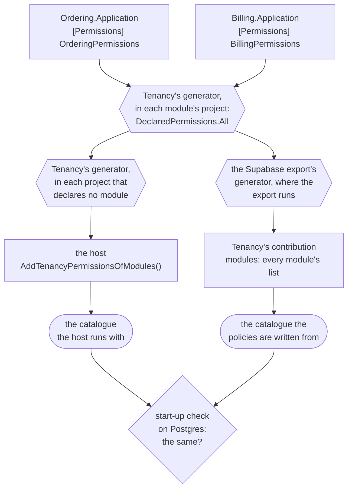
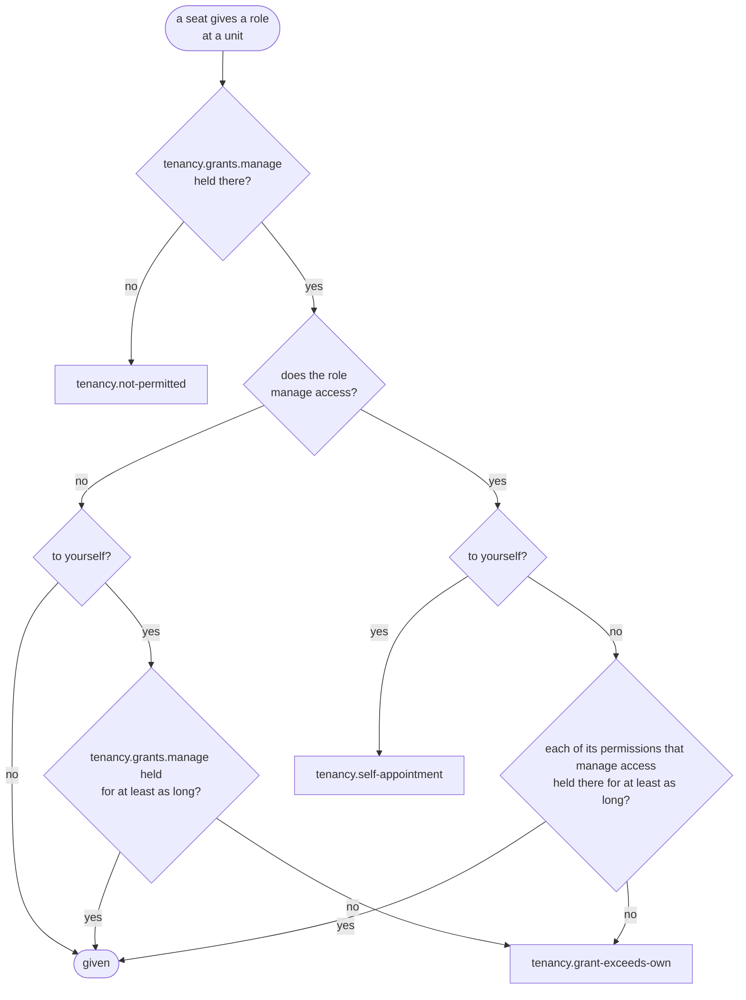
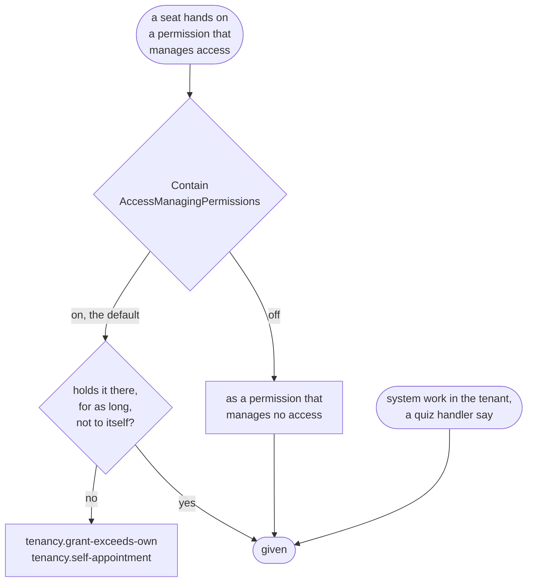

# Tenancy: roles and permissions

What a tenant's roles are made of, where they come from, and who may hand them on. Read it when you declare your
modules' permissions, choose the roles a new tenant starts with, or decide who may give roles. The
[overview](overview.md) has the words.

- **Permission**: one thing you may do, a string such as `orders.refund`. A request asks for one; a role gives some.
- **Catalogue**: every permission the application knows: Tenancy's (`tenancy.units.manage`), your modules', your
  application's.
- **Role**: a named set of permissions, kept per tenant.
- **Grant**: a role given to a **seat** (one person's place in one tenant) at a **unit** (a place in the tenant's
  organization tree).
- **Pack**: a starter role, which every new tenant gets a copy of (`RolePack` in the code).

## What the catalogue is for

- Tenancy decides access with the catalogue: which permissions exist, which manage access (and whether those stay
  contained), and which roles a new tenant starts with.
- Tenancy brings its own permissions, and each module states its own
  ([A module states its permissions once](#a-module-states-its-permissions-once)). Your `ApplicationCatalogue` adds
  what neither can say:

| Part | What it decides | Without it |
|---|---|---|
| `Packs` | The roles a new tenant starts with, which shape of tenant gets each (`SeededFor`), and what its first administrator holds | Every tenant starts with Tenancy's administrators' role alone ([The administrators' pack](#the-administrators-pack)) |
| `Permissions` | Permissions that belong to no module | Only Tenancy's permissions and the modules' contributions |
| `AccessManagingPermissions` | A permission a module declares that should manage access in your application | A permission manages access only where it is declared so ([Which permissions manage access](#which-permissions-manage-access)) |
| `ContainAccessManagingPermissions` | Whether a seat hands on a permission that manages access only where it holds it itself | On: containment holds ([Containment, on or off](#containment-on-or-off)) |

- Every part is optional, and so is the catalogue: with `options.Catalogue` unset, Tenancy builds it from
  `new ApplicationCatalogue()`, its own permissions and the modules'.
- The Postgres export, which builds the catalogue without the registration, writes the policies from the part you
  mark `[TenancyCatalogue]`, or from `new ApplicationCatalogue()` when you mark none
  ([Setting it up](postgres.md#setting-it-up)).
- A unit's kind decides nothing, so it is [yours to keep](your-module.md#the-kind-of-a-unit), on your own unit class.

## A module states its permissions once

A module declares its permissions next to the code that asks for them: constants of a static class marked
`[Permissions]`, each with its **level** (the attribute that says where it is asked) and its `Description` (what it
lets somebody do).

```csharp
// Ordering.Application, a project of the module Ordering
[Permissions]
public static class OrderingPermissions
{
    [AtTenant(Description = "See the orders")]
    public const string View = "orders.view";

    [AtUnit(Implies = [View], Description = "Refund an order")]
    public const string Refund = "orders.refund";
}
```

| The level | Asked | Held by |
|---|---|---|
| `[AtTenant]` | for the whole tenant, as `TenancyAccess.AtTenant` asks it, and as `[RequiresPermission]` with no marker requires it | a role of the organization granted at its root |
| `[AtUnit]` | at a unit, as `TenancyAccess.AtUnit` and a request's `[AtUnit]` member ask it | a role granted at that unit or above it |
| `[On<TResource>]`, [Membership's](../membership.md#the-settings-of-a-permission) | on one resource with members | its owner, its members through their roles, and, where its rules say so, a role granted where it hangs |

- A permission asked both for the whole tenant and at a unit carries both levels.
- At any level it is in Tenancy's catalogue under the module, so a role of the organization can hold it.
- The `Description` is what a screen that puts permissions into roles shows beside it, in English. To say it in
  another language, translate it under the permission's name in a resx the application's
  [failure localizer](../localization.md) reads, as a refusal's text is.
- `Implies`: what holding it brings along, as a pack's permissions do.
- `Retired = true`: it grants nothing any more, and no stored right breaks.
- [DDD00092](../diagnostics.md#ddd00092): a `[Permissions]` class that is not static, a constant without a level,
  or a permission declared twice.
- **The summary instead.** With no `Description` on any level, the constant's `/// <summary>` is the description,
  read from the comment whether or not the project writes a documentation file. A `Description` wins. With neither:
  [DDD00099](../diagnostics.md#ddd00099), a warning, since a screen would show a bare name.

### How the permissions reach the host and the export

Two programs need every module's permissions and cannot ask each other: the host builds its catalogue from its
services, and the program that exports the database's policies builds the same catalogue without any. Both compose
the modules, so both read the lists in the modules' assemblies: Tenancy's generator writes each module's list and
collects them into the host, and the Supabase package's generator finds the same lists for Tenancy's contribution
([Setting it up](postgres.md#setting-it-up)).

The path from a module's `[Permissions]` class to each of the two catalogues, and the start-up check where they
meet; look here when the host and the database disagree about a permission.



<details>
<summary>Show the code: the host's one call, and what the generators write</summary>

```csharp
// What Tenancy's generator writes into Ordering.Application, in the namespace of its assembly
public static class DeclaredPermissions
{
    [TenancyPermissions]
    public static IReadOnlyList<Permission> All { get; } = new Permission[]
    {
        new("orders.view", "Ordering", "See the orders.", Implies: null, Retired: false, Order: 10),
        new("orders.refund", "Ordering", "Refund an order.", Implies: new string[] { "orders.view" }, Retired: false, Order: 20),
    };
}

// The host's Program.cs: the host references every module, and the class is in the namespace of its assembly
using Shop.Host;

builder.Services.AddTenancyPermissionsOfModules();

// What Tenancy's generator writes into the host, in the namespace of its assembly
internal static class TenancyPermissionsOfModules
{
    public static IReadOnlyList<Permission> All { get; } = Join(
        global::Shop.Billing.Application.DeclaredPermissions.All,
        global::Shop.Ordering.Application.DeclaredPermissions.All);

    public static IServiceCollection AddTenancyPermissionsOfModules(this IServiceCollection services)
        => TenancyServiceCollectionExtensions.AddTenancyPermissions(services, All);
}

// What the Supabase package's generator writes into the project that runs the export, in
// DDDToolkit.RowAccessContributionsOfPackages.g.cs: Tenancy's contribution, made from the same lists
private readonly IRowAccessContribution _contribution = new global::DDDToolkit.Supporting.Tenancy.Postgres.TenancyRowAccessContribution(
    modules: new IEnumerable<Permission>[]
    {
        global::Shop.Billing.Application.DeclaredPermissions.All,
        global::Shop.Ordering.Application.DeclaredPermissions.All,
    },
    application: global::Shop.ShopCatalogue.Application);
```

</details>

**In the module.**

- Tenancy's generator writes `DeclaredPermissions.All` into each project that declares a `[Permissions]` class,
  under that project's module, and marks it `[TenancyPermissions]` for the projects that compose the modules to
  collect.
- That is the only list: the module writes none, its registration adds nothing, and no other project lists its
  permissions.
- A list marked `[TenancyPermissions]` by hand says the permissions twice: [DDD00095](../diagnostics.md#ddd00095).

**In the host.** The generator writes `TenancyPermissionsOfModules`, an internal class with every module's list it
finds in the project and its references, into every application that references Tenancy and every library that
references it and declares no module. Its namespace is the assembly's name (`Shop.Host` for `Shop.Host.dll`),
whatever `RootNamespace` says.

- **`TenancyPermissionsOfModules.All`**: every module's permissions, list after list, in the order of the lists'
  names. A program of your own that builds the catalogue without the host's services calls
  `TenancyCatalogue.Build(application, TenancyPermissionsOfModules.All)`, or
  `TenancyCatalogue.Build(TenancyPermissionsOfModules.All)` without a part of your own. The Supabase export needs
  neither: it hands Tenancy's contribution the same lists, found by their mark.
- **`services.AddTenancyPermissionsOfModules()`**: adds `All` to the catalogue as one contribution; the host calls it
  once. A top-level `Program.cs` is in no namespace, so it needs `using Shop.Host;`.
- Neither call names a module: a module or permission you add reaches both programs at the next build, and the host
  does not change.
- While no module declares a permission, `All` is empty and both calls still compile.

**Which projects get the class.**

- A project declares a module with `DDD_Module`, in the project file or for a folder of projects
  ([A module named by its folder](../modules.md#a-module-named-by-its-folder)), or with `[assembly: Module]`. One that
  declares none lists its permissions under its assembly's name.
- A module's own libraries get none: a module states its own permissions and composes no other module's.
- An application gets it whether it declares a module or not, since nothing composes the modules from it. A
  one-project application that sets `DDD_Module` to name its code, as [Getting started](../getting-started.md) does,
  is module and host at once, and registers its own permissions with the same call.
- A library that the host and an export share, to compose the modules in one place, sets no `DDD_Module`; otherwise
  it is a module and gets no class.

**What goes wrong.**

- `AddTenancyPermissions` stays, for permissions you add by hand. A module's list added with it as well is added
  twice: the catalogue stops at start-up, with one problem naming the permissions and the call to take out.
- A host without `AddTenancyPermissionsOfModules()` runs with no module's permissions. A pack that names one stops
  the catalogue at start-up; with no such pack, as with Tenancy's default administrators' pack, the first question
  about one throws. Both messages name the two halves: the `[Permissions]` classes and the host's call.
- The two programs build the same catalogue while they reference the same modules and neither adds permissions by
  hand that the other lacks. The export can be the host itself, with one list. Where it is a program of its own, as
  in the sample, it references the modules the host does, and the start-up check on Postgres guards it: it compares
  the functions the export wrote with the host's catalogue, and refuses a host whose policies were written from
  another catalogue ([Setting it up](postgres.md#setting-it-up)).

## Starter roles: packs

**Pack** is the code's word for a starter role: `RolePack`, listed in your catalogue's `Packs`.

- A tenant's roles start as copies of the packs, and are the tenant's own from then on, to rename and to give other
  permissions.
- `SeededFor` says which tenants get a copy: left out, every tenant; set to a shape, only a tenant of that shape,
  provisioned so or changed to it later. It chooses tenants, not the role: a role has no shape.
- A role made from a pack still follows the pack when your application changes it, once the host syncs the packs;
  what the tenant changed itself stays ([Packs after provisioning](#packs-after-provisioning)).
- Whoever holds `tenancy.roles.manage` for the whole tenant may put any permission of the catalogue into any role. So
  that permission makes an **administrator**: an active seat, placed at the root, holding it there through a grant
  with no end.
- Only an administrator adds a permission that manages access to a role, or takes one out
  ([Who may give a role](#who-may-give-a-role)).

## The administrators' pack

- A tenant's first seat gets the role of the administrators' pack, at the root. It holds the permissions that manage
  access, so its holder can give the next role: no tenant starts without one.
- You need not declare it.

### The default: Tenancy's own

- With no administrators' pack declared, `TenancyCatalogue.Build` adds `TenancyPacks.DefaultAdministrators`: key
  `administrator`, named Administrator, for every shape, seeded when a tenant is provisioned.
- It lists no permissions, so it holds every live permission, one a module adds later included; a tenant that has the
  role already gets that permission at the next sync of the packs
  ([Packs after provisioning](#packs-after-provisioning)).
- So the smallest application declares no catalogue: its modules mark their permissions, the host adds them with one
  generated call ([A module states its permissions once](#a-module-states-its-permissions-once)), and
  `options.Catalogue` stays unset.
- Packs that administer nothing, such as a viewer's, sit beside it.
- A tenant provisioned in Dutch gets it as Beheerder: the package names its own pack in the two languages it ships,
  and asks your `IRolePackTexts` first, by the key `administrator`
  ([Roles in the tenant's language](names-and-languages.md#roles-in-the-tenants-language)).
- On Postgres the access file is written from the same catalogue, so `pack_permissions('administrator')` answers every
  live permission, and the start-up check comparing the database's functions with the running catalogue passes.

### Your own administrators' pack

- Declare your own once the role needs another name or its own list of permissions, and then one for every shape: a
  single one with no `SeededFor`, or one seeded for each shape.
- The default is added only when you declare none; `HasDefaultAdministrators` on the built catalogue says which you
  have.
- `TenancyCatalogue.Build` refuses these, with a problem that says the fix:

| Your catalogue | The problem |
|---|---|
| An administrators' pack seeded for a flat tenant, and none for a hierarchical one | names the `SeededFor` to write |
| One declared with `SeedOnProvision: false`: seeded into no tenant, it counts for no shape | names it, and says to leave that off |
| Two seeded for one shape | says to keep one: seed the other for another shape, or declare it without `Administers` |
| While the default is added: a pack of yours whose key, or one of its names ignoring case, is Administrator or the Dutch Beheerder (a tenant's roles have names of their own) | names the pack, and says to rename it or to declare it with `Administers: true`, which makes it the administrators' pack |

<details>
<summary>Show the code: an application without a catalogue, one with permissions of its own and no packs, and one with an administrators' pack for each shape</summary>

```csharp
// No catalogue: the permissions are Tenancy's and the modules', and every tenant starts with the default
// administrators' role, given to its first seat
services.AddTenancy<ShopTenancyContext>();

// Permissions the application owns itself, and still no pack: the default administrators' role holds them too
public static ApplicationCatalogue Application { get; } = new(Permissions: ShopPermissions.All);

// A provisioned tenant names the role by the pack's key
var administrators = provisioned.RolesByPack[TenancyPacks.DefaultAdministratorsKey];

// Administrators of your own, one seeded for each shape of tenant, and a pack that every tenant gets
public static ApplicationCatalogue Application { get; } = new(
    Packs:
    [
        new("owner", "Owner", "Runs the shop", [], SeededFor: TenantShape.Flat, Administers: true),
        new("head-office", "Head office", "Runs every branch", [], SeededFor: TenantShape.Hierarchical, Administers: true),
        new("viewer", "Viewer", "Looks at the orders", [ShopPermissions.OrdersView]),   // no SeededFor: every tenant
    ],
    Permissions: ShopPermissions.All);
```

</details>

### What the administrators hold

- A pack that lists no permissions holds every permission of the catalogue, the modules' included.
- One that lists permissions holds only those: for administrators who run access without the permissions to the
  modules' work. Its list must hold every one of Tenancy's permissions and every permission that manages access,
  itself or through one that implies it. `TenancyCatalogue.Build` refuses a pack that leaves one out, naming each, so
  marking another permission stops the application at start-up until the pack lists it.
- Either way an administrator can give every role, and appointing an area manager needs no system work.
- The list is where the role starts, not a wall around the seat: an administrator still puts any permission into a
  role, and gives itself a role that manages no access, as every seat that manages grants may.

### Moving an application to the default

Switching a running application from a pack of its own to the default changes none of its tenants:

- Each keeps the role its old pack gave, with that role's permissions and its holders.
- The default reaches those tenants only with a change of shape, which copies every pack seeded for the new shape
  that the tenant has no copy of, the default among them.
- A tenant that still has a role named like the default (an old pack called Administrator, say) refuses that copy
  with `tenancy.role-name-taken`, and the change of shape with it. Rename that role in those tenants first, or keep
  declaring your own pack.

## Packs after provisioning

- Tenants change their roles as they like, and your packs change too: a module you add brings permissions that an
  administrators' pack listing none now holds, or you add a permission to a pack or take one out.
- By default a tenant provisioned before keeps the role the old pack made.
- `SyncRolePacks()` in the host brings those roles up to their packs once the host has started, in every tenant,
  without undoing what a tenant changed itself.

### How a role follows its pack

- Every role made from a pack remembers what the pack gave it, `PermissionsFromPack`: the pack as it was when the role
  was made, and later as it was when the role last followed it.
- The sync compares that with the pack your catalogue builds now:
  - gained by the pack: added to the role;
  - lost by the pack: taken out;
  - taken out by the tenant: stays out while the pack still holds it;
  - added by the tenant: stays while the pack never held it.
- Say a tenant took closing boards out of its Project lead, and you later add archiving boards to that pack: at the
  next start the role gets archiving, and closing stays out.
- A tenant whose Administrator came from the default pack gets the permissions of a module you add, and nobody makes
  a role for them by hand.

What the comparison cannot tell apart is settled this way:

| Case | What the sync does |
|---|---|
| A permission the tenant added by hand, which the pack gains later and loses again | Once the pack holds it, it is the pack's: it goes when the pack loses it, and the event says so |
| A permission the tenant took out, which the pack loses and later gains again | It comes back as a permission the pack gained: once the pack lost it, the role no longer remembers it. The event names it, among the permissions that manage access when it manages access |
| A permission that is no longer live, retired or removed from your code | It stays on the role. It grants nothing, and retiring a permission changes no role |
| A permission that a permission the role keeps implies | It stays, or comes with that permission, as everywhere a role's permissions are set |
| An archived role | Left as it is: it grants nothing, and changes no more |
| A role an import or a seeding made from a pack with permissions of its own | It remembers the pack's permissions, not its own, so what it holds beyond the pack, or lacks, is the tenant's and stays |
| A role whose pack your catalogue no longer has | It keeps its keys and what it remembers, and follows the pack again if you declare it again under the same key |
| A role made before roles remembered their pack, whose column is empty, or made from a pack your catalogue did not have then | It follows as if the pack had given it nothing yet: it gets every permission of the pack it lacks, and loses none |
| A role whose permissions are stored in another order | The same permissions are no change: they are saved in order, and no event is raised |
| A role whose following would take the administrator permission from the tenant's last administrators | Left as it is, and named in the answer. It follows once the tenant has an administrator through another role |

Permissions that manage access follow too. Only an administrator changes them in a role
([Who may give a role](#who-may-give-a-role)), but only your code puts a permission in a pack, so the sync, being your
application's work, follows the pack in those as well. The event lists them apart, so whoever tells the tenant can
say the change gives or takes away power over other people's access.

### Turning it on

- One call, beside the start-up checks but not one of them: a check reads and changes nothing, and this changes the
  tenants' roles.
- It runs once per start, in the background, after the start-up checks and every hosted service have started (so a
  seeding of your own is done). The host serves meanwhile.
- It visits the active and the suspended tenants in turn, running `RoleCommands.FollowPacksAsync` in each as Tenancy's
  system work in that tenant: on Postgres it writes under the policies, in Tenancy's own scope.
- One save per tenant, which takes the tenant's access revision first, as every change of rights does. So a second
  run changes nothing, and of two hosts starting at once only one commits a tenant: the other reads it again and
  finds nothing left to change.
- A tenant whose sync fails is logged, and left for the next start.
- `AddTenancy` registers what the call runs, `IRolePackSync`. To sync from a deployment step, or behind an endpoint of
  your operators, leave the call out and run that yourself. An operator who syncs one tenant runs the use case in it,
  recorded as the operator.

<details>
<summary>Show the code: turning the sync on, and running it yourself</summary>

```csharp
// The host
builder.Services.RunStartupChecks();
builder.Services.SyncRolePacks();   // once the host has started, every tenant's roles follow their packs

// A deployment step, or an operator's endpoint for every tenant: the same, run when you say
var report = await services.GetRequiredService<IRolePackSync>().SyncAsync(cancellationToken);
if (!report.Succeeded)
{
    foreach (var (tenant, error) in report.Failed)
    {
        logger.LogError(error, "The roles of tenant {Tenant} did not follow their packs", tenant);
    }
}

// One tenant, for an operator, whom the events then name
using (TenancyWork.BeginOperatorIn<TenantId, SeatId>(tenant, operatorIdentity))
{
    var followed = await roles.FollowPacksAsync(cancellationToken);   // roles: TenancyUseCases.RoleCommands
    // followed.Changed, followed.KeptForAnAdministrator, followed.WithoutTheirPack
}
```

</details>

### Telling the tenant

- Each role that changes raises `RoleFollowedItsPack`: the tenant, the role, the pack, the permissions that came in
  (`Added`) and went out (`Removed`), those of them that manage access (`ManagingAccess`), and who made the change
  (`By`, the system).
- The package sends no message. `AddTenancyEventLog` keeps the event in the
  [access history](operators-and-history.md#access-history), where the tenant's administrators read it; the sample
  does no more.
- To mail them, publish the event as a contract of your own, and handle that where your application sends mail.

<details>
<summary>Show the code: mailing a tenant's administrators when a role followed its pack</summary>

```csharp
// The contract, in the module that publishes it
[IntegrationEvent]
public sealed record RoleFollowedItsPackV1(long TenantId, Guid RoleId, string Pack, string[] Added, string[] Removed, string[] ManagingAccess);

// Tenancy's outbox: mapped before AddTenancyDomainEvents, which keeps every event it has no mapping for off the sinks
options.UseOutbox<ShopTenancyContext>(outbox => outbox
    .PublishAs<RoleFollowedItsPack<TenantId, RoleId, SeatId>, RoleFollowedItsPackV1>(followed => new RoleFollowedItsPackV1(
        followed.TenantId.Value, followed.RoleId.Value, followed.Pack, [.. followed.Added], [.. followed.Removed], [.. followed.ManagingAccess]))
    .AddTenancyDomainEvents()
    .KeepEventLog(log => log.AddTenancyEventLog()));

// Where your application sends mail: who administers the tenant, and where to write to them, is yours to know
public sealed class TellTheAdministrators(IShopAdministrators administrators, IMailer mailer)
    : IIntegrationEventHandler<RoleFollowedItsPackV1>
{
    public async Task HandleAsync(RoleFollowedItsPackV1 followed, IntegrationEventMessage message, CancellationToken cancellationToken)
    {
        // A role may only gain permissions, or only lose them: a line is written for what happened, and none for what did not
        string?[] lines =
        [
            $"The role made from the pack {followed.Pack} changed with the application.",
            followed.Added.Length > 0 ? $"It gained {string.Join(", ", followed.Added)}." : null,
            followed.Removed.Length > 0 ? $"It lost {string.Join(", ", followed.Removed)}." : null,
            followed.ManagingAccess.Length > 0 ? $"It changes who may manage access: {string.Join(", ", followed.ManagingAccess)}." : null,
        ];
        var body = string.Join(Environment.NewLine, lines.OfType<string>());

        foreach (var address in await administrators.AddressesAsync(followed.TenantId, cancellationToken))
        {
            await mailer.SendAsync(address, "A role changed with the application", body, cancellationToken);
        }
    }
}
```

The handler is delivered at least once, so where a second mail would matter it remembers the message it mailed for,
by `message.MessageId`. [Integration events](../integration-events.md) has the handler's registration, and what it
runs as.

</details>

### The column it needs

- The roles' table has one column more, `PermissionsFromPack`, on every database, added by a migration of yours like
  any change of the model. It is nullable: rows stored before it have none, and follow as the table above says.
- On Postgres the export also writes two triggers and a stricter policy for it:
  - a seat that changes a role cannot change the column: a trigger refuses, as a policy does;
  - the other trigger keeps the pack a role was made from;
  - a role a seat adds names no pack, or is an exact copy of one, remembering exactly the pack's permissions
    ([What the policies check](postgres.md#what-the-policies-check)).

## Who may give a role

`tenancy.grants.manage` at a unit is enough to give roles there. Its holder gives any active role of the tenant that
manages no access to a seat placed there or below, and takes it away again, without holding the role's permissions:
someone in HR gives a developer the developer's role without being a developer.

### Roles that manage access stay contained

A role **manages access** when it holds a permission that gives power over other people's access. Such a role stays
contained:

- Only a seat holding each of its permissions that manage access at that unit (granted there or above), for at least
  as long as the grant runs, gives it or takes it away. As long as the grant runs: until its end, or for good when it
  has none. A seat that manages seats for a week does not give a role that manages seats for good.
- The refusal is `tenancy.grant-exceeds-own`; its `Missing` argument names the permissions that manage access the
  seat lacks there, or lacks for long enough. The role's other permissions are not counted.
- Nobody gives one to themselves, whatever they hold: `tenancy.self-appointment`, decided before any of the role's
  permissions is counted.

This is **containment**, and everything below about roles and permissions that manage access is part of it. It is on
unless you turn it off ([Containment, on or off](#containment-on-or-off)); then a role that manages access goes as one
that manages none, down the flowchart's branch for those, and what this section says of those holds for every role.

Every check a grant of a role goes through, with the refusal each one gives; use it to read a refusal back to its
cause.



<details>
<summary>Show the code: giving a role, and reading a refusal</summary>

```csharp
// SeatCommands is registered with Tenancy. It finds the calling seat itself,
// and decides as above before it saves.
public sealed class RoleDesk(TenancyUseCases.SeatCommands seats)
{
    public Task GiveAsync(SeatId seat, OrganizationUnitId unit, RoleId role, DateTimeOffset? until, CancellationToken cancellationToken)
        => seats.GrantAsync(seat, unit, role, until, reason: null, cancellationToken);
}
```

```csharp
try
{
    // No end: the role is given for good
    await desk.GiveAsync(seat, unit, role, until: null, cancellationToken);
}
catch (RefusalException refusal) when (refusal.Code == TenancyRefusals.GrantExceedsOwn)
{
    // The permissions that manage access the caller lacks there, or lacks for long enough
    var missing = refusal.Arguments["Missing"];
}
```

</details>

For every role: the permission is asked at the unit and reaches everything below it; the last administrator stays;
nothing is given at an archived unit; only active roles of the same tenant are given; a grant a seat makes starts
now. System work in a tenant (work no person does, begun explicitly) is held to none of this.

### Which permissions manage access

- All of Tenancy's do, except the one that reads the [access history](operators-and-history.md#access-history).
- Mark your own where you declare them, and any permission, a module's included, in your part of the catalogue. The
  sample's host marks two of its Projects module's:

```csharp
public static ApplicationCatalogue Application { get; } = new(
    Packs: [/* ... */],
    AccessManagingPermissions: [ProjectPermissionNames.ChangeOwner, ProjectPermissionNames.ManageCrew]);

// A permission of your own, marked where it is declared
new Permission("widgets.assign", "Widgets", "Hand widgets to people", ManagesAccess: true);
```

Mark every permission that should be given only by someone who holds it: each one that

- gives power over roles, grants, placements, seats or the tree;
- decides who works on what, such as managing a project's crew, or names an owner;
- reaches credentials, or lets support staff into a tenant.

Then:

- A permission whose power reaches no further than the permissions of roles that manage no access may stay unmarked.
- The built catalogue lists the marks in `AccessManagingPermissions`, and shows each on its permission in
  `Permissions`.
- A permission that manages no access may not imply one that does, so what a role is labelled with is what it holds.
- Pin the set with a test that holds the built catalogue's `AccessManagingPermissions` to the permissions written
  out, one by one. A mark added or dropped then fails a test until somebody decides it, and never slips in as the side
  effect of a new permission.

<details>
<summary>Show the code: the sample's test of its marks</summary>

```csharp
// ApplicationRuleScenarios.cs in the sample's tests
[Fact]
public async Task The_permissions_that_manage_access_are_exactly_these()
{
    await using var host = await sample.StartAsync();   // a host from the class's fixture, on Supabase's Postgres image

    host.Services.GetRequiredService<TenancyCatalogue>().AccessManagingPermissions.Should().BeEquivalentTo(
    [
        "tenancy.settings.manage",
        "tenancy.units.manage",
        "tenancy.seats.manage",
        "tenancy.grants.manage",
        "tenancy.roles.manage",
        "projects.owner.change",
        "projects.crew.manage",
    ]);
}
```

</details>

**A forgotten mark fails open.** Marking is opt-in:

- An unmarked permission is given by every grants manager, to anyone placed where they hold `tenancy.grants.manage`,
  themselves included.
- An application that marks none hands its grants managers every role except those holding one of Tenancy's
  permissions that manage access. Mark before anyone manages grants.
- The marks rule the organization's grants, which Tenancy gives. A module that gives permissions through grants of its
  own (a crew role, on one project) answers for a marked permission it gives that way: no further than the giver
  reaches with it, or contained the same way. The sample's crews give `projects.crew.manage` on one project only, and
  only from whoever manages that project's crew already.
- Marks are read when a role is given or taken away; nothing checks the existing grants when a mark changes. After
  changing marks, restart every instance before anyone grants again.
- Taking a marked permission out of retirement marks it anew.

### Giving yourself a role

- A seat gives itself a role that manages no access for no longer than it holds `tenancy.grants.manage` there: a
  week's grants manager gives itself no role for good.
- Grants to anyone else run as long as the giver says.
- Nobody places themselves (`tenancy.self-assignment`), so a seat gives itself roles only where someone else placed
  it.

### Taking a role away

- Taking away follows giving: a role that manages no access goes with `tenancy.grants.manage` alone; one that manages
  access needs its permissions that do, until at least the end of that grant.
- A seat's own grant that applies now is its own hold of those permissions, so a seat may take away its current roles.
  One that has ended, or is still to start, holds nothing: taking it away needs the permissions, as for anyone else's.
- An archived role manages nothing.
- Withdrawing a placement takes its grants with it: the caller needs `tenancy.seats.manage`, plus
  `tenancy.grants.manage` when the placement has grants, each checked against its own end.
- The last administrator stays in every case.

### Suspending, deactivating and reactivating a seat

- A seat's status decides whether its grants count, so these take away, or give back, every grant of the seat that
  has not ended.
- The caller needs `tenancy.seats.manage` for the whole tenant, and, for each grant of a role that manages access,
  that role's permissions that manage access at the grant's unit until at least its end, as taking the role away
  would. Otherwise `tenancy.grant-exceeds-own`, naming what the caller lacks.
- A grant that has ended gives nothing either way and is not counted; one still to start is.
- A seat may suspend or deactivate itself (its current grants are its own hold), but never reactivates itself: a
  suspended seat acts as nobody.
- The last administrator stays.

### Moving a unit

- A move changes which grants reach the unit and everything below it: those above the old parent and not the new one
  stop reaching it; those above the new parent and not the old one start to.
- The mover needs `tenancy.units.manage` at both parents, and is held to the rules for giving and taking away over
  what the move changes. Each grant that has not ended counts at the moving unit, against its own end, one still to
  start included:
  - The move gives the mover nothing: every permission its own grants on the new side would give it there, it already
    holds at the unit, for at least as long.
  - It gives or takes away a permission that manages access, from anyone, only when the mover holds that permission
    at the unit until at least the end of the grant it comes from, or for good for a grant with no end.
- The refusal is `tenancy.grant-exceeds-own`, with no `Role`, and `Missing` naming the permissions.
- Permissions that manage no access follow a move freely for everyone but the mover, as a role holding only them is
  given freely.
- An administrator whose role holds every permission moves any unit. One whose pack lists its permissions holds every
  permission that manages access at the root, so no move is refused it over what others gain or lose; a grant of its
  own below the root still counts, and a move that would give it a permission from there that its role at the root
  lacks is refused, as any seat's.

### Changing a role that manages access

- Adding a permission that manages access to a role, taking one out, or archiving a role that holds one takes an
  administrator: `tenancy.roles.manage` at the root, with no end. Anyone else: `tenancy.grant-exceeds-own`, naming
  `tenancy.roles.manage`.
- An added permission reaches every holder of the role, those who gave it to themselves included: look at who holds a
  role before you add one.
- A permission taken out, or a role archived, goes from every holder at once, which an administrator for a week could
  not do grant by grant.
- Each grant records who gave it, in `RoleGrant.GrantedBy` and the `OrganizationRoleGranted` event. A change of a
  role's permissions names what came in and went out, in the `RolePermissionsChanged` event.

### What that means for a tenant

- Trust `tenancy.grants.manage` with every role that manages no access where it is held, the holder's own included.
- Two grants managers can give each other roles; containment still holds for roles that manage access.
- Tenancy knows one person per seat. Someone who can add a seat for another account of their own, or has help from
  someone who can, gives that seat what they could not give themselves, within what containment allows them anyway.
- A role holding only `tenancy.grants.manage` manages access, so grants managers give it to one another, never to
  themselves.
- A seat that manages a region for a week cannot keep its units for good by moving them under a region it manages for
  good, nor move a unit away from, or under, someone who holds a role that manages access there for good.

## Containment, on or off

- Containment is the rule above for permissions that manage access: a seat hands one on only where it holds it
  itself ([Who may give a role](#who-may-give-a-role)).
- You decide. Who may give your users what is a choice about your product, part of the access model, not something
  that keeps your data sound. So it is a setting of your catalogue, `ContainAccessManagingPermissions`, on by default.

### What it does

Ben holds `tenancy.grants.manage` at Pier 7, a unit of Harbor Works, for good, through a role that holds only that
permission. With containment on:

- He gives anyone placed at Pier 7, himself included, a role that manages no access, a surveyor's say.
- He gives nobody a role holding a permission that manages access he does not hold there: not an area manager's
  (`tenancy.units.manage` and `tenancy.seats.manage`), not the administrators' (`tenancy.roles.manage`).
- He gives himself no role that manages access at all.
- So Ben cannot give himself `tenancy.roles.manage`, at the root or anywhere: he hands on the grants permission, no
  more.

The same holds for every other way a permission that manages access changes hands: taking a role away and withdrawing
a placement that has one; suspending, deactivating or reactivating a seat that holds one; putting such a permission
into a role, taking one out or archiving a role that holds one (an administrator's work alone); and moving a unit,
which gives or takes such a permission from nobody where the mover does not hold it.

### What turning it off means

- A role or a permission that manages access goes as one that manages none; seats are no longer held to the rules
  above.
- Ben gives himself the administrators' role at Pier 7, and then manages everything at and below it: its units, its
  seats, its grants and every permission of every module.
- A seat with the grants permission at the root gives itself the administrators' role there. A seat that manages roles
  for the whole tenant puts every permission into every role, its own included.
- Anyone holding a permission that manages access can hand out every permission, so is in practice an administrator of
  everything that permission reaches.
- Turn it off when that is what you want, or when your own handlers decide who may give what, by rules of your
  product.

### What it does not touch

- Roles that manage no access go as always, with `tenancy.grants.manage` at the unit, and now every role goes that
  way. So a seat still gives itself any role for no longer than it holds `tenancy.grants.manage` there: with the
  grants permission for a week, Ben gives himself the administrators' role for that week, not for good. A move still
  gives the mover nothing.
- Each command still asks its permission where it acts: Ben gives no role outside Pier 7 and the units below it, where
  alone he holds the grants permission. That he gives none at the root is this, not containment.
- A tenant keeps an administrator: the last one is never taken away, in C# or in the database.
- A seat keeps its identity and its tenant, whoever asks
  ([What the database guards on a seat](postgres.md#what-the-database-guards-on-a-seat)).
- The marks stay: `AccessManagingPermissions` and `ManagesAccess` answer the same.

### The one question that decides it

Can your database be reached without your handlers, for instance through Supabase's Data API? Then leave it on.

- Your handlers are the only place a product rule of your own says who may give what, and a client talking to the
  database directly goes past them.
- With containment on, the database still refuses that client a role that manages access at a unit where it lacks
  that role's permissions, any such role to itself, such an invitation, and stopping a seat whose such grants it could
  not take away.
- How long a grant runs, a change of such a permission in a role, and moves are asked by the use cases alone
  ([What stays in C#](postgres.md#what-stays-in-c)).
- With it off, a grants manager there hands out every role.

Where the setting sits on the path of a seat handing on a permission that manages access, and that system work never
passes through it:



### System work is not held to it

- Containment is about a seat handing permissions on, never about your application: system work in a tenant holds
  every permission there and is not held to it, on or off.
- So an application where a manager earns a role that manages access, by passing a quiz say, keeps containment on. Its
  own handler checks the quiz, which Tenancy knows nothing of, then gives the role inside
  `TenancyUseCases.BeginSystemIn(tenant, seat)`, for the seat that passed.
- The grant records no seat as its giver; its event records the system, acting for that seat.
- System work gives whatever it is told, so what it is told comes from your application, never from the request. The
  handler below takes the tenant and the seat from the caller (refusing anything but a seat), and the role and the
  unit from the quiz's own record; the request only names the quiz and carries the answers.
- A handler that took a role or a seat from its request would give whoever passed the quiz whatever they named, the
  administrators' role at the root included.

### The setting in the host and the export

- One line of your part of the catalogue; leaving it out keeps containment on.
- The host reads it from `TenancyOptions.Catalogue`, the export from the same part, marked `[TenancyCatalogue]`
  ([Setting it up](postgres.md#setting-it-up)), so the two cannot disagree.
- The export writes it into the access files with the rest of the catalogue. On Postgres the policies on the grants
  and the invitations, and the trigger on a seat's status, ask `permission_is_contained(permission)`: it answers the
  permissions that manage access while containment is on, and none once it is off.
- The start-up check `tenancy.policies-in-place` compares that function with the host's catalogue, and refuses a
  database written with containment the other way round, saying which way each is. So after changing the setting,
  export the access files and apply them before the host starts.
- Grants made while it was off stay when you turn it back on: containment is asked when a role is given or taken
  away, and nothing checks the grants that exist.

<details>
<summary>Show the code: turning containment off, and a quiz handler that keeps it on</summary>

```csharp
// Your part of the catalogue, with containment off: the host hands it to TenancyOptions.Catalogue, and the export
// writes the policies from it because it is marked. Leave the last line out to keep containment on.
public static class ShopCatalogue
{
    [TenancyCatalogue]
    public static ApplicationCatalogue Application { get; } = new(
        Packs: [/* ... */],
        AccessManagingPermissions: [ProjectPermissionNames.ChangeOwner, ProjectPermissionNames.ManageCrew],
        ContainAccessManagingPermissions: false);
}
```

```csharp
// Your own handler, with containment on. The request names the quiz and carries the answers. Who passed is the
// caller, and what passing gives is the quiz's: system work gives whatever it is told, so a client chooses neither.
public sealed class QuizDesk(TenancyUseCases.SeatCommands seats, IQuizzes quizzes)
{
    public async Task PassAsync(QuizId quizId, QuizAnswers answers, CancellationToken cancellationToken)
    {
        if (TenancyUseCases.CurrentCaller() is not { Kind: TenancyCallerKind.Seat, Tenant: { } tenant, Seat: { } seat })
        {
            throw QuizRefusals.Refuse(QuizRefusals.SeatsOnly);
        }

        var quiz = await quizzes.FindAsync(quizId, cancellationToken) ?? throw QuizRefusals.Refuse(QuizRefusals.NotFound);
        if (!quiz.Passes(answers))
        {
            throw QuizRefusals.Refuse(QuizRefusals.NotPassed);
        }

        // The role and the unit are the quiz's own, which an administrator set when making it.
        using (TenancyUseCases.BeginSystemIn(tenant, seat))
        {
            await seats.GrantAsync(seat, quiz.Unit, quiz.Role, until: null, reason: "passed " + quiz.Name, cancellationToken);
        }
    }
}
```

</details>
