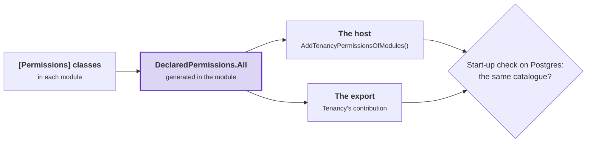

# Tenancy: roles and permissions

What a tenant's roles contain, where roles come from, and who may give them. Read this page when you declare
permissions, choose the roles a new tenant starts with, or decide who may give roles.

- **Permission**: one thing a caller may do, as a string such as `orders.refund`. A request requires one permission,
  and a role contains several.
- **Role**: a named set of permissions, stored per tenant. A **grant** gives a role to a **seat** (one person's place
  in one tenant) at a **unit** (a place in the tenant's organization tree).
- **Starter role**: a role that every new tenant gets a copy of (`StarterRole` in the code).

## What the catalogue is for

The **catalogue** is every permission the application knows. It combines Tenancy's permissions
(`tenancy.units.manage`), each module's permissions ([below](#declaring-a-modules-permissions)), and what your
`ApplicationCatalogue` adds. Every part of `ApplicationCatalogue` is optional:

| Part | What it sets | Default |
|---|---|---|
| `StarterRoles` | The starter roles, which shape of tenant (flat or hierarchical) gets each one, and what the first administrator holds | Tenancy's administrators' starter role only ([The administrators' pack](#the-administrators-pack)) |
| `Permissions` | Permissions that belong to no module | None |
| `AccessManagingPermissions` | Permissions declared elsewhere, for example by a module, that manage access in your application | Only the permissions marked where they are declared ([Which permissions manage access](#which-permissions-manage-access)) |
| `ContainAccessManagingPermissions` | Whether a seat may give a permission that manages access only where the seat holds that permission | On ([Containment, on or off](#containment-on-or-off)) |

- To use no catalogue, leave `options.Catalogue` unset. Tenancy then builds `new ApplicationCatalogue()`.
- The Postgres export builds the catalogue without starting the host. It uses the part you mark `[TenancyCatalogue]`,
  or `new ApplicationCatalogue()` when you mark none ([The row access contribution](postgres.md#the-row-access-contribution)).
- A unit's kind plays no part in access. Keep the kind [on your unit class](your-module.md#the-kind-of-a-unit).
- [`ApplicationCatalogue`](reference/catalogue.md#applicationcatalogue) lists every member.

## Declaring a module's permissions

A module declares its permissions next to the code that requires them. Each permission is a public constant of a
static class marked `[Permissions]`. Each constant has a **level** and a `Description`. The level says where the
permission is checked. The description says what the permission lets somebody do.

**`Ordering.Application/OrderingPermissions.cs`**, in the module Ordering

```csharp
[Permissions]
public static class OrderingPermissions
{
    [AtTenant(Description = "See the orders")]
    public const string View = "orders.view";

    [AtUnit(Implies = [View], Description = "Refund an order")]
    public const string Refund = "orders.refund";
}
```

| Level | Where it is checked | Who holds it |
|---|---|---|
| `[AtTenant]` | For the whole tenant, by `TenancyAccess.AtTenant` or by `[RequiresPermission]` without a marker | A seat with a role granted at the root |
| `[AtUnit]` | At a unit, by `TenancyAccess.AtUnit` or by a request's `[AtUnit]` member | A seat with a role granted at that unit or above it |
| `[On<TResource>]`, [Membership's](../membership/permissions-and-roles.md#the-settings-of-a-permission) | On one resource with members | The resource's owner, its members through their roles, and a role granted at the resource's unit or above it, when the permission allows that (`FromAbove`) |

- A permission that is checked at more than one level carries each level. Put each setting on one of the levels. At
  every level the permission is in the catalogue under its module, so a role of the organization can hold it.
- `Implies` lists the permissions that come with this one. Implication goes one step. A permission that another
  permission implies cannot imply anything itself.
- `Retired = true` makes the permission grant nothing. No role can receive it again, and no stored grant breaks.
  Retire a permission instead of deleting it. A permission that is declared and not retired is **live**.
- `Description` is the English text that a screen for building roles shows. Without it, the constant's
  `/// <summary>` is used. With neither, [DDD00099](../diagnostics.md#ddd00099) warns. Translate the description
  under the permission's name, in a resx that your [failure localizer](../localization.md) reads.
- [DDD00092](../diagnostics.md#ddd00092) lists the rules for the class.

### Collecting the permissions of every module

Two programs need every module's permissions. The first is the host. The second is the export, which writes the
Postgres policies without starting the host. The diagram shows where each program gets the permissions. When the two
programs disagree about a permission, follow it to find the cause. Purple: the one list that each module generates.



The host needs one line:

**`Shop.Host/Program.cs`**

```csharp
using Shop.Host;   // the generated class is in the assembly's namespace, and a top-level Program.cs is in none

builder.Services.AddTenancyPermissionsOfModules();
```

- **In a module's project** with a `[Permissions]` class, Tenancy's generator writes `DeclaredPermissions.All`,
  marked `[TenancyPermissions]`. That list is the module's only list. A list you mark `[TenancyPermissions]` by hand
  is [DDD00095](../diagnostics.md#ddd00095).
- **In a project that composes the modules**, the generator writes `TenancyPermissionsOfModules`. These projects are
  every application that references Tenancy, and every library that references Tenancy and declares no module. The
  class is internal and in the namespace of the assembly's name (`Shop.Host`), whatever `RootNamespace` says. Its
  `All` contains every module list in the project and in its references, ordered by the lists' names. `All` is empty
  while no module list exists.
- So no call names a module. A module you add reaches both programs at the next build.
- A program of yours that builds the catalogue without the host calls
  `TenancyCatalogue.Build(application, TenancyPermissionsOfModules.All)`. The Supabase export finds the lists itself.
- A project declares a module with `DDD_Module` ([A module named by its folder](../modules.md#a-module-named-by-its-folder))
  or `[assembly: Module]`. A project that declares no module lists its permissions under its assembly's name. So a
  library that the host and an export share to compose the modules sets no `DDD_Module`.
- A one-project application that sets `DDD_Module`, as [Getting started](../getting-started.md) does, is a module and
  a host at once. It registers its permissions with the same call.

| Mistake | Result |
|---|---|
| A module's list is also added with `AddTenancyPermissions`, which exists for permissions you add by hand | Building the catalogue fails at start-up. The message names the permissions and the call to remove. |
| The host does not call `AddTenancyPermissionsOfModules()` | When a starter role names a module's permission, building the catalogue fails at start-up. Otherwise the first query about a module's permission throws. Both messages name the fix. |
| The export references other modules than the host, or either program adds permissions by hand | The start-up check on Postgres refuses to start the host ([The start-up checks](postgres.md#the-start-up-checks)). The export can be the host itself. |

## Starter roles

- A tenant's roles start as copies of the starter roles in `StarterRoles`. After that, the copies belong to the tenant,
  which can rename and change them.
- `SeededFor` selects the tenants. Without `SeededFor`, every tenant gets a copy. With a shape, only tenants of that
  shape get a copy, whether they were provisioned with that shape or changed to it later. A role has no shape.
- A copy follows your later changes to its starter role once the host syncs them
  ([Packs after provisioning](#packs-after-provisioning)).
- A seat that holds `tenancy.roles.manage` for the whole tenant can put any permission into any role. An
  **administrator** is an active seat, placed at the root, that holds `tenancy.roles.manage` there through a grant
  with no end.
- [`StarterRole`](reference/catalogue.md#rolepack) lists every member.

## The administrators' pack

A tenant's first seat gets the administrators' starter role at the root. That role holds the permissions that manage
access, so its holder can give the next role. You do not need to declare it:

| You declare | Result |
|---|---|
| No pack with `Administers: true` | Tenancy adds `TenancyStarterRoles.DefaultAdministrators`. Its key is `administrator`, its name is Administrator, it is seeded for every shape, and it holds every live permission. |
| One pack with `Administers: true` and no `SeededFor`, or one administrators' pack for each shape | Tenancy uses your pack and adds no default. |
| Administrators' packs that leave a shape without one, give a shape two, or use `SeedOnProvision: false` | `TenancyCatalogue.Build` refuses the catalogue and names the fix. |
| No administrators' pack, and a pack of yours with the key `administrator`, or named Administrator or Beheerder (names compared ignoring case) | `Build` refuses the pack. Rename it, or make it the administrators' pack with `Administers: true`. |

- `HasDefaultAdministrators` on the built catalogue tells you which case applies.
- The default pack lists no permissions, so it holds every live permission. This includes a permission that a module
  adds later. Tenants that have the role get the new permission at the next sync. So the smallest application
  declares no catalogue.
- A tenant provisioned in Dutch gets the role as Beheerder. Tenancy first looks up the name in your `IStarterRoleTexts`,
  by the key `administrator` ([Roles in the tenant's language](names-and-languages.md#roles-in-the-tenants-language)).
- On Postgres, `starter_role_permissions('administrator')` returns every live permission, the same set as the running
  catalogue.

<details>
<summary>Show the code: no catalogue, permissions of your own and no packs, and an administrators' pack for each shape</summary>

```csharp
// No catalogue: the permissions are Tenancy's and the modules', and every tenant starts with the default
// administrators' role, given to its first seat
services.AddTenancy<ShopTenancyContext>();

// Permissions the application owns itself, and still no starter role: the default administrators' role holds them too
public static ApplicationCatalogue Application { get; } = new(Permissions: ShopPermissions.All);

// A provisioned tenant names the role by the starter role's key
var administrators = provisioned.RolesByStarterRole[TenancyStarterRoles.DefaultAdministratorsKey];

// Administrators of your own, one seeded for each shape of tenant, and a starter role that every tenant gets
public static ApplicationCatalogue Application { get; } = new(
    StarterRoles:
    [
        new("owner", "Owner", "Runs the shop", [], SeededFor: TenantShape.Flat, Administers: true),
        new("head-office", "Head office", "Runs every branch", [], SeededFor: TenantShape.Hierarchical, Administers: true),
        new("viewer", "Viewer", "Looks at the orders", [ShopPermissions.OrdersView]),   // no SeededFor: every tenant
    ],
    Permissions: ShopPermissions.All);
```

</details>

### What the administrators hold

- An administrators' pack that lists no permissions holds every live permission.
- A pack that lists permissions holds only those. Use it for administrators who run access but not the modules'
  work. The list must contain every one of Tenancy's permissions and every permission that manages access, directly
  or through a permission that implies it. Otherwise `Build` refuses the pack. So when you mark another permission as
  managing access, start-up fails until the pack lists it.
- In both cases an administrator can give every role. Appointing an area manager therefore needs no system work.
- The list sets what the role starts with. An administrator can still put any permission into any role.

### Switching to the default administrators' pack

When you drop your own administrators' pack and use the default, no tenant changes:

- Each tenant keeps the role that its old pack gave it, with the role's permissions and holders.
- The default reaches a tenant only when the tenant changes from flat to hierarchical. That change copies every
  starter role seeded for the new shape that the tenant lacks, and gives the copies to nobody.
- When the tenant still has a role with the default's name, the copy is refused with `tenancy.role-name-taken`, and
  the change of shape is refused too. Rename that role first.

## Packs after provisioning

A tenant keeps the roles that its starter roles created, whatever you change in the starter roles later. When the host
runs `SyncStarterRoles()`, those roles follow their starter roles, in every tenant. What a tenant changed itself stays.

### How a role follows its pack

A role made from a starter role stores what the starter role gave it, in `PermissionsFromStarterRole`. The sync compares
that list with the starter role as your catalogue builds it now:

| A permission | The sync |
|---|---|
| that the starter role gained | adds it |
| that the starter role lost | removes it |
| that the tenant removed while the starter role still has it | leaves it out |
| that the tenant added and the starter role never had | leaves it in |

[`FollowStarterRole`](reference/aggregates.md#followpacktenancycatalogue-tenancyactortseatid) covers the cases that the
comparison cannot tell apart. The cases you are likely to meet:

- When following would take `tenancy.roles.manage` from the tenant's last administrators, the sync leaves the role as
  it is and logs a warning. The role follows once the tenant has an administrator through another role.
- A role made before roles stored their starter role's permissions gets every permission of the starter role that it
  lacks, and loses none.
- A permission that is no longer live stays on the role and grants nothing.
- A role whose starter role is gone keeps its permissions. The role follows again once you declare a starter role
  with the same key.

Permissions that manage access follow the same rule. Only your code puts a permission into a starter role, so the
sync may add or remove permissions that manage access. The event lists those permissions separately, so you can tell
the tenant.

### Turning on the sync

**`Shop.Host/Program.cs`**

```csharp
builder.Services.RunStartupChecks();
builder.Services.SyncStarterRoles();   // once the host has started, every tenant's roles follow their starter roles
```

- `SyncStarterRoles()` is not a start-up check, because a start-up check changes nothing. The sync runs once per start,
  in the background. It starts after the start-up checks and after every hosted service has started, so a seeding of
  yours is done. The host serves requests while the sync runs. Calling `SyncStarterRoles()` twice runs the sync once.
- In each active or suspended tenant, the sync runs `RoleCommands.FollowStarterRolesAsync` as Tenancy's system work, in
  Tenancy's scope. On Postgres it runs under the policies.
- The sync saves once per tenant, after taking the tenant's access revision. So a second run, or a second host that
  starts at the same time, changes nothing more. When another change of the tenant's access commits first, the sync
  reads the tenant again, for at most three attempts.
- The sync logs a tenant that fails as an error, and tries that tenant again at the next start.
- To sync from a deployment step or an operator's endpoint, leave out the call and run
  [`IStarterRoleSync`](reference/catalogue.md#irolepacksync) yourself. `AddTenancy` registers it. An operator who syncs
  one tenant runs [`FollowStarterRolesAsync`](reference/use-cases.md#followpacksasynccancellationtoken) in that tenant, and
  the events record the operator.

<details>
<summary>Show the code: running the sync yourself</summary>

```csharp
// A deployment step, or an operator's endpoint for every tenant
var report = await services.GetRequiredService<IStarterRoleSync>().SyncAsync(cancellationToken);
if (!report.Succeeded)
{
    foreach (var (tenant, error) in report.Failed)
    {
        logger.LogError(error, "The roles of tenant {Tenant} did not follow their starter roles", tenant);
    }
}

// One tenant, for an operator. The events record the operator.
using (TenancyWork.BeginOperatorIn<TenantId, SeatId>(tenant, operatorIdentity))
{
    var followed = await roles.FollowStarterRolesAsync(cancellationToken);   // roles: TenancyUseCases.RoleCommands
    // followed.Changed, followed.KeptForAnAdministrator, followed.WithoutTheirStarterRole
}
```

</details>

### Telling the tenant's administrators

- Each role that changes raises [`RoleFollowedItsStarterRole`](reference/aggregates.md#rolefolloweditspackttenantid-troleid-tseatid).
  The event has `Added`, `Removed`, the permissions among them that manage access (`ManagingAccess`), and `By`.
- The package sends no message. `AddTenancyEventLog` stores the event in the
  [access history](operators-and-history.md#access-history), where the tenant's administrators can read it.
- To e-mail the administrators, publish the event as an integration event of your own and handle that event. A
  handler receives each message at least once. So store `message.MessageId` where a second e-mail would matter
  ([Integration events](../integration-events.md)).

<details>
<summary>Show the code: mailing a tenant's administrators when a role followed its pack</summary>

```csharp
// The contract, in the module that publishes it
[IntegrationEvent]
public sealed record RoleFollowedItsStarterRoleV1(long TenantId, Guid RoleId, string StarterRole, string[] Added, string[] Removed, string[] ManagingAccess);

// Tenancy's outbox. Map the event before AddTenancyDomainEvents, which keeps every event without a mapping off the sinks.
options.UseOutbox<ShopTenancyContext>(outbox => outbox
    .PublishAs<RoleFollowedItsStarterRole<TenantId, RoleId, SeatId>, RoleFollowedItsStarterRoleV1>(followed => new RoleFollowedItsStarterRoleV1(
        followed.TenantId.Value, followed.RoleId.Value, followed.StarterRole, [.. followed.Added], [.. followed.Removed], [.. followed.ManagingAccess]))
    .AddTenancyDomainEvents()
    .KeepEventLog(log => log.AddTenancyEventLog()));

// Where your application sends mail. Your code finds the tenant's administrators and their addresses.
public sealed class TellTheAdministrators(IShopAdministrators administrators, IMailer mailer)
    : IIntegrationEventHandler<RoleFollowedItsStarterRoleV1>
{
    public async Task HandleAsync(RoleFollowedItsStarterRoleV1 followed, IntegrationEventMessage message, CancellationToken cancellationToken)
    {
        // One line per change that happened
        string?[] lines =
        [
            $"The role made from the starter role {followed.StarterRole} changed with the application.",
            followed.Added.Length > 0 ? $"It gained {string.Join(", ", followed.Added)}." : null,
            followed.Removed.Length > 0 ? $"It lost {string.Join(", ", followed.Removed)}." : null,
            followed.ManagingAccess.Length > 0 ? $"It changes who may manage access: {string.Join(", ", followed.ManagingAccess)}." : null,
        ];
        var body = string.Join(Environment.NewLine, lines.OfType<string>());

        foreach (var address in await administrators.AddressesAsync(followed.TenantId, cancellationToken))
        {
            await mailer.SendAsync(address, "A role changed with the application", body, cancellationToken);
        }
    }
}
```

</details>

### The PermissionsFromStarterRole column

- `PermissionsFromStarterRole` is a column on the roles table. Add it with a migration of yours. The column is nullable.
  Rows where it is null follow as described in [How a role follows its pack](#how-a-role-follows-its-pack).
- On Postgres the export protects the column ([What the policies check](postgres.md#what-the-policies-check)). No seat
  changes it. Nobody changes the pack a role came from. A role that a seat adds names no pack, or is an exact copy of
  one.

## Who may give a role

A role **manages access** when it holds a permission that gives power over other people's access
([Which permissions manage access](#which-permissions-manage-access)). These rules apply when a seat gives a role at a
unit:

- **A role that manages no access.** A seat with `tenancy.grants.manage` at the unit may give the role, without
  holding the role's permissions. The seat can give the role to any seat placed at the unit or below it, for any
  period.
- **A role for yourself.** A seat may give itself a role for no longer than it holds `tenancy.grants.manage` at the
  unit. Otherwise the refusal is `tenancy.grant-exceeds-own`. Nobody can place themselves
  (`tenancy.self-assignment`), so this rule applies only where another seat placed you.
- **A role that manages access.** Only a seat that holds each of the role's access-managing permissions at the unit
  may give the role, for at least as long as the grant runs. The role's other permissions do not count. Otherwise the
  refusal is `tenancy.grant-exceeds-own`, and its `Missing` argument names what the seat lacks.
- **A role that manages access, for yourself.** A seat can never give itself a role that manages access. The refusal
  is `tenancy.self-appointment`, checked before the seat's permissions are compared.
- **Every grant.** The role is an active role of the tenant. The unit is active, and the seat is placed there. The
  grant starts now, and only system work may pass `from` (`tenancy.start-system-only`). The last administrator stays
  (`tenancy.last-admin`).
- **System work** in a tenant is exempt from all of these rules.

The third and fourth rules are **containment**. Containment is on unless you turn it off
([Containment, on or off](#containment-on-or-off)).

Example: in Harbor Works, Rhea holds Area manager at North, with no end. The role contains `tenancy.grants.manage`
and `projects.crew.manage`, and both manage access. At North Coast:

- Observer manages no access. Rhea can give it to Leo and to herself.
- Crew lead manages access through `projects.crew.manage`. Rhea can give it to Leo. She cannot give it to herself
  (`tenancy.self-appointment`).
- Access admin needs `tenancy.roles.manage` at North Coast, among other permissions, and Rhea lacks it. She cannot
  give Access admin even to Leo (`tenancy.grant-exceeds-own`).
- At South Bay, Rhea can give no role (`tenancy.not-permitted`).

```csharp
// seats: TenancyUseCases.SeatCommands. GrantAsync finds the calling seat and applies the rules above before it saves.
try
{
    await seats.GrantAsync(seat, unit, role, until: null, reason: null, cancellationToken);   // until: null, for good
}
catch (RefusalException refusal) when (refusal.Code == TenancyRefusals.GrantExceedsOwn)
{
    var missing = refusal.Arguments["Missing"];   // what the caller lacks there, or lacks for long enough
}
```

[`SeatCommands.GrantAsync`](reference/use-cases.md#grantasynctseatid-tunitid-troleid-datetimeoffset-string-cancellationtoken-datetimeoffset)
lists every parameter and refusal.

### Which permissions manage access

- All of Tenancy's permissions manage access, except `tenancy.history.view`, which reads the
  [access history](operators-and-history.md#access-history).
- Mark a permission you own with `ManagesAccess: true`. Mark any other permission, including a module's, in
  `AccessManagingPermissions`:

```csharp
// The sample's host marks two of its Projects module's permissions
public static ApplicationCatalogue Application { get; } = new(
    StarterRoles: [/* ... */],
    AccessManagingPermissions: [ProjectPermissionNames.ChangeOwner, ProjectPermissionNames.ManageCrew]);

// A permission of your own, marked where it is declared
new Permission("widgets.assign", "Widgets", "Hand widgets to people", ManagesAccess: true);
```

- Mark every permission that only its holder should give. Examples:
  - power over roles, grants, placements, seats or the tree;
  - deciding who works on what, or naming an owner;
  - access to credentials;
  - letting support staff into a tenant.
- A permission whose power reaches only roles that manage no access may stay unmarked.
- A permission that manages no access may not imply a permission that does. `Build` refuses that catalogue.
- Pin the set with a test of the built catalogue's `AccessManagingPermissions`. Then a mark cannot change without a
  failing test:

<details>
<summary>Show the code: the sample's test of its marks</summary>

```csharp
// ApplicationRuleScenarios.cs in the sample's tests
[Fact]
public async Task The_permissions_that_manage_access_are_exactly_these()
{
    await using var host = await sample.StartAsync();   // a host from the class's fixture, on Supabase's Postgres image

    host.Services.GetRequiredService<TenancyCatalogue>().AccessManagingPermissions.Should().BeEquivalentTo(
    [
        "tenancy.settings.manage",
        "tenancy.units.manage",
        "tenancy.seats.manage",
        "tenancy.grants.manage",
        "tenancy.roles.manage",
        "projects.owner.change",
        "projects.crew.manage",
    ]);
}
```

</details>

**A forgotten mark gives access away.** Without its mark, a permission counts as one that manages no access:

- Every grants manager can give the unmarked permission to anyone placed where the manager holds
  `tenancy.grants.manage`, the manager included. Mark permissions before anyone manages grants.
- A module that gives permissions through its own grants, such as a crew role on one project, must apply containment
  to a marked permission itself. The sample's crews give `projects.crew.manage` only from a seat that already manages
  that crew.
- The marks are read when a role is given or taken away. They are never applied to existing grants. After changing
  marks, restart every instance before anyone grants again. A marked permission that comes out of retirement is
  marked again.

### Other commands that change access

Each of these commands follows the rule for giving a role. With containment on:

| Change | The command requires | A role that manages access also requires |
|---|---|---|
| Take a role away ([`RevokeAsync`](reference/use-cases.md#revokeasynctseatid-tunitid-troleid-cancellationtoken)) | `tenancy.grants.manage` at the unit | The role's access-managing permissions at the unit, until at least the grant's end. A seat's current grant counts as the seat's hold, so a seat can take away its own roles. |
| Withdraw a placement and its grants ([`WithdrawAsync`](reference/use-cases.md#withdrawasynctseatid-tunitid-cancellationtoken)) | `tenancy.seats.manage` at the unit, plus `tenancy.grants.manage` when the placement has grants | The same, for each grant. |
| Suspend, deactivate or reactivate a seat ([`SuspendAsync`](reference/use-cases.md#suspendasynctseatid-cancellationtoken)). This takes away or gives back the seat's grants. | `tenancy.seats.manage` for the whole tenant | The same, for each grant that has not ended. A seat can suspend or deactivate itself. A seat can never reactivate itself, because a suspended seat acts as nobody. |
| Move a unit ([`MoveUnitAsync`](reference/use-cases.md#moveunitasynctunitid-tunitid-cancellationtoken)). This changes which grants reach the unit. | `tenancy.units.manage` at the old parent and at the new parent | Every access-managing permission that the move gives to anyone or takes from anyone, held by the mover at the unit until at least the end of that grant. Even with containment off, the move gives the mover nothing that the mover lacks at the unit, or for longer. |
| Add or remove an access-managing permission in a role, or archive a role that holds one ([`SetPermissionsAsync`](reference/use-cases.md#setpermissionsasynctroleid-ireadonlycollectionstring-cancellationtoken)) | `tenancy.roles.manage` for the whole tenant | A caller who is an administrator, which means `tenancy.roles.manage` at the root with no end. |

- The refusal is `tenancy.grant-exceeds-own`, and it names what the seat lacks. The last administrator always stays.
- Only an administrator changes an access-managing permission in a role, because the change reaches every holder at
  once. The holders include seats that gave themselves the role while it managed no access. Check who holds a role
  before you add to it.
- `RoleGrant.GrantedBy` records who gave each grant. `RolePermissionsChanged` names the permissions that were added
  and removed.

### What grants managers can do

- A seat with `tenancy.grants.manage` can give every role that manages no access, at the units where it holds that
  permission. This includes giving those roles to itself. Give `tenancy.grants.manage` only to seats you trust with
  all of those roles.
- Grants managers can give each other roles. A grants manager can never give itself a role that manages access, even
  a role that holds only `tenancy.grants.manage`.
- Tenancy knows one person per seat. A person who adds a seat for a second account of their own can give that seat
  what they could not give themselves, within containment.

## Containment, on or off

**Containment** is the rule above for permissions that manage access. A seat gives a permission that manages access
only where the seat holds that permission, for no longer than it holds it, and never to itself. You set containment
with `ContainAccessManagingPermissions` in your catalogue. It is on by default. Who may give your users which
permission is a product decision. The rules that keep the access model consistent apply in both settings, and are
listed below.

With containment off, a role or permission that manages access is treated like one that manages no access. The third
and fourth rules of [Who may give a role](#who-may-give-a-role), and the last column of
[Other commands that change access](#other-commands-that-change-access), no longer apply. On Postgres,
`permission_is_contained(permission)` returns false. Rhea can then give herself Administrator at North, and manage
everything at North and below.

- So a seat with a permission that manages access administers everything that permission reaches.
- Turn containment off when you want that, or when your handlers decide who may give what.

In both settings:

- A seat gives itself a role for no longer than it holds `tenancy.grants.manage` at the unit. A move gives the mover
  nothing.
- Each command checks its permission at the unit where it acts. Rhea gives no role outside North and the units below
  North.
- The last administrator stays, in C# and in the database. A seat keeps its identity and its tenant
  ([What the database guards on a seat](postgres.md#who-may-change-a-seats-columns)).
- The catalogue's `AccessManagingPermissions` and `ManagesAccess` return the same results.

### When to keep containment on

Keep containment on when clients can reach the database directly, for example through Supabase's Data API:

- A client that talks to the database directly bypasses every rule in your handlers.
- With containment on, the database still refuses a seat that:
  - gives, changes or takes away a role that manages access at a unit where the seat lacks the role's
    access-managing permissions;
  - gives itself a role that manages access;
  - breaks either of these rules through an invitation;
  - changes the status of a seat whose access-managing grants it could not take away or give back.
- Only the C# use cases check durations, changes to a role's permissions, and moves
  ([What stays in C#](postgres.md#rules-checked-only-in-c)).
- With containment off, a grants manager at a unit can give every role there, also through the Data API.

### Containment and system work

- System work in a tenant holds every permission in that tenant, with containment on or off.
- To give a role that manages access when a condition of yours is met, such as a passed quiz, keep containment on.
  Your handler checks the condition, then grants the role inside `TenancyUseCases.BeginSystemIn(tenant)`. The
  grant names no giver, and its event records the system with your reason ("passed Safety quiz").
- Leave the acting seat out here. An acting seat is the person who asked for the work, such as the administrator who
  starts an import. The seat that receives the role did not ask for it; as acting seat, the history would read
  "system, for Leo", which looks as if Leo gave himself the role.
- System work gives whatever it is told to give. So take the tenant and the seat from the caller, and refuse a caller
  that is not a seat. Take the role and the unit from your records. Never take any of the four from the request.
  Otherwise anyone who passes the quiz gets any role they name, including the administrators' role.

### The setting in the host and the export

- The host reads the setting from `TenancyOptions.Catalogue`. The export reads the setting from the same catalogue
  part, marked `[TenancyCatalogue]` ([The row access contribution](postgres.md#the-row-access-contribution)). So the two cannot disagree.
- On Postgres, the policies on grants and invitations, and the trigger on a seat's status, call
  `permission_is_contained`. The start-up check `tenancy.policies-in-place` refuses a database exported with the
  other setting. After changing the setting, export the access files and apply them before the host starts.
- Grants made while containment was off stay when you turn containment back on. Containment is checked when a role is
  given or taken away, and never against existing grants.

<details>
<summary>Show the code: turning containment off, and a quiz handler that keeps it on</summary>

```csharp
// Your part of the catalogue, with containment off. The host passes it to TenancyOptions.Catalogue. The export
// writes the policies from it because it is marked [TenancyCatalogue]. Leave out the last line to keep containment on.
public static class ShopCatalogue
{
    [TenancyCatalogue]
    public static ApplicationCatalogue Application { get; } = new(
        StarterRoles: [/* ... */],
        AccessManagingPermissions: [ProjectPermissionNames.ChangeOwner, ProjectPermissionNames.ManageCrew],
        ContainAccessManagingPermissions: false);
}
```

```csharp
// Your handler, with containment on. The request names the quiz and carries the answers. The seat that passed is
// the caller, and the role and the unit come from the quiz. System work gives whatever it is told, so the client
// chooses neither.
public sealed class QuizDesk(TenancyUseCases.SeatCommands seats, IQuizzes quizzes)
{
    public async Task PassAsync(QuizId quizId, QuizAnswers answers, CancellationToken cancellationToken)
    {
        if (TenancyUseCases.CurrentCaller() is not { Kind: TenancyCallerKind.Seat, Tenant: { } tenant, Seat: { } seat })
        {
            throw QuizRefusals.Refuse(QuizRefusals.SeatsOnly);
        }

        var quiz = await quizzes.FindAsync(quizId, cancellationToken) ?? throw QuizRefusals.Refuse(QuizRefusals.NotFound);
        if (!quiz.Passes(answers))
        {
            throw QuizRefusals.Refuse(QuizRefusals.NotPassed);
        }

        // An administrator set the quiz's role and unit when making the quiz. No person asks for this grant, so
        // the system work names no acting seat; the reason says why the role was given.
        using (TenancyUseCases.BeginSystemIn(tenant))
        {
            await seats.GrantAsync(seat, quiz.Unit, quiz.Role, until: null, reason: "passed " + quiz.Name, cancellationToken);
        }
    }
}
```

</details>
