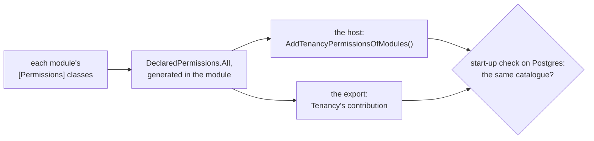

# Tenancy: roles and permissions

What a tenant's roles are made of, where they come from, and who may hand them on. Read it when you declare
permissions, choose the roles a new tenant starts with, or decide who may give roles.

- **Permission**: one thing you may do, a string such as `orders.refund`. A request asks for one; a role gives some.
- **Role**: a named set of permissions, kept per tenant. A **grant** gives a role to a **seat** (one person's place
  in one tenant) at a **unit** (a place in the tenant's organization tree).
- **Starter role**: a role every new tenant gets a copy of; **pack** in the code (`RolePack`) and in some headings.

## What the catalogue is for

The **catalogue** is every permission the application knows: Tenancy's (`tenancy.units.manage`), each module's
([below](#a-module-states-its-permissions-once)), and what your `ApplicationCatalogue` adds. Every part is optional:

| Part | What it decides | Default |
|---|---|---|
| `Packs` | The starter roles, which shape of tenant (flat or hierarchical) gets each, and what the first administrator holds | Tenancy's administrators' starter role alone ([The administrators' pack](#the-administrators-pack)) |
| `Permissions` | Permissions that belong to no module | none |
| `AccessManagingPermissions` | Permissions declared elsewhere, a module's say, that manage access in your application | only those marked where declared ([Which permissions manage access](#which-permissions-manage-access)) |
| `ContainAccessManagingPermissions` | Whether a seat hands on a permission that manages access only where it holds it itself | on ([Containment, on or off](#containment-on-or-off)) |

- No catalogue at all: leave `options.Catalogue` unset; Tenancy builds `new ApplicationCatalogue()`.
- The Postgres export builds the catalogue without the host, from the part you mark `[TenancyCatalogue]`, or
  `new ApplicationCatalogue()` when you mark none ([Setting it up](postgres.md#setting-it-up)).
- A unit's kind decides nothing, so it is [yours to keep](your-module.md#the-kind-of-a-unit), on your unit class.
- Every member: [`ApplicationCatalogue`](reference/catalogue.md#applicationcatalogue).

## A module states its permissions once

A module declares its permissions next to the code that asks for them: public constants of a static class marked
`[Permissions]`, each with a **level** (where it is asked) and a `Description` (what it lets somebody do).

**`Ordering.Application/OrderingPermissions.cs`**, in the module Ordering

```csharp
[Permissions]
public static class OrderingPermissions
{
    [AtTenant(Description = "See the orders")]
    public const string View = "orders.view";

    [AtUnit(Implies = [View], Description = "Refund an order")]
    public const string Refund = "orders.refund";
}
```

| Level | Asked | Held by |
|---|---|---|
| `[AtTenant]` | for the whole tenant: `TenancyAccess.AtTenant`, or `[RequiresPermission]` with no marker | a role granted at the root |
| `[AtUnit]` | at a unit: `TenancyAccess.AtUnit`, or a request's `[AtUnit]` member | a role granted at that unit or above |
| `[On<TResource>]`, [Membership's](../membership.md#the-settings-of-a-permission) | on one resource with members | its owner, its members through their roles, and, where its rules say so, a role granted where it hangs |

- A permission asked both ways carries both levels; say each setting on one. At any level it is in the catalogue
  under its module, so a role of the organization can hold it.
- `Implies`: what holding it brings along. One hop: an implied permission implies nothing itself.
- `Retired = true`: it grants nothing and goes into no role again, but no stored right breaks. Retire, never delete.
  A permission declared and not retired is **live**.
- `Description`: the English text a screen that puts permissions into roles shows. Left out, the constant's
  `/// <summary>` is used; with neither, [DDD00099](../diagnostics.md#ddd00099) warns. Translate it under the
  permission's name in a resx your [failure localizer](../localization.md) reads.
- The class's rules: [DDD00092](../diagnostics.md#ddd00092).

### How the permissions reach the host and the export

Two programs need every module's permissions: the host, and the export that writes the Postgres policies without
starting the host. Where to look when the two disagree about a permission:



**`Shop.Host/Program.cs`**: the one line you write

```csharp
using Shop.Host;   // the generated class is in the assembly's namespace, and a top-level Program.cs is in none

builder.Services.AddTenancyPermissionsOfModules();
```

- **In a module's project** with a `[Permissions]` class, Tenancy's generator writes `DeclaredPermissions.All`,
  marked `[TenancyPermissions]`: the module's only list. A list marked so by hand:
  [DDD00095](../diagnostics.md#ddd00095).
- **In a project that composes the modules**, every application that references Tenancy and every library that
  references it and declares no module, it writes `TenancyPermissionsOfModules`, internal, in the namespace of the
  assembly's name (`Shop.Host`), whatever `RootNamespace` says. Its `All` holds every module's list it finds there and
  in the references, in the order of the lists' names; empty while none exists.
- So no call names a module: a module you add reaches both programs at the next build.
- A program of your own that builds the catalogue without the host calls
  `TenancyCatalogue.Build(application, TenancyPermissionsOfModules.All)`. The Supabase export finds the lists itself.
- A project declares a module with `DDD_Module` ([A module named by its folder](../modules.md#a-module-named-by-its-folder))
  or `[assembly: Module]`; one that declares none lists its permissions under its assembly's name. So a library the
  host and an export share, to compose the modules, sets no `DDD_Module`.
- A one-project application that sets `DDD_Module`, as [Getting started](../getting-started.md) does, is module and
  host at once, and registers its own permissions with the same call.

| Mistake | What happens |
|---|---|
| A module's list also added with `AddTenancyPermissions` (kept for permissions you add by hand) | The catalogue stops at start-up, naming the permissions and the call to take out |
| The host lacks `AddTenancyPermissionsOfModules()` | A starter role naming a module's permission stops the catalogue at start-up; with none, the first question about a module's permission throws. Both messages name the fix |
| The export references other modules than the host, or either adds permissions by hand | The start-up check on Postgres refuses the host ([Setting it up](postgres.md#setting-it-up)). The export may be the host itself |

## Starter roles

- A tenant's roles start as copies of the starter roles in `Packs`, the tenant's own from then on, to rename and
  change.
- `SeededFor` picks the tenants: left out, every tenant; set to a shape, only tenants of that shape, provisioned so
  or changed to it later. A role has no shape.
- A copy follows your later changes once the host syncs them ([Packs after provisioning](#packs-after-provisioning)).
- Whoever holds `tenancy.roles.manage` for the whole tenant may put any permission into any role. So that makes an
  **administrator**: an active seat, placed at the root, holding it there through a grant with no end.
- Every member: [`RolePack`](reference/catalogue.md#rolepack).

## The administrators' pack

A tenant's first seat gets the administrators' starter role, at the root. It holds the permissions that manage
access, so its holder can give the next role. You need not declare one:

| You declare | Result |
|---|---|
| No pack with `Administers: true` | Tenancy adds `TenancyPacks.DefaultAdministrators`: key `administrator`, named Administrator, for every shape, holding every live permission |
| One with `Administers: true` and no `SeededFor`, or one seeded for each shape | Yours; no default |
| Administrators' packs that leave a shape without one, give a shape two, or say `SeedOnProvision: false` | `TenancyCatalogue.Build` refuses, naming the fix |
| No administrators' pack, and one of yours keyed `administrator` or named Administrator or Beheerder, ignoring case | Refused: rename it, or make it the administrators' pack with `Administers: true` |

- `HasDefaultAdministrators` on the built catalogue says which you have.
- The default lists no permissions, so it holds every live permission, also one a module adds later: tenants that
  have the role get it at the next sync. So the smallest application declares no catalogue at all.
- A tenant provisioned in Dutch gets it as Beheerder; your `IRolePackTexts` is asked first, by the key
  `administrator` ([Roles in the tenant's language](names-and-languages.md#roles-in-the-tenants-language)).
- On Postgres, `pack_permissions('administrator')` answers every live permission, matching the running catalogue.

<details>
<summary>Show the code: no catalogue, permissions of your own and no packs, and an administrators' pack for each shape</summary>

```csharp
// No catalogue: the permissions are Tenancy's and the modules', and every tenant starts with the default
// administrators' role, given to its first seat
services.AddTenancy<ShopTenancyContext>();

// Permissions the application owns itself, and still no pack: the default administrators' role holds them too
public static ApplicationCatalogue Application { get; } = new(Permissions: ShopPermissions.All);

// A provisioned tenant names the role by the pack's key
var administrators = provisioned.RolesByPack[TenancyPacks.DefaultAdministratorsKey];

// Administrators of your own, one seeded for each shape of tenant, and a pack that every tenant gets
public static ApplicationCatalogue Application { get; } = new(
    Packs:
    [
        new("owner", "Owner", "Runs the shop", [], SeededFor: TenantShape.Flat, Administers: true),
        new("head-office", "Head office", "Runs every branch", [], SeededFor: TenantShape.Hierarchical, Administers: true),
        new("viewer", "Viewer", "Looks at the orders", [ShopPermissions.OrdersView]),   // no SeededFor: every tenant
    ],
    Permissions: ShopPermissions.All);
```

</details>

### What the administrators hold

- A pack that lists no permissions holds every live permission.
- One that lists permissions holds only those, for administrators who run access but not the modules' work. It must
  list every one of Tenancy's permissions and every permission that manages access, or one that implies it; `Build`
  refuses it otherwise, so marking another permission stops start-up until the pack lists it.
- Either way an administrator gives every role, so appointing an area manager needs no system work (work no person
  does, begun explicitly).
- The list is where the role starts, not a wall: an administrator still puts any permission into any role.

### Moving an application to the default

Dropping your own administrators' pack for the default changes no tenant:

- Each keeps the role its old pack gave, with its permissions and holders.
- The default reaches a tenant only when it turns from flat to hierarchical, which copies every starter role
  seeded for the new shape that it lacks, and gives the copies to nobody.
- If the tenant still has a role named like the default, that copy is refused with `tenancy.role-name-taken`, and
  the change of shape with it. Rename that role first.

## Packs after provisioning

A tenant keeps the roles its starter roles made, whatever you change in them later, until the host runs
`SyncRolePacks()`: then those roles follow their starter roles, in every tenant, keeping what the tenant changed.

### How a role follows its pack

A role made from a starter role remembers what that gave it, `PermissionsFromPack`. The sync compares that with the
starter role as your catalogue builds it now:

| A permission | The sync |
|---|---|
| gained by the starter role | adds it |
| lost by the starter role | takes it out |
| taken out by the tenant, still in the starter role | leaves it out |
| added by the tenant, never in the starter role | leaves it in |

The cases a comparison cannot tell apart: [`FollowPack`](reference/aggregates.md#followpacktenancycatalogue-tenancyactortseatid).
Those you are likely to meet:

- A role whose change would take `tenancy.roles.manage` from the last administrators is left as it is, and logged,
  until the tenant has an administrator through another role.
- A role made before roles remembered their starter role gets every permission of it that it lacks, and loses none.
- A permission no longer live stays, granting nothing. A role whose starter role is gone keeps its permissions, and
  follows again once you declare one under the same key.

Permissions that manage access follow too: only your code puts one in a starter role, so the sync, your
application's work, may change them. The event lists them apart, for whoever tells the tenant.

### Turning it on

**`Shop.Host/Program.cs`**

```csharp
builder.Services.RunStartupChecks();
builder.Services.SyncRolePacks();   // once the host has started, every tenant's roles follow their packs
```

- It is no start-up check, which changes nothing. It runs once per start, in the background, after the checks and
  every hosted service have started (a seeding of yours is done). The host serves meanwhile.
- In each active or suspended tenant it runs `RoleCommands.FollowPacksAsync` as Tenancy's system work, on Postgres
  under the policies, in Tenancy's own scope. One save per tenant, after taking the tenant's access revision, so a
  second run, or a second host starting at once, changes nothing more.
- A tenant whose sync fails is logged, and tried again at the next start.
- To sync from a deployment step or an operator's endpoint, leave the call out and run
  [`IRolePackSync`](reference/catalogue.md#irolepacksync), which `AddTenancy` registers, yourself. An operator
  syncing one tenant runs [`FollowPacksAsync`](reference/use-cases.md#followpacksasynccancellationtoken) in it,
  recorded as the operator.

<details>
<summary>Show the code: running the sync yourself</summary>

```csharp
// A deployment step, or an operator's endpoint for every tenant
var report = await services.GetRequiredService<IRolePackSync>().SyncAsync(cancellationToken);
if (!report.Succeeded)
{
    foreach (var (tenant, error) in report.Failed)
    {
        logger.LogError(error, "The roles of tenant {Tenant} did not follow their packs", tenant);
    }
}

// One tenant, for an operator, whom the events then name
using (TenancyWork.BeginOperatorIn<TenantId, SeatId>(tenant, operatorIdentity))
{
    var followed = await roles.FollowPacksAsync(cancellationToken);   // roles: TenancyUseCases.RoleCommands
    // followed.Changed, followed.KeptForAnAdministrator, followed.WithoutTheirPack
}
```

</details>

### Telling the tenant

- Each role that changes raises [`RoleFollowedItsPack`](reference/aggregates.md#rolefolloweditspackttenantid-troleid-tseatid),
  with `Added`, `Removed`, those of them that manage access (`ManagingAccess`), and `By`.
- The package sends no message. `AddTenancyEventLog` keeps the event in the
  [access history](operators-and-history.md#access-history), where the tenant's administrators read it.
- To mail them, publish it as an integration event of your own and handle that. A handler is delivered at least
  once, so remember `message.MessageId` where a second mail would matter
  ([Integration events](../integration-events.md)).

<details>
<summary>Show the code: mailing a tenant's administrators when a role followed its pack</summary>

```csharp
// The contract, in the module that publishes it
[IntegrationEvent]
public sealed record RoleFollowedItsPackV1(long TenantId, Guid RoleId, string Pack, string[] Added, string[] Removed, string[] ManagingAccess);

// Tenancy's outbox: mapped before AddTenancyDomainEvents, which keeps every event it has no mapping for off the sinks
options.UseOutbox<ShopTenancyContext>(outbox => outbox
    .PublishAs<RoleFollowedItsPack<TenantId, RoleId, SeatId>, RoleFollowedItsPackV1>(followed => new RoleFollowedItsPackV1(
        followed.TenantId.Value, followed.RoleId.Value, followed.Pack, [.. followed.Added], [.. followed.Removed], [.. followed.ManagingAccess]))
    .AddTenancyDomainEvents()
    .KeepEventLog(log => log.AddTenancyEventLog()));

// Where your application sends mail: who administers the tenant, and where to write to them, is yours to know
public sealed class TellTheAdministrators(IShopAdministrators administrators, IMailer mailer)
    : IIntegrationEventHandler<RoleFollowedItsPackV1>
{
    public async Task HandleAsync(RoleFollowedItsPackV1 followed, IntegrationEventMessage message, CancellationToken cancellationToken)
    {
        // A line for what happened, and none for what did not
        string?[] lines =
        [
            $"The role made from the pack {followed.Pack} changed with the application.",
            followed.Added.Length > 0 ? $"It gained {string.Join(", ", followed.Added)}." : null,
            followed.Removed.Length > 0 ? $"It lost {string.Join(", ", followed.Removed)}." : null,
            followed.ManagingAccess.Length > 0 ? $"It changes who may manage access: {string.Join(", ", followed.ManagingAccess)}." : null,
        ];
        var body = string.Join(Environment.NewLine, lines.OfType<string>());

        foreach (var address in await administrators.AddressesAsync(followed.TenantId, cancellationToken))
        {
            await mailer.SendAsync(address, "A role changed with the application", body, cancellationToken);
        }
    }
}
```

</details>

### The column it needs

- `PermissionsFromPack`, on the roles' table, added by a migration of yours. Nullable: older rows follow as above.
- On Postgres the export guards it ([What the policies check](postgres.md#what-the-policies-check)): no seat changes
  it, nobody changes the pack a role came from, and a role a seat adds names no pack or is an exact copy of one.

## Who may give a role

A role **manages access** when it holds a permission that gives power over other people's access
([Which permissions manage access](#which-permissions-manage-access)). Giving a role at a unit:

- **A role that manages no access**: `tenancy.grants.manage` at the unit is enough, without holding the role's
  permissions. Its holder gives it to a seat placed there or below, for any period.
- **To yourself**: for no longer than you hold `tenancy.grants.manage` there, else `tenancy.grant-exceeds-own`.
  Nobody places themselves (`tenancy.self-assignment`), so this is only where someone else placed you.
- **A role that manages access**: only from a seat holding each of its permissions that manage access at the unit,
  for at least as long as the grant runs; its other permissions are not counted. Else `tenancy.grant-exceeds-own`,
  whose `Missing` names what is lacking.
- **Never to yourself**, a role that manages access: `tenancy.self-appointment`, decided first.
- **Every grant**: an active role of the tenant, an active unit where the seat is placed, starting now (`from` is
  for system work: `tenancy.start-system-only`). The last administrator stays (`tenancy.last-admin`).
- **System work** in a tenant (work no person does, begun explicitly) is held to none of this.

The third and fourth rules are **containment**, on unless you turn it off
([Containment, on or off](#containment-on-or-off)).

Example: in Harbor Works, Rhea holds Area manager at North, for good, with `tenancy.grants.manage` and
`projects.crew.manage`, which manage access. At North Coast:

- Observer, which manages no access: she gives it to Leo, and to herself.
- Crew lead, which manages access through `projects.crew.manage`: to Leo, not to herself (`tenancy.self-appointment`).
- Access admin: not even to Leo, since she lacks `tenancy.roles.manage` there, among others
  (`tenancy.grant-exceeds-own`).
- At South Bay she gives nothing: `tenancy.not-permitted`.

```csharp
// seats: TenancyUseCases.SeatCommands. It finds the calling seat itself, and decides as above before it saves.
try
{
    await seats.GrantAsync(seat, unit, role, until: null, reason: null, cancellationToken);   // until: null, for good
}
catch (RefusalException refusal) when (refusal.Code == TenancyRefusals.GrantExceedsOwn)
{
    var missing = refusal.Arguments["Missing"];   // what the caller lacks there, or lacks for long enough
}
```

Every parameter and refusal: [`SeatCommands.GrantAsync`](reference/use-cases.md#grantasynctseatid-tunitid-troleid-datetimeoffset-string-cancellationtoken-datetimeoffset).

### Which permissions manage access

- All of Tenancy's do, except `tenancy.history.view`, which reads the
  [access history](operators-and-history.md#access-history).
- Mark one you own with `ManagesAccess: true`; mark any other, a module's included, in `AccessManagingPermissions`:

```csharp
// The sample's host marks two of its Projects module's permissions
public static ApplicationCatalogue Application { get; } = new(
    Packs: [/* ... */],
    AccessManagingPermissions: [ProjectPermissionNames.ChangeOwner, ProjectPermissionNames.ManageCrew]);

// A permission of your own, marked where it is declared
new Permission("widgets.assign", "Widgets", "Hand widgets to people", ManagesAccess: true);
```

- Mark every permission only its holder should give: power over roles, grants, placements, seats or the tree;
  deciding who works on what, or naming an owner; reaching credentials; letting support staff into a tenant.
- One whose power reaches no further than roles that manage no access may stay unmarked.
- A permission that manages no access may not imply one that does: `Build` refuses it.
- Pin the set with a test of the built catalogue's `AccessManagingPermissions`, so a mark never changes unnoticed:

<details>
<summary>Show the code: the sample's test of its marks</summary>

```csharp
// ApplicationRuleScenarios.cs in the sample's tests
[Fact]
public async Task The_permissions_that_manage_access_are_exactly_these()
{
    await using var host = await sample.StartAsync();   // a host from the class's fixture, on Supabase's Postgres image

    host.Services.GetRequiredService<TenancyCatalogue>().AccessManagingPermissions.Should().BeEquivalentTo(
    [
        "tenancy.settings.manage",
        "tenancy.units.manage",
        "tenancy.seats.manage",
        "tenancy.grants.manage",
        "tenancy.roles.manage",
        "projects.owner.change",
        "projects.crew.manage",
    ]);
}
```

</details>

**A forgotten mark fails open:**

- Every grants manager gives an unmarked permission to anyone placed where they hold `tenancy.grants.manage`,
  themselves included. Mark before anyone manages grants.
- A module that gives permissions through grants of its own (a crew role, on one project) contains a marked one it
  gives that way itself: the sample's crews give `projects.crew.manage` only from whoever manages that crew already.
- Marks are read when a role is given or taken away, never against existing grants. After changing marks, restart
  every instance before anyone grants again. A marked permission taken out of retirement is marked again.

### The other ways access changes hands

Each follows the rule for giving. With containment on:

| Change | The command asks | A role that manages access also needs |
|---|---|---|
| Take a role away ([`RevokeAsync`](reference/use-cases.md#revokeasynctseatid-tunitid-troleid-cancellationtoken)) | `tenancy.grants.manage` at the unit | its permissions that manage access there, until at least the grant's end. A seat's own current grant counts as its hold, so it may take away its own roles |
| Withdraw a placement and its grants ([`WithdrawAsync`](reference/use-cases.md#withdrawasynctseatid-tunitid-cancellationtoken)) | `tenancy.seats.manage` at the unit, plus `tenancy.grants.manage` when it has grants | the same, per grant |
| Suspend, deactivate or reactivate a seat ([`SuspendAsync`](reference/use-cases.md#suspendasynctseatid-cancellationtoken)), which takes away or gives back its grants | `tenancy.seats.manage` for the whole tenant | the same, per grant not yet ended. A seat may suspend or deactivate itself, never reactivate itself |
| Move a unit ([`MoveUnitAsync`](reference/use-cases.md#moveunitasynctunitid-tunitid-cancellationtoken)), which changes the grants that reach it | `tenancy.units.manage` at the old and the new parent | every such permission the move gives or takes from anyone, held by the mover at the unit until at least that grant's end. Always: the move gives the mover nothing it lacks there, or for longer |
| Add or take out such a permission in a role, or archive a role that holds one ([`SetPermissionsAsync`](reference/use-cases.md#setpermissionsasynctroleid-ireadonlycollectionstring-cancellationtoken)) | `tenancy.roles.manage` for the whole tenant | an administrator: `tenancy.roles.manage` at the root, with no end |

- The refusal is `tenancy.grant-exceeds-own`, naming what is lacking. The last administrator always stays.
- Why only an administrator changes such a permission in a role: the change reaches every holder at once,
  including those who gave the role to themselves. Look at who holds a role before you add to it.
- `RoleGrant.GrantedBy` records who gave each grant; `RolePermissionsChanged` names what came in and went out.

### What that means for a tenant

- Trust `tenancy.grants.manage` with every role that manages no access where it is held, its holder's own included.
- Grants managers can give each other roles, but a role that manages access (even one holding only
  `tenancy.grants.manage`) never to themselves.
- Tenancy knows one person per seat: someone who adds a seat for another account of their own gives it what they
  could not give themselves, within containment.

## Containment, on or off

**Containment** is the rule above for permissions that manage access: a seat hands one on only where it holds it,
for as long, and never to itself. You decide: `ContainAccessManagingPermissions` in your catalogue, on by default.
Who may give your users what is a product choice; it does not keep your data sound.

Off, a role or permission that manages access goes as one that manages none: the third and fourth rules of
[Who may give a role](#who-may-give-a-role) and the last column of [the other ways](#the-other-ways-access-changes-hands)
no longer apply; on Postgres `permission_is_contained(permission)` answers false. Rhea then gives herself
Administrator at North, and manages everything there and below.

- So whoever holds a permission that manages access administers everything it reaches.
- Turn it off when that is what you want, or when your own handlers decide who may give what.

Either way:

- A seat gives itself a role for no longer than it holds `tenancy.grants.manage` there, and a move gives the mover
  nothing.
- Each command asks its permission where it acts: Rhea gives no role outside North and below.
- The last administrator stays, in C# and in the database, and a seat keeps its identity and tenant
  ([What the database guards on a seat](postgres.md#what-the-database-guards-on-a-seat)).
- `AccessManagingPermissions` and `ManagesAccess` answer the same.

### The one question that decides it

Can your database be reached without your handlers, through Supabase's Data API say? Then leave it on:

- A client talking to the database directly goes past any rule of your handlers.
- With containment on, the database still refuses it a role that manages access where it lacks that role's
  permissions, any such role to itself, such an invitation, and stopping a seat whose such grants it could not take
  away. Durations, role changes and moves are checked in C# alone ([What stays in C#](postgres.md#what-stays-in-c)).
- With it off, a grants manager there hands out every role.

### System work is not held to it

- System work in a tenant holds every permission there, on or off.
- So to give a role that manages access when a condition of yours is met, a quiz passed say, keep containment on:
  your handler checks the condition, then grants inside `TenancyUseCases.BeginSystemIn(tenant, seat)`. The grant
  names no giver; its event records the system, acting for that seat.
- System work gives whatever it is told, so take the tenant and seat from the caller (refusing anything but a seat)
  and the role and unit from your own records, never from the request: otherwise whoever passed gets whatever they
  named, the administrators' role included.

### The setting in the host and the export

- The host reads it from `TenancyOptions.Catalogue`, the export from the same part, marked `[TenancyCatalogue]`
  ([Setting it up](postgres.md#setting-it-up)), so the two cannot disagree.
- On Postgres the policies on grants and invitations, and the trigger on a seat's status, ask
  `permission_is_contained`. The start-up check `tenancy.policies-in-place` refuses a database exported with the
  other setting: after changing it, export the access files and apply them before the host starts.
- Grants made while it was off stay when you turn it back on: containment is asked when a role is given or taken
  away, never of existing grants.

<details>
<summary>Show the code: turning containment off, and a quiz handler that keeps it on</summary>

```csharp
// Your part of the catalogue, with containment off: the host hands it to TenancyOptions.Catalogue, and the export
// writes the policies from it because it is marked. Leave the last line out to keep containment on.
public static class ShopCatalogue
{
    [TenancyCatalogue]
    public static ApplicationCatalogue Application { get; } = new(
        Packs: [/* ... */],
        AccessManagingPermissions: [ProjectPermissionNames.ChangeOwner, ProjectPermissionNames.ManageCrew],
        ContainAccessManagingPermissions: false);
}
```

```csharp
// Your own handler, with containment on. The request names the quiz and carries the answers. Who passed is the
// caller, and what passing gives is the quiz's: system work gives whatever it is told, so a client chooses neither.
public sealed class QuizDesk(TenancyUseCases.SeatCommands seats, IQuizzes quizzes)
{
    public async Task PassAsync(QuizId quizId, QuizAnswers answers, CancellationToken cancellationToken)
    {
        if (TenancyUseCases.CurrentCaller() is not { Kind: TenancyCallerKind.Seat, Tenant: { } tenant, Seat: { } seat })
        {
            throw QuizRefusals.Refuse(QuizRefusals.SeatsOnly);
        }

        var quiz = await quizzes.FindAsync(quizId, cancellationToken) ?? throw QuizRefusals.Refuse(QuizRefusals.NotFound);
        if (!quiz.Passes(answers))
        {
            throw QuizRefusals.Refuse(QuizRefusals.NotPassed);
        }

        // The role and the unit are the quiz's own, which an administrator set when making it.
        using (TenancyUseCases.BeginSystemIn(tenant, seat))
        {
            await seats.GrantAsync(seat, quiz.Unit, quiz.Role, until: null, reason: "passed " + quiz.Name, cancellationToken);
        }
    }
}
```

</details>
