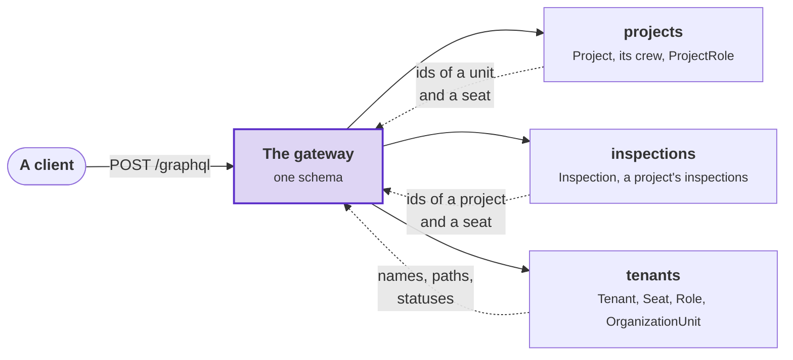
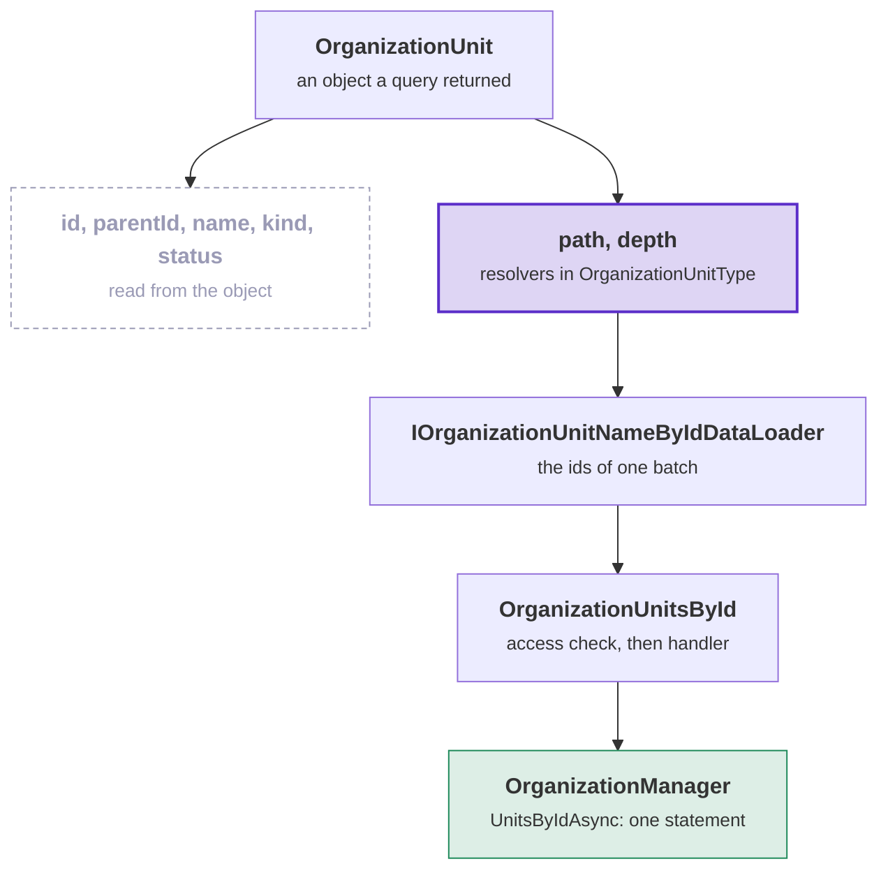
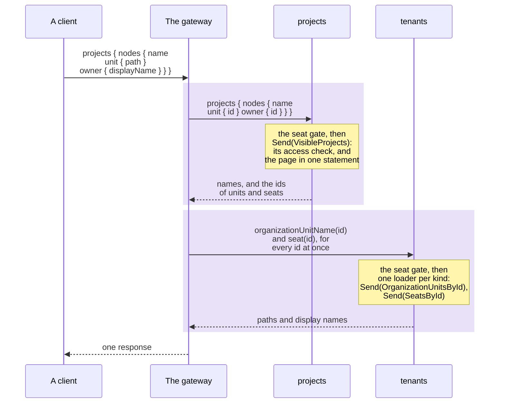

# GraphQL in the sample

How the [sample](../the-sample.md) composes its three module schemas into one, what a query costs, and the rules each
module schema follows. Read it before you give a module a schema. [GraphQL](../../graphql.md) describes the toolkit's
side.

## One schema over three modules

- `/graphql` serves the routes' commands and queries as one schema. The host composes it in the process from the
  schema of each module, with
  [`DDDToolkit.HotChocolate.Fusion.InMemory`](../../graphql.md#one-schema-over-a-modular-monolith). Each feature has a
  `GraphQL` folder beside its `Rest` folder.
- A module refers to another module's entity by id only. The gateway asks the owning module for the other fields. So
  Projects returns no names from Tenancy, and a client still gets a crew with names in one request.

The diagram shows which module owns which types. Projects and Inspections return ids to the gateway, and Tenants
returns the names. Purple: the gateway; dashed arrows: what each module returns.



Projects declares a seat as its key alone: `[GraphQLName("Seat")] [EntityKey("id")] record ReferencedSeat(SeatId Id)`.
Tenants declares the owned `Seat` type over its `Seat` class, with an internal lookup (`[Lookup] [Internal]`). The
lookup uses a data loader that sends `SeatsById` once per batch, in parts of at most 200 ids
([`DirectoryQueries.cs`](../../../Examples/Tenancy/Modules/Tenants/Examples.Tenancy.Tenants.Api/Directory/GraphQL/DirectoryQueries.cs)).

## Tenancy's classes as GraphQL types

Tenancy's managers return the application's classes: `Tenant`, `Seat`, `Role`, `OrganizationUnit` and
`Invitation`. The Tenants schema declares one GraphQL type over each class. For example, `seats` returns the `Seat`
objects that `SeatManager.ListAsync` read, and the `Seat` type shows their `id`, `displayName` and `status`.

- **A type class lists the fields it shows.** Each type class calls `BindFieldsExplicitly()` and names the fields of
  the class one by one. A field that is not listed is not in the schema. The classes hold more than the schema
  shows:
  - A seat holds the identity of its person.
  - An invitation holds the id of the account that the identity provider made for its address.
  - A role holds the permissions that its starter role gave it.
- **A field that the class lacks is a resolver in the type class.** A unit's path depends on the units above it, so
  `OrganizationUnit.path` and `depth` are resolvers. Whether a role manages access comes from the catalogue, so
  `Role.managesAccess` is a resolver. Each resolver loads its value through a data loader. The data loader sends a
  query, and the query's handler asks the manager. A resolver takes no manager itself. So the units of a list are one
  question to the manager, and that question passes the access check of its query.
- **A manager's record is a GraphQL type too.** Some reads return more than one class holds. The manager then returns
  a record with the class inside it, and the schema shows that record. `overviewOfMine` returns the seat manager's
  `SeatOverview`, which holds the tenant, the seat, its units and its roles. The operators' `tenants` returns the tenant
  manager's page, where each `TenantListing` holds a tenant beside its name and its number of active seats.

The diagram follows the fields of one unit. Purple: the resolvers in the type class; green: the manager that reads
the path and the depth; grey: the fields that come from the object, with no read.



**`Tenants.Api/Organization/GraphQL/OrganizationUnitType.cs`**: the type over the unit, with the two fields the unit
lacks.

```csharp {6,14-17}
[ObjectType<OrganizationUnit>]
internal static partial class OrganizationUnitType
{
    static partial void Configure(IObjectTypeDescriptor<OrganizationUnit> descriptor)
    {
        descriptor.BindFieldsExplicitly();
        descriptor.Field(unit => unit.Id);
        descriptor.Field(unit => unit.ParentId);
        descriptor.Field(unit => unit.Name);
        descriptor.Field(unit => unit.Kind);
        descriptor.Field(unit => unit.Status);
    }

    [Cost(DirectoryQueries.LoadedForTheRequest)]
    public static async Task<string?> GetPathAsync(
        [Parent] OrganizationUnit unit, IOrganizationUnitNameByIdDataLoader names, CancellationToken cancellationToken)
        => (await names.LoadAsync(unit.Id, cancellationToken))?.Path;

    [Cost(DirectoryQueries.LoadedForTheRequest)]
    public static async Task<int?> GetDepthAsync(
        [Parent] OrganizationUnit unit, IOrganizationUnitNameByIdDataLoader names, CancellationToken cancellationToken)
        => (await names.LoadAsync(unit.Id, cancellationToken))?.Depth;
}
```

- `[ObjectType<OrganizationUnit>]` makes the class `OrganizationUnit` a GraphQL type. HotChocolate's generator adds
  every public static method of the type class as a field. `GetPathAsync` becomes `path`.
- `[Parent]` is the unit that the field belongs to. The data loader collects the ids of a batch and sends one
  `OrganizationUnitsById` for them.
- `[Cost]` says that the field reads once per batch. Without it, HotChocolate estimates one read per unit.
- The resolver runs only when a client asks for `path`. `{ organizationUnits { name kind } }` reads the units once.

<details>
<summary>Show the code: the role, with a rule on one field and a resolver on another</summary>

**`Tenants.Api/Roles/GraphQL/RoleType.cs`**

```csharp {14-15,17-19}
[ObjectType<Role>]
[EntityKey("id")]
internal static partial class RoleType
{
    static partial void Configure(IObjectTypeDescriptor<Role> descriptor)
    {
        descriptor.BindFieldsExplicitly();
        descriptor.Field(role => role.Id);
        descriptor.Field(role => role.Name);
        descriptor.Field(role => role.FromStarterRole);
        descriptor.Field(role => role.Status);
    }

    [Authorize(RoleListing.ManageRolesPermission)]   // tenancy.roles.manage
    public static IReadOnlyList<string> GetPermissions([Parent] Role role) => role.Permissions;

    [Cost(DirectoryQueries.LoadedForTheRequest)]
    public static async Task<bool?> GetManagesAccessAsync([Parent] Role role, IRoleByIdDataLoader roles, CancellationToken cancellationToken)
        => (await roles.LoadAsync(role.Id, cancellationToken))?.ManagesAccess;
}
```

</details>

The types of the Tenants schema, with the class or record each is declared over:

| GraphQL type | Declared over | Fields the class lacks |
|---|---|---|
| `Tenant` | `Tenant` | `slug` is a resolver that returns the text of the `TenantSlug`. |
| `Seat` | `Seat` | None. The type shows `id`, `displayName` and `status`. |
| `Role` | `Role` | `managesAccess` loads through `IRoleByIdDataLoader`. `permissions` requires `tenancy.roles.manage`. |
| `OrganizationUnit` | `OrganizationUnit` | `path` and `depth` load through `IOrganizationUnitNameByIdDataLoader`. |
| `Invitation` | `Invitation` | `unit`, `role` and `issuedBy` load through the three directory loaders. |
| `SeatOverview` | `SeatManager.SeatOverview` | `placements` returns the placements of the overview's seat. |
| `Placement`, `RoleGrant` | the package's `Placement<…>` and `RoleGrant<…>` | None. They name units and roles by id. |
| `SeatOfMine` | `SeatInTenant<Seat>` | None. |
| `TenantPage`, `TenantListing` | `TenantManager.TenantPage` and `TenantManager.TenantListing` | None. |
| `OrganizationUnitName` | `NamedUnit<OrganizationUnitId>` | None. |
| `IssuedInvitation` | `InvitationManager.IssuedInvitation` | None. |
| `AcceptedInvitation` | `InvitationManager.AcceptedInvitation` | None. |

The routes write the same fields as the types. `GET /tenancy/units` writes each unit with `path` and `depth`, from the
organization manager's `UnitInTree`. `GET /me` writes the fields of `SeatOverview`. Its `placements` name units and
roles by id, and the overview's `units` and `roles` say what each id is called. A route writes a seat as `id`,
`displayName` and `status`. It never writes the identity.

### What a mutation returns

A command of the Tenants module returns the object that its manager returned. A command that creates returns the
new object, and a command that changes returns the changed aggregate. The mutation sends the command and returns that
object. It reads nothing again.

| Mutations | Return |
|---|---|
| `seatRename`, `seatSuspend`, `seatReactivate`, `seatDeactivate`, `seatPlace`, `placementWithdraw`, `roleGrant`, `roleRevoke` | The `Seat` |
| `roleCreate`, `rolePermissionsSet`, `roleArchive` | The `Role` |
| `organizationUnitAdd`, `organizationUnitMove`, `organizationUnitArchive` | The `OrganizationUnit` |
| `tenantShapeChange` | The `Tenant`, in its new shape |
| `personInvite` | The `IssuedInvitation`: the invitation and its token |
| `invitationCancel` | The cancelled `Invitation` |
| `invitationAccept` | The `AcceptedInvitation`: the `Tenant`, whose slug the next request names, and the new `Seat` |

- The resolvers of a type still run for what the class lacks. A unit's `path` and a role's `managesAccess` load
  through their data loaders after the command has saved.
- The route of the same command writes the same object, with `200`, or `201` for a new unit or role. A route writes a
  unit from a command without `path` and `depth`, because the command reads nothing more. It writes a role from a
  command with its `permissions`, because each of those commands requires `tenancy.roles.manage`.
- A mutation of Projects sends the project's query after its command and returns the project's overview. The overview
  holds what the caller may do with the project, which the command does not read.

## A field on another module's type

A module can add fields to a type that another module owns. In Inspections' schema, `Project` has the key and one
field, `inspections`. The gateway adds that field to the project that Projects returns. No root field takes a
project's id, so a client asks for the project:

```graphql
{
  projects {
    nodes {
      name
      inspections(first: 5) { nodes { title } }
    }
  }
}
```

- For each batch of projects, Inspections makes one gate call and runs one SQL statement:
  - A data loader sends one `InspectionsOfProjects`.
  - The access check of that query calls Projects' gate once (`IProjectGate.AskAsync`).
  - The read pages the inspections of every project in the batch at once (`ToBatchPageAsync`).
- `canRecord` and `totalCount` cost one more statement each, when the client asks for them.
- A **batch** is what HotChocolate has collected when it sends. As a rule a batch is one page, or two pages on a busy
  server.
- A project that the caller may not see returns `null`. Inspections' own check decides this, whatever id reaches it.
- `GET /projects/{id}/inspections` pages the same way. So its `next` is the GraphQL cursor of the page's last row.

<details>
<summary>Show the code: the field added to another module's type</summary>

**`Inspections.Api/Recording/GraphQL/ProjectType.cs`**

```csharp
// Project as Inspections declares it, over a record that holds the project's id
[ObjectType<ReferencedProject>]
[EntityKey("id")]
internal static partial class ProjectType
{
    static partial void Configure(IObjectTypeDescriptor<ReferencedProject> descriptor) => descriptor.Name("Project");

    [UseConnection(IncludeTotalCount = true, DefaultPageSize = DefaultPage, MaxPageSize = LargestPage)]   // 10, and 50 at most
    [Cost(InspectionsConnection.LoadedForThePage)]                  // 1: one read for a batch
    public static async Task<InspectionsConnection?> GetInspectionsAsync(
        [Parent] ReferencedProject project, PagingArguments paging, IInspectionsByProjectIdDataLoader inspections, CancellationToken cancellationToken)
        => await inspections.With(paging).LoadAsync(project.Id, cancellationToken) is { } page
            ? new InspectionsConnection(page, project.Id)
            : null;
}
```

</details>

## How one query runs

The diagram follows one query from the client to the modules. Each purple band is one call to a module. Each call
starts with the seat gate, and loads its page or its batch of ids at once.



## How a module declares its schema

The modules follow the way HotChocolate 16 offers, and write nothing twice. `GraphQLDeclarationTests` checks every
module against these rules. Projects' schema is the example:
[`ProjectType.cs`](../../../Examples/Tenancy/Modules/Projects/Examples.Tenancy.Projects.Api/Overview/GraphQL/ProjectType.cs),
[`OverviewPagedQueries.cs`](../../../Examples/Tenancy/Modules/Projects/Examples.Tenancy.Projects.Api/Overview/GraphQL/OverviewPagedQueries.cs),
[`CrewMemberType.cs`](../../../Examples/Tenancy/Modules/Projects/Examples.Tenancy.Projects.Api/Crew/GraphQL/CrewMemberType.cs).

- **A field contains no logic.** It sends the request that the route of its feature sends. A mutation returns what it
  changed ([What a mutation returns](#what-a-mutation-returns)).
- **A type is what a query returns.** It is declared over that class or record with
  [`[ObjectType<T>]`](../../graphql.md#types-over-application-records). In Projects and Inspections that is the
  application's record. In Tenants it is one of Tenancy's classes or a manager's record, as
  [Tenancy's classes as GraphQL types](#tenancys-classes-as-graphql-types) shows. Nothing is copied or mapped.
- **Missing data returns `null` without an error.** `project(id:)` and `node(id:)` return `null` for a project that is
  missing or out of sight. A reference that its owner does not resolve, such as another tenant's seat, returns its id
  with every other field `null`. So every field except the key of `Seat`, `OrganizationUnitName`, `Role` and
  `Project` is nullable (`AddDDDToolkitEntityNullability()`).
- **Ids are loaded together**, once per field of the response. For example, the owners of a page take one
  `SeatsById`. `crew`, `myRoles` and `can` are resolvers behind data loaders. Each runs one statement per batch, when
  the client asks for it.
- **A field can require a permission**, visible in the schema, on top of the check of every request:
  [`[Authorize("tenancy.roles.manage")]`](../../graphql.md#a-permission-on-a-field) on `Role.permissions` and
  `ProjectRole.permissions`, and `[Authorize("projects.crew.manage")]` on `CrewMember.roles`. Without the permission
  the field is `null`, with a coded error.
- **The routes keep the same rule.** The crew queries check `projects.crew.manage` in their SQL statement and return
  `null` for the roles. An empty list would mean "none", so they do not return one. The role queries return whether
  the caller holds `tenancy.roles.manage` for the whole tenant, and `GET /tenancy/roles` writes `"permissions": null`
  when it does not. A seat reads what it holds itself in its overview: its roles by name, and each permission with
  the units it reaches.
- **Tenants returns whole lists** for `seats`, `organizationUnits`, `roles` and `openInvitations`. The operators'
  `tenants` field keeps the package's page and cursor.
- **A history row** has `byKind`, `bySeatId` and `bySeat`.
- **Invitations.** `personInvite` returns the invitation and its token, once. Send the token as a variable.
- **Operators' fields** (`tenants`, `tenantAccessHistory`, `tenantProjects`, `tenantProjectInspections`) return ids
  where other fields return names. The directory resolves names only for a seat of the tenant, and an operator has
  none.
- **Errors are typed** [in the mutation's payload](../../graphql.md#typed-errors-in-mutation-payloads). A refusal is a
  `RefusalError` with its code. Project mutations take `expectedVersion`, which is the routes' `If-Match`, and return
  the new `version`. A stale version returns a `ConcurrencyConflictError`.
- **A project is a node.** Its `id` is a node id. Seats, units and roles keep plain `UUID`s.

## Access, language and the database

- **A token, then a seat.** `/graphql` requires a token. `SeatGate` runs the routes' seat check
  (`SeatRequirement.RefusalFor`) in front of every root field. So a client gets `tenancy.tenant-required` or
  `tenancy.not-seated` with its code. `seatsOfMine` and `invitationAccept` need no seat. The operators' fields need an
  operator (`tenancy.operators-only`).
- **The request's language.** The gateway runs after `UseRequestLocalization()`. So a refusal's `message` follows
  `Accept-Language` ([A sample in two languages](../../localization.md#a-sample-in-two-languages)).
- **The caller in the database.** A field only sends a request. So its reads run under the caller's database role and
  claims, and the row level security policies check them again.
- **Only in REST:** the dev login, `GET /access/projects/{id}?permission=`, health, and `POST /tenancy/directory/*`.
  In GraphQL, references resolve the names that the directory routes return.

## Paging and cost limits

- **Three connection types**, over the queries that their routes send:
  - `projects` returns a `ProjectConnection`.
  - A project's `inspections` returns an `InspectionsConnection`, with `canRecord`.
  - `accessHistory`, and the operators' `tenantAccessHistory`, return an `AccessHistoryEntryConnection`.
- Each connection has `nodes`, `edges`, `pageInfo`, `totalCount` when asked, and the same cursors as the routes. Each
  refuses [a cursor from another list](who-may-do-what.md#invalid-cursors).
- **One end per page.** `first` together with `last` is refused with the list's code (`projects.page-from-both-ends`,
  and the same code for the other lists). A page size outside the list's range is refused too. One helper does both:
  `PageSizes` in `Shared/Examples.Tenancy.Shared.Application`.
- **Within the cost limit.** HotChocolate estimates the cost of a request from the largest page of each list and a
  weight per field. So each connection states its sizes: ten by default and fifty at most. The routes use fifty and
  two hundred. A field behind a data loader weighs one (`[Cost(1)]`), instead of ten per row.
- **The gateway limits the whole request.** The cost estimate is per module schema, and a field that another module
  adds runs once per row. So the gateway refuses a document with more than 200 fields or more than ten levels, before
  it asks any module (`AddSampleRequestBounds` in `Host/GraphQL/SampleGraphQL.cs`). The deepest screen asks for seven
  levels. Introspection keeps HotChocolate's own limit, so GraphQL Codegen's introspection query still works.
- A signed-in user's SQL statement stops after ten seconds (`StatementTimeouts[CurrentUserKind.User]` in
  `Host/Storage/SampleStorage.cs`).
- **No subscriptions.** A WebSocket carries no header per message. A host that adds subscriptions reads the tenant
  once, from the first message.

## The administration gateway

`/admin/graphql` offers everything that `/graphql` offers, plus another person's roles: `seatGrants(seatId:)`. The
field sends the query that `GET /tenancy/seats/{seatId}/grants` sends. It requires `tenancy.seats.manage` for the
whole tenant, which is the sample's choice.

- `SeatsAdminQueries` is marked
  [`[GraphQLSchema("admin", OperationType.Query)]`](../../graphql.md#a-field-for-one-schema-only), so it is
  registered in that schema only. `DirectoryQueries` is marked for both schemas.
- Each schema is composed with Projects and Inspections in a gateway of its own
  ([Several gateways](../../graphql.md#several-gateways), `SampleGateways`). The host maps the administration gateway
  behind the seat policy.
- Maud reads Rhea's roles there. Leo gets `tenancy.not-permitted`. Another tenant's seat returns
  `tenancy.seat-not-found`. `/graphql` refuses the field when it validates the document, because its schema has no
  such field.
- The schema decides which fields a caller is offered. The request's check decides who may read the answer.
- The operators' fields are in both schemas. `/admin/graphql` admits only callers with a seat, so there those fields
  return `tenancy.operators-only`.

## Schema files and tool access

- **A tool reads a schema with a key**, because Codegen and Relay send no token. The host reads the key from
  `GraphQL:SchemaKey`, and the tool sends it as `X-GraphQL-Schema-Key`. Development needs no key. The key reads the
  schema and nothing else ([Reading the schema from a tool](../../graphql.md#reading-the-schema-from-a-tool)).
- **The schemas are committed.** `schema.graphql` and `admin.graphql` are beside the host's `Program.cs`, and each
  module has its `GraphQL/schema.graphql`. `GraphQLSchemaTests` compares them with the running schemas.
- With `TENANCY_WRITE_SCHEMA=1`, `GraphQLSchemaTests` writes the files again. That run fails and says so. The next run
  passes.
