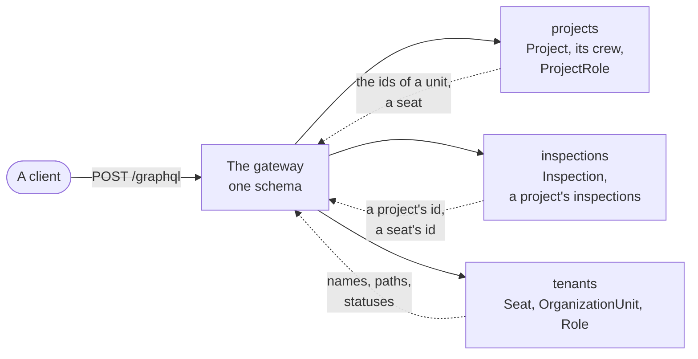
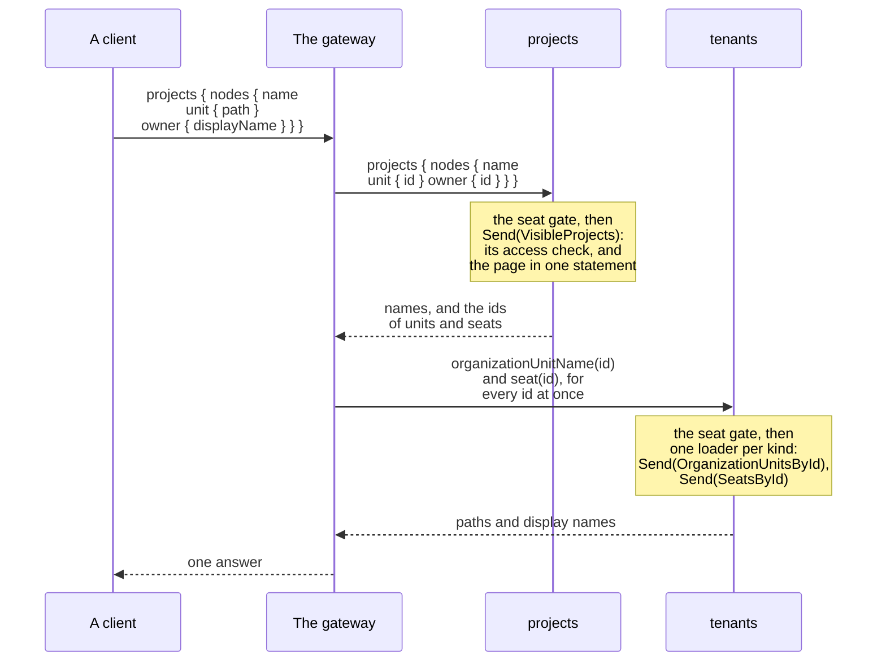

# GraphQL in the sample

How the [sample](../the-sample.md)'s three schemas become one, what a query costs, and each module schema's rules:
read it before giving a module a schema. [GraphQL](../../graphql.md) has the toolkit's side.

## One schema over three modules

- `/graphql` serves the routes' commands and queries as one schema, composed in the process from each module's own
  (a `GraphQL` folder per feature beside `Rest`) with
  [`DDDToolkit.HotChocolate.Fusion.InMemory`](../../graphql.md#one-schema-over-a-modular-monolith).
- A module names another's entity by id only, and the gateway asks the owner for the rest: Projects answers no name
  of Tenancy's, and a client still gets a crew with names in one request.

Which module owns which types: ids go to the gateway, names come back from their owner.



Projects declares a seat as its key alone (`[GraphQLName("Seat")] [EntityKey("id")] record ReferencedSeat(SeatId Id)`);
Tenants declares the owned `Seat` over its `SeatListing`, with an internal lookup (`[Lookup] [Internal]`) behind a
data loader that sends `SeatsById` once per batch, in parts of at most 200 ids
([`DirectoryQueries.cs`](../../../Examples/Tenancy/Modules/Tenants/Examples.Tenancy.Tenants.Api/Directory/GraphQL/DirectoryQueries.cs)).

## A field on another module's type

A module may add fields to a type another owns. In Inspections' schema `Project` is the key and one field,
`inspections`, which the gateway puts on the project Projects answers. No root field takes a project's id; a client
asks the project:

```graphql
{
  projects {
    nodes {
      name
      inspections(first: 5) { nodes { title } }
    }
  }
}
```

- Per batch of projects it costs Inspections one question and one statement: a data loader sends one
  `InspectionsOfProjects`, whose check asks Projects' gate once (`IProjectGate.AskAsync`), and the read pages every
  project's inspections at once (`ToBatchPageAsync`). `canRecord` and `totalCount` cost one more each, when asked.
- A **batch** is what HotChocolate has gathered when it sends: as a rule a page, two on a busy server.
- A project the caller may not see answers `null`: Inspections' own check decides, whatever id reaches it.
- `GET /projects/{id}/inspections` pages the same way, so its `next` is the GraphQL cursor of the page's last row.

<details>
<summary>Show the code: the field added to another module's type</summary>

```csharp
// Inspections.Api/Recording/GraphQL/ProjectType.cs: Project as Inspections declares it, over a record holding its id
[ObjectType<ReferencedProject>]
[EntityKey("id")]
internal static partial class ProjectType
{
    static partial void Configure(IObjectTypeDescriptor<ReferencedProject> descriptor) => descriptor.Name("Project");

    [UseConnection(IncludeTotalCount = true, DefaultPageSize = DefaultPage, MaxPageSize = LargestPage)]   // 10, and 50 at most
    [Cost(InspectionsConnection.LoadedForThePage)]                  // 1: one read for a batch
    public static async Task<InspectionsConnection?> GetInspectionsAsync(
        [Parent] ReferencedProject project, PagingArguments paging, IInspectionsByProjectIdDataLoader inspections, CancellationToken cancellationToken)
        => await inspections.With(paging).LoadAsync(project.Id, cancellationToken) is { } page
            ? new InspectionsConnection(page, project.Id)
            : null;
}
```

</details>

## One query, end to end

Where the seat gate runs, and that each module answers its page or its batch of ids at once:



## How a module declares its schema

The way HotChocolate 16 offers, writing nothing twice; `GraphQLDeclarationTests` hold the modules to it. Projects' is
the example: [`ProjectType.cs`](../../../Examples/Tenancy/Modules/Projects/Examples.Tenancy.Projects.Api/Overview/GraphQL/ProjectType.cs),
[`OverviewPagedQueries.cs`](../../../Examples/Tenancy/Modules/Projects/Examples.Tenancy.Projects.Api/Overview/GraphQL/OverviewPagedQueries.cs),
[`CrewMemberType.cs`](../../../Examples/Tenancy/Modules/Projects/Examples.Tenancy.Projects.Api/Crew/GraphQL/CrewMemberType.cs).

- **A field decides nothing**: it sends what its feature's route sends. A mutation answers what it changed.
- **A type is the application's record**, declared over what a query answers with
  [`[ObjectType<T>]`](../../graphql.md#types-over-your-own-records): nothing is copied or mapped.
- **Nothing to read is `null`, not an error.** `project(id:)` and `node(id:)` answer `null` for a project that is
  missing or out of sight. A reference its owner does not answer (another tenant's seat) is its id with every other
  field `null` and no error, so every field but the key of `Seat`, `OrganizationUnit`, `Role` and `Project` is
  nullable (`AddDDDToolkitEntityNullability()`).
- **Ids are asked together**: once per field of the answer (a page's owners are one `SeatsById`). `crew`, `myRoles`
  and `can` are resolvers behind loaders, one statement each per batch, when asked.
- **A field can ask for a permission**, readable in the schema, beside every request's check:
  [`[Authorize("tenancy.roles.manage")]`](../../graphql.md#a-permission-on-a-field) on `Role.permissions` and
  `ProjectRole.permissions`, `[Authorize("projects.crew.manage")]` on `CrewMember.roles`. Without it the field is
  `null`, with a coded error.
- **The rule itself is held where the data is read**: the queries ask the permission in their statement and answer
  `null` (not empty, which would say "none"), so the routes answer what the fields do. A seat always reads its own.
- **Tenants' lists are whole**: `seats`, `organizationUnits`, `roles`, `openInvitations`; the operators' `tenants`
  keeps the package's page and marker.
- **A history row** has `byKind`, `bySeatId` and `bySeat`. **Invitations**: `personInvite` answers the token, once;
  send it as a variable. **Operators' fields** (`tenants`, `tenantAccessHistory`, `tenantProjects`,
  `tenantProjectInspections`) answer ids where names would be: an operator has no seat.
- **Errors are typed** [in the mutation's payload](../../graphql.md#typed-errors-in-mutation-payloads): a refusal is a
  `RefusalError` with its code. Project mutations take `expectedVersion` (the routes' `If-Match`) and answer the new
  `version`; a stale one is a `ConcurrencyConflictError`.
- **A project is a node**: its `id` is a node id. Seats, units and roles keep plain `UUID`s.

## Access, language and the database

- **A token, then a seat.** `/graphql` requires a token; `SeatGate` asks the routes' question
  (`SeatRequirement.RefusalFor`) in front of every root field, so a client gets `tenancy.tenant-required` or
  `tenancy.not-seated` with its code. `seatsOfMine` and `invitationAccept` need no seat; the operators' fields need an
  operator (`tenancy.operators-only`).
- **The request's language**: the gateway comes after `UseRequestLocalization()`, so a refusal's `message` follows
  `Accept-Language` ([A sample in two languages](../../localization.md#a-sample-in-two-languages)).
- **The caller in the database**: a field only sends, so its reads run under the caller's role and claims, and the
  policies check them again.
- **REST only**: the dev login, `GET /access/projects/{id}?permission=`, health, and `POST /tenancy/directory/*`
  (in GraphQL, the references).

## Paging and what a request may cost

- **Three connections**, over the queries their routes send: `projects`, a project's `inspections` (with
  `canRecord`) and `accessHistory`, each with `nodes`, `edges`, `pageInfo` and `totalCount` when asked, and the
  routes' cursors. Each refuses [a marker that is not its cursor](who-may-do-what.md#a-marker-that-is-not-the-lists-cursor).
- **From one end**: `first` with `last` is refused with the list's code (`projects.page-from-both-ends`, and so on),
  and a size held to the list's range, by one helper, `PageSizes` in `Shared/Examples.Tenancy.Shared.Application`.
- **Within the cost limit.** HotChocolate estimates a request from each list's largest page and a weight per
  field, so each connection states its sizes, ten by default and fifty at most (routes: fifty and two hundred), and a
  field behind a loader weighs one (`[Cost(1)]`), not ten per row.
- **The gateway bounds the whole request**, because the estimate is per module schema and a field another module adds
  is asked once per row: a document over 200 fields or ten levels deep (the deepest screen asks seven) is refused
  before any module is asked (`AddSampleRequestBounds` in `Host/GraphQL/SampleGraphQL.cs`). Introspection keeps
  HotChocolate's bound, so GraphQL Codegen's query is answered.
- A signed-in user's statement stops after ten seconds (`StatementTimeouts[CallerKind.User]`,
  `Host/Storage/SampleStorage.cs`).
- **No subscriptions**: a WebSocket carries no header per message, so a host that adds them reads the tenant from the
  first message, once.

## The administration's gateway

`/admin/graphql` offers everything `/graphql` offers, plus another person's roles: `seatGrants(seatId:)`, the query
`GET /tenancy/seats/{seatId}/grants` sends, requiring `tenancy.seats.manage` for the whole tenant (the sample's
choice).

- `SeatsAdminQueries` is marked [`[GraphQLSchema("admin", OperationType.Query)]`](../../graphql.md#a-field-for-one-schema-only),
  so it is registered in that schema only; `DirectoryQueries` is marked for both. Each schema is composed with
  Projects and Inspections in a gateway of its own ([Several gateways](../../graphql.md#several-gateways),
  `SampleGateways`); the administration's is mapped behind the seat policy.
- maud reads rhea's roles there; leo gets `tenancy.not-permitted`; another tenant's seat is `tenancy.seat-not-found`;
  `/graphql` refuses the field when it reads the document. The schema decides who is offered a field, the request who
  may read the answer.
- The operators' fields are at both; `/admin/graphql` admits seats only, so there they answer `tenancy.operators-only`.

## The schemas, for tools and in the repository

- **A tool reads a schema with a key** (Codegen and Relay have no token): the key at `GraphQL:SchemaKey`, sent as
  `X-GraphQL-Schema-Key`, none in Development. It reads the schema and nothing else
  ([Reading the schema from a tool](../../graphql.md#reading-the-schema-from-a-tool)).
- **The schemas are committed**: `schema.graphql` and `admin.graphql` beside the host's `Program.cs`, and each
  module's `GraphQL/schema.graphql`. `GraphQLSchemaTests` compare them, and write them anew under
  `TENANCY_WRITE_SCHEMA=1` (that run fails and says so; the next passes).
