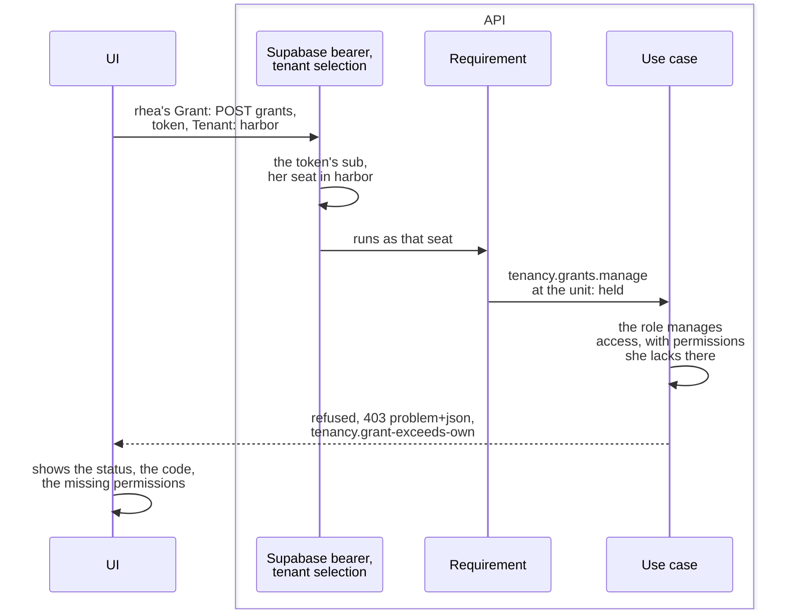

# Try the sample

Running the [sample](../the-sample.md), its UI, one call followed to its refusal, and the presets: calls that each
break one rule.

## Starting the sample

It needs Docker and nothing else. From the repository's root:

```bash
dotnet run --project Examples/Tenancy/Examples.Tenancy.AppHost
```

- Aspire's dashboard, `http://localhost:15105` with the login link the terminal prints, shows the containers (`db`,
  `mail`, `auth`), the steps that run once (`roles`, `migrate`), the API (`api`) and the UI (`ui`).
- The API seeds [the two tenants](../the-sample.md#its-seed) on its first start. The containers are new every run:
  restart the AppHost to start over.
- Sign in with the dev login's cards, or at Supabase Auth as `<name>@example.test` with the dashboard's
  `demo-password` parameter.
- Without Aspire, on the stack the Supabase CLI starts: [the samples' page](../../../Examples/README.md#the-tenancy-sample).

> [!WARNING]
> The dev login signs anyone in as anyone. The host maps it only in Development, and refuses to start with it on
> elsewhere, with a JWT secret under 32 bytes, or with a Supabase URL off the machine. Its tokens are ordinary
> Supabase access tokens, checked by the same bearer. Off, with no JWT secret, the host checks tokens against the keys
> a real Supabase project publishes.

## What the UI shows

A Blazor app calling the API with the signed-in person's token and the `Tenant` header, as any client.

| Page | Shows |
|---|---|
| Sign in | A card per person, starting in their first tenant by slug with an active seat (seth's only seat is suspended, so he sees its refusal first). The top bar switches tenant. |
| Who am I | The seat; its placements with their dated grants; its roles, marked if they manage access; every permission held now, with the units it reaches. |
| My projects | The projects the seat sees, its roles on each, and whether through the crew or the organization. |
| A project | Its crew (members' dated roles for whoever manages it), inspections and actions: filled when the seat may, outlined ("not allowed, try anyway") when not; every button sends the call and shows the answer. |
| Crew roles | The tenant's project roles: make, rename, archive, re-permission. |
| Try it | Any call by hand, as the person, as nobody or in another tenant; the directory asked about one id; [the presets](#the-presets). |
| Access history | Who changed whose access, newest first, for `tenancy.history.view`. |
| Invitations | The open invitations; revoke one, or invite by address. The token is shown once, as a link. |
| Accept an invitation | Takes that token as the signed-in person: as juno, invited by tove into meadow, the picker then has meadow. |

The pages ask the directory for the names of the API's ids (`DirectoryNames`): once per id per load, one call per
kind, the project roles in one `GET /project-roles`. An unanswered id shows as its start.

## One call, from the UI to the refusal

Every call goes the same way: the bearer finds the person, the `Tenant` header and the person's seats the seat, the
request's requirement lets through who may send it, and the use case refuses what the seat may not do. rhea grants leo
a role that manages access with permissions she lacks, which shows why the use case asks again:



The answer, shortened (it also carries the problem's `type` and a `traceId`):

```json
{
  "status": 403,
  "title": "That reaches past what you hold yourself, there or for that long: tenancy.roles.manage, tenancy.settings.manage.",
  "code": "tenancy.grant-exceeds-own",
  "arguments": {
    "Role": "e0000000-0000-4000-8000-000000000107",
    "Missing": "tenancy.roles.manage, tenancy.settings.manage"
  }
}
```

- The header only names a tenant; the seat comes from the person's own seats, by the token's verified identity. So a
  tenant without a seat of yours is `tenancy.not-seated`, as one that does not exist.
- A refusal is 400, 403, 404 or 409 by its kind; a broken aggregate rule 422; a lost race 409 `concurrency-conflict`.
- The host's pipeline: authentication, tenant selection, localization, authorization; then the signed-in, seated and
  operators' groups ([`Program.cs`](../../../Examples/Tenancy/Examples.Tenancy.Host/Program.cs)).

## The presets

The Try it page runs them one by one or all at once
([`DevAttempts.cs`](../../../Examples/Tenancy/Examples.Tenancy.Host/DevLogin/DevAttempts.cs)). All but one allowed read
are refusals of the seed, so running them changes nothing.

| Preset | Who tries what | Answer |
|---|---|---|
| `other-tenants-project` | tove, in harbor, opens meadow's Garden shed | 404 `projects.not-found` |
| `other-tenants-slug` | rhea names meadow in the header | 403 `tenancy.not-seated` |
| `outside-your-region` | rhea opens Bay bridge | 404 `projects.not-found` |
| `through-an-expired-grant` | vic opens Inland depot | 404 `projects.not-found` |
| `close-as-observer` | vic closes Pier 7 | 403 `projects.not-permitted` (`projects.close`) |
| `rename-as-access-admin` | maud renames Pier 7 | 403 `projects.not-permitted` (`projects.edit`) |
| `crew-role-without-crew-management` | juno gives vic Crew lead on Pier 7 | 403 `projects.not-permitted` (`projects.crew.manage`) |
| `organization-role-on-a-crew` | leo gives vic Area manager (an org role) on Pier 7 | 400 `projects.role-not-for-members` |
| `crew-role-held-twice` | leo gives juno Surveyor on Pier 7, which she holds | 409 `projects.crew-role-held` |
| `inspection-outside-the-planned-range` | rhea records on Inland depot for days in 2000 | 409 `inspections.outside-planned-range` |
| `owner-change-from-the-crew` | leo, Pier 7's owner, names juno its owner | 403 `projects.not-permitted` (`projects.owner.change`) |
| `grant-above-your-rights` | rhea grants Access admin to leo at North Coast | 403 `tenancy.grant-exceeds-own` |
| `grant-outside-your-region` | rhea grants Observer to tove at South Bay | 403 `tenancy.not-permitted` |
| `give-a-role-that-manages-access` | hana gives leo Area manager at North Coast | 403 `tenancy.grant-exceeds-own` |
| `give-access-admin-from-the-people-office` | hana gives leo Access admin at North Coast | 403 `tenancy.grant-exceeds-own` |
| `give-crew-lead-from-the-people-office` | hana gives leo Crew lead at North Coast | 403 `tenancy.grant-exceeds-own` |
| `take-away-a-role-that-manages-access` | hana revokes rhea's Area manager at North | 403 `tenancy.grant-exceeds-own` |
| `appoint-yourself` | hana gives herself Area manager at the root | 403 `tenancy.self-appointment` |
| `appoint-yourself-holding-its-permission` | rhea gives herself People office at North | 403 `tenancy.self-appointment` |
| `only-administrator-revokes` | tove, in meadow, revokes her Tenant admin grant | 409 `tenancy.last-admin` |
| `only-administrator-suspends` | tove, in meadow, suspends her own seat | 409 `tenancy.last-admin` |
| `only-administrator-withdraws` | tove, in meadow, withdraws her root placement | 409 `tenancy.last-admin` |
| `remove-the-owner` | leo, the owner, leaves Pier 7's crew | 409 `projects.owner-protected` |
| `give-the-owner-a-role` | leo, the owner, gives himself Surveyor on Pier 7 | 409 `projects.owner-protected` |
| `history-with-the-permission` | maud reads the access history | 200 |
| `history-without-the-permission` | rhea reads the access history | 403 `tenancy.not-permitted` (`tenancy.history.view`) |
| `invite-without-seat-management` | hana invites a person | 403 `tenancy.not-permitted` |
| `accept-an-invitation-nobody-sent` | leo accepts a token nobody was given | 404 `tenancy.invitation-not-found` |
| `suspended-seat` | seth asks who he is | 403 `tenancy.seat-suspended` |
| `no-token` | rhea's projects, without a token | 401 |
| `no-tenant-header` | rhea asks who she is, naming no tenant | 400 `tenancy.tenant-required` |

- A role given from the UI first can make one succeed (with Crew lead at North Coast, juno may give vic Crew lead on
  Pier 7); restart the AppHost to have them all refused again.
- A project page's buttons are real calls. Closed (by leo or rhea), Pier 7 answers three presets with 409
  `projects.closed`: the role juno holds, and the two about its owner. Reopen it with the button in Close's place.
- `Examples.Tenancy.Host.http`, beside the host, walks the same API from an editor.
