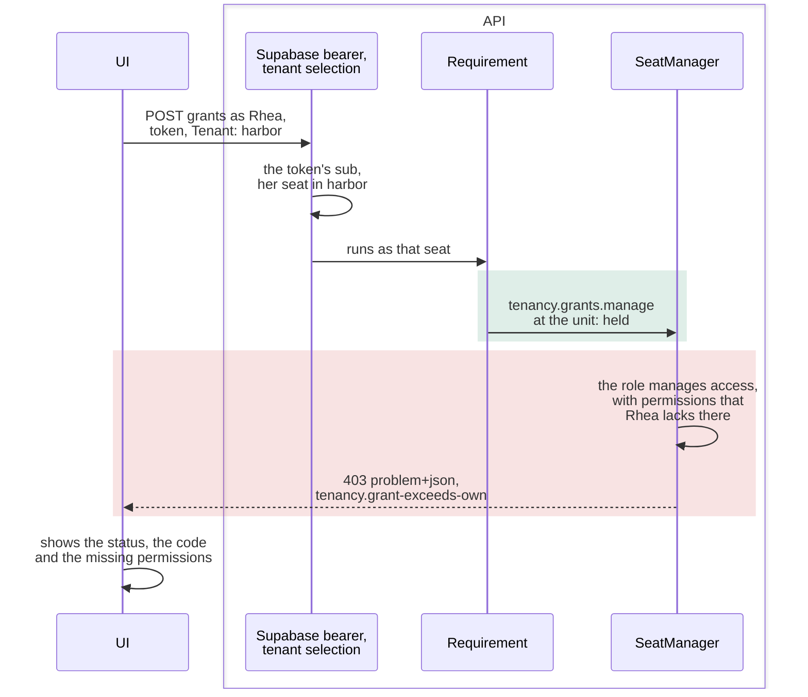

# Try the sample

How to run the [sample](../the-sample.md), what its UI shows, one call followed to its refusal, and the presets, which are calls
that each break one rule.

## Starting the sample

The sample needs Docker and nothing else. From the repository's root:

```bash
dotnet run --project Examples/Tenancy/Examples.Tenancy.AppHost
```

- Aspire's dashboard is at `http://localhost:15105`, with the login link that the terminal prints. It shows the
  containers (`db`, `mail`, `auth`), the steps that run once (`roles`, `migrate`), the API (`api`) and the UI (`ui`).
- The API seeds [the two tenants](../the-sample.md#the-seed-data) when `Sample:SeedDemoData` is on.
  `appsettings.Development.json` turns it on. A start that finds the data already there seeds nothing.
- The AppHost creates new containers on every run, so every run starts with a fresh seed. Restart the AppHost to start
  over.
- Sign in with a card on the dev login page, or at Supabase Auth as `<name>@example.test` with the `demo-password`
  parameter from the dashboard.
- To run without Aspire, on the stack that the Supabase CLI starts, see
  [the samples' page](../../../Examples/README.md#the-tenancy-sample).

> [!WARNING]
> The dev login signs anyone in as anyone. The host maps it only in Development. The host refuses to start with the
> dev login on in any other environment, with a JWT secret under 32 bytes, or with a Supabase URL that is not on the
> local machine. Dev login tokens are ordinary Supabase access tokens, and the same bearer handler checks them. With
> the dev login off and no JWT secret, the host checks tokens against the keys that a real Supabase project publishes.

## What the UI shows

The UI is a Blazor app. It calls the API with the signed-in person's token and the `Tenant` header, as any client
does.

| Page | Shows |
|---|---|
| Sign in | A card per person. Each person starts in the first tenant, by slug, where they have an active seat. Seth's only seat is suspended, so he sees its refusal first. The top bar switches tenant. |
| Who am I | The seat, its placements with their dated grants, and its roles, marked when they manage access. Every permission held now, with the units it reaches. |
| My projects | The projects that the seat sees, its roles on each, and whether it reaches each project through the crew or the organization. |
| A project | Its crew, its inspections and its actions. A caller who manages the crew also sees the members' dated roles. An action button is filled when the seat may use it, and outlined ("not allowed, try anyway") when not. Every button sends the call and shows the answer. |
| Crew roles | The tenant's project roles. Make, rename and archive them, and set their permissions. |
| Try it | Any call by hand, as the person, as nobody, or in another tenant. The directory, asked about one id. [The presets](#the-presets). |
| Access history | Who changed whose access, newest first, for a caller with `tenancy.history.view`. |
| Invitations | The open invitations. Revoke one, or invite by address. The token is shown once, as a link. |
| Accept an invitation | Accepts that token as the signed-in person. For example, Juno accepts Tove's invitation into Meadow Gardens, and the tenant picker then lists Meadow Gardens. |

The pages ask the directory for the names behind the API's ids (`DirectoryNames`). They ask once per id per page
load, with one call per kind. The project roles come in one `GET /project-roles`. An id that the directory does not
return shows as its first characters.

## One refused call, step by step

Every call takes the same path:

1. The bearer handler finds the person from the token.
2. The `Tenant` header and the person's seats give the seat.
3. The request's requirement lets through a caller who may send the request.
4. Tenancy's manager refuses what the seat may not do.

In the example, Rhea grants Leo a role that manages access, with permissions she lacks. The requirement lets her
through, because she holds `tenancy.grants.manage` at the unit. `SeatManager.GrantAsync` refuses. This is why the
manager checks again. Green: the requirement lets the call through. Red: the manager refuses it.



The response, shortened. It also carries the problem's `type` and a `traceId`.

```json
{
  "status": 403,
  "title": "That reaches past what you hold yourself, there or for that long: tenancy.roles.manage, tenancy.settings.manage.",
  "code": "tenancy.grant-exceeds-own",
  "arguments": {
    "Role": "e0000000-0000-4000-8000-000000000107",
    "Missing": "tenancy.roles.manage, tenancy.settings.manage"
  }
}
```

- The header only names a tenant. The seat comes from the person's own seats, found by the token's verified
  identity. So a tenant where the caller has no seat returns `tenancy.not-seated`, the same as a tenant that does not
  exist.
- The status follows the kind of refusal: 400, 403, 404 or 409. A broken aggregate rule returns 422. A lost race
  returns 409 `concurrency-conflict`.
- The host's pipeline runs authentication, tenant selection, localization and authorization. Then come the route
  groups for signed-in callers, for seated callers and for operators
  ([`Program.cs`](../../../Examples/Tenancy/Examples.Tenancy.Host/Program.cs)).

## The presets

The Try it page runs the presets one by one or all at once
([`DevAttempts.cs`](../../../Examples/Tenancy/Examples.Tenancy.Host/DevLogin/DevAttempts.cs)). One preset is an
allowed read. All the others are refusals of the seeded data, so running them changes nothing.

| Preset | Who tries what | Response |
|---|---|---|
| `other-tenants-project` | Tove, in Harbor Works, opens Garden shed of Meadow Gardens. | 404 `projects.not-found` |
| `other-tenants-slug` | Rhea sends `meadow` in the `Tenant` header. | 403 `tenancy.not-seated` |
| `outside-your-region` | Rhea opens Bay bridge. | 404 `projects.not-found` |
| `through-an-expired-grant` | Vic opens Inland depot. | 404 `projects.not-found` |
| `close-as-observer` | Vic closes Pier 7. | 403 `projects.not-permitted` (`projects.close`) |
| `rename-as-access-admin` | Maud renames Pier 7. | 403 `projects.not-permitted` (`projects.edit`) |
| `crew-role-without-crew-management` | Juno gives Vic Crew lead on Pier 7. | 403 `projects.not-permitted` (`projects.crew.manage`) |
| `organization-role-on-a-crew` | Leo gives Vic Area manager, an organization role, on Pier 7. | 400 `projects.role-not-for-members` |
| `crew-role-held-twice` | Leo gives Juno Surveyor on Pier 7, a role she already holds there. | 409 `projects.crew-role-held` |
| `inspection-outside-the-planned-range` | Rhea records an inspection on Inland depot for days in 2000. | 409 `inspections.outside-planned-range` |
| `owner-change-from-the-crew` | Leo, the owner of Pier 7, names Juno as the owner. | 403 `projects.not-permitted` (`projects.owner.change`) |
| `grant-above-your-rights` | Rhea grants Access admin to Leo at North Coast. | 403 `tenancy.grant-exceeds-own` |
| `grant-outside-your-region` | Rhea grants Observer to Tove at South Bay. | 403 `tenancy.not-permitted` |
| `give-a-role-that-manages-access` | Hana gives Leo Area manager at North Coast. | 403 `tenancy.grant-exceeds-own` |
| `give-access-admin-from-the-people-office` | Hana gives Leo Access admin at North Coast. | 403 `tenancy.grant-exceeds-own` |
| `give-crew-lead-from-the-people-office` | Hana gives Leo Crew lead at North Coast. | 403 `tenancy.grant-exceeds-own` |
| `take-away-a-role-that-manages-access` | Hana revokes Rhea's Area manager at North. | 403 `tenancy.grant-exceeds-own` |
| `appoint-yourself` | Hana gives herself Area manager at the root. | 403 `tenancy.self-appointment` |
| `appoint-yourself-holding-its-permission` | Rhea gives herself People office at North. | 403 `tenancy.self-appointment` |
| `only-administrator-revokes` | Tove, in Meadow Gardens, revokes her own Tenant admin grant. | 409 `tenancy.last-admin` |
| `only-administrator-suspends` | Tove, in Meadow Gardens, suspends her own seat. | 409 `tenancy.last-admin` |
| `only-administrator-withdraws` | Tove, in Meadow Gardens, withdraws her placement at the root. | 409 `tenancy.last-admin` |
| `remove-the-owner` | Leo, the owner, leaves the crew of Pier 7. | 409 `projects.owner-protected` |
| `give-the-owner-a-role` | Leo, the owner, gives himself Surveyor on Pier 7. | 409 `projects.owner-protected` |
| `history-with-the-permission` | Maud reads the access history. | 200 |
| `history-without-the-permission` | Rhea reads the access history. | 403 `tenancy.not-permitted` (`tenancy.history.view`) |
| `invite-without-seat-management` | Hana invites a person. | 403 `tenancy.not-permitted` |
| `accept-an-invitation-nobody-sent` | Leo accepts with a token that nobody was given. | 404 `tenancy.invitation-not-found` |
| `suspended-seat` | Seth asks who he is. | 403 `tenancy.seat-suspended` |
| `no-token` | Rhea's projects are asked for without a token. | 401 |
| `no-tenant-header` | Rhea asks who she is, without a `Tenant` header. | 400 `tenancy.tenant-required` |

- A role given from the UI first can make a preset succeed. For example, with Crew lead at North Coast, Juno may give
  Vic Crew lead on Pier 7. Restart the AppHost to have every preset refused again.
- The buttons on a project page send real calls. After Leo or Rhea closes Pier 7, three presets return 409
  `projects.closed` instead: `crew-role-held-twice`, `remove-the-owner` and `give-the-owner-a-role`. Reopen Pier 7
  with the button that replaces Close.
- `Examples.Tenancy.Host.http`, beside the host, calls the same API from an editor.
