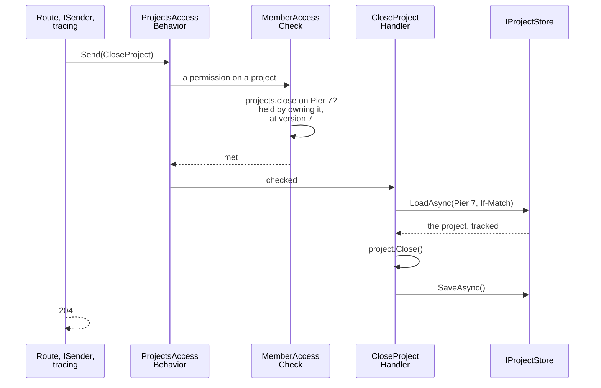
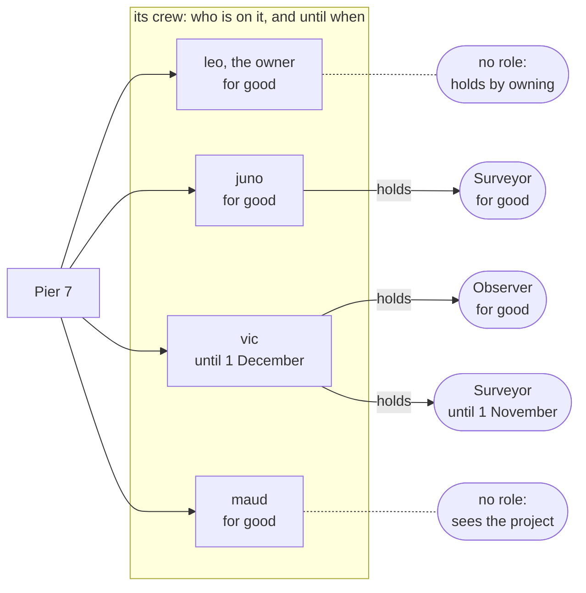

# Who may do what, in the sample

How the [sample](../the-sample.md) decides who may do what, from a module's layers to the save, and what its routes
answer. The people are [its seed](../the-sample.md#its-seed); Tenancy's side is [Who may do what](../who-may-do-what.md).

## A module in layers

A project per layer, in a folder named after the module;
[`Modules/Directory.Build.props`](../../../Examples/Tenancy/Modules/Directory.Build.props) makes each project the
module's from its folder ([A module named by its folder](../../modules.md#a-module-named-by-its-folder)).

| Project | Holds |
|---|---|
| Domain | The classes and their rules, a folder per aggregate. |
| Application | The use cases (a command or query and its handler), a folder per feature; the module's request interface and the check for its own cases; the ports. |
| Infrastructure | The context, migrations, port adapters and their registration. The only project that names Entity Framework. |
| API | Routes, GraphQL fields and types, in the same feature folders, and the module's entry. The only project that names ASP.NET Core. |
| Contracts | What other modules may name. Inspections publishes nothing, so has none. |

- `Add{Module}Module` registers the module, GraphQL included. Routes are mapped per audience, whose requirements the
  host decides: `Map{Module}Module` for seated callers, `Map{Module}Operations` for staff, and Tenants'
  `MapTenantsSeatsOfMine` and `MapTenantsInvitationAcceptance` for a signed-in person with no seat yet.
- The host references each module's API project only. References run API → Application and Infrastructure,
  Infrastructure → Application → Domain → Contracts; the Domain also references `Tenants.Contracts` for the ids, and
  Inspections' application references `Projects.Contracts`.
- **Two ports** ([`ProjectsInfrastructure.cs`](../../../Examples/Tenancy/Modules/Projects/Examples.Tenancy.Projects.Infrastructure/ProjectsInfrastructure.cs)
  registers them): a command loads, changes and saves through `IProjectStore`, on the request's context, its unit of
  work; a query reads through `IProjectReads` on a context of its own, since one request's queries may run side by
  side and a context runs one at a time.
- A reading takes Tenancy's answers as sets, so "the projects a seat may see" stays one statement; it answers data,
  never an entity.
- **Pools** (`PostgresPools.AddContext`): one for requests, one for background work. A read borrows a context for its
  one query; the request's context is taken on first use and returned at the end.
- Every project: [`Examples/README.md`](../../../Examples/README.md#the-tenancy-sample); every folder:
  [Folders inside the layers](../../modules.md#folders-inside-the-layers).

## From the route to the handler

A route decides nothing: it makes a command or query of its arguments and sends it. The request passes tracing, then
its module's access behavior, which the toolkit's generator writes from the module's request interface
([What a request requires of its caller](../who-may-do-what.md#what-a-request-requires-of-its-caller)) and which asks
the module's checks. leo closes Pier 7, to show which class does what:



The command declares its requirement with attributes, and the module's interface is one line
([`CloseProject.cs`](../../../Examples/Tenancy/Modules/Projects/Examples.Tenancy.Projects.Application/Lifecycle/Commands/CloseProject.cs),
[`IProjectsRequest.cs`](../../../Examples/Tenancy/Modules/Projects/Examples.Tenancy.Projects.Application/Access/IProjectsRequest.cs)):

```csharp
[RequiresPermission(RequiredPermission)]
public sealed record CloseProject([OnResource] ProjectId Id, [ExpectedVersion] long? ExpectedVersion = null) : ICommand, IProjectsRequest
{
    public const string RequiredPermission = ProjectPermissionNames.Close;
}

[AccessRequests, InTenant]   // ProjectsAccessBehavior is generated from this, with the module's default
public partial interface IProjectsRequest : IRequireAccess;
```

- A refused request never reaches its handler (its trace is tagged with the code). A handler saves through the store:
  one command, one unit of work.
- Nothing reaches a handler another way: a module without its behavior stops the host at start-up
  ([start-up check](../../startup-checks.md) `access.behaviors-registered`), and a handler called instead of sent is
  warning [DDD00061](../../diagnostics.md#ddd00061).

**Who writes which check.** Each module writes its request interface, marked `[AccessRequests]`, and a check for its
own cases only:

| Case | Decided by | Its check is in |
|---|---|---|
| A permission at a unit | Projects | Projects' set |
| What takes Projects' gate | Inspections | Inspections' set |
| A permission on a project | the Membership package | Projects' set |
| In a tenant, a permission for the whole tenant or at a unit, an operator | the Tenancy package | each module's set |
| Signed in, or the application itself | the toolkit | every set |

Tenants has no check of its own. Under Projects' [module default](../../access-requirements.md#a-modules-default),
`[InTenant]`, a request any seat may send states nothing. An undecided case stops the request where it is sent.

**From the check to the save** ([the whole of it](../../membership.md#from-the-check-to-the-save)):

- The handler loads what its command names, at the `If-Match` version: any change since is 409 `concurrency-conflict`.
- The version, the project's rules and the database, checking every row as the caller, hold the write: a caller who
  lost every permission that writes it gets 403 `access.refused`.
- The sample ships without [the expert hold](../../membership.md#the-expert-hold), which ties the save to the
  checked version.

## What each request declares

What each request declares, and what its handler still decides. **Seen with** a permission: it filters the query's
statement, so nothing out of reach is answered and nobody is refused for seeing nothing.

| Projects | Declares | The handler adds |
|---|---|---|
| `VisibleProjects`, `AllCrewMembers`, `PermissionOnProject` | seen with `projects.view` | the two about one project: out of sight is `projects.not-found` (an unknown permission is `tenancy.unknown-permission` first) |
| `ProjectsById`, `CrewsOfProjects`, `AbilitiesOnProjects`, `PermissionsOnProjects` | seen with `projects.view` | a project out of sight is left out |
| `ProjectDetail` | `projects.view` on the project | what the caller may do, asked with each command's permission |
| `PermissionsHeldAtRoot`, `TenantProjectRoles`, `ProjectRolesById` | in a tenant (the default) | a role's permissions only for `tenancy.roles.manage` for the whole tenant |
| `TenantProjects` | an operator only | |
| `OpenProject` | `projects.open` at the unit; naming an owner, also: it is the caller's own seat, or `projects.owner.change` at the unit (`AccessRequirement.All`, `Any`, `Own`) | the unit is active; the owner may be on a crew |
| `ChangeProjectName`, `PlanProject` | `projects.edit` on the project | |
| `MoveProjectToUnit` | `projects.edit` on the project and `projects.open` at the new unit (`AccessRequirement.All`) | the unit is active |
| `CloseProject`, `ReopenProject` | `projects.close` on the project | |
| `AddCrewMember`, `GiveCrewRole` | `projects.crew.manage` on the project | a new member's seat is active; a role is one of the tenant's project roles in use |
| `TakeCrewRole`, `RemoveCrewMember` | `projects.crew.manage` on the project | a seat changing its own place is saved as the module's work (`OwnPlaceOnTheCrew`) |
| `ChangeProjectOwner` | `projects.owner.change` on the project | an active seat; the old owner stays in the project role `FormerOwnerRole` names, or leaves |
| `MakeProjectRole`, `RenameProjectRole`, `SetProjectRolePermissions`, `ArchiveProjectRole` | `tenancy.roles.manage` for the whole tenant | |
| `SetUpProjectRoles` | in a tenant; no route sends it | only system work in the tenant it sets up, else `access.system-only` |

| Inspections | Declares | The handler adds |
|---|---|---|
| `ProjectInspections`, `InspectionDetail` | `projects.view` on the project | for the list, whether the caller may record |
| `InspectionsOfProjects`, `ProjectsOpenToRecording` | `projects.view` or `inspections.record` on each project; one out of reach is left out | asked of Projects' gate once for all |
| `RecordInspection` | `inspections.record` on the project, which is open, by a seat | days outside the planned range: `inspections.outside-planned-range` |
| `TenantProjectInspections` | an operator only | |

Inspections answers no permission itself: its check asks Projects' gate, `IProjectGate`, and maps the answer (out of
sight `projects.not-found`, closed `projects.closed`, not held `projects.not-permitted`).

Tenants' requests hand most work to Tenancy's use cases, which ask again what the request declared, then their own
rules (linked):

| Tenants | Declares | Then |
|---|---|---|
| `SeatsOfMine` | signed in: own seats, before any tenant, by the token's verified identity | |
| `OverviewOfMine`, `OrganizationUnits`, `TenantSeats`, `TenantRoles`, `SeatsById`, `OrganizationUnitsById`, `RolesById`, `CatalogueContents`, `UnitsWhereIHold`, `OpenInvitations` | in a tenant | mostly [the directory](../reference/use-cases.md#tenancyusecasestenancydirectory); open invitations ([`ListOpenAsync`](../reference/use-cases.md#listopenasynccancellationtoken)) only at units where the caller holds `tenancy.seats.manage` |
| `AddOrganizationUnit`, `MoveOrganizationUnit`, `ArchiveOrganizationUnit` | `tenancy.units.manage` at the parent; a move or archive declares only "in a tenant" | [`AddUnitAsync`](../reference/use-cases.md#addunitasynctunitid-string-cancellationtoken-tunitid-actiontunit), [`MoveUnitAsync`](../reference/use-cases.md#moveunitasynctunitid-tunitid-cancellationtoken), [`ArchiveUnitAsync`](../reference/use-cases.md#archiveunitasynctunitid-cancellationtoken); the sample's `kind` is set in the callback |
| `ChangeTenantShape` | `tenancy.settings.manage` for the whole tenant | [`ChangeShapeAsync`](../reference/use-cases.md#changeshapeasynctenantshape-ireadonlydictionarystring-troleid-cultureinfo-cancellationtoken) |
| `MakePlacement`, `WithdrawPlacement` | `tenancy.seats.manage` at the unit | [`PlaceAsync`](../reference/use-cases.md#placeasynctseatid-tunitid-bool-cancellationtoken), [`WithdrawAsync`](../reference/use-cases.md#withdrawasynctseatid-tunitid-cancellationtoken) |
| `MakeGrant`, `RevokeGrant` | `tenancy.grants.manage` at the unit | [`GrantAsync`](../reference/use-cases.md#grantasynctseatid-tunitid-troleid-datetimeoffset-string-cancellationtoken-datetimeoffset), [`RevokeAsync`](../reference/use-cases.md#revokeasynctseatid-tunitid-troleid-cancellationtoken) |
| `SuspendTenantSeat`, `ReactivateTenantSeat`, `DeactivateTenantSeat` | `tenancy.seats.manage` for the whole tenant | [`SuspendAsync`](../reference/use-cases.md#suspendasynctseatid-cancellationtoken), [`ReactivateAsync`](../reference/use-cases.md#reactivateasynctseatid-cancellationtoken), [`DeactivateAsync`](../reference/use-cases.md#deactivateasynctseatid-cancellationtoken) |
| `SeatGrants` | `tenancy.seats.manage` for the whole tenant, or at the unit asked about (`?unit=`) | [`SeatOverviewAsync`](../reference/use-cases.md#seatoverviewasynctseatid-cancellationtoken) |
| `CreateTenantRole`, `SetRolePermissions`, `ArchiveTenantRole` | `tenancy.roles.manage` for the whole tenant | [`CreateAsync`](../reference/use-cases.md#createasyncstring-string-ireadonlycollectionstring-cancellationtoken-troleid), [`SetPermissionsAsync`](../reference/use-cases.md#setpermissionsasynctroleid-ireadonlycollectionstring-cancellationtoken), [`ArchiveAsync`](../reference/use-cases.md#archiveasynctroleid-cancellationtoken) |
| `InvitePerson`, `CancelInvitation` | `tenancy.seats.manage` for the whole tenant; a cancel only "in a tenant" | [`IssueAsync`](../reference/use-cases.md#issueasyncstring-tunitid-troleid-datetimeoffset-timespan-cancellationtoken-tinvitationid), [`CancelAsync`](../reference/use-cases.md#cancelasynctinvitationid-cancellationtoken) |
| `AcceptInvitation` | signed in: no seat yet | [`AcceptAsync`](../reference/use-cases.md#acceptasyncstring-string-cancellationtoken-tseatid-actiontseat) |
| `RenameSeat` | own seat, or `tenancy.seats.manage` for the whole tenant (`[OrOwn]`) | no use case: the sample's rule ([How a seat is shown](../names-and-languages.md#how-a-seat-is-shown)), held in the database by a column rule |
| `MarkTenantAsDemo` | in a tenant; no route sends it | no use case: only system work in the tenant it marks, else `access.system-only` |
| `AccessHistory` | `tenancy.history.view` for the whole tenant | |
| `AllTenants`, `TenantAccessHistory` | an operator only | `AllTenants`: [the tenant directory](../reference/use-cases.md#tenancyusecasestenantdirectory) |

A package request declares the first thing its use case asks, so the door refuses with the use case's code and
permission. `AccessDeclarationTests` fail for a request that declares nothing and hold every request to these tables;
`RequestPipelineTests` hold that the door and the use case refuse alike.

## How a seat reaches a project

Two ways, both asked inside one query:

- **Through the organization.** A role granted at a unit gives its permissions on every project at that unit and
  below it: rhea's Area manager at North reaches Pier 7 and Inland depot, not Bay bridge.
- **Through the crew.** A member sees the project while its membership lasts; more comes from a project role on the
  crew, on that project alone, for its own period within the membership. `projects.open`, `projects.owner.change` and
  Tenancy's permissions are the organization's: a crew role gives nothing with them.

## The organization's roles

The catalogue has seven starter roles (**packs** in the code); each tenant's roles start as copies of those seeded
for its shape.

| Pack | Permissions | Manages access | Seeded for |
|---|---|---|---|
| Tenant admin | none listed, so all: the administrators' pack of a flat tenant | yes | flat |
| Access admin | Tenancy's six, `projects.owner.change`, `projects.crew.manage`, `projects.view`: the administrators' pack of a hierarchical tenant | yes | hierarchical |
| Area manager | `projects.view`, `.open`, `.edit`, `.close`, `.crew.manage`, `.owner.change`, `inspections.record`, `tenancy.units.manage`, `.seats.manage`, `.grants.manage` | yes | hierarchical |
| Crew lead | `projects.view`, `.edit`, `.close`, `.crew.manage`, `inspections.record`: at a unit, it leads every crew there | yes | every shape |
| Surveyor | `projects.view`, `inspections.record` | no | every shape |
| Observer | `projects.view` | no | every shape |
| People office | `tenancy.grants.manage` | yes | every shape |

- A flat tenant turning hierarchical is given Access admin and Area manager.
- **Hierarchical** keeps running access apart from the work: Access admin renames, closes and records on nothing
  until its holder takes a role (maud may join Pier 7's crew as Crew lead).
- An administrators' pack that lists its permissions must hold every access-managing one, or the host does not start.

**Which permissions manage access**: Tenancy's, all but `tenancy.history.view`, and two of Projects' that the host
marks (`AccessManagingPermissions` in [`SampleCatalogue.cs`](../../../Examples/Tenancy/Examples.Tenancy.Catalogue/SampleCatalogue.cs)):

- `projects.owner.change`: the owner leads the crew until the organization names another;
- `projects.crew.manage`: at a unit it puts anyone on every crew there, in any role, oneself included.

So Crew lead and Area manager come only from someone holding those there at least as long, never to oneself
([Who may give a role](../roles-and-permissions.md#who-may-give-a-role)).

## Crews and their roles

- **A membership** puts a seat on the crew until a day or for good; that alone lets it see the project.
- **A crew role** is given to a member beside its other roles, until a day of its own or for good, and taken away
  while the member stays. A seat holds a role once on a crew (`projects.crew-role-held`); a role counts only while the
  membership does.

Pier 7's crew once vic is on it until 1 December with Surveyor until 1 November, and maud has joined with no role: each
membership and each role has dates of its own.



| Route | Body | Sends |
|---|---|---|
| `POST /projects/{id}/crew` | `{ seatId, roleId?, until? }` | `AddCrewMember`, with the role for the same period when named |
| `POST /projects/{id}/crew/{seatId}/roles` | `{ roleId, until? }` | `GiveCrewRole` |
| `DELETE /projects/{id}/crew/{seatId}/roles/{roleId}` | | `TakeCrewRole`: the member stays |
| `DELETE /projects/{id}/crew/{seatId}` | | `RemoveCrewMember`, with every role held there |

Each answers 204. A crew is answered to whoever sees the project, each member's roles only to a caller with
`projects.crew.manage` on it (`null` for anybody else, in the query's statement: `CrewOverview.RolesPermission`).

**Project roles** are the crews' roles, kept with the [Membership package](../../membership.md), whose worked example
the sample is.

| Starter role | Permissions |
|---|---|
| Crew lead | `projects.view`, `projects.edit`, `projects.close`, `projects.crew.manage`, `inspections.record`: all a crew can give |
| Surveyor | `projects.view`, `inspections.record` |
| Observer | `projects.view` |

- A tenant gets the three when it is set up (`SetUpProjectRoles`, system work the seeding and any tenant creation
  send); one it renamed or archived is not made again. It makes more itself.
- Whoever holds `tenancy.roles.manage` for the whole tenant makes, renames and archives them and sets their
  permissions (`/project-roles`, the `projectRoles` mutations, the Crew roles page); anybody in the tenant reads names.
- A permission of the organization's or Tenancy's in a project role: 400 `projects.permission-not-for-members`. An org
  role, archived project role or other tenant's role on a crew: 400 `projects.role-not-for-members`. An archived role
  stays on its holders, gives nothing, and can still be taken.
- The database holds a seat that writes a crew's roles itself to its own tenant's: the Membership lock asks the
  project roles' table as that seat.

**The owner**: one per project, on its crew with no end, holding no project role.

- By owning, it holds what [`ProjectPermissions`](../../../Examples/Tenancy/Modules/Projects/Examples.Tenancy.Projects.Application/Access/ProjectPermissions.cs)
  gives an owner: seeing, renaming, closing and reopening, and managing the crew. Not recording an inspection, moving
  the project (`projects.open` at the new unit), or naming another owner (`projects.owner.change` at the unit or
  above, declared `Owner = false`).
- Until the organization names another owner, the owner stays on the crew with no role (`projects.owner-protected`).
  The new owner joins the crew if not on it, and its roles there go; the old owner stays in the project role
  `formerOwnerRoleId` names, or leaves.

**Giving a crew role is positional.** Whoever manages the crew puts any active seat on it and gives anyone on it,
themselves included, any project role in use, without holding its permissions: none gives more than Crew lead.

But whoever holds `projects.crew.manage` on a project, on the crew or at the unit or above, can make themselves its
lead for good (a membership ends when its giver says, not with their grant), so grant it only to someone who may
lead those crews.

## What the answers name

Projects and Inspections name units, seats and crew roles by id: the
[read model](../who-may-do-what.md#what-a-module-reads-of-tenancy) has no names. A client asks
[Tenancy for the names](../names-and-languages.md#names), and `GET /project-roles` for the crew roles'.

`GET /projects` answers `items` and `next`. An item is the project's `id`, `version`, `number`, `name`, `unitId`,
`state`, `ownerSeat`, `plannedFrom` and `plannedUntil`, then:

- `myRoleIds`: the caller's roles on the crew now, and `via`, `crew` or `organization`: how the caller reaches it
  (rhea: none, and `organization`).
- `crew`: owner first, then by start (the module has no names to order by), each with `seatId`, `isOwner`,
  `startsAt`, `endsAt`, `appliesNow` and `roles`, each a `roleId` with its own period (the owner's always empty).
- `can`: `rename`, `plan`, `move`, `close`, `reopen`, `manageCrew`, `changeOwner`, for the caller.
- `changedBy`: [who changed it last](#an-operator-who-changed-a-row-and-the-history-as-a-list), `{ "kind": "system",
  "seatId": null }` after the seeding.

## Paging, versions and errors at the door

- **Paging.** `GET /projects?size=20` answers at most twenty and, when more follow, `next`, sent back as `after`:
  GreenDonut's paging, ordered by the number, unique in its tenant. A cursor carries no right (every page is filtered
  for the caller), and a foreign one is [refused](#a-marker-that-is-not-the-lists-cursor).
- **Filters.** `state`, `unit` (and below it) and `text` narrow the list, never widen it; `count=true` adds the
  total. `text` matches a number's start or a name's middle, in any case ("écluse" finds "Écluse nord").
- **Cost.** Three statements a page, however many projects: `VisibleProjects`, `CrewsOfProjects` and
  `AbilitiesOnProjects` (each row's `can`); the [GraphQL list](graphql.md) sends the same. Permission sets for a
  client's own buttons: `POST /access/projects/permissions`; those held at the root: `GET /access/permissions`; where
  one is held: `GET /access/units?permission=`.
- **Versions.** `GET /projects/{id}` sends the `version` as `ETag`. `If-Match: "3"` on a project changed since is 409
  `concurrency-conflict`, as a save that came second, since the client does the same for both. It is compared only
  after access, so a caller without access learns nothing from it.
- **Enums** travel by name in lower snake case (`open`, `hierarchical`), set once in the host's JSON options.
- **The door.** The seat a route inside a tenant needs is a host authorization policy, answered before the route reads
  its arguments: a malformed body is 403 `tenancy.not-seated` without a seat, 400 `invalid-request` with one.

## What the ids are called

| Route | Answers |
|---|---|
| `POST /tenancy/directory/seats` | `[ { id, displayName, status } ]`, by name |
| `POST /tenancy/directory/units` | `[ { id, parentId, name, kind, status, path, depth } ]`, by path; `kind` is the sample's field, `null` when unset |
| `POST /tenancy/directory/roles` | `[ { id, name, fromPack, status, permissions, managesAccess } ]`, active first, by name |

The body is `{ "ids": [ ... ] }`. Anyone seated gets 200, another tenant's ids left out; no list is 400
`invalid-request`, more than 200 ids 400 `tenancy.too-many-ids`.

## An operator, who changed a row, and the history as a list

**An operator who only reads.** An [operator](../operators-and-history.md#operators) works for the application and
has no seat; in the sample, orla, whose token carries the role `tenancy_operator` (with Supabase Auth a claim set for
staff, with the dev login for whoever `DevLogin:Operators` lists).

| Route | Module | Answers |
|---|---|---|
| `GET /operations/tenants` | Tenants | every tenant by slug, with its status and active seats |
| `GET /operations/tenants/{tenant}/history` | Tenants | that tenant's access history |
| `GET /operations/tenants/{tenant}/projects` | Projects | its projects, by number |
| `GET /operations/tenants/{tenant}/projects/{project}/inspections` | Inspections | that project's inspections, newest first |

- Each module owns its routes and [GraphQL fields](graphql.md), in an `Operators` feature, mapped outside the seated
  group behind `SamplePolicies.OperatorRequired`; the query reads past the tenant filter
  (`IgnoreQueryFilters([TenancyQueryFilter.Name])`) for the tenant in the path.
- The policy is a courtesy: each query declares `[RequiresOperator]`, and the package refuses everyone else, seats
  and system work included, with `tenancy.operators-only`.
- She changes nothing: every route inside a tenant asks for a seat (`tenancy.not-seated`), and her database role
  holds `SELECT` alone, reading a table only where a rule of its module admits it:

**`Projects.Infrastructure/Access/OperatorsSeeEveryProject.cs`** (Inspections has the same for its table)

```csharp
[RowAccess<Project>(RowOperations.Read, To = [RowAccessRoles.TokenPrefix + SampleTokenRoles.Operator])]
public static partial class OperatorsSeeEveryProject
{
    public static bool Allows(Project project, Caller caller) => true;
}
```

**Who changed a row.** Projects and inspections answer `changedBy`, from the columns `RecordsWhoChanged` adds
([Who changed a row](../operators-and-history.md#who-changed-a-row)): the seat, `system` for the seeding, or
`operator` for work begun with `TenancyWork.BeginOperatorIn`, without the identity, which is not a tenant's to read.
It keeps who, not when. `ChangedBy` is one value object in Tenants' contracts, shared by both modules.

**The access history as a list.** `GET /tenancy/history?size=&after=` answers the
[access history](../operators-and-history.md#access-history), newest first, to whoever holds `tenancy.history.view`
for the whole tenant. A row is the event's name, when, who acted, and the event as stored, without its own word on who
acted, which would name an operator's identity. A size outside 1 to 200 is `tenants.history.page-size-invalid`.

### A marker that is not the list's cursor

The projects, a project's inspections and the access history each hold a page's marker to their own list before
reading (`TakingOnlyItsOwnCursors`):

| Sent as `after` or `before` | Left to the paging library | In the sample |
|---|---|---|
| A text that is no cursor | An empty page | Refused |
| A cursor of a list ordered by other keys | A 500, an unexpected error in GraphQL | Refused |
| A cursor of this list with a head written into it (pages to skip, a total) | Believed | Refused |

- The refusal is the list's: 400 `projects.cursor-invalid`, `inspections.cursor-invalid` or `tenancy.cursor-invalid`;
  in GraphQL a coded error at the field, the rest of the answer kept.
- One class does it, `ListCursors` in `Shared/Examples.Tenancy.Shared.Infrastructure` (cursors are storage's to
  know, so only infrastructure references it): it decodes the marker with the keys of the query about to run, as the
  library will, without asking the database. Another list's cursor with keys of the same types is a place here too;
  a cursor is never a right.

## Inviting a person by address

The Tenants module turns [invitations](../invitations.md) on, in a feature of its own, `Invitations`.

| Route | Sends | Answers |
|---|---|---|
| `POST /tenancy/invitations` | `InvitePerson` | the id, when it ends, and the token, this once |
| `GET /tenancy/invitations` | `OpenInvitations` | the open ones into units where the caller manages seats |
| `DELETE /tenancy/invitations/{id}` | `CancelInvitation` | nothing; the token stops working |
| `POST /invitations/accept` | `AcceptInvitation` | the new seat, named by the body: `{ token, displayName }` |

- Who may invite is the [package's rule](../invitations.md#who-may-issue-one): hana, who adds no seat, gets
  `tenancy.not-permitted`.
- Accepting takes a signed-in caller and no tenant, mapped beside `GET /me/seats`. The handler passes the address in
  the caller's token, so only the invited account accepts (`tenancy.address-mismatch`); one save makes the seat, its
  primary placement and the grant.
- The token is answered once and only its digest kept. The UI shows it as a link with the token after the `#`, which
  no browser sends to a server; to and from the API it travels in a body.

**The account.** A seat belongs to a verified identity, so the person needs an account.
[`InvitePerson`](../../../Examples/Tenancy/Modules/Tenants/Examples.Tenancy.Tenants.Application/Invitations/Commands/InvitePerson.cs)
asks the toolkit's port `IIdentityAccounts` for one only after the package has issued the invitation, so nobody who
may not invite causes an account or a mail.

- The port is Supabase Auth's admin client when `Supabase:SecretKey` is set (the AppHost sets it): a new address gets
  an account and a mailed link in. Without it, with the dev login on, `DevIdentityAccounts`: the demonstration people.
- The inviter gets the same answer either way, and the account nothing until the person accepts. If the provider
  cannot be asked, the invitation is cancelled again and the failure passed on.
- **The invitation keeps the account it made** (`Invitation.InvitedAccount`): a provider finds no account by address
  and its link works once, so a person whose mail was lost has an account, no way in, and no further mail.
- So inviting the address again mails the kept account again, if nobody signed in with it (else the inviter hands
  over the token); cancelling deletes a kept account nobody used, unless another open invitation keeps it.

**The mailed link.** With `Sample:Invitations:AcceptPage` set (`AddTenantsInvitationPage`), the mail leads to that
page as `…/invitations/accept#<token>#access_token=…&type=invite`: nothing after a `#` reaches a server. The page
takes both off the address, starts no session until Auth says whose the sign-in is, asks first in a tab signed in as
somebody else (`LinkSignIn.cs`), has the person choose a password, then accepts.

- Auth redirects only to its site URL's host or its redirect list: the sample names the UI as Auth's site, in the
  AppHost and in `supabase/config.toml` ([the samples' page](../../../Examples/README.md#on-the-stack-the-supabase-cli-starts)).
- Auth is handed the token, in the request for the mail (`invite?redirect_to=…`): its logs, any gateway's and the
  mailbox hold it. So a mailed invitation rests on the sign-in with the invited address, which accepting also takes;
  keeping the token from Auth takes a mail of the application's own.
- Left out: the application's own mail, a way back for someone who followed the link and set no password, inviting
  back a deactivated seat, and removing the account of an invitation that lapsed.
