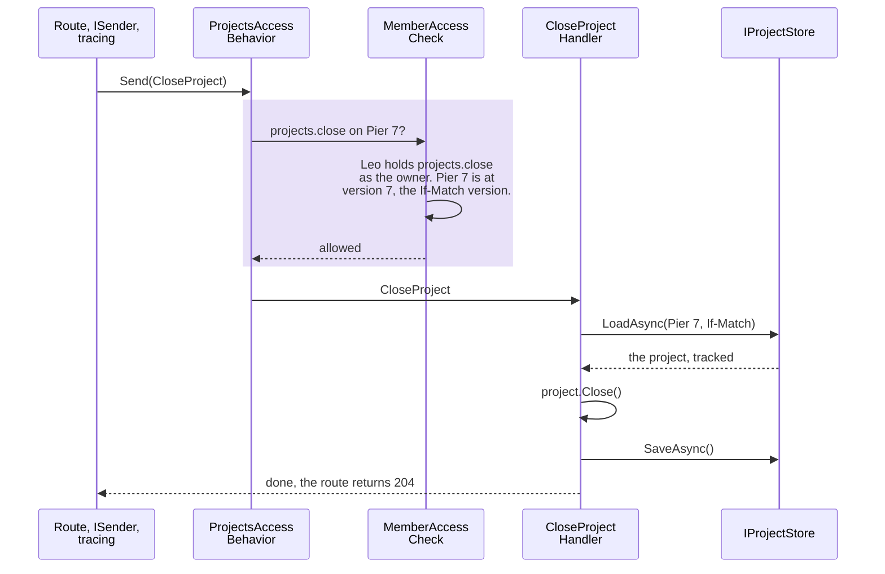
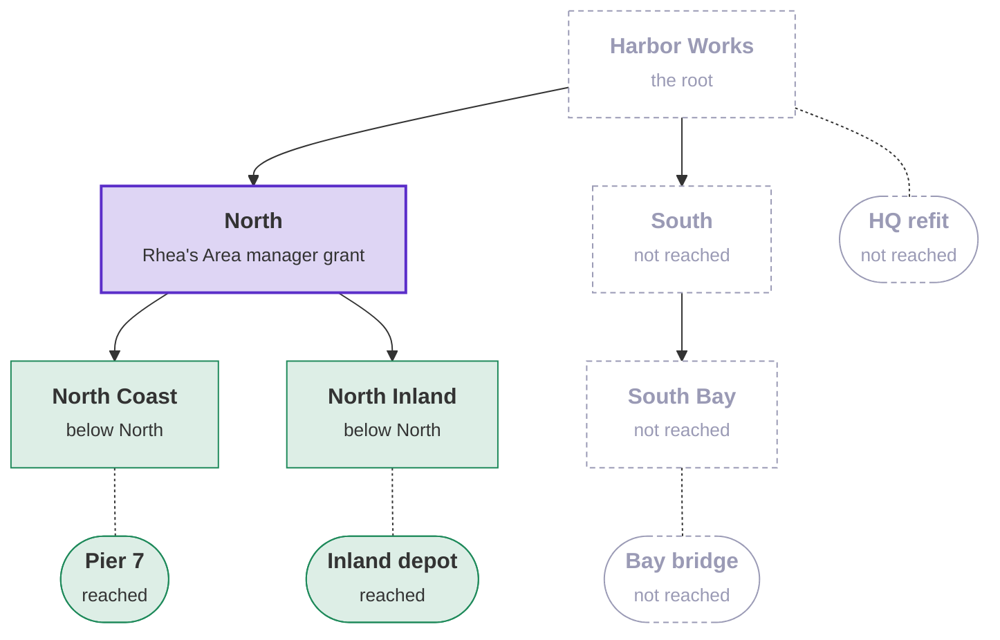
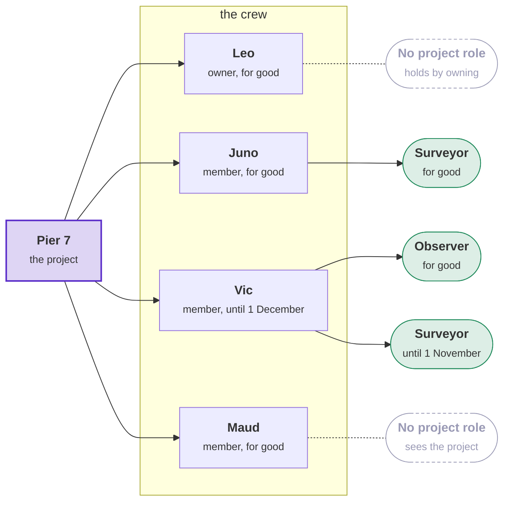

# Who may do what, in the sample

How the [sample](../the-sample.md) decides who may send each request, from the layers of a module to the save, and
what its routes return. The people are in [the seed data](../the-sample.md#the-seed-data). [Who may do what](../who-may-do-what.md)
describes the same rules from Tenancy's side.

## The layers of a module

Each module is a folder with one project per layer.
[`Modules/Directory.Build.props`](../../../Examples/Tenancy/Modules/Directory.Build.props) gives each project the
module name of its folder ([A module named by its folder](../../modules.md#a-module-named-by-its-folder)).

| Project | Contains |
|---|---|
| Domain | The classes and their rules, in one folder per aggregate. |
| Application | The use cases, each a command or query with its handler, in one folder per feature. Also the module's request interface, the access check for the module's own cases, and the ports. |
| Infrastructure | The context, the migrations, the port adapters and their registration. Only this project references Entity Framework. |
| API | The routes and the GraphQL fields and types, in the same feature folders, and the module's entry point. Only this project references ASP.NET Core. |
| Contracts | The types that other modules may use. Inspections publishes nothing, so it has no Contracts project. |

- `Add{Module}Module` registers the module, GraphQL included.
- The host maps the routes in groups, one group per audience, and sets the requirement of each group:
  - `Map{Module}Module` maps the routes for callers with a seat.
  - `Map{Module}Operations` maps the routes for operators, the application's staff.
  - Tenants' `MapTenantsSeatsOfMine` and `MapTenantsInvitationAcceptance` map the routes for a signed-in person who
    has no seat yet.
- The host references only the API project of each module. Inside a module, the API project references Application
  and Infrastructure. Infrastructure references Application, Application references Domain, and Domain references
  Contracts.
- The Domain projects of Projects and Inspections also reference `Tenants.Contracts` for the ids. The Domain and
  Application projects of Inspections also reference `Projects.Contracts`.
- **Two ports.** [`ProjectsInfrastructure.cs`](../../../Examples/Tenancy/Modules/Projects/Examples.Tenancy.Projects.Infrastructure/ProjectsInfrastructure.cs)
  registers both:
  - A command loads, changes and saves a project through `IProjectStore`. The store works on the request's context,
    which is the request's unit of work.
  - A query reads through `IProjectReads`, on a context of its own. The queries of one request may run at the same
    time, and a context runs one query at a time.
- A read uses Tenancy's queries as `IQueryable` sets. So "the projects a seat may see" stays one SQL statement. A read
  returns plain records. It never returns an entity.
- **Pools** (`PostgresPools.AddContext`). The host keeps one pool for requests and one for background work. A read
  borrows a context for its one query. The request's context is taken from the pool on first use and returned when
  the request ends.
- [`Examples/README.md`](../../../Examples/README.md#the-tenancy-sample) lists every project.
  [Folders inside the layers](../../modules.md#folders-inside-the-layers) shows every folder.

## From the route to the handler

A route checks nothing itself. It builds a command or query from its arguments and sends it. The request then passes
the tracing behavior and the module's access behavior. The toolkit's generator writes the access behavior from the
module's request interface ([What a request requires of its caller](../who-may-do-what.md#what-a-request-requires-of-its-caller)).
The behavior calls the module's access checks before the handler runs.

The diagram follows Leo as he closes Pier 7, and shows which class does what. The purple band is the access check:



The command declares its requirement with attributes. The module's request interface is one line
([`CloseProject.cs`](../../../Examples/Tenancy/Modules/Projects/Examples.Tenancy.Projects.Application/Lifecycle/Commands/CloseProject.cs),
[`IProjectsRequest.cs`](../../../Examples/Tenancy/Modules/Projects/Examples.Tenancy.Projects.Application/Access/IProjectsRequest.cs)):

```csharp
[RequiresPermission(RequiredPermission)]
public sealed record CloseProject([OnResource] ProjectId Id, [ExpectedVersion] long? ExpectedVersion = null) : ICommand, IProjectsRequest
{
    public const string RequiredPermission = ProjectPermissionNames.Close;
}

[AccessRequests, InTenant]   // the generator writes ProjectsAccessBehavior from this, with [InTenant] as the module's default
public partial interface IProjectsRequest : IRequireAccess;
```

- A refused request never reaches its handler. Its trace gets a tag with the refusal code.
- A handler saves through the store. One command is one unit of work.
- A handler cannot be reached another way:
  - The host does not start when a module's access behavior is missing
    ([start-up check](../../startup-checks.md) `access.behaviors-registered`).
  - Code that calls a handler directly, instead of sending the request, gets warning
    [DDD00061](../../diagnostics.md#ddd00061).

### Which check decides which case

Each module writes its request interface, marked `[AccessRequests]`, and an access check for its own cases only. The
packages and the toolkit bring the checks for the other cases:

| Case | Decided by | The check is registered for |
|---|---|---|
| A permission at a unit | Projects, in `ProjectsAccessCheck` | Projects' requests |
| A permission on a project, asked of Projects' gate | Inspections, in `InspectionsAccessCheck` | Inspections' requests |
| A permission on a project | The Membership package, in `MemberAccessCheck` | Projects' requests |
| In a tenant, a permission for the whole tenant or at a unit, or an operator | The Tenancy package | Every module's requests |
| Signed in, the caller's own value (`Own`), or `All` or `Any` of other cases | The toolkit | Every module's requests |

- The Tenants module writes no access check. Tenancy's checks and the toolkit's checks decide every case that its
  requests declare.
- Projects sets `[InTenant]` as its [module default](../../access-requirements.md#a-modules-default). So a Projects
  request that any seat may send declares nothing itself.
- When no registered check decides a case, the request is stopped where it is sent.

### From the check to the save

The Membership pages describe [the full path](../../membership/checks-and-saves.md#from-the-check-to-the-save). In the
sample:

- The handler loads the project that its command names, at the version in `If-Match`. If the project changed since,
  the response is 409 `concurrency-conflict`.
- Three things protect the write: the version, the project's rules, and the database, which checks every row as the
  caller. A caller who has lost every permission that writes the row by the time of the save gets 403
  `access.refused`.
- The sample leaves out [the expert hold](../../membership/checks-and-saves.md#the-expert-hold). The expert hold ties
  the save to the version that the check read.

## What each request declares

Each request declares who may send it. The handler then checks what only the handler can know. **Seen with** a
permission means that the permission filters the query's SQL statement. The query leaves out what the caller does
not reach. It refuses nobody for seeing nothing.

| Projects request | Declares | The handler also checks |
|---|---|---|
| `VisibleProjects`, `AllCrewMembers`, `PermissionOnProject` | Seen with `projects.view`. | `AllCrewMembers` and `PermissionOnProject` ask about one project, and return `projects.not-found` when it is out of sight. `PermissionOnProject` first returns `tenancy.unknown-permission` for a permission the catalogue does not know. |
| `ProjectsById`, `CrewsOfProjects`, `AbilitiesOnProjects`, `PermissionsOnProjects` | Seen with `projects.view`. | A project out of sight is left out of the result. |
| `ProjectDetail` | `projects.view` on the project. | What the caller may do, checked with the permission of each command. |
| `PermissionsHeldAtRoot`, `TenantProjectRoles`, `ProjectRolesById` | In a tenant, the module default. | A role's permissions are returned only to a caller with `tenancy.roles.manage` for the whole tenant. |
| `TenantProjects` | An operator only. | |
| `OpenProject` | `projects.open` at the unit. A request that names an owner also needs one of these: the owner is the caller's own seat, or the caller holds `projects.owner.change` at the unit (`AccessRequirement.All`, `Any`, `Own`). | The unit is active. The crew rules admit the owner's seat. The number is free in the tenant (`projects.number-taken`). |
| `ChangeProjectName`, `PlanProject` | `projects.edit` on the project. | |
| `MoveProjectToUnit` | `projects.edit` on the project and `projects.open` at the new unit (`AccessRequirement.All`). | The new unit is active. |
| `CloseProject`, `ReopenProject` | `projects.close` on the project. | |
| `AddCrewMember`, `GiveCrewRole` | `projects.crew.manage` on the project. | A new member's seat is active. A role is one of the tenant's project roles in use. |
| `TakeCrewRole`, `RemoveCrewMember` | `projects.crew.manage` on the project. | When a seat changes its own place on the crew, the store saves the change as the module's work (`OwnPlaceOnTheCrew`). |
| `ChangeProjectOwner` | `projects.owner.change` on the project. | The new owner's seat is active. The old owner stays on the crew in the project role that `FormerOwnerRole` names, or leaves the crew. |
| `MakeProjectRole`, `RenameProjectRole`, `SetProjectRolePermissions`, `ArchiveProjectRole` | `tenancy.roles.manage` for the whole tenant. | |
| `SetUpProjectRoles` | In a tenant. No route sends it. | The handler accepts only system work in the tenant it sets up. Anyone else gets `access.system-only`. |

| Inspections request | Declares | The handler also checks |
|---|---|---|
| `ProjectInspections`, `InspectionDetail` | `projects.view` on the project. | For the list: whether the caller may record an inspection. |
| `InspectionsOfProjects` | `projects.view` on each project. A project out of reach is left out. | The handler asks Projects' gate once, for all the projects. |
| `ProjectsOpenToRecording` | `inspections.record` on each project. A project out of reach is left out. | The handler asks Projects' gate once, for all the projects. |
| `RecordInspection` | `inspections.record` on the project. The project is open, and the caller is a seat. | Days outside the planned range return `inspections.outside-planned-range`. |
| `TenantProjectInspections` | An operator only. | |

Inspections checks no permission itself. Its access check calls Projects' gate, `IProjectGate.AskAsync`, and turns
the result into a refusal:

- A project out of sight returns `projects.not-found`.
- A closed project returns `projects.closed`, for a request that adds an inspection.
- A permission the caller does not hold returns `projects.not-permitted`.

Most Tenants requests hand their work to a Tenancy use case. The use case checks again what the request declared, and
then its own rules. The table links each use case:

| Tenants request | Declares | Then |
|---|---|---|
| `SeatsOfMine` | Signed in. It returns the caller's own seats, before any tenant is chosen, found by the token's verified identity. | |
| `OverviewOfMine`, `OrganizationUnits`, `TenantSeats`, `TenantRoles`, `SeatsById`, `OrganizationUnitsById`, `RolesById`, `CatalogueContents`, `UnitsWhereIHold`, `OpenInvitations` | In a tenant. | Most go to [the directory](../reference/managers.md). Open invitations ([`ListOpenAsync`](../reference/managers.md#listopenasynccancellationtoken)) are returned only for units where the caller holds `tenancy.seats.manage`. |
| `AddOrganizationUnit`, `MoveOrganizationUnit`, `ArchiveOrganizationUnit` | `AddOrganizationUnit` declares `tenancy.units.manage` at the parent. A move or an archive declares only "in a tenant". | [`AddUnitAsync`](../reference/managers.md#addunitasynctunitid-string-cancellationtoken-tunitid-actiontunit), [`MoveUnitAsync`](../reference/managers.md#moveunitasynctunitid-tunitid-cancellationtoken), [`ArchiveUnitAsync`](../reference/managers.md#archiveunitasynctunitid-cancellationtoken). The sample sets its `kind` field in the callback. |
| `ChangeTenantShape` | `tenancy.settings.manage` for the whole tenant. | [`ChangeShapeAsync`](../reference/managers.md#changeshapeasynctenantshape-ireadonlydictionarystring-troleid-cultureinfo-cancellationtoken) |
| `MakePlacement`, `WithdrawPlacement` | `tenancy.seats.manage` at the unit. | [`PlaceAsync`](../reference/managers.md#placeasynctseatid-tunitid-bool-cancellationtoken), [`WithdrawAsync`](../reference/managers.md#withdrawasynctseatid-tunitid-cancellationtoken) |
| `MakeGrant`, `RevokeGrant` | `tenancy.grants.manage` at the unit. | [`GrantAsync`](../reference/managers.md#grantasynctseatid-troleid-tunitid-datetimeoffset-string-cancellationtoken-datetimeoffset), [`RevokeAsync`](../reference/managers.md#revokeasynctseatid-troleid-tunitid-cancellationtoken) |
| `SuspendTenantSeat`, `ReactivateTenantSeat`, `DeactivateTenantSeat` | `tenancy.seats.manage` for the whole tenant. | [`SuspendAsync`](../reference/managers.md#suspendasynctseatid-cancellationtoken), [`ReactivateAsync`](../reference/managers.md#reactivateasynctseatid-cancellationtoken), [`DeactivateAsync`](../reference/managers.md#deactivateasynctseatid-cancellationtoken) |
| `SeatGrants` | `tenancy.seats.manage` for the whole tenant, or at the unit asked about (`?unit=`). | [`SeatOverviewAsync`](../reference/managers.md#overviewasynctseatid-cancellationtoken) |
| `CreateTenantRole`, `SetRolePermissions`, `ArchiveTenantRole` | `tenancy.roles.manage` for the whole tenant. | [`CreateAsync`](../reference/managers.md#createasyncstring-string-ireadonlycollectionstring-cancellationtoken-troleid), [`SetPermissionsAsync`](../reference/managers.md#setpermissionsasynctroleid-ireadonlycollectionstring-cancellationtoken), [`ArchiveAsync`](../reference/managers.md#archiveasynctroleid-cancellationtoken) |
| `InvitePerson`, `CancelInvitation` | `InvitePerson` declares `tenancy.seats.manage` for the whole tenant. A cancel declares only "in a tenant". | [`IssueAsync`](../reference/managers.md#issueasyncstring-tunitid-troleid-datetimeoffset-timespan-cancellationtoken-tinvitationid), [`CancelAsync`](../reference/managers.md#cancelasynctinvitationid-cancellationtoken) |
| `AcceptInvitation` | Signed in, with no seat yet. | [`AcceptAsync`](../reference/managers.md#acceptasyncstring-string-cancellationtoken-tseatid-actiontseat) |
| `RenameSeat` | The caller's own seat, or `tenancy.seats.manage` for the whole tenant (`[OrOwn]`). | No use case. The rule is the sample's own ([How a seat is shown](../names-and-languages.md#how-a-seat-is-shown)). A column rule enforces it in the database. |
| `MarkTenantAsDemo` | In a tenant. No route sends it. | No use case. The handler accepts only system work in the tenant it marks. Anyone else gets `access.system-only`. |
| `AccessHistory` | `tenancy.history.view` for the whole tenant. | |
| `AllTenants`, `TenantAccessHistory` | An operator only. | `AllTenants` uses [the tenant directory](../reference/managers.md#listasyncstring-int-cancellationtoken). |

A Tenants request declares the first thing that its use case checks. So the access behavior refuses with the same
code and permission as the use case. Two test classes hold the tables above:

- `AccessDeclarationTests` fails for a request that declares nothing, and checks every request against these tables.
- `RequestPipelineTests` checks that the access behavior and the use case refuse in the same way.

## How a seat reaches a project

A seat reaches a project in two ways. One query checks both:

- **Through the organization.** A role granted at a unit gives its permissions on every project at that unit and
  below it.
- **Through the crew.** A member sees the project while the membership lasts. A project role on the crew gives more
  permissions, on that project only, for the role's own period within the membership.

A crew role never gives `projects.open`, `projects.owner.change` or Tenancy's permissions. Only roles of the
organization give those.

Rhea holds Area manager at North. Purple: Rhea's grant; green: the units and projects it reaches; grey: what it does
not reach.



Vic reaches a project through the crew. His Observer grant at North Inland ended yesterday, so Inland depot is out of his reach. He
still sees Pier 7, because he is on its crew.

## The organization's roles

The catalogue declares seven starter roles. Each tenant's roles start as copies of the packs
that are seeded for the tenant's shape.

| Pack | Permissions | Manages access | Seeded for |
|---|---|---|---|
| Tenant admin | None listed, which means all. It is the administrators' pack of a flat tenant. | yes | flat |
| Access admin | Tenancy's six, `projects.owner.change`, `projects.crew.manage` and `projects.view`. It is the administrators' pack of a hierarchical tenant. | yes | hierarchical |
| Area manager | `projects.view`, `projects.open`, `projects.edit`, `projects.close`, `projects.crew.manage`, `projects.owner.change`, `inspections.record`, `tenancy.units.manage`, `tenancy.seats.manage` and `tenancy.grants.manage` | yes | hierarchical |
| Crew lead | `projects.view`, `projects.edit`, `projects.close`, `projects.crew.manage` and `inspections.record`. Granted at a unit, it leads every crew there. | yes | every shape |
| Surveyor | `projects.view` and `inspections.record` | no | every shape |
| Observer | `projects.view` | no | every shape |
| People office | `tenancy.grants.manage` | yes | every shape |

- A flat tenant that turns hierarchical gets Access admin and Area manager.
- In a **hierarchical** tenant, Access admin runs access and does none of the work. A seat with only Access admin
  cannot rename, close or record anything. It needs another role for that. For example, Maud may join Pier 7's crew
  as Crew lead.
- An administrators' pack that lists its permissions must hold every access-managing permission. Otherwise the host
  does not start.

**Which permissions manage access.** All of Tenancy's permissions except `tenancy.history.view`, and two of
Projects' permissions that the host marks (`AccessManagingPermissions` in
[`SampleCatalogue.cs`](../../../Examples/Tenancy/Examples.Tenancy.Catalogue/SampleCatalogue.cs)):

- `projects.owner.change`, because the owner leads the crew until the organization names another owner.
- `projects.crew.manage`, because at a unit it puts anyone on every crew there, in any role, the holder included.

So a seat can give Crew lead or Area manager only when it holds the role's access-managing permissions at the unit,
for at least as long. Nobody can give either role to themselves ([Who may give a role](../roles-and-permissions.md#who-may-give-a-role)).

## Crews and their roles

- **A membership** puts a seat on the crew until a given day, or for good. The membership alone lets the seat see the
  project.
- **A crew role** is given to a member beside the member's other roles, until a day of its own, or for good. It can be
  taken away while the member stays on the crew.
- A seat holds each role at most once on a crew (`projects.crew-role-held`). A role counts only while the membership
  lasts.

The diagram shows Pier 7's crew after two changes in the UI. Vic is on the crew until 1 December and holds Surveyor
until 1 November. Maud has joined with no role. Each membership and each role has its own dates. Purple: the project;
green: a project role that a member holds; grey: no project role.



| Route | Body | Sends |
|---|---|---|
| `POST /projects/{id}/crew` | `{ seatId, roleId?, until? }` | `AddCrewMember`. A named role is given for the same period. |
| `POST /projects/{id}/crew/{seatId}/roles` | `{ roleId, until? }` | `GiveCrewRole` |
| `DELETE /projects/{id}/crew/{seatId}/roles/{roleId}` | | `TakeCrewRole`. The member stays on the crew. |
| `DELETE /projects/{id}/crew/{seatId}` | | `RemoveCrewMember`, with every role the member holds there. |

- Each of these routes returns 204.
- `GET /projects/{id}/crew` returns the crew to anyone who sees the project. Each member's roles are returned only to
  a caller with `projects.crew.manage` on the project. For anyone else, `roles` is `null`. The query's SQL statement
  makes this check (`CrewOverview.RolesPermission`).

**Project roles** are the crews' roles. The [Membership package](../../membership/overview.md) keeps them, and the
sample is that package's worked example.

| Starter role | Permissions |
|---|---|
| Crew lead | `projects.view`, `projects.edit`, `projects.close`, `projects.crew.manage` and `inspections.record`. These are all the permissions a crew can give. |
| Surveyor | `projects.view` and `inspections.record` |
| Observer | `projects.view` |

- A tenant gets the three starter project roles when it is set up. `SetUpProjectRoles` makes them, as system work in
  that tenant. In the sample, only the seeding creates tenants, and it sends `SetUpProjectRoles` for each one.
- `SetUpProjectRoles` does not make a role again that the tenant renamed or archived. The tenant can make more project
  roles itself.
- A seat with `tenancy.roles.manage` for the whole tenant makes, renames and archives project roles, and sets their
  permissions. It does so through the `/project-roles` routes, the `projectRoleCreate`, `projectRoleRename`,
  `projectRolePermissionsSet` and `projectRoleArchive` mutations, or the Crew roles page. Anyone in the tenant can read
  the names.
- A project role with a permission of the organization or of Tenancy returns 400
  `projects.permission-not-for-members`.
- Giving a crew member an organization role, an archived project role or another tenant's role returns 400
  `projects.role-not-for-members`.
- An archived role stays with the members who hold it. It gives no permissions, and it can still be taken away.
- In the database, a seat that writes a crew's roles can write only roles of its own tenant. The Membership lock reads
  the project roles table as that seat.

**The owner.** Each project has one owner. The owner is on the crew with no end date and holds no project role.

- By owning the project, the owner holds what
  [`ProjectPermissions`](../../../Examples/Tenancy/Modules/Projects/Examples.Tenancy.Projects.Application/Access/ProjectPermissions.cs)
  gives an owner: seeing, renaming, closing and reopening the project, and managing its crew.
- Owning the project does not let the owner:
  - record an inspection;
  - move the project, which needs `projects.open` at the new unit;
  - name another owner, which needs `projects.owner.change` at the unit or above (declared with `Owner = false`).
- The owner stays on the crew, with no role, until the organization names another owner
  (`projects.owner-protected`).
- A new owner joins the crew if not on it already, and loses the project roles held there. The old owner stays on the
  crew in the project role that `formerOwnerRoleId` names, or leaves the crew.

**Giving a crew role.** Whoever manages the crew can put any active seat on it. They can give anyone on the crew,
themselves included, any project role in use. They do not need to hold the role's permissions, because no project
role gives more than Crew lead.

So a seat that holds `projects.crew.manage` on a project can make itself the project's Crew lead for good. This holds
whether the permission comes from the crew or from a role at the unit or above. A membership lasts until the end date
its giver set. It does not end when the giver's own grant ends. Give `projects.crew.manage` only to someone who may
lead those crews.

## What `GET /projects` returns

Projects and Inspections return units, seats and crew roles as ids. The
[read model](../who-may-do-what.md#what-a-module-reads-of-tenancy) has no names. A client asks
[Tenancy for the names](../names-and-languages.md#names), and asks `GET /project-roles` for the names of crew roles.

`GET /projects` returns `items` and `next`. Each item has the project's `id`, `version`, `number`, `name`, `unitId`,
`state`, `ownerSeat`, `plannedFrom` and `plannedUntil`. It also has these fields:

- `myRoleIds` holds the caller's current roles on the crew.
- `via` is `crew` or `organization`, and says how the caller reaches the project. For Rhea, `myRoleIds` is empty and
  `via` is `organization`.
- `crew` lists the members, the owner first and then by start date. The module has no names to sort by. Each member
  has `seatId`, `isOwner`, `startsAt`, `endsAt`, `appliesNow` and `roles`. Each role is a `roleId` with its own
  period. The owner's `roles` is always empty.
- `can` holds `rename`, `plan`, `move`, `close`, `reopen`, `manageCrew` and `changeOwner`, for the caller.
- `changedBy` says [who changed the project last](#who-changed-a-row). After the seeding it is
  `{ "kind": "system", "seatId": null }`.

## Paging, versions and request errors

- **Paging.** `GET /projects?size=20` returns at most twenty projects. When more follow, it also returns `next`. The
  client sends `next` back as `after`. The paging is GreenDonut's, ordered by the project number, which is unique in
  its tenant. A cursor gives no rights, because every page is filtered for the caller. A cursor from another list is
  [refused](#invalid-cursors).
- **Filters.** `state`, `unit` (the unit and the units below it) and `text` narrow the list. They never widen it.
  `count=true` adds the total. `text` matches the start of a number or any part of a name, ignoring case ("écluse"
  finds "Écluse nord").
- **Cost.** A page costs three SQL statements, however many projects it holds: `VisibleProjects`, `CrewsOfProjects`,
  and `AbilitiesOnProjects` for the `can` of each row. The [GraphQL list](graphql.md) sends the same three.
- **Permissions for a client's buttons.** `POST /access/projects/permissions` returns permission sets per project.
  `GET /access/permissions` returns the permissions held at the root. `GET /access/units?permission=` returns the units
  where one permission is held.
- **Versions.** `GET /projects/{id}` sends the `version` as the `ETag`. `If-Match: "3"` on a project that changed
  since returns 409 `concurrency-conflict`. A save that lost a race returns the same, because the client handles both
  cases the same way. The version is compared only after the access check, so a caller without access learns nothing
  from it.
- **Enums** travel as names in lower snake case (`open`, `hierarchical`). The host sets this once, in its JSON
  options.
- **The seat policy.** A route inside a tenant needs a seat. A host authorization policy checks the seat before the
  route reads its arguments. So a malformed body returns 403 `tenancy.not-seated` to a caller without a seat, and 400
  `invalid-request` to a caller with one.

### Invalid cursors

The project list, a project's inspections and the access history each check a page cursor against their own list
before they read (`TakingOnlyItsOwnCursors`):

| Sent as `after` or `before` | Without the check, the paging library returns | The sample |
|---|---|---|
| Text that is not a cursor | An empty page | Refuses it |
| A cursor from a list ordered by other keys | A 500, or an unexpected error in GraphQL | Refuses it |
| A cursor of this list with a header added (pages to skip, a total) | A page built from the header's values | Refuses it |

- Each list refuses with its own code: 400 `projects.cursor-invalid`, `inspections.cursor-invalid` or
  `tenancy.cursor-invalid`. In GraphQL the refusal is a coded error on the field, and the rest of the response stays.
- One class does the check: `ListCursors` in `Shared/Examples.Tenancy.Shared.Infrastructure`. Only infrastructure
  projects reference it, because cursors belong to storage. It decodes the cursor with the keys of the query about to
  run, as the library will, without a database call.
- A cursor from another list whose keys have the same types decodes as a valid position here. The caller still sees
  nothing new, because a cursor gives no rights.

## Looking up names by id

Three directory routes return the names for a list of ids:

| Route | Returns |
|---|---|
| `POST /tenancy/directory/seats` | `[ { id, displayName, status } ]`, sorted by name |
| `POST /tenancy/directory/units` | `[ { id, parentId, name, kind, status, path, depth } ]`, sorted by path. `kind` is the sample's field, and `null` when unset. |
| `POST /tenancy/directory/roles` | `[ { id, name, fromPack, status, permissions, managesAccess } ]`, active roles first, then by name |

The body is `{ "ids": [ ... ] }`. Any caller with a seat gets 200, with another tenant's ids left out. A body without
the list returns 400 `invalid-request`. More than 200 ids return 400 `tenancy.too-many-ids`.

## Operators, who changed a row, and the access history

### Operators who only read

An [operator](../operators-and-history.md#operators) works for the application and has no seat. In the sample the
operator is Orla. Her token carries the role `tenancy_operator`. With Supabase Auth, that role is a claim set for
staff. With the dev login, the role goes to the people that `DevLogin:Operators` lists.

| Route | Module | Returns |
|---|---|---|
| `GET /operations/tenants` | Tenants | Every tenant by slug, with its status and its number of active seats |
| `GET /operations/tenants/{tenant}/history` | Tenants | That tenant's access history |
| `GET /operations/tenants/{tenant}/projects` | Projects | Its projects, by number |
| `GET /operations/tenants/{tenant}/projects/{project}/inspections` | Inspections | That project's inspections, newest first |

- Each module owns its operator routes and [GraphQL fields](graphql.md), in an `Operators` feature. The host maps them
  outside the seated group, behind `SamplePolicies.OperatorRequired`. The query reads past the tenant filter
  (`IgnoreQueryFilters([TenancyQueryFilter.Name])`) for the tenant in the path.
- The policy is an early check only. Each query also declares `[RequiresOperator]`. The Tenancy package refuses anyone
  else with `tenancy.operators-only`, seats and system work included.
- Orla changes nothing:
  - Every route inside a tenant requires a seat (`tenancy.not-seated`).
  - Her database role holds only `SELECT`. It reads a table only where a row rule of the table's module allows it.

Projects' rule is below. Inspections has the same rule for its table.

**`Projects.Infrastructure/Access/OperatorsSeeEveryProject.cs`**

```csharp
[RowAccess<Project>(RowOperations.Read, To = [RowAccessRoles.TokenPrefix + SampleTokenRoles.Operator])]
public static partial class OperatorsSeeEveryProject
{
    public static bool Allows(Project project, Caller caller) => true;
}
```

### Who changed a row

Projects and inspections return `changedBy`, from the columns that `RecordsWhoChanged` adds
([Who changed a row](../operators-and-history.md#who-changed-a-row)). The value is one of these:

- the seat;
- `system`, for the seeding;
- `operator`, for work started with `TenancyWork.BeginOperatorIn`. The operator's identity is left out, because a
  tenant may not read it.

`changedBy` records who made the last change. It does not record when. `ChangedBy` is one value object in Tenants'
contracts, and both modules use it.

### The access history list

`GET /tenancy/history?size=&after=` returns the [access history](../operators-and-history.md#access-history), newest
first, to a caller with `tenancy.history.view` for the whole tenant. A row holds the event's name, the time, who
acted, and the stored event. The stored event's own field for who acted is left out, because it would name an
operator's identity. A size outside 1 to 200 returns `tenants.history.page-size-invalid`.

## Inviting a person by address

The Tenants module turns [invitations](../invitations.md) on, in its own feature folder, `Invitations`.

| Route | Sends | Returns |
|---|---|---|
| `POST /tenancy/invitations` | `InvitePerson` | The id, the end time, and the token. The token is returned this one time only. |
| `GET /tenancy/invitations` | `OpenInvitations` | The open invitations into units where the caller manages seats |
| `DELETE /tenancy/invitations/{id}` | `CancelInvitation` | Nothing. The token stops working. |
| `POST /invitations/accept` | `AcceptInvitation` | The new seat. The body is `{ token, displayName }`. |

- Who may invite is the [package's rule](../invitations.md#who-may-issue-an-invitation). Hana adds no seats, so she gets
  `tenancy.not-permitted`.
- Accepting needs a signed-in caller and no tenant. The host maps the route beside `GET /me/seats`. The handler passes
  the address in the caller's token, so only the invited account can accept (`tenancy.address-mismatch`). One save
  creates the seat, its primary placement and the grant.
- The API returns the token once and keeps only its digest. The UI shows the token as a link, with the token after the
  `#`. Browsers do not send that part of a URL to a server. Between the UI and the API, the token travels in a request
  body.

**The account.** A seat belongs to a verified identity, so the person needs an account.
[`InvitePerson`](../../../Examples/Tenancy/Modules/Tenants/Examples.Tenancy.Tenants.Application/Invitations/Commands/InvitePerson.cs)
asks the toolkit's port `IIdentityAccounts` for an account only after the package has issued the invitation. So a
caller who may not invite never causes an account or a mail.

- With `Supabase:SecretKey` set, the port is Supabase Auth's admin client. The AppHost sets the key. A new address
  gets an account and a mailed sign-in link. Without the key, and with the dev login on, the port is
  `DevIdentityAccounts`, which knows the demonstration people.
- The inviter gets the same answer whether the address already had an account or not. The account has no seat until
  the person accepts. If the provider cannot be reached, the handler cancels the invitation again and passes the
  failure on.
- **The invitation keeps the account it created** (`Invitation.InvitedAccount`). A provider cannot find an account by
  address, and its link works once. Without the kept account, a person whose mail was lost would have an account, no
  way in, and no further mail.
- So inviting the same address again mails the kept account again, if nobody has signed in with it yet. If someone
  has, the inviter hands over the token instead. Cancelling deletes a kept account that nobody used, unless another
  open invitation keeps it.

**The mailed link.** With `Sample:Invitations:AcceptPage` set (`AddTenantsInvitationPage`), the mail leads to that
page as `…/invitations/accept#<token>#access_token=…&type=invite`. Nothing after a `#` reaches a server. The page
then:

1. takes the token and Auth's access token off the address;
2. starts no session until Auth confirms whose sign-in it is;
3. asks first when the browser tab is signed in as somebody else (`LinkSignIn.cs`);
4. has the person choose a password;
5. accepts the invitation.

- Auth redirects only to its site URL's host or to its redirect list. The sample names the UI as Auth's site, in the
  AppHost and in `supabase/config.toml` ([the samples' page](../../../Examples/README.md#on-the-stack-the-supabase-cli-starts)).
- The sample hands Auth the token, in the request for the mail (`invite?redirect_to=…`). So Auth's logs, the logs of
  any gateway and the mailbox hold the token. A mailed invitation therefore depends on the sign-in with the invited
  address, which accepting also requires. To keep the token away from Auth, the application must send its own mail.
- The sample leaves out the application's own mail, a way back for someone who followed the link and set no password,
  inviting a deactivated seat back, and removing the account of an invitation that lapsed.
