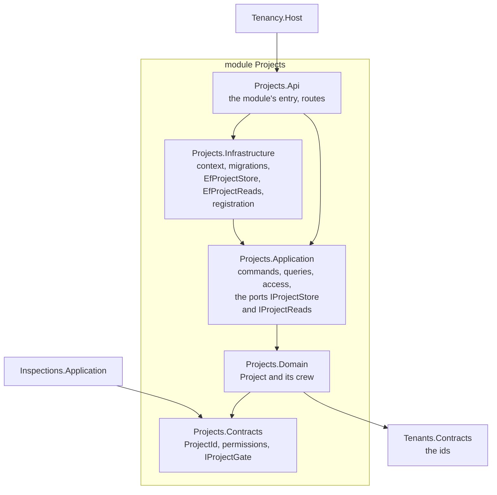
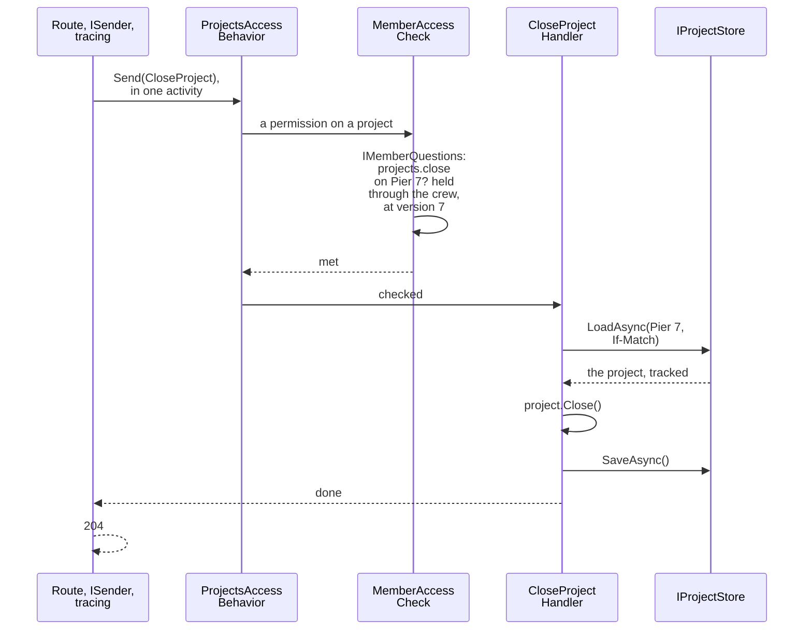
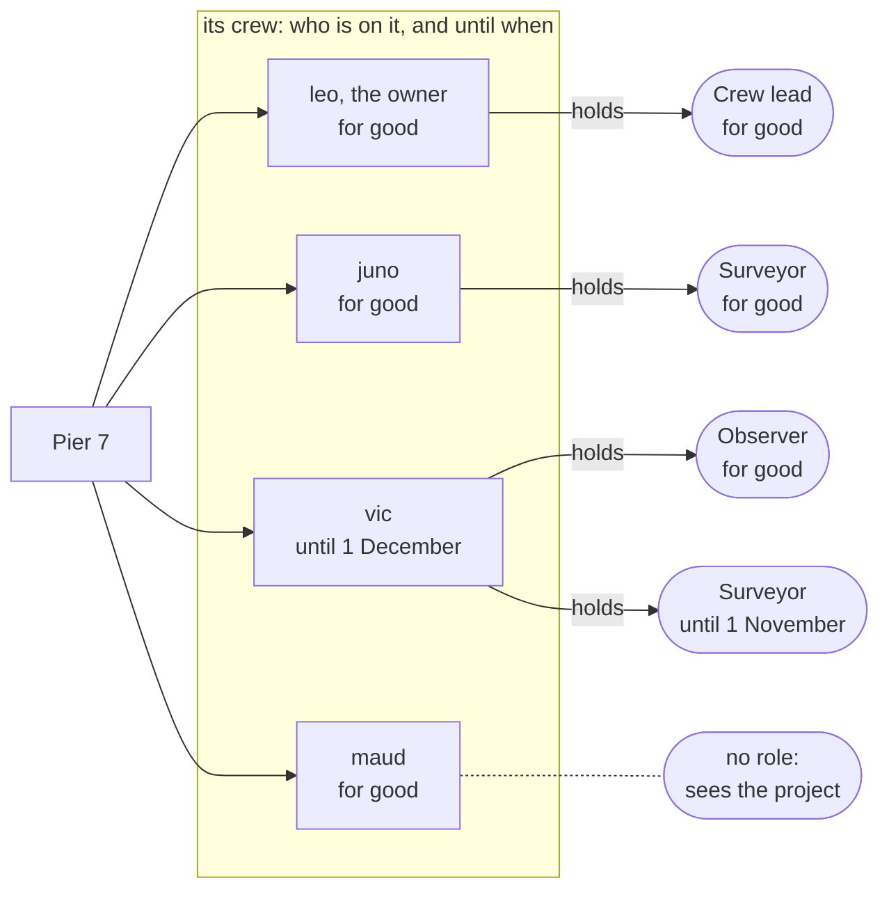
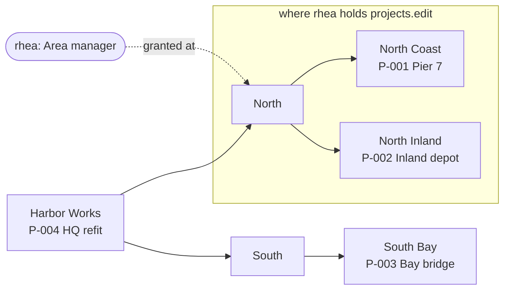
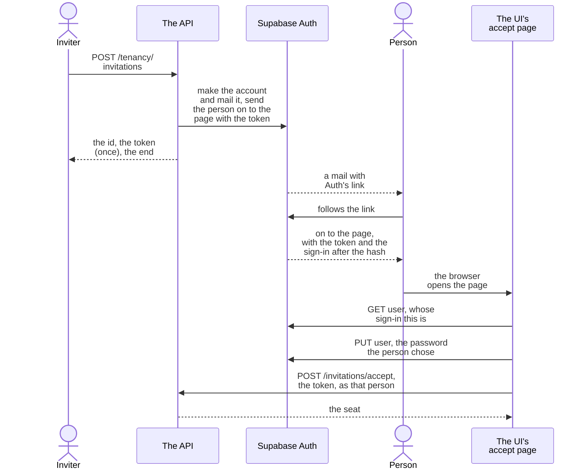
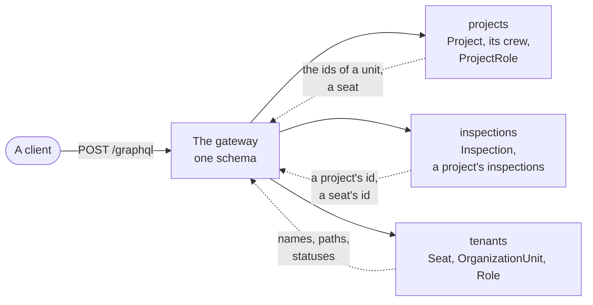
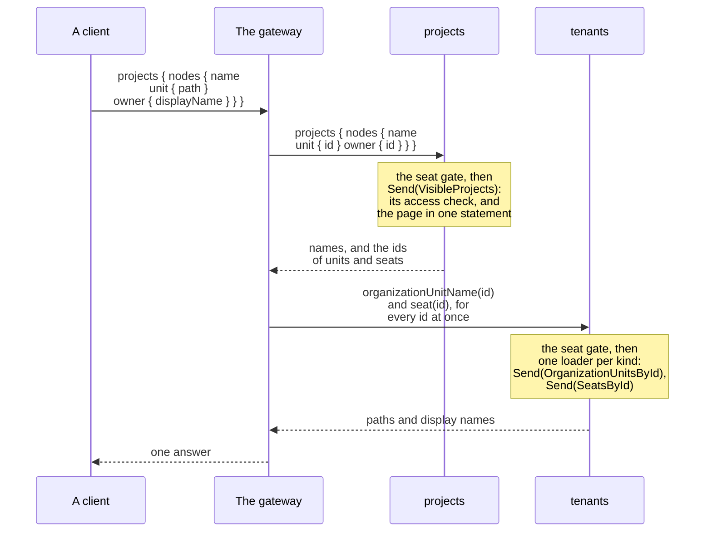
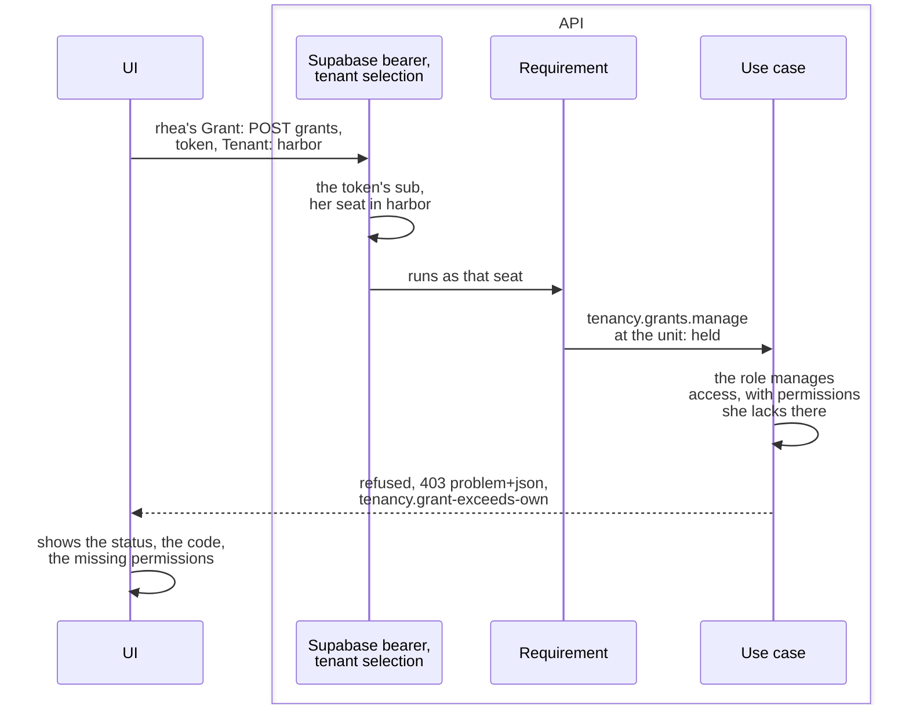

# Tenancy: the sample

[`Examples/Tenancy`](../../Examples/Tenancy) is a small application on Tenancy. This page: its layout, who may do
what in it, its [GraphQL](#graphql-in-the-sample), how to [try it](#try-it), and
[each design choice with where to see it](#design-choices-and-where-to-see-them). The words are in the
[overview](overview.md).

## Who may do what, in the sample

### The application

- Teams work on projects; a project's team is its **crew**. Two tenants, three modules:
  - **Tenants**: the application's Tenancy classes, its context and its migrations.
  - **Projects**: the projects and their crews; decides who may see and change one.
  - **Inspections**: records inspections on projects. It asks Projects through a contract whether the caller may,
    without reading Projects' tables.
- Postgres as Supabase runs it, and no other database: the AppHost starts Supabase's own Postgres and Auth images
  ([Try it](#try-it)).
- The host logs in as a role that owns nothing. Every table forces its policies; the privileges are written from
  them.
- Tables, policies and roles: the files under `Examples/Tenancy/supabase/migrations`, exported by a program of
  their own, `Examples.Tenancy.Exporter`.
- The host refuses to start while a migration is missing or the database is not set up as the policies rely on
  ([the samples' page](../../Examples/README.md#on-postgres)).
- Every choice, with its code, something to try and its test:
  [Design choices and where to see them](#design-choices-and-where-to-see-them).

### A module in layers

A project per layer, in a folder named after the module.
[`Modules/Directory.Build.props`](../../Examples/Tenancy/Modules/Directory.Build.props) makes each project the
module's, from the folder, instead of a `Module.cs` in each
([A module named by its folder](../modules.md#a-module-named-by-its-folder)).

| Project | Holds |
|---|---|
| Domain | The classes and their rules, a folder per aggregate. |
| Application | The use cases, each a command or a query with its own handler, a folder per feature. The request interface through which each says what it requires of its caller, with the check for the module's own cases. The ports they read and save through. |
| Infrastructure | The context, the migrations, the adapters for the ports, and their registration. The only project that names Entity Framework. |
| API | The routes and the GraphQL fields and types, in the same feature folders, and the module's entry. The only project that names ASP.NET Core. |
| Contracts | What other modules may name. Tenants and Projects have one; Inspections publishes nothing, so has none. |

- `Add{Module}Module` registers the module: the infrastructure and the application registrations, plus the
  module's GraphQL schema when the host serves GraphQL.
- Routes are mapped per audience, since the host decides what each group requires:
  - `Map{Module}Module`: callers with a seat;
  - `Map{Module}Operations`: the application's own staff;
  - Tenants also has `MapTenantsSeatsOfMine` and `MapTenantsInvitationAcceptance`, for a signed-in person with no
    seat yet, and `AddTenantsInvitationPage`, where a host says where its page that accepts an invitation is.
- So the host references each module's API project and nothing else of it.

The project references of Projects; every module is laid out the same way. An arrow is a project reference:



<details>
<summary>Show the code: the module's entry and the two registrations it calls</summary>

```csharp
// Projects.Api: the entry, which the host calls with the starter project roles it declares
public static IServiceCollection AddProjectsModule(this IServiceCollection services, ModuleHost host, IReadOnlyList<StarterProjectRole> starterRoles)
{
    var membership = new ProjectMembership(starterRoles);                        // the projects' rules
    return services.AddProjectsInfrastructure(host, membership).AddProjectsApplication(membership);
}

public static IEndpointRouteBuilder MapProjectsModule(this IEndpointRouteBuilder seated)
    => seated
        .MapOverviewEndpoints()
        .MapLifecycleEndpoints()
        .MapCrewEndpoints()
        .MapOwnershipEndpoints()
        .MapProjectRolesEndpoints()
        .MapAccessEndpoints();

public static IEndpointRouteBuilder MapProjectsOperations(this IEndpointRouteBuilder operators)
    => operators.MapOperatorsEndpoints();

// Projects.Infrastructure: the context on the host's connections, from a pool, and an adapter for each port
host.RequirePostgres().AddContext<ProjectsContext>(services, (application, options) => options
    .UseDDDToolkit(application));   // the toolkit, the caller on every connection, Tenancy's save check
services.AddScoped<IProjectStore, EfProjectStore>();
services.AddScoped<IProjectReads, EfProjectReads>();
services.AddTenancyAccess<TenantId, SeatId, OrganizationUnitId, RoleId, IProjectsRequest, ProjectsContext>();   // Tenancy's check, for this module's requests
services.AddProjectMembershipWithTenancy<ProjectsContext, TenantId, OrganizationUnitId, RoleId>(membership.Rules);   // the crews, by the Membership package
services.AddProjectMemberAccess<IProjectsRequest>();                         // its check, for a permission on a project

// Projects.Application: the rules, the check for a permission at a unit, and the generated behavior. No permissions: the module
// declares them in ProjectPermissions, a [Permissions] class, and the host adds every module's
services.AddSingleton(membership);
services.AddScoped<ProjectAccess>();
services.AddAccessCheck<IProjectsRequest, ProjectsAccessCheck>();
services.AddProjectsAccessBehavior();
```

*[`Projects.Api/ProjectsModule.cs`](../../Examples/Tenancy/Modules/Projects/Examples.Tenancy.Projects.Api/ProjectsModule.cs),
[`Projects.Infrastructure/ProjectsInfrastructure.cs`](../../Examples/Tenancy/Modules/Projects/Examples.Tenancy.Projects.Infrastructure/ProjectsInfrastructure.cs)
and
[`Projects.Application/ProjectsApplicationServices.cs`](../../Examples/Tenancy/Modules/Projects/Examples.Tenancy.Projects.Application/ProjectsApplicationServices.cs),
shortened*

</details>

- The host points at the API project alone.
- The API project points at the infrastructure project only for its entry: `AddProjectsModule` calls
  `AddProjectsInfrastructure`. No route or field names that project, Entity Framework or a port.
- Two ports, declared in the application project, with an adapter each in the infrastructure project:
  - `IProjectStore`: a command loads, changes and saves through it, on the request's context, its unit of work.
  - `IProjectReads`: a query reads through it, on a context of its own, since the queries of one request may run
    side by side and a context runs one at a time.
- The access check reads like a query: a reading per case it asks. `OpenProject` naming another seat as the owner
  asks two: the permission to open, and the owner's permission.
- A command reads what it asks of Tenancy the same way before it changes anything, on one reading for all of it.
- A reading takes Tenancy's answers as sets, so the projects a seat may see stay one statement
  ([Who may do what](who-may-do-what.md)). It answers with data, never with an entity.
- A crew's roles are not Tenancy's: they are **project roles**, the module's own, kept with the
  [Membership package](../membership.md). A command asks about them of the module's own table, on the request's
  context.
- Each module's contexts come from its own pools, which `PostgresPools.AddContext` in the samples' hosting project
  registers: a pool on the host's connections for requests, one on those for background work, a factory over both
  that picks at each rental, and `AddScopedFromPool`.
  - A read takes a context for its one query and gives it back.
  - The request's own context is taken from the same factory when the request first asks for it, and goes back
    when the request ends.
- Every project: [`Examples/README.md`](../../Examples/README.md#the-tenancy-sample). One module's folders, and
  why each is where it is: [Folders inside the layers](../modules.md#folders-inside-the-layers).

### From the route to the handler

- A route decides nothing: it makes a command or a query of its arguments and sends it.
- On its way to the handler the request passes tracing, then its module's access behavior.
- The behavior holds the request to what the request declares: a permission, and the project or the unit it is held
  on, taken from the request.
- The toolkit's generator writes the behavior for the module's request interface
  ([What a request requires of its caller](who-may-do-what.md#what-a-request-requires-of-its-caller)). It asks the
  checks the module registered; the one that decides the case answers.

One request end to end, leo closing Pier 7, to show which class does what between the route and the save:



<details>
<summary>Show the code: the route, the command it sends, the module's one line, the check and the handler</summary>

```csharp
// Lifecycle/Rest/LifecycleEndpoints.cs in Projects.Api: the route only sends
group.MapPost("/projects/{id}/close", async (ProjectId id, HttpRequest request, ISender sender, CancellationToken cancellationToken) =>
{
    await sender.Send(new CloseProject(id, ProjectVersions.Expected(request)), cancellationToken);   // the If-Match header, when there is one
    return Results.NoContent();
});

// Lifecycle/Commands/CloseProject.cs in Projects.Application: the command says what it requires of its caller,
// a permission on the project, the Membership package's case: MemberAccess.On(RequiredPermission, request.Id, request.ExpectedVersion)
[RequiresPermission(RequiredPermission)]
public sealed record CloseProject([OnResource] ProjectId Id, [ExpectedVersion] long? ExpectedVersion = null) : ICommand, IProjectsRequest
{
    public const string RequiredPermission = ProjectPermissionNames.Close;
}

// Access/IProjectsRequest.cs: the one line ProjectsAccessBehavior<TMessage, TResponse> is written from, partial
// for the requirements its requests' attributes say
[AccessRequests]
public partial interface IProjectsRequest : IRequireAccess;

// MemberAccessCheck, the Membership package's, which AddProjectMemberAccess<IProjectsRequest>() adds: the check
// for a permission on a project. What it read it keeps with the request, for the expert hold; the handler takes none of it.
case MemberAccess<ProjectId>.On required:
{
    var hold = await access.RequireAsync(required.Resource, required.Permission, cancellationToken);

    // Only now, with the project seen and the permission held, is the version the caller read compared
    if (required.ExpectedVersion is { } expected && expected != hold.Version)
    {
        throw new ConcurrencyConflictException(typeof(Project), required.Resource);
    }

    kept.KeepFor(request, hold);
    break;
}

// CloseProject.cs again: the handler loads the project its command names, calls the domain, and saves
public sealed class CloseProjectHandler(IProjectStore store) : ICommandHandler<CloseProject>
{
    public async ValueTask<Unit> Handle(CloseProject command, CancellationToken cancellationToken)
    {
        var project = await store.LoadAsync(command.Id, command.ExpectedVersion, cancellationToken)   // If-Match held at the load
            ?? throw ProjectRefusals.Refuse(ProjectRefusals.NotFound);

        project.Close();
        await store.SaveAsync(cancellationToken);
        return Unit.Value;
    }
}
```

</details>

**The same order for every request:** tracing, the access check, the handler.

- The host registers tracing before the modules; each module registers its own behavior and checks, so the host
  names none of them.
- A refused request never reaches its handler, and its activity is tagged with the refusal's code.
- Saving stays in the handler, through the store: one command, one unit of work.
- Nothing else reaches a handler:
  - A module without its behavior stops the host at start-up: registering the checks brings the
    [start-up check](../startup-checks.md) `access.behaviors-registered`, which holds every request the host handles
    to its module's behavior.
  - A handler called in code instead of sent is [DDD00061](../diagnostics.md#ddd00061), a warning where the call is
    written ([When nothing asks the checks](../access-requirements.md#when-nothing-asks-the-checks)).

**Who writes which check.** No module writes a behavior. Each writes its request interface, marked
`[AccessRequests]`, and a check for its own cases only:

| Case | Decided by | Its check is in |
|---|---|---|
| A permission at a unit | Projects | Projects' set |
| What takes Projects' gate | Inspections | Inspections' set |
| A permission on a project | the Membership package | Projects' set |
| The caller works in a tenant, holds a permission for the whole of it or at a unit, or is an operator | the Tenancy package | each module's set |
| The caller signed in, or is the application itself | the toolkit | every set |

- Tenants has no check of its own.
- Projects' interface also carries the module's [default](../access-requirements.md#a-modules-default),
  `[AccessRequests, InTenant]`: a request any seat may send states nothing, every other one states its own.
- A case no check of the module decides stops the request where it is sent. A test holds every case the requests
  declare to having a check.

**From the check to the save.**

- Two statements: the check reads on a context of its own; then the handler loads the project its command names,
  the one that was checked.
- The handler holds it to the version the caller named with `If-Match`. A change in between, a crew change as much
  as a rename, answers 409 `concurrency-conflict`, as a save that came second does. A command that names no version
  changes the project as it is.
- Who may was the check's to decide. After it, the write is held by the version the save compares, the project's
  own rules, and the database, which checks every row as the caller:
  - a caller who by then lost every permission that writes the project: 403 `access.refused`;
  - a caller the project is hidden from by then finds none to load.
- The whole of it: [From the check to the save](../membership.md#from-the-check-to-the-save).
  [The expert hold](../membership.md#the-expert-hold) is the one line a host adds to tie the save to the version the
  check read as well. The sample ships without it; its tests play the races both ways.

### What each request declares

What each request declares, and what its handler still decides, because it depends on more than the request can
say beforehand:

| Projects | Declares | The handler adds |
|---|---|---|
| `VisibleProjects` (query) | seen with `projects.view`: the permission filters the list inside its statement, and nobody is refused for seeing nothing | |
| `ProjectDetail` (query) | `projects.view` on the project | what the caller may do, asked with each command's own permission |
| `PermissionOnProject` (query) | seen with `projects.view` | an unknown permission is `tenancy.unknown-permission`; then a project out of sight is `projects.not-found` |
| `AllCrewMembers` (query) | seen with `projects.view`: the permission filters the query's one statement | a project out of sight is `projects.not-found` |
| `ProjectsById`, `CrewsOfProjects`, `AbilitiesOnProjects`, `PermissionsOnProjects` (queries about several projects) | seen with `projects.view` | a project out of sight is left out of the answer |
| `PermissionsHeldAtRoot` (query) | a caller that works in a tenant, the module's default | |
| `TenantProjects` (query) | an operator, and nobody else | |
| `OpenProject` | `projects.open` at the unit; naming an owner, also the owner is the caller's own seat or `projects.owner.change` is held at the unit, computed from whether it names one (`AccessRequirement.All`, `Any` and `Own`) | that the unit is active, and that the owner may be on a crew |
| `ChangeProjectName` | `projects.edit` on the project | |
| `PlanProject` | `projects.edit` on the project | |
| `MoveProjectToUnit` | both, `AccessRequirement.All`: `projects.edit` on the project, and `projects.open` at the unit it goes to, the module's own case | that the unit is active |
| `CloseProject`, `ReopenProject` | `projects.close` on the project | |
| `AddCrewMember` | `projects.crew.manage` on the project | that the seat is active, and that a role given with it is one of the tenant's project roles in use |
| `GiveCrewRole` | `projects.crew.manage` on the project | that the role is one of the tenant's project roles in use, which the module answers from its own table |
| `TakeCrewRole` | `projects.crew.manage` on the project | which project role is the crew lead's, when the seat is the owner's |
| `RemoveCrewMember` | `projects.crew.manage` on the project | |
| `ChangeProjectOwner` | `projects.owner.change` on the project | an active seat; the new owner gets the crew lead's project role, and the old owner loses it and stays on the crew |
| `TenantProjectRoles`, `ProjectRolesById` (queries) | a caller that works in a tenant, the module's default | the permissions of each role only for a caller that holds `tenancy.roles.manage` for the whole tenant |
| `MakeProjectRole`, `RenameProjectRole`, `SetProjectRolePermissions`, `ArchiveProjectRole` | `tenancy.roles.manage` for the whole tenant | the same again: no use case of a package stands between the command and the role |
| `SetUpProjectRoles` | a caller that works in a tenant (`[InTenant]`, the module's default); no route sends it, whatever sets a tenant up sends it as system work in the tenant, begun around the send | the same again, and narrower: only system work in the tenant it sets up, everyone else `access.system-only` |

| Inspections | Declares | The handler adds |
|---|---|---|
| `ProjectInspections`, `InspectionDetail` (queries) | `projects.view` on the project | for the list, whether the caller may record, asked with `RecordInspection`'s permission |
| `InspectionsOfProjects` (query) | `projects.view` on each of the projects: one out of reach is left out, and nobody is refused | which of them the caller sees, asked of Projects' gate once for all of them |
| `ProjectsOpenToRecording` (query) | `inspections.record` on each of the projects, the same way | which of them the caller may record on and are open, asked of Projects' gate once for all of them |
| `RecordInspection` | `inspections.record` on the project, which must be open, recorded by a seat | the title and the days, which the inspection checks itself; days outside the project's planned range, which the handler asks the gate for, are `inspections.outside-planned-range` |
| `TenantProjectInspections` (query) | an operator, and nobody else | |

- Inspections answers none of the permissions itself. Its check asks Projects' gate, `IProjectGate`, and maps the
  answer: out of sight `projects.not-found`, closed `projects.closed`, not held `projects.not-permitted`.
- Its handlers act on the project their request names, the one the gate answered for, and ask the gate themselves
  for what they need: the planned range an inspection is held to, or which of a list of projects the caller sees,
  asked once for all of them.
- The check of a list asks nothing about a project: a query that declares `MemberAccess.SeenWith` is filtered by
  its own statement.

| Tenants | Declares | The package's use case asks besides |
|---|---|---|
| `SeatsOfMine` (query) | a signed-in user: a person's own seats are asked for before any tenant, by the verified identity of the token alone | |
| `OverviewOfMine`, `OrganizationUnits`, `TenantSeats`, `TenantRoles`, `SeatsById`, `OrganizationUnitsById`, `RolesById` (queries) | a caller that works in a tenant | the directory answers it; `OverviewOfMine` only a seat, since only a seat has a self |
| `CatalogueContents`, `UnitsWhereIHold`, `OpenInvitations` (queries) | a caller that works in a tenant | the open invitations are those into the units where the caller holds `tenancy.seats.manage` |
| `AddOrganizationUnit` | `tenancy.units.manage` at the parent | nothing more: the kind is the sample's own field, which the handler sets in the use case's callback ([The kind of a unit](your-module.md#the-kind-of-a-unit)) |
| `MoveOrganizationUnit`, `ArchiveOrganizationUnit` | a caller that works in a tenant | `tenancy.units.manage` at the parent the unit hangs under now, which only the use case reads, and for a move at the new parent too, and that the move gives or takes away nothing the caller could not |
| `ChangeTenantShape` | `tenancy.settings.manage` for the whole tenant | |
| `MakePlacement`, `WithdrawPlacement` | `tenancy.seats.manage` at the unit | that a seat does not place itself; for a withdrawal, what taking each role away would need |
| `MakeGrant`, `RevokeGrant` | `tenancy.grants.manage` at the unit | for a role that manages access, that the caller holds its permissions that do, there and for long enough, and never gives it to itself; that the tenant keeps an administrator |
| `SuspendTenantSeat`, `ReactivateTenantSeat`, `DeactivateTenantSeat` | `tenancy.seats.manage` for the whole tenant | what taking or giving each of the seat's roles would need; that the tenant keeps an administrator |
| `SeatGrants` (query) | computed from the request: `tenancy.seats.manage` for the whole tenant, or at the unit asked about (`?unit=`) | the seat's roles in every unit, or at that unit alone |
| `RenameSeat` | yours, or the permission: the caller's own seat, or `tenancy.seats.manage` for the whole tenant, `[RequiresPermission]` with `[OrOwn]` on the seat | no use case of the package: the name is the sample's own field, and the rule is the sample's own, that a seat renames itself and another seat takes `tenancy.seats.manage` for the whole tenant ([How a seat is shown](names-and-languages.md#how-a-seat-is-shown)), and a column rule of the sample's holds the name to the same rule in the database ([What the database guards on a seat](postgres.md#what-the-database-guards-on-a-seat)) |
| `CreateTenantRole`, `SetRolePermissions`, `ArchiveTenantRole` | `tenancy.roles.manage` for the whole tenant | that only an administrator adds, takes out or archives what manages access |
| `InvitePerson` | `tenancy.seats.manage` for the whole tenant | `tenancy.grants.manage` at the unit, and the rule every grant is held to |
| `CancelInvitation` | a caller that works in a tenant | `tenancy.seats.manage` at the invitation's unit, which only the use case reads; anyone else is told there is no such invitation |
| `AcceptInvitation` | a signed-in user: there is no seat yet to hold a permission | a verified identity that may hold a seat, and the token of an open invitation; then the work is done as system work in the invitation's tenant, begun by the package, and the seat is named in its callback by the sample's rule |
| `MarkTenantAsDemo` | a caller that works in a tenant (`[InTenant]`); no route sends it, the seeding sends it as system work in the tenant, begun around the send | no use case of the package stands between it and the tenant, so its handler decides, and narrower: only system work in the tenant it marks, everyone else `access.system-only` |
| `AccessHistory` (query) | `tenancy.history.view` for the whole tenant | |
| `AllTenants`, `TenantAccessHistory` (queries) | an operator, and nobody else | |

- Each of the package's requests declares the first thing its use case asks. So a caller the use case would refuse
  first is refused at the door already, with the same code and the same permission.
- Past the door the use case asks again, and then what the third column says.
- A request that declared nothing would reach its handler unchecked. So `AccessDeclarationTests` fail for a request
  that declares nothing, find no request anyone may send, and hold every request to the tables above.
- `RequestPipelineTests` hold that the door and the use case refuse alike.

### What the answers name

Projects and Inspections name a unit, a seat and a crew's role by its id, never by a name. They read Tenancy
through the [read model](who-may-do-what.md#what-a-module-reads-of-tenancy), which has no names, and a crew's role
is a project role, whose name Projects answers at `GET /project-roles`.

`GET /projects` as it answers rhea, shortened to the first of her two projects:

```json
{
  "items": [
  {
    "id": "f0000000-0000-4000-8000-000000000101",
    "version": 3,
    "number": "P-001",
    "name": "Pier 7",
    "unitId": "b0000000-0000-4000-8000-000000000103",
    "state": "open",
    "ownerSeat": "c0000000-0000-4000-8000-000000000103",
    "plannedFrom": null,
    "plannedUntil": null,
    "myRoleIds": [],
    "via": "organization",
    "crew": [
      {
        "seatId": "c0000000-0000-4000-8000-000000000103",
        "isOwner": true,
        "startsAt": "2026-10-01T17:20:20.5690145+00:00",
        "endsAt": null,
        "appliesNow": true,
        "roles": [
          {
            "roleId": "90000000-0000-4000-8000-000000000103",
            "startsAt": "2026-10-01T17:20:20.5690145+00:00",
            "endsAt": null,
            "appliesNow": true
          }
        ]
      },
      {
        "seatId": "c0000000-0000-4000-8000-000000000104",
        "isOwner": false,
        "startsAt": "2026-10-01T17:20:20.7208506+00:00",
        "endsAt": null,
        "appliesNow": true,
        "roles": [
          {
            "roleId": "90000000-0000-4000-8000-000000000104",
            "startsAt": "2026-10-01T17:20:20.7208506+00:00",
            "endsAt": null,
            "appliesNow": true
          }
        ]
      },
      {
        "seatId": "c0000000-0000-4000-8000-000000000105",
        "isOwner": false,
        "startsAt": "2026-10-01T17:20:20.7349509+00:00",
        "endsAt": null,
        "appliesNow": true,
        "roles": [
          {
            "roleId": "90000000-0000-4000-8000-000000000105",
            "startsAt": "2026-10-01T17:20:20.7349509+00:00",
            "endsAt": null,
            "appliesNow": true
          }
        ]
      }
    ],
    "can": { "rename": true, "plan": true, "move": true, "close": true, "reopen": false, "manageCrew": true, "changeOwner": true },
    "changedBy": { "kind": "system", "seatId": null }
  }
  ],
  "next": null
}
```

- The name and the number are the project's own.
- The crew comes owner first, then by when each membership starts; a member's roles by when each starts. The
  module has no names to order by.
- `myRoleIds`: the roles the caller holds on the crew now. None for rhea, who reaches Pier 7 through the
  organization; none for leo, who owns it and holds what an owner does by owning it.
- `changedBy`: [who changed the project last](#an-operator-who-changed-a-row-and-the-history-as-a-list), here the
  seeding, which is system work.
- A client that shows the ids asks [Tenancy for the names](names-and-languages.md#names) of the unit and the seats,
  and `GET /project-roles` for those of the roles.

### Paging, versions and errors at the door

**Paging.**

- A page at a time, by number: `GET /projects?size=20` answers at most twenty and, when more follow, `next`, a
  cursor the client sends back as `after`.
- The paging is GreenDonut's, not the sample's: the query takes `PagingArguments` and answers a `Page<T>`; the
  read adapter orders by the number and calls `ToPageAsync`; the page makes its cursors.
- A number is unique in its tenant, so a cursor is a place in the list that stays put whatever is opened or closed
  meanwhile.
- A cursor carries no right: the page after it is filtered for the caller like the first.
- A text that is no cursor of this list is [refused](#a-marker-that-is-not-the-lists-cursor), 400
  `projects.cursor-invalid`.
- `state`, `unit` (that unit and everything below it, which Tenancy answers as a subquery) and `text` narrow the
  list and never widen it. It is counted only when `count=true` asks.
- `text` matches a number that starts with it or a name that contains it, whatever the case. The database folds
  the letters, and Postgres folds all of them, so "écluse" finds a project named "Écluse nord".
- The route costs the same statements however many projects a page holds, each a query of its own:
  `VisibleProjects`, the page with who may see what inside it; `CrewsOfProjects`, their crews; and
  `AbilitiesOnProjects`, what the caller may do to each, a row's `can`. The [GraphQL list](#graphql-in-the-sample)
  sends the same three, and leaves out the two a client did not ask for.
- The permission sets are a route of their own, `POST /access/projects/permissions`, for a client that fills its
  own buttons; `GET /access/permissions` answers the permissions held at the tenant's root.

**Versions.**

- A project carries its `version`; `GET /projects/{id}` sends it as `ETag`.
- A change that names the version its caller read, `If-Match: "3"`, is refused with 409 `concurrency-conflict`
  when the project changed since: the same answer as a save that came second, because the client does the same for
  both, read again and decide again.
- The version is compared only once the caller is known to see the project and to hold the permission, so a caller
  without access learns nothing from it.

**JSON and the door.**

- Enum values are written and read by name in lower snake case (`open`, `hierarchical`): the host's choice, made
  once in its JSON options.
- The seat a route inside a tenant needs is an authorization policy of the host, so a caller without a seat is
  answered before the route reads its arguments: a malformed body from such a caller is 403 `tenancy.not-seated`,
  not the 400 `invalid-request` a seated caller gets for it.

### What the ids are called

| Route | Body | Answers |
|---|---|---|
| `POST /tenancy/directory/seats` | `{ "ids": [ ... ] }` | `[ { id, displayName, status } ]`, by name |
| `POST /tenancy/directory/units` | `{ "ids": [ ... ] }` | `[ { id, parentId, name, kind, status, path, depth } ]`, by path; `kind` is the sample's own field, `null` for a unit added without one |
| `POST /tenancy/directory/roles` | `{ "ids": [ ... ] }` | `[ { id, name, fromPack, status, permissions, managesAccess } ]`, the active ones first, by name |

- Each is a `POST` that only asks and changes nothing.
- Anyone seated in the tenant may send it, and is answered 200 with what the ids are called in that tenant. An id
  of another tenant is left out.
- A body without the list: 400 `invalid-request`. More than 200 ids: 400 `tenancy.too-many-ids`.
- A crew's roles are not here: they are project roles, and `GET /project-roles` answers all of the tenant's, which
  are few.

### How a seat reaches a project

Two ways, which Projects asks inside one query:

- **Through the organization.** A role granted at a unit gives its permissions on every project at that unit and
  below it.
- **Through the crew.** A seat on a project's crew sees that project for as long as its membership lasts, whatever
  it holds there. Every other permission comes from a project role it holds on the crew
  ([Crews and their roles](#crews-and-their-roles)), which gives:
  - its permissions on that project alone;
  - for a period of its own, and only while the membership lasts;
  - only the permissions that act on a project. Opening projects (`projects.open`), naming an owner
    (`projects.owner.change`) and Tenancy's own permissions, which manage the organization, are the organization's:
    a crew role that holds them gives nothing with them.

### The organization's roles

A **pack** is a starter role: a role every new tenant gets a copy of, its own from then on. The application's
catalogue has seven, and each tenant's roles start as copies of the packs seeded for its shape:

| Pack | Permissions | Manages access | Seeded for | Usually granted |
|---|---|---|---|---|
| Tenant admin | every permission: the administrators' pack of a flat tenant, which lists none | yes | flat | at the root of a flat tenant, to its first administrator |
| Access admin | Tenancy's six permissions, `projects.owner.change`, `projects.crew.manage`, `projects.view`: the administrators' pack of a hierarchical tenant, which lists its permissions | yes | hierarchical | at the root of a hierarchical tenant, to its first administrator |
| Area manager | `projects.view`, `projects.open`, `projects.edit`, `projects.close`, `projects.crew.manage`, `projects.owner.change`, `inspections.record`, `tenancy.units.manage`, `tenancy.seats.manage`, `tenancy.grants.manage` | yes | hierarchical | at a unit |
| Crew lead | `projects.view`, `projects.edit`, `projects.close`, `projects.crew.manage`, `inspections.record` | yes | every shape | at a unit, to lead every crew there |
| Surveyor | `projects.view`, `inspections.record` | no | every shape | at a unit, to record on every project there |
| Observer | `projects.view` | no | every shape | at a unit |
| People office | `tenancy.grants.manage` | yes | every shape | at a unit, to someone who gives people their roles |

- Each shape of tenant has an administrators' pack of its own, seeded for it with `SeededFor`. A flat tenant that
  turns hierarchical is given Access admin and Area manager then.
- **Flat**: one unit and a handful of people, so the administrator does everything. Tenant admin lists no
  permissions, so it holds them all.
- **Hierarchical**: running access is kept apart from doing the work. Access admin lists its permissions: whoever
  holds it gives every role, names owners, manages every crew and sees every project, and renames, closes and
  records on none of them. maud's rename of Pier 7 is refused with `projects.not-permitted`, naming
  `projects.edit`.
- An administrators' pack that lists its permissions has to hold every permission that manages access, so marking
  another permission stops the host at start-up until Access admin lists it.
- An access admin who is to do the work gets a role for it like anyone else. Managing crews is hers, so maud may put
  herself on Pier 7's crew as Crew lead, and then she renames it.

**Which permissions manage access.**

- Tenancy's, all but `tenancy.history.view`, which only reads.
- Two that Projects declares and the host marks:
  - `projects.owner.change`, because the owner leads the crew until the organization names another;
  - `projects.crew.manage`, because whoever holds it at a unit may put anyone on every crew there, in any role,
    themselves included.
- So Crew lead and Area manager, given at a unit, go only from someone who holds those permissions there for at
  least as long, and never to oneself. Whoever manages grants and holds neither gives Surveyor and Observer.

### Crews and their roles

Being on a crew and holding a role on it are two things, each with dates of its own:

- **A membership** puts a seat on the crew from now until a day, or for good. That alone lets it see the project.
- **A crew role** is given to a seat on the crew, next to the roles it holds there already, until a day of its own
  or for good, and taken away again while the seat stays.
- A seat holds a role once on a crew (`projects.crew-role-held`), and a role counts only while the membership does.

Both kinds of dates on Pier 7's crew, once vic is on it until 1 December with Surveyor until 1 November, and maud
has put herself on it with no role:



<details>
<summary>Show the code: the crew's routes, and the project's side of them</summary>

| Route | Body | Sends |
|---|---|---|
| `POST /projects/{id}/crew` | `{ seatId, roleId?, until? }` | `AddCrewMember`: on the crew until then or for good, with the role for the same period when one is named |
| `POST /projects/{id}/crew/{seatId}/roles` | `{ roleId, until? }` | `GiveCrewRole`: next to the roles the member holds |
| `DELETE /projects/{id}/crew/{seatId}/roles/{roleId}` | | `TakeCrewRole`: the member stays on the crew |
| `DELETE /projects/{id}/crew/{seatId}` | | `RemoveCrewMember`: off the crew, with every role held there |

- Each answers 204, and each declares `projects.crew.manage` on the project.
- `GET /projects/{id}/crew` answers the crew to whoever sees the project, and each member's roles and their dates
  only to a caller who holds `projects.crew.manage` on it.
- For anybody else `roles` is `null`, in this answer and wherever a project is answered with its crew. The query
  holds that, in the statement that reads the crew (`CrewOverview.RolesPermission`).

```csharp
// Aggregates/Projects/Entities/CrewMember.cs in Projects.Domain: the Membership package's member template, which
// gives it the seat (MemberId), the period it is on the crew for, who put it there, and its dated project roles
[Member<CrewMemberId, SeatId, ProjectRoleId, Project>]
public sealed partial class CrewMember;

// Crew/Commands/GiveCrewRole.cs in Projects.Application: the role is asked of the module's own table, then the project
await admission.RequireRoleAsync(command.Role, cancellationToken);       // one of the tenant's project roles, in use

var now = clock.GetUtcNow();
project.GiveCrewRole(command.Seat, command.Role, CrewPeriod.Between(now, command.Until), now, answers.RequireTenant().Seat);
await store.SaveAsync(cancellationToken);
```

</details>

**Project roles** are the crews' roles, not the organization's. Projects keeps them with the
[Membership package](../membership.md); the sample is that page's worked example.

- Each tenant has three starter roles, made once when the tenant is set up, and whatever roles it makes itself.
- Setting a tenant up is `SetUpProjectRoles`, system work in the tenant. The seeding sends it for every tenant it
  provisions, and whatever makes a tenant while the application runs sends the same.
- A starter role is told by what it was made from, so one the tenant renamed or archived is not made again.
- Whoever holds `tenancy.roles.manage` for the whole tenant makes, renames and archives them, and changes their
  permissions: `GET` and `POST /project-roles`, `PUT /project-roles/{id}`, `PUT /project-roles/{id}/permissions`
  and `POST /project-roles/{id}/archive`; the `projectRoles` field with its four mutations; the UI's Crew roles
  page.
- Anybody who works in the tenant reads what they are called; their permissions are answered to that holder alone.

| Starter role | Permissions |
|---|---|
| Crew lead | `projects.view`, `projects.edit`, `projects.close`, `projects.crew.manage`, `inspections.record`: every permission a crew can give. The role a former owner usually stays on the crew in |
| Surveyor | `projects.view`, `inspections.record` |
| Observer | `projects.view` |

- A project role gives only the permissions that act on a project. One with a permission of the organization's or
  of Tenancy's is not made, nor given one later: 400 `projects.permission-not-for-members`.
- A role of the organization goes on no crew, and neither does an archived project role or another tenant's: 400
  `projects.role-not-for-members`.
- An archived role stays on whoever holds it, gives nothing, and can still be taken away.
- The database holds part of this against a statement that goes round the application: a seat that writes a
  crew's roles itself gives none of another tenant's, since the Membership package's lock asks the project roles'
  table as that seat. One of its own tenant's archived roles it can still write onto a crew, and that role gives
  nothing.

**The owner.** A project has one, on its crew with no end, holding no project role there.

- By owning it, the owner holds what the permissions Projects declares on a project give an owner: it sees the
  project, renames it, closes and reopens it, and manages its crew
  ([`ProjectPermissions`](../../Examples/Tenancy/Modules/Projects/Examples.Tenancy.Projects.Application/Access/ProjectPermissions.cs)).
- Recording an inspection is the Inspections module's, which a role on the crew gives. So an owner who records holds
  a role at the unit, or leaves it to the crew.
- Not by owning:
  - moving the project, which needs `projects.open` at the unit it goes to;
  - naming another owner, which needs `projects.owner.change` at the project's unit or above it, a permission
    declared with `Owner = false`.
- Until the organization names another owner, the owner is not taken off the crew and is given no role there
  (`projects.owner-protected`), whoever asks.
- Naming another owner puts the new owner on the crew when not on it yet, and its roles there go: it holds by owning
  now.
- The command says what the owner before becomes: a member in the project role it names, `formerOwnerRoleId`, or,
  left out, nobody on the crew.
- A crew lead holds more on the crew than the owner, the permission that records among it, but is not the owner and
  cannot take the owner off the crew.
- What the project roles give is the tenant's to decide, and none of them is the owner's: a tenant archives the crew
  lead's role as any other, and opens projects without any project role.
- Changing a project role's permissions takes `tenancy.roles.manage` for the whole tenant.

**Giving a crew role is positional.**

- Whoever manages the crew gives any of the tenant's project roles in use to anyone on the crew, themselves
  included, without holding the role's permissions, and puts any active seat of the tenant on it.
- The marks on permissions that manage access rule the organization's grants, not the crew's.
- On a crew a role reaches that project alone, and no role gives more there than the crew lead's, so a lead gives
  away nothing a lead cannot do.
- It does make `projects.crew.manage` a lead's position wherever it is held: whoever holds it on a project, on the
  crew or at the project's unit or above it, can make themselves the crew's lead.
- A crew membership and a crew role end when whoever gives them says, not when the giver's own grant ends. So an
  area manager granted a region for a week can lead a crew there for good, and so can whoever holds a role of the
  tenant's own with `projects.crew.manage` in it.
- That is why the host marks the permission: managing grants alone makes nobody a lead, since a role at a unit that
  holds it goes only from someone who holds it there, never to oneself
  ([who may give a role](roles-and-permissions.md#who-may-give-a-role)). Grant it only to someone who may lead the
  crews it reaches.

**Two variations the sample does not build**, each a small change to Projects:

- **A permission of its own for adding members.** Declare a second permission, say `projects.crew.add`, have
  `AddCrewMember` declare it in place of `projects.crew.manage`, and refuse a role named with it unless the caller
  holds `projects.crew.manage` too. Whoever holds only the new permission then puts people on a crew, who see the
  project, and whoever manages the crew decides what they may do there.
- **A role every new member gets.** Have `AddCrewMember`'s handler give a role the tenant picked when the request
  names none: keep which role with the tenant's settings, ask for it on the reading the handler opens, and give it
  for the membership's period. It is asked whether it is one of the tenant's project roles in use
  (`admission.RequireRoleAsync`), like any other.

### The two tenants and their people

**Harbor Works** (`harbor`) is hierarchical: its root has two regions, North and South, and three areas below
them. A role granted at North holds at North and everything below it, and nowhere else. Where rhea's Area manager
grant at North reaches, and which projects that puts in her sight:



<details>
<summary>Show the code: asking where a permission reaches</summary>

```http
GET /access/units?permission=projects.edit
Authorization: Bearer <rhea's token>
Tenant: harbor
```

```json
{
  "unitsWhereIHold": [
    "b0000000-0000-4000-8000-000000000102",
    "b0000000-0000-4000-8000-000000000103",
    "b0000000-0000-4000-8000-000000000104"
  ],
  "atTenant": false
}
```

- The units are ids, North, North Coast and North Inland: the answer is built on the access questions, which have
  no names. `POST /tenancy/directory/units` says what the ids are called.
- The route sends a query, `UnitsWhereIHold`. Its handler asks the question inside the query that reads the
  tenant's units, so the answer is one statement.
- It reads on a context of its own, which the read port opens for it: a request may send several queries side by
  side, and a context runs one at a time.

```csharp
// Access/Queries/UnitsWhereIHold.cs in the sample's Tenants.Application project: the query's handler
await using var reading = reads.Open();                             // ITenancyReads: a context for this query alone
var questions = answers.Over(reading.Rows, reading.Queries);

var held = questions.UnitsWhereIHold(query.Permission);                    // a set, not a list: it becomes a subquery
var units = await reading.Queries.ListAsync(
    questions.Units().Select(unit => new UnitRead(unit.Id, unit.ParentId, held.Contains(unit.Id))),
    cancellationToken);

var atTenant = units.Any(unit => unit.ParentId is null && unit.Held);   // held at the root
var ids = units.Where(unit => unit.Held).Select(unit => unit.Id).OrderBy(unit => unit.Value);
```

</details>

**Meadow Gardens** (`meadow`) is flat: its root is its only unit, and it refuses a unit below it with
`tenancy.flat-tenant` until it changes shape.

Each person of the demonstration shows one rule:

| Person | Seat | Shows |
|---|---|---|
| ada | harbor, at the root, Access admin and Area manager | harbor's first administrator, who also runs its work: everything in harbor is hers to do. maud administers too, so either of them may step down, and not both |
| rhea | harbor, North, Area manager | sees Pier 7 and Inland depot, and not Bay bridge (`projects.not-found`); grants Observer and Crew lead at North Coast, and is refused Access admin there (`tenancy.grant-exceeds-own`, with the permissions that manage access she lacks) and anything at South Bay (`tenancy.not-permitted`) |
| leo | harbor, North Coast, no organization role | the owner of Pier 7, holding no role on its crew: renames it, closes and reopens it, puts seats on its crew and gives and takes their project roles; records no inspection on it, since recording is the Inspections module's and comes with a role on the crew (`projects.not-permitted`), names no other owner (`projects.not-permitted`), gives the crew no role of the organization (`projects.role-not-for-members`), and is given no role and stays on the crew until someone else owns it (`projects.owner-protected`) |
| juno | harbor, North Coast | a surveyor on Pier 7's crew: records an inspection, is refused a rename |
| vic | harbor, North Inland, Observer until yesterday | sees Pier 7 through its crew, and not Inland depot, which only his expired grant reached |
| seth | harbor, South Bay, suspended | every call in harbor is `tenancy.seat-suspended`, though `/me/seats` still lists the seat |
| tove | harbor, South Bay; meadow, Tenant admin, its only administrator | one person in two tenants, switching with the `Tenant` header; in meadow she may neither revoke her own grant, suspend herself nor withdraw her placement (`tenancy.last-admin`) |
| hana | harbor, at the root, People office | gives roles without holding them: Surveyor to leo at North Coast, and to herself at the root; is refused Crew lead, Area manager and Access admin for anyone else (`tenancy.grant-exceeds-own`), and any role that manages access for herself (`tenancy.self-appointment`) |
| maud | harbor, at the root, Access admin | runs access and does none of the work: gives every role, names owners, manages every crew and sees every project; her rename of Pier 7 is refused (`projects.not-permitted`, permission `projects.edit`) until she is on its crew as Crew lead, where she may put herself |

### An operator, who changed a row, and the history as a list

**An operator who only reads.** An [operator](operators-and-history.md#operators) works for the application and has
no seat; in the sample, orla.

- Her token carries the role `tenancy_operator`: with Supabase Auth, a claim the project's owner sets for a member
  of staff; with the dev login, for whoever the host's settings list under `DevLogin:Operators`.
- The host has a policy for it, `SamplePolicies.OperatorRequired`, and maps the operators' routes outside the group
  that requires a seat.
- Each module owns what it answers, in a feature of its own named for who it is for, `Operators`:

| Route | Module | Answers |
|---|---|---|
| `GET /operations/tenants` | Tenants | every tenant by slug, with its status and its active seats: the package's `TenantDirectory` |
| `GET /operations/tenants/{tenant}/history` | Tenants | that tenant's access history |
| `GET /operations/tenants/{tenant}/projects` | Projects | that tenant's projects, by number |
| `GET /operations/tenants/{tenant}/projects/{project}/inspections` | Inspections | that project's inspections, newest first |

- Each route has a field in the GraphQL schema, which sends the same query
  ([GraphQL in the sample](#graphql-in-the-sample)).
- An operator works in no tenant, so the tenant is in the path, and the query names it past the tenant filter
  (`IgnoreQueryFilters([TenancyQueryFilter.Name])`).
- The host's policy is a courtesy, as the seat's is: every one of these queries declares `[RequiresOperator]`, and
  the package's check, added to each module's set, refuses anyone else with `tenancy.operators-only`, a seat that
  holds every permission and system work included.
- In the database the query runs as the operators' own role, which reads a module's table only where a rule of that
  module admits it:

```csharp
// Projects.Infrastructure/Access/OperatorsSeeEveryProject.cs; Inspections has the same rule for its own table
[RowAccess<Project>(RowOperations.Read, To = [RowAccessRoles.TokenPrefix + SampleTokenRoles.Operator])]
public static partial class OperatorsSeeEveryProject
{
    public static bool Allows(Project project, Caller caller) => true;
}
```

- She changes nothing. Every route inside a tenant asks for a seat, and an operator's token has none, whatever
  tenant it names: `tenancy.not-seated`.
- Her database role holds `SELECT` and nothing else, so a statement that went around the application is refused by
  the database.

**Who changed a row.** A project and an inspection answer `changedBy`: the kind of actor and, for a seat, its id,
read from the columns `RecordsWhoChanged` adds ([Who changed a row](operators-and-history.md#who-changed-a-row)).

| Who changed it | `changedBy` names |
|---|---|
| a seat | the seat |
| the seeding | `system` |
| work begun with `TenancyWork.BeginOperatorIn` | `operator`, without the identity: that is not a tenant's to read |

- The UI asks the directory what the seat is called.
- The row keeps who, not when. An inspection never changes, so its `recordedAt` is the moment; a project's row has
  no time of its own.
- In GraphQL, `Project` and `Inspection` have the field as well, `changedBy { kind seat }`, with nothing written for
  it: each [type is declared over the record](#graphql-in-the-sample) the route writes out.
- The answer is one value object, `ChangedBy`, which the Tenants module publishes in its contracts, so both modules
  answer the same record.
- A value object is shareable by itself in a source schema, so each schema shows the type and the gateway offers
  one. Likewise `DateRange`, the range of days a project is planned for and an inspection covers:
  `planned { from until }` on a project, `days { from until }` on an inspection, and `DateRangeInput` where a
  mutation takes one.

**The access history as a list.**

- `GET /tenancy/history?size=&after=` answers the tenant's
  [access history](operators-and-history.md#access-history), newest first, to whoever holds
  `tenancy.history.view` for the whole tenant; anyone else is refused with `tenancy.not-permitted`.
- Each row has the event's name, when it happened, who acted, and the event as it was stored, but for the event's
  own word on who acted, which would name an operator's identity.
- It is paged by GreenDonut's own types, not by a marker of the sample's:

```csharp
// Tenants.Application/History/Queries/AccessHistory.cs: the query takes the page and answers one
public sealed record AccessHistory(PagingArguments Paging) : IQuery<Page<AccessHistoryEntry>>, ITenantsRequest

// Tenants.Infrastructure/Persistence/EfTenancyReads.cs: ordered by a unique pair of columns, and paged in SQL
var page = await db.Set<EventLogEntry>().AsNoTracking()
    .Where(entry => EF.Property<TenantId>(entry, TenancyEventLogTable.TenantId) == tenant)
    .OrderByDescending(entry => entry.RecordedAt)
    .ThenByDescending(entry => entry.Id)
    .TakingOnlyItsOwnCursors(paging, () => TenancyRefusals.Refuse(TenancyRefusals.CursorInvalid))
    .ToPageAsync(paging, cancellationToken);

// Tenants.Api/History/Rest/HistoryEndpoints.cs: the route maps size and after to the same arguments
sender.Send(new AccessHistory(HistoryPages.Asked(after, size)), cancellationToken)

// Tenants.Api/Rest/HistoryPages.cs: what the routes of two features share sits beside the features
public static PagingArguments Asked(string? after, int? size) => new(first: size ?? HistoryRefusals.DefaultPage, after: after);

// Tenants.Api/History/GraphQL/HistoryPagedQueries.cs: the field hands on the arguments HotChocolate read
[UseConnection(IncludeTotalCount = true, DefaultPageSize = DefaultPage, MaxPageSize = LargestPage)]   // ten, and fifty at most
public static async Task<PageConnection<AccessHistoryEntry>> GetAccessHistoryAsync(PagingArguments paging, [Service] ISender sender, CancellationToken cancellationToken)
    => new(await sender.Send(new AccessHistory(paging), cancellationToken));
```

- A size outside 1 to 200 is `tenants.history.page-size-invalid`.
- The UI has a page for it, **Access history**; the try-it presets read it once with the permission and once
  without.

#### A marker that is not the list's cursor

Three lists are paged this way: the projects, a project's inspections and the access history. Each holds the marker
a page is asked with to its own list before it reads anything, with the line `TakingOnlyItsOwnCursors` above:

| Sent as `after` or `before` | Left to the paging library | In the sample |
|---|---|---|
| A text that is no cursor | An empty page | Refused |
| A cursor of a list ordered by other keys | A failure inside the read: a 500, and an unexpected error in GraphQL | Refused |
| A cursor of this list with a head written into it, which says how many pages to skip and what the list's total is | Believed | Refused |

- The refusal is the list's own: 400 `projects.cursor-invalid`, `inspections.cursor-invalid` or
  `tenancy.cursor-invalid` from a route. In GraphQL it is a coded error at the field, and the project a refused
  `inspections` belongs to stays in the answer.
- One class does it for the three lists: `ListCursors`, in `Shared/Examples.Tenancy.Shared.Infrastructure`. The
  lists are read in three infrastructure projects and a module does not reference another's; how a query is ordered
  and how the library writes a cursor is storage's to know. So what all three need has a project of its own, which
  only infrastructure projects reference.
- It reads the marker with the keys of the query that is about to be paged, the way the library will: Base64, the
  head the library writes, one value for every key, each of its key's type. Nothing is sent to the database for it.
- A cursor of another list ordered by keys of the same types is a place in this list too: a moment and an id from
  the access history read as a moment and an id among a project's inspections, and answer the rows after them. A
  cursor is a place and never a right, so that gives a caller nothing it could not ask for.

### Inviting a person by address

The Tenants module has [invitations](invitations.md): the class `Invitation` with its id, one more call in the
context and one in the registration, and a feature of its own, `Invitations`, in the application and the API
project.

| Route | Sends | Answers |
|---|---|---|
| `POST /tenancy/invitations` | `InvitePerson` | the invitation's id, when it ends, and its token, this once |
| `GET /tenancy/invitations` | `OpenInvitations` | the open invitations into the units where the caller manages seats: the address, and what each offers by id |
| `DELETE /tenancy/invitations/{id}` | `CancelInvitation` | nothing; the token no longer works |
| `POST /invitations/accept` | `AcceptInvitation` | the seat the caller now has, named as the body says: `{ token, displayName }` |

**Who may invite** is the package's to say: `tenancy.seats.manage` for the whole tenant and `tenancy.grants.manage`
at the unit, with the role held to [the rule every grant is held to](roles-and-permissions.md#who-may-give-a-role).
tove, meadow's administrator, invites; hana, who gives roles and adds no seat, is refused with
`tenancy.not-permitted`.

**The account.** A seat belongs to a verified identity, so the invited person needs an account to sign in with. The
handler asks for one through the toolkit's port, `IIdentityAccounts`, once the package has issued the invitation, so
nobody who may not invite has an account made or a mail sent:

```csharp
// Tenants.Application/Invitations/Commands/InvitePerson.cs
var issued = await invitations.IssueAsync(command.Address, command.Unit, command.Role, command.Until, lifetime: null, cancellationToken);

// Made just now, and mailed; or there already, and then mailed again only when it is this application's own.
var account = await accounts.InviteByEmailAsync(address, leadsTo, cancellationToken) is IdentityAccountOutcome.Created made
    ? made.Identity
    : await MailedAgainAsync(accounts, issued.Id, address, leadsTo, cancellationToken);

// The invitation keeps the id of the account that was made for it.
if (account is { } own && await kept.FindAsync(issued.Id, cancellationToken) is { } invitation)
{
    invitation.KeepAccount(own);
    await store.SaveAsync(cancellationToken);
}

return issued;
```

- The host says who answers the port (`Host/Auth/SampleIdentityAccounts.cs`):
  - With `Supabase:SecretKey` set, as the AppHost sets it: Supabase Auth, through its admin client. An address
    without an account gets one, and Auth mails the person a link that lets them in: how anyone gets in where
    nobody signs up.
  - With no permission for Auth and the dev login on, such as a host started by hand on the stack the Supabase CLI
    starts: `DevIdentityAccounts`, to which the demonstration people are the accounts there are.
- Whoever invites is answered the same for an address that had an account and for one that had none.
- The account is given nothing: there is no seat until the person accepts.
- When the provider cannot be asked, the invitation is cancelled again and the failure is passed on.

**The account is kept with the invitation**, by its id: `Invitation.InvitedAccount`, a field the sample adds to the
package's invitation as it adds a job title to a seat. Why: a provider finds no account by its address, and the mail
it sends lets a person in once, and for a while. A person whose mail was lost, or who came to it too late, has an
account and no way into it, and from then on the provider answers that the address is taken and mails nobody. So:

- **Inviting the address again mails that account again.** The handler looks among the tenant's open invitations
  for one to the same address that kept an account, asks the provider whether anybody ever signed in with it
  (`FindAsync`), and when nobody did has it mailed by its id (`InviteAccountAsync`), with the link of the new
  invitation. Only an account the application made itself is ever mailed this way.
- **An account somebody signed in with is not mailed.** Following the mail proves the address, and the provider
  invites no proven account. The new token then reaches the person from whoever invited, and they accept signed in.
- **Cancelling deletes an account nobody used**, once the package has cancelled the invitation, unless another open
  invitation of the tenant keeps the same account. The invitation forgets the id with the address, in the same save.
  An account somebody signed in with stays: it is a person's.

**The token.**

- It is answered once, to whoever invited; the API keeps only its digest.
- The UI shows it as a link with the token after the `#`, which a browser sends to no server, for the inviter to
  hand to the person.
- To and from the API it travels in a body, never in a path or a query.

**A person with no account yet** gets that link by mail, without anybody handing it over, once the host says where
the UI's page is:

- The setting is `Sample:Invitations:AcceptPage`, which the host passes to the module with
  `AddTenantsInvitationPage`.
- The handler asks the provider to send the person on to that page with the token after the `#`
  (`InvitationPage.With`).
- Auth keeps that part and adds its sign-in behind a `#` of its own, so the browser lands on
  `…/invitations/accept#<token>#access_token=…&type=invite`, none of which the UI's server is sent.

A mailed invitation from the inviter's request to the seat, to show which party sees the token at each step:



<details>
<summary>Show the code: the page's address with the token, and the page reading what it arrived with</summary>

```csharp
// Host/Auth/SampleIdentityAccounts.cs: the host says where the page is, from Sample:Invitations:AcceptPage
services.AddTenantsInvitationPage(page);

// Tenants.Application/Invitations/InvitationPage.cs: the page's address, with the token after the '#'
public Uri With(string token)
{
    ArgumentException.ThrowIfNullOrWhiteSpace(token);
    return new UriBuilder(Address) { Fragment = token }.Uri;
}

// Ui/Auth/AuthLink.cs, in Read: what the address carries after its '#' when the person arrives.
// The application's part first, then what Auth added behind a '#' of its own.
var second = fragment.IndexOf('#');
var (token, added) = second >= 0 ? (fragment[..second], fragment[(second + 1)..])
    : fragment.Contains('=') ? ("", fragment)
    : (fragment, "");
```

*[`InvitationPage.cs`](../../Examples/Tenancy/Modules/Tenants/Examples.Tenancy.Tenants.Application/Invitations/InvitationPage.cs)
and [`AuthLink.cs`](../../Examples/Tenancy/Examples.Tenancy.Ui/Auth/AuthLink.cs), shortened*

</details>

**The accept page** (`Ui/Components/Pages/AcceptInvitation.razor`, with `Ui/Auth/AuthLink.cs`):

- It reads the token and the sign-in off the address, and takes them off it at once.
- What an address says proves nothing, so the page starts no session until Auth has said whose the access token is.
- Anybody can make such a link with the sign-in of an account of their own, so a tab signed in as somebody else
  keeps its session: the page says whom the link would sign in, and asks first (`Ui/Auth/LinkSignIn.cs`).
- The person has no password yet and the mail's link works once, so the page has them choose one first, with Auth's
  own call and their own sign-in, and then shows the invitation with its token filled in.
- The next sign-in is the login page's, with the address and that password.

**Four things to know.**

1. **Auth follows a redirect only to an address its settings allow**: the host of its site URL, or an entry of its
   redirect list. The sample names the UI as Auth's site, in the AppHost, which also sets the page, and in
   `supabase/config.toml` for the stack the Supabase CLI starts
   ([the samples' page](../../Examples/README.md#on-the-stack-the-supabase-cli-starts)).
2. **In a Supabase project a gateway stands in front of Auth** and passes the mail's link on to it. The AppHost
   starts none: the link names Auth's own address on the machine and the path Auth answers itself, so it opens as
   written.
3. **The token is handed to Auth, not kept from it.** The page's address, token and all, is a value in the address
   of the request that asks Auth for the mail (`invite?redirect_to=…`), so Auth's request log and any gateway's in
   front of it keep it, and it is in the mail. Whoever reads those logs, or that mailbox, holds the token of an open
   invitation. Where the mail carries the token, an invitation therefore rests on the sign-in with the invited
   address, which accepting takes as well and Auth alone gives. Keeping the token from Auth takes a mail of the
   application's own.
4. **An address that had an account is not mailed**, unless it is the account an earlier invitation kept and nobody
   used. There, as with the dev login, whoever invited passes the link on.

**Accepting** takes a signed-in caller and no tenant, so the host maps it beside `GET /me/seats`, outside the group
that requires a seat.

- The package reads the caller's verified identity itself, and the handler hands it the address in the caller's own
  token. So an invitation is accepted by the account it was sent to and by no other: `tenancy.address-mismatch`.
- One save makes the seat, its primary placement and the grant.

| The invitation | Refused with |
|---|---|
| revoked | `tenancy.invitation-cancelled` |
| its week ran out | `tenancy.invitation-lapsed` |
| somebody else accepted it | `tenancy.invitation-used` |
| a text that is no token | `tenancy.invitation-not-found` |

**Around it.**

- Adding invitations to a database in use took a migration of the Tenants module and the access files exported
  again.
- The UI has two pages for it, **Invitations** and **Accept an invitation**; the `.http` file has the requests under
  tove; two try-it presets show a refusal each.
- The same use cases are in the GraphQL schema ([GraphQL in the sample](#graphql-in-the-sample)).
- The sample leaves out: a mail of the application's own; a way back in for somebody who followed the mail's link
  and chose no password; inviting somebody back whose seat was deactivated; and removing the account of an
  invitation whose time ran out without anybody cancelling it.

## GraphQL in the sample

How the sample's three schemas become one, what a query costs, and the rules each module's schema keeps. Read it
before you give a module a schema; [GraphQL](../graphql.md) has the toolkit's side.

### One schema over three modules

- Beside its routes the sample serves GraphQL at `/graphql`: the same commands and queries, as one schema.
- Each module's schema is in its API project, a `GraphQL` folder per feature beside `Rest`.
- The host composes the three in the process with
  [`DDDToolkit.HotChocolate.Fusion.InMemory`](../graphql.md#one-schema-over-a-modular-monolith).
- A module names another module's entity by its id only; the gateway asks the owner for the rest. So Projects
  answers no name of Tenancy's, and a client still gets a crew with names in one request.

Which module owns which types: ids go to the gateway, names come back from their owner.



<details>
<summary>Show the code: a reference, its owner, and the lookup between them</summary>

```csharp
// Projects.Api/GraphQL/ReferencedSeat.cs: a seat as Projects knows it. Its name is Tenancy's to give.
[GraphQLName("Seat")]
[EntityKey("id")]
internal sealed record ReferencedSeat(SeatId Id);

// Tenants.Api/Seats/GraphQL/SeatType.cs: the same type where it is owned, declared over the record the
// module's queries select from the seats the directory answers, with the name the module keeps on its seat class.
// Nothing is copied, and nothing is said per field: the host's conventions make every field of a type with a
// permission nullable but the permission, so a seat the caller may not read arrives as its id with nothing else, and without
// an error.
[ObjectType<SeatListing>]
[EntityKey("id")]
internal static partial class SeatType
{
    static partial void Configure(IObjectTypeDescriptor<SeatListing> descriptor) => descriptor.Name("Seat");
}

// Tenants.Api/Directory/GraphQL/DirectoryQueries.cs: how the gateway gets from the one to the other. The
// lookup is internal: it is no field of the composed schema.
[Query]
[Lookup]
[Internal]
[Cost(LoadedForTheRequest)]                                         // 1: it reads once for the ids of a batch, as a rule all of a request
public static async Task<SeatListing?> GetSeatAsync(SeatId id, ISeatByIdDataLoader seats, CancellationToken cancellationToken)
    => await seats.LoadAsync(id, cancellationToken);

// Tenants.Api/Directory/GraphQL/DirectoryDataLoaders.cs: HotChocolate's generator writes ISeatByIdDataLoader
// from this method, and calls it in a scope of its own. It sends the directory's query, SeatsById, once for
// the seats of a batch, as a rule all a field of the answer names, in parts no larger than one question takes.
[DataLoader]
public static async Task<IReadOnlyDictionary<SeatId, SeatListing>> GetSeatByIdAsync(
    IReadOnlyList<SeatId> ids, ISender sender, CancellationToken cancellationToken)
{
    var seats = new Dictionary<SeatId, SeatListing>();
    foreach (var part in ids.Chunk(TenancyUseCases.TenancyDirectory.MostIds))
    {
        foreach (var seat in await sender.Send(new SeatsById(part), cancellationToken))
        {
            seats[seat.Id] = seat;
        }
    }

    return seats;
}
```

</details>

<details>
<summary>Show the code: a relation inside the module that owns it</summary>

```csharp
// Tenants.Api/History/GraphQL/AccessHistoryEntryType.cs: the record names the seat that acted by id. The
// resolver takes that field's place and reads the seat through the loader of the lookup, once for a batch,
// as a rule a page. The id stays a field beside it, for whoever the directory does not answer.
[ObjectType<AccessHistoryEntry>]
internal static partial class AccessHistoryEntryType
{
    public static SeatId? GetBySeatId([Parent] AccessHistoryEntry row) => row.BySeat;

    [Cost(DirectoryQueries.LoadedForTheRequest)]                    // 1, as the lookup beside the loader
    public static async Task<SeatListing?> GetBySeatAsync([Parent] AccessHistoryEntry row, ISeatByIdDataLoader seats, CancellationToken cancellationToken)
        => row.BySeat is { } seat ? await seats.LoadAsync(seat, cancellationToken) : null;
}
```

</details>

### A field on another module's type

- A module may add fields to a type another module owns. A project's inspections are Inspections' to give: in its
  schema `Project` is the key and one field, `inspections`, which the gateway puts on the project Projects answers.
- No root field takes a project's id: a client asks the project.

```graphql
{
  projects {
    nodes {
      name
      inspections(first: 5) { nodes { title } }
    }
  }
}
```

It costs Inspections one question and one statement per batch of projects, not per project:

- A data loader sends one query about every project of the batch.
- Its access check asks Projects' gate once about all of them (`IProjectGate.AskAsync(projects, permission)`, one
  statement); the read pages every project's inspections in one statement (`ToBatchPageAsync`).
- `canRecord` and `totalCount` cost one more each, only when selected.
- A project the caller may not see answers `null`: whatever id reaches Inspections' schema, its own access check
  decides.
- A **batch** is what HotChocolate has gathered when it sends; it waits a moment for more keys. A page of projects
  is one batch as a rule, two on a server too busy to resolve the page's fields in that moment. The answer is the
  same: the promise is the cost of a batch, not the number of batches.

<details>
<summary>Show the code: a field added to another module's type</summary>

```csharp
// Inspections.Api/Recording/GraphQL/ProjectType.cs: Project as Inspections declares it, over a record that
// holds the project's id and nothing else. The connection, its edges and its cursors are HotChocolate's.
[ObjectType<ReferencedProject>]
[EntityKey("id")]
internal static partial class ProjectType
{
    static partial void Configure(IObjectTypeDescriptor<ReferencedProject> descriptor) => descriptor.Name("Project");

    // HotChocolate's own sizes, said on the field: ten, and fifty at most
    [UseConnection(IncludeTotalCount = true, DefaultPageSize = DefaultPage, MaxPageSize = LargestPage)]
    [Cost(InspectionsConnection.LoadedForThePage)]                  // 1: the loader reads once for a batch, as a rule the page
    public static async Task<InspectionsConnection?> GetInspectionsAsync(
        [Parent] ReferencedProject project, PagingArguments paging, IInspectionsByProjectIdDataLoader inspections, CancellationToken cancellationToken)
        => await inspections.With(paging).LoadAsync(project.Id, cancellationToken) is { } page
            ? new InspectionsConnection(page, project.Id)
            : null;
}

// RecordingDataLoaders.cs: HotChocolate's generator writes the loader from this method. It sends one query
// for the projects of a batch, in parts of at most what Projects' gate answers at a time.
[DataLoader]
public static async Task<IReadOnlyDictionary<ProjectId, Page<InspectionOverview>>> GetInspectionsByProjectIdAsync(
    IReadOnlyList<ProjectId> projects, PagingArguments paging, ISender sender, CancellationToken cancellationToken)
{
    var pages = new Dictionary<ProjectId, Page<InspectionOverview>>();
    foreach (var part in projects.Chunk(InspectionsOfProjects.MostProjects))
    {
        foreach (var (project, page) in await sender.Send(new InspectionsOfProjects(part, paging), cancellationToken))
        {
            pages[project] = page;
        }
    }

    return pages;
}

// RecordingQueries.cs: the gateway's way in, and no field of the schema a client is offered. It answers the permission
// it was given: what the caller may see is decided where the inspections are read.
[Query]
[Lookup]
[Internal]
public static ReferencedProject? GetProjectById([ID("Project")] ProjectId id) => new(id);

// Inspections.Infrastructure/Persistence/EfInspectionReads.cs: newest first, the id as the second permission. The
// rows are tracked by the context of this one read, which is where who changed a row is taken from.
return await db.Inspections.Where(inspection => asked.Contains(inspection.ProjectId))
    .OrderByDescending(inspection => inspection.RecordedAt).ThenBy(inspection => inspection.Id)
    .TakingOnlyItsOwnCursors(paging, NotThisLists)                  // inspections.cursor-invalid, before the statement
    .ToBatchPageAsync(inspection => inspection.ProjectId, inspection => Overview(db, inspection), paging, cancellationToken);
```

</details>

- `Inspection` is declared the same way, over `InspectionOverview`, the record the queries answer
  (`[ObjectType<InspectionOverview>]` in `InspectionType.cs`): no output record, no mapping.
- `GET /projects/{id}/inspections` reads the same pages with the same paging arguments, so its `next` is the cursor
  a GraphQL client gets for the page's last row.

### One query, end to end

One query, from the client's document to the statements it costs: where the seat gate runs, and that each module
answers its page or its batch of ids at once.



<details>
<summary>Show the code: the host's part, and a field that only sends</summary>

```csharp
// Host/Program.cs: every module registers its schemas and gets the host's conventions; two gateways compose.
// AddSampleStorage says where the modules' tables live: Postgres, at ConnectionStrings:Supabase.
var host = builder.AddSampleStorage().WithGraphQL(graphql => graphql.AddSampleGraphQLConventions());
// Each module's entry is given that host: the three Add{Module}Module(host) calls, shown under "Try it".
builder.Services.AddInMemoryFusionGateway(SampleGateways.User,
    [TenantsModule.SourceSchema, ProjectsModule.SourceSchema, InspectionsModule.SourceSchema],
    options => options.ConfigureGateway = gateway => gateway.AddSampleRequestBounds());
builder.Services.AddInMemoryFusionGateway(SampleGateways.Administration,
    [TenantsModule.AdministrationSchema, ProjectsModule.SourceSchema, InspectionsModule.SourceSchema],
    options => options.ConfigureGateway = gateway => gateway.AddSampleRequestBounds());

// After authentication and tenant selection: each gateway is an endpoint, and requires what the routes do.
app.MapInMemoryFusionGateway("/graphql", SampleGateways.User).RequireAuthorization();
app.MapInMemoryFusionGateway("/admin/graphql", SampleGateways.Administration).RequireAuthorization(SamplePolicies.SeatRequired);
```

```csharp
// Projects.Api/Lifecycle/GraphQL/LifecycleMutations.cs: the command the route sends, then what it changed.
[Mutation]
public static async Task<ProjectOverview?> ProjectRenameAsync([ID("Project")] ProjectId id, string name, long? expectedVersion, [Service] ISender sender, CancellationToken cancellationToken)
{
    await sender.Send(new ChangeProjectName(id, name, expectedVersion), cancellationToken);
    return await ChangedProject.ReadAsync(id, sender, cancellationToken);
}
```

</details>

### How a module declares its schema

Each module declares its schema the way HotChocolate 16 offers, and writes nothing twice. Projects' has all of it:

<details>
<summary>Show the code: a type over the application's record, a loader, a paged field and a permission on a field</summary>

```csharp
// Projects.Api/Overview/GraphQL/ProjectType.cs: the type Project, over what the application answers. The
// record's properties are its fields; what takes another read is a resolver that asks a loader.
[ObjectType<ProjectOverview>]
[EntityKey("id")]
internal static partial class ProjectType
{
    static partial void Configure(IObjectTypeDescriptor<ProjectOverview> descriptor) => descriptor.Name("Project");

    [BindMember(nameof(ProjectOverview.OwnerSeat))]                 // ownerSeat becomes owner, a reference by key
    public static ReferencedSeat GetOwner([Parent] ProjectOverview project) => new(project.OwnerSeat);

    [Cost(LoadedForThePage)]                                        // 1: the loader reads once for a batch, as a rule the page
    public static async Task<IReadOnlyList<CrewOverview>?> GetCrewAsync([Parent] ProjectOverview project, ICrewByProjectIdDataLoader crews, CancellationToken cancellationToken)
        => (await crews.LoadAsync(project.Id, cancellationToken))?.Members;
}

// Projects.Api/Overview/GraphQL/OverviewDataLoaders.cs: HotChocolate writes ICrewByProjectIdDataLoader from
// this. It sends one set-shaped query for the projects of a batch; the query declares its access and
// answers only the projects the caller may see, in one statement.
[DataLoader]
public static async Task<IReadOnlyDictionary<ProjectId, ProjectCrew>> GetCrewByProjectIdAsync(IReadOnlyList<ProjectId> projects, ISender sender, CancellationToken cancellationToken)
    => await sender.Send(new CrewsOfProjects(projects), cancellationToken);   // the sample sends more than 200 ids in parts

// Projects.Api/Overview/GraphQL/OverviewPagedQueries.cs: the one exception to "a field is a method marked
// [Query]". HotChocolate writes a paged field's connection type only for a class it generates the type of, so
// a class marked [QueryType] holds the paged fields, and nothing else: a field that does not page stays a
// [Query] method, in OverviewQueries.cs. The field hands HotChocolate's paging arguments to the query the
// route sends, and answers its page as a connection.
[UseConnection(IncludeTotalCount = true, DefaultPageSize = DefaultPage, MaxPageSize = LargestPage)]   // ten, and fifty at most
public static async Task<PageConnection<ProjectOverview>> GetProjectsAsync(PagingArguments paging, ProjectState? state, OrganizationUnitId? unit, string? text, [Service] ISender sender, CancellationToken cancellationToken)
    => new(await sender.Send(new VisibleProjects(paging, state, unit, text), cancellationToken));

// Projects.Api/Crew/GraphQL/CrewMemberType.cs: who holds which role on a crew is for whoever manages it.
// The schema shows the rule: @authorize(policy: "projects.crew.manage"). Tenants' Role.permissions has one too.
// The permission is the constant the query asks about, which left the roles out for a caller without it.
[Authorize(CrewOverview.RolesPermission)]
public static IReadOnlyList<CrewRoleOverview>? GetRoles([Parent] CrewOverview member) => member.Roles;

// Projects.Api/Crew/GraphQL/CrewFieldPermissions.cs: who answers that permission, for every member of a page at once.
internal sealed class CrewFieldPermissions : IFieldPermissions<CrewOverview>
{
    public async ValueTask<RefusalException?> RefusedAsync(CrewOverview parent, string permission, IResolverContext context, CancellationToken cancellationToken)
        => await context.DataLoader<IHeldPermissionsByProjectIdDataLoader>().LoadAsync(parent.ProjectId, cancellationToken) is { } held && held.Permissions.Contains(permission, StringComparer.Ordinal)
            ? null
            : ProjectRefusals.Refuse(ProjectRefusals.NotPermitted, ("Permission", permission));
}
```

</details>

What that comes to:

- **A field decides nothing.** A resolver takes its arguments, the sender and (for a lookup or an entity's field) a
  data loader, and sends what the route of the same feature sends. What a seat may do is decided where it is for a
  route: on the request's way to its handler.
- **Nothing to read is `null`, not an error.**
  - `project(id:)` and `node(id:)` answer `null` for a project that is not there or not the caller's to see; the
    two read the same.
  - A reference whose owner answers nothing (a seat of another tenant, say) is its id with every other field
    `null`, and `errors` stays empty. So every field but the key of `Seat`, `OrganizationUnit`, `Role` and
    `Project` may be null.
- **A type is the application's own record.**
  - Each is declared over the record a query answers, the package's own included, with
    [`[ObjectType<T>]`](../graphql.md#types-over-your-own-records) in a type class beside the fields: nothing is
    copied or mapped for the schema.
  - So declared: `Project`, its crew, `Inspection`; Tenants' `Seat`, `OrganizationUnit`, `Role`, the catalogue,
    the calling seat's overview, an invitation, an access history row, a tenant of the operators' list.
  - `AddDDDToolkitEntityNullability()`, one of the host's conventions, makes the four entities' fields nullable.
  - No record is a schema's own: where the package answers the module's own seat, the query selects into an
    application-layer record, such as the tenant picker's `SeatOfMine` with its `TenantOfSeat`, and the overview's
    `SeatOverviewListing`.
  - `GraphQLDeclarationTests` holds the three modules to this, and to the loaders and paging below.
- **A lookup's ids are asked together.**
  - HotChocolate's generator writes every data loader from a method marked `[DataLoader]`.
  - The gateway asks a module once per field of the answer that names something of it: the owners of a page of
    projects are, as a rule, one `SeatsById`, their crews' seats another, however many projects and seats.
  - `project(id:)` asks one loader for every id of a request.
  - A loader promises one question per batch it sends.
- **A list reads what is asked for.**
  - `{ projects { nodes { number } } }` costs one statement.
  - A project's `crew`, `myRoles` and `can` are resolvers behind loaders: asked for, one statement each per batch
    (as a rule the page), three in all.
  - A project role a crew or `myRoles` names by id is read only when more than its id is asked, once per request.
- **A field can ask for a permission.**
  - `Role.permissions` and `ProjectRole.permissions` carry
    [`[Authorize("tenancy.roles.manage")]`](../graphql.md#a-permission-on-a-field); `CrewMember.roles` carries
    `[Authorize("projects.crew.manage")]`.
  - A seat without it gets every role, or every member of a crew it sees, with that field `null` and one coded
    error per refused field: `tenancy.not-permitted` or `projects.not-permitted`.
  - The rule is readable in the schema, beside every request's access check, not in its place.
- **The rule itself is held where the data is read**, not on the field.
  - The crew query asks, in its one statement, whether the caller holds `projects.crew.manage` on each project, and
    answers the members of a crew the caller does not manage without roles (`CrewOverview.Roles` is `null`).
  - The role queries ask whether the caller holds `tenancy.roles.manage` for the whole tenant, and otherwise answer
    roles without permissions (`RoleListing.Permissions`).
  - So the routes say what the fields say: `GET /projects/{id}/crew`, a project and the project list answer
    `"roles": null` to a seat that only sees the crew; `GET /tenancy/roles` and `POST /tenancy/directory/roles`
    answer `"permissions": null` to a seat that does not manage roles.
  - `null`, not an empty list, which would say the member holds no role, or the role brings no permission.
  - The field's attribute names the constant the query asks about, and adds what only a field can: the rule in the
    schema, and a refusal saying why the field is empty.
  - A seat always reads what it holds itself: its own roles on a crew (`myRoles`, `myRoleIds`), and its own
    overview's roles with their permissions.
- **Tenants' lists are lists.** `seats`, `organizationUnits`, `roles` and `openInvitations` answer a tenant's rows
  whole: the package has no paged form for them. What it does page, the operators' `tenants`, keeps the package's
  page and marker and is no connection.
- **An access history row says who acted:** `byKind`, and for a seat `bySeat`, the `Seat` itself, read through the
  directory's data loader once per batch (as a rule the page), with `bySeatId` beside it. Without
  `tenancy.history.view`, `accessHistory` is one `tenancy.not-permitted`, the query's own refusal.
- **Invitations are three mutations and a list.**
  - `personInvite` answers the token, the one time it is shown; `invitationCancel` the id; `invitationAccept` the
    new seat's id, which `seatsOfMine` then lists with its tenant.
  - A client sends the token as a variable, not in the document.
  - `openInvitations` shows unit, role and issuer as the `OrganizationUnit`, `Role` and `Seat` they are: inside
    the owning module a relation is a resolver with a data loader, not a reference for the gateway.
- **An operator's field asks for an operator.**
  - Each of [the operators' routes](#an-operator-who-changed-a-row-and-the-history-as-a-list) has a field in the
    `Operators` feature of its module: `tenants(after:, size:)` with `items` and `next`;
    `tenantAccessHistory(tenant:)`, the connection `accessHistory` is; and two plain lists,
    `tenantProjects(tenant:)` and `tenantProjectInspections(tenant:, project:)`.
  - An operator has no seat, and the directory answers seats of the tenant, so an operator gets ids where a name
    would be: `unitId` and `ownerSeat` of a `TenantProject`, `recordedBy { id }` of an inspection, `bySeatId` of a
    history row (whose `bySeat` is refused with `tenancy.not-seated`).
- **A mutation answers what it changed**, read after the save, with the typed errors of
  [mutation payloads](../graphql.md#typed-errors-in-mutation-payloads): a refusal is a `RefusalError` with its
  code, never a top-level error. A project's mutations take `expectedVersion` (the routes' `If-Match`) and answer
  the new `version`; a stale one is a `ConcurrencyConflictError`.
- **A project is a node:** its `id` is a node id, not the routes' bare id, in every schema that names a project.
  Seats, units and roles keep plain `UUID` ids.

### Access, language and the database

- **A token, then a seat.**
  - `/graphql`, the user's gateway, is an endpoint and requires a token as the routes do
    (`RequireAuthorization()`): a request without one is challenged before the gateway reads it.
  - `SeatGate` checks the seat in front of every root field of every module's schema. It asks what the routes'
    policy asks (`SeatRequirement.RefusalFor`) and throws the refusal, so a client gets `tenancy.tenant-required`
    or `tenancy.not-seated` with its code, where HotChocolate's own authorization could answer one generic error.
  - Two fields need no seat, as their routes need none: `seatsOfMine` and `invitationAccept`.
  - The operators' four fields ask for an operator instead, and answer anybody else `tenancy.operators-only` before
    a query is sent.
- **A message is in the request's language.** The gateway comes after `UseRequestLocalization()`, so a refusal's
  `message`, the gate's included, is in the language `Accept-Language` asks for, like a route refusal's `title`
  ([A sample in two languages](../localization.md#a-sample-in-two-languages)).
- **A field runs as its caller in the database too.** A resolver only sends, so its reads go through the module's
  contexts like a route's: on the host's request connections, under the caller's role and claims, where the
  policies check it a second time.
- **What stays REST:** the dev login and its attempts, the probe route `GET /access/projects/{id}?permission=`, the
  health endpoints, and `POST /tenancy/directory/*`, whose GraphQL form is the references themselves.

### Paging and what a request may cost

- **The project list, a project's inspections and the access history are connections.**
  - `projects(first:, after:)` and `projects(last:, before:)` answer `nodes`, `edges`, `pageInfo` and, when asked,
    `totalCount`, by the cursors the route gives as `next`: one query, one page under both.
  - `inspections` pages the same way, with `canRecord` beside `totalCount`; so does `accessHistory`, over the query
    `GET /tenancy/history` sends.
  - No module has a cursor or page of its own, and each list refuses
    [a marker that is not its cursor](#a-marker-that-is-not-the-lists-cursor).
- **A page is asked for from one end.**
  - `first` with `last` is no page, and the paging library throws for it, so each list refuses it first with its own
    code: `projects.page-from-both-ends`, `inspections.page-from-both-ends`, `tenants.history.page-from-both-ends`.
  - A size is held to the list's range from either end.
  - One helper makes the check for all three, `PageSizes` in `Shared/Examples.Tenancy.Shared.Application`, each list
    with its own sizes and refusals.
- **A page is within what a request may cost.**
  - HotChocolate estimates a request before it runs, from each list's largest page and a weight per field.
  - So every connection has HotChocolate's own sizes, ten by default and fifty at most (the routes keep fifty and
    two hundred), said on its field (`[UseConnection(DefaultPageSize = 10, MaxPageSize = 50)]`) so they are in the
    schema whatever a default becomes elsewhere.
  - A field behind a data loader reads once per batch of parents, so it says it weighs one (`[Cost(1)]`) where
    HotChocolate would weigh it ten per row.
  - A largest page of projects with their crews, what the caller may do and their inspections is then within the
    limits: `GraphQLProjectScenarios` asks for one.
- **A gateway bounds a request as a whole.**
  - The estimate is made per module schema, per operation the gateway sends it, and the gateway asks a field
    another module adds once per row.
  - So a wide request (the project list many times over under aliases, each row with its inspections many times
    over) passes every estimate and still asks for a great many rows.
  - The host bounds the request where it is seen whole, at both gateways (`AddSampleRequestBounds` in
    `Host/GraphQL/SampleGraphQL.cs`): at most 200 fields in a document, ten levels of data deep (the deepest a
    screen asks is seven). Such a request is refused before any module is asked.
  - Introspection keeps HotChocolate's own bound, so the query GraphQL Codegen sends, seven `ofType` deep, is
    answered to a tool that may read the schema.
  - A statement run for a signed-in user also stops after ten seconds (`StatementTimeouts[CallerKind.User]` in
    `Host/Storage/SampleStorage.cs`); the application's own work keeps the login role's timeout.
- **No subscriptions.** A WebSocket carries no header per message, so a host that adds them reads the tenant from
  the connection's first message and resolves it once, as tenant selection does per request.

### The administration's gateway

The tenant's administration has a gateway of its own, `/admin/graphql`:

- It offers everything `/graphql` offers a seat, plus another person's roles: `seatGrants(seatId:)`, the query
  `GET /tenancy/seats/{seatId}/grants` sends. It requires `tenancy.seats.manage` for the whole tenant (the sample's
  choice) and selects its rows from the package's `SeatOverviewAsync(seat)`. A seat reads its own roles at
  `/graphql`, in `overviewOfMine`.
- The field's class, `SeatsAdminQueries`, is marked
  [`[GraphQLSchema("admin", OperationType.Query)]`](../graphql.md#a-field-for-one-schema-only), so the module's
  generated bindings, `AddTenantsGraphQlRuntimeBindings()`, register it in that schema only.
- The module registers both source schemas from the same calls (`TenantsGraphQL.AddTenantsGraphQL`); the lookups
  the gateways resolve references through, `DirectoryQueries`, are marked for both.
- The host composes each with Projects and Inspections in a gateway of its own
  ([Several gateways](../graphql.md#several-gateways), `SampleGateways`), bounds both alike, and maps the
  administration's at an endpoint that requires a seat, as the routes inside a tenant do.
- Maud, an access admin, reads Rhea's roles there. Leo, who holds no permission, is refused with
  `tenancy.not-permitted`. A seat of another tenant is not found: `tenancy.seat-not-found`. `/graphql` refuses the
  field to everybody when it reads the document.
- The schema decides who is offered a field; the request, who may read what it answers.
- The operators' fields are offered at both endpoints, like everything of the three modules; `/admin/graphql`
  admits seats only, so there they always answer `tenancy.operators-only`.

### The schemas, for tools and in the repository

- **A tool reads the schemas with a key**, since GraphQL Codegen and the Relay compiler have no token.
  - In Development (the sample on a developer's machine) they read either gateway's schema without one.
  - Elsewhere the tool sends, in `X-GraphQL-Schema-Key`, the key the host reads at `GraphQL:SchemaKey` (the
    environment variable `GraphQL__SchemaKey` or its secret store), from the same secret.
  - The key reads the schema and nothing else
    ([Reading the schema from a tool](../graphql.md#reading-the-schema-from-a-tool)). `GraphQLSchemaKeyTests` runs
    the host in Production and downloads both schemas with it.
- **The schemas are committed.**
  - `schema.graphql` beside the host's `Program.cs` is what `/graphql` offers; `admin.graphql` beside it, what
    `/admin/graphql` offers.
  - Each module's `GraphQL/schema.graphql` is its own, with the keys and lookups the gateways compose by;
    `Tenants.Api/GraphQL/admin.graphql` is Tenancy's administration's.
  - `GraphQLSchemaTests` compares them, and writes them anew under `TENANCY_WRITE_SCHEMA=1`: a test that wrote its
    file fails and says so, and passes when run again without the variable.

## Try it

How to run the sample, what its UI does, how one call goes through the API, and the presets: calls that each
break one rule, with the answer they should get.

### Starting the sample

- It needs Docker, nothing else.
- Its AppHost starts Supabase's own Postgres and Auth images and a mail catcher, applies the exported files to the
  database, and runs the API and the UI.

From the repository's root:

```bash
dotnet run --project Examples/Tenancy/Examples.Tenancy.AppHost
```

- Open Aspire's dashboard, on `http://localhost:15105`, with the login link the terminal prints. It shows the
  containers (`db`, `mail`, `auth`), the two steps that run once (`roles`, `migrate`), the API (`api`) and the UI
  (`ui`). Open the UI from there.
- The API seeds the two tenants on its first start.
- The login page signs the demonstration people in two ways: with the dev login's cards, or at Supabase Auth with
  `<name>@example.test` and the password the dashboard shows under Parameters, as `demo-password`.
- The containers are new every run: to start over, restart the AppHost.
- [The samples' page](../../Examples/README.md#the-tenancy-sample) says what each part is, and how to run the host on
  the stack the Supabase CLI starts, without Aspire.

### What the UI shows

The UI is a Blazor app. It calls the API over HTTP with the signed-in person's token and the `Tenant` header,
exactly as any other client would.

- **Sign in**: one card per person.
  - Signing in starts in the person's first tenant by slug where their seat is active. seth's only seat is
    suspended, so he starts in that one, and its refusal is the first thing he sees.
  - The picker in the top bar switches tenant, to a suspended seat too.
  - Logging out forgets the answers of the session.
- **Who am I**: the tenant; the seat; each placement with its grants, their periods and whether they apply now;
  the roles, each with whether it manages access; every permission held now, with the units it reaches.
- **My projects**: the projects the seat may see, its roles on each, and whether it reaches the project through
  the crew or the organization.
- **A project's page**:
  - its crew, and for whoever manages the crew each member with the roles it holds and their dates;
  - its inspections;
  - its actions: filled when the seat may, outlined as "not allowed, try anyway" when it may not. Every button
    sends the call regardless, and shows the answer.
  - A seat goes on the crew with a role or without one, a member is given a role until a day or for good, and each
    role has a button that takes it away.
- **Names on My projects and a project's page**: the API answers ids; the pages ask the directory for their names
  (`DirectoryNames` in the UI).
  - Once per id per load: one call for seats, one for units and one for roles, and only for what the page's
    pickers did not list already.
  - The project roles, which are few, in one `GET /project-roles`.
  - An id the directory does not answer is shown as the start of the id.
- **Crew roles**: lists the tenant's project roles; makes, renames and archives them, and changes their
  permissions. Each button is filled for whoever manages the tenant's roles, and outlined for anybody else.
- **Try it**: sends any call by hand, as the signed-in person, as nobody or in another tenant, with ids typed or
  picked.
  - The two actions on org roles mark the roles that manage access in their picker. The crew's actions pick a
    project role, an archived one too.
  - "Name of a seat", "Path of a unit" and "Name of a role" ask the directory about one id. Type one of another
    tenant, and the answer is an empty list.
  - Below them are [the presets](#the-presets).
- **Access history**: who changed whose access, newest first, for a seat that holds `tenancy.history.view`.
  Anyone else sees the API's refusal.
- **Invitations**: lists the open invitations, revokes one, and invites a person by address. The invitation's
  token is shown once, as a link.
- **Accept an invitation**: takes that token, as the signed-in person. Sign in as juno, whom tove invited into
  meadow, and the tenant picker has meadow from then on.

### One call, from the UI to the refusal

Every call takes the same way through the API:

1. The bearer finds the person.
2. The `Tenant` header and the person's own seats decide the seat.
3. The request's requirement lets through who may send it.
4. The use case refuses what the seat may not do, with a code.

The diagram follows one such call: rhea grants leo a role that manages access, with permissions she does not
hold. It shows why the use case asks again: the requirement lets her through, the use case refuses.



<details>
<summary>Show the code: the API's side of a call</summary>

From the host's [`Program.cs`](../../Examples/Tenancy/Examples.Tenancy.Host/Program.cs), shortened:

```csharp
builder.Services.AddSampleAuthentication(builder.Configuration, builder.Environment);   // the Supabase bearer
builder.Services.AddSampleSeatPolicy();                                              // "a seat in the tenant named", as a policy
builder.Services.AddSampleOperatorPolicy();                                          // "an operator's token role", as another
builder.Services.AddSampleIdentityAccounts(builder.Configuration, builder.Environment);   // the accounts invited people sign in with
builder.Services.RequireExplicitCallers();                                           // nothing runs as the application unasked
builder.Services.Configure<RouteHandlerOptions>(options => options.ThrowOnBadRequest = true);
builder.Services.AddMediator(options => options.ServiceLifetime = ServiceLifetime.Scoped);   // handlers and the sender, per request
builder.Services.AddRequestTracing();                                                // first in every request's pipeline
builder.Services.AddTenantsModule(host, SampleCatalogue.Application);              // each module's entry, from its API project
builder.Services.AddProjectsModule(host, SampleCatalogue.ProjectRoles);            // with the starter project roles
builder.Services.AddInspectionsModule(host);
builder.Services.AddTenancyPermissionsOfModules();                                      // every module's permissions, written by Tenancy's generator
builder.Services.AddProblemDetails();
builder.Services.AddExceptionHandler<RefusalProblems>();                             // refusals as problem+json

var app = builder.Build();
app.UseExceptionHandler();
app.UseAuthentication();
app.UseTenantSelection();                                    // the token's caller, and the Tenant header against its seats
app.UseRequestLocalization();                                // the language of the answer, before anything can refuse
app.UseAuthorization();                                      // after both: the seat policy asks for the seat, and refuses in that language

var signedIn = app.MapGroup("").RequireAuthorization();      // no token, or an expired one: 401
signedIn.MapTenantsSeatsOfMine();                            // a person's seats need no tenant
signedIn.MapTenantsInvitationAcceptance();                   // and neither does accepting an invitation
var seated = signedIn.MapGroup("").RequireAuthorization(SamplePolicies.SeatRequired);   // everything else needs a seat in the named tenant
seated.MapTenantsModule();
seated.MapProjectsModule();
seated.MapInspectionsModule();
var operators = signedIn.MapGroup("").RequireAuthorization(SamplePolicies.OperatorRequired);   // the application's own staff: reading only
operators.MapTenantsOperations();
operators.MapProjectsOperations();
operators.MapInspectionsOperations();
```

- `POST .../grants` sends `MakeGrant`. It passes tracing, then the Tenants module's access behavior, as
  [every request does](#who-may-do-what-in-the-sample).
- `MakeGrant` requires `tenancy.grants.manage` at the unit. rhea holds it there, so the package's check lets her
  through, and the handler hands the request to the package's use case.
- The use case asks for the permission again, and then for what only it can read: the role manages access, and
  rhea does not hold its permissions that do. So it refuses, as above.
- The queries that list the tenant's units, seats and roles, name them by id and describe the caller's own seat
  are answered by the package's directory. Each runs in a scope of its own, with a context taken from the
  module's pool, so two of them sent side by side never share a context.

The answer, shortened (it also carries the problem's `type` and a `traceId`):

```json
{
  "status": 403,
  "title": "That reaches past what you hold yourself, there or for that long: tenancy.roles.manage, tenancy.settings.manage.",
  "code": "tenancy.grant-exceeds-own",
  "arguments": {
    "Role": "e0000000-0000-4000-8000-000000000107",
    "Missing": "tenancy.roles.manage, tenancy.settings.manage"
  }
}
```

</details>

- The header only names a tenant. The seat comes from the person's own seats, found by the verified identity in
  the token.
- So naming a tenant one has no seat in is `tenancy.not-seated`: the same answer as for a tenant that does not
  exist.
- A refusal is 400, 403, 404 or 409 by its kind. A broken rule of an aggregate is 422. A change that lost a race
  with another is 409 `concurrency-conflict`.

### The presets

- The Try it page runs them one by one or all at once.
- Each is a refusal of the demonstration as it is seeded, except one read that is allowed, beside the same read
  refused. So running them changes nothing.
- A role given from the UI first can make one succeed: with Crew lead at North Coast, juno may give vic Crew lead
  on Pier 7. Restart the AppHost to have them all refused again.

| Attempt | Status | Code |
|---|---|---|
| tove, in harbor, opens Garden shed, meadow's project | 404 | `projects.not-found` |
| rhea names meadow in the header | 403 | `tenancy.not-seated` |
| rhea opens Bay bridge, outside her region | 404 | `projects.not-found` |
| vic opens Inland depot, reached only through his expired grant | 404 | `projects.not-found` |
| vic closes Pier 7, which he only observes | 403 | `projects.not-permitted`, permission `projects.close` |
| maud, an access admin, renames Pier 7 | 403 | `projects.not-permitted`, permission `projects.edit` |
| juno gives vic Crew lead on Pier 7 | 403 | `projects.not-permitted`, permission `projects.crew.manage` |
| leo gives vic Area manager on Pier 7, a role of the organization | 400 | `projects.role-not-for-members` |
| leo gives juno Surveyor on Pier 7, which she holds there already | 409 | `projects.crew-role-held` |
| rhea records an inspection on Inland depot for days outside its planned range | 409 | `inspections.outside-planned-range` |
| leo, Pier 7's owner and crew lead, names juno its owner | 403 | `projects.not-permitted`, permission `projects.owner.change` |
| rhea grants Access admin to leo at North Coast | 403 | `tenancy.grant-exceeds-own` |
| rhea grants Observer to tove at South Bay | 403 | `tenancy.not-permitted` |
| hana gives leo Area manager at North Coast | 403 | `tenancy.grant-exceeds-own` |
| hana gives leo Access admin at North Coast | 403 | `tenancy.grant-exceeds-own` |
| hana gives leo Crew lead at North Coast, without `projects.crew.manage` | 403 | `tenancy.grant-exceeds-own` |
| hana takes away rhea's Area manager at North | 403 | `tenancy.grant-exceeds-own` |
| hana gives herself Area manager at Harbor Works | 403 | `tenancy.self-appointment` |
| rhea gives herself People office at North, whose one permission she holds | 403 | `tenancy.self-appointment` |
| tove, in meadow, revokes her own Tenant admin grant | 409 | `tenancy.last-admin` |
| tove, in meadow, suspends her own seat | 409 | `tenancy.last-admin` |
| tove, in meadow, withdraws her root placement | 409 | `tenancy.last-admin` |
| leo removes himself, the owner, from Pier 7's crew | 409 | `projects.owner-protected` |
| leo, the owner, gives himself the Surveyor role on Pier 7 | 409 | `projects.owner-protected` |
| maud, an access admin, reads the access history | 200 | |
| rhea reads the access history, without `tenancy.history.view` | 403 | `tenancy.not-permitted`, permission `tenancy.history.view` |
| hana, who gives roles and adds no seat, invites a person | 403 | `tenancy.not-permitted` |
| leo accepts an invitation with a token nobody was given | 404 | `tenancy.invitation-not-found` |
| seth asks who he is, with his suspended seat | 403 | `tenancy.seat-suspended` |
| rhea's projects, asked without a token | 401 | |
| rhea asks who she is, naming no tenant | 400 | `tenancy.tenant-required` |

- The buttons on a project's page are real calls. Closing Pier 7 there, as leo or rhea may, closes it for
  everyone, and three presets then answer 409 `projects.closed` instead: the role juno holds already, and the two
  about its owner.
- Whoever may close a project may reopen it, with the button that takes Close's place on a closed project.
- `Examples.Tenancy.Host.http`, next to the host, walks through the same API from an editor: it signs in, reads,
  changes and is refused, request by request.

> [!WARNING]
> The dev login signs anyone in as anyone.
>
> - The host maps it only in Development.
> - It refuses to start with it on anywhere else, with a JWT secret shorter than 32 bytes, or with a Supabase URL
>   that is not on the machine itself.
> - Its tokens are ordinary Supabase access tokens, checked by the same bearer a real sign-in goes through.
> - With the dev login off and no JWT secret set, the host checks tokens against the keys a real Supabase project
>   publishes.

## Design choices and where to see them

Every choice the Tenancy pages describe, with three places to see it: in the code, in something to try on the
running [sample](#who-may-do-what-in-the-sample), and in a test that fails when the choice is undone. Where one of
the three is not there, the row says so.

- **Code** is linked. A file of the sample is under [`Examples/Tenancy`](../../Examples/Tenancy), a file of the
  packages under `Source/`.
- **Try it** is one of:
  - a preset of the UI's Try it page, named by its id as [`DevAttempts.cs`](../../Examples/Tenancy/Examples.Tenancy.Host/DevLogin/DevAttempts.cs) lists it;
  - a page of the UI;
  - a request in the host's [`.http` file](../../Examples/Tenancy/Examples.Tenancy.Host/Examples.Tenancy.Host.http), under the person who sends it;
  - a command.

  [Try it](#try-it) says how to start the sample.
- **Test** is a test class.
  - The sample's are in [`Tests/Examples.Tenancy.Tests`](../../Tests/Examples.Tenancy.Tests).
  - The packages' are in `Tests/DDDToolkit.Supporting.Tenancy.Tests`,
    `Tests/DDDToolkit.Supporting.Tenancy.EntityFramework.Tests` and
    `Tests/DDDToolkit.Supporting.Tenancy.Postgres.Tests`.
  - A choice the toolkit itself carries names a class of the toolkit's own tests, in `Tests/DDDToolkit.Tests`,
    `Tests/DDDToolkit.EntityFramework.Tests`, `Tests/DDDToolkit.HotChocolate.Tests` or
    `Tests/DDDToolkit.Auth.Supabase.Tests`.
  - The sample run whole, from its AppHost, is in `Tests/Examples.AppHost.Tests`.
  - A test class of the sample that needs the host with a database takes it from the fixture `SampleHosts`, which
    starts Supabase's own images through Testcontainers: such a class needs Docker.

### Access rules

| The choice | Where to see it |
|---|---|
| Every request says who may send it, in one attribute on the request; none leaves it to a package. The generator writes the call the attribute stands for into the module's interface, and a request answers the property itself only where it computes the requirement. A request handed to one of Tenancy's use cases says what that use case asks first; the use case asks again, and keeps the rules only it can read | **Code:** [`AccessRequirement.cs`](../../Source/DDDToolkit/Access/AccessRequirement.cs), [`RequiresPermissionAttribute.cs`](../../Source/DDDToolkit/Access/RequiresPermissionAttribute.cs), [`AtUnitAttribute.cs`](../../Source/DDDToolkit.Supporting.Tenancy/Access/RequiredAccess/AtUnitAttribute.cs), [`MakeGrant.cs`](../../Examples/Tenancy/Modules/Tenants/Examples.Tenancy.Tenants.Application/Grants/Commands/MakeGrant.cs), [`SeatGrants.cs`](../../Examples/Tenancy/Modules/Tenants/Examples.Tenancy.Tenants.Application/Seats/Queries/SeatGrants.cs)<br/>**Try it:** Preset `grant-outside-your-region`, which the request's requirement refuses, and `give-a-role-that-manages-access`, which it lets through and the use case refuses<br/>**Test:** `AccessDeclarationTests`, `RequestPipelineTests`, `CallerRequirementTests` |
| A project's owner holds the permissions Projects declares for an owner, by owning it, with no role. A crew role reaches no further than what a crew can give | **Code:** [`Project.cs`](../../Examples/Tenancy/Modules/Projects/Examples.Tenancy.Projects.Domain/Aggregates/Projects/Project.cs), [`ProjectPermissions.cs`](../../Examples/Tenancy/Modules/Projects/Examples.Tenancy.Projects.Application/Access/ProjectPermissions.cs), [`ProjectMembership.cs`](../../Examples/Tenancy/Modules/Projects/Examples.Tenancy.Projects.Application/Access/ProjectMembership.cs)<br/>**Try it:** Sign in as leo and open Pier 7. Presets `owner-change-from-the-crew`, `remove-the-owner` and `give-the-owner-a-role`<br/>**Test:** `OwnerScenarios`, `CrewRoleScenarios`, `ProjectMembershipTests` |
| Whoever may close a project may reopen it | **Code:** [`ReopenProject.cs`](../../Examples/Tenancy/Modules/Projects/Examples.Tenancy.Projects.Application/Lifecycle/Commands/ReopenProject.cs)<br/>**Try it:** The Reopen button on a closed project's page; leo's close and reopen in the `.http` file<br/>**Test:** `ClosingAndReopeningScenarios` |
| Whoever manages a crew gives any of the tenant's project roles in use to anyone on it, themselves included, without holding the role's permissions | **Code:** [`GiveCrewRole.cs`](../../Examples/Tenancy/Modules/Projects/Examples.Tenancy.Projects.Application/Crew/Commands/GiveCrewRole.cs)<br/>**Try it:** leo gives vic the surveyor's role, in the `.http` file. Preset `crew-role-without-crew-management`<br/>**Test:** `CrewRoleScenarios` |
| A role of the organization is given by whoever manages grants where the seat is placed. A role that manages access is given only by a seat that holds its permissions that do, there and for at least as long, and never to itself | **Code:** [`TenancyUseCases.Gate.cs`](../../Source/DDDToolkit.Supporting.Tenancy/UseCases/TenancyUseCases.Gate.cs), [`SampleCatalogue.cs`](../../Examples/Tenancy/Examples.Tenancy.Catalogue/SampleCatalogue.cs)<br/>**Try it:** Sign in as hana. Presets `give-a-role-that-manages-access`, `appoint-yourself` and `appoint-yourself-holding-its-permission`<br/>**Test:** `PeopleOfficeScenarios`, `SeatCommandsTests` |
| A seat's status and a unit's move are held to the same rule as giving and taking a role | **Code:** [`TenancyUseCases.Seats.cs`](../../Source/DDDToolkit.Supporting.Tenancy/UseCases/Seats/TenancyUseCases.Seats.cs), [`TenancyUseCases.Organization.cs`](../../Source/DDDToolkit.Supporting.Tenancy/UseCases/Organizations/TenancyUseCases.Organization.cs)<br/>**Try it:** Nothing in the demonstration shows it: whoever manages seats or units for the whole tenant there holds every permission that manages access<br/>**Test:** `SeatCommandsTests`, `OrganizationCommandsTests`, `ContainmentAndLastAdminScenarios` |
| Another seat's overview asks no permission of its own: the request that asks for it says who may, and the read rules decide what comes back. The sample's administration asks `tenancy.seats.manage` for the whole tenant or at the unit asked about, its own choice. On Postgres the policies give a caller another seat's grants only where it may read them | **Code:** [`TenancyUseCases.Directory.cs`](../../Source/DDDToolkit.Supporting.Tenancy/UseCases/Directory/TenancyUseCases.Directory.cs), [`SeatGrants.cs`](../../Examples/Tenancy/Modules/Tenants/Examples.Tenancy.Tenants.Application/Seats/Queries/SeatGrants.cs)<br/>**Try it:** maud's `GET /tenancy/seats/{seatId}/grants` for juno, and maud's and leo's `seatGrants` at `/admin/graphql`, in the `.http` file<br/>**Test:** `DirectoryTests`, in Tenancy's tests and on Postgres, `ReadRulesTests`, `AdministrationSchemaScenarios` |
| Containment is a setting of the catalogue, on unless the application turns it off; the sample keeps it on. The database and the use cases follow the same setting, and system work gives what a handler of the application's own decided | **Code:** [`ApplicationCatalogue.cs`](../../Source/DDDToolkit.Supporting.Tenancy/Catalogue/ApplicationCatalogue.cs), [`SampleCatalogue.cs`](../../Examples/Tenancy/Examples.Tenancy.Catalogue/SampleCatalogue.cs)<br/>**Try it:** Nothing in the demonstration turns it off; every refusal of `tenancy.grant-exceeds-own` and `tenancy.self-appointment` there is containment<br/>**Test:** `ContainmentTests`, in Tenancy's tests and on Postgres, `StartUpCheckTests`, `ApplicationRuleScenarios`, and `TenancyChoicesExportTests`, which runs the exporter's build step with it off and finds the function that answers it the one change |
| The database knows which permissions manage access: its functions are written from the catalogue the host runs with | **Code:** [`TenancyRowAccessContribution.cs`](../../Source/DDDToolkit.Supporting.Tenancy.Postgres/Policies/TenancyRowAccessContribution.cs), [`SampleCatalogue.cs`](../../Examples/Tenancy/Examples.Tenancy.Catalogue/SampleCatalogue.cs), which marks the catalogue `[TenancyCatalogue]`, `Examples/Tenancy/supabase/migrations/*_access.tenants.ddd.sql`<br/>**Try it:** Start the sample: the host starts only when the database and the catalogue agree ([On Postgres](../../Examples/README.md#on-postgres))<br/>**Test:** `ContributionTests`, `StartupTests`, `SampleOnPostgresTests` |
| An administrators' pack (the starter role of a tenant's administrators) may list its permissions, for administrators who run access and do none of the work | **Code:** [`TenancyCatalogue.cs`](../../Source/DDDToolkit.Supporting.Tenancy/Catalogue/TenancyCatalogue.cs), [`SampleCatalogue.cs`](../../Examples/Tenancy/Examples.Tenancy.Catalogue/SampleCatalogue.cs)<br/>**Try it:** Sign in as maud. Preset `rename-as-access-admin`<br/>**Test:** `CatalogueTests`, `AccessAdminScenarios` |
| A catalogue that declares no administrators' pack gets Tenancy's own, holding every live permission, for every shape. One that declares an administrators' pack declares one for every shape | **Code:** [`TenancyPacks.cs`](../../Source/DDDToolkit.Supporting.Tenancy/Catalogue/TenancyPacks.cs), [`TenancyCatalogue.cs`](../../Source/DDDToolkit.Supporting.Tenancy/Catalogue/TenancyCatalogue.cs)<br/>**Try it:** Not in the sample: it declares an administrators' pack for each shape. The publishing house the package check builds against the packed packages declares none ([`Tenants.cs`](../../build/package-consumers/SupportingDomains/Domain/Tenants.cs)), and the check finds the default in the access file its export writes<br/>**Test:** `CatalogueTests`, `TenantCommandsTests`, `ProvisioningTests`, and the package check, build/verify-package-consumption.sh |
| A role made from a pack follows its pack once the host syncs the packs: what the pack gained is added, what it lost is taken out, what the tenant changed itself stays, and the tenant's administrators read it in the history. The host turns it on with a call of its own, not among its start-up checks | **Code:** [`RoleAggregate.cs`](../../Source/DDDToolkit.Supporting.Tenancy/Aggregates/Roles/RoleAggregate.cs), [`TenancyUseCases.Roles.cs`](../../Source/DDDToolkit.Supporting.Tenancy/UseCases/Roles/TenancyUseCases.Roles.cs), [`EfRolePackSync.cs`](../../Source/DDDToolkit.Supporting.Tenancy.EntityFramework/RolePacks/EfRolePackSync.cs), [`Program.cs`](../../Examples/Tenancy/Examples.Tenancy.Host/Program.cs)<br/>**Try it:** On [the stack the Supabase CLI starts](../../Examples/README.md#on-the-stack-the-supabase-cli-starts), whose database stays: start the host once and stop it; add a permission to a pack in [`SampleCatalogue.cs`](../../Examples/Tenancy/Examples.Tenancy.Catalogue/SampleCatalogue.cs); build `Examples.Tenancy.Exporter`, which writes a new `*_access.tenants.ddd.sql`; run `supabase migration up`; start the host again. The role has the permission, and maud reads `tenancy.role-followed-its-pack` on the History page. Under the AppHost the database is new every run, so provisioning gives the permission and the sync has nothing to follow<br/>**Test:** `RoleFollowsItsPackTests`, `FollowPacksTests`, `RolePackSyncTests`, `RolePackSyncScenarios` |
| A crew member holds several roles, each with dates of its own. The roles are the tenant's project roles, kept by the Projects module with the Membership package: made from starter roles when a tenant is set up, and the tenant's own to make, rename, archive and give other permissions | **Code:** [`CrewMember.cs`](../../Examples/Tenancy/Modules/Projects/Examples.Tenancy.Projects.Domain/Aggregates/Projects/Entities/CrewMember.cs), [`ProjectRole.cs`](../../Examples/Tenancy/Modules/Projects/Examples.Tenancy.Projects.Domain/Aggregates/ProjectRoles/ProjectRole.cs), [`ProjectMembership.cs`](../../Examples/Tenancy/Modules/Projects/Examples.Tenancy.Projects.Application/Access/ProjectMembership.cs), [`SetUpProjectRoles.cs`](../../Examples/Tenancy/Modules/Projects/Examples.Tenancy.Projects.Application/ProjectRoles/Commands/SetUpProjectRoles.cs)<br/>**Try it:** The crew table on a project's page, and the Crew roles page. Presets `organization-role-on-a-crew` and `crew-role-held-twice`<br/>**Test:** `CrewMembershipScenarios`, `ProjectRoleScenarios`, `ProjectCrewTests` |
| A seat that gives up its own place on a crew is saved as the application's work for that seat, because a database that checks rows judges each statement by the rows as they are then. Only for the request in hand, whose check let it through: a handler reached around its check saves as the caller, and the database judges it. That save writes the one project it changed, and refuses when the unit of work holds anything else. It is the sample's answer; the toolkit has no general one | **Code:** [`OwnPlaceOnTheCrew.cs`](../../Examples/Tenancy/Modules/Projects/Examples.Tenancy.Projects.Application/Crew/OwnPlaceOnTheCrew.cs), [`EfProjectStore.cs`](../../Examples/Tenancy/Modules/Projects/Examples.Tenancy.Projects.Infrastructure/Persistence/EfProjectStore.cs)<br/>**Try it:** No preset. In the UI, leo gives vic Crew lead on Pier 7, and vic takes that role from himself<br/>**Test:** `CrewRoleScenarios`, `AccessHoldScenarios` |

### Structure

| The choice | Where to see it |
|---|---|
| A module is a project per layer, with ports between the application and its storage. Its entry is in its API project, and the host references that project alone | **Code:** [`Modules`](../../Examples/Tenancy/Modules), [`ProjectsModule.cs`](../../Examples/Tenancy/Modules/Projects/Examples.Tenancy.Projects.Api/ProjectsModule.cs), [`IProjectStore.cs`](../../Examples/Tenancy/Modules/Projects/Examples.Tenancy.Projects.Application/StoredProjects/IProjectStore.cs)<br/>**Try it:** `dotnet run --project Examples/Tenancy/Examples.Tenancy.AppHost`<br/>**Test:** `LayerReferenceTests` |
| A module declares its permissions once, as the constants of a `[Permissions]` class with their levels. Tenancy's generator writes each module's list from it; the host gets every module's list from the same generator and registers the permissions with one call. The program that exports finds the same lists itself, and builds Tenancy's policies from them and from the part of the catalogue marked `[TenancyCatalogue]` | **Code:** [`ProjectPermissions.cs`](../../Examples/Tenancy/Modules/Projects/Examples.Tenancy.Projects.Application/Access/ProjectPermissions.cs), [`InspectionPermissions.cs`](../../Examples/Tenancy/Modules/Inspections/Examples.Tenancy.Inspections.Application/Access/InspectionPermissions.cs), [`Program.cs`](../../Examples/Tenancy/Examples.Tenancy.Host/Program.cs), [`SampleCatalogue.cs`](../../Examples/Tenancy/Examples.Tenancy.Catalogue/SampleCatalogue.cs), [`TenancyPermissionsGenerator.cs`](../../Source/DDDToolkit.Supporting.Tenancy.Analyzers/TenancyPermissionsGenerator.cs)<br/>**Try it:** Nothing to run: build the host and the exporter with `-p:EmitCompilerGeneratedFiles=true`. `DeclaredPermissions.g.cs` is under each module's application project's `obj` folder, `TenancyPermissionsOfModules.g.cs` under the host's, `DDDToolkit.RowAccessContributionsOfPackages.g.cs` under the exporter's<br/>**Test:** `ModulePermissionsTests`, `TenancyPermissionsGeneratorTests`, `PackageContributionsGeneratorTests`, `StartupTests` |
| No project writes Tenancy's nine types. The use cases are named through a class the toolkit's generator writes where the module's classes are declared, `TenancyUseCases`, after the package's own class; every project above sees it, the generators there included. A second module with the classes names its own in one line | **Code:** [`TemplateFacades.cs`](../../Source/DDDToolkit.Analyzers.Shared/TemplateFacades.cs), [`AssemblyInfo.cs`](../../Source/DDDToolkit.Supporting.Tenancy/AssemblyInfo.cs), [`PermissionOfMineType.cs`](../../Examples/Tenancy/Modules/Tenants/Examples.Tenancy.Tenants.Api/Seats/GraphQL/PermissionOfMineType.cs)<br/>**Try it:** Nothing to run: build with `-p:EmitCompilerGeneratedFiles=true`, and `TenancyUseCases.TemplateFacade.g.cs` is under the obj folder of the Tenants domain project<br/>**Test:** `TemplateFacadeTests`, `SourceTreeTests` |
| No project that sees the Tenants module's classes names Tenancy's ids to begin system work, ask the current caller, register Tenancy or select the tenant. The first two are static members of the class the use cases are named through; the registrations are generated, like `AddTenancy`, into the module's own projects; tenant selection is asked without its id types. Types generic over the ids keep them. Projects and Inspections see the ids alone, and write them where they register | **Code:** [`TenancyUseCases.Callers.cs`](../../Source/DDDToolkit.Supporting.Tenancy/UseCases/TenancyUseCases.Callers.cs), [`ITenantSelection.cs`](../../Source/DDDToolkit.Supporting.Tenancy/Access/Selection/ITenantSelection.cs), [`DemoSeeder.cs`](../../Examples/Tenancy/Examples.Tenancy.Host/Seeding/DemoSeeder.cs), [`TenantHeader.cs`](../../Examples/Tenancy/Examples.Tenancy.Host/Access/TenantHeader.cs), [`TenantsInfrastructure.cs`](../../Examples/Tenancy/Modules/Tenants/Examples.Tenancy.Tenants.Infrastructure/TenantsInfrastructure.cs), [`ProjectsInfrastructure.cs`](../../Examples/Tenancy/Modules/Projects/Examples.Tenancy.Projects.Infrastructure/ProjectsInfrastructure.cs)<br/>**Try it:** Nothing to run: the seeding begins its system work this way each time the sample starts with its demonstration<br/>**Test:** `SourceTreeTests`, `TenancyClosedOverTheIdsTests`, `ClosedOverTheIdsTests` |
| No class the application adds nothing to is written by hand. Tenancy's switch in the Tenants domain project has the generator write the organization and the role as the package ships them; the tenant, the unit, the seat and the invitation are declared, because each adds something, and win. The ids are the contracts project's own, printed with their prefixes, and the switch takes them | **Code:** [`Module.cs`](../../Examples/Tenancy/Modules/Tenants/Examples.Tenancy.Tenants.Domain/Module.cs), [`GenerateTenancyClassesAttribute.cs`](../../Source/DDDToolkit.Supporting.Tenancy/Aggregates/GenerateTenancyClassesAttribute.cs), [`TemplateDefaults.cs`](../../Source/DDDToolkit.Analyzers.Shared/TemplateDefaults.cs)<br/>**Try it:** Nothing to run: build with `-p:EmitCompilerGeneratedFiles=true`, and `Organization.TemplateDefault.*.g.cs` and `Role.TemplateDefault.*.g.cs` are under the obj folder of the Tenants domain project<br/>**Test:** `SourceTreeTests`, `MigrationTests`, `TemplateDefaultsTests`, `ProvisioningTests` |
| A use case is one command or query, sent through the mediator. What it requires of its caller is checked on its way to its handler, by a behavior the toolkit generates from the module's request interface | **Code:** [`CloseProject.cs`](../../Examples/Tenancy/Modules/Projects/Examples.Tenancy.Projects.Application/Lifecycle/Commands/CloseProject.cs), [`IProjectsRequest.cs`](../../Examples/Tenancy/Modules/Projects/Examples.Tenancy.Projects.Application/Access/IProjectsRequest.cs), [`MemberAccessCheck.cs`](../../Source/DDDToolkit.Supporting.Membership/Access/RequiredAccess/MemberAccessCheck.cs)<br/>**Try it:** Any route. Preset `close-as-observer` is refused by the check<br/>**Test:** `AccessDeclarationTests`, `RequestPipelineTests` |
| The feature comes first and the kind second: a folder per feature with `Commands` and `Queries` in it, and the same feature names in the API project with `Rest` and `GraphQL` | **Code:** [`AllCrewMembers.cs`](../../Examples/Tenancy/Modules/Projects/Examples.Tenancy.Projects.Application/Crew/Queries/AllCrewMembers.cs), [`CrewEndpoints.cs`](../../Examples/Tenancy/Modules/Projects/Examples.Tenancy.Projects.Api/Crew/Rest/CrewEndpoints.cs), [`CrewMutations.cs`](../../Examples/Tenancy/Modules/Projects/Examples.Tenancy.Projects.Api/Crew/GraphQL/CrewMutations.cs)<br/>**Try it:** juno reads Pier 7's crew, in the `.http` file<br/>**Test:** `FeatureFolderTests`, `AllCrewMembersScenarios` |
| Folders are deep, and in the sample a type's namespace is its folder. The packages have the same folders and keep few namespaces | **Code:** [`Aggregates/Projects`](../../Examples/Tenancy/Modules/Projects/Examples.Tenancy.Projects.Domain/Aggregates/Projects), [`Aggregates`](../../Source/DDDToolkit.Supporting.Tenancy/Aggregates)<br/>**Try it:** Nothing to run: [Folders inside the layers](../modules.md#folders-inside-the-layers) has the tree<br/>**Test:** `SourceTreeTests`, `StoredNameTests` |
| A sample is not in the toolkit's namespace: this one is `Examples.Tenancy`, and its module on the package is Tenants | **Code:** [`Directory.Build.props`](../../Examples/Tenancy/Modules/Directory.Build.props), which names each module after its folder<br/>**Try it:** The command above<br/>**Test:** `SourceTreeTests`, `LayerReferenceTests` |
| What several modules share and none owns has a project of its own. A range of calendar days is the example: a project's plan, and the days an inspection covers | **Code:** [`DateRange.cs`](../../Examples/Tenancy/Shared/Examples.Tenancy.Shared.Domain/ValueObjects/DateRange.cs), and in GraphQL one type both schemas show: [`ProjectType.cs`](../../Examples/Tenancy/Modules/Projects/Examples.Tenancy.Projects.Api/Overview/GraphQL/ProjectType.cs), [`InspectionType.cs`](../../Examples/Tenancy/Modules/Inspections/Examples.Tenancy.Inspections.Api/Recording/GraphQL/InspectionType.cs)<br/>**Try it:** Preset `inspection-outside-the-planned-range`; `planned { from until }` on a project, in the host's `schema.graphql`<br/>**Test:** `DateRangeTests`, `PlannedRangeScenarios`, `GraphQLMutationScenarios`, `GraphQLSchemaTests` |
| A program without routes may reference a module's infrastructure: the one that exports the database's files | **Code:** [`Examples.Tenancy.Exporter`](../../Examples/Tenancy/Examples.Tenancy.Exporter)<br/>**Try it:** `dotnet build Examples/Tenancy/Examples.Tenancy.Exporter` writes `Examples/Tenancy/supabase/migrations`<br/>**Test:** `PostgresCompositionTests` |
| A module's migrations are in its infrastructure project, beside its context. There is one set, and one factory that `dotnet ef`, the export and the host's start-up check all build the context with: the one the build writes beside the context, which is marked `[SupabaseMigrations]`. The host checks every marked context with one `AddSupabaseMigrations()` | **Code:** [`Migrations`](../../Examples/Tenancy/Modules/Tenants/Examples.Tenancy.Tenants.Infrastructure/Persistence/Migrations), [`TenantsContext.cs`](../../Examples/Tenancy/Modules/Tenants/Examples.Tenancy.Tenants.Infrastructure/Persistence/TenantsContext.cs), [`Program.cs`](../../Examples/Tenancy/Examples.Tenancy.Host/Program.cs), [`PostgresPools.cs`](../../Examples/Shared/Examples.Hosting/PostgresPools.cs)<br/>**Try it:** The two commands in the context's remarks: `dotnet ef migrations add` in the infrastructure project, then a build of the exporter, which writes the new file<br/>**Test:** `MigrationTests`, `PostgresCompositionTests` |
| A read takes a context of its own for its one query, and every context comes from a pool | **Code:** [`PooledContexts.cs`](../../Source/DDDToolkit.EntityFramework/PooledContexts.cs), [`PostgresPools.cs`](../../Examples/Shared/Examples.Hosting/PostgresPools.cs)<br/>**Try it:** Run all, on the Try it page: every preset, one after another on the same pooled contexts<br/>**Test:** `PooledContextScenarios`, `PooledContextSaveTests` |
| The sample's tests run on Supabase's own images. A test that needs the host with a database takes it from one fixture, on a copy of a database migrated and seeded once in the run, and its class carries the traits the builds without Docker filter on. No test makes such a host itself, and none moves a clock on to see a period end: a period that has to run out ends a few seconds ahead and is waited for | **Code:** [`SampleHosts.cs`](../../Tests/Examples.Tenancy.Tests/Infrastructure/SampleHosts.cs), [`SampleOnPostgres.cs`](../../Tests/Examples.Tenancy.Tests/Infrastructure/SampleOnPostgres.cs), [`SampleSupabaseStack.cs`](../../Tests/Examples.Tenancy.Tests/Infrastructure/SampleSupabaseStack.cs)<br/>**Try it:** `DDDTOOLKIT_REQUIRE_CONTAINERS=1 dotnet test Tests/Examples.Tenancy.Tests --filter "Sample=Tenancy.Supabase"`<br/>**Test:** `ContainerTraitTests`, `SeededOnceTests`, `CrewMembershipOverTimeScenarios` |
| Every project fits the path budget: the longest path its build writes is at most 200 characters below the repository's root. Visual Studio writes no path over 259 and the command line builds a longer one all the same, so only a test says so before somebody opens the solution | **Code:** [`SourceTreeTests.cs`](../../Tests/Examples.Tenancy.Tests/Architecture/SourceTreeTests.cs)<br/>**Try it:** Nothing to run: the rule is about the name of a project and of the folder it is in<br/>**Test:** `SourceTreeTests` |

### Data and names

| The choice | Where to see it |
|---|---|
| No module reads Tenancy's tables. It maps the read model, as Tenancy's functions | **Code:** [`ProjectsContext.cs`](../../Examples/Tenancy/Modules/Projects/Examples.Tenancy.Projects.Infrastructure/Persistence/ProjectsContext.cs), [`TenancyModelBuilderExtensions.cs`](../../Source/DDDToolkit.Supporting.Tenancy.EntityFramework/Mapping/TenancyModelBuilderExtensions.cs)<br/>**Try it:** Nothing to see from outside: any list of projects asks Tenancy's functions inside its own statement ([On Postgres](../../Examples/README.md#on-postgres))<br/>**Test:** `ModuleModelTests`, `ReadFunctionTests`, `MigrationTests`, `AccessStatementTests` |
| Permission sets draw a screen, and a command asks again when it runs | **Code:** [`PermissionsOnProjects.cs`](../../Examples/Tenancy/Modules/Projects/Examples.Tenancy.Projects.Application/Access/Queries/PermissionsOnProjects.cs), [`ProjectAbilities.cs`](../../Examples/Tenancy/Modules/Projects/Examples.Tenancy.Projects.Application/Overview/ProjectAbilities.cs), [`ITenancyQuestions.cs`](../../Source/DDDToolkit.Supporting.Tenancy/Access/Questions/ITenancyQuestions.cs)<br/>**Try it:** rhea's two requests under `/access`, in the `.http` file; the actions on a project's page, filled or outlined<br/>**Test:** `PermissionSetScenarios`, `PermissionSetQuestionTests` |
| A unit's kind is the application's: an enum on its own unit class, set by the callback of the use case that makes the unit, and shown by a plain select over the units the directory answers whole | **Code:** [`OrganizationUnit.cs`](../../Examples/Tenancy/Modules/Tenants/Examples.Tenancy.Tenants.Domain/Aggregates/Organizations/Entities/OrganizationUnit.cs), [`AddOrganizationUnit.cs`](../../Examples/Tenancy/Modules/Tenants/Examples.Tenancy.Tenants.Application/Organization/Commands/AddOrganizationUnit.cs), [`UnitListing.cs`](../../Examples/Tenancy/Modules/Tenants/Examples.Tenancy.Tenants.Application/Organization/UnitListing.cs)<br/>**Try it:** `GET /tenancy/units`, each unit with its `kind`; `organizationUnits { name kind }` in GraphQL<br/>**Test:** `FlatAndHierarchicalScenarios`, `GraphQLMutationScenarios`, `OrganizationCommandsTests`, `DirectoryTests`, `AccessStatementTests`, `MigrationTests` |
| A seat's name is the application's, kept per tenant on its own seat class with a rule of its own: set in the callbacks of the use cases that make a seat, shown by a plain select over the seats the directory answers whole, and renamed by a command of the sample's own. Tenancy keeps no name and decides nothing with one | **Code:** [`Seat.cs`](../../Examples/Tenancy/Modules/Tenants/Examples.Tenancy.Tenants.Domain/Aggregates/Seats/Seat.cs), [`SeatListing.cs`](../../Examples/Tenancy/Modules/Tenants/Examples.Tenancy.Tenants.Application/Seats/SeatListing.cs), [`RenameSeat.cs`](../../Examples/Tenancy/Modules/Tenants/Examples.Tenancy.Tenants.Application/Seats/Commands/RenameSeat.cs), [`AcceptInvitation.cs`](../../Examples/Tenancy/Modules/Tenants/Examples.Tenancy.Tenants.Application/Invitations/Commands/AcceptInvitation.cs), [`DemoSeeder.cs`](../../Examples/Tenancy/Examples.Tenancy.Host/Seeding/DemoSeeder.cs)<br/>**Try it:** juno accepts with her name and renames her seat, in the `.http` file; `seats { displayName }` and `seatRename` in GraphQL; the name on the page Who am I<br/>**Test:** `SeatNameScenarios`, `InvitationScenarios`, `SeatCommandsTests`, `DirectoryTests`, `MigrationTests` |
| The read model carries access facts and no name. What a seat, a unit or a role is called is asked of the directory, by id | **Code:** [`ReadModel`](../../Source/DDDToolkit.Supporting.Tenancy/Access/ReadModel), [`DirectoryEndpoints.cs`](../../Examples/Tenancy/Modules/Tenants/Examples.Tenancy.Tenants.Api/Directory/Rest/DirectoryEndpoints.cs), [`DirectoryNames.cs`](../../Examples/Tenancy/Examples.Tenancy.Ui/Api/DirectoryNames.cs)<br/>**Try it:** Name of a seat, Path of a unit and Name of a role, on the Try it page<br/>**Test:** `StrictAnswersTests`, `DirectoryScenarios`, `DirectoryNamesTests`, `ReadModelTests` |
| Access is asked live, and a name is asked of its owner: by id over REST, through a reference in GraphQL. No module keeps a copy of another's names from events | **Code:** [`DirectoryQueries.cs`](../../Examples/Tenancy/Modules/Tenants/Examples.Tenancy.Tenants.Api/Directory/GraphQL/DirectoryQueries.cs), [`ReferencedSeat.cs`](../../Examples/Tenancy/Modules/Projects/Examples.Tenancy.Projects.Api/GraphQL/ReferencedSeat.cs)<br/>**Try it:** "A project with names", in the GraphQL part of the `.http` file<br/>**Test:** `GraphQLLookupScenarios`, `DirectoryLookupScenarios` |
| The sample keeps the names Entity Framework gives. A database in snake_case is a host's choice | **Code:** [`TenancyTableNames.cs`](../../Source/DDDToolkit.Supporting.Tenancy.EntityFramework/Mapping/TenancyTableNames.cs)<br/>**Try it:** The recipe under [Your own naming](postgres.md#your-own-naming); the sample's files under `Examples/Tenancy/supabase/migrations`<br/>**Test:** `TenancyNamingTests`, `MigrationTests` |
| What the database refuses is answered with the refusal's code | **Code:** [`ProjectsContext.cs`](../../Examples/Tenancy/Modules/Projects/Examples.Tenancy.Projects.Infrastructure/Persistence/ProjectsContext.cs), [`TenancyMapping.cs`](../../Source/DDDToolkit.Supporting.Tenancy.EntityFramework/Mapping/TenancyMapping.cs)<br/>**Try it:** Nothing to try by hand: it takes two commands at once. A number that is taken is refused under the same code by the command's own check<br/>**Test:** `DatabaseRefusalScenarios`, `IndexRefusalTests` |

### Database security

| The choice | Where to see it |
|---|---|
| A seat reads only its own rights, and the database writes them | **Code:** [`TenancySql.cs`](../../Source/DDDToolkit.Supporting.Tenancy.Postgres/Sql/TenancySql.cs), [`TenantsInfrastructure.cs`](../../Examples/Tenancy/Modules/Tenants/Examples.Tenancy.Tenants.Infrastructure/TenantsInfrastructure.cs)<br/>**Try it:** Start the sample: it runs no other way ([On Postgres](../../Examples/README.md#on-postgres))<br/>**Test:** `RightsVisibilityTests`, `DatabaseKeepsRightsTests`, `SampleOnPostgresTests` |
| `tenancy.grants.manage`, `tenancy.seats.manage` and `tenancy.units.manage` read another seat's grants only where they apply: at the unit they are held at and below it. `tenancy.roles.manage` held for the whole tenant reads them everywhere. The functions that answer about other seats' rights follow the same definition ([Who reads which grants](postgres.md#who-reads-which-grants)) | **Code:** [`TenancySql.cs`](../../Source/DDDToolkit.Supporting.Tenancy.Postgres/Sql/TenancySql.cs), [`TenancyQuestions.cs`](../../Source/DDDToolkit.Supporting.Tenancy/Access/Questions/TenancyQuestions.cs)<br/>**Try it:** Nothing in the demonstration shows it: rhea's request for another person's roles is refused at the door, because it asks `tenancy.seats.manage` for the whole tenant. Past the door, the policy shows her only the grants at North and below it, and none of ada's or maud's at the root (`AdministrationSchemaScenarios`)<br/>**Test:** `RightsVisibilityTests`, `CrossSeatQuestionTests`, `AdministrationSchemaScenarios` |
| A read across tenants goes through a function, never past the policies. Functions that take the tenant serve a policy on a stored file or a channel | **Code:** [`TenancySql.cs`](../../Source/DDDToolkit.Supporting.Tenancy.Postgres/Sql/TenancySql.cs), [`TenancySystemReads.cs`](../../Source/DDDToolkit.Supporting.Tenancy.EntityFramework/ReadFunctions/TenancySystemReads.cs)<br/>**Try it:** Not in the sample: it stores no files and has no channels<br/>**Test:** `SystemReadFunctionTests`, `TenantArgumentFunctionTests` |
| A token's role reaches the database only as a role the host mapped it to. A mapped role is closed out of every tenant unless it is an operator's, which reads and never writes | **Code:** [`SampleStorage.cs`](../../Examples/Tenancy/Examples.Tenancy.Host/Storage/SampleStorage.cs), [`TenancyPostgresChecks.cs`](../../Source/DDDToolkit.Supporting.Tenancy.Postgres/Checks/TenancyPostgresChecks.cs)<br/>**Try it:** orla's requests in the `.http` file<br/>**Test:** `TokenRoleTests`, `OperatorPolicyTests`, `TokenRolePostgresTests` |
| The host logs in as a role that owns nothing, every table forces its policies, the privileges are written from the policies, and the event log only grows | **Code:** `Examples/Tenancy/supabase/migrations/*_login_role.tenancy_api.ddd.sql`, which the exporter writes from its `SupabaseLoginRole`, [`Examples.Tenancy.Exporter.csproj`](../../Examples/Tenancy/Examples.Tenancy.Exporter/Examples.Tenancy.Exporter.csproj), [`Program.cs`](../../Examples/Tenancy/Examples.Tenancy.Host/Program.cs), which runs the start-up checks the registrations bring<br/>**Try it:** [On the stack the Supabase CLI starts](../../Examples/README.md#on-the-stack-the-supabase-cli-starts)<br/>**Test:** `SampleOnPostgresTests`, `SampleWithoutDatabaseTests`, `LoginRoleFileTests`, `LoginThatOwnsNothingTests`, `ForcedRowLevelSecurityTests`, `EventLogGuardTests` |
| On Postgres the unique index on a tenant's root is required: the policies hold a seat, the index holds every role | **Code:** [`TenancyPostgresChecks.cs`](../../Source/DDDToolkit.Supporting.Tenancy.Postgres/Checks/TenancyPostgresChecks.cs), [`TenantsContext.cs`](../../Examples/Tenancy/Modules/Tenants/Examples.Tenancy.Tenants.Infrastructure/Persistence/TenantsContext.cs)<br/>**Try it:** The host starts only when the check passes<br/>**Test:** `RootIndexCheckTests` |
| The policy for changing a project is coarser than the application, on purpose. The unit a project is at, the seat that owns it and its crew decide who reaches it, so in the database those change only with the permissions their commands ask: the unit with a trigger of the module's own, the owner and the crew with the lock the Membership package writes from the projects' rules. Its name, its planned days and its state change only with the permissions renaming, planning and closing ask, by column rules. A save one of them refuses, from a handler whose caller lost a permission after its check, is refused with `access.refused`, a 403, as a policy's refusal is | **Code:** [`UnitChangesWithItsPermissions.cs`](../../Examples/Tenancy/Modules/Projects/Examples.Tenancy.Projects.Infrastructure/Access/UnitChangesWithItsPermissions.cs), [`NameAndPlanChangeWithTheEditPermission.cs`](../../Examples/Tenancy/Modules/Projects/Examples.Tenancy.Projects.Infrastructure/Access/NameAndPlanChangeWithTheEditPermission.cs), [`StateChangesWithTheClosePermission.cs`](../../Examples/Tenancy/Modules/Projects/Examples.Tenancy.Projects.Infrastructure/Access/StateChangesWithTheClosePermission.cs), [`SampleCatalogue.cs`](../../Examples/Tenancy/Examples.Tenancy.Catalogue/SampleCatalogue.cs), which marks the projects' rules `[MembershipRules<CrewMember>]`, [`SeatsChangeTheProjectsTheyWorkOn.cs`](../../Examples/Tenancy/Modules/Projects/Examples.Tenancy.Projects.Infrastructure/Access/SeatsChangeTheProjectsTheyWorkOn.cs), [`Program.cs`](../../Examples/Tenancy/Examples.Tenancy.Exporter/Program.cs)<br/>**Try it:** Nothing to try through the application: the rule is about statements that go around it. [What stays in C#](postgres.md#what-stays-in-c) says what the policy still lets through<br/>**Test:** `SampleOnPostgresTests`, `MovingScenarios`, `OwnerScenarios` |
| What a member reads of the other seats, and who besides the seats' managers reads an invitation, are defaults. A read rule on the application's own class takes the place of one, held to the tenant, beside what Tenancy's own work reads, which stays. The sample keeps both defaults | **Code:** [`TenancySql.cs`](../../Source/DDDToolkit.Supporting.Tenancy.Postgres/Sql/TenancySql.cs), [`ContributedDefault.cs`](../../Source/DDDToolkit.EntityFramework.Postgres/ContributedDefault.cs), [`TenancyRowAccess.cs`](../../Source/DDDToolkit.Supporting.Tenancy/Access/RowAccess/TenancyRowAccess.cs)<br/>**Try it:** Nothing in the sample: it keeps the defaults ([Who reads the seats](postgres.md#who-reads-the-seats-a-default-you-may-replace) says why)<br/>**Test:** `ReadRulesTests`, `RowAccessContributionTests`, `TenancyReadRuleGeneratorTests`, and `TenancyChoicesExportTests`, which runs the exporter's build step with a read rule on the sample's seat class and finds the default's policy the one that goes |
| Tenancy guards only its own columns of a seat: no seat changes its id, identity or tenant, whatever it manages, and its status changes only as the use cases change it. The columns the application adds are its own to guard: the sample holds a seat's name to the rule of its command with a column rule, and leaves the job title as writable as the row | **Code:** [`TenancySql.cs`](../../Source/DDDToolkit.Supporting.Tenancy.Postgres/Sql/TenancySql.cs), [`NameChangesByTheSeatOrWithTheSeatsPermission.cs`](../../Examples/Tenancy/Modules/Tenants/Examples.Tenancy.Tenants.Infrastructure/Access/NameChangesByTheSeatOrWithTheSeatsPermission.cs), [`RenameSeat.cs`](../../Examples/Tenancy/Modules/Tenants/Examples.Tenancy.Tenants.Application/Seats/Commands/RenameSeat.cs)<br/>**Try it:** Nothing to try through the application: the rules are about statements that go around it ([What the database guards on a seat](postgres.md#what-the-database-guards-on-a-seat))<br/>**Test:** `SeatColumnsTests`, `TenancyTriggerTests`, `SampleOnPostgresTests` |
| A module's rule asks about another module's projects by the project's id, through a one-line contract Projects publishes, and names no SQL function: the export writes the policy with the function the Membership package says answers that set. Projects' own rules ask the same contracts. The functions are named after the projects, from the class's name | **Code:** [`ProjectsISee.cs`](../../Examples/Tenancy/Modules/Projects/Examples.Tenancy.Projects.Contracts/RowAccess/ProjectsISee.cs), [`ProjectsWhereIHold.cs`](../../Examples/Tenancy/Modules/Projects/Examples.Tenancy.Projects.Contracts/RowAccess/ProjectsWhereIHold.cs), [`SeatsRecordWhereTheyMay.cs`](../../Examples/Tenancy/Modules/Inspections/Examples.Tenancy.Inspections.Infrastructure/Access/SeatsRecordWhereTheyMay.cs), [`ProjectMembership.cs`](../../Examples/Tenancy/Modules/Projects/Examples.Tenancy.Projects.Application/Access/ProjectMembership.cs)<br/>**Try it:** Read the newest `Examples/Tenancy/supabase/migrations/*_access.inspections.ddd.sql`: its policies ask `"projects".projects_where_i_hold`, a name no rule of Inspections writes. [A resource's access, asked by its id](../row-level-security.md#a-resources-access-asked-by-its-id) has the mechanism<br/>**Test:** `ProjectRowRulesTests`, `InspectionRowRulesTests`, `SampleOnPostgresTests` |
| Every context is wired by one call. `UseDDDToolkit` adds the toolkit's interceptors, then what the host's registrations brought: the caller on every connection, which row level security brings, and Tenancy's save check, last. A module added later is wired by the same call, and a context that keeps rows to a tenant without the save check is refused at its first save | **Code:** [`ProjectsInfrastructure.cs`](../../Examples/Tenancy/Modules/Projects/Examples.Tenancy.Projects.Infrastructure/ProjectsInfrastructure.cs), [`SampleStorage.cs`](../../Examples/Tenancy/Examples.Tenancy.Host/Storage/SampleStorage.cs), [`DependencyInjection.cs`](../../Source/DDDToolkit.EntityFramework/DependencyInjection.cs)<br/>**Try it:** Start the sample: the host's log names each context once, with what it was given<br/>**Test:** `StartupTests`, `UseDDDToolkitTests`, `OneCallTests`, `RequiredSaveCheckTests` |
| Connections are budgeted per purpose: one pool for requests and one for background work | **Code:** [`PostgresPools.cs`](../../Examples/Shared/Examples.Hosting/PostgresPools.cs), [`ContextsByPurpose.cs`](../../Examples/Shared/Examples.Hosting/ContextsByPurpose.cs)<br/>**Try it:** `Sample:Pools:Requests` and `Sample:Pools:Background`, in the host's settings<br/>**Test:** `SampleOnPostgresTests` |
| The application's clock and the database's are expected to be in step. The policies have no tolerance for a difference | **Code:** [The functions](postgres.md#the-functions) says so; nothing in the packages<br/>**Try it:** Nothing to try: it is a property of the machines' clocks<br/>**Test:** `DatabaseClock`, the clock the Postgres tests of the package run with |
| The real sign-in stands beside the dev login. The host takes both kinds of token Supabase Auth issues: one checked with the JWT secret, and one with a key Auth publishes | **Code:** [`SupabaseTokenHandler.cs`](../../Source/DDDToolkit.Auth.Supabase/SupabaseTokenHandler.cs), [`SampleAuthentication.cs`](../../Examples/Tenancy/Examples.Tenancy.Host/Auth/SampleAuthentication.cs), [`SupabaseLoginClient.cs`](../../Examples/Tenancy/Examples.Tenancy.Ui/Auth/SupabaseLoginClient.cs)<br/>**Try it:** The password form on the login page, with `rhea@example.test` and the password the dashboard shows under Parameters<br/>**Test:** `SampleOnSupabaseTests`, `PublishedKeyTokenTests`, `SupabaseTokenHandlerTests` |
| The sample is a Supabase project as the CLI reads one: the exported files are its migrations, and the stack the CLI starts runs it with the real sign-in | **Code:** `Examples/Tenancy/supabase/config.toml`, `Examples/Tenancy/supabase/migrations`<br/>**Try it:** [On the stack the Supabase CLI starts](../../Examples/README.md#on-the-stack-the-supabase-cli-starts)<br/>**Test:** `SampleOnTheCliStackTests`, which is skipped where no such stack runs |

### REST

| The choice | Where to see it |
|---|---|
| The seat a route inside a tenant needs is an authorization policy of the host, so a caller without one is answered before the route reads its arguments | **Code:** [`SamplePolicies.cs`](../../Examples/Tenancy/Examples.Tenancy.Host/Access/SamplePolicies.cs), [`SeatRequirementHandler.cs`](../../Examples/Tenancy/Examples.Tenancy.Host/Access/SeatRequirementHandler.cs)<br/>**Try it:** Preset `other-tenants-slug`; rhea's body that would not bind, sent to meadow, in the `.http` file<br/>**Test:** `SeatPolicyScenarios` |
| Enum values travel by name in lower snake case, in answers and in bodies: the host's choice, made once | **Code:** [`Program.cs`](../../Examples/Tenancy/Examples.Tenancy.Host/Program.cs), [`SampleGraphQL.cs`](../../Examples/Tenancy/Examples.Tenancy.Host/GraphQL/SampleGraphQL.cs)<br/>**Try it:** Any answer: `"state": "open"`, `"via": "crew"`<br/>**Test:** `EnumSpellingScenarios` |
| A change may name the version its caller read. A stale one is a 409, the answer a save that came second gets, compared only after access, and again where the handler loads | **Code:** [`MemberAccessCheck.cs`](../../Source/DDDToolkit.Supporting.Membership/Access/RequiredAccess/MemberAccessCheck.cs), [`ProjectVersions.cs`](../../Examples/Tenancy/Modules/Projects/Examples.Tenancy.Projects.Api/Rest/ProjectVersions.cs), [`EfProjectStore.cs`](../../Examples/Tenancy/Modules/Projects/Examples.Tenancy.Projects.Infrastructure/Persistence/EfProjectStore.cs)<br/>**Try it:** leo renames Pier 7 with `If-Match`, then again with the old version, in the `.http` file<br/>**Test:** `VersionScenarios`, `AccessHoldScenarios` |
| A handler takes nothing from its check: it loads what its command names, and the save, the project's rules and the database hold the write. The expert hold, one line, ties the save to the version the check read as well; the sample ships without it | **Code:** [`ChangeProjectName.cs`](../../Examples/Tenancy/Modules/Projects/Examples.Tenancy.Projects.Application/Lifecycle/Commands/ChangeProjectName.cs), [`MemberHoldInterceptor.cs`](../../Source/DDDToolkit.Supporting.Membership.EntityFramework/Saving/MemberHoldInterceptor.cs)<br/>**Try it:** a race is not played by hand: the tests play each one, with a step between the check and the handler<br/>**Test:** `AccessHoldScenarios`, `RequestPipelineTests`, `HoldsCheckedAtSaveTests` |
| A list comes a page at a time with a cursor, is counted only when asked, and a filter narrows it and never widens it. A marker that is no cursor of the list is refused | **Code:** [`VisibleProjects.cs`](../../Examples/Tenancy/Modules/Projects/Examples.Tenancy.Projects.Application/Overview/Queries/VisibleProjects.cs), [`EfProjectReads.cs`](../../Examples/Tenancy/Modules/Projects/Examples.Tenancy.Projects.Infrastructure/Persistence/EfProjectReads.cs), [`ListCursors.cs`](../../Examples/Tenancy/Shared/Examples.Tenancy.Shared.Infrastructure/Paging/ListCursors.cs)<br/>**Try it:** rhea's `GET /projects?size=1&count=true` and the page after it, in the `.http` file; the filters and More on My projects<br/>**Test:** `ProjectListScenarios`, `InspectionListScenarios`, `ListCursorsTests`, `AccessStatementTests` |
| A browser client on another origin is let in only when the host lists its origin | **Code:** [`BrowserCors.cs`](../../Examples/Tenancy/Examples.Tenancy.Host/Requests/BrowserCors.cs)<br/>**Try it:** `Sample:Cors:Origins` in the host's settings, and the `fetch` example on [the samples' page](../../Examples/README.md#the-tenancy-sample)<br/>**Test:** `CorsTests` |

### GraphQL

| The choice | Where to see it |
|---|---|
| REST and GraphQL are two ways into the same use cases: a field sends what its feature's route sends | **Code:** [`CrewMutations.cs`](../../Examples/Tenancy/Modules/Projects/Examples.Tenancy.Projects.Api/Crew/GraphQL/CrewMutations.cs), [`CrewEndpoints.cs`](../../Examples/Tenancy/Modules/Projects/Examples.Tenancy.Projects.Api/Crew/Rest/CrewEndpoints.cs)<br/>**Try it:** The GraphQL part at the end of the `.http` file<br/>**Test:** `FeatureFolderTests`, `GraphQLMutationScenarios` |
| Each module has a source schema of its own, the host composes them in the process, and a module names another's entity by its id | **Code:** [`ProjectsGraphQL.cs`](../../Examples/Tenancy/Modules/Projects/Examples.Tenancy.Projects.Api/GraphQL/ProjectsGraphQL.cs), [`ReferencedSeat.cs`](../../Examples/Tenancy/Modules/Projects/Examples.Tenancy.Projects.Api/GraphQL/ReferencedSeat.cs), [`schema.graphql`](../../Examples/Tenancy/Examples.Tenancy.Host/schema.graphql)<br/>**Try it:** "A project with names", in the `.http` file<br/>**Test:** `GraphQLSchemaTests`, `GraphQLLookupScenarios` |
| A lookup is in the composed schema only when a client needs it; the others are the gateway's alone | **Code:** [`DirectoryQueries.cs`](../../Examples/Tenancy/Modules/Tenants/Examples.Tenancy.Tenants.Api/Directory/GraphQL/DirectoryQueries.cs), [`OverviewQueries.cs`](../../Examples/Tenancy/Modules/Projects/Examples.Tenancy.Projects.Api/Overview/GraphQL/OverviewQueries.cs)<br/>**Try it:** The host's `schema.graphql` has `project(id:)` and no lookup of a seat, a unit or a role<br/>**Test:** `GraphQLSchemaTests`, `DirectoryLookupScenarios` |
| A reference whose owner answers nothing is its key with every other field null, and no error | **Code:** [`EntityFieldsNullableInterceptor.cs`](../../Source/DDDToolkit.HotChocolate/Interceptors/EntityFieldsNullableInterceptor.cs), [`SeatType.cs`](../../Examples/Tenancy/Modules/Tenants/Examples.Tenancy.Tenants.Api/Seats/GraphQL/SeatType.cs)<br/>**Try it:** Not in the sample: the demonstration names no seat of another tenant<br/>**Test:** `GraphQLLookupScenarios`, `EntityNullabilityTests` |
| An operation is a static method marked `[Query]` or `[Mutation]`, with its services marked `[Service]`, registered by HotChocolate's own generator | **Code:** [`LifecycleMutations.cs`](../../Examples/Tenancy/Modules/Projects/Examples.Tenancy.Projects.Api/Lifecycle/GraphQL/LifecycleMutations.cs), [`Module.cs`](../../Examples/Tenancy/Modules/Projects/Examples.Tenancy.Projects.Api/Module.cs)<br/>**Try it:** The rename, in the GraphQL part of the `.http` file<br/>**Test:** `OperationDeclarationTests` |
| A list is paged by HotChocolate's own paging, under the route as under the field. A page is asked for from one end, in a size of the list's own: one check for the three lists | **Code:** [`OverviewPagedQueries.cs`](../../Examples/Tenancy/Modules/Projects/Examples.Tenancy.Projects.Api/Overview/GraphQL/OverviewPagedQueries.cs), [`EfInspectionReads.cs`](../../Examples/Tenancy/Modules/Inspections/Examples.Tenancy.Inspections.Infrastructure/Persistence/EfInspectionReads.cs), [`PageSizes.cs`](../../Examples/Tenancy/Shared/Examples.Tenancy.Shared.Application/Paging/PageSizes.cs)<br/>**Try it:** `projects(first: 2)` with `pageInfo` and `totalCount`, and `projects(first: 2, last: 2)`, which is refused, in the `.http` file<br/>**Test:** `GraphQLProjectScenarios`, `InspectionListScenarios`, `ProjectListScenarios`, `PageSizesTests`, `IdsAsPagingKeysTests` |
| A type is declared over the application's own record, and what takes a read of its own is a resolver behind a data loader that HotChocolate's generator writes | **Code:** [`ProjectType.cs`](../../Examples/Tenancy/Modules/Projects/Examples.Tenancy.Projects.Api/Overview/GraphQL/ProjectType.cs), [`OverviewDataLoaders.cs`](../../Examples/Tenancy/Modules/Projects/Examples.Tenancy.Projects.Api/Overview/GraphQL/OverviewDataLoaders.cs), [`AccessHistoryEntryType.cs`](../../Examples/Tenancy/Modules/Tenants/Examples.Tenancy.Tenants.Api/History/GraphQL/AccessHistoryEntryType.cs)<br/>**Try it:** "A project with names", in the `.http` file: the crews of the answer are one read<br/>**Test:** `GraphQLDeclarationTests`, `GraphQLProjectScenarios` |
| A field can ask for a permission, beside the access check of every request and never in its place. The rule itself is held where the data is read, so a route answers what the field answers; the field declares it | **Code:** [`CrewOverviews.cs`](../../Examples/Tenancy/Modules/Projects/Examples.Tenancy.Projects.Application/Crew/CrewOverviews.cs), [`RoleListing.cs`](../../Examples/Tenancy/Modules/Tenants/Examples.Tenancy.Tenants.Application/Roles/RoleListing.cs), [`CrewMemberType.cs`](../../Examples/Tenancy/Modules/Projects/Examples.Tenancy.Projects.Api/Crew/GraphQL/CrewMemberType.cs), [`CrewFieldPermissions.cs`](../../Examples/Tenancy/Modules/Projects/Examples.Tenancy.Projects.Api/Crew/GraphQL/CrewFieldPermissions.cs), [`PermissionAuthorizationHandler.cs`](../../Source/DDDToolkit.HotChocolate/Authorization/PermissionAuthorizationHandler.cs)<br/>**Try it:** In the `.http` file: juno's `GET /projects/{id}/crew` and vic's query answer every member with `roles` null, and leo's `{ roles { name permissions } }` every role with `permissions` null. Pier 7's page as juno says who manages the crew reads the roles<br/>**Test:** `CrewRoleScenarios`, `RolePermissionsScenarios`, `GraphQLProjectScenarios`, `PermissionAuthorizationTests` |
| Across modules a relation is the gateway's: a reference by key, and a module adding fields to a type another owns. A batch of projects, as a rule a page, costs the other module one question and one statement | **Code:** [`ProjectType.cs`](../../Examples/Tenancy/Modules/Inspections/Examples.Tenancy.Inspections.Api/Recording/GraphQL/ProjectType.cs), [`RecordingDataLoaders.cs`](../../Examples/Tenancy/Modules/Inspections/Examples.Tenancy.Inspections.Api/Recording/GraphQL/RecordingDataLoaders.cs), [`IProjectGate.cs`](../../Examples/Tenancy/Modules/Projects/Examples.Tenancy.Projects.Contracts/Gate/IProjectGate.cs)<br/>**Try it:** juno's projects with their inspections, in the `.http` file<br/>**Test:** `InspectionsOfProjectsScenarios`, `InspectionsSchemaTests` |
| The tenant's administration has a gateway of its own at `/admin/graphql`: everything `/graphql` offers, and another person's roles, which `/graphql` offers nobody. The class of that field is marked for Tenancy's administration schema, each gateway lists the schemas it composes, and the request still says who may read it | **Code:** [`SeatsAdminQueries.cs`](../../Examples/Tenancy/Modules/Tenants/Examples.Tenancy.Tenants.Api/Seats/GraphQL/SeatsAdminQueries.cs), [`TenantsGraphQL.cs`](../../Examples/Tenancy/Modules/Tenants/Examples.Tenancy.Tenants.Api/GraphQL/TenantsGraphQL.cs), [`SampleGateways.cs`](../../Examples/Tenancy/Examples.Tenancy.Host/GraphQL/SampleGateways.cs), [`Program.cs`](../../Examples/Tenancy/Examples.Tenancy.Host/Program.cs), [`admin.graphql`](../../Examples/Tenancy/Examples.Tenancy.Host/admin.graphql)<br/>**Try it:** maud's and leo's `seatGrants` at `/admin/graphql`, in the `.http` file<br/>**Test:** `AdministrationSchemaScenarios`, `GraphQLSchemaTests`, `OneSchemaPerClassTests` |
| A gateway is an endpoint and requires what the routes require. A tool reads a schema with the key at `GraphQL:SchemaKey`, and in Development without one | **Code:** [`Program.cs`](../../Examples/Tenancy/Examples.Tenancy.Host/Program.cs), [`SampleGateways.cs`](../../Examples/Tenancy/Examples.Tenancy.Host/GraphQL/SampleGateways.cs)<br/>**Try it:** "The schema, as a tool reads it", in the `.http` file<br/>**Test:** `GraphQLSchemaKeyTests`, `GraphQLSeatGateScenarios`, `SchemaKeyTests` |
| A project is a node, a mutation answers what it changed with typed errors in its payload, and the seat is checked in front of every field | **Code:** [`SampleGraphQL.cs`](../../Examples/Tenancy/Examples.Tenancy.Host/GraphQL/SampleGraphQL.cs), [`SeatGate.cs`](../../Examples/Tenancy/Examples.Tenancy.Host/Access/SeatGate.cs)<br/>**Try it:** The rename with `expectedVersion`, vic's refused rename and rhea's query in meadow, in the `.http` file<br/>**Test:** `GraphQLMutationScenarios`, `GraphQLSeatGateScenarios` |
| A field for the application's own staff asks for an operator where every other asks for a seat, and is in the `Operators` feature of the module that owns what it reads | **Code:** [`SeatGate.cs`](../../Examples/Tenancy/Examples.Tenancy.Host/Access/SeatGate.cs), [`OperatorsQueries.cs`](../../Examples/Tenancy/Modules/Projects/Examples.Tenancy.Projects.Api/Operators/GraphQL/OperatorsQueries.cs), [`TenantProjectType.cs`](../../Examples/Tenancy/Modules/Projects/Examples.Tenancy.Projects.Api/Operators/GraphQL/TenantProjectType.cs)<br/>**Try it:** orla's four requests at the end of the GraphQL part of the `.http` file<br/>**Test:** `GraphQLSeatGateScenarios`, `OperatorFieldScenarios`, `TenantProjectsFieldScenarios`, `TenantProjectInspectionsFieldScenarios` |
| A page is within what a request may cost: HotChocolate's own page sizes, said on the field, and a weight of one on a field behind a data loader. The gateway bounds the request as a whole, its depth and its number of fields, and in the database a user's statement has a timeout | **Code:** [`OverviewPagedQueries.cs`](../../Examples/Tenancy/Modules/Projects/Examples.Tenancy.Projects.Api/Overview/GraphQL/OverviewPagedQueries.cs), [`InspectionsConnection.cs`](../../Examples/Tenancy/Modules/Inspections/Examples.Tenancy.Inspections.Api/Recording/GraphQL/InspectionsConnection.cs), [`SampleGraphQL.cs`](../../Examples/Tenancy/Examples.Tenancy.Host/GraphQL/SampleGraphQL.cs), [`SampleStorage.cs`](../../Examples/Tenancy/Examples.Tenancy.Host/Storage/SampleStorage.cs)<br/>**Try it:** A page of projects with `crew`, `can` and `inspections`; and the request that goes round three times, in the `.http` file, which is refused<br/>**Test:** `GraphQLProjectScenarios`, `GraphQLDeclarationTests`, `SampleOnPostgresTests` |

### Operators and history

| The choice | Where to see it |
|---|---|
| An operator only reads: across tenants, through a database role of its own, with no seat. What it asks for is carried out by system work that names it | **Code:** [`TenancyUseCases.TenantDirectory.cs`](../../Source/DDDToolkit.Supporting.Tenancy/UseCases/Tenants/TenancyUseCases.TenantDirectory.cs), [`AllTenants.cs`](../../Examples/Tenancy/Modules/Tenants/Examples.Tenancy.Tenants.Application/Operators/Queries/AllTenants.cs), [`OperatorRequirement.cs`](../../Examples/Tenancy/Examples.Tenancy.Host/Access/OperatorRequirement.cs), [`OperatorsSeeEveryProject.cs`](../../Examples/Tenancy/Modules/Projects/Examples.Tenancy.Projects.Infrastructure/Access/OperatorsSeeEveryProject.cs), [`OperatorsQueries.cs`](../../Examples/Tenancy/Modules/Tenants/Examples.Tenancy.Tenants.Api/Operators/GraphQL/OperatorsQueries.cs)<br/>**Try it:** orla's requests in the `.http` file, by route and by field. The UI has no page for an operator<br/>**Test:** `OperatorScenarios`, `OperatorFieldScenarios`, `OperatorTests`, `OperatorPolicyTests` |
| Who acted is one answer everywhere: a seat, an operator by its verified identity, the system, or a link's token. It is never put into the toolkit's caller | **Code:** [`TenancyActor.cs`](../../Source/DDDToolkit.Supporting.Tenancy/Access/ActedBy/TenancyActor.cs), [`TenancyAttribution.cs`](../../Source/DDDToolkit.Supporting.Tenancy.EntityFramework/Attribution/TenancyAttribution.cs), [`ChangedBy.cs`](../../Examples/Tenancy/Modules/Tenants/Examples.Tenancy.Tenants.Contracts/ValueObjects/ChangedBy.cs)<br/>**Try it:** "Last changed by" on a project's page; leo reads Pier 7 after his rename, in the `.http` file<br/>**Test:** `WhoChangedScenarios`, `ActorTests`, `AttributionTests`, `AttributionTriggerTests` |
| The access history is the event log, with each event's tenant on its row. It only grows, and reading it takes a permission of its own | **Code:** [`TenancyEventLogExtensions.cs`](../../Source/DDDToolkit.Supporting.Tenancy.EntityFramework/History/TenancyEventLogExtensions.cs), [`AccessHistory.cs`](../../Examples/Tenancy/Modules/Tenants/Examples.Tenancy.Tenants.Application/History/Queries/AccessHistory.cs), [`HistoryEndpoints.cs`](../../Examples/Tenancy/Modules/Tenants/Examples.Tenancy.Tenants.Api/History/Rest/HistoryEndpoints.cs), [`HistoryPagedQueries.cs`](../../Examples/Tenancy/Modules/Tenants/Examples.Tenancy.Tenants.Api/History/GraphQL/HistoryPagedQueries.cs)<br/>**Try it:** The Access history page. Presets `history-with-the-permission` and `history-without-the-permission`. maud's `accessHistory`, in the GraphQL part of the `.http` file<br/>**Test:** `AccessHistoryScenarios`, `AccessHistoryFieldScenarios`, `AccessHistoryTests`, `AccessHistoryPolicyTests` |

### Invitations

| The choice | Where to see it |
|---|---|
| A seat is made when an invitation is accepted. Issuing makes the invitation and nothing else; accepting makes the seat, its placement and its grant in one save | **Code:** [`InvitationAggregate.cs`](../../Source/DDDToolkit.Supporting.Tenancy/Aggregates/Invitations/InvitationAggregate.cs), [`TenancyUseCases.Invitations.cs`](../../Source/DDDToolkit.Supporting.Tenancy/UseCases/Invitations/TenancyUseCases.Invitations.cs), [`InvitePerson.cs`](../../Examples/Tenancy/Modules/Tenants/Examples.Tenancy.Tenants.Application/Invitations/Commands/InvitePerson.cs), [`InvitationsMutations.cs`](../../Examples/Tenancy/Modules/Tenants/Examples.Tenancy.Tenants.Api/Invitations/GraphQL/InvitationsMutations.cs)<br/>**Try it:** The pages Invitations and Accept an invitation; tove's requests in the `.http` file, by route and through the schema<br/>**Test:** `InvitationScenarios`, `InvitationFieldScenarios`, `InvitationTests`, `InvitationStoreTests` |
| An invitation never gives more than its issuer could give at the moment it is used | **Code:** [`TenancyUseCases.Invitations.cs`](../../Source/DDDToolkit.Supporting.Tenancy/UseCases/Invitations/TenancyUseCases.Invitations.cs)<br/>**Try it:** Preset `invite-without-seat-management` shows the issuing half. Nothing in the demonstration takes a permission from an issuer before the invitation is accepted<br/>**Test:** `InvitationTests`, `InvitationPolicyTests` |
| Accepting takes the token and a verified identity, read from the caller. Nobody is found by an address; an address the host passes as verified only narrows | **Code:** [`AcceptInvitation.cs`](../../Examples/Tenancy/Modules/Tenants/Examples.Tenancy.Tenants.Application/Invitations/Commands/AcceptInvitation.cs)<br/>**Try it:** Preset `accept-an-invitation-nobody-sent`; leo's refused acceptance in the `.http` file<br/>**Test:** `InvitationScenarios`, `InvitationTests` |
| A token is a bearer credential: shown once, and kept as a digest in a table that on Postgres no caller's role reads | **Code:** [`BearerTokens.cs`](../../Source/DDDToolkit/Security/BearerTokens.cs), [`TenancyInvitationDigest.cs`](../../Source/DDDToolkit.Supporting.Tenancy.EntityFramework/Invitations/TenancyInvitationDigest.cs)<br/>**Try it:** The Invitations page shows the token once, as a link<br/>**Test:** `BearerTokensTests`, `InvitationPolicyTests` |
| An invitation offers one role, for one address, which is forgotten once it is accepted or cancelled | **Code:** [`InvitationAggregate.cs`](../../Source/DDDToolkit.Supporting.Tenancy/Aggregates/Invitations/InvitationAggregate.cs)<br/>**Try it:** The form on the Invitations page; `GET /tenancy/invitations` in the `.http` file<br/>**Test:** `InvitationTests`, `ModelTests` |
| An invitation is open, accepted or cancelled. Whether its time ran out is decided from the clock when it is used, so nothing has to mark it | **Code:** [`InvitationState.cs`](../../Source/DDDToolkit.Supporting.Tenancy/Aggregates/Invitations/ValueObjects/InvitationState.cs)<br/>**Try it:** tove revokes her second invitation, in the `.http` file<br/>**Test:** `InvitationOverTimeScenarios`, `InvitationTests` |
| Listing and cancelling take seat management at the invitation's unit. To any other seat it is not found | **Code:** [`OpenInvitations.cs`](../../Examples/Tenancy/Modules/Tenants/Examples.Tenancy.Tenants.Application/Invitations/Queries/OpenInvitations.cs), [`CancelInvitation.cs`](../../Examples/Tenancy/Modules/Tenants/Examples.Tenancy.Tenants.Application/Invitations/Commands/CancelInvitation.cs)<br/>**Try it:** The Invitations page<br/>**Test:** `InvitationTests`, `InvitationPolicyTests` |
| Two acceptances at once are kept apart by the save: the second is a lost race | **Code:** [`TenancyUseCases.Invitations.cs`](../../Source/DDDToolkit.Supporting.Tenancy/UseCases/Invitations/TenancyUseCases.Invitations.cs)<br/>**Try it:** Not in the sample: no page or request makes two acceptances meet<br/>**Test:** `InvitationStoreTests` |
| What an invitation offers is fixed once it is issued: by the model, and on Postgres by a trigger that holds every role | **Code:** [`TenancyMapping.cs`](../../Source/DDDToolkit.Supporting.Tenancy.EntityFramework/Mapping/TenancyMapping.cs), [`TenancySql.cs`](../../Source/DDDToolkit.Supporting.Tenancy.Postgres/Sql/TenancySql.cs)<br/>**Try it:** Nothing to try: the rule is about statements that go around the model<br/>**Test:** `InvitationStoreTests`, `InvitationPolicyTests` |
| Invitations are the one part of Tenancy a host may leave out | **Code:** [`TenantsContext.cs`](../../Examples/Tenancy/Modules/Tenants/Examples.Tenancy.Tenants.Infrastructure/Persistence/TenantsContext.cs), [`Invitation.cs`](../../Examples/Tenancy/Modules/Tenants/Examples.Tenancy.Tenants.Domain/Aggregates/Invitations/Invitation.cs)<br/>**Try it:** The two pages, which a host without invitations would not have<br/>**Test:** `ModelTests`, `TemplateWiringTests` |
| The account an invited person signs in with is asked for through a port. An address that has an account already is not mailed, and whoever invites is answered the same either way. The invitation keeps the id of the account made for it: an account whose mail went unanswered is mailed again when the address is invited again, and one nobody used is deleted when the invitation is cancelled | **Code:** [`IIdentityAccounts.cs`](../../Source/DDDToolkit/Identity/IIdentityAccounts.cs), [`SupabaseIdentityAccounts.cs`](../../Source/DDDToolkit.Auth.Supabase/SupabaseIdentityAccounts.cs), [`SampleIdentityAccounts.cs`](../../Examples/Tenancy/Examples.Tenancy.Host/Auth/SampleIdentityAccounts.cs), [`Invitation.cs`](../../Examples/Tenancy/Modules/Tenants/Examples.Tenancy.Tenants.Domain/Aggregates/Invitations/Invitation.cs), [`InvitePerson.cs`](../../Examples/Tenancy/Modules/Tenants/Examples.Tenancy.Tenants.Application/Invitations/Commands/InvitePerson.cs), [`CancelInvitation.cs`](../../Examples/Tenancy/Modules/Tenants/Examples.Tenancy.Tenants.Application/Invitations/Commands/CancelInvitation.cs)<br/>**Try it:** tove invites juno, and wren twice, in the `.http` file; the mails arrive in `mail`, from the dashboard<br/>**Test:** `InvitationScenarios`, `InvitationWithSupabaseAuthTests`, `InvitedByMailTests`, `SupabaseIdentityAccountsOnAuthTests` |
| Where the host names the page that accepts, the provider's mail leads there with the token after the `#`. The page signs the person in from the link, has them choose a password, and accepts. A tab signed in as somebody else is asked first. The provider is handed the token to mail it, so such an invitation rests on the sign-in with the invited address | **Code:** [`InvitationPage.cs`](../../Examples/Tenancy/Modules/Tenants/Examples.Tenancy.Tenants.Application/Invitations/InvitationPage.cs), [`AcceptInvitation.razor`](../../Examples/Tenancy/Examples.Tenancy.Ui/Components/Pages/AcceptInvitation.razor), [`AuthLink.cs`](../../Examples/Tenancy/Examples.Tenancy.Ui/Auth/AuthLink.cs), [`LinkSignIn.cs`](../../Examples/Tenancy/Examples.Tenancy.Ui/Auth/LinkSignIn.cs)<br/>**Try it:** tove invites an address without an account on the Invitations page. The mail is in `mail`, from the dashboard, and its link opens as it is written<br/>**Test:** `InvitedByMailTests`, `AuthLinkTests`, `LinkSignInTests`, `TenancyOnSupabase` |

### Languages

| The choice | Where to see it |
|---|---|
| The package's Dutch has no word for the reader. An application that wants another tone puts a resource file of its own in front of the package's | **Code:** [`TenancyFailures.nl.resx`](../../Source/DDDToolkit.Supporting.Tenancy/Resources/TenancyFailures.nl.resx), [`ProjectFailures.nl.resx`](../../Examples/Tenancy/Modules/Projects/Examples.Tenancy.Projects.Domain/Aggregates/Projects/ProjectFailures.nl.resx)<br/>**Try it:** The `en` and `nl` switch in the UI's top bar; rhea's request with `Accept-Language: nl` in the `.http` file<br/>**Test:** `RefusalTableTests`, `TranslationTests` |
| A request is answered in the language it asks for, and code that phrases a text outside a request names its reader's language | **Code:** [`CultureScope.cs`](../../Source/DDDToolkit/Localization/CultureScope.cs), [`RequestLanguages.cs`](../../Examples/Tenancy/Examples.Tenancy.Host/Languages/RequestLanguages.cs), [`RefusalProblems.cs`](../../Examples/Tenancy/Examples.Tenancy.Host/Requests/RefusalProblems.cs)<br/>**Try it:** The same switch: any refusal on a page reads Dutch after it<br/>**Test:** `CultureScopeTests`, `LanguageScenarios` |
| The input a refusal is about stays an argument, `Field`, in the word the use cases call it by. The sample's own codes do not carry it yet, and no form of the UI uses it | **Code:** [`TenancyRefusals.cs`](../../Source/DDDToolkit.Supporting.Tenancy/Refusals/TenancyRefusals.cs), [`TenancyNames.cs`](../../Source/DDDToolkit.Supporting.Tenancy/Services/TenancyNames.cs)<br/>**Try it:** rhea asks about a permission the catalogue does not know, in the `.http` file: the answer's `Field` is `permissions`<br/>**Test:** `RefusalTableTests` |
| A role made from a pack is named once, in the language the application passes, and is the tenant's own afterwards | **Code:** [`IRolePackTexts.cs`](../../Source/DDDToolkit.Supporting.Tenancy/Catalogue/IRolePackTexts.cs)<br/>**Try it:** Not in the sample: it passes no language, so its roles have the catalogue's names<br/>**Test:** `RolePackTextsTests`, `ProvisioningHooksTests` |
| The package names its own administrators' pack in English and Dutch, after the application's texts | **Code:** [`TenancyPackTexts.nl.resx`](../../Source/DDDToolkit.Supporting.Tenancy/Resources/TenancyPackTexts.nl.resx), [`TenancyUseCases.Tenants.cs`](../../Source/DDDToolkit.Supporting.Tenancy/UseCases/Tenants/TenancyUseCases.Tenants.cs)<br/>**Try it:** Not in the sample: it declares its own packs<br/>**Test:** `RolePackTextsTests` |
