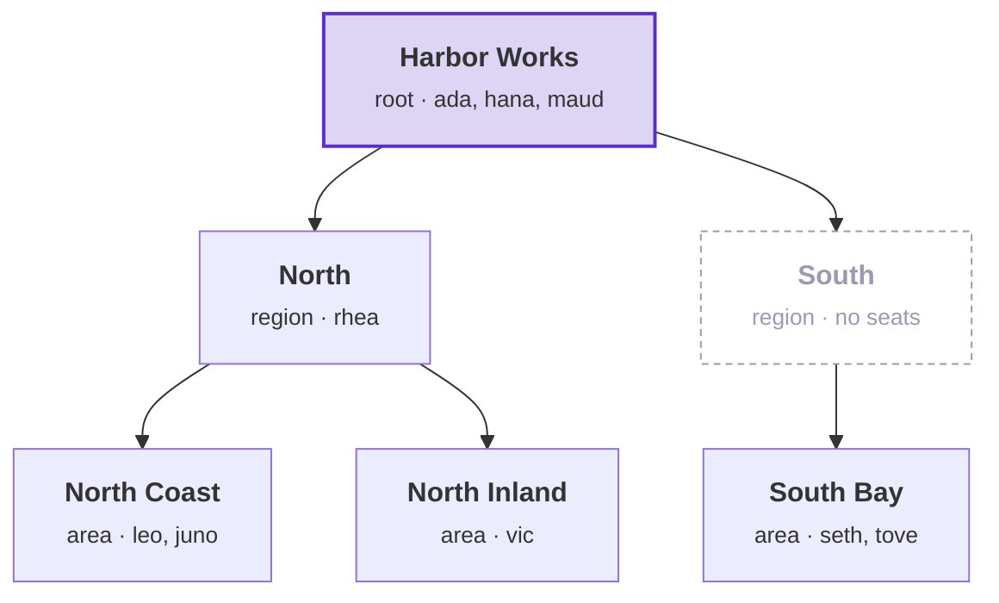

# Tenancy: the sample

[`Examples/Tenancy`](../../Examples/Tenancy) is a small application built on Tenancy. Teams work on projects, and a
project's team is its **crew**. This page lists what the sample contains, who is in its seed data, and where each
part is described. The words are defined in the [overview](overview.md).

## What the sample contains

- The sample has three modules:
  - **Tenants** holds the application's Tenancy classes, its context and its migrations.
  - **Projects** holds projects and their crews. It decides who may see and change a project.
  - **Inspections** holds inspections on projects. It calls a Projects contract to check whether the caller may act
    on a project, and reads none of Projects' tables.
- REST routes and one GraphQL schema serve the same commands and queries. A Blazor UI calls the API.
- The database is Postgres as Supabase runs it, with row level security (RLS). The sample supports no other
  database. The host logs in as a role that owns nothing, and every table forces its policies.
- `Examples.Tenancy.Exporter` writes the tables, policies and roles as files under
  `Examples/Tenancy/supabase/migrations`. The host refuses to start while a file is missing, or while the database
  is not set up the way the policies expect ([the samples' page](../../Examples/README.md#on-postgres)).

## The seed data

In Development, the host seeds two tenants with fixed ids when it starts (`Sample:SeedDemoData` in
`appsettings.Development.json`). A second start seeds nothing.

- **Harbor Works** (`harbor`) is hierarchical. Below its root are two regions and three areas, shown in the diagram
  below.
- **Meadow Gardens** (`meadow`) is flat. Its root is its only unit. Adding a unit below the root fails with
  `tenancy.flat-tenant` until the tenant changes shape.
- The projects:
  - P-001 Pier 7, at North Coast.
  - P-002 Inland depot, at North Inland. It is the only project with planned days.
  - P-003 Bay bridge, at South Bay.
  - P-004 HQ refit, at the root of harbor.
  - M-001 Garden shed, in meadow.

The diagram shows the tree of Harbor Works and the people placed at each unit. Purple: the root, where three seats
are placed. Grey: the region South, where no seat is placed.



Each person demonstrates one rule. An **org role** is granted at a unit. A **crew role** is held on one project's
crew.

| Person | Seat | Org role | On a crew | What the person shows |
|---|---|---|---|---|
| ada | harbor, root | Access admin, Area manager | Owns Bay bridge and HQ refit | The first administrator, who also runs the work. Ada and maud are both administrators. Either one may step down, and the other one then cannot. |
| rhea | harbor, North | Area manager | Owns Inland depot | Sees Pier 7 and Inland depot. Bay bridge gives her `projects.not-found`. She grants Observer and Crew lead at North Coast. Granting Access admin fails with `tenancy.grant-exceeds-own`, and any grant at South Bay fails with `tenancy.not-permitted`. |
| leo | harbor, North Coast | none | Owns Pier 7, with no crew role | Renames, closes and reopens Pier 7 and manages its crew, because he owns it. Recording an inspection or naming an owner fails with `projects.not-permitted`. Giving an org role on the crew fails with `projects.role-not-for-members`. Leaving the crew or taking a crew role fails with `projects.owner-protected`. |
| juno | harbor, North Coast | none | Surveyor on Pier 7 | Records an inspection. Renaming Pier 7 is refused. |
| vic | harbor, North Inland | Observer, ended yesterday | Observer on Pier 7 | Sees Pier 7 through the crew. Does not see Inland depot, because only the expired grant reached it. |
| seth | harbor, South Bay, suspended | Observer | | Every call in harbor fails with `tenancy.seat-suspended`. `/me/seats` still lists the seat. |
| tove | harbor, South Bay; meadow, root | meadow: Tenant admin | Surveyor on Bay bridge | Has seats in two tenants and switches between them with the `Tenant` header. She is meadow's only administrator. So in meadow she cannot revoke her grant, suspend herself or withdraw her placement (`tenancy.last-admin`). |
| hana | harbor, root | People office | | Gives Surveyor and Observer, which she does not hold, and People office. Giving Crew lead, Area manager or Access admin to others fails with `tenancy.grant-exceeds-own`. Giving herself any role that manages access fails with `tenancy.self-appointment`. |
| maud | harbor, root | Access admin | | Runs access and none of the work. Renaming Pier 7 fails with `projects.not-permitted` until she joins its crew as Crew lead. |
| orla | none, an [operator](operators-and-history.md#operators) | | | A member of the application's staff. Reads every tenant and changes nothing. |

## Who may do what, in the sample

[Who may do what, in the sample](sample/who-may-do-what.md) covers a module's layers, a request from route to save,
what each request declares, roles and crews, paging, operators, and invitations.

## GraphQL in the sample

[GraphQL in the sample](sample/graphql.md) covers the one schema over the three modules, what a query costs, the
rules each module's schema keeps, and the administration's gateway.

## Try it

[Try it](sample/try-it.md) covers the sample's UI, one call followed to its refusal, and the presets, each of which
breaks one rule. The sample needs Docker. From the repository's root, run:

```bash
dotnet run --project Examples/Tenancy/Examples.Tenancy.AppHost
```

## Design choices and where to see them

[Design choices and where to see them](sample/design-choices.md) lists every choice the Tenancy pages describe, with
its code, something to try, and the test that checks it.
