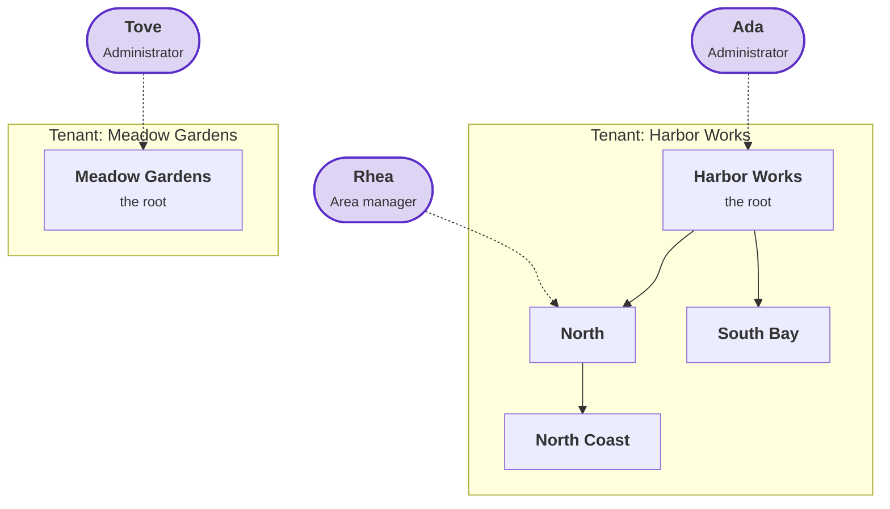
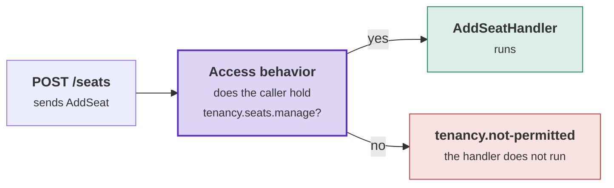

# Tenancy: the tutorial

This tutorial builds a small API with Tenancy, one step at a time. Read the [overview](overview.md) first. It
explains the words the steps use: tenant, unit, seat, role and grant.

## What we build

The application is called **Harbor**: an API for harbor companies. Each company that signs up becomes a tenant.
At the end of the tutorial, Harbor holds two tenants with these units and people. Purple marks a person; a dashed
line goes to the unit where that person's role is granted.



| Person | Seat in | Placed at | Role, granted at | Holds its permissions at |
|---|---|---|---|---|
| Ada | Harbor Works | Harbor Works | Administrator, at the root | every unit of Harbor Works |
| Rhea | Harbor Works | North | Area manager, at North | North and North Coast |
| Tove | Meadow Gardens | Meadow Gardens | Administrator, at the root | every unit of Meadow Gardens |

When it is done, you can try these with plain HTTP requests:

- Ada adds units and seats anywhere in Harbor Works.
- Rhea adds a unit below North. Below South Bay she gets `403`: her grant does not reach it.
- Ada asks for Meadow Gardens and is refused: she has no seat there.
- Rhea asks which units she may manage, and gets North and North Coast.

Each step says where we are, why the step comes now, and what it adds. It explains the idea, shows every file
whole with the new lines highlighted, and lists what those lines do.

## Step 1: the module's projects and their packages

**Where we are.** You have an empty solution with one project, the host. The host is an ASP.NET Core project that
will run the application.

**Why now.** Tenancy becomes a module of your application, like your other modules. Every later step adds files to
the module's projects, so the projects come first.

**What we want.** A module called Tenancy in five projects. Each project holds one layer and references only the
packages that layer needs.

### The idea: a module in layers

**Why a module.** A module has its own data and rules ([Modules](../modules.md)). Other modules can ask Tenancy who
may do what. They cannot change a seat or a role themselves.

**Why layers.** Each layer has one job and uses only the layer below it:

- **domain**: the classes and their rules. This layer has no database and no HTTP, so you can test the rules as
  plain C#.
- **application**: the requests and their handlers.
- **infrastructure**: the database. No other layer knows about the database.
- **API**: the routes. The host references only this project.

**Why a contracts project.**

- Other modules store Tenancy's ids. For example, a board stores its `TenantId` and its owner's `SeatId`.
- If another module referenced Tenancy's domain project for these ids, it would also get `Seat` and `Role`. It could
  then change them without Tenancy's rules.
- So the ids go in a small project of their own. Other modules may reference only this project. The analyzer warns
  when a module uses more of another module ([Module contracts](../module-contracts.md)).

**Why Postgres, on Supabase.**

- Tenancy works on any Entity Framework database. Its checks run in C#, before your handler.
- On Postgres, Tenancy also adds **row level security (RLS)**. RLS puts a policy on each table, and Postgres applies
  that policy to every query, as the caller. A query that skips your handlers still gets only the caller's rows:

  ```sql
  -- Leo, a seat of Harbor Works, from any tool:
  select * from tenancy."Seats";
  -- only Harbor Works' seats come back
  ```

- Supabase is Postgres with sign-in (Supabase Auth) and a stack that runs on your machine. This tutorial uses it to
  show RLS from the request to the database.
- On another database you leave out the Postgres package and the Supabase steps. The C# checks stay the same.

Harbor's Tenancy module has five projects: one for the contracts and one for each layer.

| Project | What it holds | Tenancy's package in it |
|---|---|---|
| `Harbor.Tenancy.Contracts` | The ids, which other modules may use. | none (only the toolkit's core package) |
| `Harbor.Tenancy.Domain` | The classes: tenant, organization, unit, seat, role. | `Supporting.Tenancy` |
| `Harbor.Tenancy.Application` | The requests and their handlers. | none (it comes through the domain project) |
| `Harbor.Tenancy.Infrastructure` | The database context and its migrations. | `Supporting.Tenancy.Postgres` |
| `Harbor.Tenancy.Api` | The routes, and the method the host calls to add the module. | none |

```text
Harbor.slnx
Directory.Build.props
Directory.Packages.props
src/
├── Harbor.Host/
└── Modules/
    └── Tenancy/
        ├── Harbor.Tenancy.Contracts/
        ├── Harbor.Tenancy.Domain/
        ├── Harbor.Tenancy.Application/
        ├── Harbor.Tenancy.Infrastructure/
        └── Harbor.Tenancy.Api/
```

### What you write

**`Directory.Build.props`**, at the root. **Why:** the toolkit needs to know which module each project belongs to. It
uses the module name to check what one module uses of another, and to name generated code. The highlighted lines
take the module name from the folder, so a new module needs only a new folder.

```xml {8-11,13-16}
<Project>
  <PropertyGroup>
    <TargetFramework>net10.0</TargetFramework>
    <Nullable>enable</Nullable>
    <ImplicitUsings>enable</ImplicitUsings>
  </PropertyGroup>

  <!-- A project in src/Modules/<Module>/ belongs to that module: the folder's name is the module's name. -->
  <PropertyGroup Condition="$(MSBuildProjectDirectory.Replace('\', '/').Contains('/src/Modules/'))">
    <DDD_Module>$([System.IO.Path]::GetFileName($([System.IO.Path]::GetDirectoryName($(MSBuildProjectDirectory)))))</DDD_Module>
  </PropertyGroup>

  <!-- A module's project named *.Contracts is what the other modules may use of it. -->
  <PropertyGroup Condition="'$(DDD_Module)' != '' and $(MSBuildProjectName.EndsWith('.Contracts'))">
    <DDD_ModuleContracts>true</DDD_ModuleContracts>
  </PropertyGroup>
</Project>
```

- `DDD_Module` is the module's name. From it, the toolkit writes `[assembly: Module("Tenancy")]` into each of the five
  projects. No project needs its own file for this.
- `DDD_ModuleContracts` marks the contracts project as the project other modules may use.

**`Directory.Packages.props`**, at the root. **Why:** all package versions are in this one file, so the toolkit's
packages always have the same version. Write a prerelease version in full, such as `3.2.0-preview.5`.

```xml {7-10}
<Project>
  <PropertyGroup>
    <ManagePackageVersionsCentrally>true</ManagePackageVersionsCentrally>
  </PropertyGroup>

  <ItemGroup>
    <PackageVersion Include="Temp.DDDToolkit" Version="3.2.0-preview.5" />
    <PackageVersion Include="Temp.DDDToolkit.Supporting.Tenancy" Version="3.2.0-preview.5" />
    <PackageVersion Include="Temp.DDDToolkit.Supporting.Tenancy.Postgres" Version="3.2.0-preview.5" />
    <PackageVersion Include="Temp.DDDToolkit.EntityFramework.Supabase" Version="3.2.0-preview.5" />
    <PackageVersion Include="Npgsql.EntityFrameworkCore.PostgreSQL" Version="10.0.3" />
    <PackageVersion Include="Microsoft.EntityFrameworkCore.Relational" Version="10.0.12" />
    <PackageVersion Include="Microsoft.EntityFrameworkCore.Design" Version="10.0.12" />
    <PackageVersion Include="Mediator.Abstractions" Version="3.0.2" />
    <PackageVersion Include="Mediator.SourceGenerator" Version="3.0.2" />
  </ItemGroup>
</Project>
```

**The five project files.** Each project references only the layer below it and only the packages its layer needs.
This keeps the database out of the domain. The comment at the top of each file says what the project holds.

**`src/Modules/Tenancy/Harbor.Tenancy.Contracts/Harbor.Tenancy.Contracts.csproj`**

```xml {5}
<Project Sdk="Microsoft.NET.Sdk">

  <!-- What the other modules may use of Tenancy: its ids. -->
  <ItemGroup>
    <PackageReference Include="Temp.DDDToolkit" />
  </ItemGroup>

</Project>
```

**`src/Modules/Tenancy/Harbor.Tenancy.Domain/Harbor.Tenancy.Domain.csproj`**

```xml {5}
<Project Sdk="Microsoft.NET.Sdk">

  <!-- The tenancy classes, and the rules the application adds to them. -->
  <ItemGroup>
    <PackageReference Include="Temp.DDDToolkit.Supporting.Tenancy" />
  </ItemGroup>

  <ItemGroup>
    <ProjectReference Include="..\Harbor.Tenancy.Contracts\Harbor.Tenancy.Contracts.csproj" />
  </ItemGroup>

</Project>
```

**`src/Modules/Tenancy/Harbor.Tenancy.Application/Harbor.Tenancy.Application.csproj`**

```xml
<Project Sdk="Microsoft.NET.Sdk">

  <!-- The requests and their handlers, a folder per feature. The mediator itself is generated into the host. -->
  <ItemGroup>
    <ProjectReference Include="..\Harbor.Tenancy.Domain\Harbor.Tenancy.Domain.csproj" />
    <PackageReference Include="Mediator.Abstractions" />
  </ItemGroup>

</Project>
```

**`src/Modules/Tenancy/Harbor.Tenancy.Infrastructure/Harbor.Tenancy.Infrastructure.csproj`**

```xml {14-15}
<Project Sdk="Microsoft.NET.Sdk">

  <!-- Where Tenancy is stored: its context and its migrations. -->
  <ItemGroup>
    <ProjectReference Include="..\Harbor.Tenancy.Application\Harbor.Tenancy.Application.csproj" />
  </ItemGroup>

  <PropertyGroup>
    <!-- dotnet ef runs this project as its own startup project. -->
    <GenerateRuntimeConfigurationFiles>true</GenerateRuntimeConfigurationFiles>
  </PropertyGroup>

  <ItemGroup>
    <PackageReference Include="Temp.DDDToolkit.Supporting.Tenancy.Postgres" />
    <PackageReference Include="Temp.DDDToolkit.EntityFramework.Supabase" />
    <PackageReference Include="Npgsql.EntityFrameworkCore.PostgreSQL" />
    <PackageReference Include="Microsoft.EntityFrameworkCore.Relational" />
    <PackageReference Include="Microsoft.EntityFrameworkCore.Design" PrivateAssets="all" />
  </ItemGroup>

</Project>
```

**`src/Modules/Tenancy/Harbor.Tenancy.Api/Harbor.Tenancy.Api.csproj`**

```xml
<Project Sdk="Microsoft.NET.Sdk">

  <!-- The module's entry: its registration and its routes. The host references this project and nothing else of the module. -->
  <ItemGroup>
    <ProjectReference Include="..\Harbor.Tenancy.Application\Harbor.Tenancy.Application.csproj" />
    <ProjectReference Include="..\Harbor.Tenancy.Infrastructure\Harbor.Tenancy.Infrastructure.csproj" />
    <FrameworkReference Include="Microsoft.AspNetCore.App" />
  </ItemGroup>

</Project>
```

### What it does

- `Supporting.Tenancy` (domain) contains the templates, their rules and the generator. It has no database code.
- `Supporting.Tenancy.Postgres` (infrastructure) contains the RLS policies. It references
  `Supporting.Tenancy.EntityFramework`, the Entity Framework mapping, so you get both. On another database, reference
  `Supporting.Tenancy.EntityFramework` instead.
- `EntityFramework.Supabase` (infrastructure) writes the migrations and policies as SQL files for Supabase. At
  start-up it checks that the database has them.
- `Mediator.Abstractions` (application) is the Mediator library. Each request is a command or a query, and one
  handler handles it. `Mediator.SourceGenerator` writes the mediator itself into the host, in step 5.
- `Microsoft.EntityFrameworkCore.Design` (infrastructure) is what `dotnet ef` needs to make migrations.
  `GenerateRuntimeConfigurationFiles` lets `dotnet ef` run the infrastructure project as its own startup project, so
  migrations need no host.
- `ManagePackageVersionsCentrally` turns on central package management: a `PackageReference` has no version, and the
  version comes from `Directory.Packages.props`.

Build the solution. The projects have no code yet. Step 2 adds the classes.

```powershell
dotnet build Harbor.slnx
```

## Step 2: your classes

**Where we are.** The module has five projects with their packages, and no code.

**Why now.** Every Tenancy request works on these classes. A request creates a tenant, adds a unit, or gives a seat a
role. The classes must exist before any request can use them.

**What we want.** Five classes in the domain project: tenant, organization, unit, role and seat. Their four ids go in
the contracts project. The seat gets one extra field for Harbor: a job title.

### The idea: your classes derive from Tenancy's templates

- Tenancy ships a **template** for each class. A template is an abstract parent class with the class's rules, such
  as "the last administrator cannot be removed".
- Your application uses **your own** class. It is in your domain project and derives from the template. You can add
  fields to it, and your database stores it.
- You can declare a class yourself, or let **the switch** write it. The switch is one line. With it, the generator
  writes every class you did not declare:

  ```csharp
  [assembly: GenerateTenancyClasses]
  ```

- When you declare a class, the generator does not write it. Harbor declares only `Seat`, to add the job title.
- An organization has no id type of its own. It uses its tenant's id.

### What you write

**The four ids**, in the contracts project, because other modules store them. **Why not a plain `Guid`:** with
separate id types, passing a `SeatId` where a `TenantId` is expected is a compile error. `[EntityId<Guid>]` generates
the rest: equality, parsing, `Create()` and storage.

**`Harbor.Tenancy.Contracts/ValueObjects/TenantId.cs`**

```csharp {5-6}
using DDDToolkit.Abstractions.Attributes;

namespace Harbor.Tenancy.Contracts.ValueObjects;

[EntityId<Guid>]
public readonly partial record struct TenantId;
```

`SeatId.cs`, `OrganizationUnitId.cs` and `RoleId.cs` are the same file, with `TenantId` replaced by their own name.

**The switch**, in the domain project, because the classes belong there.

**`Harbor.Tenancy.Domain/Module.cs`**

```csharp {3}
using DDDToolkit.Supporting.Tenancy;

[assembly: GenerateTenancyClasses]
```

**The seat**, in the domain project. **Why declare it:** to add a field (the job title), you need your own class. The
attribute names the template and the id type.

**`Harbor.Tenancy.Domain/Aggregates/Seats/Seat.cs`**

```csharp {6-7,9,11}
using DDDToolkit.Supporting.Tenancy;
using Harbor.Tenancy.Contracts.ValueObjects;

namespace Harbor.Tenancy.Domain.Aggregates.Seats;

[SeatAggregate<SeatId>]
public sealed partial class Seat
{
    public string? JobTitle { get; private set; }

    public void ChangeJobTitle(string? jobTitle) => JobTitle = jobTitle;
}
```

### What it does

- `[SeatAggregate<SeatId>]`: the generator writes the other half of the `partial` class, which derives from the
  template. `Seat` has all of the template's members, plus `JobTitle`.
- The switch writes `Tenant`, `Organization`, `OrganizationUnit` and `Role`. It does not write `Seat`, because you
  declared it.
- The switch uses the ids from the contracts project, so it writes no id types.
- The generator also writes Tenancy's managers for your classes, one per aggregate: `TenantManager`,
  `OrganizationManager`, `SeatManager` and `RoleManager`. A manager holds the commands and the reads of its
  aggregate. Every later request uses one of them.
- It also writes `TenancyAccessManager`, closed over your ids. It says who acts and in which tenant, and it starts
  system work (step 6).

Build again. The generated files are in the domain project, under **Dependencies → Analyzers**.

> **Going further.** A class of your own with rules: [How your classes add behaviour](your-module.md#how-your-classes-add-behaviour).
> How an id makes a new one: [How a new id is made](your-module.md#how-a-new-id-is-made).

## Step 3: where it is stored

**Where we are.** The classes exist, but nothing stores them yet.

**Why now.** A request that creates a tenant must save the tenant somewhere.

**What we want.** A database context for the module with its tables in their own schema, `tenancy`, and the first
migration.

### The idea: one call maps Tenancy's tables in your context

- Tenancy has no database context of its own. Its classes are mapped in **your** context, next to the module's other
  data.
- One call, `modelBuilder.AddTenancy(...)`, maps all of them: tables, keys, indexes and the organization's tree. The
  generator writes this method for your classes, so it takes no type arguments.
- With `[SupabaseMigrations]` on the context, the migrations become SQL files for Supabase. At start-up, the host
  checks that the database has them.

### What you write

**`Harbor.Tenancy.Infrastructure/Persistence/TenancyContext.cs`**

```csharp {11,15,19-21,26-28}
using DDDToolkit.EntityFramework.Conventions;
using DDDToolkit.EntityFramework.Outbox;
using DDDToolkit.EntityFramework.Supabase;
using DDDToolkit.Supporting.Tenancy.EntityFramework;
using Harbor.Tenancy.Infrastructure.Converters;
using Microsoft.EntityFrameworkCore;

namespace Harbor.Tenancy.Infrastructure.Persistence;

// Its migrations are written for Supabase, and the host checks them at start-up.
[SupabaseMigrations]
public sealed class TenancyContext(DbContextOptions<TenancyContext> options) : DbContext(options)
{
    // The schema of this module's tables.
    public const string Schema = "tenancy";

    protected override void OnModelCreating(ModelBuilder modelBuilder)
    {
        modelBuilder.HasDefaultSchema(Schema);
        modelBuilder.AddTenancy(database: Database);
        modelBuilder.AddDomainEventOutbox(Database, schema: Schema);
    }

    protected override void ConfigureConventions(ModelConfigurationBuilder configurationBuilder)
    {
        configurationBuilder.AddDDDToolkitConventions();
        configurationBuilder.StoreDateTimeOffsetsAsUtc();
        configurationBuilder.AddTenancyConverters();
    }
}
```

### What it does

- `[SupabaseMigrations]`: the build writes the design-time factory that `dotnet ef` needs. From step 5 on, the host's
  build exports each migration as a `.sql` file into `supabase/migrations`.
- `Schema = "tenancy"`: Tenancy's tables go in their own schema, separate from the tables of other modules.
- `AddTenancy(database: Database)` maps the five classes. It reads the database provider's name from `database` to
  write filtered indexes. Without `database`, there are no filtered indexes.
- `AddDomainEventOutbox`: Tenancy raises a domain event for each change. The outbox saves these events in the same
  transaction as the change. `schema: Schema` puts the outbox table in the module's schema too.
- `AddDDDToolkitConventions`, `AddTenancyConverters`: Entity Framework does not know your id types. These two calls
  store each id as its `Guid`. The generator writes `AddTenancyConverters()` into the infrastructure project, named
  after the module. It covers the ids of the module's domain and contracts projects.
- `StoreDateTimeOffsetsAsUtc`: Tenancy checks in SQL which grants apply now. Times stored as UTC compare correctly on
  every database.

Create the first migration. The design-time factory lets the infrastructure project be its own startup project:

```powershell
dotnet ef migrations add Tenancy --project src/Modules/Tenancy/Harbor.Tenancy.Infrastructure --startup-project src/Modules/Tenancy/Harbor.Tenancy.Infrastructure --output-dir Persistence/Migrations
```

The migration creates the schema `tenancy`. These are some of its tables:

- a table per class: `Tenants`, `Organizations`, `OrganizationUnits`, `Seats`, `Roles`;
- `SeatPlacements` and `SeatRoleGrants`: the units where each seat is placed, and the roles it holds there;
- `OrganizationUnitPaths`: one row for each pair of a unit and a unit above it, so "everything below North" is one
  query.

> **Going further.** Everything `AddTenancy` maps, and naming the tables yourself:
> [The context and the registration](your-module.md#the-context-and-the-registration).

## Step 4: the module's registration

**Where we are.** The module has its classes and a context. Nothing registers them yet.

**Why now.** The host needs one method to call to add the module. Every request needs a check that runs before its
handler.

**What we want.** `AddTenancyModule(connectionString)`, in the module's API project, registers everything the module
needs.

### The idea: the check before every handler

- Every request of the module implements one interface, `ITenancyRequest`, marked `[AccessRequests]`.
- The generator writes a pipeline behavior for this interface. Before a handler runs, the behavior checks what the
  request requires of its caller. From step 6 on, each request states this with an attribute.
- A request without a requirement does not compile (error DDD00077). So a request cannot run unchecked because
  someone forgot its attribute.

**What this looks like on a request.** Step 8 writes this request and its handler. You do not write it now; it
shows what the interface and the behavior of this step do. The attribute says what the caller needs. The behavior
checks it, and `Handle` runs only when the check passes:

```csharp
[RequiresPermission(TenancyPermissions.SeatsManage)]          // what the caller needs: tenancy.seats.manage
public sealed record AddSeat(Guid Identity, OrganizationUnitId Unit)
    : ICommand<SeatId>, ITenancyRequest;                      // ITenancyRequest: the behavior checks this request

public sealed class AddSeatHandler(SeatManager seats) : ICommandHandler<AddSeat, SeatId>
{
    // Runs only for a caller who holds tenancy.seats.manage for the whole tenant.
    public async ValueTask<SeatId> Handle(AddSeat command, CancellationToken cancellationToken)
    {
        var seat = await seats.AddAsync(command.Identity, cancellationToken);
        await seats.PlaceAsync(seat.Id, command.Unit, primary: true, cancellationToken);
        return seat.Id;
    }
}
```

What happens when a route sends this request. Purple is the check this step registers, green is the path to the
handler, red is the refusal:



Step 5 turns a refusal into an HTTP response: `tenancy.not-permitted` becomes `403`.

### What you write

**`Harbor.Tenancy.Application/Access/ITenancyRequest.cs`**

```csharp {5-6}
using DDDToolkit.Abstractions.Attributes;

namespace Harbor.Tenancy.Application.Access;

[AccessRequests]
public partial interface ITenancyRequest : IRequireAccess;
```

**`Harbor.Tenancy.Application/GlobalUsings.cs`**: the namespaces every request file of the module uses.

```csharp
global using DDDToolkit.Access;
global using DDDToolkit.Supporting.Tenancy.Access;
global using Harbor.Tenancy.Application.Access;
global using Harbor.Tenancy.Contracts.ValueObjects;
global using Mediator;
```

**`Harbor.Tenancy.Application/TenancyApplication.cs`**

```csharp {8}
using Microsoft.Extensions.DependencyInjection;

namespace Harbor.Tenancy.Application;

public static class TenancyApplication
{
    public static IServiceCollection AddTenancyApplication(this IServiceCollection services)
        => services.AddTenancyAccessBehavior();
}
```

**`Harbor.Tenancy.Infrastructure/TenancyInfrastructure.cs`**

```csharp {15-16,18-20,22-24}
using DDDToolkit.EntityFramework;
using DDDToolkit.Supporting.Tenancy.EntityFramework;
using DDDToolkit.Supporting.Tenancy.Postgres;
using Harbor.Tenancy.Application.Access;
using Harbor.Tenancy.Infrastructure.Persistence;
using Microsoft.EntityFrameworkCore;
using Microsoft.Extensions.DependencyInjection;

namespace Harbor.Tenancy.Infrastructure;

public static class TenancyInfrastructure
{
    public static IServiceCollection AddTenancyInfrastructure(this IServiceCollection services, string connectionString)
    {
        services.AddDDDToolkitEntityFramework(options => options.UseOutbox<TenancyContext>(outbox =>
            outbox.AddTenancyDomainEvents()));

        services.AddDbContext<TenancyContext>((provider, options) => options
            .UseNpgsql(connectionString)
            .UseDDDToolkit(provider));

        services.AddTenancy<TenancyContext>();
        services.AddTenancyPostgres();
        services.AddTenancyAccess<ITenancyRequest, TenancyContext>();
        return services;
    }
}
```

**`Harbor.Tenancy.Api/TenancyModule.cs`**: the only class of the module that the host calls.

```csharp {11-12}
using Harbor.Tenancy.Application;
using Harbor.Tenancy.Infrastructure;
using Microsoft.AspNetCore.Routing;
using Microsoft.Extensions.DependencyInjection;

namespace Harbor.Tenancy.Api;

// The module's entry: the host calls these, and nothing else of the module.
public static class TenancyModule
{
    public static IServiceCollection AddTenancyModule(this IServiceCollection services, string connectionString)
        => services.AddTenancyInfrastructure(connectionString).AddTenancyApplication();

    // The routes; each later step adds its own.
    public static IEndpointRouteBuilder MapTenancyModule(this IEndpointRouteBuilder routes)
        => routes;
}
```

### What it does

- `IRequireAccess`: the toolkit's interface for a request that states what it requires of its caller. A module's own
  request interface derives from it.
- `partial`: the generator adds a `RequiredAccess` property to `ITenancyRequest`, with one line for each request.
- `AddTenancyAccessBehavior()` is generated for `ITenancyRequest`. It registers the behavior that runs the check before
  each handler.
- `AddDDDToolkitEntityFramework(...)` registers the toolkit's Entity Framework services. `UseDDDToolkit` needs it.
  Every module may call it, and each call adds to the same options.
- `UseOutbox` and `AddTenancyDomainEvents()`: Tenancy's events are saved in the same transaction as the change.
- `UseDDDToolkit(provider)` adds every part the host registered to this context. Here there are two. One sets the
  caller's database role on each connection, for RLS. The other is Tenancy's save check, which refuses a write into
  another tenant.
- `AddTenancy<TenancyContext>()` registers the managers and `TenancyAccessManager` for your classes, one of each per
  scope. The managers save their data in this context.
- `AddTenancyPostgres()` sets the request's tenant on every connection, so the RLS policies can read it.
- `AddTenancyAccess<ITenancyRequest, TenancyContext>()` registers the checks that the behavior runs. The checks read
  this context.

## Step 5: the host

**Where we are.** The module has one entry point, `TenancyModule`. Nothing runs it yet.

**Why now.** Every later step sends a request, and the host receives it.

**What we want.** An API that knows the caller and the tenant, returns the right status code for a refusal, and checks
the database before it starts.

### The idea: the caller, and the seat in the tenant

- **Caller**: who sends the request. In a real application the sign-in says who calls. This tutorial does not set up
  sign-in, so a development header says who calls: `X-Dev-User: <user id>`.
- **Tenant**: the request names the tenant. In Harbor it uses the header `Tenant: harbor`.
- **Seat**: Tenancy looks up the caller's seat in that tenant. For the rest of the request, the checks, the managers
  and the database role (RLS) all use that seat.
- **Refusal**: when a rule refuses a request, it throws a `RefusalException` with a code, such as
  `tenancy.not-permitted`. The host turns the exception into a status code: 404, 403, 409 or 400.

### What you write

**`src/Harbor.Host/Harbor.Host.csproj`**

```xml {9,11,16-17}
<Project Sdk="Microsoft.NET.Sdk.Web">

  <ItemGroup>
    <ProjectReference Include="..\Modules\Tenancy\Harbor.Tenancy.Api\Harbor.Tenancy.Api.csproj" />
  </ItemGroup>

  <PropertyGroup>
    <!-- Every build writes the SQL file of each migration that has none, into supabase/migrations. -->
    <SupabaseMigrationsExport>Write</SupabaseMigrationsExport>
    <!-- The role the API logs in as: the build writes its migration, without a login or a password. -->
    <SupabaseLoginRole>harbor_api</SupabaseLoginRole>
  </PropertyGroup>

  <ItemGroup>
    <!-- The mediator is generated here, with every handler of the modules this project references. -->
    <PackageReference Include="Mediator.Abstractions" />
    <PackageReference Include="Mediator.SourceGenerator" PrivateAssets="all" />
  </ItemGroup>

</Project>
```

**`src/Harbor.Host/Program.cs`**

```csharp {3,12-15,18,22}
using DDDToolkit.EntityFramework.Supabase;
using DDDToolkit.Startup;
using Harbor.Host;
using Harbor.Host.Requests;
using Harbor.Tenancy.Api;

var builder = WebApplication.CreateBuilder(args);
var database = builder.Configuration.GetConnectionString("Supabase")
    ?? throw new InvalidOperationException("ConnectionStrings:Supabase is not set.");

builder.Services.AddMediator(options => options.ServiceLifetime = ServiceLifetime.Scoped);
builder.Services.AddSupabaseRowLevelSecurity();
builder.Services.AddTenancyModule(database);
builder.Services.AddTenancyPermissionsOfModules();
builder.Services.AddSupabaseMigrations();
builder.Services.AddProblemDetails();
builder.Services.AddExceptionHandler<RefusalsAsProblems>();
builder.Services.RunStartupChecks();

var app = builder.Build();
app.UseExceptionHandler();
app.UseCallerAndTenant();
app.MapTenancyModule();
app.Run();
```

**`src/Harbor.Host/Requests/RequestPipeline.cs`**

```csharp {14-15,17-19}
using DDDToolkit.Abstractions.Access;
using DDDToolkit.Access;
using DDDToolkit.Supporting.Tenancy.Access;

namespace Harbor.Host.Requests;

public static class RequestPipeline
{
    // The rest of the request runs as its caller, and as that caller's seat in the tenant the header names.
    public static IApplicationBuilder UseCallerAndTenant(this IApplicationBuilder app)
        => app.Use(async (context, next) =>
        {
            // A stand-in for sign-in, for development: a header says who calls.
            var caller = Guid.TryParse(context.Request.Headers["X-Dev-User"], out var user) ? Caller.User(user) : Caller.Anonymous;
            using (Callers.Begin(caller))
            {
                var seat = await context.RequestServices.GetRequiredService<ITenantSelection>()
                    .ResolveAsync(caller, context.Request.Headers["Tenant"], context.RequestAborted);
                using (TenancyCallers.Begin(seat))
                {
                    await next(context);
                }
            }
        });
}
```

**`src/Harbor.Host/Requests/RefusalsAsProblems.cs`**

```csharp {16-23}
using DDDToolkit.Exceptions;
using Microsoft.AspNetCore.Diagnostics;

namespace Harbor.Host.Requests;

// A refusal is an answer, not a crash: its kind is the status, its code is what a client reads.
public sealed class RefusalsAsProblems : IExceptionHandler
{
    public async ValueTask<bool> TryHandleAsync(HttpContext context, Exception exception, CancellationToken cancellationToken)
    {
        if (exception is not RefusalException refusal)
        {
            return false;
        }

        context.Response.StatusCode = refusal.Kind switch
        {
            RefusalKind.NotFound => StatusCodes.Status404NotFound,
            RefusalKind.NotPermitted => StatusCodes.Status403Forbidden,
            RefusalKind.Conflict => StatusCodes.Status409Conflict,
            _ => StatusCodes.Status400BadRequest,
        };
        await context.Response.WriteAsJsonAsync(new { code = refusal.Code, detail = refusal.Message }, cancellationToken);
        return true;
    }
}
```

### What it does

- `SupabaseMigrationsExport`: `Write` makes each build write the SQL files that are missing. `Check` only compares
  them and fails the build when one is missing, for a CI build.
- `AddMediator(...)` registers the generated mediator. Mediator's default lifetime is singleton. The access behavior
  and its checks are registered per scope, so the mediator must be `ServiceLifetime.Scoped`.
- `AddSupabaseRowLevelSecurity()`: every query runs as the caller's database role. The RLS policies are written for
  that role.
- `using Harbor.Host;`: the toolkit generates methods into the host, in the host's namespace.
- `AddTenancyPermissionsOfModules()` is generated into the host. It registers the permissions of every module the host
  references.
- `AddSupabaseMigrations()` and `RunStartupChecks()`: the start-up checks run before the API serves a request. They
  check that the database has every migration and policy, and that the login role may switch to the callers' roles.
  A failed check says how to fix the problem.
- `AddProblemDetails()`, `AddExceptionHandler<RefusalsAsProblems>()` and `UseExceptionHandler()`: ASP.NET Core's
  exception handling. `RefusalsAsProblems` handles a `RefusalException`. Any other exception becomes a `500`.
- `Caller.User(user)` is a signed-in user with that id. `Caller.Anonymous` is a caller without a user.
- `Callers.Begin` and `TenancyCallers.Begin` set the caller and the caller's seat for the rest of the request.
- `ITenantSelection.ResolveAsync` looks up the caller's active seat in the tenant the `Tenant` header names. It throws
  nothing. When there is no seat, it returns "nobody" with the refusal's code, such as `tenancy.not-seated`. A
  request that needs a seat is then refused with that code.
- `RefusalKind`: every refusal has one of four kinds. `NotFound` becomes `404`, `NotPermitted` `403`, `Conflict` `409`
  and `Invalid` `400`. The response body holds the refusal's `code` and its message as `detail`.
- `SupabaseLoginRole`: the API logs in as `harbor_api`. This role owns no tables, so RLS applies to it.

### Run it

1. Start Supabase locally: `npx supabase init` once, then `npx supabase start`.
2. Build the host with `dotnet build`. The export writes these into `supabase/migrations`: the Tenancy migration, the
   access file (functions and policies) and the login role.
3. Apply them: `npx supabase migration up --local`.
4. Give the login role a login and a password. Do this locally only:

   ```powershell
   docker exec supabase_db_harbor psql -U postgres -c "ALTER ROLE harbor_api WITH LOGIN PASSWORD 'local-only'"
   ```

   In `supabase_db_harbor`, `harbor` is the `project_id` from `supabase/config.toml`.

5. Run the host with the connection string:

   ```powershell
   $env:ConnectionStrings__Supabase = "Host=127.0.0.1;Port=54322;Database=postgres;Username=harbor_api;Password=local-only"
   dotnet run --project src/Harbor.Host
   ```

The start-up checks pass and the API runs. It has no routes yet.

## Step 6: provisioning a tenant

**Where we are.** The API runs. It has no routes and no tenant.

**Why now.** Every other request works inside a tenant, so the first request creates a tenant.

**What we want.** `POST /dev/tenants` creates a tenant, its root unit, and Ada as its first seat. Ada gets the
administrators' starter role at the root.

### The idea: who may send the request, and system work

- **Who may send it**: an attribute on the request says this. `[SignedIn]` lets any signed-in caller send it, with or
  without a seat.
- **The access manager**: `TenancyAccessManager`, which the generator wrote in step 2, says who acts and in which
  tenant. A handler takes it in its constructor, as `access`. `access.CurrentUser.Id` is the user id of the signed-in
  caller, such as Ada's.
- **System work**: a seat cannot create a tenant, because the tenant has no seats yet. Creating a tenant is **system
  work**. The handler starts system work with `using (access.BeginSystem())`. It lasts until the `using`
  ends. Inside it, the system is the caller, and `access.CurrentUser.Id` is `null`.
- `ProvisionAsync` refuses every caller except system work. A handler that forgets `BeginSystem()` gets a refusal on
  its first request.
- **What provisioning returns**: `ProvisionAsync` returns the new tenant, your `Tenant` class. The root unit and the
  first seat belong to the tenant. A request that names the tenant reads them through the other managers, as step 7
  does for Ada's seat.
- **The tenant's shape** is chosen when the tenant is created:

  | Shape | The organization | Use it when |
  |---|---|---|
  | `TenantShape.Flat` | The root alone. Every seat is placed at the root. Adding a unit is refused with `tenancy.flat-tenant`. | The customer has no structure, such as a single shop. Every grant is at the root, so it counts for the whole tenant. |
  | `TenantShape.Hierarchical` | A tree of units below the root. | The customer has regions, sites or departments, and people manage only their own part. |

  Harbor creates hierarchical tenants, because step 8 adds North below the root. A flat tenant can become
  hierarchical later, with `ChangeShapeAsync`, which requires `tenancy.settings.manage` for the whole tenant. A
  hierarchical tenant cannot become flat again. Your starter roles can differ per shape
  ([Starter roles](roles-and-permissions.md#starter-roles)).
- **Who becomes the administrator**: the caller. A signed-in user creates a tenant for themselves. Creating a tenant
  for someone else is work for your own staff, an [operator](operators-and-history.md#operators), who names the
  administrator.

### What you write

**`Harbor.Tenancy.Application/Tenants/ProvisionTenant/ProvisionTenant.cs`**

```csharp {6,8,10,16,18,20-28}
using DDDToolkit.Supporting.Tenancy;
using Harbor.Tenancy.Domain;

namespace Harbor.Tenancy.Application.Tenants.ProvisionTenant;

[SignedIn]
public sealed record ProvisionTenant(string Slug, string Name)
    : ICommand<Tenant>, ITenancyRequest;

public sealed class ProvisionTenantHandler(TenantManager tenants, TenancyAccessManager access)
    : ICommandHandler<ProvisionTenant, Tenant>
{
    public async ValueTask<Tenant> Handle(ProvisionTenant command, CancellationToken cancellationToken)
    {
        // The caller becomes the administrator. Read the id before BeginSystem(): inside it, the system is the caller.
        var admin = access.CurrentUser.Id ?? throw new InvalidOperationException("[SignedIn] lets only a signed-in user through.");

        using (access.BeginSystem())
        {
            return await tenants.ProvisionAsync(
                new TenantToProvision(
                    Slug: command.Slug,
                    Name: command.Name,
                    Shape: TenantShape.Hierarchical,
                    RootName: command.Name,
                    AdminIdentity: admin,
                    ConfigureFirstSeat: seat => seat.ChangeJobTitle("Harbor master")),
                cancellationToken);
        }
    }
}
```

**`Harbor.Tenancy.Api/Development/DevelopmentEndpoints.cs`**: a route for development only.

```csharp {13-17}
using Harbor.Tenancy.Application.Tenants.ProvisionTenant;
using Mediator;
using Microsoft.AspNetCore.Builder;
using Microsoft.AspNetCore.Http;
using Microsoft.AspNetCore.Routing;

namespace Harbor.Tenancy.Api.Development;

internal static class DevelopmentEndpoints
{
    public static IEndpointRouteBuilder MapDevelopmentEndpoints(this IEndpointRouteBuilder routes)
    {
        routes.MapPost("/dev/tenants", async (NewTenant body, ISender sender, CancellationToken cancellationToken) =>
        {
            var tenant = await sender.Send(new ProvisionTenant(body.Slug, body.Name), cancellationToken);
            return Results.Ok(new { tenant = tenant.Id, slug = tenant.Slug.Value });
        });

        return routes;
    }

    public sealed record NewTenant(string Slug, string Name);
}
```

**`Harbor.Tenancy.Api/TenancyModule.cs`**: one more method, which the host calls in development only.

```csharp {1,19-20}
using Harbor.Tenancy.Api.Development;
using Harbor.Tenancy.Application;
using Harbor.Tenancy.Infrastructure;
using Microsoft.AspNetCore.Routing;
using Microsoft.Extensions.DependencyInjection;

namespace Harbor.Tenancy.Api;

// The module's entry: the host calls these, and nothing else of the module.
public static class TenancyModule
{
    public static IServiceCollection AddTenancyModule(this IServiceCollection services, string connectionString)
        => services.AddTenancyInfrastructure(connectionString).AddTenancyApplication();

    // The routes; each later step adds its own.
    public static IEndpointRouteBuilder MapTenancyModule(this IEndpointRouteBuilder routes)
        => routes;

    public static IEndpointRouteBuilder MapTenancyDevelopment(this IEndpointRouteBuilder routes)
        => routes.MapDevelopmentEndpoints();
}
```

**`src/Harbor.Host/Program.cs`**: maps the development route in the Development environment only.

```csharp {24-27}
using DDDToolkit.EntityFramework.Supabase;
using DDDToolkit.Startup;
using Harbor.Host;
using Harbor.Host.Requests;
using Harbor.Tenancy.Api;

var builder = WebApplication.CreateBuilder(args);
var database = builder.Configuration.GetConnectionString("Supabase")
    ?? throw new InvalidOperationException("ConnectionStrings:Supabase is not set.");

builder.Services.AddMediator(options => options.ServiceLifetime = ServiceLifetime.Scoped);
builder.Services.AddSupabaseRowLevelSecurity();
builder.Services.AddTenancyModule(database);
builder.Services.AddTenancyPermissionsOfModules();
builder.Services.AddSupabaseMigrations();
builder.Services.AddProblemDetails();
builder.Services.AddExceptionHandler<RefusalsAsProblems>();
builder.Services.RunStartupChecks();

var app = builder.Build();
app.UseExceptionHandler();
app.UseCallerAndTenant();
app.MapTenancyModule();
if (app.Environment.IsDevelopment())
{
    app.MapTenancyDevelopment();
}

app.Run();
```

### What it does

- `[SignedIn]`: the check lets any signed-in caller through, and refuses an anonymous one.
- `ICommand<T>` and `ICommandHandler<TCommand, T>`: Mediator's interfaces for a command that returns a `T`, and for
  its handler. A query uses `IQuery<T>` and `IQueryHandler<TQuery, T>` instead (step 7).
- `TenantManager`: Tenancy's manager of tenants, generated for your classes in step 2.
- `TenancyAccessManager`: who acts and in which tenant. `access.CurrentUser.Id` is the user id of the signed-in
  caller. The handler reads it before `BeginSystem()`, because inside system work the caller is the system and the id
  is `null`.
- `using Harbor.Tenancy.Domain;`: your classes, `Tenant` among them, are in the domain project's root namespace.
- `access.BeginSystem()`: the code inside the `using` runs as system work. After the `using`, the caller is the same
  as before.
- `ProvisionAsync` writes all of this in one save: the tenant, its organization with the root unit "Harbor Works",
  every starter role, and the caller's seat at the root with the administrators' role.
- `Slug`: the tenant's short name, such as `harbor`. A request names its tenant by the slug, in the `Tenant` header.
  A slug is 2 to 63 characters: lower case letters, digits and dashes, starting with a letter or a digit. A slug
  that is in use is refused with `tenancy.slug-taken`.
- `Name` and `RootName`: the tenant's name, and the name of its root unit. Harbor gives the root the tenant's name,
  "Harbor Works".
- `ConfigureFirstSeat` sets your own fields on the first seat, here the job title. They are written in the same save.
- `ISender.Send` hands the request to the mediator. The mediator runs the access behavior and then the handler.
- `ProvisionAsync` returns the new `Tenant`, and the command returns it to the route. The route answers the tenant's
  id and its slug.
- `TenantToProvision` also takes fixed ids, for imports and seed data: `TenantId`, `RootId`, `AdminSeatId` and
  `RoleIds`. Without them, `ProvisionAsync` makes new ids.

### Try it

```http
POST /dev/tenants
X-Dev-User: d0000000-0000-4000-8000-000000000001
Content-Type: application/json

{ "slug": "harbor", "name": "Harbor Works" }
```

The response is `200`, with the tenant's id and its slug, `harbor`. Step 7 reads Ada's seat and the root unit.

Then create the second tenant, Meadow Gardens, with Tove as its administrator:

```http
POST /dev/tenants
X-Dev-User: d0000000-0000-4000-8000-000000000004
Content-Type: application/json

{ "slug": "meadow", "name": "Meadow Gardens" }
```

## Step 7: who am I

**Where we are.** Harbor Works exists, with Ada as its administrator.

**Why now.** Before Ada changes anything, she can look at her own seat. The later steps change what this request
returns.

**What we want.** `GET /me` returns Ada's seat in the tenant the request names: where the seat is placed, its roles,
and each permission it holds with the units where that permission counts.

### The idea: the overview, and your own fields

- `WhoAmIAsync()` returns the calling seat's **overview**: your `Seat` object with all its fields, the id and path
  of each unit where it is placed, your `Role` objects of its grants, and each permission with the units it
  reaches.
- The API returns a record type of your own, built from the overview. You decide which fields leave the API.
- `[InTenant]`: any seat in the tenant may send the request. A caller without a seat in that tenant gets `403`.

### What you write

**`Harbor.Tenancy.Application/Seats/WhoAmI/WhoAmI.cs`**

```csharp {3,10,17,22}
namespace Harbor.Tenancy.Application.Seats.WhoAmI;

[InTenant]
public sealed record WhoAmI : IQuery<MyOverview>, ITenancyRequest;

public sealed class WhoAmIHandler(SeatManager seats) : IQueryHandler<WhoAmI, MyOverview>
{
    public async ValueTask<MyOverview> Handle(WhoAmI query, CancellationToken cancellationToken)
    {
        var overview = await seats.WhoAmIAsync(cancellationToken);
        return new MyOverview(
            overview.Tenant.Slug.Value,
            overview.Seat.Id,
            overview.Seat.JobTitle,
            [
                .. overview.Seat.Placements.Select(placement => new MyPlacement(
                    placement.UnitId,
                    overview.UnitOf(placement.UnitId).Path,
                    placement.IsPrimary,
                    [.. placement.Grants.Select(grant => new MyGrant(overview.RoleOf(grant.RoleId)?.Name ?? "", grant.AppliesAt(overview.AsOf)))])),
            ],
            [.. overview.Permissions.Select(permission => new MyPermission(permission.Permission, permission.AtTenant, [.. permission.Reaches.Select(unit => unit.Path)]))]);
    }
}

public sealed record MyOverview(string Tenant, SeatId Seat, string? JobTitle, IReadOnlyList<MyPlacement> Placements, IReadOnlyList<MyPermission> Permissions);

public sealed record MyPlacement(OrganizationUnitId UnitId, string Unit, bool Primary, IReadOnlyList<MyGrant> Grants);

public sealed record MyGrant(string Role, bool AppliesNow);

public sealed record MyPermission(string Permission, bool AtTenant, IReadOnlyList<string> Reaches);
```

**`Harbor.Tenancy.Api/Seats/Rest/SeatsEndpoints.cs`**: the route only sends the request. The behavior checks the
request before the handler runs.

```csharp {13-14}
using Harbor.Tenancy.Application.Seats.WhoAmI;
using Mediator;
using Microsoft.AspNetCore.Builder;
using Microsoft.AspNetCore.Http;
using Microsoft.AspNetCore.Routing;

namespace Harbor.Tenancy.Api.Seats.Rest;

internal static class SeatsEndpoints
{
    public static IEndpointRouteBuilder MapSeatsEndpoints(this IEndpointRouteBuilder routes)
    {
        routes.MapGet("/me", async (ISender sender, CancellationToken cancellationToken)
            => Results.Ok(await sender.Send(new WhoAmI(), cancellationToken)));

        return routes;
    }
}
```

**`Harbor.Tenancy.Api/TenancyModule.cs`**: the module maps the new route.

```csharp {2,17}
using Harbor.Tenancy.Api.Development;
using Harbor.Tenancy.Api.Seats.Rest;
using Harbor.Tenancy.Application;
using Harbor.Tenancy.Infrastructure;
using Microsoft.AspNetCore.Routing;
using Microsoft.Extensions.DependencyInjection;

namespace Harbor.Tenancy.Api;

// The module's entry: the host calls these, and nothing else of the module.
public static class TenancyModule
{
    public static IServiceCollection AddTenancyModule(this IServiceCollection services, string connectionString)
        => services.AddTenancyInfrastructure(connectionString).AddTenancyApplication();

    public static IEndpointRouteBuilder MapTenancyModule(this IEndpointRouteBuilder routes)
        => routes.MapSeatsEndpoints();

    public static IEndpointRouteBuilder MapTenancyDevelopment(this IEndpointRouteBuilder routes)
        => routes.MapDevelopmentEndpoints();
}
```

### What it does

- `IQuery<MyOverview>` and `IQueryHandler<WhoAmI, MyOverview>`: Mediator's interfaces for a query that returns a
  `MyOverview`, and for its handler.
- `SeatManager`: Tenancy's manager of seats, which changes seats and reads them, as `WhoAmIAsync` does. Step 8
  reads units with `OrganizationManager.ListUnitsAsync`.
- `overview.UnitOf(...)` and `overview.RoleOf(...)` look up the seat's units and roles in the overview. The overview
  read them in the same query, so these calls run no query.
- `Path`: the names of the unit and the units above it, the root first, joined with `" / "`. An example is
  `Harbor Works / North`.
- `Placements`: the units where the seat is placed. A seat can be placed at several units, at most once per unit. A
  placement gives no permission by itself. The roles granted at it do.
- `placement.UnitId`: the id of the unit. Ada's seat is placed at the root, so her answer holds the root's id.
- `IsPrimary`: at most one placement of a seat is its primary one, for example the person's home unit. The first
  seat's placement at the root is primary.
- `grant.AppliesAt(overview.AsOf)` tells whether a grant applies at `AsOf`, the moment the overview describes.
- `permission.AtTenant` is `true` when the seat holds the permission at the root, so in the whole tenant.

### Try it

```http
GET /me
X-Dev-User: d0000000-0000-4000-8000-000000000001
Tenant: harbor
```

The response shows Ada's seat. It is placed at `Harbor Works` with the role Administrator. Every permission has
`atTenant: true` and reaches `Harbor Works`. The placement's `unitId` is the root's id. Keep it for step 8.

The request needs a seat in the tenant it names. The tenant selection from step 5 refuses it in two cases:

- without the `Tenant` header: `tenancy.tenant-required`;
- with `Tenant: meadow`: `tenancy.not-seated`, because Ada has no seat in Meadow Gardens. A slug of a tenant that
  does not exist gets the same answer, so a caller cannot find out which tenants exist.

## Step 8: a unit and a seat

**Where we are.** Harbor Works has its root unit and one seat, Ada's.

**Why now.** Step 9 gives a seat a role at a unit. The unit and the seat must exist first.

**What we want.** The units North and South Bay below Harbor Works, a seat for Rhea placed at North, and a request
that lists the units a seat can read.

### The idea: a permission, and where it must be held

- `[RequiresPermission(...)]`: the caller must hold that permission.
- **Where**: without a marker, the caller must hold it for the whole tenant. With `[AtUnit]` on a parameter, the
  caller must hold it at that unit or above it.
- Tenancy's manager checks the permission again where it acts, and adds its own rules. So the check before the
  handler is the first check, and the manager runs a second one.
- Harbor has a rule of its own: "no two units with the same name below one parent". Harbor's handler checks this rule
  and throws Harbor's own refusal.

### What you write

**`Harbor.Tenancy.Application/Units/AddUnit/AddUnit.cs`**

```csharp {6-7,14-22,24}
using DDDToolkit.Supporting.Tenancy;
using DDDToolkit.Supporting.Tenancy.Catalogue;

namespace Harbor.Tenancy.Application.Units.AddUnit;

[RequiresPermission(TenancyPermissions.UnitsManage)]
public sealed record AddUnit([AtUnit] OrganizationUnitId Parent, string Name) : ICommand<OrganizationUnitId>, ITenancyRequest;

public sealed class AddUnitHandler(OrganizationManager organization)
    : ICommandHandler<AddUnit, OrganizationUnitId>
{
    public async ValueTask<OrganizationUnitId> Handle(AddUnit command, CancellationToken cancellationToken)
    {
        // Harbor's own rule: no two active units of one name below one parent.
        var name = command.Name.Trim();
        var units = await organization.ListUnitsAsync(cancellationToken);
        if (units.Any(found => found.Unit.ParentId == command.Parent
            && found.Unit.Status == UnitStatus.Active
            && string.Equals(found.Unit.Name.Trim(), name, StringComparison.OrdinalIgnoreCase)))
        {
            throw UnitRefusals.NameTakenBelow(name);
        }

        return (await organization.AddUnitAsync(command.Parent, command.Name, cancellationToken)).Id;
    }
}
```

**`Harbor.Tenancy.Application/Units/UnitRefusals.cs`**: Harbor's refusal, with a code that a client can read.

```csharp {7,9-11}
using DDDToolkit.Exceptions;

namespace Harbor.Tenancy.Application.Units;

public static class UnitRefusals
{
    public const string NameTaken = "units.name-taken";

    internal static RefusalException NameTakenBelow(string name)
        => new(NameTaken, RefusalKind.Conflict, $"The unit has a unit named {name} below it already.",
            new Dictionary<string, object?>(StringComparer.OrdinalIgnoreCase) { ["Name"] = name });
}
```

**`Harbor.Tenancy.Application/Units/ListUnits/ListUnits.cs`**

```csharp {5,11-12}
using DDDToolkit.Supporting.Tenancy;

namespace Harbor.Tenancy.Application.Units.ListUnits;

[InTenant]
public sealed record ListUnits : IQuery<IReadOnlyList<UnitListing>>, ITenancyRequest;

public sealed class ListUnitsHandler(OrganizationManager organization) : IQueryHandler<ListUnits, IReadOnlyList<UnitListing>>
{
    public async ValueTask<IReadOnlyList<UnitListing>> Handle(ListUnits query, CancellationToken cancellationToken)
        => [.. (await organization.ListUnitsAsync(cancellationToken))
            .Select(found => new UnitListing(found.Unit.Id, found.Unit.ParentId, found.Unit.Name, found.Unit.Status, found.Path, found.Depth))];
}

public sealed record UnitListing(OrganizationUnitId Id, OrganizationUnitId? ParentId, string Name, UnitStatus Status, string Path, int Depth);
```

**`Harbor.Tenancy.Application/Seats/AddSeat/AddSeat.cs`**

```csharp {5,12-13}
using DDDToolkit.Supporting.Tenancy.Catalogue;

namespace Harbor.Tenancy.Application.Seats.AddSeat;

[RequiresPermission(TenancyPermissions.SeatsManage)]
public sealed record AddSeat(Guid Identity, OrganizationUnitId Unit) : ICommand<SeatId>, ITenancyRequest;

public sealed class AddSeatHandler(SeatManager seats) : ICommandHandler<AddSeat, SeatId>
{
    public async ValueTask<SeatId> Handle(AddSeat command, CancellationToken cancellationToken)
    {
        var seat = await seats.AddAsync(command.Identity, cancellationToken);
        await seats.PlaceAsync(seat.Id, command.Unit, primary: true, cancellationToken);
        return seat.Id;
    }
}
```

**`Harbor.Tenancy.Api/Units/Rest/UnitsEndpoints.cs`**: each route only sends its request.

```csharp {15-16,18-19}
using Harbor.Tenancy.Application.Units.AddUnit;
using Harbor.Tenancy.Application.Units.ListUnits;
using Harbor.Tenancy.Contracts.ValueObjects;
using Mediator;
using Microsoft.AspNetCore.Builder;
using Microsoft.AspNetCore.Http;
using Microsoft.AspNetCore.Routing;

namespace Harbor.Tenancy.Api.Units.Rest;

internal static class UnitsEndpoints
{
    public static IEndpointRouteBuilder MapUnitsEndpoints(this IEndpointRouteBuilder routes)
    {
        routes.MapGet("/units", async (ISender sender, CancellationToken cancellationToken)
            => Results.Ok(await sender.Send(new ListUnits(), cancellationToken)));

        routes.MapPost("/units", async (NewUnit body, ISender sender, CancellationToken cancellationToken)
            => Results.Ok(new { unit = await sender.Send(new AddUnit(body.Parent, body.Name), cancellationToken) }));

        return routes;
    }

    public sealed record NewUnit(OrganizationUnitId Parent, string Name);
}
```

**`Harbor.Tenancy.Api/Seats/Rest/SeatsEndpoints.cs`**: adds `POST /seats` next to `GET /me`.

```csharp {1,3,17-18,23}
using Harbor.Tenancy.Application.Seats.AddSeat;
using Harbor.Tenancy.Application.Seats.WhoAmI;
using Harbor.Tenancy.Contracts.ValueObjects;
using Mediator;
using Microsoft.AspNetCore.Builder;
using Microsoft.AspNetCore.Http;
using Microsoft.AspNetCore.Routing;

namespace Harbor.Tenancy.Api.Seats.Rest;

internal static class SeatsEndpoints
{
    public static IEndpointRouteBuilder MapSeatsEndpoints(this IEndpointRouteBuilder routes)
    {
        routes.MapGet("/me", async (ISender sender, CancellationToken cancellationToken)
            => Results.Ok(await sender.Send(new WhoAmI(), cancellationToken)));
        routes.MapPost("/seats", async (NewSeat body, ISender sender, CancellationToken cancellationToken)
            => Results.Ok(new { seat = await sender.Send(new AddSeat(body.Identity, body.Unit), cancellationToken) }));

        return routes;
    }

    public sealed record NewSeat(Guid Identity, OrganizationUnitId Unit);
}
```

**`Harbor.Tenancy.Api/TenancyModule.cs`**: the module maps both groups of routes.

```csharp {3,18}
using Harbor.Tenancy.Api.Development;
using Harbor.Tenancy.Api.Seats.Rest;
using Harbor.Tenancy.Api.Units.Rest;
using Harbor.Tenancy.Application;
using Harbor.Tenancy.Infrastructure;
using Microsoft.AspNetCore.Routing;
using Microsoft.Extensions.DependencyInjection;

namespace Harbor.Tenancy.Api;

// The module's entry: the host calls these, and nothing else of the module.
public static class TenancyModule
{
    public static IServiceCollection AddTenancyModule(this IServiceCollection services, string connectionString)
        => services.AddTenancyInfrastructure(connectionString).AddTenancyApplication();

    public static IEndpointRouteBuilder MapTenancyModule(this IEndpointRouteBuilder routes)
        => routes.MapUnitsEndpoints().MapSeatsEndpoints();

    public static IEndpointRouteBuilder MapTenancyDevelopment(this IEndpointRouteBuilder routes)
        => routes.MapDevelopmentEndpoints();
}
```

### What it does

- `TenancyPermissions` holds the names of Tenancy's own permissions: `UnitsManage` is `tenancy.units.manage`,
  `SeatsManage` is `tenancy.seats.manage`, and so on.
- `[AtUnit] Parent`: Ada needs `tenancy.units.manage` at the parent unit or above it. She holds it at the root, so she
  may add a unit anywhere.
- `OrganizationManager` and `SeatManager`: Tenancy's managers of the organization with its units, and of seats.
- `AddUnitAsync` writes the unit and its rows in `OrganizationUnitPaths` in one save, and returns the new unit.
- `UnitStatus.Active`: a unit is `Active` or `Archived`. Nothing new is added to an archived unit, so Harbor's rule
  compares names with active units only.
- `new RefusalException(code, kind, message, arguments)`: `RefusalKind.Conflict` becomes `409` (step 5). The
  arguments dictionary carries values a client may show, here the `Name`.
- `ListUnitsAsync` returns the units this seat can read: the units where it is placed, and every unit below them.
  `Depth` is how deep a unit is in the tree: the root has depth 1, North has depth 2.
- `AddAsync` adds a seat for a verified identity, and returns it: the user id from the sign-in, here the `X-Dev-User` id. Adding a
  seat needs `tenancy.seats.manage` for the whole tenant.
- `PlaceAsync` places the seat at a unit. It needs `tenancy.seats.manage` at that unit. `primary: true` makes this
  placement the seat's primary one.

### Try it

As Ada (`X-Dev-User` Ada's id, `Tenant: harbor`):

1. `POST /units` with `{ "parent": "<root id>", "name": "North" }`: `200`, North's id.
2. The same request again: `409`, `units.name-taken`, from Harbor's rule.
3. `POST /seats` with `{ "identity": "d0000000-0000-4000-8000-000000000002", "unit": "<North's id>" }`: Rhea's seat.
4. `POST /units` with `{ "parent": "<root id>", "name": "South Bay" }`: `200`.
5. `GET /units`: Harbor Works, with `Harbor Works / North` and `Harbor Works / South Bay` below it.

## Step 9: a role at a unit

**Where we are.** Rhea has a seat at North and no role, so she may do nothing yet.

**Why now.** This step shows the main rule of Tenancy. A role granted at a unit gives its permissions at that unit and
at every unit below it. It gives them nowhere else.

**What we want.** Ada makes a role "Area manager" with `tenancy.units.manage`, and grants it to Rhea at North. Rhea
may then add units below North. She may not add units below the root or below South Bay.

### The idea: a tenant's own role, granted at a unit

- **Making a role**: a tenant can make its own roles, if your application has a request for it. Harbor's request
  requires `tenancy.roles.manage` for the whole tenant.
- **Granting** gives a role to a seat at a unit. It requires `tenancy.grants.manage` at that unit. The seat must be
  placed at that unit, so Rhea's placement at North (step 8) comes first.
- **Reach**: a grant at North counts at North and at every unit below North ([overview](overview.md#reach-a-grant-covers-the-units-below-it)).
- **Permissions that manage access** give power over other people's access. Five of Tenancy's six permissions are
  marked so: `tenancy.settings.manage`, `tenancy.units.manage`, `tenancy.seats.manage`, `tenancy.grants.manage` and
  `tenancy.roles.manage`. The sixth, `tenancy.history.view`, only reads the access history.
- **Containment**: a seat may grant a role with a permission that manages access only at a unit where the seat holds
  that permission itself, for at least as long as the grant lasts. A seat never grants such a role to itself
  ([what your application decides](overview.md#what-your-application-decides)). Containment is on unless your
  application turns off `ContainAccessManagingPermissions`. Area manager holds `tenancy.units.manage`, so containment
  applies here. Ada holds that permission at the root with no end, so her grant passes.

### What you write

**`Harbor.Tenancy.Application/Roles/CreateRole/CreateRole.cs`**

```csharp {5-6,10-11}
using DDDToolkit.Supporting.Tenancy.Catalogue;

namespace Harbor.Tenancy.Application.Roles.CreateRole;

[RequiresPermission(TenancyPermissions.RolesManage)]
public sealed record CreateRole(string Name, string Description, IReadOnlyList<string> Permissions) : ICommand<RoleId>, ITenancyRequest;

public sealed class CreateRoleHandler(RoleManager roles) : ICommandHandler<CreateRole, RoleId>
{
    public async ValueTask<RoleId> Handle(CreateRole command, CancellationToken cancellationToken)
        => (await roles.CreateAsync(command.Name, command.Description, command.Permissions, cancellationToken)).Id;
}
```

**`Harbor.Tenancy.Application/Grants/GrantRole/GrantRole.cs`**

```csharp {5-6,12}
using DDDToolkit.Supporting.Tenancy.Catalogue;

namespace Harbor.Tenancy.Application.Grants.GrantRole;

[RequiresPermission(TenancyPermissions.GrantsManage)]
public sealed record GrantRole(SeatId Seat, [AtUnit] OrganizationUnitId Unit, RoleId Role) : ICommand, ITenancyRequest;

public sealed class GrantRoleHandler(SeatManager seats) : ICommandHandler<GrantRole>
{
    public async ValueTask<Unit> Handle(GrantRole command, CancellationToken cancellationToken)
    {
        await seats.GrantAsync(command.Seat, command.Role, command.Unit, until: null, reason: null, cancellationToken);
        return Unit.Value;
    }
}
```

**`Harbor.Tenancy.Api/Roles/Rest/RolesEndpoints.cs`**

```csharp {13-14}
using Harbor.Tenancy.Application.Roles.CreateRole;
using Mediator;
using Microsoft.AspNetCore.Builder;
using Microsoft.AspNetCore.Http;
using Microsoft.AspNetCore.Routing;

namespace Harbor.Tenancy.Api.Roles.Rest;

internal static class RolesEndpoints
{
    public static IEndpointRouteBuilder MapRolesEndpoints(this IEndpointRouteBuilder routes)
    {
        routes.MapPost("/roles", async (NewRole body, ISender sender, CancellationToken cancellationToken)
            => Results.Ok(new { role = await sender.Send(new CreateRole(body.Name, body.Description, body.Permissions), cancellationToken) }));

        return routes;
    }

    public sealed record NewRole(string Name, string Description, string[] Permissions);
}
```

**`Harbor.Tenancy.Api/Seats/Rest/SeatsEndpoints.cs`**: `POST /grants` beside the others.

```csharp {1,20-24,31}
using Harbor.Tenancy.Application.Grants.GrantRole;
using Harbor.Tenancy.Application.Seats.AddSeat;
using Harbor.Tenancy.Application.Seats.WhoAmI;
using Harbor.Tenancy.Contracts.ValueObjects;
using Mediator;
using Microsoft.AspNetCore.Builder;
using Microsoft.AspNetCore.Http;
using Microsoft.AspNetCore.Routing;

namespace Harbor.Tenancy.Api.Seats.Rest;

internal static class SeatsEndpoints
{
    public static IEndpointRouteBuilder MapSeatsEndpoints(this IEndpointRouteBuilder routes)
    {
        routes.MapGet("/me", async (ISender sender, CancellationToken cancellationToken)
            => Results.Ok(await sender.Send(new WhoAmI(), cancellationToken)));
        routes.MapPost("/seats", async (NewSeat body, ISender sender, CancellationToken cancellationToken)
            => Results.Ok(new { seat = await sender.Send(new AddSeat(body.Identity, body.Unit), cancellationToken) }));
        routes.MapPost("/grants", async (NewGrant body, ISender sender, CancellationToken cancellationToken) =>
        {
            await sender.Send(new GrantRole(body.Seat, body.Unit, body.Role), cancellationToken);
            return Results.NoContent();
        });

        return routes;
    }

    public sealed record NewSeat(Guid Identity, OrganizationUnitId Unit);

    public sealed record NewGrant(SeatId Seat, OrganizationUnitId Unit, RoleId Role);
}
```

**`Harbor.Tenancy.Api/TenancyModule.cs`**: the roles' routes too.

```csharp {2,19}
using Harbor.Tenancy.Api.Development;
using Harbor.Tenancy.Api.Roles.Rest;
using Harbor.Tenancy.Api.Seats.Rest;
using Harbor.Tenancy.Api.Units.Rest;
using Harbor.Tenancy.Application;
using Harbor.Tenancy.Infrastructure;
using Microsoft.AspNetCore.Routing;
using Microsoft.Extensions.DependencyInjection;

namespace Harbor.Tenancy.Api;

// The module's entry: the host calls these, and nothing else of the module.
public static class TenancyModule
{
    public static IServiceCollection AddTenancyModule(this IServiceCollection services, string connectionString)
        => services.AddTenancyInfrastructure(connectionString).AddTenancyApplication();

    public static IEndpointRouteBuilder MapTenancyModule(this IEndpointRouteBuilder routes)
        => routes.MapUnitsEndpoints().MapSeatsEndpoints().MapRolesEndpoints();

    public static IEndpointRouteBuilder MapTenancyDevelopment(this IEndpointRouteBuilder routes)
        => routes.MapDevelopmentEndpoints();
}
```

### What it does

- `RoleManager`: Tenancy's manager of roles. `CreateAsync` returns the new role; the handler answers its id.
- `CreateAsync` refuses a permission the catalogue does not know (`tenancy.unknown-permission`). It also refuses a
  name the tenant already uses (`tenancy.role-name-taken`).
- `GrantAsync(..., until: null, ...)`: the grant starts now and has no end. A value for `until` ends the grant at
  that moment.
- `reason: null`: a text of at most 500 characters that says why the role was granted. Tenancy stores it on the
  grant. `null` stores no reason.
- The check before the handler requires `tenancy.grants.manage` at the unit. `GrantAsync` checks this again and adds
  the containment rules.
- `ICommand` without a type argument is a command with no result. Its handler returns `Unit.Value`, Mediator's empty
  result, and the route returns `204` with `Results.NoContent()`.

### Try it

1. As Ada: `POST /roles` with `{ "name": "Area manager", "description": "Runs an area", "permissions":
   ["tenancy.units.manage"] }`.
2. As Ada: `POST /grants` with Rhea's seat, North, and that role.
3. As Rhea (`X-Dev-User` Rhea's id): `POST /units` below North, "North Coast": `200`.
4. As Rhea: `POST /units` below South Bay: `403`, `tenancy.not-permitted`. Her grant reaches North and the units
   below it, and South Bay is not below North.
5. As Rhea: `GET /me`: the response lists `tenancy.units.manage` with `atTenant: false`, reaching
   `Harbor Works / North` and `Harbor Works / North / North Coast`.

## Step 10: the units a caller may manage

**Where we are.** Rhea holds Area manager at North. For a request that requires `tenancy.units.manage` at a unit,
the check lets her through at North and North Coast, and refuses her at other units.

**Why now.** A screen needs to know these units before it sends a request. It shows the "Add unit" button only at the
units where the caller may add one. Your code gets the list from Tenancy with a query.

**What we want.** `GET /units/manageable`: the units where the caller holds `tenancy.units.manage`. Ada gets all four
units of Harbor Works. Rhea gets North and North Coast.

### The idea: who acts, and Tenancy's queries inside your own query

- **Who acts.** `TenancyAccessManager` (step 6) answers two questions in any handler:
  - `access.CurrentUser`: who acts. `Id` is the signed-in user's id, and `null` for system work and for a caller
    without a sign-in.
  - `access.CurrentTenant`: the tenant the request names, and the caller's seat there. `Require()` returns both. For
    a caller without a seat, it throws the refusal the tenant selection gave, such as `tenancy.not-seated`.
- **Tenancy's queries.** `db.Tenancy()` returns Tenancy's queries for the current caller over a context. The
  generator writes this extension for your ids into the project that holds the context.
  `UnitsWhereIHold(permission)` returns an `IQueryable`. Entity Framework puts it into your own query as a subquery,
  so the database runs one statement.
- The query needs the context, so it lives in the infrastructure layer. The application layer declares an interface
  for it, `IUnitReads`, the same way as for a repository.
- Another module can run the same query over its own context, once that context maps Tenancy's read model
  ([Who may do what](who-may-do-what.md)).

**What this looks like in a handler.** This request is not part of Harbor; you do not write it. It shows the access
manager in a handler. `[InTenant]` lets only a seat of the tenant through, so `Require()` finds the tenant and the
seat:

```csharp
[InTenant]
public sealed record WhereAmI : IQuery<string>, ITenancyRequest;

public sealed class WhereAmIHandler(TenancyAccessManager access) : IQueryHandler<WhereAmI, string>
{
    public ValueTask<string> Handle(WhereAmI query, CancellationToken cancellationToken)
    {
        var current = access.CurrentTenant.Require();   // the tenant the Tenant header names, and the caller's seat
        var user = access.CurrentUser.Id;                // the X-Dev-User id
        return ValueTask.FromResult($"User {user}, seat {current.Seat}, tenant {current.Id}");
    }
}
```

### What you write

**`Harbor.Tenancy.Application/Units/IUnitReads.cs`**: the interface the application layer uses. It does not mention
the database.

```csharp {3,5,8}
namespace Harbor.Tenancy.Application.Units;

public interface IUnitReads
{
    Task<IReadOnlyList<ManageableUnit>> ManageableAsync(CancellationToken cancellationToken);
}

public sealed record ManageableUnit(OrganizationUnitId Id, string Name);
```

**`Harbor.Tenancy.Application/Units/ManageableUnits/ManageableUnits.cs`**

```csharp {3-4,6,8-9}
namespace Harbor.Tenancy.Application.Units.ManageableUnits;

[InTenant]
public sealed record ManageableUnits : IQuery<IReadOnlyList<ManageableUnit>>, ITenancyRequest;

public sealed class ManageableUnitsHandler(IUnitReads units) : IQueryHandler<ManageableUnits, IReadOnlyList<ManageableUnit>>
{
    public async ValueTask<IReadOnlyList<ManageableUnit>> Handle(ManageableUnits query, CancellationToken cancellationToken)
        => await units.ManageableAsync(cancellationToken);
}
```

**`Harbor.Tenancy.Infrastructure/Persistence/UnitReads.cs`**: your query, with Tenancy's query inside it.

```csharp {11,15-16,18-23}
using DDDToolkit.Supporting.Tenancy.Access;
using DDDToolkit.Supporting.Tenancy.Catalogue;
using DDDToolkit.Supporting.Tenancy.EntityFramework;
using Harbor.Tenancy.Application.Units;
using Harbor.Tenancy.Contracts.ValueObjects;
using Harbor.Tenancy.Domain;
using Microsoft.EntityFrameworkCore;

namespace Harbor.Tenancy.Infrastructure.Persistence;

internal sealed class UnitReads(TenancyContext db) : IUnitReads
{
    public async Task<IReadOnlyList<ManageableUnit>> ManageableAsync(CancellationToken cancellationToken)
    {
        // Entity Framework puts this query into the one below, as a subquery.
        var held = db.Tenancy().UnitsWhereIHold(TenancyPermissions.UnitsManage);

        return await db.Set<Organization>()
            .SelectMany(organization => organization.Units)
            .Where(unit => held.Contains(unit.Id))
            .OrderBy(unit => unit.Name)
            .Select(unit => new ManageableUnit(unit.Id, unit.Name))
            .ToListAsync(cancellationToken);
    }
}
```

**`Harbor.Tenancy.Infrastructure/TenancyInfrastructure.cs`**: registers `UnitReads`.

```csharp {5,26}
using DDDToolkit.EntityFramework;
using DDDToolkit.Supporting.Tenancy.EntityFramework;
using DDDToolkit.Supporting.Tenancy.Postgres;
using Harbor.Tenancy.Application.Access;
using Harbor.Tenancy.Application.Units;
using Harbor.Tenancy.Infrastructure.Persistence;
using Microsoft.EntityFrameworkCore;
using Microsoft.Extensions.DependencyInjection;

namespace Harbor.Tenancy.Infrastructure;

public static class TenancyInfrastructure
{
    public static IServiceCollection AddTenancyInfrastructure(this IServiceCollection services, string connectionString)
    {
        services.AddDDDToolkitEntityFramework(options => options.UseOutbox<TenancyContext>(outbox =>
            outbox.AddTenancyDomainEvents()));

        services.AddDbContext<TenancyContext>((provider, options) => options
            .UseNpgsql(connectionString)
            .UseDDDToolkit(provider));

        services.AddTenancy<TenancyContext>();
        services.AddTenancyPostgres();
        services.AddTenancyAccess<ITenancyRequest, TenancyContext>();
        services.AddScoped<IUnitReads, UnitReads>();
        return services;
    }
}
```

**`Harbor.Tenancy.Api/Units/Rest/UnitsEndpoints.cs`**: adds the new route next to the others.

```csharp {3,22-23}
using Harbor.Tenancy.Application.Units.AddUnit;
using Harbor.Tenancy.Application.Units.ListUnits;
using Harbor.Tenancy.Application.Units.ManageableUnits;
using Harbor.Tenancy.Contracts.ValueObjects;
using Mediator;
using Microsoft.AspNetCore.Builder;
using Microsoft.AspNetCore.Http;
using Microsoft.AspNetCore.Routing;

namespace Harbor.Tenancy.Api.Units.Rest;

internal static class UnitsEndpoints
{
    public static IEndpointRouteBuilder MapUnitsEndpoints(this IEndpointRouteBuilder routes)
    {
        routes.MapGet("/units", async (ISender sender, CancellationToken cancellationToken)
            => Results.Ok(await sender.Send(new ListUnits(), cancellationToken)));

        routes.MapPost("/units", async (NewUnit body, ISender sender, CancellationToken cancellationToken)
            => Results.Ok(new { unit = await sender.Send(new AddUnit(body.Parent, body.Name), cancellationToken) }));

        routes.MapGet("/units/manageable", async (ISender sender, CancellationToken cancellationToken)
            => Results.Ok(await sender.Send(new ManageableUnits(), cancellationToken)));

        return routes;
    }

    public sealed record NewUnit(OrganizationUnitId Parent, string Name);
}
```

### What it does

- `db.Tenancy()` returns Tenancy's queries for the current caller over `TenancyContext`, at the moment of the call.
  The generator wrote it for your ids, so the queries return your ids and the call names no type.
- `UnitsWhereIHold(TenancyPermissions.UnitsManage)` returns the units where a grant gives the caller the permission,
  and every unit below them. A grant that has ended gives nothing.
- `held.Contains(unit.Id)`: Entity Framework writes this as a subquery. The database runs one statement.
- `db.Set<Organization>()`: Tenancy's query filter returns only the caller's tenant's organization, so the query sees
  only that tenant's units. The units belong to the `Organization` aggregate, so the query reaches them through
  `organization.Units`.
- `AddScoped<IUnitReads, UnitReads>()`: one instance per request, like the context.
- `[InTenant]`: any seat in the tenant may send the request. Each caller gets only the units that caller may manage,
  so the request needs no permission.

### Try it

1. As Ada: `GET /units/manageable`: Harbor Works, North, North Coast and South Bay.
2. As Rhea: `GET /units/manageable`: North and North Coast.

## What you built

| Step | What now works |
|---|---|
| 1-3 | The module's projects, your classes, the tables |
| 4-5 | The module registered, a host that knows the caller and the seat, the database checked at start-up |
| 6 | A tenant, created as system work |
| 7 | `GET /me`: what a seat is and holds |
| 8 | Units and seats, behind permissions held at a unit |
| 9 | A tenant's own role, granted at a unit, counting at that unit and below |
| 10 | Tenancy's queries inside your own query: the units a caller may manage |

Next, the [Membership tutorial](../membership/tutorial.md) adds boards to Harbor. A board has its own members, and
membership gives access to that one board.
